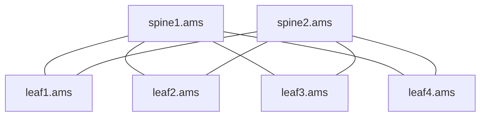

Every router in a link-state network holds the same map and computes, by itself, how to reach every other router from where it sits. The computation is called **SPF** (shortest path first): Dijkstra's algorithm with the router as the root. What a router needs from it is not the paths but, for each destination, the cost and the set of neighbours to hand the packet to. This problem asks you to compute exactly that.

### The networking idea in one minute

In **IS-IS** and **OSPF**, the two link-state routing protocols, each router floods a small record listing its neighbours and the **metric** (a cost, a positive integer an operator sets per link and per direction) to each. Every router collects every record into the same database, so every router sees the same directed, weighted graph.

A router forwards a packet only one hop: it picks a neighbour, the **next hop**, and that neighbour decides the rest using its own copy of the map. Because every copy is identical and every router picks shortest paths, the hops line up into a shortest path end to end. So the routing table entry for a destination is its cost plus the first hops of the shortest paths. On a real router a next hop is the neighbour's address on the shared link (from `leaf1.ams`, `spine1.ams` is `10.254.1.0`, the spine's end of their point-to-point `/31`), learned from the neighbour's hellos; here router names stand in for addresses.

When several shortest paths tie, a router uses all of their first hops at once. That is **ECMP** (equal-cost multipath): the forwarding chip hashes each flow onto one member of the group, so a leaf with two spines uses both uplinks. ECMP is the reason leaf-spine fabrics work, so ties are the main case here, not an edge case.

The examples use Meridian, the reference fabric in the track: routers such as `leaf1.ams` and `spine2.ams` in Amsterdam, `spine1.sin` in Singapore, and metric 10 on every leaf-spine link unless stated.

### The task

Write `spf_next_hops(links, source)`.

- `links` is a list of `[from, to, metric]` entries, one per **directed** adjacency: `from` advertises `to` as a neighbour at `metric`. A normal link appears twice, once from each end, and the two metrics may differ.
- If the same `[from, to]` pair appears more than once (parallel links), only the lowest metric counts.
- A metric of `16777215` (2²⁴ − 1, the largest IS-IS wide metric) means "never use this link": ignore that entry. Every other metric is usable, including `16777214`, the value operators set to cost a link out without removing it.
- Use each remaining entry on its own. Real IS-IS also runs a **two-way connectivity check**: it uses `from → to` only if `to` lists `from` too, so a half-advertised link drops out of SPF. This problem leaves that check out (it is one of the follow-ups); in the examples every working link is listed from both ends anyway.
- `source` is the router running SPF. It may have no links at all.

Return a dictionary with one entry for every router reachable from `source`, excluding `source` itself:

```text
{destination: {"cost": total_metric, "next_hops": [sorted neighbour names]}}
```

`next_hops` holds every neighbour of `source` that is the first hop of at least one minimum-cost path, without duplicates, sorted in ascending string order (character by character, so `leaf10.ams` comes before `leaf2.ams`). A direct neighbour is in its own list only if the direct link is itself a minimum-cost path; when a detour ties it, both first hops appear. Routers that cannot be reached do not appear, and the key order of the dictionary does not matter.

### Examples

**1. The healthy small Amsterdam fabric** (2 spines, 4 leaves, every leaf linked to every spine at 10 in both directions), from `leaf1.ams`:



| Destination | Output | Why |
|---|---|---|
| `spine1.ams` | `{"cost": 10, "next_hops": ["spine1.ams"]}` | One direct link. Going via `spine2.ams` and a leaf costs 30 |
| `spine2.ams` | `{"cost": 10, "next_hops": ["spine2.ams"]}` | Symmetric |
| `leaf2.ams`, `leaf3.ams`, `leaf4.ams` | `{"cost": 20, "next_hops": ["spine1.ams", "spine2.ams"]}` each | Two paths of 20, one through each spine: a two-member ECMP group |

**2. One direction costed out.** Same fabric, but `leaf1.ams` advertises `spine2.ams` at 1000 (the entry `["leaf1.ams", "spine2.ams", 1000]` replaces the 10); `spine2.ams` still advertises `leaf1.ams` at 10. From `leaf1.ams`:

| Destination | Output | Why |
|---|---|---|
| `spine1.ams` | `{"cost": 10, "next_hops": ["spine1.ams"]}` | Unchanged |
| `leaf2.ams` .. `leaf4.ams` | `{"cost": 20, "next_hops": ["spine1.ams"]}` | Via `spine2.ams` would cost 1010 |
| `spine2.ams` | `{"cost": 30, "next_hops": ["spine1.ams"]}` | Up to `spine1.ams`, down to any leaf, up to `spine2.ams` beats the direct 1000. A direct neighbour is not automatically a next hop |

Traffic *into* `leaf1.ams` still arrives over `spine2.ams`, because metrics are per direction. Operators use this to drain one direction of a link.

**3. A tie between paths of different lengths.** A two-leaf fabric plus the border gateways: `spine1.ams`–`gw1.ams` at 20, `spine2.ams`–`gw2.ams` at 5, `gw2.ams`–`gw1.ams` at 15, all in both directions. From `leaf1.ams`:

| Destination | Output | Why |
|---|---|---|
| `gw1.ams` | `{"cost": 30, "next_hops": ["spine1.ams", "spine2.ams"]}` | `leaf1 → spine1 → gw1` = 10 + 20, and `leaf1 → spine2 → gw2 → gw1` = 10 + 5 + 15. Equal cost is all that counts; hop count is irrelevant |
| `gw2.ams` | `{"cost": 15, "next_hops": ["spine2.ams"]}` | |
| `leaf2.ams` | `{"cost": 20, "next_hops": ["spine1.ams", "spine2.ams"]}` | |

### Constraints

- `0 ≤ len(links) ≤ 10⁵`; at most `10⁴` distinct router names.
- `1 ≤ metric ≤ 16777215` (an integer); `from ≠ to`; names are non-empty ASCII strings.
- `source` is a non-empty string and need not appear in `links`.

### Follow-up

"Your SPF gives `leaf1.ams` four spine next hops for every leaf, but this switch's hardware ECMP groups hold only two members. What do you install, and how do you keep every leaf choosing the same way? Then a fibre to one of the chosen spines is cut: how does the router move traffic in the tens of milliseconds before the new LSP arrives and SPF reruns, and what must be true of the backup next hop for it not to loop?"

## Solution

### The naive approach

The obvious approach is to enumerate paths: run Dijkstra for distances, then walk every path from the source and keep the first hops of those whose cost equals the distance. That is correct and exponential. A Clos fabric is full of ties: with `S` spines and three tiers, the number of equal-cost paths between two leaves grows as a product of the widths, and a depth-first enumeration visits each one.

A polynomial naive approach runs Dijkstra once from the source and once from each of its `k` neighbours `n`. Then `n` is a first hop to `d` exactly when `metric(source, n) + dist_n(d) = dist_source(d)`. That costs `k + 1` runs, `O(k · (V + E) log V)`, and is a good answer to give in an interview before improving on it. It also answers "why not just store a parent pointer": one parent per router finds one shortest path and discards the ties, which are the whole point.

### The insight

First hops travel along the shortest-path tree. If `u` lies on a shortest path to `v` and the last edge is `u → v`, then every first hop that starts a shortest path to `u` also starts one to `v`, and nothing else does. So each router's set is the union of its shortest-path predecessors' sets, and the source's direct neighbours seed it: a neighbour `v` reached straight from the source gets `{v}`.

Dijkstra already finalises routers in order of distance. With positive metrics, every predecessor `u` of `v` on a shortest path has `dist(u) < dist(v)` and is finalised first. So you can carry the sets through the same relaxation step that carries distances. On a strictly shorter path, replace `v`'s set with `u`'s; on an equal one, add `u`'s to it. When `v` leaves the heap, its set is complete.

### The optimal approach

1. Build an adjacency map from `links`, skipping metric `16777215` and keeping the lowest metric of a repeated `(from, to)` pair.
2. Run Dijkstra from `source` with a binary heap and lazy deletion: skip a popped entry whose router is already finalised.
3. When relaxing `u → v` with new cost `nd`, the offered first hops are `{v}` if `u` is the source, else `hops[u]`. If `nd < dist[v]`, set `dist[v] = nd` and `hops[v]` to a copy of the offer, and push. If `nd == dist[v]`, union the offer into `hops[v]`.
4. Emit every reached router except the source, with its first hops sorted.

```python
import heapq

UNUSABLE = 16_777_215  # 2^24 - 1: the wide-metric "never use this link" value


def spf_next_hops(links: list[list], source: str) -> dict[str, dict]:
    adj: dict[str, dict[str, int]] = {}
    for a, b, metric in links:
        if metric >= UNUSABLE or a == b:
            continue
        nbrs = adj.setdefault(a, {})
        if b not in nbrs or metric < nbrs[b]:
            nbrs[b] = metric                         # parallel links: lowest metric

    dist = {source: 0}
    hops: dict[str, set[str]] = {source: set()}
    done: set[str] = set()
    heap = [(0, source)]
    while heap:
        d, u = heapq.heappop(heap)
        if u in done:
            continue                                 # a stale heap entry
        done.add(u)                                  # dist[u] and hops[u] are final
        for v, metric in adj.get(u, {}).items():
            nd = d + metric
            via = {v} if u == source else hops[u]
            if v not in dist or nd < dist[v]:
                dist[v] = nd
                hops[v] = set(via)                   # strictly better: replace
                heapq.heappush(heap, (nd, v))
            elif nd == dist[v]:
                hops[v] |= via                       # a tie: merge first hops
    return {
        v: {"cost": dist[v], "next_hops": sorted(hops[v])}
        for v in dist
        if v != source
    }
```

Trace example 1 from `leaf1.ams`. Popping `leaf1.ams` (0) gives `spine1.ams` 10 with `{spine1}` and `spine2.ams` 10 with `{spine2}`. Popping `spine1.ams` gives the other three leaves 20 with `{spine1}`, and `leaf1.ams` 20, which is ignored because 20 is worse than 0. Popping `spine2.ams` reaches the three leaves at 20 again: equal, so each set becomes `{spine1, spine2}`. The leaves pop last and only offer the spines and `leaf1.ams` at 30 or more, which changes nothing.

Two lines carry the correctness. `hops[v] = set(via)` copies, so a later merge into `v` cannot leak into `u`'s set. The equality branch never pushes `v` again, because its distance did not change and its set is complete before it pops.

**Complexity.** Building the map is `O(E)`. Dijkstra with a binary heap and lazy deletion pushes at most one entry per improving relaxation: `O((V + E) log V)`. The set work adds up to `k` per relaxation, where `k` is the number of the source's neighbours, and sorting each output list costs `O(k log k)` per router, so the total is `O((V + E) log V + E · k + V · k log k)` time and `O(E + V · k)` space. In a fabric `k` is the number of uplinks (2 to 64), so the sets are small; a bitmask over the source's neighbours makes each merge one OR instruction for `k ≤ 64`.

### Common mistakes

- **One parent pointer per router.** It finds a shortest path, not all of them, so every ECMP group shrinks to one member.
- **Replacing on a tie, or merging on an improvement.** `<` replaces, `==` merges. Swapping them keeps stale first hops from a longer path, or loses all but the last tie.
- **Sharing the set object.** `hops[v] = hops[u]` aliases them; a later tie merged into `v` silently changes `u`'s next hops too.
- **Treating direct neighbours as their own next hop.** In example 2 `spine2.ams` is a neighbour, yet its only first hop is `spine1.ams`. Let the relaxation decide.
- **Assuming links are symmetric.** Building an undirected graph from the list doubles every one-way cost-out, and the results are wrong in both directions.
- **Forgetting the special metrics.** `16777215` is excluded; `16777214` is an ordinary, very large metric. A path over a costed-out link is still a path when nothing better exists.
- **Zero metrics.** The algorithm relies on predecessors finalising strictly earlier, which is why the constraint starts at 1. OSPF requires an interface cost of at least 1, IS-IS narrow metrics run from 1 to 63, and implementations configure wide link metrics from 1 as well. With a zero, a tie partner could pop after `v` and its first hops would be lost.

### How to discuss it

Start with the networking reading: "each router runs Dijkstra from itself, and the forwarding entry is the cost plus every neighbour that starts a shortest path, because ties become an ECMP group." Name path enumeration and why it explodes on a Clos, then the `k + 1` Dijkstra runs as a correct polynomial baseline. Then give the insight in one sentence: first hops are inherited along shortest-path edges, so they ride along with the distance in the same relaxation. While coding, point at the two comparisons and the copy. Trace one leaf in the healthy fabric to show a set growing from `{spine1}` to `{spine1, spine2}`, and example 2 to show that a direct neighbour can be reached through someone else. Close with complexity, including the `E · k` term that a pure "it's Dijkstra" answer leaves out.

### Networking follow-ups

A principal engineer at a network company keeps going from the algorithm into the protocol and the hardware. The [IS-IS lesson](/learn/fabric-networking/underlay/is-is-from-zero) builds the full route calculation these questions extend.

- **"Only two members fit in the ECMP group."** Routers cap the paths they install (a `maximum-paths` setting, bounded by the chip's group size). The choice must be deterministic, typically by lowest neighbour system ID or interface, so that the decision is reproducible and does not churn on every SPF. The cost is uneven load: every leaf picking the same two of four spines leaves the other two idle, which is why fabrics are built so that the ECMP width covers the spine count. Common wrong answer: "pick two at random", which reshuffles flows on every recompute.
- **"A next-hop link fails. What happens before SPF reruns?"** Detection (loss of light, or BFD, the bidirectional forwarding detection protocol, in tens of milliseconds) removes the member from the hardware group locally, and flows on it rehash onto the survivors. That needs no SPF at all when another equal-cost member exists, which is a second reason ECMP matters. With no equal-cost survivor, a **loop-free alternate** (LFA, RFC 5286) is a precomputed backup neighbour `N` satisfying `dist(N, D) < dist(N, S) + dist(S, D)`: `N`'s own shortest path to `D` does not come back through `S`, so handing it the packet cannot loop. Computing it needs SPF from each neighbour, which is the naive approach above put to use. [Convergence and BFD](/learn/fabric-networking/underlay/convergence-and-bfd) times the whole sequence.
- **"Why does the hash need resilience?"** When a group shrinks from four members to three, a plain `hash mod n` moves about three quarters of all flows, including flows that were on healthy links. Resilient hashing keeps a fixed table of buckets and reassigns only the buckets of the lost member. [ECMP and hashing](/learn/fabric-networking/fabric-architecture/ecmp-and-hashing) covers both.
- **"What about the overload bit and the two-way check?"** IS-IS uses an edge only if both ends list each other, so a half-flooded failure already removes it, and a router with the overload bit set is reachable but never transit. Both are small changes to this code: keep `a → b` only if `b → a` is also listed, and finalise an overloaded router without relaxing its edges (unless it is the source, which still uses its own links).
- **"One link changes. Do you rerun everything?"** Real implementations throttle SPF with exponential backoff timers and use **incremental SPF**, recomputing only the part of the tree below the changed edge. A change to prefixes alone needs only a partial route calculation: SPF is over routers, and prefixes are hung on the results afterwards (route cost = router cost + prefix metric). The SPF itself takes well under a millisecond for a few hundred routers; programming thousands of forwarding entries into the chip usually dominates convergence time.
- **"Can two routers disagree?"** During flooding, for milliseconds, yes. If `spine1.ams` has the new map and a leaf the old one, each can point at the other: a **microloop**, with packets bouncing until their TTL runs out. It is why maintenance raises metrics before shutting links, and why databases must converge before anyone trusts the results.
- **"What should a tool built on this surface?"** The ECMP width per destination against the design (every leaf-to-leaf entry in a four-spine pod should have four members), destinations with a single next hop where the design promises redundancy, and the change in widths after a drain is simulated on the database, before the change is made.
