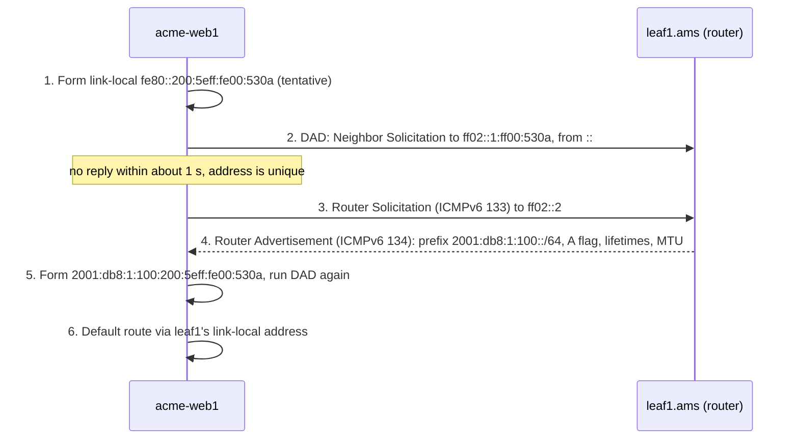

Every time a host sends a packet it asks one question: is the destination on my own link, so I deliver the frame directly, or elsewhere, so I hand it to my gateway? Every router asks a second: which row of my table covers this address? Both answer with the same bitwise operation on a number and a mask, and both fail in predictable ways when a mask is off by a bit or two ranges overlap.

Meridian, the reference operator in this track, numbers every server, every fabric link (64 between Amsterdam's 4 spines and 16 leaves alone; a **leaf** is the switch servers plug into, a **spine** interconnects leaves, as [links, frames and Ethernet](/learn/fabric-networking/from-zero/links-frames-and-ethernet) introduced), every router's own identity, a management network, two tenants who both use `10.1.1.0/24`, and a public block the internet must reach. This lesson builds the arithmetic from zero on those addresses, then the two prefix lengths a fabric is built on (/31 for links, /32 for loopbacks) and the IPv6 equivalents. Standards are cited as RFCs (Requests for Comments, the numbered documents that define internet protocols).

## An IPv4 address is a 32-bit number

An **IP address** identifies an interface (a network attachment point, such as a server's NIC or one port of a router) at layer 3, the layer that routers forward on. IPv4 addresses are 32 bits. People write them in **dotted decimal**: four 8-bit groups called **octets**, each shown as a decimal number from 0 to 255. Inside the IPv4 header they are two plain 32-bit fields, the source address at bytes 12 to 15 and the destination at bytes 16 to 19 ([the packet walk](/learn/fabric-networking/from-zero/the-packet-walk) shows the whole header).

Converting an octet to binary uses the place values of 8 bits:

| Bit position | 7 | 6 | 5 | 4 | 3 | 2 | 1 | 0 |
|---|---|---|---|---|---|---|---|---|
| Place value | 128 | 64 | 32 | 16 | 8 | 4 | 2 | 1 |
| 10 = 8 + 2 | 0 | 0 | 0 | 0 | 1 | 0 | 1 | 0 |
| 254 = 128 + 64 + 32 + 16 + 8 + 4 + 2 | 1 | 1 | 1 | 1 | 1 | 1 | 1 | 0 |
| 19 = 16 + 2 + 1 | 0 | 0 | 0 | 1 | 0 | 0 | 1 | 1 |

To convert, subtract the largest place value that fits, write a 1, and continue with the remainder; every place value that did not fit is a 0. `acme-web1`, Acme's web server, is `10.1.1.10`, which is `00001010.00000001.00000001.00001010`. As a single integer it is 10 × 2²⁴ + 1 × 2¹⁶ + 1 × 2⁸ + 10 = 167,837,962. Tooling should store addresses this way: integers sort correctly ("10.1.1.9" sorts after "10.1.1.10" as a string), ranges become comparisons, and "is this address in that block?" becomes one AND.

An address on its own says nothing about where the network boundary is. That needs a second number.

## From classes to CIDR

The original 1981 design put the boundary at a place fixed by the first bits of the address, in **classes**:

| Class | First bits | Range of first octet | Network part | Networks | Hosts per network |
|---|---|---|---|---|---|
| A | `0` | 0–127 | 8 bits | 128 (126 usable) | 16,777,214 |
| B | `10` | 128–191 | 16 bits | 16,384 | 65,534 |
| C | `110` | 192–223 | 24 bits | 2,097,152 | 254 |
| D | `1110` | 224–239 | multicast groups | | |
| E | `1111` | 240–255 | reserved | | |

Classes failed on two counts. **Waste**: an organisation with 2,000 hosts was too big for a class C (254), so it got a class B (65,534) and left over 63,000 addresses idle; by the early 1990s class B space was running out. **Table growth**: the alternative, eight class Cs, cost every internet router eight rows instead of one.

**CIDR** (classless inter-domain routing, RFC 1518 and 1519 in 1993, now RFC 4632) makes the boundary explicit and allows it at any bit. `10.1.1.10/24` reads "the first 24 bits are the **network part** (the **prefix**), the remaining 8 are the **host part**". A block of any power-of-two size can be allocated, and neighbouring blocks can be advertised as one shorter prefix (**aggregation**, or summarisation), which is how the global routing table stays at about a million IPv4 prefixes rather than one row per organisation per class C.

- **Solves:** address waste and routing-table growth.
- **Breaks:** anything that still infers the mask from the first octet: an address entered without its prefix length can quietly get the classful one ("10.x is /8").
- **Signal:** a device whose configured prefix differs from the one the source of truth (the database of intended addresses and devices that configuration is generated from) gives its subnet.

## Prefixes and masks

A **prefix length** `/n` has an equivalent **subnet mask**: n one-bits followed by 32 − n zero-bits, written in dotted decimal. A /24 is `255.255.255.0`; a /20 is twenty ones, `11111111.11111111.11110000.00000000`, which is `255.255.240.0`. The ones must be contiguous; a device rejects a mask such as `255.0.255.0`.

At most one octet of a mask is "interesting" (neither 255 nor 0), and every mask octet is one of nine values:

| Prefix bits falling in this octet | 0 | 1 | 2 | 3 | 4 | 5 | 6 | 7 | 8 |
|---|---|---|---|---|---|---|---|---|---|
| Mask octet | 0 | 128 | 192 | 224 | 240 | 248 | 252 | 254 | 255 |
| Block size in this octet (256 − mask) | 256 | 128 | 64 | 32 | 16 | 8 | 4 | 2 | 1 |

The block size is the step between consecutive networks in that octet: a /20 mask has 240 in the third octet, so /20 networks start at third-octet values 0, 16, 32, 48 and so on. That row of the table is the whole of the "subnetting by hand" trick.

The common sizes, which are worth knowing without arithmetic:

| Prefix | Mask | Addresses | Usable hosts | Typical use in a fabric |
|---|---|---|---|---|
| /8 | 255.0.0.0 | 16,777,216 | 16,777,214 | All of `10.0.0.0/8` |
| /16 | 255.255.0.0 | 65,536 | 65,534 | An infrastructure pool (Meridian's loopbacks, links) |
| /20 | 255.255.240.0 | 4,096 | 4,094 | One site's fabric-link block |
| /24 | 255.255.255.0 | 256 | 254 | One server VLAN, one tenant subnet |
| /26 | 255.255.255.192 | 64 | 62 | A small VLAN |
| /30 | 255.255.255.252 | 4 | 2 | Older point-to-point links |
| /31 | 255.255.255.254 | 2 | 2 (RFC 3021) | Point-to-point links |
| /32 | 255.255.255.255 | 1 | 1 | A loopback: one router's identity |

Access lists also use the **wildcard mask**, the bitwise inverse (`0.0.0.255` for a /24): the same boundary seen from the other side.

## Subnet math by hand

Four values describe a subnet, and each is one bitwise operation:

1. **Network address** = address AND mask. AND keeps a bit only where both inputs are 1, so the network bits pass through and the host bits are cleared.
2. **Broadcast address** = network OR (NOT mask): every host bit set to 1. A packet sent there reaches every host on the subnet.
3. **Host range** = network + 1 through broadcast − 1.
4. **Usable hosts** = 2^(32 − n) − 2, because the all-zeros host value names the network and the all-ones value is the broadcast.

### Worked: `acme-web1`, 10.1.1.10/24

The boundary falls between octets, so it can be read off directly, but the binary shows what the hardware does:

```text
10.1.1.10      = 00001010.00000001.00000001|00001010
/24 mask       = 11111111.11111111.11111111|00000000   = 255.255.255.0
AND: network   = 00001010.00000001.00000001|00000000   = 10.1.1.0
host bits = 1  = 00001010.00000001.00000001|11111111   = 10.1.1.255 (broadcast)
hosts          = 10.1.1.1 to 10.1.1.254                 = 2^8 - 2 = 254
```

Acme's gateway on `leaf1.ams` is `10.1.1.1`, the first host by convention. The on-link test is the same AND on the destination: `10.1.1.11` AND `255.255.255.0` is `10.1.1.0`, my network, so `acme-web1` delivers directly after an ARP (address resolution protocol) lookup of the neighbour's MAC address (the 48-bit Ethernet hardware address); `10.1.2.20` gives `10.1.2.0`, so the frame goes to the gateway's MAC ([ARP and the default gateway](/learn/fabric-networking/from-zero/arp-and-the-default-gateway) traces that decision; [ip-in-subnet](/practice/ip-in-subnet) practises the test).

```viz
{"type": "fabric", "scenario": "subnet-math", "title": "Subnet math bit by bit: 10.1.1.10/24, then a /31 link and a /32 loopback", "caption": "acme-web1's address and the /24 mask in binary; their AND gives network 10.1.1.0, all host bits set give broadcast 10.1.1.255, and 10.1.1.1 to 10.1.1.254 leaves 254 hosts. The same AND says 10.1.1.11 is on-link and 10.1.2.20 is not. Then leaf1.ams's link address 10.254.1.1/31, where both addresses are used (RFC 3021), and its loopback 10.255.1.11/32."}
```

### Worked: a boundary inside an octet, 10.254.19.9/20

The case that trips people up, and the one interviewers ask. Use the block-size method:

1. **Find the interesting octet.** /20 is 16 bits (two full octets) plus 4, so the boundary lies in the third octet, and the mask is `255.255.240.0`.
2. **Block size** = 256 − 240 = 16. Networks start at third-octet values 0, 16, 32, 48…
3. **Round the address's third octet down** to a multiple of 16: 19 becomes 16. The network is `10.254.16.0/20`.
4. **The next network** starts at `10.254.32.0`, so the broadcast is one less: `10.254.31.255`.
5. **Hosts**: `10.254.16.1` to `10.254.31.254`, 2¹² − 2 = 4,094.

Step 3 is an AND on the one octet that matters. The first two octets AND with 255 and pass through, the fourth ANDs with 0 and clears, and only 19 AND 240 needs binary:

```viz
{"type": "bits", "algorithm": "and-or-xor", "a": 19, "b": 240, "ops": ["and"], "title": "The interesting octet of 10.254.19.9/20: 19 AND 240 = 16", "caption": "Only the third octet straddles the /20 boundary. 19 is 00010011 and the mask octet 240 is 11110000; column by column, AND keeps a bit only where both are 1, leaving 00010000 = 16. The network is 10.254.16.0/20."}
```

At Meridian this /20 is not a subnet on any wire. It is a **block**: `10.254.16.0/20` is reserved for every fabric link in Singapore, carved into /31s. A subnet is configured on an interface and its hosts share a link; a block is a planning unit that appears in a routing table at most as a summary, and its "4,094 hosts" are meaningless. Meridian's link plan (below) decodes `10.254.19.9` as `leaf5.sin`'s end of its link to `spine3.sin`.

### Edge case: one bit wrong on a host

A mask error does not stop a host sending. It makes the on-link test wrong for some destinations, so the symptom is always partial.

- **Mask too short.** `acme-web1` is configured `10.1.1.10/16`. Its network becomes `10.1.0.0/16`, so `10.1.2.20` (`acme-db1`, on another VLAN, a separate layer-2 segment ([switches, VLANs and loops](/learn/fabric-networking/from-zero/switches-vlans-and-loops)), behind `leaf3.ams`) now looks on-link. The host ARPs for `10.1.2.20` on VLAN 100 and nobody answers. Symptom: `acme-web1` reaches the internet and its own subnet but not `acme-db1`. Signal: `ip neigh` shows `10.1.2.20 INCOMPLETE` or `FAILED`; `ip route` shows `10.1.0.0/16 dev eth0`. A gateway doing proxy ARP answers for the far host and hides the mistake.
- **Mask too long, gateway outside the subnet.** A host at `10.1.1.200/25` is in `10.1.1.128/25` (block size 128 in the fourth octet; 200 rounds down to 128). Its gateway `10.1.1.1` is in `10.1.1.0/25`, not on-link as far as it knows, so it cannot install a default route through it (Linux refuses: "Nexthop has invalid gateway"). Symptom: everything off the local /25 fails from boot.
- **Mask too long, gateway inside.** A host at `10.1.1.10/25` keeps its gateway but treats `10.1.1.200` as remote, so the gateway routes the packet straight back into VLAN 100, perhaps adding an ICMP redirect (ICMP is IP's error and diagnostic protocol). `10.1.1.200` (correctly /24) replies directly: an asymmetric path that works until the gateway filters statefully.

The fix in every case is the mask, and the prevention is a check that every address on a VLAN uses the prefix length of the gateway's subnet.

### The arithmetic in code

A subnet calculator on integers, checked against Python's `ipaddress` module, and a decoder for Meridian's numbering plan, which says what an address from a log line or traceroute is.

```python
import ipaddress

SITES = {1: "ams", 2: "sin", 3: "sjc"}


def to_int(dotted: str) -> int:
    a, b, c, d = (int(x) for x in dotted.split("."))
    return (a << 24) | (b << 16) | (c << 8) | d


def to_dotted(n: int) -> str:
    return ".".join(str((n >> s) & 0xFF) for s in (24, 16, 8, 0))


def subnet(cidr: str) -> dict:
    addr, plen = cidr.split("/")
    plen = int(plen)
    mask = (0xFFFFFFFF << (32 - plen)) & 0xFFFFFFFF  # plen ones, then zeros
    net = to_int(addr) & mask                         # clear the host bits
    last = net | (~mask & 0xFFFFFFFF)                 # set the host bits
    if plen == 32:                                    # a loopback: one address
        first, end, bcast, hosts = net, net, None, 1
    elif plen == 31:                                  # RFC 3021: both ends usable
        first, end, bcast, hosts = net, last, None, 2
    else:
        first, end, bcast, hosts = net + 1, last - 1, to_dotted(last), 2 ** (32 - plen) - 2
    return {"network": f"{to_dotted(net)}/{plen}", "mask": to_dotted(mask),
            "broadcast": bcast, "hosts": f"{to_dotted(first)}-{to_dotted(end)} ({hosts})"}


def in_block(addr: str, block: str) -> bool:
    net, plen = block.split("/")
    mask = (0xFFFFFFFF << (32 - int(plen))) & 0xFFFFFFFF
    return to_int(addr) & mask == to_int(net)


def role(n: int) -> str:
    if n <= 10:
        return f"spine{n}"
    if n <= 100:
        return f"leaf{n - 10}"
    if n <= 200:
        return f"rr{n - 100}"
    return f"gw{n - 200}"


def what_is(addr: str) -> str:
    """Decode an address against Meridian's numbering plan."""
    o = [int(x) for x in addr.split(".")]
    if in_block(addr, "10.255.0.0/16"):                # loopbacks: 10.255.<site>.<n>
        return f"loopback of {role(o[3])}.{SITES[o[2]]}"
    if in_block(addr, "10.254.0.0/16"):                # links: 10.254.<16(site-1)+spine>.<2(leaf-1)+end>
        site, spine = SITES[o[2] // 16 + 1], o[2] % 16
        leaf, end = o[3] // 2 + 1, "leaf" if o[3] % 2 else "spine"
        return f"{end} end of leaf{leaf}.{site}-spine{spine}.{site}"
    if in_block(addr, "172.16.0.0/16"):
        return f"out-of-band management, site {SITES[o[2]]}"
    if in_block(addr, "10.0.0.0/8"):
        return "tenant space: ambiguous without a VRF"
    return "not in Meridian's plan"


for cidr in ["10.1.1.10/24", "10.254.19.9/20", "10.254.1.1/31", "10.255.1.11/32"]:
    mine = subnet(cidr)
    std = ipaddress.ip_network(cidr, strict=False)     # the standard library agrees
    assert mine["network"] == str(std)
    print(f"{cidr:15} -> {mine}")

for a in ["10.255.1.11", "10.255.2.101", "10.254.19.9", "10.254.1.0", "172.16.1.11", "10.1.1.10"]:
    print(f"{a:13} {what_is(a)}")
```

```text
10.1.1.10/24    -> {'network': '10.1.1.0/24', 'mask': '255.255.255.0', 'broadcast': '10.1.1.255', 'hosts': '10.1.1.1-10.1.1.254 (254)'}
10.254.19.9/20  -> {'network': '10.254.16.0/20', 'mask': '255.255.240.0', 'broadcast': '10.254.31.255', 'hosts': '10.254.16.1-10.254.31.254 (4094)'}
10.254.1.1/31   -> {'network': '10.254.1.0/31', 'mask': '255.255.255.254', 'broadcast': None, 'hosts': '10.254.1.0-10.254.1.1 (2)'}
10.255.1.11/32  -> {'network': '10.255.1.11/32', 'mask': '255.255.255.255', 'broadcast': None, 'hosts': '10.255.1.11-10.255.1.11 (1)'}
10.255.1.11   loopback of leaf1.ams
10.255.2.101  loopback of rr1.sin
10.254.19.9   leaf end of leaf5.sin-spine3.sin
10.254.1.0    spine end of leaf1.ams-spine1.ams
172.16.1.11   out-of-band management, site ams
10.1.1.10     tenant space: ambiguous without a VRF
```

The non-obvious lines: Python integers are unbounded, so the shifted ones grow past bit 31 until `& 0xFFFFFFFF` cuts them back to 32 bits. `strict=False` lets `ipaddress` accept host bits set (the default raises on `10.1.1.10/24`). The last line matters later: `10.1.1.10` is both `acme-web1` and `globex-app1`, so a tenant address means something only with its VRF.

## Private and special ranges

Some ranges are reserved, with fixed meanings every router and host knows:

| Range | Size | Meaning | Where it shows up |
|---|---|---|---|
| `10.0.0.0/8` | 16,777,216 | Private (RFC 1918, 1996) | Meridian's infrastructure and tenant space |
| `172.16.0.0/12` | 1,048,576 | Private: `172.16.0.0` to `172.31.255.255` | Meridian's management network `172.16.0.0/16` sits inside it; Docker's default bridge `172.17.0.0/16` too |
| `192.168.0.0/16` | 65,536 | Private | Home networks |
| `100.64.0.0/10` | 4,194,304 | Shared space for carrier-grade NAT (RFC 6598) | Between a home router and its ISP |
| `127.0.0.0/8` | | The host itself | `127.0.0.1`, never on a wire |
| `169.254.0.0/16` | | IPv4 link-local (RFC 3927), self-assigned when DHCP (the protocol that leases a host its address) fails | A host with no lease; cloud metadata at `169.254.169.254` |
| `0.0.0.0/8` | | "This host" before it has an address | DHCP Discover's source |
| `224.0.0.0/4` | | Multicast | Underlay multicast for VXLAN flooding |
| `192.0.2.0/24`, `198.51.100.0/24`, `203.0.113.0/24` | 256 each | Documentation (RFC 5737) | Every public address in this track |
| `255.255.255.255` | 1 | Limited broadcast, never forwarded | DHCP Discover's destination |

**Private** means no internet router carries routes for these ranges, so any organisation may reuse them internally and must translate them (NAT, network address translation) to reach the internet ([NAT, firewalls and cloud networking](/learn/networking/fundamentals/nat-firewalls-and-cloud-networking)). They exist because of scarcity: IANA (the Internet Assigned Numbers Authority) gave its last free /8 blocks to the regional registries in February 2011, RIPE NCC (Europe's registry) made its final /22 allocation in November 2019, and public IPv4 addresses now trade at tens of dollars each. Meridian's public block `203.0.113.0/24` is a documentation range and its public AS numbers (autonomous system numbers, a network's identity in BGP, the internet's routing protocol) come from RFC 5398's documentation range 64496–64511, so nothing here is real; its internal AS numbers, 65000 and up, are private-use (RFC 6996).

Two consequences shape a fabric:

- **Reuse creates overlap on purpose.** Acme and Globex both use `10.1.1.0/24`. The fabric keeps them apart with a VRF (virtual routing and forwarding instance, a separate routing table) per tenant, so the lookup key is (VRF, address) ([VRFs and multi-tenancy](/learn/fabric-networking/overlays-vxlan-evpn/vrfs-and-multi-tenancy)).
- **Overlap you did not plan is an outage.** A monitoring host runs Docker, whose default bridge claims `172.17.0.0/16`. Had the management network used that range, the host would route management traffic into its own bridge and lose every device. Docker's further networks take 172.18 upwards, so Meridian's `172.16.0.0/16` escapes by luck, not by a check.

## /31: numbering a link with two addresses

A fabric link connects exactly two routers. Under ordinary rules the smallest subnet holding two hosts is a /30: four addresses, two usable, half spent on a network and a broadcast address that a two-ended link has no use for.

**RFC 3021** (2000) defines the /31: one host bit, two addresses, both usable, no network or broadcast address. Meridian's rule:

- Fabric links come from `10.254.0.0/16`.
- Link between `leafN` and `spineS` at site number *site* (`ams` 1, `sin` 2, `sjc` 3): `10.254.<16 × (site − 1) + S>.<2 × (N − 1)>/31`. The spine takes the even address, the leaf the odd one.
- So `leaf1.ams`–`spine1.ams` is `10.254.1.0/31` (spine `.0`, leaf `.1`); `leaf3.ams`–`spine1.ams` is `10.254.1.4/31` (the addresses used in [the packet walk](/learn/fabric-networking/from-zero/the-packet-walk)); `leaf1.ams`–`spine2.ams` is `10.254.2.0/31`.

Each spine owns one /24, which holds 128 /31s, enough for 128 leaves; each site owns one /20 (`10.254.0.0/20` for `ams`, `10.254.16.0/20` for `sin`, `10.254.32.0/20` for `sjc`), room for spines 1 to 15 (a 16th would spill into the next site's block). The counts:

| | Links | Addresses as /30 | Addresses as /31 |
|---|---|---|---|
| `ams`, 4 spines × 16 leaves | 64 | 256 | 128 |
| All three sites at the same size | 192 | 768 | 384 |
| A larger fabric, 8 spines × 128 leaves | 1,024 | 4,096 | 2,048 |

The saved addresses are not the main win; a fabric has `10.0.0.0/8` to spend. The wins: every link address is computable from the two device names, even/odd tells you which end you are looking at, and each site's /20 aggregates its links into one route. Many fabrics advertise no link routes at all, only loopbacks; link addresses still identify the hop in a traceroute reply.

The plan has one seam. Amsterdam's spine blocks `10.254.1.0/24` to `10.254.4.0/24` do not start on a multiple of 4, so they are not one /22: summarising them takes three routes (`10.254.1.0/24`, `10.254.2.0/23`, `10.254.4.0/24`). Only the site /20 aggregates cleanly. Alignment is designed in; [summarize-routes](/practice/summarize-routes) practises finding it, and [IP addressing and routing](/learn/networking/fundamentals/ip-addressing-and-routing) carves one block into subnets of different sizes (VLSM), largest first.

- **Solves:** half the address cost of /30, and a plan that a program can compute and check.
- **Breaks:** the ends disagree. With `10.254.1.0/31` on `spine1.ams` and `10.254.1.1/30` on `leaf1.ams`, the leaf sees its peer's address as its network address, which some stacks will not send to. A few older stacks do not support /31 at all.
- **Signal:** the link is up, and the IS-IS adjacency over it ([IS-IS from zero](/learn/fabric-networking/underlay/is-is-from-zero)) may even form because IS-IS hellos travel at layer 2, but ping from the leaf to the spine's link address can fail. The check is mechanical: both ends in one /31, one even, one odd.

The alternatives to numbering every link:

| Option | IPv4 addresses per link | What traceroute shows | Support | Cost |
|---|---|---|---|---|
| /30 per link | 4 | The link's address, so the exact link | Universal | Half the space wasted |
| /31 per link (Meridian) | 2 | The link's address | All current network operating systems and Linux | Both ends must agree |
| IP unnumbered (interfaces borrow the loopback address) | 0 | The device's loopback, not which of its links | Most network operating systems | Parallel links look identical in tools |
| IPv6 link-local only, IPv4 routes with IPv6 next hops (RFC 8950, "BGP unnumbered") | 0 | Loopback or link-local | FRRouting, Cumulus/NVUE, SONiC and others | Needs IPv6 on every link; covered in [BGP as the underlay](/learn/fabric-networking/underlay/bgp-as-the-underlay) |

## /32 loopbacks: an address for the router itself

A **loopback interface** is a virtual interface attached to no cable, up whenever the router is up. Meridian gives each device one loopback address as a /32, a prefix of a single address: `10.255.<site>.<n>/32`, with spines n = 1 to 4 (`spine1.ams` is `10.255.1.1`), leaves from 11 (`leaf1.ams` is `10.255.1.11`), route reflectors 101 and 102, border gateways 201 and 202. Nothing else lives on a loopback, so announcing the /32 says "this exact address is this router".

### Why every router has one

`leaf1.ams` has four uplink addresses, and each disappears when its link does. The loopback is the address that does not. Two terms first: the **underlay** is the routing between the fabric's own switches (IS-IS at Meridian), whose job is to reach every device; the **overlay** is the tenant networks carried in tunnels across it.

**Stable sessions.** `leaf1.ams` runs its iBGP session (BGP inside one AS, the overlay's routing protocol, [BGP sessions and the FSM](/learn/fabric-networking/bgp-fundamentals/bgp-sessions-and-the-fsm)) to the route reflector `rr1.ams` (a router, out of the forwarding path, that relays BGP routes between leaves) at `10.255.1.101` from its own loopback `10.255.1.11`. Had it used its link address `10.254.1.1`, a cut `leaf1.ams`–`spine1.ams` fibre would take that address down, kill the TCP connection under BGP and withdraw every overlay route the session carried, although three uplinks still work. With loopbacks at both ends, the underlay reroutes to `10.255.1.101` through spines 2 to 4 within milliseconds to a few hundred milliseconds ([convergence and BFD](/learn/fabric-networking/underlay/convergence-and-bfd)); TCP may retransmit a segment, and the session never notices: its hold timer (how long BGP waits without hearing from the peer) is typically set to 9 seconds in data center fabrics, against 90 or 180 seconds as common defaults elsewhere.

**Identity.** BGP and OSPF (a link-state routing protocol like IS-IS) need a unique, stable 32-bit router ID; the loopback address is both, and routable. IS-IS uses a 48-bit system ID instead, which Meridian derives from the loopback: pad each octet of `10.255.1.11` to three digits, `010.255.001.011`, and regroup the twelve digits into fours, `0102.5500.1011`.

**Tunnel endpoints.** In the overlay each leaf is a VTEP (VXLAN tunnel endpoint; VXLAN wraps a tenant's Ethernet frame in UDP and IP) and tenant packets cross the fabric inside an outer IP header addressed to the destination leaf's loopback ([VXLAN encapsulation](/learn/fabric-networking/overlays-vxlan-evpn/vxlan-encapsulation)). The spines need routes to the sixteen leaf loopbacks, not to any tenant prefix, and ECMP (equal-cost multipath) spreads the tunnels over every spine because the loopback is reachable through all of them.

**One name per box.** Telemetry and syslog sourced from the loopback arrive from one address whichever link they left on.

The rule that falls out: the underlay's whole job is to make every loopback reachable from everywhere. Overlay BGP routes name loopbacks as next hops, and a router finds the real outgoing link by looking the loopback up in the underlay ([iBGP, loops and next hops](/learn/fabric-networking/bgp-fundamentals/ibgp-loops-and-next-hops); recursive resolution is in [the routing table](/learn/fabric-networking/from-zero/the-routing-table)).

What it looks like on `leaf1.ams`, a Linux-based switch (illustrative `ip -br addr` output, trimmed; `swp` is the switch-port naming used by Cumulus Linux):

```text
lo        UNKNOWN  127.0.0.1/8 10.255.1.11/32 ::1/128
eth0      UP       172.16.1.11/24
swp51     UP       10.254.1.1/31
swp52     UP       10.254.2.1/31
swp53     UP       10.254.3.1/31
swp54     UP       10.254.4.1/31
```

Every line decodes with the plan: loopback, out-of-band management port, and the leaf's odd end of each spine's /31. Linux shows the loopback as `UNKNOWN` because it has no carrier to detect.

- **Solves:** an address that survives any single link failure, a stable router ID and a tunnel endpoint.
- **Breaks:** the loopback is configured but not advertised into the underlay, so the iBGP session to it never leaves Active and VXLAN tunnels towards it black-hole. Or a copied configuration gives two devices one loopback: one router ID and one IS-IS system ID for two routers, and traffic for one goes to the other ([underlay failures in production](/learn/fabric-networking/underlay/underlay-failures-in-production)).
- **Signal:** the count of `/32` routes in `10.255.<site>.0/24` in the underlay against the count of devices the inventory expects at that site; any difference is a device missing from the map or a duplicate.

## IPv6 essentials

IPv6 addresses are 128 bits, which removes scarcity and changes three habits: LANs are always /64, every interface creates an address for itself, and hosts configure themselves from what the router announces.

### Writing an address

128 bits are written as eight groups of four hex digits (16 bits each), compressed by two rules (canonical form in RFC 5952): drop leading zeros in each group, and replace the longest run of all-zero groups with `::`, once, the leftmost on a tie. `2001:0db8:0000:0000:0001:0000:0000:0011` has two runs of two zero groups; the first is replaced, giving `2001:db8::1:0:0:11`. Prefixes use the same `/n` notation as IPv4. `2001:db8::/32` is reserved for documentation (RFC 3849) and stands in for Meridian's allocation.

A global address on a LAN, in an illustrative plan that gives each Meridian site a /48 and numbers the VLAN 100 subnet `100` in hex:

| Field | Bits | Value here | Who reads it |
|---|---|---|---|
| Global routing prefix | 48 | `2001:db8:1` | Internet routers see Meridian's /32; Meridian's routers see site 1 (`ams`) |
| Subnet ID | 16 | `0100` | Meridian's routers: which link or VLAN |
| Interface ID | 64 | `0200:5eff:fe00:530a` | Only the final link, through neighbour discovery |

A /48 holds 2¹⁶ = 65,536 /64 subnets, and each /64 holds 2⁶⁴ (about 1.8 × 10¹⁹) addresses. Nobody counts usable hosts in IPv6; the unit of planning is the number of /64s.

### Why every LAN is a /64

The interface ID is 64 bits by convention (RFC 4291), and SLAAC, below, builds an address by appending it to a 64-bit prefix. A LAN with three hosts is still a /64; a /80 breaks SLAAC, and hosts that depend on it (Android does not support stateful DHCPv6) get no address. The one common exception is router-to-router links, which may use **/127** (RFC 6164), the IPv6 equivalent of a /31, or no global address at all. There is no broadcast in IPv6; multicast groups such as `ff02::1` (all nodes on the link) and `ff02::2` (all routers) replace it.

### Link-local addresses

Every IPv6 interface has a **link-local address** in `fe80::/10` (in practice `fe80::/64`), valid only on its own link and never forwarded. A host creates one first, so it can talk to its router before it has a global address. The traditional interface ID is **modified EUI-64**, built from the 48-bit MAC; for `acme-web1`'s `00:00:5e:00:53:0a`:

1. Split the MAC in half: `00:00:5e` and `00:53:0a`.
2. Insert `ff:fe` between the halves: `00:00:5e:ff:fe:00:53:0a`.
3. Flip bit 1 of the first byte (the universal/local bit): `00` becomes `02`.
4. Prefix `fe80::`: the link-local address is `fe80::200:5eff:fe00:530a`.

Windows, macOS, iOS, Android and Linux under NetworkManager use a hash-based or random interface ID instead (RFC 7217 stable addresses, RFC 8981 temporary ones) so a device cannot be tracked by its MAC; the bare Linux kernel default and many routers still use EUI-64. Because `fe80::/64` exists on every interface, a link-local address needs its interface to mean anything: `fe80::1%eth0`. IPv6 routes use the neighbour's link-local address as next hop, which survives renumbering and makes BGP unnumbered possible.

### SLAAC: a host configures itself

Stateless address autoconfiguration (RFC 4862) gives `acme-web1` a global address with no DHCP server, carried by neighbour discovery (ND, ICMPv6's replacement for ARP).



The two steps that carry the mechanism:

- **Duplicate address detection (step 2).** The address is **tentative** until DAD finishes. The host sends a Neighbor Solicitation for it from the unspecified address `::` to its **solicited-node multicast group**, the fixed prefix `ff02::1:ff00:0/104` plus the address's last 24 bits, so only nodes whose address ends in `00:530a` process it. No answer within the retransmit timer (1 second by default) means unique.
- **The Router Advertisement (step 4).** Sent from `leaf1.ams`'s link-local address, in reply to the Router Solicitation or periodically (at most 600 s apart by default). It carries the prefix `2001:db8:1:100::/64` with the A ("autonomous": build an address from me) flag and its lifetimes, the router lifetime (how long to use this router as default gateway), the link MTU, and the M and O flags telling the host whether to ask DHCPv6 for an address or only for settings such as DNS servers.

Meridian's tenant VLANs use an **anycast gateway**: every leaf is VLAN 100's gateway with the same addresses and the same MAC, so a host's gateway is always its own leaf ([EVPN, the control plane](/learn/fabric-networking/overlays-vxlan-evpn/evpn-the-control-plane)). Every leaf answers ARP for `10.1.1.1` with the anycast gateway MAC `00:00:5e:00:01:01`, and in the same way every leaf sends the same Router Advertisement, from a link-local address derived from that shared MAC.

- **Solves:** zero-configuration addressing for millions of hosts with no server and no shared state.
- **Breaks:** any device on the link can send a Router Advertisement. A misconfigured VM announces itself as a router, hosts install a second default route through it, and IPv6 traffic from part of the VLAN detours or vanishes. Filtering all ICMPv6 breaks neighbour discovery, SLAAC and IPv6 path-MTU discovery at once.
- **Signal:** default routes (`ip -6 route show default`) via an unexpected link-local address; a capture showing ICMPv6 type 134 from a host port. The fix is RA Guard (RFC 6105) on host-facing ports, which drops advertisements from ports that are not router ports and counts them.

### IPv4 and IPv6 side by side

| | IPv4 | IPv6 |
|---|---|---|
| Address size | 32 bits | 128 bits |
| Typical LAN | /24, sized to the hosts | /64, always |
| Point-to-point link | /31 | /127, or link-local only |
| Router identity | /32 loopback | /128 loopback |
| Host configuration | DHCP or static | SLAAC, DHCPv6, or both |
| Finding a neighbour's MAC | ARP (broadcast) | Neighbour discovery (ICMPv6, multicast) |
| Private space | RFC 1918, reused with NAT | Unique local `fc00::/7`, rarely needed; global addresses for everything |
| Self-assigned address | `169.254.0.0/16`, only when DHCP fails | `fe80::/10`, always present |

## Failure modes in production

Three that recur, beyond the mask errors, /31 mismatches and rogue advertisements above:

**A duplicate address.** *Symptom:* a host or router that works intermittently; for a server IP, connections reset as the ARP entry flips between two MACs. *Diagnosis:* the gateway's neighbour table shows the IP's MAC changing (often logged as a "moved" event); IPv6 hosts log a DAD failure; duplicated loopbacks show up as IS-IS duplicate system IDs or two routers with one BGP router ID. *Fix:* assign addresses from one source of truth, never by copying a neighbour's configuration, and alert on any address that maps to two MACs or two devices.

**An overlapping range.** *Symptom:* one host or site cannot reach devices everyone else reaches. *Diagnosis:* its routing table has a more specific connected route for the range (a container bridge, a VPN client), which wins by longest-prefix match ([the routing table](/learn/fabric-networking/from-zero/the-routing-table)). *Fix:* move one range, and keep a registry of every range in use, including the defaults of software you install.

**A plan that disagrees with itself.** *Symptom:* a new link or device fails at bring-up in one of the ways above, after a manual edit. *Diagnosis:* the two ends, or the device and its inventory record, were typed separately and differ. *Fix:* generate both ends of every link and every loopback from one record, and diff running addresses against it.

## What the platform should show

The software a network team relies on for addressing is IPAM (IP address management) joined to the source of truth ([network automation and source of truth](/learn/fabric-networking/operating-fabrics/network-automation-and-source-of-truth)). It should surface:

- **Decode any address.** Paste `10.254.19.9`, get "`leaf5.sin`, link to `spine3.sin`, leaf end", with the interface. Every traceroute, log line and alert benefits.
- **Plan conformance as a check, not a document.** Every interface address in the block its role allows; both ends of every link in one /31, even at the spine and odd at the leaf; every loopback a /32 in `10.255.<site>.0/24`; every host on a VLAN with the gateway's prefix length.
- **Loopback reachability against inventory.** The number of loopbacks each device can reach through the underlay, against the number that exist. This one number catches an unadvertised loopback, a duplicate and a partitioned underlay.
- **Overlap detection.** Tenant ranges, infrastructure blocks, management space and the default ranges of software in use (container bridges, VPN clients), with overlaps flagged where they can meet: in one VRF, or on one host.
- **Pool utilisation.** DHCP scopes, /31 pools per spine (128 per /24), loopback ranges per site and the public /24, trended, so a site build does not discover the plan is full.
- **IPv6 hygiene.** Router Advertisement sources per VLAN, hosts with unexpected default routes, DAD failures.

## Interviewer follow-ups

**"How many usable hosts are in a /27, and in a /31?"** Model answer: a /27 has 5 host bits, 32 addresses, 30 usable. A /31 has 2 addresses, both usable on a point-to-point link under RFC 3021, because a two-ended link needs neither a network nor a broadcast address; that is why fabrics number links with /31s. Common wrong answer: "a /31 has zero usable hosts", the classic rule applied where it no longer holds.

**"Why do routers have loopback addresses, and why /32?"** Model answer: a loopback is tied to no link, so it stays reachable while any path to the router exists, which makes it the endpoint for iBGP sessions, the router ID and the VXLAN tunnel endpoint. It is a /32 because it names exactly one device. Common wrong answer: "for testing", which confuses it with `127.0.0.1`.

**"A server can reach the internet but not a database in another subnet of the same data center. Where would you start?"** Model answer: scope first (one server or all of them), then the server's own view: `ip route` and its prefix length. A mask that is too short makes the database look on-link, so the server ARPs for it and shows an `INCOMPLETE` neighbour entry; the internet works because it is off-link either way. Then I compare with the gateway's subnet in the source of truth. Common wrong answer: going straight to firewall rules or routing on the network side.

**"Why is every IPv6 LAN a /64, even with three hosts on it?"** Model answer: SLAAC builds an address from a 64-bit prefix and a 64-bit interface ID, so hosts can configure themselves only on a /64; the planning unit is the number of /64s (65,536 in a site's /48). Router links can use /127 or link-local only. Common wrong answer: "because there are plenty of addresses". Which RA options a fabric sets on host VLANs I would confirm with the network team; what I would build is the check that each host VLAN sees RAs only from its gateway.

**"Two tenants use the same subnet. How can one fabric carry both?"** Model answer: an address is unique only inside a routing table, so each tenant gets a VRF and the fabric looks up (VRF, address); across the spines the VRF travels as a VNI (VXLAN network identifier, a 24-bit tag in the tunnel header), so the spines never see the overlap. Common wrong answer: "NAT one of them", which works but is not how a multi-tenant fabric does it.

## What mid-level engineers get wrong

- **Treating `172.16.0.0/16` as the private block.** It is a /12 up to `172.31.255.255`; a `startswith("172.16.")` check misclassifies fifteen sixteenths of it.
- **Inferring the mask from the first octet.** Classes ended in 1993; a "10." address can have any prefix length.
- **Calling a planning block a subnet.** `10.254.16.0/20` is room for 2,048 /31s, not a LAN of 4,094 hosts, and alerting on its "utilisation" as if it were a VLAN is meaningless.
- **Shifting by 32 in JavaScript.** `0xffffffff << 32` is -1 (all ones), not 0, because shifts are taken mod 32, so a /0 computed that way gets a /32's mask.

## Exercise

```exercise
id: subnet-info
title: Subnet math, including /31 and /32
prompt: |
  Given an IPv4 address with a prefix length, such as "10.1.1.10/24",
  return an object with:

  - `network`: the network address (address AND mask), dotted decimal,
    without the prefix length.
  - `broadcast`: the address with every host bit set, or `null` for a
    /31 or /32.
  - `first` and `last`: the first and last usable addresses.
  - `hosts`: the number of usable addresses.

  Ordinary prefixes (/0 to /30) reserve the network and broadcast
  addresses, so `first` is network + 1, `last` is broadcast - 1 and
  `hosts` is 2^(32 - n) - 2. A /31 is a point-to-point link (RFC 3021):
  both addresses are usable, so `first` is the network address, `last`
  the other one, and `hosts` is 2. A /32 is a single address: `first`
  and `last` are that address and `hosts` is 1.

  The input address may have host bits set.
languages: [python, javascript]
entry: subnet_info
starter:
  python: |
    def subnet_info(cidr):
        # Parse the address into a 32-bit integer, build the mask from the
        # prefix length, then AND / OR to find the network and broadcast.
        return {"network": "", "broadcast": None, "first": "", "last": "", "hosts": 0}
  javascript: |
    function subnet_info(cidr) {
      // Parse the address into a 32-bit integer, build the mask from the
      // prefix length, then AND / OR to find the network and broadcast.
      return { network: "", broadcast: null, first: "", last: "", hosts: 0 };
    }
tests:
  - args: ["10.1.1.10/24"]
    expected: {"network": "10.1.1.0", "broadcast": "10.1.1.255", "first": "10.1.1.1", "last": "10.1.1.254", "hosts": 254}
    label: acme-web1's subnet
  - args: ["10.254.19.9/20"]
    expected: {"network": "10.254.16.0", "broadcast": "10.254.31.255", "first": "10.254.16.1", "last": "10.254.31.254", "hosts": 4094}
    label: a boundary inside the third octet
  - args: ["10.254.1.1/31"]
    expected: {"network": "10.254.1.0", "broadcast": null, "first": "10.254.1.0", "last": "10.254.1.1", "hosts": 2}
    label: a /31 fabric link
  - args: ["10.255.1.11/32"]
    expected: {"network": "10.255.1.11", "broadcast": null, "first": "10.255.1.11", "last": "10.255.1.11", "hosts": 1}
    label: a /32 loopback
  - args: ["203.0.113.130/30"]
    expected: {"network": "203.0.113.128", "broadcast": "203.0.113.131", "first": "203.0.113.129", "last": "203.0.113.130", "hosts": 2}
    label: an old-style /30 link
  - args: ["10.1.2.77/26"]
    expected: {"network": "10.1.2.64", "broadcast": "10.1.2.127", "first": "10.1.2.65", "last": "10.1.2.126", "hosts": 62}
    hidden: true
  - args: ["172.20.5.5/12"]
    expected: {"network": "172.16.0.0", "broadcast": "172.31.255.255", "first": "172.16.0.1", "last": "172.31.255.254", "hosts": 1048574}
    hidden: true
    label: the whole 172.16.0.0/12 private block
  - args: ["0.0.0.0/0"]
    expected: {"network": "0.0.0.0", "broadcast": "255.255.255.255", "first": "0.0.0.1", "last": "255.255.255.254", "hosts": 4294967294}
    hidden: true
    label: a /0, where a shift by 32 goes wrong
hints:
  - "Build the address as an integer: for each octet, value = value * 256 + octet."
  - "The mask is 32 - n zero bits below n one bits. In Python, mask the shifted value with 0xFFFFFFFF; in JavaScript, shifts are taken mod 32, so treat /0 as a special case and use >>> 0 to keep results unsigned."
  - "Network is address AND mask; the all-ones host value is network OR (NOT mask). Handle /31 and /32 before the general formula."
```

## Senior signals

- You do subnet math with the block-size method in your head (256 minus the interesting mask octet, round down) and explain the AND it stands for.
- You distinguish a subnet on a wire from a planning block that exists only as a summary, and you design plans whose blocks align so they aggregate.
- You number links with /31s for the reason (two ends need no broadcast), explain loopbacks as the address that survives any single link failure, and make "every loopback reachable" the underlay's health check.
- You treat an address in tenant space as meaningless without its VRF, and build tooling keyed on (VRF, prefix).
- For IPv6 you give every LAN a /64 because SLAAC needs it, expect link-local next hops, ask for RA Guard, and never filter ICMPv6 wholesale.
- You want the address plan as data a program checks (conformance, overlap, utilisation), not a spreadsheet people read.

## Check yourself

```quiz
- q: >-
    What is the network address of 10.254.19.9/20?
  options: ["10.254.16.0, since 19 AND 240 is 16", "10.254.0.0, since /20 clears the third octet", "10.254.18.0, since blocks step by 2 in the third octet", "10.254.19.0, since the third octet is kept"]
  answer: 0
  explanation: >-
    /20 puts the boundary inside the third octet with mask octet 240, so networks step by 256 - 240 = 16 there. 19 AND 240 keeps the top four bits (00010000), giving 16, so the network is 10.254.16.0/20 and the broadcast is 10.254.31.255. Keeping 19 would be a /24; clearing the whole octet would be a /16.
- q: >-
    leaf1.ams runs its iBGP session to rr1.ams from its loopback 10.255.1.11 rather than from its uplink address 10.254.1.1. What does that buy?
  options: ["The session gets a shorter hold timer by default", "The session survives the loss of any one uplink", "The session can skip the TCP handshake on port 179", "The session needs no underlay route to the reflector"]
  answer: 1
  explanation: >-
    The uplink address lives on one interface and disappears when that link fails, taking the TCP connection and every overlay route with it although three other uplinks work. The loopback is reachable through any working spine, so the underlay reroutes and the session never notices. It still needs an underlay route to the reflector and still rides TCP on port 179; the hold timer is unrelated.
- q: >-
    A host is configured as 10.1.1.200/25 with default gateway 10.1.1.1. What happens?
  options: ["It works normally, since the gateway is in 10.1.1.0/24", "It cannot use 10.1.1.1, which lies outside its subnet", "It ARPs for every destination, since /25 has no gateway", "It reaches only addresses from 10.1.1.0 to 10.1.1.127"]
  answer: 1
  explanation: >-
    10.1.1.200/25 is in 10.1.1.128/25 (128 to 255). The gateway 10.1.1.1 is in the other half, so from the host's point of view it is not on-link and cannot be a next hop; Linux refuses the default route. Everything off the host's /25 fails, including the lower half of the real /24. The /24 is what the network intended, not what the host computes.
- q: >-
    Why can a /31 be used on a link between two routers when the usual formula gives zero usable hosts?
  options: ["Routers ignore the mask on links and use the MAC instead", "A two-ended link needs no network or broadcast address", "The /31 borrows a host bit from the router's loopback", "The broadcast is moved into the next /31 in the block"]
  answer: 1
  explanation: >-
    The network and broadcast addresses exist to name a shared segment and reach everyone on it. A point-to-point link has exactly two ends, so RFC 3021 lets both addresses be hosts: Meridian gives the spine the even one and the leaf the odd one. Routers still use the mask, and nothing is borrowed from the loopback or a neighbouring block.
- q: >-
    Which address is in private (RFC 1918) space?
  options: ["192.169.1.1, inside 192.168.0.0/16", "100.64.1.1, inside 100.64.0.0/10", "172.20.5.5, inside 172.16.0.0/12", "172.32.0.1, inside 172.16.0.0/12"]
  answer: 2
  explanation: >-
    The RFC 1918 block is 172.16.0.0/12, from 172.16.0.0 to 172.31.255.255, so 172.20.5.5 is private and 172.32.0.1, one past its end, is public. 192.169.1.1 is likewise outside 192.168.0.0/16, which ends at 192.168.255.255. 100.64.0.0/10 is reserved, but as shared carrier-grade NAT space (RFC 6598), not RFC 1918 private space.
- q: >-
    Why is an IPv6 LAN with only three hosts still given a /64?
  options: ["Neighbour discovery broadcasts to the whole /64 at once", "IPv6 routers cannot store prefixes longer than /64", "A /64 is the smallest block a registry can allocate", "SLAAC appends a 64-bit interface ID to a 64-bit prefix"]
  answer: 3
  explanation: >-
    Stateless autoconfiguration builds each address from the advertised 64-bit prefix plus a 64-bit interface ID, so a link with a longer prefix cannot autoconfigure. Routers carry longer prefixes routinely (/127 links, /128 loopbacks), IPv6 has no broadcast and neighbour discovery uses solicited-node multicast, and registries allocate far larger blocks such as /32 or /48.
```
