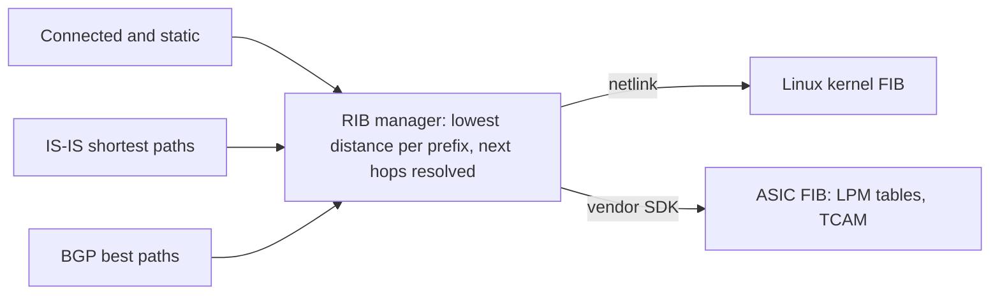
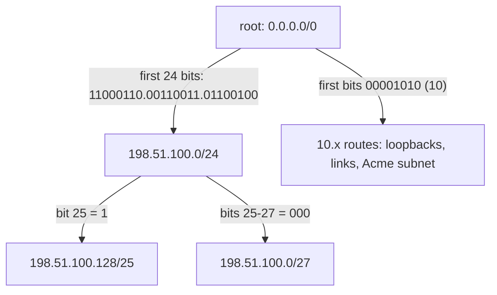

A leaf switch holds a few hundred routes; a border router carrying the internet holds about a million. For every packet it must pick exactly one, and several usually match: the default route matches every destination there is. One 400 Gb/s port can deliver about 595 million minimum-size packets a second, and a switch chip has dozens of ports. Get the rule wrong and traffic leaves through the wrong exit; get the data structure wrong and the router cannot keep up.

The example router throughout is `leaf1.ams`, the leaf that Acme's web server `acme-web1` (`10.1.1.10`) plugs into, in a small example with two spines, treated as a plain IP router as in [the packet walk](/learn/fabric-networking/from-zero/the-packet-walk). On the real Meridian fabric, routes to the internet sit in a per-tenant table and arrive through EVPN ([VRFs and multi-tenancy](/learn/fabric-networking/overlays-vxlan-evpn/vrfs-and-multi-tenancy)), but the lookup rules are the same.

## What a route is

A **prefix** such as `198.51.100.0/24` names every address whose first 24 bits equal those of `198.51.100.0` ([IP addressing and subnets](/learn/fabric-networking/from-zero/ip-addressing-and-subnets) works the bit arithmetic). A **route** says "to reach this prefix, hand the packet to this next hop". The **next hop** is the IP address of the router that should receive the packet next, and the router turns it into a MAC address with ARP ([ARP and the default gateway](/learn/fabric-networking/from-zero/arp-and-the-default-gateway)). A row in the routing table carries more than that pair:

| Field | Example on `leaf1.ams` | Who writes it | What reads it |
|---|---|---|---|
| Prefix | `198.51.100.0/27` | The protocol that learned it | The lookup: this is the key |
| Next hop | `10.255.1.202` (`gw2.ams`'s loopback) | The protocol | Resolution, then ARP |
| Outgoing interface | `to-spine1` | Connected routes, or resolution | The forwarding chip |
| Source | BGP | The routing software | Selection between sources |
| Administrative distance | 200 | A local default per source | Selection between sources for one prefix |
| Metric | 0 for BGP, 20 for IS-IS | The protocol | Selection within one source |
| Age | `00:12:44` | The routing software | People and tooling: when it last changed |

The nine routes this lesson uses, as a routing daemon prints them (illustrative, trimmed output in the style of FRRouting, the open-source routing suite inside SONiC and Cumulus Linux). `[200/0]` is distance and metric; `>` marks the selected route and `*` a next hop installed for forwarding.

```text
leaf1.ams# show ip route
Codes: C connected, I IS-IS, B BGP, > selected, * installed
B>  0.0.0.0/0          [200/0]  via 10.255.1.201 (recursive)      00:41:07
  *                               via 10.254.1.0, to-spine1
  *                               via 10.254.2.0, to-spine2
C>* 10.1.1.0/24                 directly connected, vlan100        3d02h
B>  198.51.100.0/24    [200/0]  via 10.255.1.201 (recursive)      00:41:07
  *                               via 10.254.1.0, to-spine1
  *                               via 10.254.2.0, to-spine2
B>  198.51.100.128/25  [200/0]  via 10.255.1.202 (recursive)      00:12:44
  *                               via 10.254.1.0, to-spine1
  *                               via 10.254.2.0, to-spine2
B>  198.51.100.0/27    [200/0]  via 10.255.1.202 (recursive)      00:12:44
  *                               via 10.254.1.0, to-spine1
  *                               via 10.254.2.0, to-spine2
I>* 10.255.1.201/32    [115/20] via 10.254.1.0, to-spine1          3d02h
  *                               via 10.254.2.0, to-spine2
I>* 10.255.1.202/32    [115/20] via 10.254.1.0, to-spine1          3d02h
  *                               via 10.254.2.0, to-spine2
C>* 10.254.1.0/31               directly connected, to-spine1      3d02h
C>* 10.254.2.0/31               directly connected, to-spine2      3d02h
```

The `/32`s are the loopbacks of the border gateways `gw1.ams` and `gw2.ams`, learned through IS-IS, the fabric's interior routing protocol; the `/31`s are leaf1's links to the two spines. The default and `198.51.100.0/24` exit through `gw1.ams` and ISP1; two more-specific pieces of the content network AS 64511's block exit through `gw2.ams`, where AS 64511 peers with Meridian directly. The public addresses come from the documentation ranges of RFC 5737 and the AS numbers from those of RFC 5398, so none are real; the `10.` addresses are private (RFC 1918).

## Longest-prefix match, worked on leaf1's table

A packet from `acme-web1` arrives for `198.51.100.25`. The rule: **among every route whose prefix contains the destination, use the one with the longest prefix.** In binary the destination is `11000110.00110011.01100100.00011001`. A `/n` route matches when the destination's first `n` bits equal the prefix's first `n` bits.

| Route | Bits that must match | Destination's bits | Match? |
|---|---|---|---|
| `0.0.0.0/0` | none | anything | yes, length 0 |
| `10.1.1.0/24` | `00001010.00000001.00000001` | `11000110…` | no: differs at bit 1 |
| `198.51.100.0/24` | `11000110.00110011.01100100` | identical | yes, length 24 |
| `198.51.100.128/25` | the /24's bits, then `1` | the /24's bits, then `0` | no: differs at bit 25 |
| `198.51.100.0/27` | the /24's bits, then `000` | the /24's bits, then `000` | yes, length 27 |
| `10.255.1.201/32`, `10.255.1.202/32` | start `00001010` (10) | start `11000110` (198) | no |
| `10.254.1.0/31`, `10.254.2.0/31` | start `00001010` | start `11000110` | no |

Three routes match; the `/27` is longest, so the packet goes towards `gw2.ams`. Change the last octet and the winner changes:

| Destination | Last octet in binary | Routes that match | Winner | Exit |
|---|---|---|---|---|
| `198.51.100.25` | `00011001` | /0, /24, /27 | `198.51.100.0/27` | `gw2.ams` |
| `198.51.100.40` | `00101000` | /0, /24 (the /27 needs `000`, this starts `001`) | `198.51.100.0/24` | `gw1.ams` |
| `198.51.100.200` | `11001000` | /0, /24, /25 | `198.51.100.128/25` | `gw2.ams` |
| `192.0.2.7` | n/a | /0 only | `0.0.0.0/0` | `gw1.ams` |
| `10.255.1.202` | n/a | /0, /32 | `10.255.1.202/32` | IS-IS, either spine |

Why the longest? A `/27` names 32 addresses, a `/24` names 256 and the default all four billion, so the longest match is the most precise statement anyone made about where this destination lives.

The consequence people miss: **longest-prefix match runs before any notion of "best"**. A `/27` over a congested 200 ms path beats a `/24` over an idle 1 ms one; distances and metrics, below, only ever compare routes for the *same* prefix. Announcing more-specifics is how an operator steers incoming traffic on purpose ([traffic engineering with BGP](/learn/fabric-networking/bgp-in-the-real-world/traffic-engineering-with-bgp)) and how a hijacker steals it ([leaks, hijacks and RPKI](/learn/fabric-networking/bgp-in-the-real-world/leaks-hijacks-and-rpki)).

```viz
{"type": "fabric", "scenario": "lpm-lookup", "title": "Longest-prefix match on leaf1.ams, then recursive resolution of the BGP next hop", "caption": "acme-web1 sends to 198.51.100.25. leaf1.ams checks each of its nine routes bit by bit: the default matches with length 0, the /24 with 24, the /25 fails at bit 25, and the /27 wins with 27. Its next hop, gw2.ams's loopback 10.255.1.202, is looked up again: an IS-IS /32 with two next hops, each inside a connected /31 to a spine. The FIB entry holds the resolved pair, and the flow's hash picks spine1."}
```

**What it solves:** aggregation and exceptions in one table, with no ordering for an operator to get wrong. **How it breaks:** a stray more-specific (a `/32` static left after a test, a leaked `/25`) silently takes traffic from the covering route, which still looks healthy. **What shows it:** asking the router which route a destination actually uses (`ip route get 198.51.100.25` on Linux, `show ip route 198.51.100.25` on most network operating systems), and a change in the count of routes per prefix length.

## Where routes come from

### Connected routes

Assigning `10.254.1.1/31` to interface `to-spine1` creates two entries. The **connected route** `10.254.1.0/31` means "anything in this prefix is on this wire: ARP for the destination itself". The **local** route `10.254.1.1/32` means "this address is mine: deliver to my own CPU"; Linux keeps these in a separate `local` table, and a switch chip programs them as receive entries ([planes, ASICs and network operating systems](/learn/fabric-networking/from-zero/planes-asics-and-network-operating-systems)).

A connected route exists only while its interface is up, which is a feature: when the link to `spine1.ams` fails, `10.254.1.0/31` disappears, and so does everything resolved through it. A loopback such as `10.255.1.11/32` is connected to an interface with no wire, so it never goes down. **Breaks:** a flapping interface withdraws and re-adds its subnet with every flap. **Signal:** interface state changes lined up with route churn on the same device.

### Static routes

A **static route** is written by an operator or automation, never learned. It stays installed while its next hop resolves (typically, while the interface towards it is up), whatever happens beyond it: nothing tests the path. Fabrics use few: a static default for the out-of-band management port (`172.16.1.11`), in its own table so management never depends on the fabric; a static `203.0.113.0/24` to a discard interface (often called null0) on the gateways, which keeps the internet announcement stable and drops packets for unused addresses instead of looping them; and **floating statics**, given a deliberately poor distance so they are used only when the dynamic route disappears.

**Breaks:** statics outlive their purpose. **Signal:** statics per device compared with the source of truth, the system that holds the intended configuration ([network automation and source of truth](/learn/fabric-networking/operating-fabrics/network-automation-and-source-of-truth)).

### Dynamic routes

A routing protocol learns routes from neighbours and withdraws them when the network changes. `leaf1.ams` runs two:

- **IS-IS**, Meridian's underlay protocol, floods a map of the site to every router and runs a shortest-path calculation on it ([IS-IS from zero](/learn/fabric-networking/underlay/is-is-from-zero); the algorithms are in [routing algorithms](/learn/networking/network-algorithms/routing-algorithms)). It supplies every loopback and link in the site, with a metric that sums link costs (at the common default of 10 per link, leaf to spine to gateway costs 20); its next hops are always directly connected neighbours.
- **BGP** carries tenant and external routes, learned from the route reflectors `rr1.ams` and `rr2.ams` over iBGP in AS 65000 ([what BGP is for](/learn/fabric-networking/bgp-fundamentals/what-bgp-is-for)). Its next hop is the router where traffic should *leave*, here a gateway's loopback two hops away, not a neighbour: the subject of the recursion section.

### The default route

`0.0.0.0/0` (`::/0` in IPv6) has no bits to compare, so it matches every destination with length 0 and wins only when nothing else matches: the route of last resort. Hosts get theirs from DHCP as the "default gateway" (IPv6 hosts from router advertisements). In Meridian's fabric, `gw1.ams` and `gw2.ams` originate a default into BGP, a well-built gateway only while its own internet sessions are up (conditional origination).

**What it solves:** a leaf needs a few hundred routes instead of a million. **How it breaks:** it hides missing routes. If `leaf1.ams` lost `10.1.2.0/24`, that traffic would follow the default to a gateway, which may send it back: a clean "unreachable" becomes a loop that burns TTL. A gateway still originating the default after its upstream died attracts internet-bound traffic into a hole. **Signal:** internal destinations leaving through the gateways, TTL-expired counters rising there, and `ip route get` returning `0.0.0.0/0` for an address that should have a specific route. Many fabrics carry no default in the underlay, so a missing loopback fails loudly.

## Same prefix, several sources: administrative distance and metrics

Longest-prefix match chooses between *different* prefixes, per packet. Before that, the routing software decides which route to keep when it holds several for the *same* prefix, such as IS-IS and a static both offering `10.255.1.202/32`. The order is fixed:

1. **Administrative distance** picks between sources. Lower wins.
2. **Metric** picks within one source. Lower wins (BGP is the exception; below).
3. **A tie** within one source becomes an ECMP route with several next hops, if the protocol allows it.

**Administrative distance** (Juniper: *preference*) is a local number per source saying how much this router trusts it. No protocol carries it, so two routers can disagree. Common defaults:

| Source | Cisco IOS and FRRouting | Juniper Junos (preference) |
|---|---|---|
| Connected | 0 | 0 |
| Static | 1 | 5 |
| eBGP (learned from another AS) | 20 | 170 |
| OSPF, internal | 110 | 10 |
| IS-IS | 115 | 15 (level 1), 18 (level 2) |
| iBGP (learned inside the AS) | 200 | 170 |

The Cisco ordering encodes a judgement: an eBGP route is information you cannot get any other way, so it beats your IGP (interior gateway protocol, here IS-IS); an internal prefix arriving over iBGP is usually a copy of something the IGP knows first-hand, so the IGP wins. Junos ranks every IGP above all BGP, so in a mixed-vendor network the same route can win on one box and lose on the next.

Worked on `leaf1.ams`:

- `10.254.1.0/31` arrives as connected (distance 0) and from IS-IS (115, metric 20: the link to `spine1.ams` plus the metric `spine1.ams` advertises for its side of the link). Connected wins; the IS-IS copy stays in the RIB as an unused backup.
- `198.51.100.0/24` arrives from iBGP via `gw1.ams` (200) and as a floating static via `gw2.ams` (250). BGP wins; if `gw1.ams` withdraws the `/24`, the static is installed and the traffic leaves through `gw2.ams`.
- `10.255.1.202/32` from IS-IS costs 10 + 10 = 20 via either spine, so both next hops are installed. Raise the cost of the link `spine2.ams`–`gw2.ams` to 1,000 before maintenance and the path via `spine2.ams` costs 1,010, so only `spine1.ams` remains ([safe change and maintenance](/learn/fabric-networking/operating-fabrics/safe-change-and-maintenance)).

**Metrics are comparable only inside one protocol**: an IS-IS cost of 20 and an OSPF cost of 20 mean unrelated things. BGP has no single metric; it runs a multi-step decision process over path attributes and hands the RIB one winner, or several with multipath enabled ([the best-path algorithm](/learn/fabric-networking/bgp-fundamentals/the-best-path-algorithm)).

**What distance solves:** a deterministic choice between protocols that cannot compare metrics. **How it breaks:** a forgotten static. During a migration someone adds `10.255.1.202/32` via `10.254.1.0`, distance 1. It beats IS-IS's 115, so all traffic towards `gw2.ams` crowds onto one uplink, and when `spine1.ams` is costed out of IS-IS for maintenance, the static ignores the drain and keeps sending traffic into the spine everyone believes is empty. **Signal:** the source code in front of a route (`S>*` where intent says `I>*`), and traffic still arriving on a drained device.

## RIB and FIB: the table that chooses and the table that forwards

The **RIB** (routing information base) is the control plane's table, in the routing software's memory. It holds every candidate from every source with its distance, metric and age, including unusable ones: backups that lost on distance, and routes whose next hop cannot be reached. Each protocol keeps its own tables first (BGP's are in [UPDATEs, attributes and RIBs](/learn/fabric-networking/bgp-fundamentals/updates-attributes-and-ribs)); a RIB manager, `zebra` in FRRouting, merges them by distance.

The **FIB** (forwarding information base) holds only the winners, with next hops resolved down to an outgoing port and a neighbour whose MAC the router knows, in the format the forwarding engine reads fastest: a trie in the Linux kernel, LPM tables and TCAM in a switch chip.



Real systems add stages. On SONiC, routes go from `zebra` through `fpmsyncd` into a Redis database, and `orchagent` and `syncd` turn them into calls on SAI, the switch abstraction interface each chip vendor implements; on Cumulus Linux, `switchd` copies the kernel's table into the chip. Every stage is a queue that can lag and a translation that can fail.

Why two tables: the RIB is built for change (many candidates, policy, history) and lives in the control-plane CPU's DRAM; the FIB is built for line-rate reads and lives in tens of megabytes of on-chip memory. The split also lets the chip keep forwarding while the routing software restarts, which graceful restart relies on ([convergence and scale](/learn/fabric-networking/bgp-in-the-real-world/convergence-and-scale)).

Programming hardware is far slower than choosing routes. Rates depend on the chip, the network operating system and the vendor SDK, but think thousands to tens of thousands of route changes a second: a full internet table of about a million IPv4 prefixes takes tens of seconds to minutes after a reboot, while the RIB lists routes the hardware cannot forward yet.

**What the split solves:** fast forwarding that survives a control-plane restart. **How it breaks:** the two disagree. A hardware table fills and new routes stay in the RIB only (some platforms drop the traffic, some send it to the CPU at a tiny fraction of line rate); a programming error leaves a stale entry; the queue between them lags after a large change. When the global IPv4 table passed 512,000 routes in August 2014, routers whose hardware allocated exactly that many lost reachability to some prefixes worldwide ([routing algorithms](/learn/networking/network-algorithms/routing-algorithms); the hardware reason is below). **Signal:** RIB route count against FIB route count against hardware capacity, per device; "hardware programming failed" or "table full" logs; on SONiC, a route present in the application database but missing from the ASIC database.

## Recursive next-hop resolution

The BGP route `198.51.100.0/27` says "via `10.255.1.202`": `gw2.ams`'s loopback, two hops away, on none of `leaf1.ams`'s links, so the leaf cannot ARP for it. BGP uses far next hops on purpose: it says *where traffic should leave* and knows nothing of the topology between; IS-IS knows the topology and nothing of the internet. **Recursive resolution** joins them: the router looks the next hop up in the same table, and repeats until it reaches a connected route. Traced on `leaf1.ams`, as in the visualisation above:

| Step | Look up | Longest match | Source | Gives |
|---|---|---|---|---|
| 1 | `198.51.100.25` | `198.51.100.0/27` | BGP | next hop `10.255.1.202`, not on any link |
| 2 | `10.255.1.202` | `10.255.1.202/32` | IS-IS | next hops `10.254.1.0` and `10.254.2.0` |
| 3a | `10.254.1.0` | `10.254.1.0/31` | connected | interface `to-spine1`; ARP for `10.254.1.0` |
| 3b | `10.254.2.0` | `10.254.2.0/31` | connected | interface `to-spine2`; ARP for `10.254.2.0` |

A connected route ends the recursion because only a neighbour on an attached link can be reached directly. The resolved result, `198.51.100.0/27` via `10.254.1.0` on `to-spine1` or `10.254.2.0` on `to-spine2`, is what goes into the FIB. Resolution happens **when a route changes**, not per packet; the chip never walks the chain. The Linux kernel does not recurse at all (it accepts a gateway only if directly reachable), so `zebra` resolves the chain before installing anything.

That pairing is the whole relationship between BGP and the underlay: a BGP route is only as good as the IGP route under its next hop ([iBGP, loops and next hops](/learn/fabric-networking/bgp-fundamentals/ibgp-loops-and-next-hops)).

### One change, a million prefixes: the hierarchical FIB

Suppose 900,000 BGP prefixes resolve through `10.255.1.202`, and the link from `spine2.ams` to `gw2.ams` fails. IS-IS changes one route, `10.255.1.202/32`, from two next hops to one. A flat FIB must rewrite all 900,000 entries, about 90 seconds at 10,000 updates a second, while traffic still heads for the broken path. A **hierarchical FIB** stores each BGP prefix as a pointer to a shared next-hop object, "via `gw2.ams`", which points to the ports; the IS-IS change rewrites that one object and every prefix moves at once. Cisco calls this BGP Prefix Independent Convergence (PIC Core); Linux has had the structure since kernel 5.3 as nexthop objects (`ip nexthop`), which FRRouting uses. Whether a platform programs its chip this way decides whether a gateway failure costs milliseconds or a minute.

### How resolution breaks

**An unresolvable next hop.** `gw2.ams`'s loopback drops out of IS-IS (a change stopped advertising it, or its adjacencies are down) while its BGP routes are still held: the iBGP sessions between loopbacks notice only when their hold timer expires (9 seconds on Meridian, 90 to 180 seconds at vendor defaults), and never if they run between other addresses. The `/27` stays in the RIB, marked unusable, and is not installed. Longest-prefix match then finds the `/24` via `gw1.ams` and traffic silently changes exit; with no covering route, the destination is unreachable while every session shows Established. **Signal:** the count of BGP routes with an unresolvable next hop, which should be zero.

**Resolution through the default.** If allowed, the missing `10.255.1.202/32` would leave `10.255.1.202` matching `0.0.0.0/0`, so the "resolved" path would point towards `gw1.ams`: traffic meant for one exit goes to another, which may send it back. FRRouting refuses to resolve a next hop through the default unless explicitly allowed; other implementations differ, so it is worth checking, because a clean black hole is easier to find than a loop.

**A recursion loop.** A BGP route for `10.255.0.0/16` with next hop `10.255.1.202`, inside it, would resolve through itself once the IS-IS `/32` disappears; implementations detect this and mark it unusable.

**A promise the path does not keep.** Recursion chooses only the first hop. The packet carries only its destination address and each spine runs its own lookup; if the spines lack the `/27` because BGP runs only on leaves and gateways, a spine drops the packet or follows its own default ([the BGP black hole](/learn/fabric-networking/bgp-fundamentals/the-bgp-black-hole)). The usual fix is a tunnel addressed to the exit itself ([VXLAN encapsulation](/learn/fabric-networking/overlays-vxlan-evpn/vxlan-encapsulation)).

## ECMP entries

An **ECMP** (equal-cost multipath) entry is a route with several next hops of equal preference. An IGP installs every equal-cost path its shortest-path run finds, up to a per-platform limit, as IS-IS did for `10.255.1.202/32`; BGP installs one best path per prefix unless multipath is enabled.

In the FIB, an ECMP entry is a **next-hop group**: one prefix pointing at a list of members. For each packet the chip hashes fields that are constant for a flow, usually the 5-tuple (source and destination address, protocol, source and destination port), to pick a member, so every packet of one TCP connection takes the same path and arrives in order ([ECMP and hashing](/learn/fabric-networking/fabric-architecture/ecmp-and-hashing) covers the hash). On Linux an ECMP route looks like this (illustrative):

```text
$ ip route show 198.51.100.0/27
198.51.100.0/27 nhid 41 proto bgp metric 20
        nexthop via 10.254.1.0 dev to-spine1 weight 1
        nexthop via 10.254.2.0 dev to-spine2 weight 1
$ ip route get 198.51.100.25
198.51.100.25 via 10.254.1.0 dev to-spine1 src 10.254.1.1
```

`ip route get` names one member because the kernel hashed this lookup; another flow may get `to-spine2`.

Recursion and ECMP combine. Suppose BGP multipath gave `192.0.2.0/24` two next hops, `gw1.ams` and `gw2.ams`, each resolving through both spines (behind route reflectors this needs ADD-PATH, RFC 7911, because a reflector otherwise passes on only its own best path; see [route reflectors](/learn/fabric-networking/bgp-fundamentals/route-reflectors)). The FIB entry is the union of the resolved members, `{to-spine1, to-spine2}`, two members and not four. The leaf chooses only a spine; which gateway the packet reaches is decided by the spine's own lookup.

On the full-size Amsterdam site, with four spines, each member carries 25% of a leaf's spine-bound traffic; lose a spine and three members carry about 33% each, on 25% less uplink capacity ([Clos and leaf-spine](/learn/fabric-networking/fabric-architecture/clos-and-leaf-spine)).

**What ECMP solves:** using every parallel link, with per-flow ordering preserved. **How it breaks:** a member whose link is up but dropping packets still receives its full share (a gray failure, [optics, cabling and the physical layer](/learn/fabric-networking/fabric-architecture/optics-cabling-and-the-physical-layer)); a member change re-hashes flows onto new paths unless the chip supports resilient hashing; and the chip limits members per group and the number of groups. **Signal:** ECMP width per prefix compared with what the topology promises (four at `ams`), and utilisation skew between members of one group.

## How a router decides in nanoseconds: tries and TCAM

The budget: a minimum-size Ethernet frame occupies 84 bytes of wire time (64 of frame, 8 of preamble, 12 of inter-frame gap), 672 bits, which at 400 Gb/s takes 1.68 ns. A chip with 51.2 Tb/s of ports faces tens of billions of lookups a second across several parallel pipelines, so it cannot scan a million rows or afford many DRAM reads at tens of nanoseconds each.

### Tries

A **binary trie** stores prefixes as paths: from the root, bit 0 goes left and bit 1 right, and a node at depth `n` carries a route if some `/n` prefix ends there. To look up an address, walk its bits and remember the last route passed; when the walk falls off the trie, that route is the longest match: at most 32 steps for IPv4, 128 for IPv6, however many routes there are. Collapsing single-child chains (a path-compressed or Patricia trie) leaves `leaf1.ams`'s table looking like this:



The walk for `198.51.100.25` passes the root (remember the default), the `/24` (remember it), follows `000` to the `/27` and stops: the answer is the last route remembered. For `198.51.100.40` the walk leaves the `/24` along `0`, `0`, finds bit 27 is `1` where the trie only has `0`, falls off, and answers with the `/24`.

The code is that trie plus distance selection, recursive resolution that refuses the default, and a TCAM model, on `leaf1.ams`'s candidates.

```python
import ipaddress

DISTANCE = {"connected": 0, "static": 1, "isis": 115, "ibgp": 200}

# leaf1.ams's candidate routes: (prefix, protocol, metric, next hops[, distance])
CANDIDATES = [
    ("0.0.0.0/0", "ibgp", 0, ["10.255.1.201"]),
    ("10.1.1.0/24", "connected", 0, ["vlan100"]),
    ("198.51.100.0/24", "ibgp", 0, ["10.255.1.201"]),
    ("198.51.100.0/24", "static", 0, ["10.255.1.202"], 250),  # floating static via gw2
    ("198.51.100.128/25", "ibgp", 0, ["10.255.1.202"]),
    ("198.51.100.0/27", "ibgp", 0, ["10.255.1.202"]),
    ("10.255.1.201/32", "isis", 20, ["10.254.1.0", "10.254.2.0"]),
    ("10.255.1.202/32", "isis", 20, ["10.254.1.0", "10.254.2.0"]),
    ("10.254.1.0/31", "connected", 0, ["to-spine1"]),
    ("10.254.1.0/31", "isis", 20, ["10.254.1.0"]),   # spine1 advertises the link too
    ("10.254.2.0/31", "connected", 0, ["to-spine2"]),
]


def select(candidates):
    """RIB: per prefix keep the lowest (distance, metric); everything else is a backup."""
    best = {}
    for prefix, proto, metric, nhs, *dist in candidates:
        key = (dist[0] if dist else DISTANCE[proto], metric)
        if prefix not in best or key < best[prefix][0]:
            best[prefix] = (key, proto, nhs)
    return {p: (proto, nhs) for p, (key, proto, nhs) in best.items()}


class Node:
    __slots__ = ("child", "route")

    def __init__(self):
        self.child, self.route = [None, None], None


def bits(addr, n):
    v = int(ipaddress.IPv4Address(addr))
    return [(v >> (31 - i)) & 1 for i in range(n)]


class Trie:
    def __init__(self, routes):
        self.root = Node()
        for prefix, route in routes.items():
            net, node = ipaddress.IPv4Network(prefix), self.root
            for b in bits(net.network_address, net.prefixlen):
                node.child[b] = node.child[b] or Node()
                node = node.child[b]
            node.route = (prefix, route)

    def lookup(self, addr, use_default=True):
        node, best, visited = self.root, None, 0
        for b in bits(addr, 32) + [None]:
            visited += 1
            if node.route and (use_default or node is not self.root):
                best = node.route              # remember the longest match so far
            if b is None or node.child[b] is None:
                return best, visited           # fell off the trie: best is the answer
            node = node.child[b]


def resolve(fib, addr, chain=()):
    """Follow next hops until a connected route names an interface."""
    match, _ = fib.lookup(addr, use_default=not chain)  # never resolve via the default
    if match is None or match[0] in chain:
        return []                               # unresolvable, or a resolution loop
    prefix, (proto, nhs) = match
    if proto == "connected":
        return [(addr, nhs[0])]                 # on this link: ARP for addr itself
    return sorted({hop for nh in nhs for hop in resolve(fib, nh, chain + (prefix,))})


def tcam(routes, addr):
    """Every row compared at once; rows sorted longest-first; first hit wins."""
    rows = sorted((ipaddress.IPv4Network(p) for p in routes), key=lambda n: -n.prefixlen)
    a = int(ipaddress.IPv4Address(addr))
    hits = [n for n in rows if a & int(n.netmask) == int(n.network_address)]
    return str(hits[0]) if hits else None


chosen = select(CANDIDATES)
fib = Trie(chosen)
for prefix in ("198.51.100.0/24", "10.254.1.0/31"):
    print(f"{prefix:18} installed from {chosen[prefix][0]}")
for dst in ("198.51.100.25", "198.51.100.200", "198.51.100.40", "192.0.2.7", "10.1.1.10"):
    (prefix, (proto, nhs)), visited = fib.lookup(dst)
    assert tcam(chosen, dst) == prefix          # the hardware model agrees
    print(f"{dst:15} {prefix:18} {proto:9} via {','.join(nhs):13} "
          f"trie nodes {visited:2}  -> {resolve(fib, dst)}")

del chosen["10.255.1.202/32"]                   # gw2.ams's loopback vanishes from IS-IS
print("gw2 loopback gone:", resolve(Trie(chosen), "198.51.100.25"))
```

```text
198.51.100.0/24    installed from ibgp
10.254.1.0/31      installed from connected
198.51.100.25   198.51.100.0/27    ibgp      via 10.255.1.202  trie nodes 28  -> [('10.254.1.0', 'to-spine1'), ('10.254.2.0', 'to-spine2')]
198.51.100.200  198.51.100.128/25  ibgp      via 10.255.1.202  trie nodes 26  -> [('10.254.1.0', 'to-spine1'), ('10.254.2.0', 'to-spine2')]
198.51.100.40   198.51.100.0/24    ibgp      via 10.255.1.201  trie nodes 27  -> [('10.254.1.0', 'to-spine1'), ('10.254.2.0', 'to-spine2')]
192.0.2.7       0.0.0.0/0          ibgp      via 10.255.1.201  trie nodes  6  -> [('10.254.1.0', 'to-spine1'), ('10.254.2.0', 'to-spine2')]
10.1.1.10       10.1.1.0/24        connected via vlan100       trie nodes 25  -> [('10.1.1.10', 'vlan100')]
gw2 loopback gone: []
```

The lines that carry the ideas:

- `key` compares distance first, metric second; the floating static and the IS-IS copy of the `/31` never reach the trie.
- `best = node.route` is longest-prefix match: the deepest route on the walk is remembered last.
- `use_default=not chain` lets the destination match the default but never a next hop; `match[0] in chain` stops a route resolving through itself.
- The visit counts are memory reads: 28 for the `/27`, 6 for `192.0.2.7`, whose bits leave the `198` branch after five. At tens of nanoseconds per DRAM read, 28 dependent reads approach a microsecond, so real tries consume several bits per node (Linux's `fib_trie`, in [IP addressing and routing](/learn/networking/fundamentals/ip-addressing-and-routing)).
- The last line returns nothing: the `/27` matches but its next hop no longer resolves. A real router would fall back to the `/24` via `gw1.ams`, which the exercise asks you to build.

**DIR-24-8**, a 1998 design used in DPDK's LPM library, spends memory to save reads: a table of 2²⁴ entries indexed by the first 24 bits answers any prefix of 24 bits or shorter in one read, and a second small table handles longer prefixes. More than half of the internet's IPv4 routes are `/24`s. The price is updates: a `/8` occupies 65,536 slots of the first table, all rewritten when it changes.

### TCAM

A **TCAM** (ternary content-addressable memory) inverts the question: ordinary memory takes an address and returns data; a content-addressable memory takes data and returns the row holding it. *Ternary* means each stored bit is 0, 1 or X ("don't care"), so `198.51.100.0/27` is one row with 27 bits fixed and 5 X. Every row compares with the destination in parallel in a single lookup, and a **priority encoder** returns the lowest-numbered row that matched. Store rows longest prefix first and the first match is the longest, in one lookup whatever the table size. The `tcam` function above is the same logic without the parallelism.

What it costs:

- **Area and power.** A TCAM cell needs about 16 transistors where an SRAM bit needs 6, and every row is active on every lookup. The TCAM on a data center switch chip therefore holds thousands to tens of thousands of entries, and platforms that keep a full internet table in TCAM add a separate TCAM chip, at extra cost and power.
- **Ordered updates.** The ordering must hold after every insert. With rows grouped by prefix length, adding a `/27` to a full `/27` region means shifting one row at each length boundary between it and the free space, up to 32 moves for one insert.

Data center switch chips therefore keep most routes in SRAM with **algorithmic LPM** (per-length hash tables, compressed tries or similar, pipelined into a fixed number of cycles) and keep TCAM for ACLs (access control lists, packet filters with masks on many fields) and leftovers. Many chips split one memory between MAC addresses, host routes and LPM routes by a **forwarding-table profile** chosen at boot. The 2014 routers failed the same way: their FIB TCAM held about a million entries, but the default split gave IPv4 512,000. The packet's whole path through the chip is in [planes, ASICs and network operating systems](/learn/fabric-networking/from-zero/planes-asics-and-network-operating-systems).

| Structure | Reads per IPv4 lookup | Update cost | Memory and power | Where it is used |
|---|---|---|---|---|
| Linear scan | one per route | trivial | small | toys and very small tables |
| Binary trie | up to 32, dependent | up to 32 nodes | a node per bit, pointer-heavy | reference implementations, teaching |
| Multibit or level-compressed trie | about 4–8 | rebuild a few nodes | compact | Linux `fib_trie`, many software routers |
| DIR-24-8 | 1, or 2 for prefixes longer than /24 | short prefixes rewrite thousands of slots | 32 MB or more for the first table | DPDK and other software data planes |
| TCAM | 1 (all rows at once) | row moves to keep order | high area and power per entry | ACLs, small fast LPM tables |
| Algorithmic LPM in SRAM | a few, pipelined | moderate | dense, low power | data center switch ASICs |

## Failure modes in production

| Failure | Symptom | Diagnosis | Fix |
|---|---|---|---|
| A stray more-specific | Traffic to part of a block exits somewhere unexpected; the covering route looks fine | `ip route get` on an affected address returns a longer prefix than intended, often a static or a newly learned BGP route | Remove the static, filter the more-specific at import, alert on unexpected prefix lengths |
| Hardware FIB full | A subset of destinations drops or crawls (sent to the CPU) while `show ip route` lists them | RIB count above FIB count; "table full" logs; per-table hardware utilisation at 100% | Change the table profile, aggregate, or carry a default instead of the full table |
| Unresolvable next hop | Traffic changes exit, or a prefix is unreachable, while every BGP session is Established | BGP routes flagged with an unusable next hop; the gateway's loopback missing from IS-IS | Restore the loopback's IGP route; alert on any unresolvable next hop |
| A static that outranks the IGP | One uplink hot while its ECMP partner idles; drained devices still carry traffic | The route's source is static where IS-IS was expected | Delete it; make the source of truth forbid statics in the fabric |
| ECMP narrower than the topology | 4 spines, but a prefix uses 3 or fewer; one spine's links run hotter | ECMP width per prefix compared across leaves; a missing route on one spine | Find why the member dropped out (link, adjacency, metric) |

## What the platform should show

A fabric tool should answer these questions without anyone logging into a box:

- **"Which route does this destination use, and why?"** For any device and address: the winning prefix, its source, distance and metric, the candidates that lost, and the resolution chain down to ports: the visualisation's trace, as an API.
- **RIB against FIB against hardware.** Per device, route counts in each, the difference by prefix, and each hardware table (LPM, host, ECMP groups, TCAM) as a percentage of capacity, alerting well before 100%.
- **Unresolvable next hops** as a count that should be zero, with the prefixes affected.
- **ECMP width** per important prefix against what the topology promises, so "three of four spines" is visible before anyone reads a utilisation graph.
- **Route sources against intent.** Statics that are not in the source of truth, and prefixes whose source changed (IS-IS to static, BGP to default).
- **Prefix-length histograms over time**, per device and peer, so a burst of more-specifics or a fall-back to the default shows up as a change.

## Interviewer follow-ups

**"A router has `10.0.0.0/8` from OSPF, `10.1.0.0/16` as a static, and `10.1.0.0/16` from iBGP. Where does a packet for `10.1.2.3` go?"** Model answer: longest match first, so the `/16`, never the `/8`; then between the two `/16`s, distance decides, so the static (1) beats iBGP (200). Distance is consulted only between routes for the same prefix, in the RIB, when routes change; longest-prefix match is the per-packet lookup in the FIB. Common wrong answer: "OSPF, because 110 is lower than 200", applying distance across prefixes of different lengths.

**"Why does a BGP route's next hop point at a loopback that isn't a neighbour?"** Model answer: BGP describes where traffic should leave the network, not the topology in between, so it names the exit router by an address that stays up while any of its links is up. The router resolves that address through the IGP to a connected neighbour and installs the result, so a BGP route is usable only while the IGP reaches its next hop. Common wrong answer: "the router forwards the packet to the loopback address", as if the next hop were written into the packet.

**"`show ip route` has the route, but traffic to it is dropped. What could be wrong?"** Model answer: the RIB is not the FIB. The hardware table may be full, programming may have failed or be lagging, or a downstream router may lack the route. I would compare RIB and hardware entries on that device, check the next hop's resolution, then walk the path. The platform command that dumps the hardware table I'd leave to the network team, but a per-device RIB-against-FIB diff is something I would build. Common wrong answer: "the route is there, so it must be a firewall".

**"How does a switch do longest-prefix match at line rate?"** Model answer: not with one hash table, which answers only exact matches (one per prefix length works, at up to 33 probes for IPv4, or about 5 with a binary search over lengths that needs extra marker entries). Either TCAM, where every row compares in parallel and a priority encoder returns the first match, so rows are stored longest first; or algorithmic LPM in SRAM, pipelined into a fixed number of cycles. TCAM is fast but power-hungry, so it is small and mostly kept for ACLs. Common wrong answer: "a binary search over sorted prefixes", which does not give the longest match without extra structure.

## What mid-level engineers get wrong

- **Treating administrative distance as a global ranking.** It never compares a `/16` with a `/24`; lowering a distance to "prefer" a route changes nothing if a more-specific exists.
- **Reading `show ip route` as proof of forwarding.** It shows the RIB; hardware can disagree, and the next router can lack the route.
- **Assuming the next hop is in the packet.** It only chooses a neighbour's MAC address; only the destination address travels.
- **Assuming a default route is harmless.** It turns missing routes into misrouted traffic and can make an unresolvable next hop look resolved.

## Exercise: resolve a route the way the FIB does

```exercise
id: resolve-route
title: Longest-prefix match with recursive resolution
prompt: |
  Write `resolve_route(routes, dst)`, returning the FIB entry a router would
  use for IPv4 address `dst`: a list of `[neighbour_ip, interface]` pairs.

  `routes` is a list of `[prefix, next_hops]`. `prefix` is a string such as
  "198.51.100.0/27" (host bits are zero). `next_hops` is a list of strings:
  either IPv4 addresses, or exactly one string "if:<name>", which makes the
  route a connected route on interface `<name>`.

  - Consider the routes whose prefix contains `dst`, longest prefix first.
    Use the first one that is usable.
  - A connected route is always usable: return `[[dst, name]]`, because
    `dst` is on that link.
  - Any other route is usable if at least one of its next hops resolves.
    To resolve next hop `h`, find the longest prefix containing `h`,
    ignoring the default route `0.0.0.0/0`. If that route is connected on
    interface `name`, `h` resolves to the pair `[h, name]`. Otherwise
    resolve each of that route's next hops in the same way and collect all
    the pairs.
  - A next hop that matches nothing, or whose resolution would use a route
    already used in the same chain (including the route chosen for `dst`),
    contributes nothing.
  - Return the union of the pairs of the chosen route without duplicates,
    in any order. Return `[]` if no matching route is usable.
languages: [python, javascript]
entry: resolve_route
starter:
  python: |
    def resolve_route(routes, dst):
        # Parse prefixes once; write a longest-match helper that can skip the default.
        return []
  javascript: |
    function resolve_route(routes, dst) {
      // Parse prefixes once; write a longest-match helper that can skip the default.
      return [];
    }
tests:
  - args: [[["0.0.0.0/0", ["10.255.1.201"]], ["10.1.1.0/24", ["if:vlan100"]], ["198.51.100.0/24", ["10.255.1.201"]], ["198.51.100.128/25", ["10.255.1.202"]], ["198.51.100.0/27", ["10.255.1.202"]], ["10.255.1.201/32", ["10.254.1.0", "10.254.2.0"]], ["10.255.1.202/32", ["10.254.1.0", "10.254.2.0"]], ["10.254.1.0/31", ["if:to-spine1"]], ["10.254.2.0/31", ["if:to-spine2"]]], "198.51.100.25"]
    expected: [["10.254.1.0", "to-spine1"], ["10.254.2.0", "to-spine2"]]
    any_order: true
    label: "the /27 wins, ECMP over both spines"
  - args: [[["0.0.0.0/0", ["10.255.1.201"]], ["10.1.1.0/24", ["if:vlan100"]], ["198.51.100.0/24", ["10.255.1.201"]], ["198.51.100.128/25", ["10.255.1.202"]], ["198.51.100.0/27", ["10.255.1.202"]], ["10.255.1.201/32", ["10.254.1.0", "10.254.2.0"]], ["10.255.1.202/32", ["10.254.1.0", "10.254.2.0"]], ["10.254.1.0/31", ["if:to-spine1"]], ["10.254.2.0/31", ["if:to-spine2"]]], "10.1.1.10"]
    expected: [["10.1.1.10", "vlan100"]]
    any_order: true
    label: "connected subnet: the destination itself"
  - args: [[["0.0.0.0/0", ["10.255.1.201"]], ["10.1.1.0/24", ["if:vlan100"]], ["198.51.100.0/24", ["10.255.1.201"]], ["198.51.100.128/25", ["10.255.1.202"]], ["198.51.100.0/27", ["10.255.1.202"]], ["10.255.1.201/32", ["10.254.1.0", "10.254.2.0"]], ["10.255.1.202/32", ["10.254.1.0", "10.254.2.0"]], ["10.254.1.0/31", ["if:to-spine1"]], ["10.254.2.0/31", ["if:to-spine2"]]], "192.0.2.7"]
    expected: [["10.254.1.0", "to-spine1"], ["10.254.2.0", "to-spine2"]]
    any_order: true
    label: "only the default route matches"
  - args: [[["0.0.0.0/0", ["10.255.1.201"]], ["10.1.1.0/24", ["if:vlan100"]], ["198.51.100.0/24", ["10.255.1.201"]], ["198.51.100.128/25", ["10.255.1.202"]], ["198.51.100.0/27", ["10.255.1.202"]], ["10.254.1.0/31", ["if:to-spine1"]], ["10.254.2.0/31", ["if:to-spine2"]], ["10.255.1.201/32", ["10.254.2.0"]]], "198.51.100.25"]
    expected: [["10.254.2.0", "to-spine2"]]
    any_order: true
    label: "gw2's loopback missing: the /24 takes over"
  - args: [[["203.0.113.0/24", ["10.255.1.201", "10.255.1.250"]], ["192.0.2.0/24", ["10.255.1.201", "10.255.1.202"]], ["10.255.1.201/32", ["10.254.1.0"]], ["10.255.1.202/32", ["10.254.1.0", "10.254.2.0"]], ["10.254.1.0/31", ["if:to-spine1"]], ["10.254.2.0/31", ["if:to-spine2"]]], "192.0.2.50"]
    expected: [["10.254.1.0", "to-spine1"], ["10.254.2.0", "to-spine2"]]
    any_order: true
    label: "two BGP next hops sharing a spine: no duplicates"
  - args: [[["0.0.0.0/0", ["10.9.9.9"]], ["10.9.0.0/16", ["10.9.9.9"]], ["10.254.1.0/31", ["if:to-spine1"]]], "10.9.1.1"]
    expected: []
    any_order: true
    label: "a next hop that resolves through its own route"
    hidden: true
  - args: [[["0.0.0.0/0", ["10.255.1.201"]], ["203.0.113.0/24", ["10.255.1.209"]], ["10.255.1.201/32", ["10.254.2.0"]], ["10.254.2.0/31", ["if:to-spine2"]]], "203.0.113.5"]
    expected: [["10.254.2.0", "to-spine2"]]
    any_order: true
    label: "next hop reachable only via the default"
    hidden: true
  - args: [[["203.0.113.0/24", ["10.255.1.201", "10.255.1.250"]], ["192.0.2.0/24", ["10.255.1.201", "10.255.1.202"]], ["10.255.1.201/32", ["10.254.1.0"]], ["10.255.1.202/32", ["10.254.1.0", "10.254.2.0"]], ["10.254.1.0/31", ["if:to-spine1"]], ["10.254.2.0/31", ["if:to-spine2"]]], "203.0.113.9"]
    expected: [["10.254.1.0", "to-spine1"]]
    any_order: true
    label: "one ECMP member unresolvable"
    hidden: true
hints:
  - "Convert each address to a 32-bit integer; a /n prefix contains x when x with its low 32 - n bits cleared equals the prefix's network address."
  - "Write one helper that lists matching routes longest first, with a flag that skips length 0; the destination may use the default, next hops may not."
  - "Resolve recursively, passing along the prefixes already used in this chain, and collect pairs in a set so two next hops through the same spine count once."
```

## Senior signals

- You separate the per-packet decision (longest-prefix match in the FIB) from the per-change ones (distance, metric, best path in the RIB), and say which a symptom points to.
- You describe BGP next hops as exits resolved through the IGP, and know recursion picks only the first hop.
- You ask whether the FIB is hierarchical, because on a large table it decides whether a gateway failure costs milliseconds or a minute.
- You count ECMP width at the FIB, after resolution, against what the topology promises.

## Check yourself

```quiz
- q: >-
    leaf1.ams holds 0.0.0.0/0 via gw1, 198.51.100.0/24 via gw1, 198.51.100.128/25 via gw2 and 198.51.100.0/27 via gw2, all usable. Which route carries a packet for 198.51.100.40?
  options: ["198.51.100.0/24 via gw1, the longest prefix that contains .40", "0.0.0.0/0 via gw1, since no route names .40 exactly", "198.51.100.128/25 via gw2, the closest prefix above .40", "198.51.100.0/27 via gw2, the longest prefix in the table"]
  answer: 0
  explanation: >-
    .40 is 00101000 in binary. The /27 needs the last octet to start 000 and this one starts 001, so it does not contain .40; the /25 needs a leading 1. The /24 and the default both contain it, and the /24 is longer. Being the longest prefix in the table counts for nothing unless the prefix contains the destination.
- q: >-
    leaf1.ams learns 10.255.1.202/32 from IS-IS with two equal-cost next hops, and someone adds a static for the same /32 via spine1 only. With Cisco or FRRouting defaults, what happens?
  options: ["Neither is installed until an operator picks one of them", "The static wins on distance and ECMP falls to spine1 alone", "Both are installed, giving three next hops in one group", "IS-IS wins on its lower metric and both next hops stay"]
  answer: 1
  explanation: >-
    For one prefix from two sources, administrative distance decides first: static 1 beats IS-IS 115. Metrics are compared only within one protocol, so IS-IS's metric is never weighed against the static. The router installs only the static's single next hop, so traffic towards gw2 crowds onto one uplink, and the static ignores any IS-IS drain of spine1.
- q: >-
    show ip route on a leaf lists 203.0.113.0/24 as selected, yet packets to it are dropped on that leaf and syslog reports a hardware table error. What is the most likely explanation?
  options: ["The ECMP hash sends those flows to a member that has no MAC", "The route lost on administrative distance after it was selected", "The route is in the RIB but was never programmed into the FIB", "The BGP session that taught the route has moved to Active"]
  answer: 2
  explanation: >-
    show ip route displays the RIB, the control plane's choice. The chip forwards from the FIB, and if the hardware table is full or programming failed, the route never reaches it, so traffic is dropped or punted while the RIB looks correct. A session in Active would have withdrawn the route from the RIB, and distance is settled before a route is shown as selected.
- q: >-
    gw2.ams's loopback disappears from IS-IS, but its BGP sessions stay up through another path. leaf1 holds the /27 via gw2, the /24 via gw1 and a default via gw1. What happens to traffic for 198.51.100.25?
  options: ["The /27 becomes unusable, so it takes the /24 towards gw1", "It keeps flowing to gw2 until the BGP hold timer expires", "It is dropped, because the /27 is still the longest match", "It follows the default to gw1, resolving gw2's loopback via 0/0"]
  answer: 0
  explanation: >-
    A BGP route whose next hop cannot be resolved stays in the RIB but is not installed, so the FIB lookup finds the next-longest match, the /24 via gw1. Sessions being up does not help; resolution needs an IGP route to the next hop. Implementations such as FRRouting refuse to resolve a next hop through the default route unless told to, precisely to avoid sending gw2's traffic somewhere unintended.
- q: >-
    Why does a TCAM used for longest-prefix match store its entries sorted from the longest prefix to the shortest?
  options: ["Sorting lets it binary-search the rows in about log n steps", "Longer prefixes need fewer don't-care bits to be compared", "Its priority encoder returns the lowest-numbered matching row", "The chip searches rows one by one and stops at the first hit"]
  answer: 2
  explanation: >-
    Every TCAM row compares against the key in parallel in the same cycle, and when several match, the priority encoder reports the lowest index. Placing longer prefixes first makes that first match the longest one. The search is not sequential and not a binary search; the ordering exists only for the encoder, and keeping it on every insert is why TCAM updates may move many entries.
- q: >-
    BGP multipath gives 192.0.2.0/24 two next hops, gw1.ams and gw2.ams, and each gateway loopback resolves through spine1 and spine2. How many members does leaf1's FIB entry have?
  options: ["Two: spine1 and spine2, the union after resolution", "Two: one per gateway, with the spine picked later on", "Four: each gateway paired with each of the two spines", "One: multipath is undone when a next hop is recursive"]
  answer: 0
  explanation: >-
    The FIB stores what the leaf can act on: a neighbour and a port. Both gateways resolve to the same two spine neighbours, so the union is two members. The leaf cannot choose the gateway, because the packet carries only its destination address; the spine's own lookup decides which gateway it reaches.
```
