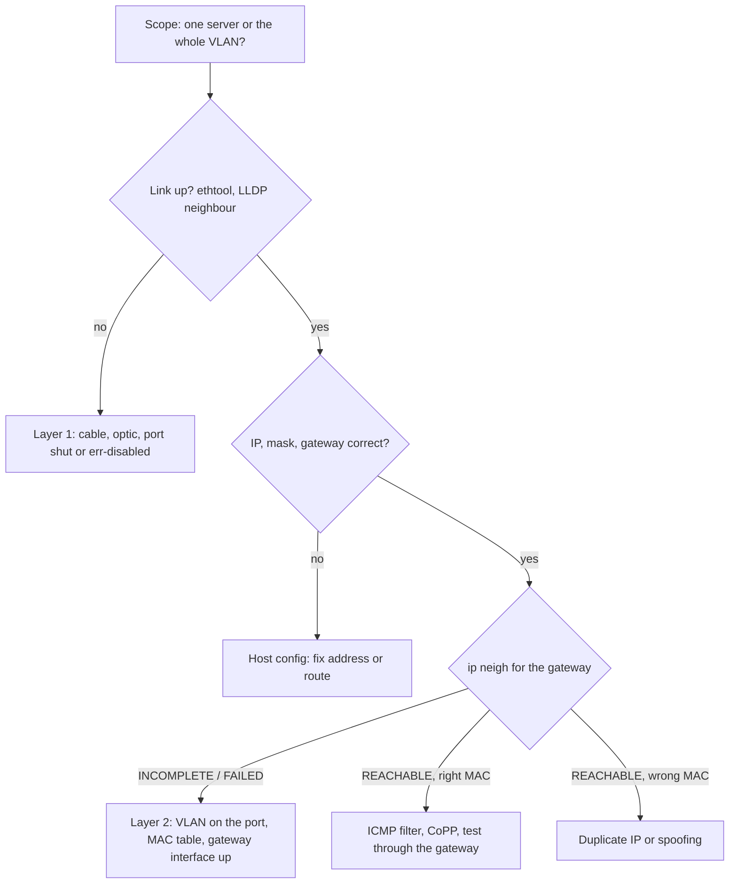

The routing table hands a host an answer in the wrong currency. It says "send this packet to 10.1.1.1", an IP address, but the network card can only put an Ethernet frame on the wire, and a frame is addressed to a MAC address, the 48-bit hardware address of an interface. Something has to turn the next hop's IP into a MAC before the first byte can leave. On IPv4 that is ARP, the Address Resolution Protocol (RFC 826, 1982); on IPv6 it is neighbour discovery. Both are tiny, both are unauthenticated, and both sit underneath every connection you have ever opened.

Network panels ask "a server can't ping its default gateway: what do you check?" because the answer shows whether you hold the picture. The gateway is one hop away, so the answer is a walk up the layers from the cable, not a tour of the routing protocols, and ARP is where most of the evidence lives.

This lesson uses Meridian's Amsterdam fabric. Acme's web server `acme-web1` (`10.1.1.10/24`, MAC `00:00:5e:00:53:0a`) sits on VLAN 100 behind `leaf1.ams`, and its default gateway, the router it hands every packet for a destination outside its own subnet, is `10.1.1.1`. A VLAN is a virtual LAN, one broadcast domain carved out of a switch ([switches, VLANs and loops](/learn/fabric-networking/from-zero/switches-vlans-and-loops)). The gateway is not a separate router: every Meridian leaf answers for `10.1.1.1` with the same **anycast gateway MAC**, `00:00:5e:00:01:01`. Acme's database `acme-db1` (`10.1.2.20`) lives in another subnet, VLAN 200, behind `leaf3.ams`. MACs come from the documentation range `00:00:5e:00:53:xx`.

## The first decision: same subnet or off subnet

Before ARP runs, the host decides *whose* MAC it needs. The rule fits in one line: if the destination is inside a subnet the host is directly attached to, resolve the destination itself; otherwise resolve the gateway that the routing table names. "Inside the subnet" is a bitwise AND of the destination with the interface's mask, compared with the interface's own network ([IP addressing and subnets](/learn/fabric-networking/from-zero/ip-addressing-and-subnets) works the arithmetic by hand).

| Destination | AND 255.255.255.0 | Equal to 10.1.1.0? | Route that matches | ARP for |
|---|---|---|---|---|
| `10.1.1.11` (another Acme host) | 10.1.1.0 | yes | `10.1.1.0/24` connected | 10.1.1.11 |
| `10.1.2.20` (`acme-db1`) | 10.1.2.0 | no | `0.0.0.0/0` via 10.1.1.1 | 10.1.1.1 |
| `203.0.113.10` (Meridian's website; a documentation address, RFC 5737) | 203.0.113.0 | no | `0.0.0.0/0` via 10.1.1.1 | 10.1.1.1 |

In practice the host does not run a separate test: it performs the ordinary longest-prefix match on its routing table ([the routing table](/learn/fabric-networking/from-zero/the-routing-table)). A server's table usually has two lines, and the kernel shows its decision without sending anything:

```text
$ ip route                                    (on acme-web1, illustrative)
default via 10.1.1.1 dev eth0
10.1.1.0/24 dev eth0 proto kernel scope link src 10.1.1.10

$ ip route get 10.1.2.20
10.1.2.20 via 10.1.1.1 dev eth0 src 10.1.1.10
$ ip route get 10.1.1.11
10.1.1.11 dev eth0 src 10.1.1.10
```

`scope link` means "on this wire, resolve the destination directly"; `via` means "resolve this router instead". The gateway's IP **never appears in the packet**: the IP header still says `10.1.2.20`, and `10.1.1.1` is used only to look up a MAC. And the gateway must sit inside a connected subnet, because a host can only ARP on a wire it is attached to; Linux rejects any other gateway with "Nexthop has invalid gateway" unless the route is explicitly marked on-link.

The decision in Python, plus the ARP request it leads to, built byte for byte:

```python
import ipaddress
import struct


def mac_bytes(mac: str) -> bytes:
    return bytes(int(part, 16) for part in mac.split(":"))


def next_hop(src_if: str, gateway: str, dst: str) -> str:
    """The host's first decision: ARP for the destination or for the gateway?"""
    iface = ipaddress.ip_interface(src_if)          # 10.1.1.10/24
    on_link = ipaddress.ip_address(dst) in iface.network
    return dst if on_link else gateway


def arp_request(src_mac: str, src_ip: str, target_ip: str) -> bytes:
    eth = mac_bytes("ff:ff:ff:ff:ff:ff") + mac_bytes(src_mac) + struct.pack("!H", 0x0806)
    arp = struct.pack("!HHBBH6s4s6s4s",
                      1,         # hardware type: Ethernet
                      0x0800,    # protocol type: IPv4
                      6, 4,      # address lengths: MAC 6 bytes, IPv4 4 bytes
                      1,         # operation: 1 request, 2 reply
                      mac_bytes(src_mac), ipaddress.ip_address(src_ip).packed,
                      bytes(6),  # target MAC: unknown, all zeros
                      ipaddress.ip_address(target_ip).packed)
    frame = eth + arp
    return frame + bytes(60 - len(frame))   # pad to Ethernet's 60-byte minimum


for dst in ["10.1.1.11", "10.1.2.20"]:
    print(f"to {dst}: ARP for {next_hop('10.1.1.10/24', '10.1.1.1', dst)}")
print("misconfigured /16, to 10.1.2.20: ARP for", next_hop("10.1.1.10/16", "10.1.1.1", "10.1.2.20"))

frame = arp_request("00:00:5e:00:53:0a", "10.1.1.10", next_hop("10.1.1.10/24", "10.1.1.1", "10.1.2.20"))
print(len(frame), "bytes before the FCS")
for off in range(0, 42, 14):
    print(f"  {off:02d}: {frame[off:off + 14].hex(' ')}")
op, = struct.unpack("!H", frame[20:22])
print("operation", op, "target IP", ipaddress.ip_address(frame[38:42]))
```

```text
to 10.1.1.11: ARP for 10.1.1.11
to 10.1.2.20: ARP for 10.1.1.1
misconfigured /16, to 10.1.2.20: ARP for 10.1.2.20
60 bytes before the FCS
  00: ff ff ff ff ff ff 00 00 5e 00 53 0a 08 06
  14: 00 01 08 00 06 04 00 01 00 00 5e 00 53 0a
  28: 0a 01 01 0a 00 00 00 00 00 00 0a 01 01 01
operation 1 target IP 10.1.1.1
```

`ip_interface(...).network` is the AND with the mask; `in` is the comparison. The third output line is the production edge case: give the host a `/16` by mistake and it believes `acme-db1` is on its own wire, so it ARPs for `10.1.2.20` in VLAN 100, where `acme-db1` never hears it. Whether that fails or quietly works depends on proxy ARP, below.

- **Solves:** a host needs no knowledge of the network beyond its own subnet and one gateway.
- **Breaks:** a wrong mask (too long cuts off neighbours, too short makes remote hosts look local) or a wrong gateway, usually from a template or a typo.
- **Signal:** `ip route get <destination>` shows the decision; `ip neigh` fills with entries for addresses that should never be resolved directly.

## ARP request and reply, field by field

ARP runs directly on Ethernet, not over IP: its frames carry EtherType `0x0806` (the 2-byte field naming what follows the Ethernet header, in [links, frames and Ethernet](/learn/fabric-networking/from-zero/links-frames-and-ethernet)) instead of IPv4's `0x0800`. The request `acme-web1` sends for its gateway is 28 bytes:

| Field | Size | Value in this request | What reads it |
|---|---|---|---|
| Hardware type | 2 bytes | 1 (Ethernet) | Receiver, to know the address format |
| Protocol type | 2 bytes | `0x0800` (IPv4) | Receiver; ARP was designed for any protocol, not only IP |
| Hardware address length | 1 byte | 6 | Receiver's parser |
| Protocol address length | 1 byte | 4 | Receiver's parser |
| Operation | 2 bytes | 1 (request); 2 is reply | Receiver's dispatch |
| Sender MAC | 6 bytes | `00:00:5e:00:53:0a` | Every receiver that caches the sender |
| Sender IP | 4 bytes | 10.1.1.10 | Every receiver that caches the sender |
| Target MAC | 6 bytes | `00:00:00:00:00:00` (the unknown) | Ignored in a request |
| Target IP | 4 bytes | 10.1.1.1 | Every receiver: "is this mine?" |

The Ethernet header is addressed to `ff:ff:ff:ff:ff:ff`, the broadcast MAC, because the sender does not know whom to ask. 14 bytes of header plus 28 of ARP is 42, below Ethernet's 60-byte minimum, so 18 bytes of zero padding are added, then the 4-byte FCS (frame check sequence, the CRC that detects corruption): 64 bytes on the wire, at 25 Gb/s about 20 nanoseconds of serialisation (64 × 8 bits / 25 × 10⁹ b/s), or 27 ns counting the 20 bytes of preamble and inter-frame gap.

The exchange, traced:

1. `acme-web1` needs the MAC of `10.1.1.1`. Its ARP cache has no entry, so the kernel creates one in state INCOMPLETE and holds the TCP SYN (the connection's first packet) in a small queue.
2. It broadcasts the request. `leaf1.ams` floods it to every other port in VLAN 100, as a switch does with any broadcast, and hands a copy to its own gateway interface for the VLAN, often called an SVI (switched virtual interface) or IRB (integrated routing and bridging) interface: the router that lives inside the VLAN.
3. Every other host in VLAN 100, `acme-app1` (`10.1.1.13`) among them, finds the target IP is not its own and discards the frame, though RFC 826 (and Linux) lets it refresh an *existing* entry for the sender, which gratuitous ARP relies on.
4. The gateway interface owns `10.1.1.1`. The request carried the sender's IP and MAC, so the leaf first records `10.1.1.10 → 00:00:5e:00:53:0a` in its own neighbour table and never needs to ARP for `acme-web1` to reply.
5. The leaf sends a **unicast** reply, operation 2, straight to `00:00:5e:00:53:0a`: sender MAC `00:00:5e:00:01:01`, sender IP `10.1.1.1`, target MAC and IP `acme-web1`'s own.
6. `acme-web1` stores `10.1.1.1 → 00:00:5e:00:01:01` as REACHABLE, releases the queued SYN, and sends the first frame: destination MAC the gateway's, destination IP `acme-db1`'s, which the leaf then routes hop by hop ([the packet walk](/learn/fabric-networking/from-zero/the-packet-walk)). On a quiet leaf the exchange takes on the order of a millisecond or less, most of it the request's trip through the switch's CPU, which handles ARP in software.

```viz
{"type": "fabric", "scenario": "arp-gateway", "title": "ARP for the gateway: off-subnet decision, broadcast request, unicast reply, cached entry, first frame", "caption": "acme-web1 connects to acme-db1. It finds 10.1.2.20 off its subnet, so it needs the gateway's MAC; the cache entry starts INCOMPLETE with the SYN queued, the request floods VLAN 100 (acme-app1 ignores it), leaf1.ams learns acme-web1 from the request and replies with the anycast gateway MAC, the entry becomes REACHABLE, and the SYN leaves addressed to the gateway's MAC but acme-db1's IP."}
```

A capture on `acme-web1` (`tcpdump -e -n arp`, illustrative) shows the request at 42 bytes, captured before the NIC (network interface card) pads it, and the padded 60-byte reply:

```text
00:00:5e:00:53:0a > ff:ff:ff:ff:ff:ff, ethertype ARP (0x0806), length 42: Request who-has 10.1.1.1 tell 10.1.1.10, length 28
00:00:5e:00:01:01 > 00:00:5e:00:53:0a, ethertype ARP (0x0806), length 60: Reply 10.1.1.1 is-at 00:00:5e:00:01:01, length 46
```

- **Solves:** IP-to-MAC mapping with zero configuration: any host can join a subnet and talk.
- **Breaks:** no reply (wrong VLAN, missing gateway interface, a filter), a wrong reply (a duplicate IP, or spoofing: ARP has no authentication), or too many requests (every broadcast interrupts every host in the VLAN).
- **Signal:** the server's cache state, a capture with requests leaving and no replies, and on the leaf the neighbour table and the drop counters of the policer (a rate limiter) that guards its CPU from ARP floods.

### Where the gateway lives: VRRP versus the anycast gateway

One gateway router is a single point of failure. The classic fix is VRRP, the Virtual Router Redundancy Protocol (RFC 5798): two routers share a virtual IP and a virtual MAC of the form `00:00:5e:00:01:{group number}` (Meridian's address has that form), the master answers ARP and advertises every second, and the backup takes over after missing three advertisements, 3 to 4 seconds. The new master sends gratuitous ARP so the switches learn the virtual MAC's new port.

An EVPN fabric (EVPN, Ethernet VPN, is the BGP-based control plane that tells leaves which tenant hosts sit behind which leaf: [EVPN, the control plane](/learn/fabric-networking/overlays-vxlan-evpn/evpn-the-control-plane)) does something simpler: **every leaf is the gateway at once**, owning `10.1.1.1` and `00:00:5e:00:01:01`, answering ARP and routing locally. Nothing fails over because nothing is primary, and a server that moves from `leaf1.ams` to `leaf5.ams` keeps a correct cache entry.

## The cache: states, timers and why STALE is normal

Answers are cached, or every packet would wait for a broadcast. On Linux the cache is the **neighbour table** (`ip neigh`), shared by ARP and IPv6 neighbour discovery. Its state machine comes from IPv6 (RFC 4861's neighbour unreachability detection), which is why an IPv4 entry can say STALE or DELAY.

| State | Meaning | Is the cached MAC used? | Leaves the state when |
|---|---|---|---|
| INCOMPLETE | Request sent, no reply yet; packets wait in a queue | No | Reply arrives (REACHABLE) or 3 broadcast probes 1 s apart go unanswered (FAILED) |
| REACHABLE | Recently confirmed | Yes | A random 15–45 s pass (`base_reachable_time` 30 s, times 0.5 to 1.5) without confirmation: STALE |
| STALE | Not confirmed lately, not doubted either | Yes, at once | A packet is sent: DELAY |
| DELAY | Waiting briefly for an upper layer to confirm | Yes | Confirmation (REACHABLE) or 5 s pass (`delay_first_probe_time`): PROBE |
| PROBE | Sending unicast requests to the cached MAC | Yes | Reply (REACHABLE) or 3 unanswered probes 1 s apart (FAILED) |
| FAILED | Resolution failed; queued packets were dropped | No | The next packet starts INCOMPLETE again |
| PERMANENT | Configured by hand | Yes | Never |

Three details explain behaviour you will see on real servers:

- **STALE is not an error.** Most entries on a busy server are STALE, and traffic flows through them without delay. The kernel doubts an entry only when it is used and nothing has confirmed it.
- **TCP confirms for ARP.** An acknowledgement of new data through a next hop tells the neighbour subsystem the neighbour is alive, so an entry carrying a busy connection returns to REACHABLE with no ARP traffic. Unicast probes appear mostly for idle or UDP-only peers.
- **The queue is small.** Packets for an INCOMPLETE entry wait in a per-entry queue (`unres_qlen_bytes`, on the order of 200 KB on current kernels). Overflow drops are counted in `/proc/net/stat/arp_cache` as `unresolved_discards`, invisible to every interface counter.

The state machine in runnable form, with the reachable time fixed at 30 s so the run is repeatable. The first run is a healthy gateway; the second is a gateway that never answers.

```python
REACHABLE_TIME = 30.0   # Linux picks 15-45 s at random around base_reachable_time; fixed here
DELAY_TIME = 5.0        # delay_first_probe_time
RETRANS = 1.0           # retrans_time between probes
SOLICIT = 3             # mcast_solicit (INCOMPLETE) and ucast_solicit (PROBE)


class Neighbour:
    def __init__(self, ip):
        self.ip, self.mac, self.state = ip, None, "NONE"
        self.since, self.probes, self.queue = 0.0, 0, []

    def tick(self, now):
        """Advance timers; returns a line describing what the kernel did, if anything."""
        if self.state == "REACHABLE" and now - self.since >= REACHABLE_TIME:
            self.state, self.since = "STALE", now
            return "reachable time expired: STALE (still used, not yet doubted)"
        if self.state == "DELAY" and now - self.since >= DELAY_TIME:
            self.state, self.since, self.probes = "PROBE", now, 1
            return f"no confirmation in {DELAY_TIME:.0f} s: PROBE, unicast ARP to {self.mac}"
        if self.state in ("INCOMPLETE", "PROBE") and now - self.since >= RETRANS * self.probes:
            if self.probes < SOLICIT:
                self.probes += 1
                kind = "broadcast" if self.state == "INCOMPLETE" else "unicast"
                return f"{self.state}: {kind} ARP probe {self.probes} of {SOLICIT}"
            dropped, self.queue = len(self.queue), []
            self.state, self.mac = "FAILED", None
            return f"no reply to {SOLICIT} probes: FAILED, {dropped} queued packet(s) dropped"
        return None

    def send(self, now, pkt):
        if self.state in ("NONE", "FAILED"):
            self.state, self.since, self.probes, self.queue = "INCOMPLETE", now, 1, [pkt]
            return f"no entry: INCOMPLETE, '{pkt}' queued, broadcast ARP probe 1 of {SOLICIT}"
        if self.state == "INCOMPLETE":
            self.queue.append(pkt)
            return f"still INCOMPLETE: '{pkt}' queued"
        if self.state == "STALE":
            self.state, self.since = "DELAY", now
            return f"'{pkt}' sent to {self.mac} at once; STALE -> DELAY, waiting for a confirmation"
        return f"'{pkt}' sent to {self.mac} ({self.state})"

    def reply(self, now, mac):
        self.mac, self.state, self.since = mac, "REACHABLE", now
        sent, self.queue = self.queue, []
        return f"ARP reply {mac}: REACHABLE" + (f", released {sent}" if sent else "")

    def confirm(self, now):   # e.g. TCP saw an ACK for new data from this next hop
        if self.state in ("DELAY", "PROBE", "REACHABLE"):
            self.state, self.since = "REACHABLE", now
            return "upper layer confirmed reachability: REACHABLE, no ARP needed"


def run(title, events):
    gw = Neighbour("10.1.1.1")
    print(title)
    t = 0.0
    for at, action, arg in events + [(events[-1][0] + 6.0, "end", None)]:
        while t < at:                       # step the clock in 0.5 s ticks
            t = min(at, t + 0.5)
            msg = gw.tick(t)
            if msg:
                print(f"  t={t:5.1f}  {msg}")
        if action != "end":
            msg = getattr(gw, action)(t, arg) if arg else getattr(gw, action)(t)
            print(f"  t={t:5.1f}  {msg}")


GW_MAC = "00:00:5e:00:01:01"
run("Healthy gateway:", [(0.0, "send", "SYN to 10.1.2.20"), (0.0, "reply", GW_MAC),
                         (20.0, "send", "query"), (40.0, "send", "query"),
                         (41.0, "confirm", None), (80.0, "send", "query"),
                         (86.3, "reply", GW_MAC)])
run("Gateway interface missing:", [(0.0, "send", "SYN to 10.1.2.20"), (0.5, "send", "ping")])
```

```text
Healthy gateway:
  t=  0.0  no entry: INCOMPLETE, 'SYN to 10.1.2.20' queued, broadcast ARP probe 1 of 3
  t=  0.0  ARP reply 00:00:5e:00:01:01: REACHABLE, released ['SYN to 10.1.2.20']
  t= 20.0  'query' sent to 00:00:5e:00:01:01 (REACHABLE)
  t= 30.0  reachable time expired: STALE (still used, not yet doubted)
  t= 40.0  'query' sent to 00:00:5e:00:01:01 at once; STALE -> DELAY, waiting for a confirmation
  t= 41.0  upper layer confirmed reachability: REACHABLE, no ARP needed
  t= 71.0  reachable time expired: STALE (still used, not yet doubted)
  t= 80.0  'query' sent to 00:00:5e:00:01:01 at once; STALE -> DELAY, waiting for a confirmation
  t= 85.0  no confirmation in 5 s: PROBE, unicast ARP to 00:00:5e:00:01:01
  t= 86.0  PROBE: unicast ARP probe 2 of 3
  t= 86.3  ARP reply 00:00:5e:00:01:01: REACHABLE
Gateway interface missing:
  t=  0.0  no entry: INCOMPLETE, 'SYN to 10.1.2.20' queued, broadcast ARP probe 1 of 3
  t=  0.5  still INCOMPLETE: 'ping' queued
  t=  1.0  INCOMPLETE: broadcast ARP probe 2 of 3
  t=  2.0  INCOMPLETE: broadcast ARP probe 3 of 3
  t=  3.0  no reply to 3 probes: FAILED, 2 queued packet(s) dropped
```

Remember the last line. A host whose gateway never answers fails after about **3 seconds**, and the error comes from the host itself: `connect()` returns "No route to host" (EHOSTUNREACH), and `ping` (which sends ICMP echo requests; ICMP is IP's control and error channel) prints `From 10.1.1.10 icmp_seq=1 Destination Host Unreachable`, naming the server's own address. No packet for the destination ever left, so there is nothing to find on the routers.

### The router's side of the cache

Routers keep the same mapping for every host on every gateway interface, in hardware too: the ASIC (the forwarding chip) needs each host's MAC in a host or adjacency table to rewrite frames at line rate. Those tables hold from tens of thousands to a few hundred thousand entries depending on the chip, shared between IPv4 and IPv6. Router ARP timers are far longer than a server's: 4 hours is a common router default (Cisco IOS, for one), and tens of minutes is common on data center switches, while a switch forgets a MAC it has not heard from in 300 seconds, the IEEE 802.1D aging default most switches keep. That mismatch causes a classic failure below.

## Gratuitous ARP: announcing instead of asking

A **gratuitous ARP** is an unrequested ARP whose sender IP and target IP are the same address: "10.1.1.50 is at this MAC", broadcast to the VLAN, as a request or a reply (implementations accept both). It does three jobs:

1. **Moving an address to a new MAC.** After a failover, the new owner announces itself so caches update now rather than when they time out.
2. **Detecting duplicate addresses.** RFC 5227 has a host probe before using an address: an ARP request with sender IP `0.0.0.0` asking for the address it wants. Any reply means someone already has it.
3. **Telling switches where a MAC now lives.** A broadcast reaches every switch in the VLAN, and each learns the source MAC's new port. Hypervisors send a gratuitous ARP or RARP (reverse ARP) frame for a virtual machine right after a live migration for this reason.

Traced on Meridian: Acme runs two load balancers in VLAN 100, `acme-lb1` (MAC `00:00:5e:00:53:32`) and `acme-lb2` (`00:00:5e:00:53:33`), sharing the virtual IP `10.1.1.50` with keepalived, a Linux implementation of VRRP. By default keepalived keeps each box's own MAC rather than a virtual one, so failover rests entirely on gratuitous ARP.

1. `acme-web1` and `leaf1.ams` both cache `10.1.1.50 → …:32`, and the leaf's MAC table puts `…:32` on `acme-lb1`'s port.
2. `acme-lb1` loses power. `acme-lb2` misses three advertisements and becomes master 3 to 4 seconds later.
3. `acme-lb2` takes `10.1.1.50` and broadcasts: sender IP `10.1.1.50`, sender MAC `…:33`, target IP `10.1.1.50`. keepalived repeats it (five times by default) in case one is lost.
4. `acme-web1` already has an entry for `10.1.1.50`, so it overwrites the MAC. Linux's default `arp_accept=0` refuses to *create* entries from unsolicited ARP but updates existing ones, the case that matters.
5. `leaf1.ams` updates its neighbour entry and learns `…:33` on `acme-lb2`'s port, so traffic routed in from other subnets follows; in EVPN it also advertises the new MAC and IP pairing to every other leaf.

Without step 3, `acme-web1` would keep sending to a dead MAC until its entry fell through STALE, DELAY and PROBE to FAILED, under a minute on Linux, and a router holding a 4-hour ARP entry could black-hole the virtual IP far longer. A policy that drops gratuitous ARP turns a 4-second failover into an outage.

- **Solves:** fast cache updates after failover or migration; duplicate address detection.
- **Breaks:** lost or filtered announcements leave stale caches; and being unauthenticated, gratuitous ARP is also the tool of ARP spoofing, an attacker announcing the gateway's IP with its own MAC. Dynamic ARP inspection on switches checks ARP against the leases handed out by DHCP (the protocol that assigns hosts their addresses) for that reason.
- **Signal:** duplicate-address log messages, MAC moves (one MAC appearing on a new port), and in EVPN the MAC mobility sequence number rising on each move.

## Proxy ARP: answering for someone else

**Proxy ARP** (RFC 1027) is a router answering an ARP request for an address that is not its own, with its own MAC, because it has a route to that address through a different interface. The asker sends its frames to the router, which routes them.

Traced, with the `/16` mistake from the first section: `acme-web1` is configured as `10.1.1.10/16` and pings `acme-db1`.

1. `10.1.2.20` is inside `10.1.0.0/16`, so `acme-web1` ARPs for `10.1.2.20` directly, in VLAN 100.
2. `acme-db1` is in VLAN 200 behind `leaf3.ams` and never sees the broadcast.
3. **Without proxy ARP:** nobody answers; three probes, FAILED, "Destination Host Unreachable" after 3 seconds, while pings to `10.1.1.1` work perfectly.
4. **With proxy ARP on leaf1's VLAN 100 interface:** the leaf looks up `10.1.2.20`, finds `10.1.2.0/24` through an interface other than the one the request arrived on, and replies "`10.1.2.20` is at `00:00:5e:00:01:01`". `acme-web1` sends to the gateway MAC after all, and the ping works.

The misconfiguration is now invisible: the server works for years, then a migration disables proxy ARP (most data center platforms ship it off) and the server loses everything outside `10.1.1.0/24`. The giveaway is in its cache: dozens of IPs mapped to one MAC, the gateway's.

EVPN fabrics contain a relative that is not proxy ARP. With **ARP suppression**, the leaf answers a request for a host on the *same* subnet behind another leaf, say `acme-web2` (`10.1.1.11`, behind `leaf2.sin`), with that host's **real** MAC, `00:00:5e:00:53:0b`, from the MAC-and-IP routes EVPN distributes. The broadcast never crosses the fabric. The [EVPN control plane](/learn/fabric-networking/overlays-vxlan-evpn/evpn-the-control-plane) shows the routes, and [BUM traffic](/learn/fabric-networking/overlays-vxlan-evpn/bum-traffic) shows how much flooding it saves. Public clouds go further: the virtual switch under every VM answers all ARP from the controller's table, so no broadcast ever reaches the physical network.

- **Solves:** reachability for hosts that cannot be reconfigured, and in its suppression form, broadcast reduction at scale.
- **Breaks:** hides wrong masks until it is removed; grows host caches (one entry per remote destination); a proxy answering for addresses it should not can attract and black-hole traffic.
- **Signal:** many IPs sharing one MAC in `ip neigh`; proxy-ARP reply counters on the gateway interface.

## IPv6 neighbour discovery

IPv6 has no ARP. Neighbour discovery (ND, RFC 4861) does the job with ICMPv6, the IPv6 version of ICMP:

| ICMPv6 type | Message | Sent by | Purpose |
|---|---|---|---|
| 133 | Router Solicitation (RS) | Host | "Any routers here?" at boot |
| 134 | Router Advertisement (RA) | Router | Prefix, default router, lifetime, MTU |
| 135 | Neighbour Solicitation (NS) | Anyone | "Who has this address?" (ARP request), and reachability probes |
| 136 | Neighbour Advertisement (NA) | Owner | "It is at this MAC" (ARP reply) |
| 137 | Redirect | Router | "Use a better first hop for this destination" |

**Multicast instead of broadcast.** An NS goes to the target's **solicited-node multicast address**, `ff02::1:ff` plus the target's last 24 bits, sent to Ethernet address `33:33` plus the multicast address's last 32 bits (RFC 2464). NICs filter on it in hardware, so only hosts whose addresses end in those 24 bits are interrupted, typically one.

**The gateway comes from routers, not configuration.** Routers send RAs every few minutes and on request; a host takes the RA's source, a **link-local** address in `fe80::/10`, as its default gateway, so an IPv6 server's default route reads `default via fe80::1 dev eth0`. The advertised router lifetime defaults to 1,800 seconds.

**A built-in hop check.** ND messages must arrive with hop limit 255 (IPv6's TTL, the counter every router decrements), which only a sender on the same link can produce, so a forged NA from elsewhere is discarded: the idea behind BGP's GTSM (Generalized TTL Security Mechanism, RFC 5082) check ([BGP sessions and the FSM](/learn/fabric-networking/bgp-fundamentals/bgp-sessions-and-the-fsm)).

Suppose Acme's VLAN 100 also carries IPv6, with `2001:db8:a:100::/64` (`2001:db8::/32` is reserved for documentation) and the anycast gateway's link-local address `fe80::1`. `acme-web1` resolving its gateway:

| Layer | Field | Value | What reads it |
|---|---|---|---|
| Ethernet | Destination MAC | `33:33:ff:00:00:01` | NIC filters: only listeners for this group accept |
| Ethernet | Source MAC | `00:00:5e:00:53:0a` | Switch MAC learning |
| Ethernet | EtherType | `0x86DD` (IPv6) | Receiver |
| IPv6 | Source | `fe80::200:5eff:fe00:530a` (link-local, from the MAC) | Target, to reply |
| IPv6 | Destination | `ff02::1:ff00:1` (solicited-node of `fe80::1`) | Multicast delivery |
| IPv6 | Hop limit | 255 | Receiver rejects anything lower |
| ICMPv6 | Type / code | 135 / 0 (NS) | Receiver's dispatch |
| ICMPv6 | Target address | `fe80::1` | "Is this mine?" |
| ICMPv6 option | Source link-layer address (type 1) | `00:00:5e:00:53:0a` | Target caches the sender, like ARP's sender fields |

The leaf answers with an NA (type 136) with the Router, Solicited and Override flags and the target link-layer address `00:00:5e:00:01:01`; the neighbour table then runs the same states as above. Duplicate address detection is built in (RFC 4862): before using an address, a host sends an NS for it from the unspecified address `::`, and any NA in reply means it is taken.

- **Solves:** resolution without broadcast, router discovery without DHCP, and on-link-only protection.
- **Breaks:** MLD snooping (switches tracking Multicast Listener Discovery, the protocol hosts use to join groups) dropping solicited-node traffic, so IPv6 neighbours fail while IPv4 works on the same port; rogue RAs from a misconfigured host (RA guard on switch ports filters them); router neighbour cache exhaustion from a scan of a /64, each nonexistent address creating an INCOMPLETE entry (RFC 6583).
- **Signal:** `ip -6 neigh` states, `ip -6 route` showing a default route via a link-local address (or none), RA counters, and INCOMPLETE counts on gateway interfaces.

## "The server can't ping its default gateway": the checklist

The gateway is one hop away, so the fault is on that hop: the server, its cable, its switch port, the VLAN or the gateway interface. Answering with IS-IS, BGP or the spines, which cannot affect a directly connected next hop, is the most common way to fail this question. Walk up the layers, saying at each step which layer you are testing and what result sends you on.



1. **Scope first.** Can other servers in VLAN 100 ping `10.1.1.1`? If they can, it is this server or its port; if none can, the gateway interface or the VLAN on the leaf. One question halves the search before any command.
2. **Layer 1: is the link up?** On the server, `ip -br link` and `ethtool eth0` (`Link detected: yes`, the expected speed); on the leaf, the port's state, error counters, and whether a protection feature error-disabled it. LLDP, the Link Layer Discovery Protocol in which each end announces its name and port, confirms the cable lands where the documentation says.
3. **Host configuration.** `ip -br addr` and `ip route`: the right address and mask (the `/16` case), a gateway inside the subnet, on the interface that is actually cabled. A bond (several NICs combined into one logical interface) with the address on the wrong member, or a VLAN subinterface the port does not expect, fails here.
4. **ARP: the pivot.** `ip neigh show 10.1.1.1`.
   - INCOMPLETE then FAILED: requests leave and no reply returns. Confirm with `tcpdump -e -n arp` on the server: requests visible going out, nothing coming back. The fault is layer 2 or the gateway: the port in the wrong VLAN (or tagged when the port expects untagged frames), the server's MAC missing from the leaf's MAC table for VLAN 100, the gateway interface missing, down or holding the wrong address or VRF (a VRF, virtual routing and forwarding, is a separate routing table per tenant, in [VRFs and multi-tenancy](/learn/fabric-networking/overlays-vxlan-evpn/vrfs-and-multi-tenancy)).
   - REACHABLE with `00:00:5e:00:01:01`: layer 2 and ARP work. Move up.
   - REACHABLE with an unexpected MAC: someone else answers for `10.1.1.1`, a duplicate address or spoofing. `arping 10.1.1.1` shows every MAC that replies.
5. **ARP resolves but ping fails.** Frames reach the gateway, so it is a policy or the gateway's CPU. A ping to the gateway's own address is traffic *to the switch*: the ASIC punts it to the CPU under control-plane policing (CoPP, a rate limit protecting the CPU, in [planes, ASICs and network operating systems](/learn/fabric-networking/from-zero/planes-asics-and-network-operating-systems)), and some fabrics limit ICMP to the gateway heavily. Check the host firewall and any ACL (access control list, a packet filter) on the gateway interface, then test *through* the gateway: ping `acme-db1`. A gateway that forwards but ignores pings is working.
6. **Only then, size.** If small pings work and `ping -M do -s 8972 10.1.1.1` (a 9,000-byte packet that must not be fragmented) fails, the server's MTU (maximum transmission unit, the largest packet an interface sends) exceeds what the port or the gateway interface accepts ([transport as the network sees it](/learn/fabric-networking/from-zero/transport-as-the-network-sees-it)).

What the evidence looks like when step 4 fails, with the leaf's side alongside (illustrative; the leaf output is vendor-neutral):

```text
acme-web1$ ip neigh show 10.1.1.1
10.1.1.1 dev eth0 FAILED
acme-web1$ ping -c 2 10.1.1.1
From 10.1.1.10 icmp_seq=1 Destination Host Unreachable
From 10.1.1.10 icmp_seq=2 Destination Host Unreachable

leaf1.ams> show mac address-table vlan 100
VLAN  MAC                Port   Type
100   00:00:5e:00:53:0a  swp1   dynamic      <- the server's frames arrive
leaf1.ams> show interface vlan100
vlan100 is down; no address configured       <- nobody owns 10.1.1.1
```

The MAC table proves the server's frames reach the leaf; the missing gateway interface explains the silence. That is the run below.

```viz
{"type": "fabric", "scenario": "arp-gateway", "variant": "no-reply", "title": "No reply: three broadcast probes, a FAILED entry and \"No route to host\" from the server itself", "caption": "The same connection with leaf1.ams's VLAN 100 gateway interface missing. The request floods the VLAN, nobody owns 10.1.1.1, two more probes follow at 1 s and 2 s, and at 3 s the entry turns FAILED, the queued SYN is dropped and connect() fails with EHOSTUNREACH: no packet to acme-db1 ever left the server."}
```

The interview version: "First I'd confirm scope: this server, or every server in the VLAN. It's one hop, so no routing protocol is involved; I'd go up the layers: link and LLDP, then address, mask and gateway, then whether ARP resolves the gateway's MAC. If ARP fails, it's layer 2 or the gateway interface. If ARP resolves and ping still fails, it's a filter or control-plane policing, so I'd test through the gateway rather than to it."

## Failure modes in production

**ARP timeout longer than MAC aging: unicast flooding.** *Symptom:* traffic for one server appears on every port in its VLAN, and utilisation rises on servers that never asked for it. *Diagnosis:* the router holds a valid ARP entry (4 hours) and keeps sending to that MAC, but the switch forgot the MAC's port after 300 seconds because the server's own traffic leaves by another path (asymmetric routing), so every frame is flooded as unknown unicast. The ARP table has the MAC, the MAC table does not, and unknown-unicast flood counters rise. *Fix:* keep the router's ARP timeout below the switches' MAC aging time (or raise MAC aging to match), so each ARP refresh re-teaches the switch the port before it forgets it.

**Neighbour table overflow.** *Symptom:* a Kubernetes node on a large flat subnet intermittently cannot reach some peers, and `dmesg` says `neighbour: arp_cache: neighbor table overflow!`. *Diagnosis:* Linux garbage-collects above `gc_thresh2` (512 entries by default) and refuses new entries above `gc_thresh3` (1,024). On a switch, the ASIC host table fills and new hosts are routed by the CPU or not at all. *Fix:* raise the thresholds where a host legitimately has thousands of neighbours, and shrink layer-2 domains ([why overlays](/learn/fabric-networking/overlays-vxlan-evpn/why-overlays)).

**Duplicate IP address.** *Symptom:* connections to one address reset or hang intermittently, depending on which host answered the latest ARP. *Diagnosis:* `arping` shows two MACs replying; the leaf logs a MAC move or, in EVPN, duplicate address detection, which in the open-source FRRouting suite by default flags an address as duplicate after 5 moves within 180 seconds (freezing it is an extra option). *Fix:* find the second owner (often a cloned VM or a static address inside a DHCP pool) and reconcile against the source of truth.

**ARP storm after a leaf reboot.** *Symptom:* after a leaf comes back, most servers recover in seconds but some stay unreachable for minutes. *Diagnosis:* every host and the leaf re-resolve at once, the policer on ARP to the CPU drops the excess, and failed resolutions retry only when the next packet needs them; CoPP drop counters for the ARP class show it. *Fix:* size the ARP policer for the leaf's host count, and drain traffic before maintenance ([safe change and maintenance](/learn/fabric-networking/operating-fabrics/safe-change-and-maintenance)).

## Trade-offs: ways to resolve a neighbour

| Mechanism | Who answers | Traffic it creates | Trust | Scale limit | Typical failure |
|---|---|---|---|---|---|
| ARP (IPv4) | The owner | A broadcast to every host in the VLAN per miss | None; anyone can answer | Broadcast load and host tables in large VLANs | No reply (VLAN, gateway), spoofing |
| IPv6 ND | The owner | A multicast that usually one host's NIC accepts | Hop limit 255 limits it to the link; RA guard optional | Router neighbour cache under /64 scans | MLD snooping drops, rogue RAs |
| Proxy ARP | A router, with its own MAC | Same as ARP | None | One entry per remote destination on the host | Hides wrong masks until removed |
| EVPN ARP suppression | The local leaf, with the real MAC | None across the fabric when the answer is known | As good as the control plane | Leaf host tables | Stale MAC/IP route after a silent move |
| Static entries | Nobody; configured | None | Total, and rigid | Operator effort | Wrong after any hardware change |

## Under the hood: the Linux neighbour subsystem

On Linux the routing lookup produces a next hop, and the packet is handed to a `struct neighbour` for that next hop and device; the same code serves ARP (`arp_tbl`) and IPv6 ND (`nd_tbl`). The entry holds the state, the MAC, the timers and the unresolved queue. Per-device tunables live under `/proc/sys/net/ipv4/neigh/<device>/` (and `net.ipv6.neigh` for ND): `base_reachable_time_ms` (30,000), `delay_first_probe_time` (5), `retrans_time_ms` (1,000), `ucast_solicit` and `mcast_solicit` (3 each), and `gc_stale_time` (60 s, after which an unused STALE entry can be collected). The three `gc_thresh` limits are table-wide, under `neigh/default/`.

Two sysctls matter on multi-homed hosts and load balancers: `arp_ignore=1` replies only for addresses on the interface the request arrived on, and `arp_announce=2` uses the best local address as the sender IP. Together they let direct-server-return load balancing put a virtual IP on every backend's loopback without the backends answering ARP for it ([load balancing](/learn/networking/application-protocols/load-balancing)). On a switch running a Linux-based network operating system (Cumulus Linux, SONiC), the kernel's neighbour table is the software copy and a daemon programs each entry into the ASIC's host table; when the two disagree, the kernel says one thing and the hardware forwards another, so the platform should compare them.

## What the platform should show

A tool built for "is it the network?" should expose, per server and per gateway:

- **Neighbour state, not only link state.** The count of INCOMPLETE and FAILED entries per host and per gateway interface. A port can be up with a dead gateway behind it.
- **Gateway reachability from the host's point of view.** A probe from the server to its gateway and one *through* the gateway, so "the gateway does not answer ICMP" is told apart from "the gateway does not forward".
- **Table utilisation against limits.** Host neighbour tables against `gc_thresh3`, leaf host and adjacency tables against the ASIC's capacity, with a trend.
- **MAC moves and duplicate addresses as events.** Each with both ports, both MACs and the time, correlated with failovers and VM migrations so expected moves are not alarms.
- **Policer drops for ARP and ND.** CoPP drop counters per class on every leaf, graphed beside reboots and maintenance.
- **Intent checks.** Each server's address, mask and gateway against the source of truth, ARP timeout against MAC aging on every device, proxy ARP where it should be off. Most failures here are configuration drift a diff would have caught ([network automation and source of truth](/learn/fabric-networking/operating-fabrics/network-automation-and-source-of-truth)).

## Interviewer follow-ups

**"`ip neigh` shows the gateway REACHABLE with the right MAC, yet ping to it fails. What now?"** Model answer: layer 2 and ARP work, so frames reach the gateway; what remains is a host firewall, an ACL, or control-plane policing on ICMP to the switch's CPU. I would ping through the gateway to separate forwarding from the control plane. Common wrong answer: "clear the ARP cache", which removes the one piece of evidence that was healthy. An honest addition: "I'd defer to the network team on the CoPP classes and rates on that platform, but I'd want their drop counters in the same view as the failed probe."

**"Why does IPv6 use multicast for neighbour discovery when ARP uses broadcast?"** Model answer: a broadcast costs every host's CPU in the VLAN on every miss; the solicited-node group is filtered by the NIC, so typically only the owner processes it. Common wrong answer: "IPv6 has no broadcast, so it had no choice"; dropping broadcast was the design decision, made for this reason.

**"What is gratuitous ARP, and what breaks without it?"** Model answer: an unsolicited ARP whose sender and target IP are equal, announcing a mapping; it updates caches and switch MAC tables after a failover or migration, and detects duplicates. Without it, peers keep sending to the old MAC until their entries time out, up to about a minute on a Linux host and potentially hours on a router. Common wrong answer: "it is an attack"; spoofing uses the mechanism, but every failover design depends on it.

**"Why doesn't a server need to re-ARP when it moves to another leaf in Meridian?"** Model answer: every leaf is the gateway at once with the same IP and the same anycast MAC, so the cached entry is still correct; EVPN carries the server's own MAC to the other leaves. Common wrong answer: "the new leaf sends it a gratuitous ARP".

## What mid-level engineers get wrong

- **Jumping to routing protocols for a one-hop problem.** IS-IS and BGP cannot affect a directly connected next hop; the evidence is in the ARP cache.
- **Reading STALE as broken.** STALE entries carry traffic without delay; FAILED and INCOMPLETE are the states that mean something.
- **Expecting the destination's MAC in an off-subnet frame.** The frame carries the gateway's MAC; the destination's MAC never leaves its own subnet.
- **Leaving proxy ARP to cover a wrong mask.** It fails later, during somebody else's change.

## Senior signals

- You state the host's decision as a longest-prefix match on its own table, and know the gateway's IP is only a key for finding a MAC and never appears in the packet.
- You read the neighbour cache as evidence: INCOMPLETE then FAILED means requests left and nothing came back, and "Destination Host Unreachable" from the server's own address means no packet ever left.
- You answer the gateway question as one hop walked up the layers, scope first, with ARP as the pivot.
- You tie failover speed to gratuitous ARP and cache timers, and know why an anycast gateway removes failover altogether.
- You watch the tables as capacity: host neighbour limits, ASIC host tables, ARP policers, and ARP timeout against MAC aging.

## Check yourself

```quiz
- q: >-
    acme-web1 (10.1.1.10/24, gateway 10.1.1.1) opens a connection to acme-db1 at 10.1.2.20. Which MAC address does it resolve with ARP?
  options: ["The gateway's, because 10.1.2.20 is off the host's subnet", "acme-db1's, because the frame must reach the database", "The broadcast MAC, because the destination is in another VLAN", "acme-db1's, obtained from the gateway by proxy ARP"]
  answer: 0
  explanation: >-
    10.1.2.20 AND 255.255.255.0 is 10.1.2.0, not acme-web1's 10.1.1.0, so the default route via 10.1.1.1 matches and the host needs the gateway's MAC. The frame's destination MAC is the gateway's and its destination IP is acme-db1's. The broadcast MAC is only used for the ARP request itself, and proxy ARP would answer with the router's own MAC, not the database's.
- q: >-
    A server cannot reach its gateway. ip neigh shows the gateway as FAILED, and ping prints "From 10.1.1.10 icmp_seq=1 Destination Host Unreachable", where 10.1.1.10 is the server itself. What does this tell you?
  options: ["ARP got no reply, so the pings never left the server", "The gateway received the pings and refused them with ICMP", "A router beyond the gateway has no route to the destination", "The gateway answered ARP but its CPU dropped the pings"]
  answer: 0
  explanation: >-
    FAILED means the kernel's ARP requests went unanswered, so it dropped the queued packets and generated the error locally, which is why the message names the server's own address. Nothing reached the gateway. The next checks are layer 2 and the gateway interface: the port's VLAN, the leaf's MAC table, the gateway interface being up. A refusal or CPU drop at the gateway requires ARP to have succeeded first.
- q: >-
    After a keepalived failover moves virtual IP 10.1.1.50 from acme-lb1 to acme-lb2, which message makes peers send to acme-lb2 without waiting for their cache entries to time out?
  options: ["A proxy ARP reply from leaf1.ams for 10.1.1.50 carrying the gateway MAC", "A gratuitous ARP from acme-lb2 naming 10.1.1.50 as both sender and target IP", "An ICMP redirect from leaf1.ams naming acme-lb2 as the better first hop", "An ARP request from each peer, sent as soon as its entry turns STALE"]
  answer: 1
  explanation: >-
    The new owner broadcasts a gratuitous ARP, and hosts that already cache 10.1.1.50 overwrite the MAC (Linux updates existing entries even with arp_accept=0), while the switches learn the MAC's new port. Waiting for STALE and a probe is exactly the slow path the announcement avoids. Proxy ARP would point peers at the leaf, and redirects concern routers, not same-subnet neighbours.
- q: >-
    A server configured as 10.1.1.10/16 instead of /24 has reached 10.1.2.20 for years. A migration disables proxy ARP on the leaf and the server loses everything outside 10.1.1.0/24. Why did it ever work?
  options: ["The leaf answered ARP for 10.1.2.20 with its own MAC and routed the frames", "The database answered ARP across VLANs because both share one leaf pair", "The /16 mask is wider, so the server's packets matched the default route instead", "EVPN ARP suppression answered with the database's real MAC from a MAC-and-IP route"]
  answer: 0
  explanation: >-
    The /16 made 10.1.2.20 look on-link, so the server ARPed for it directly. With proxy ARP, the leaf had a route to 10.1.2.0/24 through another interface and replied with its own MAC, so frames went to the leaf anyway. ARP suppression answers only for hosts in the same subnet and VLAN, with their real MAC; acme-db1 is in VLAN 200, which the server's broadcast never reaches.
- q: >-
    Why does IPv6 neighbour discovery interrupt fewer hosts than ARP in a large VLAN?
  options: ["Its messages are carried over TCP, so they reach only one listener", "Its solicitations are sent only to the routers learned from advertisements", "Its solicitations go to a solicited-node multicast group that NICs filter", "Its replies are cached for longer, so misses are much rarer than in ARP"]
  answer: 2
  explanation: >-
    A neighbour solicitation goes to ff02::1:ff plus the target's last 24 bits, mapped to a 33:33 Ethernet multicast address the NIC can filter in hardware, so typically only the owner processes it. ARP's broadcast reaches every host's CPU. ND uses the same reachability state machine as Linux's ARP, so cache lifetime is not the difference, and ND runs over ICMPv6, not TCP.
- q: >-
    ip neigh on acme-web1 shows the gateway REACHABLE at 00:00:5e:00:01:01, but ping 10.1.1.1 times out, while ping to acme-db1 works. What is the most likely explanation?
  options: ["The ARP entry is stale and must be flushed before pings can succeed", "A routing protocol adjacency on the leaf is down, so replies are lost", "The server's port is in the wrong VLAN, so replies go elsewhere", "The gateway forwards, but ICMP to its own address is filtered or policed"]
  answer: 3
  explanation: >-
    Pings through the gateway work, so layer 2, ARP and forwarding are fine. Ping to the gateway's own address is punted to the switch CPU, where control-plane policing or an ACL can drop it. A wrong VLAN would break ARP and the ping to acme-db1 too, flushing a REACHABLE entry discards good evidence, and no routing protocol is involved in a directly connected hop.
```
