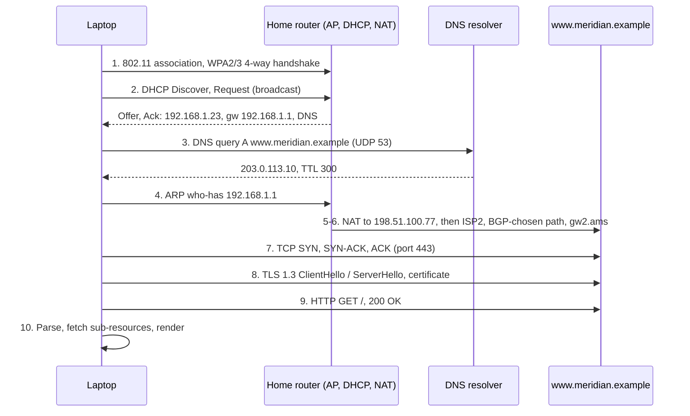

"A new laptop joins the Wi-Fi and opens a website. What happens?" Network organisations ask it in nearly every interview loop because it separates people who hold the picture from people who hold the vocabulary. A weak answer lists protocols in roughly the right order. A strong one has two parts: the rule every router applies to every packet (which bytes it reads, which it rewrites, which it never touches), and the end-to-end story as ten steps, each with its layer, what breaks there and how you would see it.

## What a router does to every packet

A router is a box with interfaces in different subnets and a forwarding table, the FIB (forwarding information base: the prefixes the router has chosen, each with a next hop, as built in [the routing table](/learn/fabric-networking/from-zero/the-routing-table)). For every arriving frame it runs the same loop, either in an ASIC (application-specific integrated circuit, the switching chip that forwards in hardware) or in software such as the Linux kernel:

1. **Check the FCS.** The frame check sequence is the 4-byte CRC-32 at the end of every Ethernet frame ([links, frames and Ethernet](/learn/fabric-networking/from-zero/links-frames-and-ethernet)). A mismatch means corruption on the wire: drop, and count a CRC error on that interface.
2. **Check the destination MAC.** A frame not addressed to this interface (or to a broadcast or multicast group it listens to) is not forwarded.
3. **Strip the Ethernet header.** What remains is the IP packet.
4. **Validate the IP header:** version, header length, header checksum.
5. **Longest-prefix match on the destination IP**, giving a next-hop IP and an outgoing interface, or "this packet is for me" (one of the router's own addresses), in which case it goes up to the router's own software whatever its TTL. No match and no default route: drop, and possibly send ICMP "destination unreachable".
6. **Check the TTL** of a packet to be forwarded. TTL (time to live) is an 8-bit hop counter. At 1 or 0, forwarding would take it to zero, so the router drops the packet and sends an ICMP "time exceeded" to the source. ICMP, the Internet Control Message Protocol, is IP's error and diagnostic channel (IP protocol 1). Hardware does the lookup and the TTL check in the same pipeline pass; the order here is for reading.
7. **Decrement the TTL and update the header checksum**, which covers the TTL byte.
8. **Find the next hop's MAC** in the ARP cache ([ARP and the default gateway](/learn/fabric-networking/from-zero/arp-and-the-default-gateway)): the next router's interface, or the destination host itself on a connected subnet.
9. **Build a new Ethernet header**: source MAC is this router's outgoing interface, destination MAC the next hop's, plus a new FCS.
10. **Queue and transmit.**

Apart from ACLs (access control lists, packet filters) and the ECMP hash (equal-cost multipath: spreading flows over several equally good next hops by hashing header fields), nothing in the loop reads the source IP, ports or payload, or remembers the packet afterwards. That statelessness lets one ASIC forward billions of packets per second, and makes a routing change apply to the very next packet.

## Three routers, one packet, byte by byte

Acme's web server `acme-web1` (`10.1.1.10`, behind `leaf1.ams`) talks to Acme's database `acme-db1` (`10.1.2.20`, behind `leaf3.ams`), in another subnet. Take Meridian's Amsterdam fabric, as a small example with two spines, and treat `leaf1.ams`, `spine1.ams` and `leaf3.ams` as plain IP routers. A leaf is the switch servers plug into; a spine is a switch that interconnects leaves. Real tenant traffic crosses the spines inside a VXLAN tunnel (an extra outer header that carries the tenant's packet from leaf to leaf) ([the overlay packet walk](/learn/fabric-networking/overlays-vxlan-evpn/the-overlay-packet-walk)), but the per-hop rules are easiest to see without it. Each leaf answers its hosts as the gateway with the anycast gateway MAC `00:00:5e:00:01:01`, the same on every leaf. Other MACs come from the documentation range `00:00:5e:00:53:xx`.

| Device | Interface | IP | MAC |
|---|---|---|---|
| `acme-web1` | eth0 | 10.1.1.10/24, gateway 10.1.1.1 | 00:00:5e:00:53:0a |
| `leaf1.ams` | VLAN 100 (gateway) | 10.1.1.1/24 | 00:00:5e:00:01:01 |
| `leaf1.ams` | uplink to spine1 | 10.254.1.1/31 | 00:00:5e:00:53:80 |
| `spine1.ams` | to leaf1 | 10.254.1.0/31 | 00:00:5e:00:53:81 |
| `spine1.ams` | to leaf3 | 10.254.1.4/31 | 00:00:5e:00:53:82 |
| `leaf3.ams` | uplink to spine1 | 10.254.1.5/31 | 00:00:5e:00:53:83 |
| `leaf3.ams` | VLAN 200 (gateway) | 10.1.2.1/24 | 00:00:5e:00:01:01 |
| `acme-db1` | eth0 | 10.1.2.20/24, gateway 10.1.2.1 | 00:00:5e:00:53:14 |

`acme-web1` opens a TCP connection to PostgreSQL on port 5432. Its first packet is a 60-byte SYN (the opening segment of TCP's handshake) with TTL 64, the Linux default (`net.ipv4.ip_default_ttl`). The destination is off-subnet, so the frame goes to the gateway's MAC. `leaf1.ams` has two equal-cost next hops, one per spine; this flow's hash picks `spine1.ams`. The same packet on each link:

| Field | web1 → leaf1 | leaf1 → spine1 | spine1 → leaf3 | leaf3 → db1 | Who changed it |
|---|---|---|---|---|---|
| Source MAC | 00:00:5e:00:53:0a (web1) | 00:00:5e:00:53:80 (leaf1) | 00:00:5e:00:53:82 (spine1) | 00:00:5e:00:01:01 (leaf3) | every router |
| Destination MAC | 00:00:5e:00:01:01 (leaf1) | 00:00:5e:00:53:81 (spine1) | 00:00:5e:00:53:83 (leaf3) | 00:00:5e:00:53:14 (db1) | every router |
| Source IP | 10.1.1.10 | 10.1.1.10 | 10.1.1.10 | 10.1.1.10 | nobody |
| Destination IP | 10.1.2.20 | 10.1.2.20 | 10.1.2.20 | 10.1.2.20 | nobody |
| TTL | 64 | 63 | 62 | 61 | every router, minus one |
| IP header checksum | 0xe97d | 0xea7d | 0xeb7d | 0xec7d | every router, because of the TTL |
| IP identification | 0x3a1f | 0x3a1f | 0x3a1f | 0x3a1f | nobody |
| TCP ports, sequence number | 51514 → 5432, seq 1000 | same | same | same | nobody |
| Ethernet FCS | computed by web1 | recomputed by leaf1 | recomputed by spine1 | recomputed by leaf3 | every router |

The MAC line changes on every link; the IP line never does. That contrast answers "why do we need both?": the Ethernet header is a per-link delivery label whose job ends at the next router, and the IP header is the end-to-end label every router reads to choose the next link.

```viz
{"type": "fabric", "scenario": "hop-by-hop", "title": "Hop by hop: the MACs are rewritten at every router, the IPs stay, the TTL counts down", "caption": "acme-web1 to acme-db1 through leaf1.ams, spine1.ams and leaf3.ams, treated as plain routers. At each one the Ethernet header is rebuilt with new MACs from its neighbour table, while the IP header keeps both addresses, loses one from its TTL and gets a new checksum. Watch the header stack and each router's FIB."}
```

### The IPv4 header as leaf1 sees it

| Field | Size | Value here | What a router does with it |
|---|---|---|---|
| Version | 4 bits | 4 | Read; selects the IPv4 path |
| Header length (IHL) | 4 bits | 5 (× 4 = 20 bytes) | Read, to find the payload |
| DSCP / ECN | 6 + 2 bits | 0 / 0 | DSCP picks the output queue; a congested queue may set ECN to "congestion experienced" ([lossless Ethernet](/learn/fabric-networking/ai-fabrics/lossless-ethernet-pfc-ecn-dcqcn)) |
| Total length | 16 bits | 60 | Read, checked against the frame |
| Identification | 16 bits | 0x3a1f | Untouched; used only for fragments |
| Flags, fragment offset | 3 + 13 bits | DF set, 0 | With DF ("don't fragment"), a too-big packet is dropped with an ICMP error ([transport as the network sees it](/learn/fabric-networking/from-zero/transport-as-the-network-sees-it)) |
| TTL | 8 bits | 64 | Checked, then decremented |
| Protocol | 8 bits | 6 (TCP) | Untouched; read by ACLs and the ECMP hash |
| Header checksum | 16 bits | 0xe97d | Verified, then updated |
| Source address | 32 bits | 10.1.1.10 | Untouched (except by NAT); read by ACLs and the hash |
| Destination address | 32 bits | 10.1.2.20 | The lookup key |

Fields that legitimately change in flight are each a mechanism: DSCP re-marked at a trust boundary, ECN marked by a congested queue, IPv4 fragmentation when DF is clear, addresses rewritten by NAT (step 5 of the laptop walk below). Tunnels leave the inner header alone and wrap it in a new one.

### TTL: what it solves, how it breaks, what shows it

**Solves:** routing loops. If `spine1.ams` routes `10.1.2.0/24` via `leaf1.ams` and `leaf1.ams` routes it via `spine1.ams`, which can happen for tens to hundreds of milliseconds while routers update their tables at slightly different moments (microloops, in [convergence and BFD](/learn/fabric-networking/underlay/convergence-and-bfd)), every packet would bounce forever. With TTL 64 it dies after 64 hops. Ethernet frames carry no TTL, which is why a layer-2 loop melts a network ([switches, VLANs and loops](/learn/fabric-networking/from-zero/switches-vlans-and-loops)) while a layer-3 loop is bounded: each looping packet dies after at most 255 hops.

**Breaks:** TTL bounds a loop; it does not prevent one. In a two-router loop a packet entering with TTL 63 crosses the looped link 62 times, 31 in each direction, so a 1 Gb/s flow caught in it offers roughly 31 Gb/s to that link in each direction, and innocent traffic sharing the link suffers.

**Signal:** TTL-expired counters and ICMP generation jump on the looping routers; traceroute shows two addresses alternating to the 30-hop limit; link utilisation rises with no rise in delivered traffic. The fix for microloops is in the IGP (the interior gateway protocol that routes inside one network, IS-IS at Meridian): ordered FIB updates or precomputed loop-free backup paths. A loop that persists is often a static route pointing back the way the traffic came.

Senders start from a few values (Linux and macOS 64, Windows 128, many network operating systems 255), so a packet arriving with TTL 52 most likely left a Linux host 12 hops away. The Generalized TTL Security Mechanism (GTSM, RFC 5082) turns this into a defence: directly connected BGP peers send with TTL 255 and accept only packets that arrive with 255, which no sender more than one hop away can produce, so a spoofed packet from further away is discarded ([BGP sessions and the FSM](/learn/fabric-networking/bgp-fundamentals/bgp-sessions-and-the-fsm)). IPv6 calls the field "hop limit".

### The checksum: patched, not recomputed

The IPv4 header checksum is the inverted one's-complement sum of the header's ten 16-bit words ([error detection](/learn/networking/network-algorithms/error-detection) computes one by hand). TTL shares a word with Protocol: `0x4006` at TTL 64, `0x3F06` at 63. That word drops by `0x0100`, so the inverted checksum rises by `0x0100`, from `0xe97d` to `0xea7d`. Routers apply RFC 1624's incremental update, `HC' = ~(~HC + ~m + m')` with `m` and `m'` the old and new word: one addition in the pipeline instead of re-summing the header.

Two design choices follow. **IPv6 has no header checksum** (RFC 8200): the link FCS and the TCP/UDP checksums already catch corruption, so every router is spared the update. And **the Ethernet FCS is recomputed at every hop**, because each frame is new. A CRC error is therefore a property of *one link*. If `leaf1.ams` counts receive CRC errors on its port towards `spine2.ams`, the fault is on that link: the cable, either optic, or `spine2.ams`'s transmitter, and nothing else. One caveat: data center switches often forward **cut-through**, starting to transmit a frame before its FCS has arrived. When the FCS then fails, the switch "stomps" the outgoing CRC with a recognisable invalid value, so the bad frame is counted again downstream; good tooling counts received CRC errors and stomped frames separately and blames only the first link.

### The walk in code

A direct transcription of the router loop, on the topology above. It builds real header bytes, so the checksums are the true values, then runs a traceroute over the same three routers.

```python
import ipaddress
import socket
import struct


def ip_checksum(header: bytes) -> int:
    total = 0
    for i in range(0, len(header), 2):
        total += (header[i] << 8) | header[i + 1]   # sum 16-bit words
    while total >> 16:                              # fold carries back in
        total = (total & 0xFFFF) + (total >> 16)
    return ~total & 0xFFFF                          # one's complement


def build_ip(src, dst, ttl, proto):
    hdr = struct.pack("!BBHHHBBH4s4s", 0x45, 0, 60, 0x3A1F, 0x4000, ttl, proto,
                      0, socket.inet_aton(src), socket.inet_aton(dst))
    return {"src": src, "dst": dst, "ttl": ttl, "proto": proto,
            "csum": ip_checksum(hdr)}


class Router:
    def __init__(self, name, ifaces, routes, arp):
        self.name = name
        self.ifaces = ifaces    # interface -> (own IP, own MAC)
        self.routes = [(ipaddress.ip_network(p), nh, i) for p, nh, i in routes]
        self.arp = arp          # neighbour IP -> MAC (already resolved)

    def forward(self, frame, in_iface):
        pkt = frame["ip"]
        if pkt["ttl"] <= 1:     # would reach 0 here: drop and tell the source
            my_ip = self.ifaces[in_iface][0]
            return None, f"ICMP time exceeded from {my_ip} ({self.name})"
        dst = ipaddress.ip_address(pkt["dst"])
        net, nh, out = max((r for r in self.routes if dst in r[0]),
                           key=lambda r: r[0].prefixlen)   # longest prefix
        target = pkt["dst"] if nh == "connected" else nh
        new_ip = build_ip(pkt["src"], pkt["dst"], pkt["ttl"] - 1, pkt["proto"])
        return {"src_mac": self.ifaces[out][1], "dst_mac": self.arp[target],
                "ip": new_ip}, out


GW = "00:00:5e:00:01:01"   # anycast gateway MAC, the same on every leaf
leaf1 = Router("leaf1.ams", {"vlan100": ("10.1.1.1", GW),
                             "up1": ("10.254.1.1", "00:00:5e:00:53:80")},
               [("10.1.1.0/24", "connected", "vlan100"),
                ("10.1.2.0/24", "10.254.1.0", "up1")],
               {"10.254.1.0": "00:00:5e:00:53:81"})
spine1 = Router("spine1.ams", {"to-leaf1": ("10.254.1.0", "00:00:5e:00:53:81"),
                               "to-leaf3": ("10.254.1.4", "00:00:5e:00:53:82")},
                [("10.1.1.0/24", "10.254.1.1", "to-leaf1"),
                 ("10.1.2.0/24", "10.254.1.5", "to-leaf3")],
                {"10.254.1.1": "00:00:5e:00:53:80", "10.254.1.5": "00:00:5e:00:53:83"})
leaf3 = Router("leaf3.ams", {"up1": ("10.254.1.5", "00:00:5e:00:53:83"),
                             "vlan200": ("10.1.2.1", GW)},
               [("10.1.2.0/24", "connected", "vlan200"),
                ("10.1.1.0/24", "10.254.1.4", "up1")],
               {"10.1.2.20": "00:00:5e:00:53:14"})
# (router, interface the packet arrives on)
PATH = [(leaf1, "vlan100"), (spine1, "to-leaf1"), (leaf3, "up1")]


def send(ttl, proto=6, show=True):
    frame = {"src_mac": "00:00:5e:00:53:0a", "dst_mac": GW,
             "ip": build_ip("10.1.1.10", "10.1.2.20", ttl, proto)}
    for router, in_iface in PATH:
        if show:
            print(f"  into {router.name:10}: {frame['src_mac']} -> {frame['dst_mac']}  "
                  f"ttl={frame['ip']['ttl']} csum=0x{frame['ip']['csum']:04x}")
        frame, result = router.forward(frame, in_iface)
        if frame is None:
            return result
    if show:
        print(f"  into acme-db1  : {frame['src_mac']} -> {frame['dst_mac']}  "
              f"ttl={frame['ip']['ttl']} csum=0x{frame['ip']['csum']:04x}")
    return "ICMP port unreachable from 10.1.2.20" if proto == 17 else "delivered"


print("One TCP packet, TTL 64:")
print(" ", send(64))
print("traceroute 10.1.2.20 (UDP probes):")
for ttl in range(1, 5):
    print(f"  ttl={ttl}: {send(ttl, proto=17, show=False)}")
```

```text
One TCP packet, TTL 64:
  into leaf1.ams : 00:00:5e:00:53:0a -> 00:00:5e:00:01:01  ttl=64 csum=0xe97d
  into spine1.ams: 00:00:5e:00:53:80 -> 00:00:5e:00:53:81  ttl=63 csum=0xea7d
  into leaf3.ams : 00:00:5e:00:53:82 -> 00:00:5e:00:53:83  ttl=62 csum=0xeb7d
  into acme-db1  : 00:00:5e:00:01:01 -> 00:00:5e:00:53:14  ttl=61 csum=0xec7d
  delivered
traceroute 10.1.2.20 (UDP probes):
  ttl=1: ICMP time exceeded from 10.1.1.1 (leaf1.ams)
  ttl=2: ICMP time exceeded from 10.254.1.0 (spine1.ams)
  ttl=3: ICMP time exceeded from 10.254.1.5 (leaf3.ams)
  ttl=4: ICMP port unreachable from 10.1.2.20
```

Three lines carry the design. `ttl <= 1` drops an expiring packet before any rewrite (the model sends nothing to the routers' own addresses). `max(..., key=prefixlen)` is longest-prefix match, the readable version of what a TCAM (ternary content-addressable memory, which compares a key against every entry at once) does in one lookup. `self.arp[target]` is where the MAC is chosen: the next hop's IP is used only to find a MAC and never appears in the packet. The code rebuilds the checksum for clarity; hardware patches it, with identical results.

### What a capture shows

The same SYN captured on the first and last links with `tcpdump -e -n -v` (`-e` prints the Ethernet header). Illustrative output, trimmed:

```text
web1 → leaf1: 00:00:5e:00:53:0a > 00:00:5e:00:01:01, ethertype IPv4 (0x0800), length 74:
              (tos 0x0, ttl 64, id 14879, offset 0, flags [DF], proto TCP (6), length 60)
              10.1.1.10.51514 > 10.1.2.20.5432: Flags [S], seq 1000, win 64240, options [mss 1460,...]
leaf3 → db1:  00:00:5e:00:01:01 > 00:00:5e:00:53:14, ethertype IPv4 (0x0800), length 74:
              (tos 0x0, ttl 61, id 14879, offset 0, flags [DF], proto TCP (6), length 60)
              10.1.1.10.51514 > 10.1.2.20.5432: Flags [S], seq 1000, win 64240, options [mss 1460,...]
```

Matching `id 14879` (0x3a1f) and sequence number prove it is one packet seen twice. The anycast gateway MAC is the destination on the first link and the source on the last, because both leaves answer as the same gateway. If two captures disagree in any field other than MACs, TTL and checksum, something in between rewrote it (a NAT, a load balancer, a DSCP policy): the fastest way to find an unmentioned middlebox. The 74 bytes are 14 of Ethernet plus 60 of IP; tcpdump omits the FCS.

## traceroute: turning TTL expiry into a map

traceroute (`tracert` on Windows) makes every router on the path identify itself by deliberately expiring probes. [Debugging the network](/learn/networking/networking-in-practice/debugging-the-network) shows how to read `mtr` on a real trace; this section is the mechanism and where it misleads you inside a fabric.

1. Send three UDP probes with **TTL 1** to destination ports 33434, 33435, 33436. The port rises with every probe, chosen because nothing is likely to listen there.
2. The first router expires them and returns ICMP **type 11, code 0** ("TTL exceeded in transit"). The ICMP message quotes the original IP header and at least 8 bytes of payload (the UDP header), so traceroute matches each reply to its probe by port and prints the router's address and round-trip time.
3. Repeat with **TTL 2, 3, …**; each round dies one router further on.
4. A probe that reaches the destination finds no listener on port 3343x, and the host answers ICMP **type 3, code 3** ("port unreachable"). That different reply means "arrived".
5. No reply within the timeout (5 s on Linux) prints `* * *`. The probe still went through; only the reply is missing. The default limit is 30 hops.

```viz
{"type": "network", "scenario": "traceroute", "title": "traceroute: each TTL dies one hop further, and a silent hop prints * * *", "caption": "Probes with TTL 1, 2, 3 and 4. Each router that takes the TTL to zero returns ICMP time exceeded and reveals itself; hop 3 never answers, yet the TTL 4 probe passes through it and the destination replies with port unreachable."}
```

### Where traceroute misleads you

- **The address is a reply interface, not "the router".** Usually it is the interface the router sends the ICMP reply out of, which is normally the one the probe arrived on, so one router appears under different addresses in traces from different directions.
- **The time is the control plane's.** The ASIC forwards transit packets at line rate but does not generate ICMP: expired packets are *punted* (handed up) to the switch's CPU, which replies under a strict rate limit (control-plane policing, in [planes, ASICs and network operating systems](/learn/fabric-networking/from-zero/planes-asics-and-network-operating-systems)). A hop at 48 ms followed by hops at 10 ms is a slow responder, not a slow link. Only latency or loss that **persists to the destination** is real.
- **ECMP scatters the probes in a leaf-spine (Clos) fabric.** Each probe's new port makes it a new flow with its own 5-tuple (addresses, protocol, ports), which a router with equal-cost next hops may hash onto a different link. traceroute then prints several addresses on one hop line and can stitch hop 3 of one path to hop 4 of another, inventing links. **Paris traceroute** (published in 2006) holds the 5-tuple constant and carries the probe identity in fields the hash ignores, such as the UDP checksum. In a Clos fabric you also want the opposite on purpose: many probes with varied 5-tuples, to cover every spine ([ECMP and hashing](/learn/fabric-networking/fabric-architecture/ecmp-and-hashing), [active measurement](/learn/fabric-networking/operating-fabrics/active-measurement)).
- **Tunnels hide hops.** MPLS backbones forward on short labels instead of IP addresses ([MPLS and segment routing](/learn/fabric-networking/overlays-vxlan-evpn/mpls-and-segment-routing)); one configured not to copy the IP TTL into its labels appears as a single hop. In an EVPN fabric the spines forward on the *outer* VXLAN header and decrement the *outer* TTL; the inner TTL drops only where the inner packet is routed, at the leaves. The simulation above found `spine1.ams` at TTL 2; across Meridian's real overlay the same traceroute shows only leaves, and which address a leaf replies from (possibly the shared anycast gateway) varies by platform.
- **It shows the forward path only.** Replies follow whatever route the far side chooses, and internet paths are often asymmetric.

| Tool | Probe | Gets through firewalls | Stable across ECMP | Best for |
|---|---|---|---|---|
| Classic `traceroute` | UDP to 33434+, port changes per probe | Often blocked at enterprise edges | No: each probe is a new flow | Quick look on an open path |
| `traceroute -I` / `tracert` | ICMP echo | Moderate; ICMP is often rate-limited | Mostly, if the hash ignores the ICMP sequence | Windows, ICMP-friendly paths |
| `traceroute -T -p 443` | TCP SYN to the application's port | Best: looks like real traffic | Yes, for a fixed source port | Paths through firewalls and load balancers |
| Paris traceroute | UDP, ICMP or TCP with a fixed 5-tuple | As the chosen probe | Yes, by design | Correct topology through ECMP |
| `mtr` | Any of the above, continuously | As the chosen probe | As the chosen probe | Intermittent loss, per-hop statistics |

## The full walk: a new laptop opens a website

A laptop at home in Amsterdam joins the Wi-Fi and opens `www.meridian.example`, served by Meridian (AS 64500) from its Amsterdam site at `203.0.113.10`. The home broadband comes from ISP2 (AS 64502), also one of Meridian's two upstreams. Addresses, AS numbers and the domain all come from ranges reserved for documentation (RFC 5737, RFC 5398 and RFC 2606), so none are real.



### 1. Wi-Fi association (layer 2)

The laptop hears beacons (sent every 102.4 ms by default) or sends probe requests, picks the network by name (SSID), and runs 802.11 "open system" authentication, a formality (WPA3 replaces it with a real password exchange, below), then association, where the access point admits it. Real authentication is the WPA2 or WPA3 **four-way handshake**. Both sides hold a master key: in WPA2-Personal it is derived from passphrase and SSID by PBKDF2 with 4,096 rounds of HMAC-SHA1; WPA3 uses SAE (Simultaneous Authentication of Equals), a password-authenticated key exchange that resists offline password guessing. They swap random nonces, the laptop proves it holds the key with a message integrity code (MIC), and both derive the same session key without sending it. The access point then bridges 802.11 to Ethernet, so the home network behaves like a switched LAN.

- **Breaks:** a wrong passphrase fails at handshake message 2 (the access point cannot verify the MIC); weak signal gives low data rates and heavy retransmission.
- **Signal:** the access point's association log, signal strength (RSSI), retry rate.

### 2. DHCP: getting an address

The Dynamic Host Configuration Protocol takes four messages, DORA. **Discover**: the laptop has no address, so it broadcasts from `0.0.0.0` port 68 to `255.255.255.255` port 67 (Ethernet destination `ff:ff:ff:ff:ff:ff`). **Offer**: the home router offers `192.168.1.23`. **Request**: broadcast again, naming the accepted server so other servers withdraw their offers. **Ack**, with options: mask (option 1), router `192.168.1.1` (option 3), DNS server (option 6), lease time (option 51). Renewal is unicast at half the lease (T1), falling back to broadcast at 87.5% (T2). Where the server sits in another subnet, the router or leaf acts as a **DHCP relay**: it unicasts to the server and stamps its own interface address in `giaddr` so the server picks the right pool. Meridian relays DHCP so a new switch can fetch its first configuration on boot (zero-touch provisioning).

- **Breaks:** no server answers and the laptop (Windows and macOS by default) self-assigns link-local `169.254.x.x` (RFC 3927), reaching nothing off its link; an exhausted pool; a rogue DHCP server handing out a wrong gateway; a relay pointing at the wrong server.
- **Signal:** a `169.254` address on the client; pool utilisation and server logs.

### 3. DNS: name to address (UDP 53)

After the browser cache, OS cache and hosts file, the stub resolver queries the resolver DHCP supplied, usually the home router forwarding to ISP2's recursive resolver. On a miss that resolver walks root, `.example`, then Meridian's authoritative servers: A record `203.0.113.10`, TTL 300 seconds (a cache lifetime, unrelated to the IP hop counter). Large sites often answer per region (geo-DNS, or a CDN, content delivery network, naming its nearest edge); Meridian could hand a Singapore client its `sin` site. [DNS](/learn/networking/fundamentals/dns) covers the resolver chain.

- **Breaks:** a dead resolver makes everything look down while connections by IP still work; a stale record after a migration; geo-DNS sending a client to a far site.
- **Signal:** what the process resolves (`getent hosts`) against what DNS says (`dig`), and lookup time measured apart from connect time.

### 4. ARP: the gateway's MAC

`203.0.113.10` is outside `192.168.1.0/24`, so the laptop broadcasts "who has 192.168.1.1?", caches the router's reply, and sends its first frame: laptop MAC to router MAC, `192.168.1.23` to `203.0.113.10`. That is hop one of the hop-by-hop rule; the DNS query in step 3 needed the same lookup first.

- **Breaks:** a wrong gateway from DHCP; a stale entry after the gateway's hardware was swapped.
- **Signal:** `ip neigh` showing `FAILED` or `INCOMPLETE`; the full checklist is in [ARP and the default gateway](/learn/fabric-networking/from-zero/arp-and-the-default-gateway).

### 5. NAT at the home router

`192.168.1.23` is private (RFC 1918) and no internet router carries traffic back to it. The home router performs **network address and port translation**: it rewrites the source to its ISP-assigned address `198.51.100.77`, replaces the source port with a free one (40001), and records `192.168.1.23:51514 ↔ 198.51.100.77:40001` in its connection-tracking table so the reply can be translated back. This is the walk's one deliberate break of "the IP never changes", and because the TCP checksum covers both IP addresses, NAT patches it too. Many ISPs add carrier-grade NAT from `100.64.0.0/10` (RFC 6598). More in [NAT, firewalls and cloud networking](/learn/networking/fundamentals/nat-firewalls-and-cloud-networking).

- **Breaks:** table or port exhaustion; idle timeouts. Linux conntrack keeps an established TCP entry for 5 days by default (432,000 s), but consumer routers and carrier-grade NAT often expire one within minutes, so an idle SSH or database connection dies silently.
- **Signal:** NAT table utilisation; on hosts, connections that hang on the first packet after an idle period (which is why applications send keepalives).

### 6. Across ISP2 into Meridian: routing, with BGP decided in advance

The home router has a default route to ISP2; from there every router repeats the hop-by-hop rule. ISP2's routers carry the full internet table (on the order of a million IPv4 prefixes in the mid-2020s, still growing), and the longest match for `203.0.113.10` is `203.0.113.0/24`, learned over eBGP. BGP, the Border Gateway Protocol, is how autonomous systems (independently run networks, each with an AS number) tell each other what they can reach; eBGP is a session between two different ASes. Illustrative state on ISP2's border router:

```text
ISP2 border router: BGP table entry for 203.0.113.0/24   (illustrative)
  Path              Next hop        LocPref  Learned from
* 64500             192.0.2.1       200      customer Meridian (gw2.ams)     <- best
  64496 64501 64500 198.51.100.250  80       transit provider AS 64496
```

ISP2 prefers its paying customer's route: higher local preference, shorter AS path ([the best-path algorithm](/learn/fabric-networking/bgp-fundamentals/the-best-path-algorithm)). Inside ISP2, iBGP (BGP within one AS) tells every router about that exit and the interior routing protocol carries the packet to it ([iBGP, loops and next hops](/learn/fabric-networking/bgp-fundamentals/ibgp-loops-and-next-hops)). The packet enters Meridian at `gw2.ams`, crosses the Amsterdam fabric through a spine to the server's leaf, and is delivered.

The trap: **BGP runs nowhere in the per-packet path.** It ran earlier, picked a best path and installed it in each FIB; the packet only meets the FIB. Inside Meridian's fabric the same holds for BGP EVPN (the BGP extension that tells each leaf which tenant addresses sit behind which other leaf): its entries are used once, at the ingress leaf that builds the tunnel, and every spine forwards on underlay routes from IS-IS.

- **Breaks:** a route leak or hijack ([leaks, hijacks and RPKI](/learn/fabric-networking/bgp-in-the-real-world/leaks-hijacks-and-rpki)); a router on the path with no route while every session is up ([the BGP black hole](/learn/fabric-networking/bgp-fundamentals/the-bgp-black-hole)); a smaller-MTU tunnel dropping large packets while the explaining ICMP is filtered.
- **Signal:** a traceroute that stops at one hop; a public looking glass (a web page where a network shows its routers' BGP view) showing the prefix's AS path from outside; small pings working while large transfers hang.

### 7. TCP: the connection (port 443)

SYN, SYN-ACK, ACK: one round trip, during which each side announces its maximum segment size (1,460 bytes on a 1,500-byte-MTU interface, after 40 bytes of IP and TCP headers) and window scaling. An unanswered SYN is retransmitted after 1 s, then 2, 4, 8…; with Linux's default `tcp_syn_retries` of 6, a black-holed address takes about two minutes to fail. A reset (RST) means "nothing listening" or "a firewall refused", within one round trip. [TCP deep dive](/learn/networking/fundamentals/tcp-deep-dive) has the state machine.

- **Breaks:** a firewall silently dropping SYNs; an asymmetric return path taking the SYN-ACK through a stateful firewall that never saw the SYN.
- **Signal:** SYN retransmit counters on the host (`nstat TcpExtTCPSynRetrans`); connect time measured apart from time to first byte.

### 8. TLS: trust and keys

The TLS 1.3 ClientHello carries the server name (SNI, server name indication: `www.meridian.example`, readable on the wire unless Encrypted Client Hello is in use), cipher suites, an elliptic-curve Diffie-Hellman (ECDHE) key share, and ALPN (application-layer protocol negotiation) offering `h2`, HTTP/2. The server answers with its own key share; from that point both sides can derive keys, so the rest of its flight is encrypted: the certificate, a CertificateVerify signature proving it holds the certificate's private key, and Finished. The laptop verifies the chain against its trusted roots, name and dates included: one round trip, where TLS 1.2 needed two. [TLS and PKI](/learn/networking/fundamentals/tls-and-pki) traces it.

- **Breaks:** an expired certificate, a missing intermediate, a laptop clock so wrong that a valid certificate looks "not yet valid".
- **Signal:** handshake alerts and expiry monitoring; a wrong clock fails every site at once.

### 9. HTTP: the request

`GET /` with `:authority: www.meridian.example` (HTTP/2's Host header). The server answers `200 OK` with HTML, or a `301` redirect first, costing another round trip. Replies return to `198.51.100.77:40001` and the NAT table translates them back to `192.168.1.23:51514`. A browser that has seen the site before may use HTTP/3 over QUIC (UDP 443), which merges steps 7 and 8 into one round trip ([HTTP/2 and HTTP/3](/learn/networking/application-protocols/http-2-and-http-3)).

- **Breaks:** `5xx` errors, a load balancer with no healthy backend, redirect loops.
- **Signal:** status codes and server time to first byte.

### 10. Render

The HTML names dozens of stylesheets, scripts, images and fonts, often on other hostnames; each new hostname repeats steps 3 and 7 to 9, while requests to one host share an HTTP/2 connection. Then the page is built, styled, scripted and painted.

- **Breaks:** one slow third-party host blocking rendering behind a synchronous script.
- **Signal:** the browser's network waterfall, which shows DNS, connect, TLS and wait per request: the client-side version of what a network platform should show.

### The walk as numbers

Time to first byte is round trips, and a round trip is distance (about 5 µs per km of fibre) plus the access network. A home broadband round trip to a nearby site is typically around 10 ms, mostly Wi-Fi and the last mile rather than distance. Singapore to Amsterdam is roughly 10,500 km of fibre path, at least 105 ms round trip before any queueing.

| Step | Layer | Round trips | Laptop in Amsterdam (RTT ≈ 10 ms) | Laptop in Singapore to `ams` (RTT ≥ 105 ms) | First signal when broken |
|---|---|---|---|---|---|
| 1. Wi-Fi | 2 | local | tens of ms, once per join | same | AP association log, RSSI |
| 2. DHCP | 2 / UDP 67-68 | local | ms to a second, once per lease | same | `169.254` address |
| 3. DNS | UDP 53 | 1, more on a cache miss | ~10–50 ms | ≥ 105 ms if the authoritative servers are far | `dig` vs `getent` |
| 4. ARP | 2 | local | < 1 ms, then cached | same | `ip neigh` FAILED |
| 5. NAT | 3 / 4 | 0 | microseconds | same | NAT table use |
| 6. Routing | 3 | inside every RTT | inside every RTT | inside every RTT | traceroute stops, looking glass |
| 7. TCP | 4 | 1 | 10 ms | 105 ms | SYN retransmits |
| 8. TLS 1.3 | above 4 | 1 | 10 ms | 105 ms | handshake alerts |
| 9. HTTP | 7 | 1 | 10 ms + server time | 105 ms + server time | status codes, TTFB |
| 10. Render | browser | many, overlapped | hundreds of ms | seconds without a nearer site | browser waterfall |

Three round trips at 105 ms is 315 ms before the first byte of HTML, and no bandwidth upgrade reduces it. That is why Meridian runs a `sin` site and large sites push content to the edge: a Singapore answer from geo-DNS cuts each round trip to milliseconds.

## Failure modes that cross the steps

**A dirty link in an ECMP group.** *Symptom:* with four spines, about one connection in four retransmits and crawls; a single ping looks clean. *Diagnosis:* the per-hop FCS puts CRC errors on one specific port, and probes with varied 5-tuples show the bad ones share that spine. *Fix:* drain the link, replace the optic or cable ([optics, cabling and the physical layer](/learn/fabric-networking/fabric-architecture/optics-cabling-and-the-physical-layer)).

**Asymmetric routing through a stateful device.** *Symptom:* TCP times out while ping and UDP work. *Diagnosis:* captures on both sides show the SYN-ACK arriving at a firewall or NAT that never saw the SYN, has no table entry, and drops it. *Fix:* make the return path symmetric through the stateful pair, or share state between the pair.

**An ICMP-filtered path-MTU black hole.** *Symptom:* SSH logs in, then hangs on the first large output. *Diagnosis:* small DF pings succeed, 1,472-byte DF pings fail; a tunnel has a smaller MTU and the ICMP "fragmentation needed" that would tell the sender is filtered. *Fix:* allow that ICMP and clamp the TCP MSS at the tunnel edge ([transport as the network sees it](/learn/fabric-networking/from-zero/transport-as-the-network-sees-it)).

## What the platform should show

The tool people open when someone says "the website is down" should expose:

- **Per-step client timing.** DNS, connect, TLS and time to first byte (what `curl -w` reports) from synthetic clients in every site. The step that grew names the layer.
- **Paths both ways, per flow.** Paris-style traceroutes in both directions, with enough distinct flows to cover every ECMP member, shown as a set of paths, not one line.
- **Per-link errors as a link property.** CRC errors, stomped frames and discards attached to the link and both its ends, because that is where the per-hop FCS localises them.
- **Control-plane health beside forwarding health.** ICMP rate-limit drops, punt-queue drops and CPU, labelled so a slow traceroute hop is not read as a slow link.
- **Loops and black holes as events.** A jump in TTL-expired counters is a loop; a BGP next hop that does not resolve, or a device on a path without the route, is a black hole.
- **Shared-table exhaustion.** DHCP pools, NAT and conntrack tables, ARP and neighbour tables against hardware limits.
- **Scope first.** One client or many, one site or several, one prefix or all: "is it you, or everyone?" answered before anyone opens a terminal ([the troubleshooting method](/learn/fabric-networking/operating-fabrics/the-troubleshooting-method)).

## Interviewer follow-ups

**"Why does a packet need both a MAC and an IP address?"** Model answer: they are labels of different scope. The MAC names the interface on this link that should accept the frame and is replaced at every router; the IP names the destination end to end. MAC addresses are flat and cannot be summarised, so they do not scale beyond a broadcast domain; IP's hierarchy lets one table row cover a subnet. Common wrong answer: "MAC is the hardware address, IP the software one", true but silent on why both are needed per hop.

**"Traceroute shows 120 ms at hop 4 and 15 ms at hops 5 to 9. Where is the problem?"** Model answer: not on the forwarding path. Hop 4's CPU generates ICMP slowly, but packets through hop 4 reach hop 9 in 15 ms; only what persists to the destination is real, and I would check the reverse path too. Common wrong answer: "hop 4 is congested, open a ticket with that provider".

**"A traceroute between two servers across our EVPN fabric shows two hops. Where did the spines go?"** Model answer: the spines forward the VXLAN packet on its outer header and decrement the outer TTL; the inner TTL the probes depend on drops only where the inner packet is routed, at the two leaves. Whether a platform copies the inner TTL outward I would confirm with the network team; what I would build is probing between every pair of leaf loopbacks with varied source ports, which does show the spines. Common wrong answer: "the spines filter ICMP".

## What mid-level engineers get wrong

- **Addressing the frame to the server's MAC** for an off-subnet destination. It goes to the gateway's; the server's MAC never leaves the server's subnet.
- **Treating one traceroute as "the path"** under ECMP, or its intermediate-hop latency as link latency.
- **Assuming the IP header is untouched end to end** when a NAT or load balancer sits in the path.
- **Skipping Wi-Fi and DHCP** in the laptop walk: they are where "my laptop can't get online" actually fails, and the question said *new* laptop for a reason.

## Senior signals

- You state the per-hop rule in one sentence (MACs rewritten, IP kept, TTL decremented, checksum patched, FCS recomputed) and name the deliberate exceptions: NAT, tunnels, DSCP and ECN marking.
- You localise with the per-hop FCS: a CRC error belongs to one link, so the counter is the location.
- You read traceroute as a control-plane artefact and know ECMP needs fixed or deliberately varied 5-tuples.
- You keep BGP out of the per-packet path, and in an overlay say "BGP-learned entries once at the ingress leaf, the underlay at every hop".
- You tell the laptop walk as ten steps, each with a layer, a breakage and a signal, and quantify it in round trips: three RTTs to first byte is why sites and CDNs exist.

## Check yourself

```quiz
- q: >-
    acme-web1 (10.1.1.10/24) sends a packet to acme-db1 (10.1.2.20) through leaf1.ams, spine1.ams and leaf3.ams, treated as plain routers. On the link from leaf1 to spine1, what are the packet's destination MAC and destination IP?
  options: ["spine1's interface MAC and acme-db1's IP, 10.1.2.20", "acme-db1's MAC and acme-db1's IP, 10.1.2.20", "The anycast gateway MAC and acme-db1's IP, 10.1.2.20", "spine1's interface MAC and spine1's IP, 10.254.1.0"]
  answer: 0
  explanation: >-
    The destination IP is the end-to-end label and never changes, so it is still 10.1.2.20. The destination MAC is the per-link label: leaf1 looked up the next hop (10.254.1.0), took spine1's MAC from its neighbour table and addressed the frame to spine1. The next hop's IP is used only to find that MAC and never appears in the packet. The anycast gateway MAC is used only between a host and its leaf, and acme-db1's MAC only on the last link.
- q: >-
    A traceroute shows 95 ms at hop 4, then 12 ms at hops 5 through 8 and at the destination. What is the most likely explanation?
  options: ["Hop 4 is a tunnel endpoint adding 83 ms of encapsulation", "Hop 4's CPU answers TTL-expired probes slowly", "Hop 4 is congested and delays all traffic through it", "The return path from hop 4 is a long-haul circuit"]
  answer: 1
  explanation: >-
    Packets through hop 4 reach the destination in 12 ms, so the forwarding path through hop 4 is not slow. The ICMP reply at hop 4 is generated by the router's control plane under a rate limit, and a busy CPU answers late. Congestion at hop 4 would add delay to every later hop as well; only latency that persists to the destination is real.
- q: >-
    Leaf1 counts rising CRC errors on its port towards spine2. Where is the fault most likely to be?
  options: ["In the routing table of spine2, which mis-forwards frames", "In the sending host's NIC, whose frames carry a bad CRC", "On any link along the paths that cross spine2", "On the link between leaf1 and spine2, its optics or cable"]
  answer: 3
  explanation: >-
    Each router builds a new frame and recomputes the FCS on every hop, so a CRC error describes corruption on the one link where the frame was received. A host's bad frame would be dropped at the first hop. A routing error does not corrupt bits. The one caveat is cut-through switching, where a stomped CRC can be counted on the next link too, which good tooling separates out.
- q: >-
    In the laptop-to-website walk, which statement about BGP is correct?
  options: ["BGP is consulted at every hop to append to the AS path", "BGP chose best paths in advance; packets meet only the FIB", "BGP runs only on the home router, which picks the ISP", "Each router queries BGP to choose a next hop for the packet"]
  answer: 1
  explanation: >-
    BGP is a control-plane protocol between routers. It ran long before this packet, picked a best path per prefix and installed it in each router's forwarding table; per packet, routers do a longest-prefix match in the FIB. A home router has a default route and no BGP. The AS path grows in route announcements, never in packets.
- q: >-
    A laptop joins a network and shows the address 169.254.37.12. Which step of the walk failed?
  options: ["NAT, because the router's table was exhausted", "DHCP, because no server answered the Discover", "Wi-Fi association, because the passphrase was wrong", "DNS, because the resolver was unreachable"]
  answer: 1
  explanation: >-
    169.254.0.0/16 is the link-local range a host assigns itself when DHCP gets no answer (RFC 3927). A wrong passphrase fails the four-way handshake before any IP traffic exists, and DNS and NAT failures happen after the host already has a valid address.
- q: >-
    Classic Unix traceroute across a Clos fabric with four spines prints different addresses on the same hop line. Why?
  options: ["TTL is decremented by a different amount on each spine", "New ports per probe make ECMP hash them onto different spines", "The ICMP replies are load-balanced back over different return paths", "The spines answer from random interface addresses to hide their identity"]
  answer: 1
  explanation: >-
    Classic traceroute increments the UDP destination port per probe, so each probe is a different 5-tuple and the ECMP hash can send it to a different spine. Paris traceroute keeps the 5-tuple fixed to follow one path. In a fabric you can use the same effect on purpose, varying 5-tuples to cover every spine. The return path does not change which router expired the probe.
```
