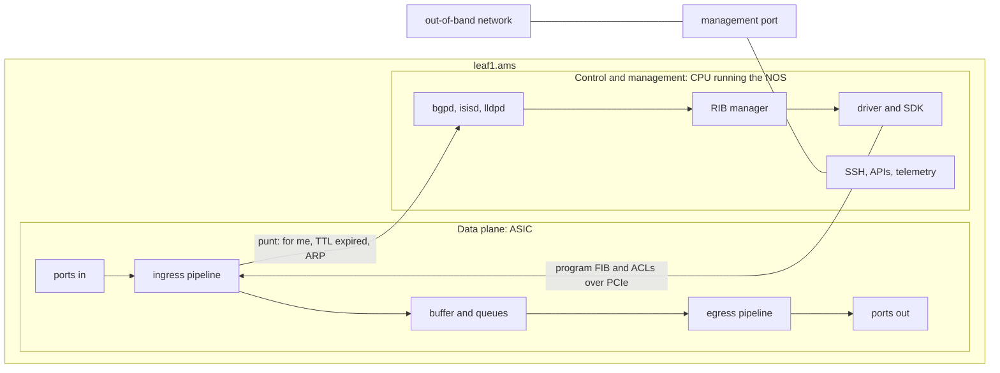

At 02:10 the dashboard for Meridian's Amsterdam fabric is green: every IS-IS adjacency up, every BGP session to the route reflectors `rr1.ams` and `rr2.ams` Established, CPU load normal. Yet Acme's web servers behind `leaf1.ams` cannot reach anything behind `leaf4.ams`. A switch is two machines in one box: a small general-purpose computer runs the protocols that turn the dashboard green, and a separate chip, the ASIC, forwards every customer packet using tables the computer wrote into it. When one of those writes fails, the protocols stay up while the chip drops the traffic.

Follow the SYN from `acme-web1` to `acme-db1` that [the packet walk](/learn/fabric-networking/from-zero/the-packet-walk) traced, this time inside the first hop. As there, treat leaves and spines as plain IP routers; in Meridian's real fabric this leaf also adds a VXLAN tunnel header, one more lookup and rewrite in the same pipeline ([the overlay packet walk](/learn/fabric-networking/overlays-vxlan-evpn/the-overlay-packet-walk)).

## Three planes in one box

A **plane** is a division of a router's work by job. It is not a protocol layer, and each plane has its own hardware, speed and ways of failing.

- **The data plane** (or forwarding plane) moves *transit* packets, the ones passing through the switch, from port to port. On a data center switch it is the **ASIC** (application-specific integrated circuit: a chip built for one job, here forwarding). It decides nothing: for every packet it reads headers, looks them up in tables and acts on the result.
- **The control plane** decides what goes into those tables. It runs on the switch's CPU as part of the **NOS** (network operating system): the routing protocols (IS-IS, BGP), BFD (fast hellos that detect a dead link), ARP (IP to MAC address), LACP (bundles links into one) and LLDP (tells each port who is on the other end), plus the software that writes results into the ASIC. It also receives every packet addressed to the switch itself.
- **The management plane** lets people and software configure and observe the switch: SSH, configuration APIs, SNMP, streaming telemetry (gNMI, a gRPC interface that pushes counters), syslog, NTP. It runs on the CPU too, reached through a dedicated management port.

| Plane | Job | Runs on | Timescale | Its traffic | Typical failure | First signal |
|---|---|---|---|---|---|---|
| Data | Forward transit packets | ASIC | Nanoseconds per packet, Tb/s per chip | All customer traffic | Drops with no protocol event: full table, bad ACL, silent hardware fault | Port and queue drop counters, probe loss through the device |
| Control | Compute and program the tables | CPU, NOS daemons | Milliseconds to seconds | BGP, IS-IS, BFD, ARP, LACP, LLDP | Session flaps, slow convergence, CPU starved by a packet storm | Protocol state, CPU queue drops, control-plane policing counters |
| Management | Configure and observe | CPU, management port, serial console | Seconds to minutes | SSH, APIs, SNMP, gNMI, syslog, NTP | Unreachable device, wrong config pushed, wrong clock | Management-port reachability, config diff, time offset |



The planes fail independently, which is why they are named. A data plane whose control plane has died keeps forwarding on its last tables, deliberately during a graceful restart (neighbours agree to keep using its routes while the software restarts) and dangerously once those tables go stale. A control plane with a broken data plane is the green dashboard above. A lost management plane leaves a switch forwarding while nobody can see or change it.

## Inside the ASIC: a pipeline with a time budget

Most data center switches use **merchant silicon**, chips sold to many switch makers: Broadcom's Tomahawk (high radix, small buffers), Trident (more features) and Jericho (deep buffers, large tables), NVIDIA's Spectrum, Cisco's Silicon One, Marvell's Teralynx. The generation now widely deployed forwards **51.2 Tb/s** in one chip, 64 ports of 800 Gb/s (Tomahawk 5, Spectrum-4); 102.4 Tb/s chips were announced in 2025.

That throughput sets a time budget. A minimum 64-byte frame plus the 8-byte preamble and 12-byte inter-frame gap ([links, frames and Ethernet](/learn/fabric-networking/from-zero/links-frames-and-ethernet)) occupies 672 bits of wire time, so 51.2 Tb/s ÷ 672 bits ≈ **76 billion packets per second**. The chip splits its ports among several parallel pipelines, assembly lines of stages that each do one small job in a fixed number of clock cycles. A pipeline taking one packet per clock at about 1 GHz handles about a billion packets a second, so a handful of them falls short of 76 billion. Data sheets therefore state the smallest packet size at which a chip reaches full line rate, usually above 64 bytes; real traffic averages hundreds of bytes.

The packet's bytes stay in the chip's buffer; only a **header vector**, the parsed fields plus metadata (up to a few hundred bytes), flows down the pipeline. Here is the SYN from `acme-web1` (`10.1.1.10`) to `acme-db1` (`10.1.2.20`, PostgreSQL port 5432) arriving at `leaf1.ams` on port 1. The stage order is illustrative; real chips run some lookups in parallel.

1. **Port and MAC.** The port deserialises the bits into a frame and, as the last bytes arrive, checks the 4-byte FCS (frame check sequence, a CRC). A store-and-forward switch drops a bad frame and adds one to the port's FCS error counter; a cut-through switch has already started sending it (below).
2. **Parser.** It walks the headers (Ethernet, IPv4, TCP) and fills the header vector: destination MAC `00:00:5e:00:01:01`, EtherType `0x0800`, `10.1.1.10 → 10.1.2.20`, TTL 64, DSCP 0 (the IP header's 6-bit priority field), protocol 6, ports 51514 → 5432. Fields the parser never extracted (an unknown tunnel, too many stacked headers) cannot be looked up.
3. **Layer-2 lookup.** The destination MAC is the anycast gateway MAC every Meridian leaf answers to, so the packet is *routed*. Any other MAC would be *bridged*: looked up in the MAC table ([switches, VLANs and loops](/learn/fabric-networking/from-zero/switches-vlans-and-loops)) and sent out within VLAN 100.
4. **Layer-3 lookup.** Longest-prefix match on `10.1.2.20` in the FIB, the forwarding table ([the routing table](/learn/fabric-networking/from-zero/the-routing-table)), finds `10.1.2.0/24` pointing at an ECMP (equal-cost multipath) group of two next hops, `10.254.1.0` (`spine1.ams`) and `10.254.2.0` (`spine2.ams`). A hash of the 5-tuple picks `spine1.ams`, port 49 ([ECMP and hashing](/learn/fabric-networking/fabric-architecture/ecmp-and-hashing)).
5. **Ingress ACL.** The access control list, held in TCAM (next section), permits the packet and a rule hit counter rises.
6. **Traffic manager.** DSCP 0 maps to traffic class 0, so the packet is queued on port 49's queue 0 in the shared buffer.
7. **Egress pipeline.** When the scheduler picks the packet, the rewrite stage applies the adjacency entry for `10.254.1.0`: destination MAC `00:00:5e:00:53:81` (spine1's port), source MAC `00:00:5e:00:53:80` (leaf1's port), TTL 64 → 63, IPv4 header checksum `0xe97d` → `0xea7d`. An egress ACL may run here too.
8. **Transmit.** The port's MAC appends a new FCS and serialises the frame onto the wire to `spine1.ams`.

The CPU never sees this packet. Port to port takes from well under a microsecond to a few, depending on chip, packet size and queue. Many fabric switches forward **cut-through**, transmitting once the headers are parsed, rather than **store-and-forward**, waiting for the whole frame; receiving 1,500 bytes takes 120 ns at 100 Gb/s, saved at every hop. The price is forwarding frames whose FCS turns out bad, marked by "stomping" the outgoing CRC ([the packet walk](/learn/fabric-networking/from-zero/the-packet-walk)). A busy egress queue, or an egress port faster than the ingress, forces store-and-forward, since the switch cannot send bits it has not received.

```viz
{"type": "fabric", "scenario": "switch-pipeline", "title": "Inside leaf1.ams: a SYN forwarded through the ASIC pipeline, a BGP KEEPALIVE punted to the CPU", "caption": "acme-web1's SYN to acme-db1 passes FCS check, parser, an LPM lookup that picks spine1 on port 49, an ingress ACL in TCAM, queue 0 in the shared buffer and the egress rewrite (TTL 64 to 63, checksum 0xe97d to 0xea7d, new MACs) without the CPU seeing it. A KEEPALIVE from rr1.ams to leaf1's loopback then matches a /32 receive entry and is punted through control-plane policing and PCIe to bgpd, which resets its hold timer. The last frame lists which signal proves which path works."}
```

The visualisation's second packet is the kind the control plane exists for. The KEEPALIVE fields that decide its fate:

| Field | Size | Value in this example | What reads it |
|---|---|---|---|
| Destination MAC | 6 bytes | `00:00:5e:00:53:80` (leaf1's port 49) | Layer-2 lookup: "my MAC, route it" |
| EtherType | 2 bytes | `0x0800` | Parser: IPv4 follows |
| DSCP | 6 bits | 48 (CS6, network control) | Queue and policing class |
| TTL | 8 bits | 63 (sent as 64; some stacks start iBGP at 255) | Checked; not decremented, because the packet is not forwarded |
| Protocol | 8 bits | 6 (TCP) | Control-plane policing classifier |
| Destination IP | 32 bits | `10.255.1.11`, leaf1's loopback | Layer-3 lookup: hits a /32 **receive** entry |
| TCP destination port | 16 bits | 179 (BGP) | Control-plane policing classifier: BGP class |

## Tables: SRAM, TCAM and what fills them

**Exact-match tables in SRAM** (static RAM, the memory of a CPU cache) are hash tables: hash the key, read a bucket, compare. They hold the MAC table (VLAN and MAC to port), host routes (VRF and /32 to adjacency; a VRF is a separate routing table, one per tenant), the adjacency table (next hop to MAC, port and rewrite) and VXLAN tunnel tables. Longest-prefix match has no single exact key, so chips use algorithmic structures in SRAM (tries, per-length hash tables) with a small TCAM assist ([the routing table](/learn/fabric-networking/from-zero/the-routing-table)). All are fixed in size.

**TCAM** (ternary content-addressable memory) answers "which entry matches this key?" instead of "what is stored at this address?". Each bit of an entry is 0, 1 or X (don't care), stored as a value and a mask. The key is compared with *every* entry in one lookup, and a priority encoder returns the lowest-numbered match. That suits ACLs, where a rule like "TCP from `10.1.1.0/24` to any address, port 23" leaves most bits as X and the first matching rule wins.

- **What it solves:** wildcard, first-match classification at line rate, whatever the number of rules.
- **How it breaks:** it is expensive. A TCAM cell needs about 16 transistors against 6 for an SRAM bit, and every entry is compared on every lookup, which costs power and die area. Chips carry thousands to tens of thousands of entries, carved into slices for ingress and egress ACLs, QoS classification, policy routing and control-plane policing. An ACL that does not fit is rejected, or on some platforms partly installed.
- **Signal:** per-slice TCAM utilisation, a failed or partial ACL commit in the logs, and rule hit counters that stay at zero for a rule that should be matching.

### Port ranges explode

A value-and-mask entry can only express an aligned power-of-two block, so a port *range* is split into blocks. Work "destination ports 1024–65535" by hand: 1024–2047 (top six bits `000001`), 2048–4095, 4096–8191, 8192–16383, 16384–32767 and 32768–65535. One configuration line costs **6 entries**; the worst 16-bit range, 1–65534, costs 30. A rule with a source and a destination range costs the product: 6 × 6 = 36 entries for "high ports to high ports". Some chips have a handful of hardware range checkers; when those run out, expansion returns.

The same arithmetic in code: a TCAM model with Acme's web-to-database policy. Rules 10 and 20 are the visualisation's; its permit-all rule 30 becomes rule 60 here.

```python
import ipaddress


def range_to_blocks(lo, hi, width=16):
    """Split the port range [lo, hi] into aligned blocks; each is one (value, mask)."""
    blocks = []
    while lo <= hi:
        size = (lo & -lo) or (1 << width)    # largest block that starts aligned at lo
        while size > hi - lo + 1:            # shrink until it fits inside the range
            size >>= 1
        blocks.append((lo, ((1 << width) - 1) ^ (size - 1)))
        lo += size
    return blocks


def prefix(p):
    net = ipaddress.ip_network(p)
    return int(net.network_address), int(net.netmask)


class Tcam:
    """Entries are (value, mask, rule, action) over an 88-bit key:
    protocol (8) | source IP (32) | destination IP (32) | destination port (16)."""

    def __init__(self):
        self.entries = []

    def add_rule(self, rule, action, proto=None, src="0.0.0.0/0", dst="0.0.0.0/0", dport=None):
        pv, pm = (proto, 0xFF) if proto is not None else (0, 0)
        sv, sm = prefix(src)
        dv, dm = prefix(dst)
        ports = range_to_blocks(*dport) if dport else [(0, 0)]   # mask 0 = any port
        for portv, portm in ports:
            value = (pv << 80) | (sv << 48) | (dv << 16) | portv
            mask = (pm << 80) | (sm << 48) | (dm << 16) | portm
            self.entries.append((value, mask, rule, action))
        self.entries.sort(key=lambda e: e[2])        # lower rule number wins
        return len(ports)

    def lookup(self, proto, src, dst, dport):
        key = (proto << 80) | (int(ipaddress.ip_address(src)) << 48) \
            | (int(ipaddress.ip_address(dst)) << 16) | dport
        for value, mask, rule, action in self.entries:   # hardware: all at once
            if key & mask == value:
                return rule, action
        return None, "deny (no match)"


acl = Tcam()
rules = [
    (10, "deny", dict(proto=6, dport=(23, 23))),
    (20, "deny", dict(src="10.1.1.0/24", dst="10.255.0.0/16")),
    (30, "permit", dict(proto=6, src="10.1.1.0/24", dst="10.1.2.0/24", dport=(5432, 5432))),
    (40, "permit", dict(proto=6, src="10.1.1.0/24", dst="10.1.2.0/24", dport=(8000, 8099))),
    (50, "deny", dict(src="10.1.1.0/24", dst="10.1.2.0/24")),
    (60, "permit", dict()),
]
for rule, action, match in rules:
    print(f"rule {rule}: {acl.add_rule(rule, action, **match)} TCAM entries")
print(f"total: {len(acl.entries)} entries for {len(rules)} rules")

for pkt in [(6, "10.1.1.10", "10.1.2.20", 5432), (6, "10.1.1.10", "10.1.2.20", 8080),
            (6, "10.1.1.10", "10.1.2.20", 22), (6, "10.1.1.10", "10.255.1.11", 179),
            (17, "10.1.1.10", "10.1.9.9", 53)]:
    print(pkt, "->", acl.lookup(*pkt))

for lo, hi in [(1024, 65535), (1, 65534)]:
    print(f"ports {lo}-{hi}: {len(range_to_blocks(lo, hi))} entries")
```

```text
rule 10: 1 TCAM entries
rule 20: 1 TCAM entries
rule 30: 1 TCAM entries
rule 40: 3 TCAM entries
rule 50: 1 TCAM entries
rule 60: 1 TCAM entries
total: 8 entries for 6 rules
(6, '10.1.1.10', '10.1.2.20', 5432) -> (30, 'permit')
(6, '10.1.1.10', '10.1.2.20', 8080) -> (40, 'permit')
(6, '10.1.1.10', '10.1.2.20', 22) -> (50, 'deny')
(6, '10.1.1.10', '10.255.1.11', 179) -> (20, 'deny')
(17, '10.1.1.10', '10.1.9.9', 53) -> (60, 'permit')
ports 1024-65535: 6 entries
ports 1-65534: 30 entries
```

`lo & -lo` isolates the lowest set bit of `lo`, the largest aligned block that can start there: 8000 is `0b1111101000000`, so rule 40 splits into 64 ports (8000–8063), 32 (8064–8095) and 4 (8096–8099). `key & mask == value` is the ternary compare; the loop is sequential only because Python is. The fourth lookup is rule 20 at work: a tenant host reaching for BGP on a fabric loopback is dropped in the data plane.

### Shared tables and profiles

Many chips pool one SRAM between MAC entries, host routes and LPM prefixes, and the operator picks a **profile** at boot: more MACs for a layer-2-heavy leaf, more prefixes for a border gateway. When a table fills, the new route is not installed and traffic follows a shorter matching prefix (often a default route pointing somewhere wrong), or on some platforms is forwarded by the CPU at a tiny fraction of line rate, while the protocol still shows the route as best. The public example is August 2014, when the global IPv4 table passed 512,000 routes and overflowed a common router's default allocation ([routing algorithms](/learn/networking/network-algorithms/routing-algorithms)); in a fabric the usual cause is a surge of EVPN host routes, a /32 per tenant host ([EVPN, the control plane](/learn/fabric-networking/overlays-vxlan-evpn/evpn-the-control-plane)).

## Buffers and queues: microseconds of slack

Packets wait in a **shared buffer**, one pool of on-chip memory for all ports. Each port typically has eight queues (traffic classes), picked by DSCP or the 802.1p priority, and a scheduler drains them: strict priority for network control, weighted round robin among the rest. A **dynamic threshold** lets a queue take a fraction of whatever is currently free, so a busy port borrows from idle ones but no queue takes everything.

The buffer is small for the speed. A 12.8 Tb/s chip such as NVIDIA's Spectrum-3 carries 64 MB, and 51.2 Tb/s chips roughly 100 to 200 MB, depending on the chip. 64 MB is 512 Mb, which 51.2 Tb/s of ports drain in **10 µs**; even 200 MB lasts about 30 µs. Worked incast: eight servers each send 100 Gb/s at once to one 100 Gb/s port, so 700 Gb/s accumulates. If the dynamic threshold gives that queue 1 MB (8 Mb), it fills in 8 Mb ÷ 700 Gb/s ≈ **11 µs**; then new packets are tail-dropped and the port's discard counter rises. A 30-second utilisation average of 20% hides the burst entirely.

- **What it solves:** absorbing short collisions between flows without loss.
- **How it breaks:** microbursts, incast, and one class starving another under a bad scheduler or threshold setting.
- **Signal:** per-queue drop counters and the buffer **watermark** (peak occupancy since last read). Utilisation averages cannot show microsecond events.

**Deep-buffer chips** (the Jericho family, for example) add gigabytes of external HBM (high-bandwidth memory): 8 GB lasts a few milliseconds at the chip's full rate, far longer for one congested port. That suits internet edges and long-haul links, where a TCP flow with a 100 ms round trip needs its bursts absorbed, at a cost in power, money and, when full, latency. AI back-end fabrics keep buffers shallow and go lossless with pause frames and ECN instead ([lossless Ethernet](/learn/fabric-networking/ai-fabrics/lossless-ethernet-pfc-ecn-dcqcn)).

## FIB programming: from a routing daemon to a hardware entry

The control plane's output is a set of table writes. Trace one: `leaf1.ams` learns `leaf3.ams`'s loopback `10.255.1.13/32` from IS-IS, on SONiC, an open-source NOS described below.

1. **`isisd` runs SPF** (shortest path first) and finds two equal-cost next hops: `10.254.1.0` via port 49 (`spine1.ams`) and `10.254.2.0` via port 50 (`spine2.ams`) ([IS-IS from zero](/learn/fabric-networking/underlay/is-is-from-zero)).
2. **`zebra`**, FRRouting's RIB manager, compares the route with any for the same prefix from other protocols by administrative distance and marks it selected in the RIB (routing information base).
3. **`fpmsyncd`** receives it from zebra over FPM (the forwarding plane manager interface) and writes `ROUTE_TABLE:10.255.1.13/32` with both next hops into APPL_DB, a Redis database.
4. **`orchagent`** sees the new key, resolves each next hop to a neighbour entry (the spine's MAC, learned by ARP), finds or creates a **next-hop group** object for {spine1, spine2}, and writes route and group objects into ASIC_DB.
5. **`syncd`** reads ASIC_DB and calls **SAI** (the Switch Abstraction Interface, an open API that each chip vendor implements) to create the route entry.
6. **The vendor SDK** turns that call into writes to the chip's LPM and ECMP tables over PCIe. Only now does a packet to `10.255.1.13` follow the new route.
7. **The result flows back.** Success or failure is recorded, and recent FRRouting and Linux versions can flag the route as offloaded or failed.

Each step hands off through a queue, so one route takes milliseconds and a burst of hundreds of thousands takes seconds to minutes, depending on the platform ([convergence and BFD](/learn/fabric-networking/underlay/convergence-and-bfd) has end-to-end numbers). Other NOSes take other paths, compared in the NOS table below.

**Next-hop groups are why big fabrics converge fast.** Suppose 2,000 tenant prefixes behind `leaf3.ams` resolve to its loopback, which uses group G1 = {spine1, spine2}. When `spine2.ams` fails, the NOS rewrites one object, G1 = {spine1}, and every prefix moves at once. This hierarchical FIB is the hardware half of prefix-independent convergence ([convergence and scale](/learn/fabric-networking/bgp-in-the-real-world/convergence-and-scale)); in a flat FIB, where each route holds its own next hops, repair time grows with the prefix count.

- **What it solves:** turning protocol decisions into line-rate forwarding.
- **How it breaks:** the chain is asynchronous. A write can fail (table full, SDK error) after the daemon has moved on, and a crashed agent can leave hardware holding entries the RIB withdrew. Some stacks wait for hardware confirmation before advertising a route (FRRouting's "suppress FIB pending"), so no neighbour sends traffic the switch cannot yet forward.
- **Signal:** RIB versus hardware diffs, FIB write errors in the logs, and the time from RIB change to hardware acknowledgement.

On SONiC every stage is a readable database, so a gap shows as counts that disagree. Illustrative output:

```text
leaf1.ams$ redis-cli -n 0 KEYS 'ROUTE_TABLE:*' | wc -l          # APPL_DB: what the routing stack asked for
1342
leaf1.ams$ redis-cli -n 1 KEYS 'ASIC_STATE:SAI_OBJECT_TYPE_ROUTE_ENTRY:*' | wc -l   # ASIC_DB: what was handed to SAI
1130
```

The counts never match exactly (local and connected entries are handled separately), so tooling compares prefix by prefix, but a gap of 212 is routes the protocols chose that never reached the chip's driver. ASIC_DB is still software one step from the silicon; the route's offload flag or the SDK's own table dump is stronger evidence.

## Punted packets and control-plane policing

A **punt** (or trap) is the ASIC handing a packet to the CPU instead of forwarding it. Some packets are *copied* instead, forwarded and also sent up, such as sFlow samples (one packet in every N, exported for traffic analysis).

| Punt reason | Example on Meridian | Why the CPU must see it |
|---|---|---|
| Addressed to the switch (receive entry) | BGP on TCP 179 from `rr1.ams` to `10.255.1.11`; BFD on UDP 3784 (unless offloaded); SSH; ICMP echo to a loopback | Only software terminates these sessions |
| Link-local control frames, matched by destination MAC | LACP to `01:80:c2:00:00:02`, LLDP to `01:80:c2:00:00:0e`, IS-IS to `01:80:c2:00:00:15` or `09:00:2b:00:00:05` | IS-IS runs directly on layer 2 with no IP header, so the MAC is the only handle |
| ARP and IPv6 neighbour discovery | `acme-web1` asking for its gateway `10.1.1.1` | The CPU answers and fills the neighbour table |
| Glean: next hop known, MAC not resolved | First packets to a newly booted host | The CPU must send an ARP; packets beyond the first few are dropped |
| TTL expiry | A traceroute probe with TTL 1 | The CPU builds ICMP "time exceeded" ([the packet walk](/learn/fabric-networking/from-zero/the-packet-walk)) |
| Too big with don't-fragment set | 9,000-byte packet towards a 1,500-byte link | The CPU builds ICMP "fragmentation needed" ([transport as the network sees it](/learn/fabric-networking/from-zero/transport-as-the-network-sees-it)) |
| Copies | sFlow samples, ACL logging | Telemetry and audit |

The CPU side is tiny: a few lanes of PCIe, tens of Gb/s at best, against 51.2 Tb/s of ports, and a NOS that usefully handles tens to hundreds of thousands of punted packets per second, depending on CPU and software. A loop, a scanner or an attack can send any port more CPU-bound traffic than that. **Control-plane policing (CoPP)** protects it: the ASIC classifies each punted packet by reason, gives each class its own CPU queue, and polices each queue with a token bucket (a rate plus a burst allowance; [rate-limiting algorithms](/learn/networking/network-algorithms/rate-limiting-algorithms)), dropping the excess in hardware. Illustrative classes:

| Class | Match | Illustrative limit | Queue priority |
|---|---|---|---|
| Routing protocols | TCP 179, IS-IS frames, BFD | A few thousand packets/s | Highest, protected |
| Link protocols | LACP, LLDP | Hundreds of packets/s | High |
| ARP and ND | EtherType `0x0806`, ICMPv6 ND | About a thousand packets/s | Medium |
| Management | SSH, SNMP, gNMI to the switch | About a thousand packets/s | Medium |
| Exceptions | TTL expired, glean, too big | Hundreds of packets/s | Low |

Worked storm. A misconfigured host behind `leaf1.ams` sends 2,000,000 ARP requests per second for its gateway. `leaf1.ams`'s BGP session to `rr1.ams` uses a negotiated hold time of 9 seconds with a KEEPALIVE every 3 ([BGP sessions and the FSM](/learn/fabric-networking/bgp-fundamentals/bgp-sessions-and-the-fsm)).

- **One shared policer of 10,000 packets per second for everything.** A KEEPALIVE gets through with probability 10,000 ÷ 2,000,000, about 0.5%. All three keepalives in one hold time are lost with probability 0.995³ ≈ 98.5%; TCP's retransmissions add perhaps a dozen tries, which still leaves about 94%. The session drops within about 9 seconds, BGP withdraws every route learned from `rr1.ams`, and a storm in one VLAN has become a fabric routing event.
- **Separate classes.** The ARP policer passes about 1,000 per second and drops the other 1,999,000 in hardware; the BGP queue is untouched and the session stays up. Only ARP suffers: a new host on that leaf may need a few retries to resolve its gateway.

Policing that is too strict fails the other way. A BGP class sized for steady state drops UPDATEs during a large reconvergence, stretching seconds into minutes. A tight exceptions class is why traceroute shows `* * *` or 40 ms at a hop that forwards in microseconds, and a ping to a switch's loopback tests the punt path and its policer, so an ICMP class at its limit shows "packet loss" on a healthy fabric.

- **What it solves:** a CPU that stays alive under any traffic, and routing protocols that cannot be starved by other punted traffic.
- **How it breaks:** too loose and storms flap sessions; too tight and convergence, traceroute and loopback probes suffer.
- **Signal:** per-class CoPP pass and drop counters and CPU queue drops, read beside protocol flaps.

## The management plane and out-of-band networks

**In-band management** reaches a switch over the network it forwards, such as SSH to its loopback, so a change that breaks routing also cuts the session that would fix it.

An **out-of-band (OOB) network** is a separate network that exists only to reach devices. At Meridian each switch's management port connects to a management switch in its rack, and those connect through separate routers into `172.16.0.0/16` (`leaf1.ams` is `172.16.1.11`); the OOB has its own uplink through a different provider or a cellular link. On the switch the management port sits in a **management VRF**, so its default route never mixes with the fabric's routes. Below that sit **console servers** on each device's serial port, for when the NOS's network stack itself is broken (a boot loop, a bad image), and remotely switched power for a hung box.

OOB carries SSH and API sessions, zero-touch provisioning and image downloads, NTP, login authentication, syslog, and the heartbeats that tell a dead device from a congested one. Where bulk streaming telemetry goes depends on the operator; OOB links are often only 1 Gb/s, so heavy streams usually go in-band ([telemetry and observability](/learn/fabric-networking/operating-fabrics/telemetry-and-observability)).

- **What it solves:** reaching, fixing and timing devices whatever state the data plane is in.
- **How it breaks:** shared fate (the OOB routers on the same power or upstream as production, or OOB quietly routed over the fabric), neglect (nobody notices it is down until the night it is needed), and circular dependencies.
- **Signal:** continuous probes of every device's management address, alerted as their own severity, and an inventory of what each management service depends on.

Two cases show the cost. Meridian once moved NTP to a server reached through the fabric. A leaf whose software stored IS-IS link-state expiries as wall-clock times booted with its clock decades behind, joined IS-IS, and was stepped forward by NTP once the fabric worked. Every entry now looked expired, its purges flooded the domain, and the underlay vanished until the originators re-flooded ([underlay failures in production](/learn/fabric-networking/underlay/underlay-failures-in-production)). Time needed the network, and the network needed time. Publicly, Meta's write-up of the October 2021 Facebook outage describes a backbone change that cut off its data centers with normal and out-of-band access both down, so engineers had to go on site ([incidents and what they teach](/learn/fabric-networking/operating-fabrics/incidents-and-what-they-teach)).

## What a network operating system is

A **NOS** is the software on the switch's CPU: a kernel (now usually Linux), drivers and the chip vendor's SDK, a platform layer (fans, power, optics), the protocol daemons, a configuration system with some transaction semantics, and APIs and telemetry. **Disaggregation** separates the parts: white-box hardware from one company and a NOS from another, installed through ONIE (the Open Network Install Environment, a boot loader for switches). Arista and Juniper mostly ship both together.

| NOS | Base | How a route reaches the ASIC | Configuration model | Main APIs | What it means for your tooling |
|---|---|---|---|---|---|
| Cumulus Linux with NVUE (NVIDIA) | Debian Linux | FRRouting → Linux kernel → `switchd` → Spectrum SDK | NVUE: the whole configuration is one object tree, changed in a staged revision, diffed, then applied; a patch merges, so a line deleted from your source stays on the device until explicitly unset | NVUE REST API and `nv` CLI | Linux tools (`ip route`, `ip link`) show the kernel state `switchd` mirrors into the chip; the chip's own tables need platform commands |
| SONiC (open source, Linux Foundation) | Debian Linux, one container per function | FRRouting → `fpmsyncd` → APPL_DB → `orchagent` → ASIC_DB → `syncd` → SAI | CONFIG_DB (`config_db.json`), reload or replace, checkpoint and rollback | Redis databases, CLI, gNMI where built in | Every stage is readable, so you can diff intent, RIB and hardware |
| Arista EOS | Linux | Agents publish to Sysdb; platform agents program the chip | CLI configuration sessions: a candidate, a diff, commit, commit with a rollback timer | eAPI (JSON-RPC over HTTPS), gNMI with OpenConfig | One state database; an agent can crash and restart without the others |
| Juniper Junos | FreeBSD (Junos OS) or Linux (Junos OS Evolved) | `rpd` on the Routing Engine → kernel → PFE (packet forwarding engine) | Candidate configuration, `commit`, `commit confirmed` (rolls back unless confirmed), numbered rollbacks | NETCONF (native: XML over SSH), gNMI | Whole-configuration transactions; the model NETCONF was built around |
| Nokia SR Linux | Linux | Applications over a state database modelled in YANG (a schema language for network configuration) | Model-driven candidate and commit | gNMI first | Everything, configuration and state, is in YANG |

Three questions decide most integration work: how to read *hardware* state, not daemon state; whether a change merges or replaces, since deletions are where drift comes from ([network automation and source of truth](/learn/fabric-networking/operating-fabrics/network-automation-and-source-of-truth)); and what a transaction and a rollback mean on that platform ([configuration APIs](/learn/fabric-networking/operating-fabrics/configuration-apis)).

## Why "the protocol is up" is not "traffic flows"

An Established BGP session proves that the punt path, the BGP CoPP class, the CPU, the kernel's TCP stack and the daemon work for small packets in one protected class. It proves nothing about:

1. **The hardware FIB.** A route best in the RIB can be absent from the chip (table full, SDK error, agent crash).
2. **ECMP completeness.** A next-hop group missing a member puts all traffic on one spine.
3. **ACLs.** A wrong or partly installed rule drops transit traffic BGP never touches.
4. **Large packets.** A 19-byte KEEPALIVE fits any MTU; a 9,000-byte data packet may not.
5. **Silent hardware faults.** A parity error in a table, a bad SerDes lane (the serialiser circuit behind one lane of a port) or a stuck queue drops packets with no protocol event: a **gray failure**.
6. **Other traffic classes.** Best-effort queue 0 can be dropping while CS6 sails through its protected queue.

[The BGP black hole](/learn/fabric-networking/bgp-fundamentals/the-bgp-black-hole) is the same gap one level up: sessions everywhere up, and a router in the path without the route.

Back to 02:10. EVPN tells `leaf1.ams` that Acme's addresses behind `leaf4.ams` sit behind the VTEP (VXLAN tunnel endpoint) `10.255.1.14`, and the RIB reaches that loopback through both spines. A burst of tenant host routes had filled the hardware route table, so `10.255.1.14/32` was never written to the chip, and with no underlay default route to fall back on, every tunnelled packet to `leaf4.ams` was dropped. Comparing the RIB with what the hardware holds finds it in one pass:

```python
SPINE1, SPINE2 = "10.254.1.0", "10.254.2.0"      # leaf1.ams's two uplink next hops

# What the routing daemons chose (RIB/FIB in software): prefix -> next hops
rib = {
    "10.255.1.12/32": {SPINE1, SPINE2},          # leaf2.ams loopback, from IS-IS
    "10.255.1.13/32": {SPINE1, SPINE2},          # leaf3.ams loopback
    "10.255.1.14/32": {SPINE1, SPINE2},          # leaf4.ams loopback
    "10.255.1.101/32": {SPINE1, SPINE2},         # rr1.ams
}
# What the ASIC holds, read back from the hardware tables (not from the daemon)
hardware = {
    "10.255.1.12/32": {SPINE1, SPINE2},
    "10.255.1.13/32": {SPINE1},                  # ECMP group lost a member
    "10.255.1.101/32": {SPINE1, SPINE2},
    "10.255.1.19/32": {SPINE2},                  # leaf9.ams was removed long ago
}
counters = {"lpm_used": 130_020, "lpm_size": 131_072, "fib_write_errors": 3}


def reconcile(rib, hw):
    findings = []
    for p in sorted(rib.keys() | hw.keys()):
        want, have = rib.get(p), hw.get(p)
        if have is None:
            findings.append(("missing", p, f"in RIB via {sorted(want)}, not in hardware: dropped or defaulted"))
        elif want is None:
            findings.append(("stale", p, f"in hardware via {sorted(have)}, withdrawn from RIB"))
        elif want != have:
            lost = sorted(want - have)
            findings.append(("degraded", p, f"hardware uses {len(have)} of {len(want)} paths, missing {lost}"))
    return findings


for kind, prefix, why in reconcile(rib, hardware):
    print(f"{kind:9} {prefix:16} {why}")
used = counters["lpm_used"] / counters["lpm_size"]
print(f"LPM table {used:.0%} full, {counters['fib_write_errors']} failed FIB writes since boot")
```

```text
degraded  10.255.1.13/32   hardware uses 1 of 2 paths, missing ['10.254.2.0']
missing   10.255.1.14/32   in RIB via ['10.254.1.0', '10.254.2.0'], not in hardware: dropped or defaulted
stale     10.255.1.19/32   in hardware via ['10.254.2.0'], withdrawn from RIB
LPM table 99% full, 3 failed FIB writes since boot
```

The comparison covers next-hop *sets*, because a degraded ECMP group is the quietest finding, and stale entries, which send traffic somewhere that no longer exists. The hard part in production is the `hardware` dictionary: it must come from as close to the chip as the platform allows (ASIC_DB or the SDK on SONiC, a hardware-table command elsewhere), never from the daemon that believes it wrote it.

## Failure modes in production

| Failure | Symptom | Diagnosis | Fix |
|---|---|---|---|
| Hardware FIB full | Some prefixes unreachable from one switch while all sessions are up | RIB vs hardware diff; table utilisation near 100%; "table full" or failed-write logs | Change the table profile, summarise, filter host routes, or move that role to a larger chip |
| TCAM exhausted by an ACL push | Commit rejected, or new rules silently missing; some flows not filtered or wrongly dropped | TCAM slice utilisation; count entries after range expansion, not lines of configuration | Merge ranges, use hardware range checkers, split policy across ingress and egress |
| CoPP too loose | BGP and IS-IS flap during a broadcast storm or scan | Flaps line up with one class's punt rate; shared CPU queue drops | Separate classes, protect routing protocols, rate-limit exceptions harder |
| CoPP too tight | Slow reconvergence, traceroute stars, "loss" on pings to loopbacks | Policer drops in the routing or ICMP class while transit is clean | Size classes for the reconvergence peak; probe through devices, not to them |
| Microburst drops | Retransmits and tail latency on a link averaging 20% | Queue drop counters and buffer watermarks rising; utilisation flat | Spread traffic (ECMP, placement), adjust thresholds, ECN marking |
| Stale hardware after an agent crash or warm restart | Traffic sent towards a removed next hop; RIB looks correct | Entries in hardware absent from the RIB; agent restart in the logs | Reconcile and resync the agent, or reboot the device during a drain |
| Silent ASIC fault | A share of flows through one device lost, no events | Probes with varied 5-tuples through the device; parity or ECC error counters | Drain the device, then replace or reboot it |
| OOB dead and unnoticed | During an incident the device cannot be reached to fix it | No continuous OOB probing existed | Probe OOB continuously, give it independent power and uplink |

## Trade-offs: how a switch forwards

| Design | Throughput per device | Buffer | Table scale | Flexibility | Where it fits |
|---|---|---|---|---|---|
| Shallow-buffer fixed pipeline (Tomahawk, Spectrum class) | Highest: 51.2 Tb/s per chip | Tens to a couple of hundred MB on chip | Data center scale, not the full internet table | Features fixed in silicon | Leaves and spines, AI back-end fabrics |
| Deep-buffer chip with external memory (Jericho class) | Lower per chip, several chips per chassis | Gigabytes of HBM | Large, internet table sized | Fixed, rich feature set | Internet edges, long-haul, data center interconnect |
| Programmable pipeline (P4 language, Intel's now-discontinued Tofino) | High | On-chip, shallow | As programmed | New headers and telemetry without new silicon | Research, in-network telemetry, custom tunnels |
| Software forwarding on x86 (Linux kernel, DPDK, VPP) | Tens to hundreds of Gb/s per server | Server RAM, effectively deep | Millions of routes | Anything code can do | Virtual routers, firewalls, labs ([how Linux sends and receives packets](/learn/fabric-networking/from-zero/how-linux-sends-and-receives-packets)) |

## What the platform should show

Report what the hardware does, not only what the control plane believes:

- **RIB against hardware FIB,** per device and VRF, comparing next-hop sets, with missing, stale and degraded entries as findings.
- **Hardware table headroom:** LPM, host, MAC and adjacency tables and each TCAM slice, used against capacity with a trend, so "99% and climbing" shows weeks before the failed write.
- **FIB programming health:** write errors, and the time from a RIB change to the hardware acknowledgement.
- **CoPP per class:** passed and dropped per second beside protocol flaps and CPU load, so "BGP flapped" arrives with "ARP class dropping 2 million per second".
- **Queue drops and buffer watermarks** per port and queue, polled fast enough or streamed, because averages hide microbursts ([telemetry and observability](/learn/fabric-networking/operating-fabrics/telemetry-and-observability)).
- **Transit probes, not loopback pings:** loss measured leaf to leaf through devices, with varied 5-tuples ([active measurement](/learn/fabric-networking/operating-fabrics/active-measurement)); label any ping to a switch as a control-plane measurement.
- **OOB reachability and management dependencies** (NTP source, authentication servers) as their own signals, so "we are blind to `leaf1.ams`" is a state, not silence.
- **One view across NOSes:** the same questions answered from NVUE, Redis, eAPI or NETCONF, with software versions and agent restarts.

## Interviewer follow-ups

**"Every BGP session is Established, but traffic to one leaf is dropping. What could be wrong?"** Model answer: the session proves only the CPU path. I would diff the RIB against the hardware FIB on the ingress leaf for the far leaf's loopback and its ECMP members, check table utilisation, FIB write errors, ACL drops and MTU, and probe with varied 5-tuples for a device dropping a share. Common wrong answer: "BGP is up, so it is the application". Honest addition: "I'd defer to the network team on the hardware-table commands, but I'd build the RIB-to-hardware diff so nobody runs them by hand."

**"What is CoPP, and what does it mean for traceroute and for monitoring?"** Model answer: punted traffic is classified and rate-limited per class in hardware, so storms cannot starve the routing protocols. Traceroute replies and pings to a switch are punted and policed, so loss or delay at one hop that does not persist to the destination is the policer, and loss is measured with transit probes. Common wrong answer: "the router is overloaded, so the link is slow".

**"The routing daemon crashes on a leaf. What happens to traffic?"** Model answer: the ASIC keeps forwarding on its last FIB. The kernel closes the dead process's TCP sockets, so neighbours see the sessions drop at once (they wait for the hold timer only if the whole CPU hangs), while BFD, a separate process, can stay up. With graceful restart they keep the leaf's routes, marked stale, for a restart window. The risk is staleness: the leaf forwards on old routes if the topology changes, and an agent that restarts out of sync can leave entries behind. Common wrong answer: "the switch stops forwarding immediately".

## What mid-level engineers get wrong

- **Pinging the switch to test the path.** That measures the punt path and its policer, which transit traffic never touches.
- **Treating "configured" or "in the RIB" as "forwarding".** The hardware write is a separate, asynchronous step that can fail.
- **Counting ACL lines instead of TCAM entries,** then being surprised when a range-heavy policy does not fit.
- **Trusting utilisation averages.** A queue overflows in 11 µs on a port averaging 20%.

## Senior signals

- A switch is an ASIC that forwards and a CPU that decides, each with its own signals, and you quote the budget: 76 billion minimum-size packets per second at 51.2 Tb/s, a 64 MB buffer gone in 10 µs.
- Port-range expansion and table profiles, not rule counts, decide what fits in TCAM.
- You trace a route from daemon to hardware, credit next-hop groups for prefix-independent convergence, and diff RIB against hardware.
- Traceroute and loopback pings are control-plane measurements filtered by CoPP.
- Management, time and authentication stay independent of the fabric, and the OOB network is monitored before it is needed.

## Check yourself

```quiz
- q: >-
    A BGP session between leaf1.ams and rr1.ams has been Established for 40 days. What does that prove about transit traffic through leaf1.ams?
  options: ["That the ECMP groups towards both spines are complete", "That the punt path and CPU handle small packets", "That transit packets in every traffic class are forwarded", "That every route BGP selected is in the hardware FIB"]
  answer: 1
  explanation: >-
    KEEPALIVEs are punted to the CPU through a protected CoPP class, so an Established session proves the punt path, the CPU, the kernel TCP stack and the daemon work for small packets in one class. Transit traffic depends on what was written into the ASIC, and a failed FIB write, an incomplete ECMP group or a bad ACL drops it while the session stays up.
- q: >-
    A new ACL rule permits TCP from any source port 1024-65535 to destination ports 1024-65535. How many TCAM entries does this one rule need on a chip without hardware range checkers?
  options: ["1, because a TCAM entry can hold any range", "2, one entry for each port range", "36, the product of six blocks per range", "12, six blocks for each of the two ranges"]
  answer: 2
  explanation: >-
    A TCAM entry is a value and a mask, so it can express only an aligned power-of-two block. 1024-65535 splits into six blocks (1024-2047 up to 32768-65535), and an entry must fix both fields at once, so every source block pairs with every destination block: 6 x 6 = 36. Adding the blocks instead of multiplying them is the tempting mistake.
- q: >-
    A host behind leaf1.ams floods 2 million ARP requests per second. With CoPP configured as separate per-class queues and policers, what is the most likely effect?
  options: ["The ASIC stops forwarding until the CPU recovers", "Transit traffic through leaf1 slows to the policer rate", "Excess ARP is dropped in hardware and BGP stays up", "BGP flaps because the CPU queue is full of ARP"]
  answer: 2
  explanation: >-
    The ARP policer passes its configured rate and drops the rest in the ASIC, and BGP has its own protected queue, so its keepalives still reach bgpd. The flap happens when everything shares one policer, where a keepalive's chance of passing falls to about 0.5%. Transit traffic is forwarded by the ASIC and does not pass through CoPP at all.
- q: >-
    A monitoring system pings the loopback of every switch once a second and reports 2% loss on spine2.ams, yet applications see no loss through it. What is the most likely explanation?
  options: ["A hardware FIB missing spine2's loopback route", "ECMP sending the pings over a congested path", "A gray failure on one of spine2's links", "The ICMP class of spine2's CoPP policing pings"]
  answer: 3
  explanation: >-
    Pings to a switch are punted to its CPU and pass a CoPP policer, so loss there measures the control-plane path. Transit traffic never touches it, which is why applications see nothing. A gray failure or congestion would hurt transit traffic as well; loss should be measured with probes that cross devices.
- q: >-
    2,000 tenant prefixes behind leaf3.ams resolve to its loopback, which uses a next-hop group containing spine1 and spine2. spine2.ams fails. Why does leaf1.ams converge about as fast as it would for one prefix?
  options: ["Only one next-hop group object is rewritten", "IS-IS recomputes SPF for the loopback only", "BGP withdraws all 2,000 prefixes in one UPDATE", "The ASIC reprograms 2,000 entries in parallel"]
  answer: 0
  explanation: >-
    In a hierarchical FIB the prefixes point at a shared next-hop group, so removing spine2 is one write to the group and every prefix moves at once, which is prefix-independent convergence. With a flat FIB each route holds its own next hops and the update time grows with the prefix count, however the protocols signal it.
- q: >-
    An operator moves NTP from the out-of-band network to the data network to save cost. Why is this risky?
  options: ["CoPP always drops NTP on data-plane ports", "NTP over the fabric is less accurate by seconds", "The fabric's time now depends on the fabric itself", "NTP packets are too large for fabric MTUs"]
  answer: 2
  explanation: >-
    A device that boots with a wrong clock gets corrected only after the fabric is up, so protocols that started under the wrong time can misbehave when the clock steps, as in the purge storm where an IS-IS database suddenly looked expired. The management plane should never depend on the data plane it exists to rescue. NTP accuracy over a fabric is fine; the risk is the circular dependency.
```
