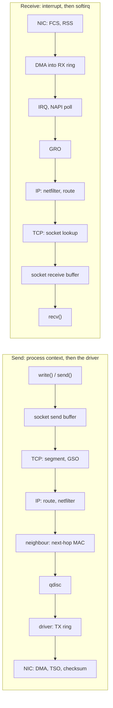
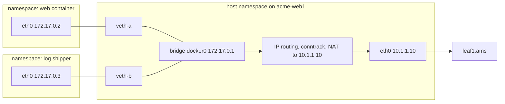

An application team says the network is dropping their packets. TCP retransmissions on `acme-web1` have doubled and its stream to `acme-db1` stalls in bursts. Every switch port between them, on `leaf1.ams`, both spines and `leaf3.ams`, shows zero discards and zero CRC errors. The packets were lost inside `acme-db1`, between its network card and the database, and TCP cannot tell that loss from fabric congestion: it retransmits and slows down the same way.

The host is the first and last hop of every packet walk. A received frame passes a NIC (network interface card), a ring of descriptors, an interrupt, a polling loop, a merge step, the IP and TCP code and a socket buffer before the application sees a byte, and each stage has a queue that can overflow and a counter that records it. This lesson traces both directions through the Linux kernel, from where [the packet walk](/learn/fabric-networking/from-zero/the-packet-walk) reached the host's port.

## Two paths through one kernel

The **kernel** is the part of the operating system that owns the hardware. Applications reach it through **system calls** (`send()`, `recv()`), each costing roughly a hundred nanoseconds to a microsecond ([I/O and system calls](/learn/systems/operating-systems/io-and-syscalls)). The **driver** is the kernel code for one model of NIC. Inside the kernel every packet is an **`sk_buff`** ("skb"): a couple of hundred bytes of metadata (arrival device, owning socket, whether the checksum was verified) plus pointers to the data. Adding or stripping a header moves a pointer, not the payload.



The directions are not mirror images. Sending runs mostly inside the sender's own system call, and the qdisc (queueing discipline, the transmit scheduler) decides what leaves when. Receiving runs in a **softirq** (a deferred, high-priority kernel task that runs after an interrupt, on the CPU that took it), and nothing on that path can slow a sender except TCP's advertised window. A full receive queue drops.

## The receive path, traced

`acme-db1` (`10.1.2.20`, behind `leaf3.ams`) is a Linux server with a 25 Gb/s NIC of 8 receive queues, running PostgreSQL on port 5432. `acme-web1` (`10.1.1.10`) streams data to it from port 51514 in full-size frames: 1,460 bytes of data per 1,500-byte IP packet.

1. **NIC.** Checks the FCS (frame check sequence) and destination MAC, then hashes the 5-tuple (addresses, protocol, ports) to pick a receive queue: queue 3 of 8.
2. **DMA.** Writes the frame by DMA (direct memory access: the device writes RAM without the CPU) into a buffer the driver supplied earlier, and marks one of RX ring 3's 1,024 descriptors filled.
3. **Interrupt.** Raises queue 3's interrupt, pinned to CPU 3. The handler masks the queue's interrupt and schedules a poll.
4. **NAPI poll.** In the softirq on CPU 3, the driver takes descriptors off the ring (64 per poll, 300 per softirq run), wraps each in an `sk_buff` marked "checksum verified", and refills the ring.
5. **GRO.** Merges four consecutive 1,460-byte segments into one `sk_buff` of 5,840 bytes.
6. **IP.** `ip_rcv` validates the header, netfilter (the packet filter behind iptables and nftables) runs, and routing finds `10.1.2.20` is local.
7. **TCP.** `tcp_v4_rcv` finds the socket by its 5-tuple, checks sequence numbers, queues the data, schedules an ACK.
8. **Socket buffer.** The bytes wait in the receive queue, `Recv-Q` in `ss`.
9. **Application.** PostgreSQL, woken by epoll, calls `recv()` and the kernel copies the bytes out. Steps 3 to 8 all ran on CPU 3.

```viz
{"type": "fabric", "scenario": "linux-rx-path", "title": "One frame from leaf3.ams to postgres on acme-db1, then a 1 ms CPU stall that drops 1,008 frames", "caption": "A data segment of acme-web1's PostgreSQL connection enters acme-db1's 25 Gb/s NIC. RSS picks queue 3 of 8, the NIC DMAs it into RX ring 3 (1,024 descriptors), the MSI-X interrupt lands on CPU 3, NAPI polls 64 at a time within a budget of 300, GRO merges four 1,460-byte segments into 5,840 bytes, IP delivers locally, TCP finds the socket, the bytes wait in Recv-Q and postgres reads them. A table grows with the counter for every stage's drops. Then CPU 3 stalls for 1 ms at line rate: the ring fills in about 0.5 ms and the NIC drops the remaining 1,008 frames."}
```

The last frames are the opening incident. A full-size frame occupies 1,538 bytes of wire time (packet, header, FCS, 8 of preamble, 12 of inter-frame gap: [links, frames and Ethernet](/learn/fabric-networking/from-zero/links-frames-and-ethernet)), so 25 Gb/s is 25 × 10⁹ / (1,538 × 8) ≈ 2.03 million frames per second, one every 492 ns. If CPU 3 cannot run its softirq for 1 ms, about 2,032 frames arrive, 1,024 fit in the ring and 1,008 are dropped. Only the NIC's counter records it; `acme-web1` sees missing segments that look exactly like fabric loss.

## Driver rings and DMA

**What it solves.** A CPU copying 2 million frames a second off the card would do nothing else, so the driver allocates buffers in RAM ahead of time and lists them in a **ring**: a circular array of **descriptors** (buffer address, length, status bit) that driver and NIC both read. The NIC DMAs each arriving frame into the next buffer it owns and marks that descriptor done; the driver consumes done descriptors in order and refills each with a fresh buffer. When the NIC's producer index catches the driver's consumer index, the ring is full. The transmit ring runs the other way: the driver writes descriptors pointing at packets and rings a **doorbell** (a NIC register write), the NIC DMAs them out and reports completion, and the driver frees the `sk_buff`, returning memory to the socket.

**Sizes.** `ethtool -g` shows current and maximum ring sizes, commonly 512 to 1,024 by default and 4,096 to 8,192 at most, depending on the driver. A ring counts frames, not bytes: 1,024 full-size frames is about 0.5 ms at 25 Gb/s but 0.13 ms at 100 Gb/s (8.1 million frames per second), so a size that was comfortable at 10 Gb/s is thin on a faster NIC.

**How it breaks.** The ring overflows when the CPU stops draining it for longer than it covers: a starved softirq, a virtual machine's vCPU descheduled by the hypervisor (steal time), a kernel path holding softirqs off. The NIC drops in hardware, counted under a driver-specific name: `rx_missed_errors` (Intel), `rx_out_of_buffer` (NVIDIA ConnectX), `rx_fifo_errors` (others), and usually `missed` in `ip -s link`.

**The fix and its cost.** `ethtool -G eth0 rx 4096` quadruples the slack. But each descriptor pins a 2 to 4 KB buffer (8 queues × 8,192 × 4 KB is 256 MB), frames in a deep ring wait longer (8,192 drained at 3 million per second is 2.7 ms), and on Intel servers with DDIO (Data Direct I/O, DMA into a slice of the last-level cache) a ring bigger than that slice spills to DRAM. The better fix is to stop the CPU stalling.

```python
LINE_RATE = 25e9                # bits per second
WIRE_BYTES = 1538               # 1,500 B packet + 14 header + 4 FCS + 8 preamble + 12 gap
ARRIVAL_PPS = LINE_RATE / (WIRE_BYTES * 8)   # about 2.03 million frames per second
CPU_PPS = 3.0e6                 # what CPU 3 can process when free (an assumption)
TICK = 1e-6                     # simulate in 1 microsecond steps


def run(ring_size, stall_ms, total_ms=10.0, stall_start_ms=2.0):
    ring = arrived = dropped = peak = 0     # ring = filled descriptors
    credit_in = credit_cpu = 0.0
    for step in range(int(total_ms * 1e-3 / TICK)):
        t_ms = step * TICK * 1e3
        stalled = stall_start_ms <= t_ms < stall_start_ms + stall_ms
        if not stalled:                 # the softirq runs: NAPI drains the ring
            credit_cpu += CPU_PPS * TICK
            take = min(ring, int(credit_cpu))
            ring -= take
            credit_cpu = 0.0 if ring == 0 else credit_cpu - take  # idle time is not banked
        credit_in += ARRIVAL_PPS * TICK
        while credit_in >= 1:           # frames arriving this microsecond
            credit_in -= 1
            arrived += 1
            if ring < ring_size:
                ring += 1               # DMA into a free descriptor
            else:
                dropped += 1            # no free descriptor: the NIC counts a miss
        peak = max(peak, ring)
    return arrived, dropped, peak


print(f"arrivals {ARRIVAL_PPS:,.0f} frames/s; an undrained ring of 1,024 "
      f"fills in {1024 / ARRIVAL_PPS * 1e3:.2f} ms")
print(f"{'ring':>6} {'stall':>7} {'arrived':>8} {'dropped':>8} {'peak':>6}")
for ring_size in (1024, 4096, 8192):
    for stall_ms in (0.0, 1.0, 5.0):
        arrived, dropped, peak = run(ring_size, stall_ms)
        print(f"{ring_size:>6} {stall_ms:>5.1f}ms {arrived:>8,} {dropped:>8,} {peak:>6,}")
```

```text
arrivals 2,031,860 frames/s; an undrained ring of 1,024 fills in 0.50 ms
  ring   stall  arrived  dropped   peak
  1024   0.0ms   20,318        0      3
  1024   1.0ms   20,318    1,010  1,024
  1024   5.0ms   20,318    9,140  1,024
  4096   0.0ms   20,318        0      3
  4096   1.0ms   20,318        0  2,034
  4096   5.0ms   20,318    6,068  4,096
  8192   0.0ms   20,318        0      3
  8192   1.0ms   20,318        0  2,034
  8192   5.0ms   20,318    1,972  8,192
```

The CPU is assumed to manage 3 million frames per second, only 1.5 times the arrival rate, so a backlog drains slowly; the 1 ms row loses 1,010, two more than the visualisation, because the ring held two frames when the stall began. `if ring < ring_size` is the NIC's only decision: it cannot push back on the sender. A ring of 4,096 absorbs a 1 ms stall, none absorbs 5 ms, and the ring that loses least queues the most.

## Interrupts and NAPI

An **interrupt** (IRQ) is a hardware signal that makes a CPU stop and run a handler. NICs use **MSI-X** (message-signalled interrupts, extended), one vector per queue, so each queue can be steered to its own CPU.

**What NAPI solves.** One interrupt per packet works at 10,000 packets per second and fails at 2 million: each costs on the order of a microsecond or more of entry, exit and cache pollution, so the CPU spends all its time in handlers. Mogul and Ramakrishnan named this **receive livelock** in the mid-1990s: throughput falls towards zero as load rises. Linux's answer, **NAPI** (the "new API", early 2000s), switches between interrupts and polling:

1. The first frame raises an interrupt. The handler masks the queue's interrupt, calls `napi_schedule` to queue a poll in the `NET_RX` softirq, and returns in well under a microsecond.
2. The softirq calls the driver's poll function, which processes up to its **weight**, 64 packets.
3. While the ring has work the poll runs again, until the softirq run hits `net.core.netdev_budget` (300 packets) or `netdev_budget_usecs` (2 ms with a 1,000 Hz tick). Stopping with work left increments **`time_squeeze`**, column 3 of `/proc/net/softnet_stat` for that CPU.
4. If softirq work keeps re-arriving (the kernel allows about ten restarts or 2 ms), the rest moves to the per-CPU thread **`ksoftirqd/N`**, which the scheduler treats like any thread.
5. A poll that empties the ring calls `napi_complete_done` and unmasks the interrupt.

A burst of thousands of frames costs one interrupt. Step 4 is the opening incident: once processing moves into `ksoftirqd/3`, a CPU-hungry process on CPU 3 (a backup, a garbage-collecting JVM) competes with it for time slices, and the ring overflows.

**Interrupt coalescing** (`ethtool -c`, often adaptive) makes the NIC wait for several frames or microseconds before interrupting: fewer interrupts, a few to tens of microseconds more latency. Latency-sensitive services lower it or use **busy polling** (`SO_BUSY_POLL`), spinning on the queue.

- **Breaks:** softirq starvation, ending in ring overflow; a budget too small for a fast NIC.
- **Signal:** `time_squeeze` rising on specific CPUs, `ksoftirqd/N` busy in `top`, one CPU's `%soft` high in `mpstat -P ALL 1`.

Illustrative `/proc/net/softnet_stat` on `acme-db1`, hexadecimal, one row per CPU; the first three columns are packets processed, backlog drops and time squeezes:

```text
0001f0e1 00000000 00000004 00000000 00000000 ...   <- CPU 0
0001d012 00000000 00000002 00000000 00000000 ...   <- CPU 1
0001a3c9 00000000 00000001 00000000 00000000 ...   <- CPU 2
000c1a77 00000000 00000068 00000000 00000000 ...   <- CPU 3: 6x the packets, 104 squeezes
```

## RSS and IRQ affinity

One core pushes on the order of one to a few million packets per second through the full stack, depending on CPU, kernel and features; a 100 Gb/s NIC delivers 8 million full-size frames per second. Receive work must be spread across cores without reordering any flow.

**RSS** (receive side scaling) does it in the NIC: a Toeplitz hash (a keyed hash from Microsoft's RSS specification, 40-byte key) over addresses and ports, whose low bits index an **indirection table** of 128 to 512 entries depending on the driver (`ethtool -x`), each naming a queue. With 8 queues the default table cycles 0 to 7. For the PostgreSQL flow:

| Step | Value |
|---|---|
| Hash input | 10.1.1.10, 10.1.2.20, port 51514, port 5432 |
| Toeplitz hash (illustrative) | `0x9c3e71d3` |
| Low 7 bits (table has 128 entries) | `0x53` = 83 |
| Table entry 83 (round-robin fill 0..7) | 83 mod 8 = queue 3 |
| Queue 3's MSI-X vector, affinity | CPU 3 |

Every packet of a flow gets the same hash, so the flow stays on one queue and CPU, never reordered. It is ECMP (equal-cost multipath: spreading flows over parallel paths by hash) inside the host ([ECMP and hashing](/learn/fabric-networking/fabric-architecture/ecmp-and-hashing)), with ECMP's weakness: **one flow cannot use more than one queue**, so one TCP stream is limited by one core, and one `iperf3` stream on a 100 Gb/s NIC can top out far below line rate while eight fill it. Some drivers hash UDP on addresses only by default (`ethtool -n eth0 rx-flow-hash udp4`), putting all UDP between two hosts on one queue; VXLAN's varied outer source port exists to give such hashes entropy ([VXLAN encapsulation](/learn/fabric-networking/overlays-vxlan-evpn/vxlan-encapsulation)).

**IRQ affinity** (`/proc/irq/<n>/smp_affinity_list`, set by hand or by `irqbalance`) picks the CPU each queue's interrupt reaches. Keep queues on cores of the NIC's NUMA node (non-uniform memory access: each CPU socket has its own memory and PCIe lanes; `/sys/class/net/eth0/device/numa_node`): a buffer processed from the other socket crosses the inter-socket link for every cache line. **RPS** (receive packet steering) is RSS in software for single-queue and virtual devices; **RFS** (receive flow steering; aRFS in hardware) steers a flow to the CPU where its reader last ran, warming the cache for step 9's copy; **XPS** maps CPUs to transmit queues so senders do not share one queue's lock.

- **Breaks:** every queue's interrupt on CPU 0, so one core does all receive work; an elephant flow (one very large flow) saturating its core; interrupts on the wrong NUMA node.
- **Signal:** uneven per-CPU `%soft` and `time_squeeze`; uneven per-queue counters in `ethtool -S` (`rx_queue_3_packets` and similar).

## Offloads: checksum, TSO and GRO

An **offload** moves per-packet work into the NIC or into a step that runs once per batch.

**Checksum offload.** On transmit the kernel leaves the TCP or UDP checksum for the NIC to fill in (`CHECKSUM_PARTIAL`); on receive the NIC verifies it and the `sk_buff` is marked `CHECKSUM_UNNECESSARY`, so the CPU never reads the payload to check it. A capture on the *sending* host shows `cksum ... (incorrect)` on every packet, because tcpdump sees it before the NIC finishes it.

**TSO** (TCP segmentation offload). TCP hands the driver one segment of up to 64 KB with one set of headers; the NIC cuts it into MSS-sized packets (MSS, maximum segment size: 1,460 bytes on a 1,500-byte MTU, 1,448 when TCP timestamps, on by default in Linux, take 12 bytes of each header), fixing sequence number, IP ID, length and checksum in each: 45 packets for one trip through the stack. **GSO** (generic segmentation offload) is the software fallback immediately before the driver, for devices or tunnels the NIC cannot segment.

**GRO** (generic receive offload) is the reverse, in software during the NAPI poll: consecutive segments of one flow with identical headers apart from length and sequence number become one `sk_buff` of up to 64 KB, flushed when the poll empties the ring (or after about a millisecond under sustained load), so it adds no meaningful delay. Its hardware predecessor **LRO** (large receive offload) discarded header details while merging, so the kernel disables LRO on devices that forward or bridge; GRO keeps enough for GSO to re-segment exactly, which is why it replaced LRO.

| Offload | Direction | Work moved | Check with | What breaks |
|---|---|---|---|---|
| Checksum | TX and RX | Summing every payload byte | `ethtool -k`: `tx-checksumming`, `rx-checksumming` | "Incorrect" checksums in sender-side captures (harmless); a NIC that mis-handles one encapsulation corrupts or drops it silently |
| TSO / GSO | TX | One stack traversal per 64 KB, not per 1,448 B | `tcp-segmentation-offload`, `generic-segmentation-offload` | 45-packet bursts at line rate into a switch queue |
| GRO | RX | One IP and TCP traversal per merged batch | `generic-receive-offload` | Captures on the receiver show 5,840-byte or 64 KB "packets" that never crossed the wire |
| LRO | RX | Merging in the NIC | `large-receive-offload` | Corrupts forwarded or bridged traffic; off on routers |

A TSO burst leaves at line rate, 45 frames back to back in about 22 µs at 25 Gb/s, into one switch queue. Linux sizes bursts to about a millisecond of the flow's rate (TSO autosizing) and the `fq` qdisc paces them, but many senders bursting at one receiver still overflow it: incast, in [why AI traffic is different](/learn/fabric-networking/ai-fabrics/why-ai-traffic-is-different). BIG TCP (Linux 5.19 for IPv6, 6.3 for IPv4) lets GSO and GRO units exceed 64 KB. Turning offloads off to "fix" capture checksums multiplies stack traversals by up to 45.

- **Signal:** `ethtool -k` differing from the fleet; `%soft` and `%sys` jumping after an offload change; `TcpInCsumErrors` rising on receivers.

## The kernel stack: IP, netfilter and TCP

After GRO the `sk_buff` goes to the protocol its EtherType names (`0x0800`, IPv4).

- **IP (`ip_rcv`)** checks version, length and checksum, then runs netfilter's PREROUTING hook, where conntrack (connection tracking, the flow table NAT and stateful firewalls rely on) looks it up. The **routing decision** follows: deliver locally, or forward if `net.ipv4.ip_forward` is on, making the host a router. **Reverse-path filtering** (`rp_filter`) drops a packet whose source would not route back out of its arrival interface, a trap for multi-homed hosts with asymmetric routes (`TcpExtIPReversePathFilter`). Local packets then pass the INPUT hook's firewall rules.
- **TCP (`tcp_v4_rcv`)** looks the segment up in the established-connection hash table; a miss falls back to listening sockets, and a miss there sends a RST (reset). If the application holds the socket lock (inside its own `recv()`, say), the segment waits on the socket's **backlog**, and a full backlog drops it (`TcpExtTCPBacklogDrop`). Otherwise TCP queues in-order data, holds out-of-order data separately and schedules an ACK.
- **SYNs** go to the listener's SYN queue, then, handshake complete, to the **accept queue**, bounded by the `listen()` backlog and `net.core.somaxconn` (4,096 since Linux 5.4). An application slow to `accept()` drops new connections (`TcpExtListenOverflows`, `TcpExtListenDrops`), which clients see as an extra second of connect time, the initial SYN retransmission timeout ([debugging the network](/learn/networking/networking-in-practice/debugging-the-network) reproduces it).

- **Breaks:** `rp_filter` dropping asymmetric traffic; a firewall rule dropping silently; a full accept queue at peak.
- **Signal:** the `nstat` counters named above, per-rule counters in `nft list ruleset` or `iptables -vnL`, connect times clustering at 1 s and 3 s.

## Socket buffers

A socket's buffers are limits on memory charged to it, not fixed arrays. Each queued `sk_buff` is charged its **truesize** (data, structure and unused buffer space), so a 100-byte segment can cost a kilobyte of budget.

**Receive.** Accepted but unread bytes sit in the receive queue. TCP's advertised window comes from the free space, so the buffer bounds the window, and the window bounds throughput at one window per round trip ([TCP deep dive](/learn/networking/fundamentals/tcp-deep-dive)). Linux autotunes each buffer within `net.ipv4.tcp_rmem` (minimum, default, maximum), typically `4096 131072 6291456`: a 6 MB maximum before Linux 6.16, 32 MB since. Calling `setsockopt(SO_RCVBUF)` switches autotuning off for that socket (capped by `net.core.rmem_max`; the kernel doubles the request to cover overhead). Part of every buffer is overhead, so the advertised window is a fraction of it and the ceilings below are upper bounds.

Worked on Meridian: replicating from `acme-db1` in Amsterdam to Singapore crosses about 10,500 km of fibre, roughly 105 ms of round trip.

| Receive buffer | Window per RTT (at most) | Throughput ceiling at 105 ms RTT |
|---|---|---|
| 256 KB, set by the application | 262,144 B | 262,144 × 8 / 0.105 ≈ 20 Mb/s |
| 6 MB (older default maximum) | 6,291,456 B | ≈ 480 Mb/s |
| 32 MB (default maximum since 6.16) | 33,554,432 B | ≈ 2.6 Gb/s |
| Needed to fill 10 Gb/s | 10 × 10⁹ × 0.105 / 8 ≈ 131 MB | 10 Gb/s |

No row drops a packet: the window is the limit, and the fix is a sysctl or socket option on the hosts, a case [the troubleshooting method](/learn/fabric-networking/operating-fabrics/the-troubleshooting-method) returns to.

**Send.** `write()` copies bytes into the send buffer (`tcp_wmem`, default maximum 4 MB) and returns; they stay charged until acknowledged, since TCP may retransmit them (`Send-Q` in `ss`). A full send buffer blocks the writer or returns `EAGAIN`: backpressure, not loss.

**UDP** has no window: a datagram arriving at a full buffer is dropped and counted in `UdpRcvbufErrors` ([UDP vs TCP](/learn/networking/fundamentals/udp-vs-tcp)). Telemetry collectors receiving sFlow or syslog lose data this way at peak.

- **Breaks:** a small hand-set `SO_RCVBUF` capping long-distance throughput; a reader that stops, so the window falls to zero; UDP receivers overflowing.
- **Signal:** `ss -tm` (`Recv-Q`, the `rb` limit), zero windows in a capture, `TcpExtTCPRcvQDrop` and `UdpRcvbufErrors` in `nstat`.

## The transmit side and the qdisc

TCP decides how much it may send (the smaller of the congestion window and the peer's window, at the pacing rate), builds a GSO segment and passes it to IP, which looks up the route, runs the OUTPUT and POSTROUTING hooks (where NAT rewrites the source) and gets the next hop's MAC from the **neighbour subsystem** ([ARP and the default gateway](/learn/fabric-networking/from-zero/arp-and-the-default-gateway)). `dev_queue_xmit` hands it to the qdisc.

**What the qdisc solves.** Many sockets share a link that sends at one fixed rate. The qdisc is the queue in front of the driver that decides order and what to drop on overflow:

| Qdisc | How it orders | Drop or delay policy | Where you see it |
|---|---|---|---|
| `pfifo_fast` | Three priority bands by the packet's TOS byte, FIFO in each | Tail drop at `txqueuelen` (1,000 packets) | The kernel's built-in default, overridden on most distributions |
| `fq_codel` | Per-flow queues served round-robin, so a bulk flow cannot starve a small one | CoDel AQM (active queue management): drops or ECN-marks once queueing delay has stayed above a 5 ms target for a 100 ms interval | The default on most systemd distributions |
| `fq` | Per-flow queues with **pacing**: each flow's packets released at its rate | Per-flow limits | Recommended for busy TCP servers; pairs with BBR |
| `mq` / `mqprio` | One child qdisc per hardware transmit queue; `mqprio` maps traffic classes to queues | Per child | Multi-queue NICs; `mqprio` on RoCE hosts with priority classes |

On a multi-queue NIC the root is `mq` with one `fq_codel` or `fq` child per hardware queue (`tc -s qdisc show dev eth0`).

Two mechanisms keep the queue in the qdisc, where it can be scheduled, not in the TX ring, where it cannot. **BQL** (byte queue limits) caps bytes outstanding in each TX ring at what keeps the link busy between completions, usually tens of kilobytes; without it, even 64 TSO segments of 64 KB in the ring are 4 MB, about 1.3 ms at 25 Gb/s of FIFO that no AQM can see. **TCP Small Queues** caps what one socket may have in the qdisc and ring, roughly a millisecond at its rate, so one bulk sender cannot fill the device queue.

- **Breaks:** a full qdisc dropping locally (TCP treats it as congestion); FIFO delay without BQL; a stuck transmit queue, logged as `transmit queue N timed out` and reset by the watchdog.
- **Signal:** `tc -s qdisc` (`dropped`, `overlimits`, `backlog`); `tx_dropped`, `tx_timeout` in `ethtool -S`; `dmesg`.

## Network namespaces

A **network namespace** is a separate copy of the kernel's networking state: interfaces, addresses, routing tables, ARP table, netfilter rules, conntrack, sockets and port space, many sysctls and most `/proc/net` counters. A process sees only its own namespace's copy, so two namespaces can both bind port 5432 on `10.1.1.10`, the separation Meridian's VRFs give Acme and Globex on the leaves ([VRFs and multi-tenancy](/learn/fabric-networking/overlays-vxlan-evpn/vrfs-and-multi-tenancy)).

**What it solves.** Containers. A Docker container or Kubernetes pod is processes in their own namespaces (network, mount, PID and others): its own `eth0`, `127.0.0.1` and routes on a shared kernel, no hypervisor. A new namespace holds only a loopback; it is connected by moving an interface in, usually one end of a veth pair.

**How it breaks.** Usually in diagnosis: commands run in the wrong namespace. `ss`, `nstat`, `ip route` and `iptables` on the host say nothing about a container's sockets, drops or routes; read them with `nsenter -t <pid> -n nstat` or `ip netns exec`, and the physical NIC's `ethtool -S` where the NIC lives, usually the host. A namespace dies with its last process unless a bind mount pins it (`ip netns add` and some container network plugins create one), so a crashed container can leave interfaces and routes behind.

- **Signal:** the same counter read inside and outside; `lsns -t net` and `ip netns list` to find namespaces, stale ones included.

## veth pairs and bridges

A **veth pair** is two virtual Ethernet interfaces back to back: a frame sent on one end is received on the other. One end in a container's namespace as its `eth0`, the other in the host's, is a cable between them. There is no hardware ring: by default sending queues the `sk_buff` on the sending CPU's **backlog** (bounded by `net.core.netdev_max_backlog`, 1,000 packets by default; a veth with GRO or XDP enabled gets its own NAPI queue instead), drained by the same softirq machinery, so container bursts overflow into column 2 of `/proc/net/softnet_stat`, a counter few dashboards graph.

A **Linux bridge** is a software layer-2 switch: it learns source MACs into a forwarding database (`bridge fdb show`), floods unknown destinations and ages entries, like a hardware switch ([switches, VLANs and loops](/learn/fabric-networking/from-zero/switches-vlans-and-loops)). Docker's default is `docker0` at `172.17.0.1/16`.



Suppose `acme-web1` runs its web server in a container at `172.17.0.2`, which connects to `acme-db1`:

1. The container routes `10.1.2.20` to its gateway `172.17.0.1`, ARPs for the bridge's MAC inside its namespace, and sends from its `eth0`.
2. The frame arrives on `veth-a` in the host namespace, through the sending CPU's backlog.
3. The bridge learns the container's MAC on `veth-a`; the destination MAC is the bridge's own, so the frame goes up to the host's IP layer.
4. The host forwards it, and POSTROUTING's masquerade rule rewrites the source to `10.1.1.10` (keeping the source port unless another connection already holds it), recorded in conntrack.
5. It leaves the physical `eth0` through qdisc and TX ring to `leaf1.ams`. The fabric sees only `10.1.1.10` and the host's MAC, so EVPN learns the host, not the container.
6. The reply reverses it: conntrack restores `172.17.0.2`, and the bridge switches the frame to `veth-a` from its forwarding database.

Container-to-container traffic on one host never touches the NIC. Kubernetes network plugins bridge like Docker, route pod addresses and advertise them to the leaves over BGP (Calico can), or tunnel between nodes in VXLAN, which costs 50 bytes of MTU ([transport as the network sees it](/learn/fabric-networking/from-zero/transport-as-the-network-sees-it) covers that trap).

- **Breaks:** veth backlog drops in bursts; a bridge subnet overlapping a range the host must reach (management, VPN), whose connected route captures that traffic by longest-prefix match; conntrack exhaustion (in failure modes below).
- **Signal:** `softnet_stat` column 2; `ip route get <address>` naming the bridge; `conntrack -S`.

## Where a host drops packets, and the counter that shows it

Every queue above has a limit and a counter. In the order a received packet meets them:

| Stage | Why it drops | Counter | Read with |
|---|---|---|---|
| Wire, NIC | Corrupt frame, bad FCS | `rx_crc_errors`, `rx_errors` | `ethtool -S`, `ip -s link` |
| RX ring | No free descriptor | `rx_missed_errors`, `rx_out_of_buffer`, `rx_fifo_errors` | `ethtool -S`; `missed` in `ip -s link` |
| Softirq budget | Not a drop: a leading indicator | `time_squeeze`, column 3 per CPU | `/proc/net/softnet_stat` |
| Backlog (RPS, veth) | `netdev_max_backlog` exceeded | column 2 per CPU | `/proc/net/softnet_stat` |
| Device layer | No protocol handler, unknown VLAN | `rx_dropped`, `rx_nohandler` | `ip -s link` |
| IP | Bad header, no route, reverse-path filter | `IpInHdrErrors`, `IpInDiscards`, `IpExtInNoRoutes`, `TcpExtIPReversePathFilter` | `nstat -az` |
| Netfilter, conntrack | A DROP rule, a full table | per-rule packet counters; `insert_failed`, `drop` | `nft list ruleset`, `iptables -vnL`, `conntrack -S` |
| TCP | Bad checksum, full accept queue, full socket backlog | `TcpInCsumErrors`, `TcpExtListenDrops`, `TcpExtTCPBacklogDrop` | `nstat -az` |
| Socket buffer | Receive memory exhausted | `TcpExtTCPRcvQDrop`, `UdpRcvbufErrors` | `nstat -az`, `ss -tm` |
| Qdisc (transmit) | Queue limit or AQM | `dropped`, `overlimits` | `tc -s qdisc` |
| TX ring, driver | Ring stuck or full | `tx_dropped`, `tx_timeout` | `ethtool -S`, `dmesg` |

Three properties matter for tooling: the counters are **cumulative since boot** (only deltas mean anything), their **names differ by driver** (a fleet needs a mapping per NIC model), and they are **split by namespace and CPU** (a host-wide sum hides one hot core). For a drop the table cannot explain, Linux 5.17 and later attach a **drop reason** to the `kfree_skb` tracepoint (`NETFILTER_DROP`, `TCP_CSUM`, `SOCKET_RCVBUFF` and others), which `perf`, `dropwatch` or the eBPF tool `pwru` turn into which function dropped which packet, and why.

The opening incident as ten-second deltas, from illustrative counters on `acme-db1`, ordered by stage:

```python
import re

# Two snapshots of acme-db1's counters, 10 seconds apart (illustrative values).
BEFORE = {
    "ethtool": "rx_crc_errors: 0\nrx_missed_errors: 120\ntx_dropped: 0\n",
    "softnet": "0001a2b3 00000000 00000004\n0001c4d5 00000000 00000002\n"
               "00019e07 00000000 00000001\n0002f4a8 00000000 00000009\n",   # one row per CPU
    "nstat": "IpInDiscards 0\nTcpExtListenDrops 7\nTcpExtTCPRcvQDrop 0\nUdpRcvbufErrors 0\n",
    "tc": "qdisc fq_codel 0: dev eth0 root\n Sent 9100 bytes 70 pkt (dropped 3, overlimits 0)\n",
}
AFTER = {
    "ethtool": "rx_crc_errors: 0\nrx_missed_errors: 1130\ntx_dropped: 0\n",
    "softnet": "0001f0e1 00000000 00000004\n0001d012 00000000 00000002\n"
               "0001a3c9 00000000 00000001\n000c1a77 00000000 00000068\n",
    "nstat": "IpInDiscards 0\nTcpExtListenDrops 7\nTcpExtTCPRcvQDrop 0\nUdpRcvbufErrors 0\n",
    "tc": "qdisc fq_codel 0: dev eth0 root\n Sent 9900 bytes 76 pkt (dropped 3, overlimits 0)\n",
}

# Counter -> (pipeline position, stage, meaning), in the order a received packet meets them.
STAGES = {
    "rx_crc_errors": (1, "wire / NIC", "corrupt frames: optic, cable or the far end"),
    "rx_missed_errors": (2, "RX ring", "no free descriptor: the kernel fell behind"),
    "softnet_dropped": (3, "backlog", "per-CPU backlog full (RPS, veth)"),
    "softnet_squeeze": (3, "softirq", "NAPI budget ran out with work left (not a drop)"),
    "IpInDiscards": (4, "IP", "discarded by the IP layer"),
    "TcpExtListenDrops": (5, "listen queue", "SYNs dropped: accept queue full"),
    "TcpExtTCPRcvQDrop": (6, "socket buffer", "receive memory exhausted"),
    "UdpRcvbufErrors": (6, "socket buffer", "UDP datagrams dropped: buffer full"),
    "qdisc_dropped": (7, "qdisc (transmit)", "queue full or AQM drop on send"),
    "tx_dropped": (8, "TX ring / driver", "driver dropped on send"),
}


def parse(snap):
    c = {}
    for line in snap["ethtool"].splitlines():
        name, value = line.split(":")
        c[name.strip()] = int(value)
    rows = [[int(x, 16) for x in line.split()] for line in snap["softnet"].splitlines()]
    c["softnet_dropped"] = sum(r[1] for r in rows)   # column 2: dropped
    c["softnet_squeeze"] = sum(r[2] for r in rows)   # column 3: time_squeeze
    c["squeeze_by_cpu"] = [r[2] for r in rows]
    for line in snap["nstat"].splitlines():
        name, value = line.split()
        c[name] = int(value)
    c["qdisc_dropped"] = sum(int(n) for n in re.findall(r"dropped (\d+)", snap["tc"]))
    return c


before, after = parse(BEFORE), parse(AFTER)
delta = {k: after[k] - before[k] for k in after if k != "squeeze_by_cpu"}
by_cpu = [a - b for a, b in zip(after["squeeze_by_cpu"], before["squeeze_by_cpu"])]
print("acme-db1, counters that moved in 10 s:")
hits = sorted((STAGES[k][0], k) for k in STAGES if delta.get(k, 0) > 0)
for _, k in hits:
    _, stage, meaning = STAGES[k]
    print(f"  {stage:<16} {k:<20} +{delta[k]:<6,} {meaning}")
print("  time_squeeze by CPU:", by_cpu)
real = [k for _, k in hits if k != "softnet_squeeze"]
if real:
    print("first stage that dropped:", STAGES[real[0]][1])
else:
    print("no host drops: look at the path, the peer or the application")
```

```text
acme-db1, counters that moved in 10 s:
  RX ring          rx_missed_errors     +1,010  no free descriptor: the kernel fell behind
  softirq          softnet_squeeze      +95     NAPI budget ran out with work left (not a drop)
  time_squeeze by CPU: [0, 0, 0, 95]
first stage that dropped: RX ring
```

The old totals (`TcpExtListenDrops 7`, qdisc `dropped 3`) did not move, so the deltas ignore them. All 95 squeezes were on CPU 3, the CPU serving queue 3, which points at whatever else ran there: `top` or `perf` on that core is next.

## Failure modes in production

**Softirq starvation on a shared core.** *Symptom:* retransmissions and throughput dips on one host's inbound flows, in bursts matching a batch job; switches clean. *Diagnosis:* `rx_missed_errors` rising, `time_squeeze` and `ksoftirqd` busy on the CPUs owning the NIC queues, where the job runs. *Fix:* keep heavy work off the interrupt CPUs; a larger ring and more queues as buffer.

**Window-limited cross-site replication.** *Symptom:* Amsterdam to Singapore replication stuck near 20 Mb/s on a 10 Gb/s circuit, zero loss, links idle. *Diagnosis:* `ss -tm` shows the buffer pinned by the application's 256 KB `SO_RCVBUF`, the ceiling computed above. *Fix:* drop the explicit setting and raise `tcp_rmem`'s maximum towards the bandwidth-delay product.

**Conntrack exhaustion on a container host.** *Symptom:* a random fraction of new connections from a node's pods time out at peak; existing ones are fine. *Diagnosis:* `nf_conntrack: table full, dropping packet` in the kernel log, `insert_failed` and `drop` rising in `conntrack -S`. *Fix:* raise `nf_conntrack_max` (memory per entry), shorten timeouts for short flows, or give pods routable addresses so no NAT is needed.

## Trade-offs: how much of the kernel to keep

Some workloads leave the kernel path. Meridian's San Jose GPU servers send training traffic over RDMA (remote direct memory access) on each GPU's 400 Gb/s NIC, while front-end and storage traffic uses this lesson's stack ([RDMA from zero](/learn/fabric-networking/ai-fabrics/rdma-from-zero)).

| Approach | Per-packet CPU cost | Latency | What you give up | Operational cost |
|---|---|---|---|---|
| Kernel stack with NAPI, GRO and TSO | Highest; amortised by batching | Tens of µs, more under load | Nothing: full TCP, firewall, namespaces, tooling | Lowest: every tool above works |
| Kernel with busy polling | Same work, no interrupt | Lower and steadier | A spinning core per busy socket | Low |
| XDP / AF_XDP (eBPF in the driver, before the `sk_buff` exists) | Very low for drop, redirect, rewrite | Low | Most of the stack for those packets | Medium: eBPF programs to build and verify |
| DPDK (the NIC owned by a user-space poll-mode driver) | Lowest for software forwarding | Low, predictable | The kernel's view: `ss`, `nstat`, `tc` see nothing | High: dedicated cores, its own tooling |
| RDMA (the NIC moves data between registered memory, no CPU per byte) | Near zero per byte | A few µs end to end | A sockets API; needs a lossless or congestion-controlled fabric | High: fabric tuning and NIC counters |

## What the platform should show

- **Host drops beside fabric drops on one timeline.** Ring misses, backlog, socket and qdisc drops per host, next to the leaf port's discards: one view that answers "is it the network?".
- **Deltas per CPU and per queue.** Rates, never totals, with the busiest CPU beside the sum.
- **A normalised counter schema.** Driver names mapped to stages (`rx_missed_errors` and `rx_out_of_buffer` both mean "ring full"), versioned per NIC model and driver.
- **Host configuration as data.** Ring sizes, queues, IRQ affinity, offloads, qdisc, `tcp_rmem`, `somaxconn`, diffed against the fleet's intent: the one host that differs often explains itself.
- **Namespace awareness.** Counters collected inside container namespaces and labelled by pod.
- **Socket samples.** Periodic `ss -ti` data (RTT, window, `Recv-Q`, retransmits) for important flows, so a window limit is not blamed on the link.
- **Drop reasons on demand.** A short `kfree_skb` trace on one host when counters cannot explain a loss.

## Interviewer follow-ups

**"TCP retransmissions to a server, and every switch port on the path is clean. Where do you look?"** Model answer: scope first (one server or many, one direction or both), then the receiver's counters as deltas: `ethtool -S` for ring misses, `softnet_stat` per CPU, `nstat` for socket drops, `ss -tm` for the window. Common wrong answer: "it must be a switch buffer", when switch discards are counted per port and would show.

**"Why does Linux not take one interrupt per packet?"** Model answer: at millions of packets per second interrupt overhead alone consumes the CPU (receive livelock). NAPI takes one interrupt, masks it, polls the ring in budgeted batches and re-enables it when the ring is empty, so cost per packet falls as load rises. Common wrong answer: "interrupt coalescing", a NIC-side delay that only complements NAPI.

**"One TCP stream on 100 Gb/s NICs reaches a fraction of line rate; eight streams fill it. Why?"** Model answer: RSS puts each flow on one queue and one CPU, so one stream is limited by one core; more flows, a larger MTU, BIG TCP or RFS help. The per-core ceiling depends on CPU and kernel, and I'd defer to the host team on tuning, but I'd show the hot core with per-CPU `%soft` and per-queue counters. Common wrong answer: "the link or switch is limiting it".

**"A container cannot reach a database its host can reach. What do you check?"** Model answer: work inside its namespace (its own routes, ARP, firewall); then a bridge subnet overlapping the database's network (`ip route get`), NAT and conntrack health, and overlay MTU. Common wrong answer: checking `ss` and `iptables` on the host and finding nothing.

## What mid-level engineers get wrong

- **Treating retransmissions as proof of network loss.** Host ring, backlog and socket drops cause identical retransmissions.
- **Reading cumulative counters as rates, or summing across CPUs.** A thousand drops since boot is nothing; a thousand this minute on one core is an incident the host-wide average hides.
- **Setting `SO_RCVBUF` "for performance".** It disables autotuning and often caps long-distance throughput.
- **Trusting a sender-side capture as the wire.** It shows what the kernel handed the NIC, before TSO and checksum offload.

## Senior signals

- You trace a frame through ring, interrupt, NAPI, GRO, IP, TCP and socket, name each stage's drop counter, and graph them beside the fabric's drops.
- You compute a ring's slack (descriptors over frame rate: 0.5 ms for 1,024 at 25 Gb/s) and know a bigger ring trades drops for latency and memory.
- You call RSS ECMP inside the host: per-flow hashing keeps order and limits one flow to one core.
- You read offloads into every capture: TSO and checksum on the sender, GRO on the receiver.
- You size buffers from the bandwidth-delay product and spot a window limit by zero loss on an idle link.
- You treat namespaces as separate stacks and read counters inside them.

## Check yourself

```quiz
- q: >-
    acme-db1's NIC has 1,024 descriptors per RX ring and receives full-size frames at 25 Gb/s line rate (about 2.03 million per second). Its softirq CPU stalls for 2 ms. About how many frames does the NIC drop?
  options: ["About 4,060, every frame that arrived during the stall", "None, because TCP flow control pauses the sender in time", "About 1,010, the same as for a 1 ms stall", "About 3,040, everything beyond the 1,024 that fit"]
  answer: 3
  explanation: >-
    In 2 ms about 4,064 frames arrive. The ring holds 1,024 and the NIC drops the rest, about 3,040, counting them only in its missed counter. TCP's window cannot help: it limits unread data at the socket, but these frames never reached TCP, and the sender learns of the loss only through missing ACKs. The ring absorbs the first 1,024 frames, so not every arrival is lost.
- q: >-
    A host's single TCP stream to a peer on a 100 Gb/s NIC reaches a fraction of line rate, while eight parallel streams fill the link. Per-CPU statistics show one core at 100% softirq. What explains it?
  options: ["NAPI's budget of 300 packets caps every flow's rate", "The switch hashes the stream onto one congested uplink", "The receive buffer is smaller than the bandwidth-delay product", "RSS keeps each flow on one queue and so on one CPU"]
  answer: 3
  explanation: >-
    RSS hashes the 5-tuple to choose a queue, and each queue's interrupt and softirq run on one CPU, so a single flow is limited by one core's processing. Eight flows hash to several queues and spread across cores. A window limit would show an idle CPU and an idle link, not a saturated core. The NAPI budget limits one softirq run, not a flow's rate, and an uplink collision would not depend on host CPU.
- q: >-
    A tcpdump on the sending host shows 64,000-byte TCP segments, each marked with an incorrect checksum. What is happening?
  options: ["The kernel is corrupting packets before they reach the NIC", "TSO and checksum offload finish the packets in the NIC", "GRO on the sender merged segments before transmission", "The path MTU is 64 KB, so no segmentation is needed"]
  answer: 1
  explanation: >-
    With TSO, TCP hands the NIC one large segment that the NIC cuts into MSS-sized packets, and with checksum offload the NIC fills in the checksums as it transmits. The capture point is above the NIC, so it sees the unfinished super-packet. GRO is a receive-side merge. The wire still carries 1,500-byte packets on a 1,500-byte MTU, and nothing is corrupted.
- q: >-
    Replication from Amsterdam to Singapore (105 ms RTT) runs at about 20 Mb/s on a 10 Gb/s circuit with zero packet loss. The application sets SO_RCVBUF to 256 KB. What limits it?
  options: ["The NIC's RX ring is overflowing on the receiver", "The sender's qdisc drops packets under CoDel's 5 ms target", "Packet loss on the long-haul circuit is forcing slow start", "The receive window: 256 KB per 105 ms round trip"]
  answer: 3
  explanation: >-
    TCP can have at most one window of unacknowledged data per round trip, and the window is bounded by the receiver's buffer: 262,144 bytes × 8 / 0.105 s is about 20 Mb/s. Setting SO_RCVBUF disables autotuning, so the buffer never grows. There is zero loss, so neither slow start after loss nor ring or qdisc drops can explain it.
- q: >-
    Two containers on the same host exchange bursts of traffic through the docker0 bridge and see intermittent loss. Which counter most likely shows it?
  options: ["Column 2 of /proc/net/softnet_stat, the per-CPU backlog drops", "The dropped field of tc -s qdisc on the physical eth0", "rx_missed_errors on the physical NIC, the RX ring overflows", "TcpExtListenDrops in nstat, read in the host namespace"]
  answer: 0
  explanation: >-
    Traffic between two containers on one host goes veth, bridge, veth and never touches the physical NIC, so its RX rings and eth0's qdisc cannot record the loss. A veth has no hardware ring: each transmitted packet is queued on the sending CPU's backlog, bounded by netdev_max_backlog (1,000 packets by default), and overflow is counted in column 2 of softnet_stat. Listen drops read in the host namespace cannot see the containers' sockets, which live in their own namespaces.
```
