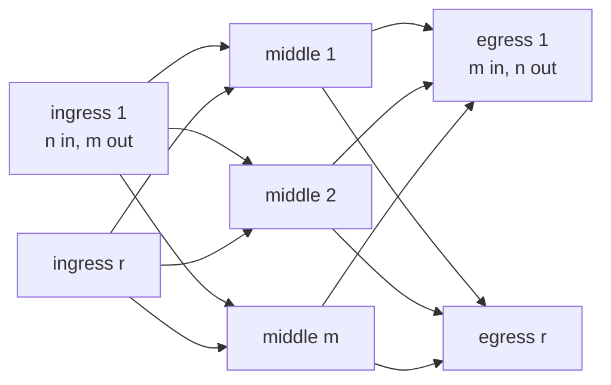
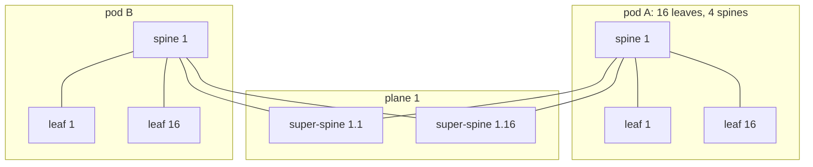

A server in a modern data center talks mostly to other servers. One page view fans out into hundreds of internal calls to caches, databases and other services, every write to storage is copied to two or three other machines, and a training job's GPUs exchange gigabytes after every step. The network must give any server a fast path to any other, at equal latency and with enough capacity, and keep doing so when a switch dies. A tree of ever-bigger switches cannot. The answer, used by nearly every large data center built since about 2010, is a Clos fabric: many small identical switches wired so that every edge switch reaches every other through any of several middle switches.

Here you build Meridian's Amsterdam site as a Clos fabric and work its numbers. How traffic is spread over the paths is [ECMP and hashing](/learn/fabric-networking/fabric-architecture/ecmp-and-hashing); the headroom to survive losing them is [redundancy and failure domains](/learn/fabric-networking/fabric-architecture/redundancy-and-failure-domains).

## The three-tier design and why it broke

Until roughly 2010 most data center networks copied the enterprise campus. Three layers of switches formed a tree:

- **Access** switches sit at the top of each rack (hence **ToR**, top-of-rack) or the end of each row, and servers plug into them.
- **Aggregation** (or distribution) switches, usually a pair, collect the uplinks from dozens of access switches. They are the servers' **default gateway**, the router a host sends off-subnet traffic to ([ARP and the default gateway](/learn/fabric-networking/from-zero/arp-and-the-default-gateway)).
- **Core** switches, large modular chassis, join the aggregation pairs to each other and to the internet edge.

Below the aggregation layer everything was layer 2: switched Ethernet, with VLANs (virtual LANs, separate broadcast domains on shared switches) stretched across many racks so that a virtual machine could move anywhere and keep its IP address. Layer 2 has no TTL, so a loop in it circulates broadcasts forever. Every access switch had two uplinks, one to each aggregation switch, and the two aggregation switches were linked to each other: a triangle, which is a loop, so **spanning tree** (STP) blocked one uplink ([switches, VLANs and loops](/learn/fabric-networking/from-zero/switches-vlans-and-loops) has the mechanism). The gateway ran on both aggregation switches under a first-hop redundancy protocol (VRRP, the Virtual Router Redundancy Protocol, or Cisco's Hot Standby Router Protocol, HSRP), which makes one of them active for the gateway address and keeps the other on standby.

### Oversubscription compounds up the tree

**Oversubscription** is the ratio of the capacity that can arrive at a switch from below to the capacity it has towards the rest of the network. At 4:1, if every server sends off-switch at once, each gets a quarter of its port speed. In a tree the ratios multiply, because traffic that crosses the core passes every layer's bottleneck. A typical design of the late 2000s, worked:

| Layer | Capacity from below | Usable capacity up | Ratio |
|---|---|---|---|
| Access switch | 48 servers × 1 Gb/s = 48 Gb/s | 2 × 10 Gb/s uplinks, one blocked by spanning tree: 10 Gb/s | 4.8:1 |
| Aggregation (the active one of the pair) | 20 access switches × 10 Gb/s = 200 Gb/s | 4 × 10 Gb/s to the core: 40 Gb/s | 5:1 |
| End to end, across the core | | | 4.8 × 5 = 24:1 |

A server with a 1 Gb/s port, talking to a server in another aggregation block while its neighbours do the same, gets about 1,000 / 24 ≈ 42 Mb/s. Real networks were often worse: Microsoft's VL2 paper (SIGCOMM 2009) put conventional rack uplinks at 1:5 to 1:20 and paths through the top of the tree at up to 1:240.

### Why it broke

**The traffic turned sideways.** The tree was sized for clients talking to servers. Distributed storage, MapReduce shuffles (every mapper sending to every reducer), microservices and VM migration sent most bytes between arbitrary racks, through the most oversubscribed layer.

**Half the links did nothing.** Spanning tree blocked one uplink per access switch, and the standby gateway carried no traffic. The operator paid for two paths and could use one.

**Growth meant bigger boxes.** More core capacity meant a bigger chassis: a hard ceiling (the largest model on the market) and a fork-lift replacement of the whole box at each step.

**Failures were large and slow.** An aggregation switch failure removed the gateway for thousands of servers until VRRP moved it; a spanning-tree recalculation took 30 to 50 seconds with classic 802.1D timers (under a second to a few seconds with the rapid version, 802.1w). One miscabled port could start a broadcast storm across every rack sharing the VLAN.

**Latency depended on where you stood.** Two servers on one access switch were one switch apart; in different aggregation blocks, five (access, aggregation, core, aggregation, access), so a placement change moved an application's p99 latency.

**What three-tier solved:** cheap ports at the edge, one big router at the top, simple north-south (client to server) traffic. **How it breaks:** east-west load saturates the aggregation and core uplinks while half the links sit blocked. **Signal:** output discards (packets dropped because a port's outgoing queue is full) and high utilisation on aggregation and core uplinks, idle blocked ports, and latency that varies with server placement.

## East-west and north-south traffic

Network diagrams put the internet at the top, so traffic between the data center and the outside world runs **north-south**, and traffic between servers inside it runs **east-west**. At Meridian a user loading a page is north-south: in through ISP1 or ISP2, a border gateway (`gw1.ams` or `gw2.ams`), a spine, the web server's leaf. Everything that page view causes is east-west: the web tier calling an API, the API reading a cache and a database, the database replicating its write.

East-west traffic dominates by a wide margin. Cisco's Global Cloud Index forecasts of the late 2010s put about 70% of data center traffic inside the data center, with the rest split between users and other data centers; Facebook described its machine-to-machine traffic in 2014 as several orders of magnitude larger than what went out to the internet. A few mechanisms explain the multiplier:

- **Fan-out.** A request that touches 100 backend shards creates 100 internal requests and 100 replies.
- **Replication.** Writing 1 TB to a store with three replicas sends 2 TB more across the fabric.
- **Batch and training.** A shuffle moves a whole dataset between machines; a data-parallel training step all-reduces the full gradient, typically every few hundred milliseconds to a few seconds ([why AI traffic is different](/learn/fabric-networking/ai-fabrics/why-ai-traffic-is-different)).

Traffic between sites crosses long-haul circuits and is sized separately ([connecting sites and backbones](/learn/fabric-networking/fabric-architecture/connecting-sites-and-backbones)). Inside one site the question is: give every server equal, ample bandwidth to every other. Telephone exchanges had answered it in 1953.

## Charles Clos, 1953: a big switch from small ones

A telephone exchange connects any of N incoming lines to any of N outgoing lines. The direct design is a **crossbar**: a grid with a switch contact (a **crosspoint**) at every intersection, N² of them. It never blocks, but N² grows ruinously: 1,024 lines need 1,048,576 crosspoints. Charles Clos, at Bell Labs, published "A Study of Non-Blocking Switching Networks" in the Bell System Technical Journal in March 1953. It showed how to build the same guarantee from many small crossbars in three stages:

1. **r ingress switches**, each with n inputs and m outputs (one to each middle switch);
2. **m middle switches**, each with r inputs and r outputs (one link to every ingress and every egress switch);
3. **r egress switches**, each with m inputs and n outputs.

N = r × n lines, and the crosspoint count is 2rnm + mr².



### Why m = 2n − 1 never blocks

A new call from input `a` on ingress switch I to output `b` on egress switch E needs one middle switch whose link from I is free *and* whose link to E is free. In the worst case:

| Step | State | Middle switches ruled out |
|---|---|---|
| 1 | The other n − 1 inputs on I are all in calls, each through a different middle switch | n − 1 (I's links to them are busy) |
| 2 | The other n − 1 outputs on E are all in calls, each through a different middle switch, none of them shared with step 1 | another n − 1 (their links to E are busy) |
| 3 | `a` and `b` are both idle and want a path | 2n − 2 ruled out, so one more is needed |

So m ≥ 2n − 1 middle switches make the network **strictly non-blocking**: any idle input reaches any idle output without disturbing existing calls. Trace it with n = 3 and m = 4: I's other inputs use middle switches M1 and M2, E's other outputs use M3 and M4, and the new call is blocked though both its ends are idle. A fifth middle switch, 2 × 3 − 1, fixes it. Alternatively, move an existing call: the call from I on M2 goes to an egress switch E3, and M3 has a free link from I and a free link to E3, so moving that call to M3 frees M2 on both sides for the new one. A network in which every call fits *if existing calls may be moved* is **rearrangeably non-blocking**, and that needs only m ≥ n (the Slepian–Duguid theorem; Beneš built the theory out in the 1960s).

The program below counts the crosspoints and then runs random call churn (calls arriving between idle lines and hanging up) on a small Clos, routing each call through the first middle switch free on both sides and never moving a call.

```python
import random


def crosspoints(n, r, m):
    """Crosspoints in a 3-stage Clos: r ingress (n x m), m middle (r x r), r egress (m x n)."""
    return 2 * r * n * m + m * r * r


def simulate(n, r, m, events=20000, seed=7):
    """Random calls between idle inputs and idle outputs. Each call needs one middle
    switch whose link from the caller's ingress switch AND whose link to the callee's
    egress switch are both free. Count the calls that find none (blocked)."""
    rng = random.Random(seed)
    up = [[None] * m for _ in range(r)]     # up[ingress][middle] = call using that link
    down = [[None] * m for _ in range(r)]   # down[egress][middle]
    calls = {}                              # (input, output) -> middle switch
    busy_in, busy_out = set(), set()
    blocked = attempts = 0
    for _ in range(events):
        if calls and rng.random() < 0.5:    # hang up a random call
            (i, o), mid = rng.choice(sorted(calls.items()))
            up[i // n][mid] = down[o // n][mid] = None
            busy_in.discard(i); busy_out.discard(o); del calls[(i, o)]
            continue
        free_in = [i for i in range(n * r) if i not in busy_in]
        free_out = [o for o in range(n * r) if o not in busy_out]
        if not free_in or not free_out:
            continue
        i, o = rng.choice(free_in), rng.choice(free_out)
        attempts += 1
        mid = next((k for k in range(m) if up[i // n][k] is None and down[o // n][k] is None), None)
        if mid is None:
            blocked += 1                    # both endpoints idle, yet no path
            continue
        up[i // n][mid] = down[o // n][mid] = (i, o)
        calls[(i, o)] = mid
        busy_in.add(i); busy_out.add(o)
    return blocked, attempts


N = 1024
print(f"single crossbar for {N} lines: {N * N:,} crosspoints")
for n in (16, 32, 64):
    r = N // n
    for m, why in ((2 * n - 1, "2n-1, strict-sense non-blocking"), (n, "n, rearrangeable only")):
        print(f"  n={n:<2} r={r:<3} m={m:<3} ({why}): {crosspoints(n, r, m):>9,} crosspoints")

print("random call churn on a small Clos, n=4 inputs per edge switch, r=4 edge switches:")
for m in (4, 5, 6, 7):
    b, a = simulate(4, 4, m)
    print(f"  m={m} middle switches: {b:>4} of {a} calls blocked ({100 * b / a:.2f}%)")
```

```text
single crossbar for 1024 lines: 1,048,576 crosspoints
  n=16 r=64  m=31  (2n-1, strict-sense non-blocking):   190,464 crosspoints
  n=16 r=64  m=16  (n, rearrangeable only):    98,304 crosspoints
  n=32 r=32  m=63  (2n-1, strict-sense non-blocking):   193,536 crosspoints
  n=32 r=32  m=32  (n, rearrangeable only):    98,304 crosspoints
  n=64 r=16  m=127 (2n-1, strict-sense non-blocking):   292,608 crosspoints
  n=64 r=16  m=64  (n, rearrangeable only):   147,456 crosspoints
random call churn on a small Clos, n=4 inputs per edge switch, r=4 edge switches:
  m=4 middle switches:  654 of 10269 calls blocked (6.37%)
  m=5 middle switches:  158 of 9879 calls blocked (1.60%)
  m=6 middle switches:    5 of 9738 calls blocked (0.05%)
  m=7 middle switches:    0 of 9737 calls blocked (0.00%)
```

A strictly non-blocking 1,024-line Clos costs about a fifth of the crossbar's crosspoints, and the saving grows with N. Blocking reaches zero at m = 2n − 1 = 7; below it, calls between idle lines fail because this routing never rearranges. The line `if mid is None` is the idea: blocking happens in the middle, never at the ends.

### From circuits to packets: the folded Clos

A data center fabric is a Clos network **folded** in half. Each ingress switch and its matching egress switch become one physical switch, the **leaf**, whose server-facing ports are both the inputs and the outputs. The middle switches become the **spines**. Traffic from a server goes up from its leaf to a spine and down to the destination's leaf: stage 1, 2, 3. That is why a leaf-spine fabric is called a 3-stage Clos.

Packets change the arithmetic. A call held a link for minutes, so the proof counted links; a packet holds one for nanoseconds (a 1,500-byte packet takes 30 ns at 400 Gb/s, as [latency, bandwidth and the math](/learn/networking/networking-in-practice/latency-bandwidth-and-math) works out), so links are shared and capacity is what counts. If a leaf's uplink capacity equals its server-facing capacity, every server can send at full rate off-leaf, provided traffic is spread evenly over the spines: the rearrangeable bound, m ≥ n, with spreading doing the rearranging. In a data center, **non-blocking** therefore means 1:1 oversubscription, not 2n − 1.

The "provided" is where real fabrics part from the theorem. ECMP (equal-cost multipath) spreads traffic by hashing each packet's **5-tuple** (source and destination IP, protocol, source and destination port), so each flow is pinned to one spine, like a circuit, chosen by hash rather than by looking for a free one. Two large flows can share an uplink while another idles. A 1:1 fabric guarantees capacity *in total*; whether a flow gets it depends on the spreading ([ECMP and hashing](/learn/fabric-networking/fabric-architecture/ecmp-and-hashing); for AI clusters, adaptive routing in [AI fabric topologies](/learn/fabric-networking/ai-fabrics/ai-fabric-topologies)).

## Leaf-spine: any leaf to any leaf in two hops

The rules of a leaf-spine fabric are short:

1. Servers, storage, firewalls and anything else that is not a fabric switch attach to **leaves**. (Meridian also hangs route reflectors, border gateways and long-haul circuits off its spines, which costs spine ports.)
2. Every leaf connects to **every spine**, with the same number of links of the same speed.
3. Leaves never connect to each other, and spines never connect to each other.

Meridian's Amsterdam site, `ams`, has 4 spines (`spine1.ams` to `spine4.ams`) and 16 leaves (`leaf1.ams` to `leaf16.ams`); the examples use a small version with 4 leaves. Every fabric link is a routed point-to-point link with its own /31 subnet (two addresses, one per end, from `10.254.0.0/16`): `leaf1.ams` is `10.254.1.1` towards `spine1.ams` (`10.254.1.0`), `10.254.2.1` towards `spine2.ams` (`10.254.2.0`), and so on. Routing on every link, rather than switching, removes spanning tree from the fabric: no link is blocked, and every link carries traffic. Each switch also has a **loopback**, a /32 address on a virtual interface that no single link failure takes down (`leaf3.ams` is `10.255.1.13`); it is the switch's identity in routing. The **underlay** is the routing among the fabric switches that makes every loopback reachable. At Meridian it is IS-IS, a link-state protocol ([what routing protocols do](/learn/fabric-networking/underlay/what-routing-protocols-do)), with every link at metric 10, so each leaf sees one equal-cost path per spine to every other leaf.

The consequences follow from the shape:

- **Two hops, always.** Between servers on different leaves the path is leaf, spine, leaf: two fabric links, three switches (one switch on the same leaf). Latency is the same for every pair of leaves: three switch traversals at well under a microsecond to a few microseconds each, depending on the chip and its buffering, plus serialisation and roughly 5 ns per metre of in-building fibre.
- **Paths equal to spines.** With 4 spines, `leaf1.ams` has 4 equal-cost paths to `leaf3.ams` and installs them as one ECMP group.
- **Spines are simple.** A spine holds routes to leaf loopbacks and link subnets and forwards. It does not know tenants, hosts or their MACs; with VXLAN, which wraps tenant packets in an outer IP header between leaf loopbacks, it never sees a tenant address at all ([why overlays](/learn/fabric-networking/overlays-vxlan-evpn/why-overlays)).

What `leaf1.ams` holds for `leaf3.ams`'s loopback (illustrative output; the next hops are the spine ends of its four /31s, and metric 20 is two links of 10):

```text
leaf1.ams# show ip route 10.255.1.13          (illustrative)
10.255.1.13/32  isis level-2, metric 20, 4 equal-cost paths
    via 10.254.1.0, swp49 (spine1.ams)
    via 10.254.2.0, swp50 (spine2.ams)
    via 10.254.3.0, swp51 (spine3.ams)
    via 10.254.4.0, swp52 (spine4.ams)
```

The visualisation below routes Acme's subnet `10.1.2.0/24` (behind `leaf3.ams`) in the underlay, as [the packet walk](/learn/fabric-networking/from-zero/the-packet-walk) did, to keep the headers simple; on the real fabric the same four next hops carry the VXLAN packets addressed to `10.255.1.13`.

```viz
{"type": "fabric", "scenario": "clos-ecmp", "title": "Leaf-spine with four spines: four equal two-hop paths, six flows hashed over them", "caption": "Meridian's Amsterdam fabric as a small example, 4 spines and 4 leaves, every leaf linked to every spine. leaf1.ams installs one next hop per spine for 10.1.2.0/24, hashes six flows' 5-tuples modulo 4, and they land 1 / 2 / 2 / 1 on spine1 to spine4. Each flow stays on one spine; the spine's single route down to leaf3.ams finishes it in two hops."}
```

**What leaf-spine solves:** equal, short paths between every pair of leaves, and capacity that grows by adding switches rather than replacing them. **How it breaks:** a lost spine or link removes a fraction of the paths and capacity, often without any alarm; a miscabled leaf ends up with fewer paths than its peers. **Signal:** the ECMP group width per leaf (it should equal the spine count) and per-uplink utilisation that drifts apart from its siblings.

## Scale math: what bounds a leaf-spine fabric

Two port counts set the size of a two-tier fabric:

- **Leaves ≤ spine ports.** Each leaf uses one port on every spine (or k ports, with k parallel links per leaf–spine pair, giving spine ports / k leaves).
- **Spines ≤ leaf uplink ports.** Each spine uses one uplink port on every leaf.

A switch's **radix** is its port count at a given speed, set by its chip. Merchant switch chips (sold by chip vendors to many switch makers) have doubled in capacity about every two years: 12.8 Tb/s chips (32 × 400 Gb/s) shipped from 2018, and 51.2 Tb/s chips (64 × 800 Gb/s, or 128 × 400 Gb/s with each port split) from 2023, with 102.4 Tb/s parts announced in 2025. Built from identical switches of radix k, a non-blocking two-tier fabric gives each leaf k/2 ports down and k/2 up, so it has k leaves (each spine has k ports), k/2 spines, and k × k/2 = k²/2 server ports: 512 with 32-port switches, 2,048 with 64, 8,192 with 128.

Meridian's numbers. Each `ams` leaf has 48 server ports at 100 Gb/s and 8 uplink ports at 400 Gb/s, of which 4 are used, one per spine. Each spine has 32 ports at 400 Gb/s. So the site can grow to 8 spines and to as many leaves as the spines have ports to spare, and not every spine port goes to a leaf:

| `spine1.ams` port budget | Ports |
|---|---|
| Leaves `leaf1.ams` to `leaf16.ams` | 16 |
| Route reflectors `rr1.ams`, `rr2.ams` (one link each to every spine) | 2 |
| Border gateways `gw1.ams`, `gw2.ams` (one link each to every spine) | 2 |
| Long-haul circuit to `spine1.sin` | 1 |
| Free for new leaves | 11 |

Every leaf needs a port on every spine, so the real ceiling is 27 leaves, not 32. Many operators attach reflectors, gateways and services to dedicated **border** or **service leaves** instead, keeping spine ports for leaves and every spine identical.

## Oversubscription, worked

For a leaf, the oversubscription ratio is server-facing capacity divided by uplink capacity:

$$\text{ratio} = \frac{48 \times 100\ \text{Gb/s}}{4 \times 400\ \text{Gb/s}} = \frac{4{,}800}{1{,}600} = 3{:}1$$

Three ways to read 3:1:

1. **Worst case per server.** If all 48 servers on `leaf1.ams` send to other leaves at once, each gets 1,600 / 48 ≈ 33 Gb/s of its 100 Gb/s port.
2. **Local traffic is free.** Traffic between two servers on the same leaf never touches an uplink, so it runs at full port speed under any ratio. 3:1 is a bet on how much traffic leaves the rack.
3. **Bisection bandwidth.** Split the servers into two halves the worst possible way and add up the capacity crossing the cut. For the full `ams` fabric, 16 leaves × 1,600 Gb/s = 25.6 Tb/s of uplink, half of which crosses a cut between two groups of 8 leaves: 12.8 Tb/s, against 38.4 Tb/s of server ports on each side. 38.4 / 12.8 = 3:1 again. Bisection bandwidth is the single number large operators quote for a fabric: Google's Jupiter paper (SIGCOMM 2015) described 1.3 Pb/s of it.

Common ratios follow the workload's habits:

| Workload | Typical leaf ratio | Why |
|---|---|---|
| General compute and web front-ends | 3:1 to 4:1 | Most bursts are short and do not coincide across a rack |
| Storage and analytics | 1:1 to 2:1 | Replication, rebuilds and shuffles push sustained traffic off-rack |
| AI training back-end | 1:1 inside the training fabric | Every GPU sends at line rate in the same instant, and the slowest flow sets the step time; some operators oversubscribe the tier joining pods and let the scheduler keep jobs inside one ([AI fabric topologies](/learn/fabric-networking/ai-fabrics/ai-fabric-topologies)) |

In a two-tier fabric oversubscription lives only at the leaf, because spines have no uplinks. With more tiers the ratios multiply, as in the three-tier tree: 3:1 at the leaf and 2:1 at the spine is 6:1 between pods, so designs usually keep the upper tiers at 1:1.

A 1:1 ratio does not mean no congestion. Two cases still drop packets: ECMP collisions (two flows hashed onto one uplink), and **incast**, many senders converging on one receiver's port, which no amount of fabric capacity fixes because the bottleneck is the last 100 Gb/s link ([why AI traffic is different](/learn/fabric-networking/ai-fabrics/why-ai-traffic-is-different)).

**What oversubscription solves:** fewer, cheaper uplinks for traffic that rarely leaves a whole rack at once. **How it breaks:** a workload that does (a storage rebuild, a training job) gets a third of its port speed. **Signal:** discards on one leaf's uplinks while its server ports run well below line rate.

## Growing by adding spines

A leaf-spine fabric grows in two directions, and neither touches existing links:

- **More leaves:** cable a new leaf to every spine; the underlay brings up one adjacency per spine, and every leaf gains a route to its loopback with the usual path count.
- **More spines:** cable one link from every leaf to a new spine; every leaf's ECMP groups widen by one, capacity rises and oversubscription falls.

The second is the one the three-tier tree could not do. For Meridian, from the sizing code below:

| Spines | Leaf uplink | Oversubscription | Worst-case share per server | Capacity lost with one spine | Uplink utilisation after one spine fails (from 62.5%) |
|---|---|---|---|---|---|
| 2 | 800 Gb/s | 6:1 | 16.7 Gb/s | 1/2 = 50% | 125%: overloaded |
| 4 | 1,600 Gb/s | 3:1 | 33.3 Gb/s | 1/4 = 25% | 83.3% |
| 8 | 3,200 Gb/s | 1.5:1 | 66.7 Gb/s | 1/8 = 12.5% | 71.4% |

The last two columns are why fabrics have four, eight or sixteen spines rather than two big ones. Losing one of N spines costs 1/N of every leaf's uplink and the survivors carry the rest: utilisation u becomes u × N / (N − 1). At 62.5%, two spines go to 125% and drop packets, four to 83% (close enough to full that bursts queue), eight to 71%. Adding a spine also reshuffles traffic: a plain modulo hash over N + 1 next hops moves most flows, not one in N + 1, which is a reason for resilient hashing ([ECMP and hashing](/learn/fabric-networking/fabric-architecture/ecmp-and-hashing)).

**What adding spines solves:** capacity and a smaller failure fraction with nothing replaced. **How it breaks:** a new spine cabled to only some leaves gives those leaves more paths than the rest, and a leaf with no free uplink port cannot join it. **Signal:** ECMP width per leaf that differs from the spine count after the change.

Watch the two-spine case first: the same six flows, then `spine2.ams` losing power.

```viz
{"type": "fabric", "scenario": "clos-ecmp", "spines": 2, "variant": "spine-failure", "title": "Two spines, one lost: half the capacity gone and the uplinks at 125%", "caption": "The small Amsterdam fabric with 2 spines. Six flows hash 3 / 3 over spine1 and spine2; leaf1.ams sends 500 Gb/s over 800 Gb/s of uplink (62.5%). spine2.ams loses power, every leaf drops it from its ECMP group, flows B, D and E move to spine1, and the same 500 Gb/s now meets 400 Gb/s of uplink: 125%, so queues fill and packets drop, with no redundancy left."}
```

Now the same failure with four spines:

```viz
{"type": "fabric", "scenario": "clos-ecmp", "variant": "spine-failure", "title": "Four spines, one lost: a quarter of the capacity gone, utilisation from 62.5% to 83.3%", "caption": "Four spines and four leaves. leaf1.ams sends 1,000 Gb/s over 1,600 Gb/s of uplink. spine2.ams loses power; the ECMP group shrinks from 4 next hops to 3 and flows are rehashed modulo 3. Flows B and E had to move off spine2, and plain modulo hashing also moved flow F off a healthy spine. Capacity falls to 1,200 Gb/s and utilisation rises to 83.3%."}
```

In both runs each leaf drops the dead spine from its group as soon as its port reports loss of signal, typically within milliseconds to tens of milliseconds (debounce timers and the hardware table rewrite both count), before any routing message arrives; packets already in flight to it are lost and TCP retransmits them. A spine that stays powered but stops forwarding gives no such signal and needs a liveness check such as BFD (Bidirectional Forwarding Detection, a fast hello between neighbours; [convergence and BFD](/learn/fabric-networking/underlay/convergence-and-bfd)). Planned work drains a spine first ([safe change and maintenance](/learn/fabric-networking/operating-fabrics/safe-change-and-maintenance)).

The arithmetic as code. `five_stage` anticipates the next section.

```python
from dataclasses import dataclass


@dataclass
class Leaf:
    down_ports: int      # server-facing ports
    down_gbps: int
    up_ports: int        # uplink ports available (one per spine at most)
    up_gbps: int


def leaf_spine(leaf, spine_ports, spines, offered_share=0.625):
    """Two-tier (3-stage folded) Clos with one link from every leaf to every spine."""
    assert spines <= leaf.up_ports, "a leaf needs one uplink port per spine"
    max_leaves = spine_ports                      # each leaf uses one port on every spine
    down = leaf.down_ports * leaf.down_gbps       # Gb/s a leaf can receive from servers
    up = spines * leaf.up_gbps                    # Gb/s it can send towards the spines
    offered = up * offered_share                  # today's busiest-hour load on the uplinks
    return {
        "spines": spines,
        "max leaves": max_leaves,
        "server ports": max_leaves * leaf.down_ports,
        "oversubscription": f"{down / up:.2f}:1",
        "per-server share off-leaf": f"{leaf.down_gbps * up / down:.1f} Gb/s",
        "capacity lost per spine": f"1/{spines} = {100 / spines:.1f}%",
        "util after one spine fails": f"{100 * offered / (up - leaf.up_gbps):.1f}%"
                                      if spines > 1 else "no path left",
    }


def five_stage(leaf, leaves_per_pod, spines_per_pod, spine_ports, super_ports):
    """Pods of leaf-spine joined by super-spine planes: spine k of every pod connects to
    every super-spine in plane k, using the spine ports not used by its own leaves."""
    spine_up = spine_ports - leaves_per_pod       # spine ports left for super-spines
    pods = super_ports                            # each super-spine has one port per pod
    leaves = pods * leaves_per_pod
    return {
        "planes": spines_per_pod,
        "super-spines per plane": spine_up,
        "super-spines": spines_per_pod * spine_up,
        "pods": pods,
        "leaves": leaves,
        "server ports": leaves * leaf.down_ports,
        "spine oversubscription": f"{leaves_per_pod / spine_up:.2f}:1",
        "switches crossed between pods": 5,   # leaf, spine, super-spine, spine, leaf
    }


meridian_leaf = Leaf(down_ports=48, down_gbps=100, up_ports=8, up_gbps=400)
cols = ["spines", "max leaves", "server ports", "oversubscription", "per-server share off-leaf",
        "capacity lost per spine", "util after one spine fails"]
print(" | ".join(cols))
for spines in (2, 4, 8):
    row = leaf_spine(meridian_leaf, spine_ports=32, spines=spines)
    print(" | ".join(str(row[c]) for c in cols))
for k, v in five_stage(meridian_leaf, leaves_per_pod=16, spines_per_pod=4,
                       spine_ports=32, super_ports=32).items():
    print(f"{k:>30}: {v}")
```

```text
spines | max leaves | server ports | oversubscription | per-server share off-leaf | capacity lost per spine | util after one spine fails
2 | 32 | 1536 | 6.00:1 | 16.7 Gb/s | 1/2 = 50.0% | 125.0%
4 | 32 | 1536 | 3.00:1 | 33.3 Gb/s | 1/4 = 25.0% | 83.3%
8 | 32 | 1536 | 1.50:1 | 66.7 Gb/s | 1/8 = 12.5% | 71.4%
                        planes: 4
        super-spines per plane: 16
                  super-spines: 64
                          pods: 32
                        leaves: 512
                  server ports: 24576
        spine oversubscription: 1.00:1
 switches crossed between pods: 5
```

Adding spines does *not* change `max leaves`: it stays at 32 in every row, because it depends on the spine's port count. Spines buy capacity and resilience; only bigger spines, or another tier, buy more leaves.

## Super-spines, pods and the 5-stage Clos

When every spine port is taken, a two-tier fabric is full. The next step repeats the Clos idea one level up.

1. **Pods.** Group leaves and their spines into a **pod**, a self-contained leaf-spine fabric. In the code's design a pod is 16 leaves and 4 spines, and each spine uses 16 of its 32 ports for the pod's leaves.
2. **Super-spines.** Each spine's other 16 ports go up to a third tier of **super-spines**, which join the pods.
3. **Planes.** The super-spines are split into **planes**, one per spine position: spine 1 of every pod connects to every super-spine in plane 1, spine 2 to plane 2, and so on. With 4 spines per pod there are 4 planes of 16 super-spines. Each super-spine has 32 ports, one per pod, so the fabric holds 32 pods.



The result: 32 pods × 16 leaves = 512 leaves and 24,576 server ports, sixteen times the two-tier limit, from the same 32-port switches. Spines are 1:1 (16 down, 16 up), so the only oversubscription is still the leaf's 3:1. Within a pod traffic crosses three switches as before; between pods it crosses five, leaf, spine, super-spine, spine, leaf, which is why this is a **5-stage Clos** (RFC 7938, which documents running BGP as the only routing protocol in large data centers, uses the same name). Planes contain failures: a super-spine failure removes 1/16 of one plane's capacity, about 1.6% of the inter-pod capacity, and a problem across a whole plane touches only one spine in each pod.

Published hyperscale fabrics share the shape. Al-Fares, Loukissas and Vahdat's "fat-tree" (SIGCOMM 2008) built a non-blocking 3-tier fabric from identical k-port switches holding k³/4 hosts: 27,648 from 48-port switches. Facebook's 2014 fabric used pods of 48 racks, each top-of-rack switch with four 40 Gb/s uplinks to four fabric switches, joined by four planes of up to 48 spine switches. Google's 2022 Jupiter paper described replacing the spine layer with optical circuit switches that can be rewired in software.

**What the 5-stage design solves:** growth past one spine's port count without bigger switches. **How it breaks:** upper tiers multiply oversubscription unless they are 1:1, inter-pod traffic crosses two more switches, and a plane-wide cabling or configuration error touches every pod. **Signal:** inter-pod against intra-pod utilisation and latency, and per-plane capacity, which should be equal.

## Under the hood: what the switches actually do

- **Fixed switches, not chassis.** Leaves and spines are typically one-chip switches of one or two rack units. A modular chassis is itself a small Clos (line cards as leaves, fabric cards as spines); leaf-spine moves that Clos onto cables, so each switch fails and is replaced on its own.
- **ECMP in the ASIC.** The forwarding chip ([planes, ASICs and network operating systems](/learn/fabric-networking/from-zero/planes-asics-and-network-operating-systems)) stores each ECMP group as a list of next hops beside the FIB (the forwarding table in hardware), hashes selected header fields of every packet, and uses the hash to index the list. Group sizes are chip-dependent, from tens to a few hundred members, which bounds how many spines (or parallel links) one group can spread over.
- **Uniform buffers.** Fixed switches have shallow on-chip buffers, tens to low hundreds of megabytes shared across all ports, against gigabytes of off-chip memory in deep-buffer chassis. Many paths at 1:1 need less buffering than a tree's few congested uplinks, part of why the cheaper switch works.

## Trade-offs

| | Three-tier (access, aggregation, core) | Leaf-spine (3-stage Clos) | Super-spine (5-stage Clos) | Single large chassis |
|---|---|---|---|---|
| Path length between racks | 3 to 5 switches, placement-dependent | 3 switches, always | 3 in a pod, 5 between pods | 1 box (internally a Clos) |
| Usable links | About half (spanning tree, standby gateway) | All, through ECMP | All, through ECMP | All internal paths |
| Oversubscription | Compounds per tier, 20:1 and worse common | Set once at the leaf, 1:1 possible | Leaf ratio × spine ratio; usually spine 1:1 | Fixed by the line cards |
| Growth | Bigger chassis, fork-lift upgrades | Add leaves up to spine ports; add spines up to leaf uplinks | Add pods up to super-spine ports | Fill slots, then replace |
| Effect of one switch failing | Aggregation loss hits thousands of servers | 1/N of capacity per spine | 1/N of a plane per super-spine | A whole fabric card or the whole box |
| Cabling and operations | Few, simple links | Leaves × spines links, many identical boxes | Many more links, needs automation | Few cables, one complex box |
| Fits | Small enterprise rooms, legacy | Most single-site data centers | Hyperscale sites, large AI clusters | Small sites, some backbone roles |

## Failure modes in production

| Failure | Symptom | Diagnosis | Fix |
|---|---|---|---|
| A spine fails or is lost to a power event | Utilisation on every leaf's surviving uplinks jumps by N / (N − 1); discards if headroom was short | ECMP group width drops on every leaf at once; one spine's neighbours all down | Restore the spine; size headroom so u × N / (N − 1) stays under the target ([redundancy and failure domains](/learn/fabric-networking/fabric-architecture/redundancy-and-failure-domains)) |
| Miscabling at bring-up: a leaf with two links to one spine and none to another | That leaf has fewer distinct spines than its peers; losing the doubly cabled spine costs it half its capacity; unexplained imbalance | LLDP neighbours (each port's report of what is on its far end) against the cabling plan ([optics, cabling and the physical layer](/learn/fabric-networking/fabric-architecture/optics-cabling-and-the-physical-layer)) | Re-cable; block bring-up until LLDP matches intent |
| One leaf–spine link down, with routes summarised at the spines | Flows to that leaf that hash onto that spine are black-holed | The spine still advertises an aggregate covering the leaf although its link to it is dead, so other leaves keep using it; RFC 7938 warns about this | Advertise per-leaf routes from spines (no summarisation inside the fabric), or prefer the specific routes |
| Hot rack at its oversubscription limit | Output discards on one leaf's uplinks while the fabric average is low; one service's tail latency rises | Per-leaf uplink utilisation and discards against server-port utilisation on the same leaf | Spread the workload across leaves, add uplinks or spines, or give that leaf type a lower ratio |
| Gray failure: a link up but corrupting or dropping | About 1/N of flows through one spine retransmit and slow; pings look fine | CRC errors (frames failing their checksum) on one port; probes with varied 5-tuples (addresses, protocol and ports, the fields the hash reads) isolate one spine ([active measurement](/learn/fabric-networking/operating-fabrics/active-measurement)) | Drain the link, replace the optic |

## What the platform should show

Tooling should model the fabric, not a list of devices:

- **ECMP width per leaf against intent.** Every leaf should have one path per spine. A leaf at 3 of 4 is a cabling or link fault that no device alarm reports.
- **Cabling against the plan.** LLDP neighbours on every fabric port compared with the intended leaf-to-spine map, before a new switch carries traffic.
- **Headroom under failure, continuously.** For every leaf, today's peak uplink load divided by the capacity left after its worst single spine loss. "Green now, red if spine2 fails" is the number a change review needs.
- **Imbalance across siblings.** A leaf's uplinks side by side; one persistently higher or lower than its siblings is a hashing, cabling or gray-failure problem.
- **Growth runway.** Free spine ports (after reflectors, gateways and circuits) and free leaf uplink ports, so "how many racks can we add?" has an answer.
- **Two views of one model.** Engineers need the failing link; managers need "Amsterdam survives a spine loss and has 11 leaves of runway".

A check that combines the first three, from LLDP data and peak utilisation the platform already collects:

```python
from collections import Counter

SPINES = [f"spine{i}.ams" for i in range(1, 5)]
UPLINK_GBPS = 400

# LLDP neighbours as collected from each leaf: (local port, remote device)
lldp = {
    "leaf1.ams": [("swp49", "spine1.ams"), ("swp50", "spine2.ams"), ("swp51", "spine3.ams"), ("swp52", "spine4.ams")],
    "leaf2.ams": [("swp49", "spine1.ams"), ("swp50", "spine2.ams"), ("swp51", "spine2.ams"), ("swp52", "spine4.ams")],
    "leaf3.ams": [("swp49", "spine1.ams"), ("swp50", "spine2.ams"), ("swp52", "spine4.ams")],
    "leaf4.ams": [("swp49", "spine1.ams"), ("swp50", "spine2.ams"), ("swp51", "spine3.ams"), ("swp52", "spine4.ams")],
}
# Busiest-hour uplink load per leaf, Gb/s (from telemetry)
peak = {"leaf1.ams": 1000, "leaf2.ams": 700, "leaf3.ams": 900, "leaf4.ams": 800}


def check(leaf, neighbours):
    seen = Counter(remote for _, remote in neighbours)
    problems = [f"{s} cabled {seen[s]} times" for s in SPINES if seen[s] > 1]
    problems += [f"no link to {s}" for s in SPINES if seen[s] == 0]
    cap = len(neighbours) * UPLINK_GBPS                   # every uplink is its own next hop
    worst_loss = max(seen.values()) * UPLINK_GBPS          # the spine holding most of our links
    worst = 100 * peak[leaf] / (cap - worst_loss) if cap > worst_loss else float("inf")
    colour = "red" if worst > 100 else "yellow" if problems or worst > 80 else "green"
    return f"{leaf}: {len(seen)}/{len(SPINES)} spines, uplink {cap} Gb/s, peak {100 * peak[leaf] / cap:.0f}%, " \
           f"after worst spine loss {worst:.0f}% [{colour}]" + (f"  <- {'; '.join(problems)}" if problems else "")


for leaf, neighbours in lldp.items():
    print(check(leaf, neighbours))
```

```text
leaf1.ams: 4/4 spines, uplink 1600 Gb/s, peak 62%, after worst spine loss 83% [yellow]
leaf2.ams: 3/4 spines, uplink 1600 Gb/s, peak 44%, after worst spine loss 88% [yellow]  <- spine2.ams cabled 2 times; no link to spine3.ams
leaf3.ams: 3/4 spines, uplink 1200 Gb/s, peak 75%, after worst spine loss 112% [red]  <- no link to spine3.ams
leaf4.ams: 4/4 spines, uplink 1600 Gb/s, peak 50%, after worst spine loss 67% [green]
```

`leaf2.ams` is the instructive row: full 1,600 Gb/s, healthy-looking at 44%, but half its uplinks go to `spine2.ams`, so losing that spine costs it 800 Gb/s. `worst_loss` takes the spine holding the most links, which turns miscabling into visible risk. `leaf3.ams` is a path short and would overload on the next spine failure.

## Interviewer follow-ups

**"How many leaves can this fabric hold, and what do you do when it is full?"** Model answer: leaves are bounded by spine ports minus anything else on the spines (27 at Meridian's site), spines by leaf uplink ports. When it is full, buy higher-radix spines or add a tier: pods joined by super-spine planes, a 5-stage Clos. Common wrong answer: "add more spines", which adds capacity but not a single leaf.

**"The fabric is 1:1. Why do we still see drops on one uplink?"** Model answer: 1:1 guarantees total capacity, not per-flow placement. ECMP hashes flows without looking at load, so two large flows can share an uplink while another idles, and incast overloads a destination port whatever the fabric has. I would compare the sibling uplinks and the flow mix, then consider better hashing, more flows per transfer or adaptive routing. Common wrong answer: "add spines". An honest addition: "I'd defer to the network team on the ASIC's hash options, but I'd build the per-uplink imbalance view that shows whether it's hashing or capacity."

**"What happens when a spine dies, and how much headroom do you need?"** Model answer: each leaf removes it from its ECMP groups when the ports go dark, flows rehash, and every leaf loses 1/N of its uplink capacity, so load u becomes u × N / (N − 1). To stay under 80% after losing one of 4 spines, peak load must stay under 60% today. Common wrong answer: "nothing, it's redundant": it is still connected, but at reduced capacity.

**"Why do AI clusters use 1:1 when web fabrics run 3:1?"** Model answer: front-end traffic is bursty and uncorrelated across a rack, so 3:1 rarely bites; a training step makes every GPU send at line rate at the same moment, and the job waits for the slowest flow, so any oversubscription becomes idle GPUs. Common wrong answer: "AI traffic is bigger", which misses the synchrony.

## What mid-level engineers get wrong

- **Counting spine ports as leaf capacity.** Reflectors, gateways and circuits also use spine ports, so a plan built on the raw port count runs out early.
- **Reading 1:1 as "never congested".** ECMP collisions and incast still drop packets in a non-blocking fabric.
- **Watching averages.** A fabric at 40% on average can have one leaf dropping on its uplinks.
- **Treating "all spines up" as healthy.** A leaf missing one path, or doubly cabled to one spine, reports no alarm and fails worse than its peers on the next outage.

## Senior signals

- You explain why three-tier broke in mechanisms: east-west traffic, blocked links, compounding oversubscription, scale-up chassis.
- You derive 2n − 1 from the worst case, and say what changes for packets: non-blocking becomes 1:1 plus even spreading, and ECMP only spreads statistically.
- You size a fabric from two port counts (spine ports bound leaves, leaf uplinks bound spines) and subtract what else hangs off the spines.
- You quote oversubscription as "33 Gb/s per server when everyone leaves the rack", not only as 3:1.
- You reason about failures as fractions: load u becomes u × N / (N − 1), so many smaller spines beat two big ones.
- You know when to add a tier, and that it brings two more hops and a second ratio to keep at 1:1.

## Check yourself

```quiz
- q: >-
    Meridian's Amsterdam leaves each have 48 server ports at 100 Gb/s and one 400 Gb/s uplink to each of 4 spines. If every server on leaf1.ams sends to servers on other leaves at once, roughly how much can each get?
  options: ["About 8 Gb/s, since 400 Gb/s is split 48 ways", "About 33 Gb/s, since 1,600 Gb/s is shared by 48", "About 100 Gb/s, since the fabric is a non-blocking Clos", "About 25 Gb/s, since one spine carries a quarter"]
  answer: 1
  explanation: >-
    The leaf's uplink capacity is 4 × 400 = 1,600 Gb/s against 48 × 100 = 4,800 Gb/s of server ports, a 3:1 ratio, so each server gets about 1,600 / 48 ≈ 33 Gb/s off-leaf. Splitting one spine's 400 Gb/s ignores the other three uplinks. Full line rate would need 1:1, and traffic between servers on the same leaf would not touch the uplinks at all.
- q: >-
    A leaf-spine fabric uses spines with 32 ports, one link per leaf per spine. The operator adds four more spines to the existing four. What happens to the maximum number of leaves?
  options: ["It stays at 32, since it depends on each spine's ports", "It halves to 16, since each leaf needs more uplinks", "It doubles to 64, since there are twice the spines", "It rises to 36, since each new spine adds one port"]
  answer: 0
  explanation: >-
    Each leaf uses one port on every spine, so the number of leaves is bounded by a single spine's port count, however many spines there are. More spines widen every leaf's ECMP group and add capacity, as long as each leaf has an uplink port for every spine. Growing past 32 leaves needs higher-radix spines or a super-spine tier.
- q: >-
    A leaf's uplinks run at 62.5% utilisation in the busiest hour with four spines. One spine fails. What is the utilisation of the remaining uplinks?
  options: ["About 83%, since the same load meets 3/4 of the capacity", "About 78%, since a quarter of 62.5% is added to each link", "About 62.5%, since ECMP drops the failed spine's share", "About 125%, since the survivors take twice the load"]
  answer: 0
  explanation: >-
    The offered load does not shrink when a spine fails; it is rehashed over three uplinks instead of four, so utilisation becomes 62.5% × 4 / 3 ≈ 83.3%. 78% adds a quarter of the old utilisation, when what changed is the denominator. ECMP drops no traffic, it moves it. 125% is the two-spine case, where losing one spine halves the capacity.
- q: >-
    In Clos's three-stage network each ingress switch has n inputs. Why does strict-sense non-blocking need 2n − 1 middle switches rather than n?
  options: ["Half the middle switches are reserved as spares for failures", "Each call uses two middle switches, one in each direction", "The crosspoint count is minimised exactly at 2n − 1 switches", "The ingress and egress sides can each block n − 1 different ones"]
  answer: 3
  explanation: >-
    In the worst case the other n − 1 inputs on the caller's ingress switch use n − 1 middle switches, and the other n − 1 outputs on the callee's egress switch use n − 1 different ones, leaving the new call needing one more: 2n − 1. With only n, calls can still always be placed if existing calls may be moved (rearrangeable non-blocking). A call uses one middle switch, and 2n − 1 is set by blocking, not by minimising cost.
- q: >-
    A fabric is built 1:1 non-blocking, yet one leaf uplink shows output discards while its sibling uplinks are half idle. What is the most likely explanation?
  options: ["ECMP hashed several large flows onto that uplink, ignoring load", "Spanning tree has blocked the sibling uplinks to prevent a loop", "The spines are oversubscribed, so the 1:1 ratio is only nominal", "The leaf's FIB lost the other next hops after a routing change"]
  answer: 0
  explanation: >-
    Non-blocking means enough capacity in total; ECMP picks an uplink per flow by hashing headers and never checks how busy it is, so a few large flows can collide on one link while others idle. Spines in a two-tier fabric have no uplinks to oversubscribe, a routed fabric runs no spanning tree on its links, and a lost next hop would show as idle siblings carrying nothing at all, not half-idle ones.
- q: >-
    Meridian builds pods of 16 leaves and 4 spines, each spine with 32 ports, 16 to its leaves and 16 to super-spines in its plane, and each super-spine with 32 ports. How many leaves can the 5-stage fabric hold, and how many switches does traffic between pods cross?
  options: ["1,024 leaves; 4 switches between pods", "512 leaves; 5 switches between pods", "256 leaves; 5 switches between pods", "512 leaves; 3 switches between pods"]
  answer: 1
  explanation: >-
    Each super-spine has one port per pod, so 32 pods of 16 leaves gives 512 leaves. Traffic between pods goes leaf, spine, super-spine, spine, leaf: five switches, hence a 5-stage Clos; within a pod it is still three. 1,024 leaves would need 64-port super-spines, and 256 would follow from giving each super-spine only 16 pod-facing ports.
```
