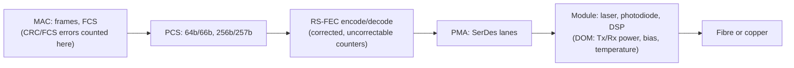

A spine that loses power is an easy failure: its links go dark within milliseconds, routing moves the traffic to the other spines, and the alert names the box. A connector with a speck of dust on it is a hard one. The link stays up, routing keeps sending it a full share of traffic, and for weeks nothing at the IP layer notices; then one connection in four starts to crawl. Most tickets in a data center fabric start at this layer: the pluggable modules, the cables and the light between them.

The running example is Meridian's Amsterdam fabric, where `leaf1.ams` has four 400 Gb/s uplinks, one to each of `spine1.ams`..`spine4.ams`. [Links, frames and Ethernet](/learn/fabric-networking/from-zero/links-frames-and-ethernet) covers the frame and its FCS; [error detection](/learn/networking/network-algorithms/error-detection) works the CRC arithmetic by hand.

## From bits to light: lanes, symbols and PAM4

A switch ASIC (the forwarding chip) drives many **SerDes** (serialiser/deserialiser) circuits, each turning parallel data into one fast serial signal, a **lane**. A 51.2 Tb/s chip has 512 lanes of 100 Gb/s; a 400G port bonds four, an 800G port eight. Each lane sends **symbols** at a fixed **baud rate** (symbols per second), in one of two schemes:

- **NRZ** (non-return-to-zero): two voltage or light levels, one bit per symbol. 25G lanes are NRZ at 25.78 GBd (gigabaud).
- **PAM4** (four-level pulse amplitude modulation): four levels, two bits per symbol. 50G and 100G lanes are PAM4; a 100G lane runs at 53.125 GBd × 2 bits = 106.25 Gb/s.

PAM4 doubles the bits without doubling the baud rate, and every step up in baud rate is much harder to build. The price is noise margin. Four levels in the same signal swing leave each "eye" (the gap the receiver must distinguish) one third of the NRZ height, a penalty of 20·log₁₀(3) ≈ 9.5 dB in signal-to-noise ratio. A PAM4 link is therefore designed to run at a raw bit error rate far above the 1e-12 or better that Ethernet promises after correction, and depends on forward error correction, which explains most counters in this lesson. The overhead puts the line rate above the nominal rate:

| Step | Rate | What happens |
|---|---|---|
| MAC data | 400 Gb/s | Frames from the switch |
| 64b/66b, then transcoded to 256b/257b | × 257/256 | Encoding that gives the receiver block boundaries |
| RS(544,514) FEC | × 544/514 | 30 parity symbols per 514 data symbols, 5.8% |
| Line rate | ≈ 425 Gb/s = 4 × 106.25 Gb/s | Split over four 100G lanes |



This is the IEEE 802.3 physical layer: PCS (physical coding sublayer), PMA (physical medium attachment) and PMD (physical medium dependent, the module); at 400G the FEC is formally part of the PCS. Each counter lives at one of these layers, which tells you where a problem sits.

## Form factors: SFP, QSFP, QSFP-DD and OSFP

The **pluggable module** (transceiver, or "optic") slides into a **cage** on the switch or NIC and can be swapped hot. The cage shape is the **form factor**; it fixes how many electrical lanes reach the module and how much power it can dissipate.

| Form factor | Electrical lanes | Common rates | Typical power | Where you see it |
|---|---|---|---|---|
| SFP, SFP+, SFP28 | 1 | 1G, 10G, 25G | about 1 W | Server NICs, management ports |
| QSFP28 | 4 × 25G NRZ | 100G | 3–4.5 W | Previous-generation leaf uplinks |
| QSFP56 / QSFP112 | 4 × 50G / 4 × 100G PAM4 | 200G / 400G | 5–12 W | NICs, 400G ports |
| QSFP-DD | 8 × 50G or 8 × 100G PAM4 | 400G, 800G | 10–17 W | Switch ports; fits QSFP modules too |
| OSFP | 8 × 100G (moving to 200G) | 400G, 800G, 1.6T | 13–17 W at 800G | AI fabrics, 800G switches; does not fit QSFP |

(Power figures are typical vendor numbers and depend on reach and generation.) QSFP-DD ("double density") adds a second row of contacts to the QSFP shape, so a QSFP28 still fits; OSFP is larger, with room for a heat sink, because 17 W in a small cage is a cooling problem: 64 × 800G modules draw about 1 kW.

Inside a module: lasers and their driver, photodiodes and amplifiers, a DSP (digital signal processor) that retimes and equalises PAM4, and a microcontroller whose memory describes the module (vendor, serial, supported modes) and holds the **DOM** readings covered below. The switch reads that memory on insertion, so a module the host does not support in a given mode can be optically perfect and never bring the link up.

Names encode the physics: `400GBASE-DR4` is 400 Gb/s, baseband, reach code DR (500 m single-mode), 4 parallel lanes. SR is short reach on multimode, FR 2 km, LR 10 km, ZR the coherent long-haul class in [connecting sites and backbones](/learn/fabric-networking/fabric-architecture/connecting-sites-and-backbones).

## Copper or glass: DAC, AOC and transceivers

Three ways to join two cages:

- **DAC** (direct attach copper): twinax copper with a module shell fixed to each end and no lasers. Almost no power and lowest cost, but copper loss grows with frequency, so reach shrinks each speed step: about 5 m at 25G per lane, 2–3 m at 100G. **AEC** (active electrical cable) adds a retimer at each end for about 5–7 m. A crushed or over-bent DAC fails like a bad optic.
- **AOC** (active optical cable): fibre with transceivers permanently attached. Thin, tens of metres, but replaced as a whole and unable to pass through a patch panel.
- **Transceiver plus structured fibre**: a separate module at each end, joined through patch cords, panels and trunks. Most flexible, longest reach, and every connector is one more place for dirt and loss.

| | Passive DAC | AOC | Transceivers + fibre |
|---|---|---|---|
| Reach at 100G/lane | ~2–3 m | ~30–100 m | 50–100 m (multimode) to 10 km+ |
| Power per end | ~0 W | several W | 8–17 W at 400–800G |
| Cost | Lowest | Middle | Highest |
| Through patch panels | No | No | Yes |
| Failure unit | Whole cable | Whole cable | Module, cord or panel separately |
| Typical failures | Bent or crushed cable, link training | One end's laser | Dirty connectors, bends, ageing lasers |
| Meridian uses it for | Server to leaf in the same rack | Short runs between adjacent racks | Leaf to spine across rows, inter-site |

Rule of thumb: copper inside the rack, fibre outside it. In the `sjc` AI cluster the GPU NICs are often several metres from their rail leaf, where 100G-per-lane copper is marginal, so many AI builds put an optic at both ends of every GPU link.

## Single-mode vs multimode fibre

A fibre is a glass **core** inside a **cladding** whose lower refractive index keeps the light in. The core size decides the rest.

- **Multimode (MMF)**: a 50 µm core. Light travels at many angles ("modes"), each a slightly different distance, so a pulse smears out with length (modal dispersion). That caps reach, and the cap tightened as symbols got shorter: on OM4, 10G-SR reaches 400 m, 25G-per-lane optics such as 100G-SR4 100 m, and 100G-per-lane optics 100 m (SR) or 50 m (the cheaper VR class). Its advantage is cheap 850 nm VCSEL lasers. Jackets are aqua (OM3, OM4) or lime (OM5).
- **Single-mode (SMF)**: a ~9 µm core, so one mode and no modal dispersion. Reach is set by attenuation, about 0.35–0.4 dB per km at 1310 nm (multimode loses about 3 dB per km at 850 nm), and needs more precise lasers. Yellow jackets (OS2).

| | Multimode (OM4) | Single-mode (OS2) |
|---|---|---|
| Core | 50 µm | ~9 µm |
| Typical wavelength | 850 nm | 1310 nm (client optics), 1550 nm (coherent) |
| Reach at 100G per lane | 50 m (VR), 100 m (SR) | 500 m (DR), 2 km (FR), 10 km (LR) |
| Optic cost | Lower | Higher, falling |
| Survives the next speed upgrade | Uncertain: multimode optics lag each new lane speed | Usually: the same fibre carries the next generation |

The hyperscalers moved to single-mode almost everywhere outside the rack: the optics price gap has narrowed, and a single-mode trunk installed today carries 400G, 800G and 1.6T without being pulled out of the ceiling. Meridian's leaf-to-spine links are 400G-DR4 on single-mode. Connectors carry their own failure modes:

- **LC**: duplex, one fibre each way. Used by single-lane and WDM optics (FR4, LR4), which multiplex four wavelengths onto one fibre pair.
- **MPO**: a ribbon of 12 or 16 fibres. DR4 uses eight of an MPO-12's positions, one fibre per lane per direction.
- **End-face polish**: UPC (flat, blue) or APC (angled 8°, green). Mating APC to UPC leaves an air gap that loses several dB and can damage both faces.
- **Polarity**: transmit must meet receive. A duplex cord crossed the wrong way joins transmitter to transmitter, so neither receiver sees light; MPO trunks come in polarity types A, B and C, and mixing them crosses or shuffles lanes.

## Lanes and breakouts

A 400G-DR4 module has four independent lasers on four fibre pairs, so it can serve as four 100G ports instead of one 400G port. That is a **breakout**: one cage, several logical ports, and a fan-out cable from the MPO to four connectors.

| Module | As one port | Breakouts | Why it can or cannot |
|---|---|---|---|
| 400G-DR4 | 1 × 400G | 4 × 100G-DR | Parallel: one fibre pair per lane |
| 400G-FR4 | 1 × 400G | None | Four wavelengths share one fibre pair |
| 800G-DR8 (or 2 × DR4 twin-port) | 1 × 800G | 2 × 400G-DR4, 8 × 100G-DR | Eight parallel lanes |
| 400G QSFP-DD DAC | 1 × 400G | 4 × 100G or 8 × 50G splitter cables | Copper splits lane by lane |

Worked example, the `sjc` rail leaf. Each GPU's NIC is 400G. A 51.2 Tb/s switch with 64 OSFP cages of 800G runs 32 cages as twin-port 2 × 400G, giving 64 GPU-facing 400G ports (25.6 Tb/s), and keeps 32 cages as 800G uplinks (another 25.6 Tb/s), so traffic up equals traffic down. Each twin-port module has two MPO connectors, each cabled to one NIC's 400G-DR4 module: 96 logical ports from 64 cages and 512 SerDes lanes. [AI fabric topologies](/learn/fabric-networking/ai-fabrics/ai-fabric-topologies) builds the whole cluster from this unit.

Three things must agree: the switch port is configured in that mode (the ASIC has a maximum logical port count and fixed lane groups, so not every cage splits every way), the module supports it, and the cable sends each lane to the right far end. The failures follow: mode not set, so a 400G port waits for a 400G partner while four 100G servers wait at the other end; a fan-out leg on the wrong server, visible as the wrong LLDP neighbour; one damaged MPO taking down four servers at once.

## Forward error correction: how a noisy lane survives

**What it solves.** PAM4 lanes are specified to work at raw bit error rates as high as about 2 in 10,000, and every real link makes some errors. The FCS rejects any frame containing one, and at 2.4e-4 a 1,500-byte frame (12,000 bits) arrives clean only $(1 - 2.4\times10^{-4})^{12000} \approx 6\%$ of the time, so end-to-end retransmission would be hopeless and the link repairs its own errors in hardware without a round trip: **forward** error correction, because the redundancy is sent ahead of need.

**How Reed-Solomon works.** 400G Ethernet uses RS(544,514), called "KP4". The encoder groups the bit stream into 10-bit **symbols** and takes 514 data symbols at a time. It treats them as coefficients of a polynomial over a finite field with 1,024 elements, and appends 30 parity symbols chosen so that the whole 544-symbol **codeword** (5,440 bits) is divisible by a fixed generator polynomial with 30 known roots. The receiver evaluates the received codeword at those 30 roots, giving 30 **syndromes**. All zero means no error. Otherwise each error has two unknowns, its position and its value, so 30 equations can solve for up to **15 bad symbols**, which the decoder then corrects. Counting symbols, not bits, makes it robust to bursts: ten bad bits inside one symbol cost one correction.

Three outcomes per codeword, each with its own counter:

1. **No errors.** Nothing to do.
2. **1 to 15 bad symbols: corrected.** The frame is intact; the *corrected* counter and the derived **pre-FEC bit error rate** rise. Normal on PAM4.
3. **16 or more: uncorrectable.** The decoder marks the data bad, so every frame touching that codeword fails its FCS check and is dropped; *uncorrectable* and FCS errors rise together.

| FEC | Used on | Corrects per codeword | Added latency (order of) |
|---|---|---|---|
| None, or Firecode (BASE-R) | 10G, some 25G NRZ | None, or one burst of up to 11 bits | Tens of ns or none |
| RS(528,514) "KR4" | 100G as 4 × 25G NRZ | 7 symbols | ~100 ns |
| RS(544,514) "KP4" | All 50G/100G-per-lane PAM4 | 15 symbols | ~100 ns |
| Coherent FEC (CFEC, oFEC) | 400ZR/ZR+ long-haul | Far stronger, soft-decision | µs |

The latency is why some trading networks still run 25G NRZ with FEC off; on PAM4 it is mandatory. Both ends must run the same named mode: KR4 and KP4 are both "RS-FEC" on a datasheet but do not interoperate, and at 25G a port may run RS-FEC, BASE-R FEC or none. A mismatch shows as good light at both ends and a link that stays down or flaps.

### The cliff, worked

FEC turns a slow analogue decline into a cliff. Assume independent bit errors (real receivers produce some bursts): a symbol is bad if any of its 10 bits is, and a codeword fails if more than 15 of its 544 symbols are bad, a binomial tail:

```python
from math import comb

N, K, M = 544, 514, 10            # RS(544,514) over 10-bit symbols ("KP4")
T = (N - K) // 2                  # symbols it can correct per codeword: 15
LINE_RATE = 425e9                 # 400GBASE-R: 4 lanes x 106.25 Gb/s


def p_uncorrectable(ber: float) -> float:
    """Chance a codeword has more than T bad symbols, if bit errors are independent."""
    ps = 1 - (1 - ber) ** M       # a 10-bit symbol is bad if any of its bits is
    return sum(comb(N, k) * ps**k * (1 - ps) ** (N - k) for k in range(T + 1, N + 1))


codewords_per_s = LINE_RATE / (N * M)
print(f"corrects up to {T} symbols; overhead {N / K - 1:.1%}; "
      f"{codewords_per_s / 1e6:.1f} M codewords/s")
print(f"{'pre-FEC BER':>12} {'bit errors/s':>14} {'P(uncorrectable)':>17} {'bad codewords/s':>16}")
for ber in (1e-8, 3e-6, 9e-5, 2.4e-4, 5e-4, 1e-3, 1.5e-3, 3e-3):
    p = p_uncorrectable(ber)
    print(f"{ber:>12.1e} {ber * LINE_RATE:>14,.0f} {p:>17.1e} {p * codewords_per_s:>16,.1f}")
```

```text
corrects up to 15 symbols; overhead 5.8%; 78.1 M codewords/s
 pre-FEC BER   bit errors/s  P(uncorrectable)  bad codewords/s
     1.0e-08          4,250           2.3e-82              0.0
     3.0e-06      1,275,000           9.5e-43              0.0
     9.0e-05     38,250,000           2.6e-19              0.0
     2.4e-04    102,000,000           8.2e-13              0.0
     5.0e-04    212,500,000           2.8e-08              2.2
     1.0e-03    425,000,000           1.5e-04         11,955.1
     1.5e-03    637,500,000           8.7e-03        681,373.3
     3.0e-03  1,275,000,000           5.4e-01     42,571,972.7
```

At a pre-FEC BER of 9e-5 the link repairs 38 million bit errors a second, loses nothing and shows zero FCS errors. 2.4e-4 is about the highest rate at which KP4 delivers a practically error-free link. A sixfold rise beyond it, to 1.5e-3, loses almost one codeword in a hundred; at 3e-3, half. The `range(T + 1, N + 1)` line is the whole idea: up to 15 bad symbols cost nothing, the 16th costs the frame.

So **zero FCS errors does not mean healthy**: pre-FEC BER is the margin gauge, and it moves weeks before FCS errors appear. Because real errors cluster, some platforms also expose a **FEC histogram** (codewords with 0, 1, … 15 corrected symbols); a tail creeping towards bin 15 is the earliest warning there is.

## Light levels: reading DOM

**DOM** (digital optical monitoring, or DDM) is the module reporting its own analogue state: temperature, voltage, and per lane the laser **bias current**, **transmit power** and **receive power**, each with factory warning and alarm thresholds. The standards are SFF-8472 (SFP), SFF-8636 (QSFP28) and CMIS (Common Management Interface Specification, QSFP-DD and OSFP).

Optical power is in **dBm**, decibels relative to 1 milliwatt: P(dBm) = 10·log₁₀(P / 1 mW). 0 dBm is 1 mW; −3 dB halves the power; −10 dB is a tenth. Losses add in dB, which is why link budgets are subtraction.

**A link budget, worked.** `leaf1.ams` port `swp51` to `spine3.ams` port `swp1`: 400G-DR4 over 150 m of single-mode fibre through two patch panels. (Port names follow the Linux style some network operating systems use; values are illustrative for a DR4-class optic.)

| Item | Value |
|---|---|
| leaf1 transmit power, per lane | +0.3 dBm |
| Fibre: 0.15 km × 0.4 dB/km | −0.06 dB |
| Four mated connector pairs (module, panel, panel, module) × ~0.5 dB | −2.0 dB |
| Expected receive power at spine3 | ≈ −1.8 dBm |
| Total channel loss | ≈ 2.1 dB, against the 3 dB maximum 400GBASE-DR4 allows |

Below the receiver's sensitivity the error rate climbs; above its maximum input (a long-reach optic on a 3 m jumper) the receiver saturates and needs an attenuator. Four weeks after commissioning, the module on `spine3.ams` reports (illustrative output):

```text
spine3.ams swp1  400G-DR4  QSFP-DD  (illustrative)
  Temperature   41.2 C    Voltage 3.29 V
          Tx bias   Tx power   Rx power
  Lane 1  7.9 mA    +0.4 dBm   -5.8 dBm
  Lane 2  8.0 mA    +0.3 dBm   -5.9 dBm
  Lane 3  7.8 mA    +0.4 dBm   -6.0 dBm
  Lane 4  8.1 mA    +0.2 dBm   -5.9 dBm
  Rx power thresholds: high alarm +5.0, high warn +4.0, low warn -8.9, low alarm -11.9 dBm
  Status: no alarms, no warnings
```

No warning has fired, because vendor thresholds must suit every cable plant the module could be sold into. Against this link's own baseline it is alarming: 4.1 dB below the commissioning −1.8 dBm, so only 10^(−0.41) ≈ 39% of the light arrives, and the channel now loses about 6.2 dB, twice the 3 dB the standard budgets for.

**Triangulate with both ends.** `leaf1.ams` reports transmit power on `swp51` unchanged at +0.3 dBm, so the transmitter is fine and the extra 4 dB is lost in a connector or the fibre between them:

| Far-end Tx power | Near-end Rx power | Errors | Most likely |
|---|---|---|---|
| Normal | Dropped vs baseline | Rising | Dirty or damaged connector, tight bend, cracked fibre |
| Dropped | Dropped by the same amount | Rising | Far-end laser failing |
| Normal | Normal | Rising | Near-end receiver or module electronics; FEC or host issue |
| Normal | Floor (about −40 dBm) on both ends | Link down | Polarity crossed, cord unplugged or patched to the wrong port |
| Normal | One lane of four low | Rising | One fibre in the MPO dirty or broken |

Two more readings matter. **Bias current rising over months with transmit power flat** is an ageing laser, its control loop pushing more current for the same light: plan a replacement. **Temperature** near the high warning usually means airflow: a missing blanking panel, a reversed fan tray, an 800G module in a cage rated for less.

## CRC/FCS errors: the counter that names the link

What FEC cannot fix appears at the MAC as **FCS errors** (often labelled CRC or input errors): frames that failed their CRC-32 check and were dropped. Three properties make it the most useful counter in the fabric.

1. **It is counted where the frame is received.** Errors in the `leaf1.ams` → `spine3.ams` direction appear on `spine3.ams`'s port; the suspects are leaf1's transmitter, the fibres for that direction and spine3's receiver. The other direction uses different fibres.
2. **It belongs to one link.** Every router builds a new frame, so an FCS error never propagates ([the packet walk](/learn/fabric-networking/from-zero/the-packet-walk)), except for cut-through switches that "stomp" a bad frame's CRC as they forward it; count stomped frames separately and blame only the first link.
3. **The sender cannot see it.** `leaf1.ams`'s counters stay perfect; nothing tells a transmitter its frames were thrown away.

Counters are cumulative, so tooling turns them into rates and ratios. Worked: two samples of `spine3.ams swp1` 60 s apart show FCS errors up 37,500,000 and frames received up 1,875,000,000: 625,000 errors a second, a ratio of 2.0%. On a healthy link this counter sits at or near zero for days; a sustained ratio above about 1e-8 deserves a ticket (a working threshold, not a standard); 2% is an outage for the flows on that link.

TCP throughput falls roughly as one over the square root of the loss rate (the Mathis model), but in a data center the bigger cost is time: a lost packet at the end of a request produces no duplicate ACKs, so it waits for a tail loss probe (milliseconds) or a retransmission timeout (at least 200 ms on Linux, [TCP deep dive](/learn/networking/fundamentals/tcp-deep-dive)), hundreds to thousands of times a normal round trip. RoCE, the RDMA transport for GPU traffic, has traditionally recovered by go-back-N, resending everything after a lost packet, so 2% loss collapses its throughput ([lossless Ethernet](/learn/fabric-networking/ai-fabrics/lossless-ethernet-pfc-ecn-dcqcn)).

## Gray failure: up, routed and losing packets

A **gray failure** is a component that is neither working nor down. It is the defining physical-layer failure of a Clos fabric, because ECMP (equal-cost multipath, hashing flows over the equal paths, from [ECMP and hashing](/learn/fabric-networking/fabric-architecture/ecmp-and-hashing)) feeds a sick link its full share for as long as routing believes it is up.

```viz
{"type": "fabric", "scenario": "gray-failure", "title": "A dirty connector: receive power drifts for five weeks, FEC hides it, then 2% loss on a link that stays up", "caption": "leaf1.ams sends a quarter of its 1,000 Gb/s to each of four 400G-DR4 uplinks. spine3.ams's counters for the port facing leaf1 move week by week: receive power from −1.8 to −6.8 dBm, pre-FEC bit error rate from 1e-8 to 1.5e-3, then uncorrectable codewords and FCS errors. The port stays up and ECMP keeps sending 25% into it until the link is costed out (the other three uplinks then run at 83%) and restored after cleaning."}
```

Why does nothing route around it? Routing asks a binary question. Light is present, so the port stays up. LLDP and BFD packets (bidirectional forwarding detection, the fast liveness probe in [convergence and BFD](/learn/fabric-networking/underlay/convergence-and-bfd)) are small, so they cross more reliably than large frames, and even IS-IS hellos, which many implementations pad to full size, need several losses in a row before the adjacency's hold time expires. BFD declares a path down after three consecutive misses: at 2% loss, probability at most 0.02³ = 8 × 10⁻⁶ per window. One flow in four from `leaf1.ams` suffers, while loss averaged over its uplinks is 0.5%, small enough to vanish on a dashboard of totals.

What catches it: pre-FEC BER and receive power against the link's own baseline (both moving since week 2), FCS errors on `spine3.ams`'s receive side, and probes over many 5-tuples, of which only those hashed through `spine3.ams` lose packets ([active measurement](/learn/fabric-networking/operating-fabrics/active-measurement)). The response is to **cost the link out** (raise its IS-IS metric at both ends so no path prefers it) after checking that three uplinks can carry 1,000 Gb/s (83%), then clean the connector. A 2017 SIGCOMM study of packet corruption in Microsoft's data centers (the CorrOpt paper) found the same at fleet scale: corruption concentrated on a few links, mostly from dirty connectors, damaged fibre, decaying transmitters and badly seated modules, and disabling a link is safe only with capacity to spare ([redundancy and failure domains](/learn/fabric-networking/fabric-architecture/redundancy-and-failure-domains)).

## Flapping

A **flap** is a link going down and up. A receiver declares loss of signal when light falls below its detection threshold, or loses block lock when it can no longer find the encoding's boundaries; Ethernet's link-fault signalling then sends "remote fault" the other way, so both ends go down even when one fibre of the pair is broken. A module hovering at that threshold, loose seating, a connector disturbed by work in the same tray, or a FEC or speed mismatch failing link training each produce repeated transitions.

**What a flap costs.** Each transition is a control-plane event across the site. In Amsterdam's IS-IS domain (24 routers: spines, leaves, route reflectors, gateways), both ends re-flood their link-state packets, every router reruns SPF, and leaves rewrite ECMP groups, remapping flows unless the hardware uses resilient hashing. A link flapping every 30 seconds makes four topology changes a minute on all 24. Overlay BGP sessions between loopbacks survive, since loopbacks stay reachable through other spines; an eBGP underlay with a session per link flaps with it ([BGP as the underlay](/learn/fabric-networking/underlay/bgp-as-the-underlay)). The mitigations trade hiding noise against delaying detection:

- **Debounce** (carrier delay or link hold timer): report a down transition only if it lasts, say, 100 ms. Hides blips; adds 100 ms to detecting every real cut.
- **Flap protection**: shut a port that flaps more than N times in M seconds (say 5 in 10) until a human looks. One dead link is cheaper than a churning one.
- **IGP throttling**: exponential back-off on SPF runs and LSP generation.

**Signal:** carrier-transition counters, "link down" logs with their reason (local fault, remote fault, loss of signal), adjacency changes, and DOM captured at each flap.

## Bring-up: miscabling and how LLDP catches it

A new Meridian site arrives as racks of switches and a cabling plan: thousands of rows of "device A, port, device B, port", patched by hand. At that volume even careful teams make errors:

- **Wrong port**: the cable lands in `swp53` instead of `swp50`.
- **Swapped pair**: two uplinks crossed, so `leaf2.ams swp51` reaches `spine4.ams` instead of `spine3.ams`.
- **Wrong device**: a leaf cabled to the neighbouring rack's spine port.
- **Physical mismatches**: polarity crossed, multimode cord on a single-mode optic, APC on UPC, a breakout leg on the wrong server. These usually give no link, or one with poor light.

Routing can hide miscabling. With numbered `/31` links, the ends of a swapped cable no longer share a subnet: a ping or BGP session to the planned address fails, and IS-IS either refuses the adjacency (many implementations check the subnet) or installs next hops not on the link. Loud. With unnumbered links (IS-IS or BGP over link-local addresses), adjacencies form over whatever cable is there. A swap between two spines still gives a valid Clos; a leaf with two cables to `spine2.ams` and none to `spine3.ams` routes too, with uneven capacity and the wrong failure domain.

**LLDP** (Link Layer Discovery Protocol, IEEE 802.1AB) reports what is actually plugged in. Each port sends a small frame every 30 seconds saying who it is; the neighbour stores it until its TTL, 120 seconds by default, runs out without a refresh. Switches never forward these frames, so a port learns only about the device at the far end of its own cable.

| Field / TLV | Size | Value from `leaf1.ams swp49` | What reads it |
|---|---|---|---|
| Destination MAC | 6 bytes | 01:80:c2:00:00:0e | Nearest-bridge group: consumed, never forwarded |
| Source MAC | 6 bytes | the port's own MAC | Neighbour table |
| EtherType | 2 bytes | 0x88cc | Dispatch to the LLDP agent |
| Chassis ID (type 1) | variable | a MAC or the device name | Neighbour identity |
| Port ID (type 2) | variable | `swp49` | Which far port this cable reaches |
| TTL (type 3) | 2 bytes | 120 s | How long to keep the entry |
| System Name (type 5) | variable | `leaf1.ams.meridian.example` | Human and tooling identity |
| Management Address (type 8) | variable | 172.16.1.11 | Out-of-band reachability |
| End (type 0) | 2 bytes | 0 | End of the frame |

Each TLV (type-length-value) starts with a 7-bit type and a 9-bit length. Validation compares observed neighbours with the plan, undirected (a cable has no direction) and normalised (one device reports `SPINE3.ams`, another `spine1.ams.meridian.example`). Meridian's check on two leaves of a new pod, 8 planned uplinks:

```python
DOMAIN = ".meridian.example"


def end(device, port):
    """One cable end, normalised: LLDP may report an FQDN or different case."""
    return (device.strip().lower().removesuffix(DOMAIN), port.strip().lower())


def cable(a, b):
    return tuple(sorted((a, b)))          # a cable has no direction


def validate(plan, lldp):
    planned = {cable(end(da, pa), end(db, pb)) for da, pa, db, pb in plan}
    seen = {cable(end(d, p), end(nd, npt)) for d, p, nd, npt in lldp}
    owner = {e: c for c in planned for e in c}    # planned port -> its planned cable

    ok = planned & seen
    miswired, unexpected, displaced = [], [], set()
    for c in sorted(seen - planned):
        clash = sorted({owner[e] for e in c if e in owner})
        if clash:
            miswired.append((c, clash))           # uses a port the plan gave to another cable
            displaced.update(clash)
        else:
            unexpected.append(c)                  # neither end is in the plan
    missing = sorted(planned - ok - displaced)    # dark: nothing seen on either end
    return {"ok": sorted(ok), "miswired": miswired, "unexpected": unexpected, "missing": missing}


def fmt(c):
    return " <-> ".join(f"{d} {p}" for d, p in c)


PLAN = [(f"leaf{n}.ams", f"swp{48 + s}", f"spine{s}.ams", f"swp{n}")
        for n in (1, 2) for s in (1, 2, 3, 4)]      # swp49..52 to spine1..4
LLDP = [  # (device, local port, neighbour's system name, neighbour's port)
    ("leaf1.ams", "swp49", "spine1.ams.meridian.example", "swp1"),
    ("spine1.ams", "swp1", "leaf1.ams", "swp49"),
    ("leaf1.ams", "swp53", "spine2.ams", "swp1"),      # wrong port on the leaf
    ("leaf1.ams", "swp51", "SPINE3.ams", "swp1"),
    ("leaf1.ams", "swp52", "spine4.ams", "swp1"),
    ("leaf1.ams", "swp55", "leaf2.ams", "swp55"),      # a cable nobody planned
    ("leaf2.ams", "swp49", "spine1.ams", "swp2"),
    ("leaf2.ams", "swp51", "spine4.ams", "swp2"),      # swp51 and swp52 swapped
    ("leaf2.ams", "swp52", "spine3.ams", "swp2"),
]                                                       # nothing at all on leaf2 swp50

r = validate(PLAN, LLDP)
print(f"ok: {len(r['ok'])} of {len(PLAN)}")
for c, clash in r["miswired"]:
    print(f"miswired: {fmt(c)}  (plan: {'; '.join(fmt(x) for x in clash)})")
for c in r["unexpected"]:
    print(f"unexpected: {fmt(c)}")
for c in r["missing"]:
    print(f"missing: {fmt(c)}")
```

```text
ok: 4 of 8
miswired: leaf1.ams swp53 <-> spine2.ams swp1  (plan: leaf1.ams swp50 <-> spine2.ams swp1)
miswired: leaf2.ams swp51 <-> spine4.ams swp2  (plan: leaf2.ams swp51 <-> spine3.ams swp2; leaf2.ams swp52 <-> spine4.ams swp2)
miswired: leaf2.ams swp52 <-> spine3.ams swp2  (plan: leaf2.ams swp51 <-> spine3.ams swp2; leaf2.ams swp52 <-> spine4.ams swp2)
unexpected: leaf1.ams swp55 <-> leaf2.ams swp55
missing: leaf2.ams swp50 <-> spine2.ams swp2
```

`cable()` sorts the two ends, so a row from either side gives the same key and one-sided rows (only `leaf1.ams` reported `swp51`) still match. `owner` separates *miswired* (an observed cable on a port the plan gave to another cable: move it) from *unexpected* (neither port planned: a leftover). A cable displaced by a miswire is not also reported missing, so the technician gets one instruction per problem. Every step is a set operation, linear in the number of cables.

LLDP cannot see a link that never came up, so "missing" needs oper status and DOM: receive power at the floor on both ends is polarity or an unplugged fibre; good light with the link down is a FEC, speed or breakout mismatch. Some network operating systems build the check in: Cumulus Linux's prescriptive topology manager compares LLDP against a topology file and can hold a mis-cabled port out of routing. The plan belongs in the source of truth ([network automation and source of truth](/learn/fabric-networking/operating-fabrics/network-automation-and-source-of-truth)), and LLDP keeps running, so a re-patch during maintenance shows up as drift.

## Why physical failures dominate incident counts

Count the parts. Amsterdam's 16 leaves and 4 spines have 64 fabric links: 128 optics. The `sjc` back-end network, assuming the non-blocking rail leaves above (16 leaves, each with 32 twin-port downlink modules and 32 × 800G uplinks), has 1,024 NIC-side modules, 512 twin-port leaf modules and 512 uplinks with a module at each end: about 2,500 modules and 1,500 fibre runs before the front-end and storage networks. Suppose, as a round planning number rather than a measured rate, that 1% degrade enough to act on each year: about 25 a year, one every two weeks, each slowing a synchronous training job to the pace of its worst link ([why AI traffic is different](/learn/fabric-networking/ai-fabrics/why-ai-traffic-is-different)).

Three mechanisms explain the rate. **Analogue margin**: PAM4 runs near its noise limit, so a fraction of a dB of contamination moves a link towards the cliff. **Human hands**: every change opens a tray near live fibres, and every remated connector is a chance for dust. **Wear and volume**: lasers age, heat cycles loosen seating, and optics are the most numerous active component in the network.

Published data has this shape: in Meta's report on training Llama 3 (2024), network switches and cables caused about 8% of 419 unexpected job interruptions over 54 days, behind GPU and memory faults. Physical faults dominate **counts** of tickets and repairs and rarely cause the large **outages**, which come from configuration and software changes with a site-wide blast radius.

| | Physical-layer faults | Configuration and software faults |
|---|---|---|
| Frequency | High: weekly at fleet scale | Low |
| Blast radius | One link, or four with a breakout | A device, a site, sometimes everything |
| Detection | Easy if hard down; hard if gray | Often immediate, sometimes latent |
| Fix | Clean, reseat, replace: routine | Rollback, often under pressure |
| What tooling should do | Detect early, cost out, ticket automatically | Prevent: validation, canaries, staged rollout |

So physical repair should be routine, automated and boring: detect against baselines, check headroom, cost out, ticket the field team, verify, restore ([safe change and maintenance](/learn/fabric-networking/operating-fabrics/safe-change-and-maintenance)).

## Each piece: what it solves, how it breaks, what shows it

| Piece | What it solves | How it breaks | Signal that shows it |
|---|---|---|---|
| Pluggable module | Speed, reach and medium chosen per port | Unsupported mode, overheating, ageing laser | Module inventory and mode, temperature, bias trend |
| DAC, AOC | Cheap, low-power short links | Bent or crushed cable, failed link training, one dead end | Link-training failures; errors after the cable is moved |
| Single-mode, multimode | Reach and upgrade life versus optic cost | Wrong fibre or reach class, APC on UPC | Rx power below budget at commissioning |
| Breakout | Several slower ports from one cage | Mode not set, legs on the wrong servers, one MPO taking four ports | Dark subports, wrong LLDP neighbours |
| FEC | Error-free frames from a noisy PAM4 lane | Margin runs out (the cliff); mode mismatch | Pre-FEC BER, FEC histogram, uncorrectable codewords |
| DOM | The module reports its own light, bias and temperature | Vendor thresholds too loose to warn | Rx against baseline, far Tx against near Rx |
| FCS counter | Names the link and direction losing frames | Blamed on the wrong end; stomped frames counted again | FCS ratio per receiving port |
| LLDP | Shows what is really cabled | Blind to a link that never came up | Diff against the plan |

## Failure modes in production

| Failure | Symptom | Diagnosis | Fix |
|---|---|---|---|
| Dirty or damaged connector | Rx falling for weeks, pre-FEC BER rising, then FCS errors; link up | Far-end Tx normal, near-end Rx down vs baseline | Cost out, inspect and clean, soak, restore |
| One lane dead in a parallel optic | Errors or link down; 3 lanes fine | Per-lane Rx shows one lane at the floor | Clean MPO; replace module or trunk |
| FEC mode mismatch | Good light both ends, link down or flapping | Compare configured FEC per end | Same named mode on both ends |
| Ageing laser | Bias current climbing, Tx power steady, later dropping | Bias trend over months | Planned replacement |
| Overheating module | Temperature warnings, errors under load | Temperature vs port position and airflow | Fix airflow, blanking panels, power class |
| Breakout misconfigured | Some or all subports dark, wrong LLDP neighbours | Port mode vs module vs fan-out mapping | Configure mode; re-patch legs |
| Miscabled at bring-up | Missing, swapped or extra neighbours; uneven ECMP | LLDP diff against plan | Re-patch, then re-run validation |
| Marginal link flapping | Carrier transitions, repeated SPF, ECMP churn | Flap counter, DOM at each flap | Flap protection, then repair |

## Under the hood: how a switch reads its optics

The module's memory is read over a slow two-wire bus (I2C, typically hundreds of kHz), in pages defined by SFF-8472, SFF-8636 or CMIS. Reading every module takes time, so network operating systems commonly poll DOM every few tens of seconds to a minute: DOM is a trend signal, not a per-second one. CMIS also handles mode selection (one 800G port or two 400G), module state and firmware.

FEC and FCS counters live in the ASIC's MAC and PCS blocks, counted in hardware at line rate and cheap to export. Copper links need **link training** at start-up, where the two SerDes tune their equalisers to the cable; a damaged DAC often fails here, so it shows as a link that will not come up rather than as errors. Streaming telemetry pushes ASIC counters every few seconds and DOM as fast as the bus allows ([telemetry and observability](/learn/fabric-networking/operating-fabrics/telemetry-and-observability)).

## What the platform should show

A fabric tool should make the physical layer a first-class view:

- **Per-link health from both ends**: Tx at one end, Rx at the other, the loss between them, pre-FEC BER, uncorrectable codewords and FCS ratio, attached to the link (not the device), per direction and per lane.
- **Baselines, not vendor thresholds**: alert when Rx falls 2–3 dB below the link's commissioning value or pre-FEC BER rises an order of magnitude, long before the module's own warnings.
- **Rates and ratios**: errors per second and error ratio, stomped CRCs separated from received ones.
- **Flap history**: transitions per hour and day with the reason code, and DOM captured at each event.
- **Cabling drift**: LLDP against the source of truth, continuously, as ok, miswired, unexpected and missing, dark ports explained by oper status and light.
- **Action with headroom**: whether costing a suspect link out leaves enough parallel capacity, so the drain can be automated.
- **Two audiences, one dataset**: the engineer needs "clean `spine3.ams swp1`, MPO, 4 dB over baseline"; the manager needs "seven links degraded this week, two drained, zero customer impact".

## Interviewer follow-ups

**"A link shows zero CRC errors, but its pre-FEC bit error rate rose a hundredfold this month. Do you act?"** Model answer: yes. FEC corrects everything until it suddenly cannot, and a hundredfold rise means the margin is going. Check receive power against baseline at both ends and schedule cleaning, costing the link out first if headroom allows. Common wrong answer: "no FCS errors, so the link is healthy".

**"`spine3.ams` counts FCS errors on the port facing `leaf1.ams`. Which part do you replace?"** Model answer: none yet. The suspects are leaf1's transmitter, that direction's fibre and spine3's receiver; DOM from both ends narrows it, and far-end Tx normal with near-end Rx low points at the path, so cleaning comes first. The replacement procedure is the field team's and I would defer to them; what I would build is the triangulation, so the ticket already names the part. Common wrong answer: replacing spine3's optic because that is where the counter is.

**"How would you validate the cabling of a new 20-switch site before it takes traffic?"** Model answer: diff LLDP against the plan as undirected, normalised cable sets; classify ok, miswired, unexpected and missing; explain missing links with oper status and light; check module types and FEC per port; gate turn-up on a clean report. Common wrong answer: "ping across every link", which passes on a swapped unnumbered cable.

**"Why do physical failures dominate incident counts but not outage minutes?"** Model answer: thousands of modules and fibres, each with analogue margin and human handling, fail often, but each takes out one link, which a Clos absorbs; large outages come from changes with a wide blast radius. So automate physical repair and invest in change safety. Common wrong answer: treating every link alert as an emergency, or ignoring them because "ECMP handles it".

## What mid-level engineers get wrong

- **Trusting the module's alarms.** A link 4 dB worse than its own baseline raises nothing.
- **Blaming the side with the counter.** FCS errors are counted at the receiver; the cause may be the far transmitter or anything between.
- **Treating corrected codewords as errors.** On PAM4 they are normal; the trend is the signal.
- **Totals instead of per-link ratios.** 0.5% average loss over four uplinks is 2% on one of them and a quarter of flows hurt.

## Senior signals

- You explain why PAM4 needs FEC (a third of the eye, 9.5 dB) and that FEC makes degradation a cliff, so pre-FEC BER, not FCS, is the early warning.
- You triangulate from both ends: far Tx, near Rx, the loss between them, per lane, against the link's own baseline.
- You call a 2% lossy link a gray failure, explain why BFD and ECMP keep it in service, and reach for cost-out with a headroom check.
- You know breakouts follow the optics (DR4 splits, FR4 does not) and carry a larger blast radius.
- You validate cabling as an undirected set diff of LLDP against intent, because unnumbered routing runs over a miswired link.
- You separate incident counts from outage impact and make physical repair automated and routine.

## Check yourself

```quiz
- q: >-
    Over four weeks a 400G link's pre-FEC bit error rate rises from 1e-8 to 9e-5. The FCS error counter still reads zero. What is the right reading?
  options: ["The rise is normal PAM4 behaviour and needs no tracking at all", "The link is losing margin and is approaching the point where FEC fails abruptly", "The FCS counter is broken, because a BER of 9e-5 must cause frame loss", "The link is healthy, because FEC repaired every error and FCS is zero"]
  answer: 1
  explanation: >-
    RS(544,514) corrects up to 15 bad symbols per codeword, so at 9e-5 every codeword is still repaired and no frame fails its FCS. But 9e-5 is within a factor of three of the roughly 2.4e-4 at which KP4 stops delivering an error-free link, and beyond that the loss rises steeply. Some corrected errors are normal on PAM4; a 9,000-fold rise is a trend worth a ticket before FCS errors appear.
- q: >-
    leaf1.ams transmits at +0.3 dBm per lane, unchanged since commissioning. spine3.ams, at the other end, now receives -5.9 dBm per lane instead of -1.8 dBm. Where is the fault most likely to be?
  options: ["In the FEC configuration on the two ends", "In a connector or the fibre between them", "In leaf1's laser, which has started to age", "In spine3's receiver electronics"]
  answer: 1
  explanation: >-
    The transmit power at the far end is unchanged, so the laser is fine, while about 4 dB more light is lost before it reaches spine3. That points at the path: a contaminated or damaged connector, a tight bend or a cracked fibre, which is why cleaning comes first. A failing receiver would usually show normal receive power with rising errors, and a FEC mismatch would leave the light normal and the link down.
- q: >-
    One of leaf1's four uplinks drops 2% of frames. Why does it stay in the ECMP group?
  options: ["IS-IS removes lossy links only after its SPF timer expires", "BFD needs three misses in a row, which is rare at 2% loss", "ECMP excludes a link only when its utilisation reaches 100%", "LLDP refreshes every 30 seconds and keeps the link marked up"]
  answer: 1
  explanation: >-
    Routing asks only whether a link is up. Light is present, so the port is up, small BFD packets cross it more reliably than large frames, and IS-IS hellos would need several losses in a row to expire an adjacency. BFD declares failure after three consecutive misses, about 0.02 cubed or 8 in a million per window at 2% loss. Nothing in IS-IS or ECMP reacts to loss, and LLDP does not feed routing; catching it needs error-rate thresholds and probes.
- q: >-
    A team wants to split a 400G port into four 100G server ports. Which module makes that possible?
  options: ["400G-LR4, because its longer reach leaves spare budget", "400G-FR4, because its four wavelengths can be separated", "400G-DR4, because each lane has its own fibre pair", "400G-FR4, because duplex LC cables split more easily"]
  answer: 2
  explanation: >-
    A DR4 module is a parallel optic: four independent lasers on four fibre pairs in one MPO, so a fan-out cable can send each lane to a different server, given a switch configured for that mode. FR4 and LR4 multiplex four wavelengths onto one fibre pair and are one 400G interface; separating them would need an optical demultiplexer, and reach has nothing to do with breakout.
- q: >-
    LLDP shows leaf2.ams swp51 neighbouring spine4.ams swp2 and swp52 neighbouring spine3.ams swp2, the reverse of the plan. The fabric uses unnumbered IS-IS. What happens?
  options: ["Both adjacencies fail, because the system IDs no longer match", "Routing works, and the swap is found only by an LLDP diff", "The leaf blocks both ports until the cables are corrected", "Traffic loops, because each spine sees the leaf twice"]
  answer: 1
  explanation: >-
    Unnumbered adjacencies form over whatever cable is present, and leaf2 still has one link to each spine, so the Clos is valid and traffic flows. The swap shows only when observed neighbours are compared with the plan, and it matters later: per-port descriptions, policy and monitoring are now wrong. With numbered /31 links the two ends would not share a subnet and the error would be loud. A topology manager can hold miswired ports out of service, but that is a feature someone configures, not a default.
- q: >-
    Why do large operators standardise on single-mode fibre for links between racks?
  options: ["Single-mode optics draw less power than multimode ones", "Its reach survives speed upgrades, while multimode reach shrinks", "Single-mode connectors need no cleaning or inspection", "Multimode fibre cannot carry PAM4 signals at all"]
  answer: 1
  explanation: >-
    Multimode's modal dispersion limits reach, and the limit tightened as symbols got shorter: on OM4, from 400 m at 10G to 100 m at 25G per lane, and 50 m for the cheaper 100G-per-lane VR optics. Single-mode has no modal dispersion, so a trunk installed now carries 400G, 800G and 1.6T, and the optics price gap has narrowed. Multimode PAM4 optics exist (SR and VR classes), single-mode optics are not lower power, and every fibre connector needs cleaning.
```
