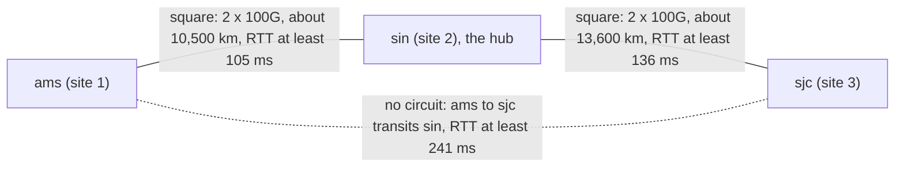

Inside one site Meridian builds a Clos: every leaf wired to every spine, dozens of equal paths, links bought once and owned outright ([Clos and leaf-spine](/learn/fabric-networking/fabric-architecture/clos-and-leaf-spine)). Between Amsterdam and Singapore, 10,500 km apart, none of that holds: every link is a circuit leased from a carrier and paid for monthly, it adds 52 ms each way that no hardware can remove, and it runs through a subsea cable that a ship's anchor can cut.

So a backbone (the network that joins sites) asks three questions a fabric never does: what are you leasing, what does distance cost the software on top, and how few circuits can you buy and still survive a cut? Meridian's answer is the **square**: two circuits per site pair, sized so either can carry everything.

## What crosses between sites

**Data center interconnect (DCI)** is the general name for the links between an operator's own sites. Seen from inside one site's fabric, traffic on them leaves the site the way **north-south** traffic does, as opposed to **east-west** traffic between servers in the same site ([Clos and leaf-spine](/learn/fabric-networking/fabric-architecture/clos-and-leaf-spine)); many operators still count it as east-west, because both ends are their own servers. At Meridian it carries four kinds of traffic:

- **Tenant traffic.** `acme-web1` (leaf1.ams) talks to `acme-web2` (leaf2.sin). The packet crosses inside VXLAN, a tunnel header addressed from one leaf's loopback to another's, so the circuit sees only leaf loopbacks ([the overlay packet walk](/learn/fabric-networking/overlays-vxlan-evpn/the-overlay-packet-walk)).
- **Replication and backup**, usually the bulk of the bytes and the traffic most hurt by distance.
- **Control plane.** IS-IS, Meridian's underlay routing protocol, runs over the circuits as one level-2 domain, so every loopback in every site is reachable ([IS-IS from zero](/learn/fabric-networking/underlay/is-is-from-zero)). Route reflectors of different sites peer across them, exchanging EVPN routes (which tenant address lives behind which leaf).
- **Management and telemetry** collected centrally.

### Routed, not stretched

**Layer-2 DCI** stretches a VLAN (a broadcast domain, [switches, VLANs and loops](/learn/fabric-networking/from-zero/switches-vlans-and-loops)) across the circuit, so both sites share one flood domain: a broadcast storm in Amsterdam floods Singapore too, over the most expensive link you own. **Layer-3 DCI** puts the circuit between two routers, addressed as a /31 with IS-IS over it, so only routed packets cross. Meridian does the second. Tenants still get layer-2 segments spanning sites, but the overlay provides them and learns MAC addresses through BGP instead of flooding them across the ocean.

Some operators also run a separate underlay per site, with border gateways that terminate the tunnels and start new ones towards the far site (EVPN multi-site designs). That contains a routing failure to one site at the cost of an extra encapsulation point; Meridian's single IS-IS domain is simpler but lets a mistake spread ([redundancy and failure domains](/learn/fabric-networking/fabric-architecture/redundancy-and-failure-domains)).

**Solves:** sites that behave as one network. **Breaks:** a stretched layer-2 domain turns one site's loop into everyone's outage; a routed one fails only by losing paths. **Signal:** broadcast and unknown-unicast rates on inter-site links, which on a routed design should be near zero.

## What you actually lease

A carrier sells one of a few products, and which one decides what you control and see. Under all of them is fibre, used in pairs (one strand per direction). **DWDM** (dense wavelength-division multiplexing) puts dozens of independent signals on one pair, each on its own wavelength of light (a "lambda"), and each can carry 100, 400 or 800 Gb/s with coherent optics (transceivers that encode bits in the phase and polarisation of light, not only its brightness). Long routes pass through optical amplifiers roughly every 80 km on land, which boost every wavelength at once without converting it to electrical signals.

| Product | What you get | Who runs the optics | Typical reach | Your control | Typical lead time |
|---|---|---|---|---|---|
| Dark fibre | A bare fibre pair, end to end | You | Metro: tens of km with plain long-reach optics, further with your own amplifiers | Total: any speed, add wavelengths later | Months (if the fibre exists) |
| Wavelength (lambda) | One wavelength on the carrier's DWDM system, e.g. 100G or 400G | Carrier | Any, including subsea | Fixed speed; transparent to your frames | Weeks to months |
| Ethernet private line | An Ethernet port at each end, carried over the carrier's packet network | Carrier | Any | Carrier may cap the MTU or add a VLAN tag | Weeks |
| MPLS VPN or IP transit | The carrier routes your packets | Carrier | Any | Least: you share their routing and queues | Weeks |

Meridian's long-haul circuits are 100G wavelengths. The hand-off happens in a colocation building: a carrier's transponder (the box that turns a client signal into a DWDM wavelength) on one side of a **cross-connect**, a patch fibre in the building's meet-me room, and `spine1.ams`'s port on the other. Each circuit has a carrier **circuit ID**, which is what appears in the carrier's maintenance notices and outage tickets; mapping it to your devices is the first thing backbone tooling must get right.

**Protected or unprotected.** A protected wavelength has a standby path inside the carrier's network; when the working path fails, the carrier switches within about 50 ms (the figure SONET/SDH protection made standard). You see a short hit and often a latency step, because the protection path is rarely the same length. Meridian buys cheaper unprotected circuits and protects them itself with the square's second circuit.

### What crosses circuit 1

A packet from `acme-web1` to `acme-web2` as it crosses circuit 1, field by field. Frames are built as in [links, frames and Ethernet](/learn/fabric-networking/from-zero/links-frames-and-ethernet), and the VXLAN layers are explained in [VXLAN encapsulation](/learn/fabric-networking/overlays-vxlan-evpn/vxlan-encapsulation).

| Field | Size | Value in this example | What reads it |
|---|---|---|---|
| Outer destination / source MAC | 6 + 6 bytes | `spine1.sin`'s port / `spine1.ams`'s port | `spine1.sin` (rewritten at every hop) |
| EtherType | 2 bytes | 0x0800 (IPv4) | `spine1.sin` |
| Outer IPv4 header | 20 bytes | 10.255.1.11 → 10.255.2.12, the two leaf loopbacks | Every spine and both circuit ends: the only lookup key in the underlay |
| Outer UDP header | 8 bytes | source port from a hash of the inner flow, destination 4789 | ECMP hashing on the way |
| VXLAN header | 8 bytes | VNI 10100 (Acme's segment) | Only `leaf2.sin` |
| Inner Ethernet, IP, TCP, data | up to 1,514 bytes | 10.1.1.10 → 10.1.1.11 | Only `leaf2.sin` and the server |
| FCS | 4 bytes | CRC-32 | `spine1.sin`, recomputed per link |

A full-size 1,500-byte tenant packet becomes a 1,568-byte frame on the circuit (1,514 inner + 50 of encapsulation + 4 FCS). A wavelength passes whatever the transponder accepts (often 9,000 bytes or more); an Ethernet private line may stop at 1,522 or 2,000, a classic failure below.

## Subsea cables

Amsterdam to Singapore and Singapore to San Jose are oceans, so Meridian's circuits are wavelengths on subsea cables. A cable is a few centimetres thick in deep water: a handful of fibre pairs (older systems 4 to 8, the newest 16 or more), a copper conductor, steel armour near shore. Repeaters (optical amplifiers) sit every 50 to 100 km on the sea floor, powered by thousands of volts of direct current fed from the **landing stations** at each end. A consortium or a cloud company owns the fibre, and many carriers resell wavelengths on it. How they fail:

- **Faults are routine.** The International Cable Protection Committee, the industry body for subsea cables, puts the global rate at roughly 150 to 200 faults a year, most caused by fishing gear and ship anchors in shallow water rather than anything in the deep ocean.
- **Repair is slow.** A ship must sail out, grapple the cable, splice and re-lay it: days in a good case, weeks when ships or permits are scarce.
- **Failures cluster.** Cables share routes, landing points and chokepoints. The Hengchun earthquake off Taiwan in December 2006 broke several cables at once and disrupted connectivity across East Asia for weeks. In early 2024 a ship disabled in the Red Sea dragged its anchor and damaged three cables, and a large share of Europe–Asia capacity runs through the Red Sea and Egypt.

That names a design concept: the **shared-risk link group (SRLG)**, a set of links one physical event can take down together. Two carriers' circuits can ride one cable, or two cables land at one station. Diversity is a property of the route the light takes, not of the carrier's name, and is checked by comparing the carriers' route maps.

**Solves:** reach across oceans. **Breaks:** a cut lasting weeks; two "independent" circuits cut by one anchor. **Signal:** both spine ports facing the circuit go down within milliseconds of each other, and the carrier's ticket arrives minutes later.

## Latency is distance

Light in glass is slower than in vacuum. Fibre's refractive index is about 1.47, so light travels at about 300,000 / 1.47 ≈ 204,000 km/s, which is **4.9 µs per kilometre**; this track rounds it to 5 µs. Nothing else on a long path comes close: serialising a 1,500-byte frame at 100 Gb/s takes 0.12 µs, a switch adds about a microsecond, and queueing, the only variable part, is small on a healthy circuit. A faster circuit puts more bytes in flight, not the first byte there sooner ([latency, bandwidth and the math](/learn/networking/networking-in-practice/latency-bandwidth-and-math)).

| Path | Fibre path (track's round numbers) | One way | Round trip (RTT) |
|---|---|---|---|
| Inside `ams`, leaf to leaf through a spine | ~200 m of cabling | ~1 µs of fibre, ~3 µs of switches | ~10 µs |
| `ams` to a metro site 40 km away | 40 km | 0.2 ms | 0.4 ms |
| `ams` – `sin` | 10,500 km | 52.5 ms | 105 ms |
| `sin` – `sjc` | 13,600 km | 68 ms | 136 ms |
| `ams` – `sjc`, transiting `sin` | 24,100 km | 120.5 ms | 241 ms |

One honesty note: 10,500 km is close to the great-circle distance, the shortest line over the globe. Real cables follow coasts and pass through Suez, and measured Western Europe–Singapore round trips are commonly 150 ms or more, so the table is a floor. Hollow-core fibre (light travelling through air inside the fibre) cuts propagation by about 30%; for most backbones, route length is the lever.

### What distance does to software

- **Synchronous replication pays an RTT per commit.** A database that waits for the Singapore replica to confirm each write cannot commit in under 105 ms, whatever the hardware. That is why synchronous replication lives within a metro and long-haul replication is asynchronous ([replication strategies](/learn/system-design/distributed-systems/replication-strategies)).
- **TCP needs a window as large as the bandwidth-delay product.** To fill 100 Gb/s for 105 ms, about 1.3 GB must be in flight. A connection limited to a 64 KB window moves 64 KB per round trip: 5 Mb/s. With a 4 MB window, 320 Mb/s. This is the commonest "the network is slow" ticket on a backbone, and the circuit is fine.
- **Loss costs more on long paths.** The Mathis approximation for a loss-limited TCP flow, rate ≈ (MSS / RTT) × 1.22 / √p, puts the RTT in the denominator ([congestion control](/learn/networking/fundamentals/congestion-control)). With 1,448-byte segments and a loss rate p of 0.01%, a flow inside a site at 1 ms RTT can reach about 1.4 Gb/s; the same flow at 105 ms reaches about 13.5 Mb/s. A loss rate nobody notices inside a site cripples transfers between sites. BBR, congestion control that paces by measured bandwidth instead of backing off on every loss, is far less sensitive, which is why it is popular for this traffic.

**Solves:** knowing the floor turns "the network is slow" into arithmetic. **Breaks:** synchronous protocols, small windows and lossy long flows. **Signal:** each circuit's RTT against its fibre-length floor, and a flow's throughput against window ÷ RTT.

## The square: two circuits instead of four

A full mesh between sites joins every Amsterdam spine to every Singapore spine: with s spines per site, s² circuits, four for two spines and sixteen for four. Each is a contract, a route and a failure point.

The **square** buys reachability with two: `spine1.ams`–`spine1.sin` (circuit 1) and `spine2.ams`–`spine2.sin` (circuit 2). The other two sides already exist: spines are not wired to each other, so the way from `spine1.ams` to `spine2.ams` runs down to any Amsterdam leaf and up again, over links Meridian owns. (Full-size `ams` has four spines; only `spine1` and `spine2` carry circuits.)

To IS-IS a circuit is a link with a high metric (cost): **1,000**, against **10** for a link inside a site. (A metric that large needs IS-IS "wide" metrics, 24 bits per link, RFC 5305; the original 6-bit metrics stopped at 63. Modern deployments run wide metrics.) It makes every path inside a site cheaper than any path that leaves it (Amsterdam leaf to Amsterdam leaf via Singapore costs 2,040 against 20), so local traffic never wanders onto a circuit after a local failure, and it leaves room to express differences between circuits later. IS-IS adds metrics along a path and installs every path with the lowest total as an equal-cost next hop (ECMP, equal-cost multipath, [ECMP and hashing](/learn/fabric-networking/fabric-architecture/ecmp-and-hashing)).

```viz
{"type": "fabric", "scenario": "site-square", "title": "The square: two circuits at 40%, one cut, the detour through the sister spine, then 80% on the survivor", "caption": "Meridian's Amsterdam and Singapore sites, small example with two spines and two leaves each, joined by two 100G circuits. leaf1.ams reaches leaf2.sin over two equal paths of metric 1,020, 80 Gb/s splits 40/40, and 10,500 km of fibre costs 105 ms round trip. Circuit 1 is cut: spine1.ams reroutes first, through a leaf to spine2.ams (metric 1,030), then the leaves converge on spine2.ams (1,020 against 1,040) and circuit 2 carries all 80 Gb/s. The run ends with the 50% planning rule, shared-risk groups and the repair."}
```

### Before the cut

Amsterdam sends 80 Gb/s to Singapore at the busy hour. `leaf1.ams`'s route to `leaf2.sin`'s loopback `10.255.2.12`:

| Via | Path | Metric |
|---|---|---|
| `spine1.ams` | leaf1 → spine1.ams → circuit 1 → spine1.sin → leaf2.sin | 10 + 1,000 + 10 = 1,020 |
| `spine2.ams` | leaf1 → spine2.ams → circuit 2 → spine2.sin → leaf2.sin | 10 + 1,000 + 10 = 1,020 |

Two equal paths, so each leaf hashes its flows across both spines and each circuit carries about 40 Gb/s, 40% of 100G.

### The cut, traced

An anchor cuts the cable carrying circuit 1 at time 0. What each device does, in order:

1. **t = 0.** Light stops. Every packet on the cable, 52 ms of traffic in each direction, is lost.
2. **Detection, milliseconds.** The carrier's transponders see loss of signal and pass it on, by switching off the laser towards the spine or by sending Ethernet's "local fault" signal into it (the spine answers its far end with "remote fault"), and both spines declare the port down. If the carrier passes nothing on, detection falls to BFD (bidirectional forwarding detection: small hellos, link declared dead after a few missed), which Meridian runs on circuits at 300 ms × 3. Without BFD, only IS-IS's hold time, commonly 30 s, is left ([convergence and BFD](/learn/fabric-networking/underlay/convergence-and-bfd)).
3. **Flooding, tens of milliseconds.** Each spine floods a new LSP (link-state PDU, the IS-IS record listing a router's links) without the circuit: microseconds per hop inside a site, at least 52 ms to the far site.
4. **`spine1.ams` reruns SPF first** (shortest path first, Dijkstra's algorithm over the link-state database). Its best path to Singapore is now down to a leaf, up to `spine2.ams` and over circuit 2: 10 + 10 + 1,000 + 10 = **1,030**, through either leaf. Packets that leaves still send it take that **detour**, two extra hops. A leaf that has not yet rerun SPF still sends half its Singapore flows to `spine1.ams`, which sends some straight back to that leaf: a **microloop**, packets bouncing until a TTL expires or the leaf converges.
5. **The leaves converge, well under a second.** Through `spine1.ams` now costs 10 + 10 + 10 + 1,000 + 10 = **1,040**, through `spine2.ams` still 1,020, so the leaves drop `spine1.ams` from the Singapore route and send everything to `spine2.ams`. Leaf-to-leaf paths are no longer than before; only traffic starting at `spine1.ams` itself, such as its probes, shows the extra hops.
6. **Steady state.** Circuit 2 carries all 80 Gb/s, 80% of its capacity. Half the inter-site capacity is gone and nothing is broken.

| Moment | `spine1.ams` to Singapore | Leaves to Singapore | Circuit 2 load |
|---|---|---|---|
| Before | circuit 1, metric 1,010 | both spines, 1,020 | 40 Gb/s |
| After step 4 | via a leaf, 1,030 | still both spines (stale) | rising |
| After step 5 | via a leaf, 1,030 (unused by leaves) | `spine2.ams` only, 1,020 | 80 Gb/s |
| Repaired, weeks later | circuit 1, 1,010 | both spines, 1,020 | 40 Gb/s |

**Solves:** survival of any one circuit failure with two leases. **Breaks:** when either circuit runs above 50% at peak, or both ride one cable. **Signal:** both ports of circuit 1 down, IS-IS adjacency loss on both spines, and a step from 40% to 80% on circuit 2 and on the leaf links into `spine2.ams`.

### The square in code

The simulation builds the small example, runs Dijkstra, and spreads traffic hop by hop as routers do: each divides what it holds equally across its equal-cost next hops. It runs the square before and after the cut at 80 and 140 Gb/s, then a full mesh of four 50G circuits.

```python
import heapq
from collections import defaultdict

SITE_METRIC, CIRCUIT_METRIC = 10, 1_000


def build(design):
    """Return {(a, b): (metric, capacity_gbps)} for Meridian's small ams-sin example."""
    links = {}
    for site in ("ams", "sin"):
        for leaf in (1, 2):
            for spine in (1, 2):
                links[(f"leaf{leaf}.{site}", f"spine{spine}.{site}")] = (SITE_METRIC, 400)
    if design == "square":      # spine1-spine1 and spine2-spine2, 100G each
        for s in (1, 2):
            links[(f"spine{s}.ams", f"spine{s}.sin")] = (CIRCUIT_METRIC, 100)
    else:                       # full mesh: every ams spine to every sin spine, 50G each
        for a in (1, 2):
            for b in (1, 2):
                links[(f"spine{a}.ams", f"spine{b}.sin")] = (CIRCUIT_METRIC, 50)
    return links


def distances_to(dst, links):
    adj = defaultdict(list)
    for (a, b), (metric, _) in links.items():
        adj[a].append((b, metric))
        adj[b].append((a, metric))
    dist, heap = {dst: 0}, [(0, dst)]
    while heap:
        d, u = heapq.heappop(heap)
        if d > dist[u]:
            continue
        for v, m in adj[u]:
            if d + m < dist.get(v, float("inf")):
                dist[v] = d + m
                heapq.heappush(heap, (d + m, v))
    return dist, adj


def link_loads(demands, links):
    """Hop-by-hop ECMP: every router splits what it holds equally over its equal-cost next hops."""
    load = defaultdict(float)
    by_dst = defaultdict(dict)
    for src, dst, gbps in demands:
        by_dst[dst][src] = by_dst[dst].get(src, 0) + gbps
    for dst, sources in by_dst.items():
        dist, adj = distances_to(dst, links)
        held = defaultdict(float, sources)
        for u in sorted(dist, key=dist.get, reverse=True):   # farthest first
            if u == dst or not held[u]:
                continue
            hops = [v for v, m in adj[u] if dist.get(v, float("inf")) + m == dist[u]]
            for v in hops:
                load[(u, v)] += held[u] / len(hops)
                held[v] += held[u] / len(hops)
    return load


def simulate(design, total, failed=None):
    links = build(design)
    links.pop(failed, None)
    per_pair = total / 4      # 2 ams leaves x 2 sin leaves, equal shares
    demands = [(f"leaf{a}.ams", f"leaf{b}.sin", per_pair) for a in (1, 2) for b in (1, 2)]
    load = link_loads(demands, links)
    worst = max(load[k] / cap for k, (_, cap) in links.items())
    return links, load, worst


def next_hops(node, dst, links):
    dist, adj = distances_to(dst, links)
    return dist[node], sorted(v for v, m in adj[node] if dist[v] + m == dist[node])


def report(design, total, failed=None):
    links, load, worst = simulate(design, total, failed)
    print(f"{design}, {total} Gb/s ams->sin, failed={failed}")
    for node in ("leaf1.ams", "spine1.ams") if failed else ("leaf1.ams",):
        metric, hops = next_hops(node, "leaf2.sin", links)
        print(f"  {node} -> leaf2.sin: metric {metric}, next hops {hops}")
    for (a, b), (metric, cap) in links.items():
        if metric == CIRCUIT_METRIC:
            print(f"  {a:>10} -> {b:<10} {load[(a, b)]:5.1f} of {cap}G  ({load[(a, b)] / cap:4.0%})")
    print(f"  worst link utilisation {worst:.0%}{'  OVERLOADED' if worst > 1 else ''}")


report("square", 80)
report("square", 80, failed=("spine1.ams", "spine1.sin"))
report("square", 140, failed=("spine1.ams", "spine1.sin"))
report("mesh", 80, failed=("spine1.ams", "spine1.sin"))

for design in ("square", "mesh"):
    circuits = [k for k, (m, _) in build(design).items() if m == CIRCUIT_METRIC]
    safe = max(t for t in range(10, 401, 10)
               if all(simulate(design, t, c)[2] <= 1 for c in circuits))
    print(f"{design}: {len(circuits)} circuits, largest load surviving any one failure: {safe} Gb/s")
```

```text
square, 80 Gb/s ams->sin, failed=None
  leaf1.ams -> leaf2.sin: metric 1020, next hops ['spine1.ams', 'spine2.ams']
  spine1.ams -> spine1.sin  40.0 of 100G  ( 40%)
  spine2.ams -> spine2.sin  40.0 of 100G  ( 40%)
  worst link utilisation 40%
square, 80 Gb/s ams->sin, failed=('spine1.ams', 'spine1.sin')
  leaf1.ams -> leaf2.sin: metric 1020, next hops ['spine2.ams']
  spine1.ams -> leaf2.sin: metric 1030, next hops ['leaf1.ams', 'leaf2.ams']
  spine2.ams -> spine2.sin  80.0 of 100G  ( 80%)
  worst link utilisation 80%
square, 140 Gb/s ams->sin, failed=('spine1.ams', 'spine1.sin')
  leaf1.ams -> leaf2.sin: metric 1020, next hops ['spine2.ams']
  spine1.ams -> leaf2.sin: metric 1030, next hops ['leaf1.ams', 'leaf2.ams']
  spine2.ams -> spine2.sin 140.0 of 100G  (140%)
  worst link utilisation 140%  OVERLOADED
mesh, 80 Gb/s ams->sin, failed=('spine1.ams', 'spine1.sin')
  leaf1.ams -> leaf2.sin: metric 1020, next hops ['spine1.ams', 'spine2.ams']
  spine1.ams -> leaf2.sin: metric 1010, next hops ['spine2.sin']
  spine1.ams -> spine2.sin  40.0 of 50G  ( 80%)
  spine2.ams -> spine1.sin  20.0 of 50G  ( 40%)
  spine2.ams -> spine2.sin  20.0 of 50G  ( 40%)
  worst link utilisation 80%
square: 2 circuits, largest load surviving any one failure: 100 Gb/s
mesh: 4 circuits, largest load surviving any one failure: 100 Gb/s
```

The lines that carry the mechanism: `distances_to` runs Dijkstra from the destination, so one run gives every router's distance to it, and a neighbour `v` is an equal-cost next hop of `u` exactly when `dist[v] + metric == dist[u]`. `link_loads` walks routers from farthest to nearest, so each has received all its traffic before splitting it. The `1030` line is the detour.

### The full mesh's spare capacity is not where the traffic is

The last two lines are the surprise. On paper the mesh keeps 150 of its 200 Gb/s after one cut, against the square's 100. But the leaves still see both Amsterdam spines at metric 1,020, so ECMP still sends half the traffic to `spine1.ams`, which has one 50G circuit left. That circuit fills at 100 Gb/s of total load, exactly where the square's survivor does: ECMP splits by path count, not capacity.

The mesh's extra capacity becomes usable only with **weighted** (unequal-cost) multipath: the leaves send `spine1.ams` a share proportional to its remaining 50G, one third, and the mesh then survives 150 Gb/s. Weighting by local interface bandwidth does not help, because a leaf's own links to both spines are equal; the weight must describe capacity a hop further on. BGP fabrics can carry it (the link-bandwidth extended community, an IETF draft several vendors implement), and some IS-IS implementations offer unequal-cost options, but plain IS-IS ECMP does not. Without weighting, the mesh buys survival of double failures: the sites stay connected while any one of its four circuits is up, whereas the square is cut off by losing both.

| Design (two spines per site) | Circuits | Capacity | Load surviving one failure, plain ECMP | With weighted ECMP | Survives two failures | Cost |
|---|---|---|---|---|---|---|
| Square, 2 × 100G | 2 | 200 Gb/s | 100 Gb/s | 100 Gb/s | No | 2 contracts |
| Full mesh, 4 × 50G | 4 | 200 Gb/s | 100 Gb/s | 150 Gb/s | Yes, connected | 4 contracts, 4 routes to keep diverse |
| Full mesh, 4 × 100G | 4 | 400 Gb/s | 200 Gb/s | 300 Gb/s | Yes, connected | Roughly twice the square |
| Square, 2 × 400G | 2 | 800 Gb/s | 400 Gb/s | 400 Gb/s | No | 2 contracts, larger wavelengths |

Prices vary by route and year, but each contract has a fixed part (cross-connects, carrier ports, operations) on top of bandwidth, so fewer, larger circuits are usually cheaper per gigabit. The square spends the money on capacity and on two truly diverse routes.

## Sparse across many sites

One level up, a full mesh of N sites needs N(N−1)/2 site pairs: 3 for three sites, 45 for ten, 1,225 for fifty. So backbones are sparse: a **hub** where traffic converges, a **ring** where every site has two neighbours, extra pairs where traffic justifies them. Meridian leases two squares, `ams`–`sin` and `sin`–`sjc`, with Singapore as the hub: four circuits for three sites, and every Amsterdam–San Jose packet crosses Singapore.



- **Latency.** Amsterdam to San Jose crosses Singapore: 24,100 km, at least 241 ms round trip. A direct transatlantic route (8,800 km great circle) typically gives 140 to 160 ms, so a third square would save about 100 ms per round trip.
- **Blast radius.** If both `ams`–`sin` circuits fail, Amsterdam is cut off from both other sites. Remote tenant routes become unusable as soon as IS-IS removes the far leaves' loopbacks, their next hops, and the route reflector sessions between sites drop when their BGP hold timers expire (9 s on Meridian's fabric, 90 or 180 s at vendor defaults, unless BFD tears them down sooner; [BGP sessions and the FSM](/learn/fabric-networking/bgp-fundamentals/bgp-sessions-and-the-fsm)), withdrawing those routes. A third square turns the line into a triangle: any one site pair can fail entirely and traffic routes the long way round.

## Metro versus long-haul

Not every interconnect is an ocean. A **metro** link joins sites in the same city or region, up to roughly 100 km; **long-haul** is hundreds to thousands of kilometres, including subsea. They differ enough to be designed differently.

| | Metro (≤ ~100 km) | Long-haul (hundreds to thousands of km) |
|---|---|---|
| Round trip | under 1 ms (40 km: 0.4 ms) | a few ms to over 250 ms |
| Usual medium | Dark fibre, often lit by the operator; 400ZR pluggable optics (OIF 400ZR, 400G over about 80 to 120 km of amplified fibre, plugged straight into a switch port) | Carrier wavelengths over DWDM with amplifiers; subsea cables |
| Cost per Gb/s | Low once the fibre exists | High, priced by distance and route |
| Design | A mesh is affordable; sites can even share one Clos as super-spine pods | Sparse: squares, rings, hubs |
| What software can do | Synchronous replication; cloud availability zones are built at this scale (AWS describes its zones within a region as within about 100 km of each other) | Asynchronous replication, caching, serving users from their nearest site |
| Typical cut | A backhoe, repaired in hours | An anchor, repaired in days to weeks |

So two buildings 40 km apart can be "one site", leaves in both under shared spines, while sites on different continents are separate fabrics joined by a few circuits. The boundary is latency and link cost, not geography.

**Solves:** cheap, sub-millisecond capacity between nearby buildings. **Breaks:** both metro paths in one duct, cut by one backhoe. **Signal:** both metro links down within milliseconds of each other.

## Capacity planning for failure

The square works only if one circuit can carry what two carried. With k parallel circuits of equal size, losing one leaves (k−1)/k of the capacity, so in normal running each circuit must stay below (k−1)/k utilisation at the busiest hour: **50% for two circuits**, 75% for four. Meridian's 80 Gb/s is 40% per circuit, inside the rule. At 140 Gb/s, 70% per circuit looks healthy every day and breaks on the day it matters.

```viz
{"type": "fabric", "scenario": "site-square", "load": 140, "title": "The same cut at 140 Gb/s: 70% per circuit looks fine until the survivor needs 140%", "caption": "The square from the previous run with Amsterdam sending 140 Gb/s, 70 per circuit. After circuit 1 is cut and the leaves converge on spine2.ams, all 140 Gb/s competes for circuit 2's 100G: 140% of its capacity, so spine2.ams's queue towards the circuit overflows and drops, and TCP slows every flow between the sites."}
```

- **Peaks, not averages.** Polled 5-minute averages hide bursts. Plan on p95 or p99 of the busiest hour, per direction, since each direction of a full-duplex circuit fills independently.
- **Planned failures count.** Carrier maintenance takes a circuit down for a few hours at night, announced days ahead, and leaves the square without redundancy: no work of your own on circuit 2 or `spine2.ams` in that window.
- **Lead time.** A new long-haul circuit takes months, so planning extrapolates. At 80 Gb/s growing 3% a month, the survivor of a cut is full when 80 × 1.03ⁿ = 100, so n = ln 1.25 / ln 1.03 ≈ 7.5 months. With a five-month lead time, Meridian orders the upgrade within two months, while every dashboard still shows 40%.
- **Diversity is part of capacity.** Two circuits in one SRLG count as one: the "survivor" fails with the first.
- **What overload looks like.** Output drops on `spine2.ams`'s port facing the circuit, utilisation flat at 100%, and TCP slowing far more than the drop rate suggests, since each loss costs a long recovery at 105 ms. If overload is unavoidable, QoS (quality of service: separate queues with priorities, see [lossless Ethernet](/learn/fabric-networking/ai-fabrics/lossless-ethernet-pfc-ecn-dcqcn)) decides who suffers: BGP and tenant traffic first, backups wait.

**Solves:** a failure that degrades service instead of breaking it. **Breaks:** a peak above (k−1)/k, a forecast that ignores lead time, a survivor in the same SRLG. **Signal:** N−1 utilisation per site pair, trended against the date an upgrade must be ordered.

The general method, sizing for one failure on top of the peak, is in [capacity planning and cost](/learn/system-design/senior-design-skills/capacity-planning-and-cost); [redundancy and failure domains](/learn/fabric-networking/fabric-architecture/redundancy-and-failure-domains) applies it inside the fabric (N+1 and headroom).

## North-south edges: ISPs and clouds

The other way out of a site leads to networks Meridian does not run. Each site's pair of **border gateways** (`gw1.ams`, `gw2.ams`) runs eBGP (BGP between two autonomous systems, [what BGP is for](/learn/fabric-networking/bgp-fundamentals/what-bgp-is-for)) to the outside. To the internet Meridian is AS 64500 announcing `203.0.113.0/24`, through ISP1 (AS 64501) and ISP2 (AS 64502); these numbers and prefixes come from the ranges reserved for documentation (RFC 5737 and RFC 5398).

- **Transit** is paid access to the whole internet. **Peering** is a direct, usually settlement-free exchange of two networks' own customers' traffic, over a private cable or an internet exchange's shared switch ([how the internet is glued together](/learn/fabric-networking/bgp-in-the-real-world/how-the-internet-is-glued-together)).
- **The square's rule applies at the edge.** Two ISPs are two circuits: if the busiest hour sends 30 Gb/s out of Amsterdam, each ISP port must take 30 Gb/s alone. Steering between them is BGP policy: LOCAL_PREF for what leaves, prepending or more-specifics for what arrives ([traffic engineering with BGP](/learn/fabric-networking/bgp-in-the-real-world/traffic-engineering-with-bgp)).
- **Clouds.** AWS Direct Connect, Azure ExpressRoute and Google Cloud Interconnect share one shape: a port in a colocation facility where the cloud has routers, a cross-connect to Meridian's gateway, a VLAN per logical connection with an eBGP session over each, dedicated ports commonly 10 or 100 Gb/s. Each has limits: AWS caps the routes a customer announces on a private virtual interface (100 at the time of writing) and takes the session down when it is exceeded, so a change that adds prefixes can disconnect a tenant from its cloud. The providers' resilience guidance asks for connections at two separate locations: the square again.

**Solves:** reaching the internet and clouds without a single point of failure. **Breaks:** one ISP or cloud session down and the other overloaded; replies returning through a different gateway whose stateful firewall never saw the request; a prefix-limit trip. **Signal:** session state and prefix counts per external peer, and egress utilisation per ISP.

## Failure modes in production

| Failure | Symptom | Diagnosis | Fix |
|---|---|---|---|
| Circuit cut, clean | Both ports down, adjacency lost, survivor steps to double load | Carrier ticket with the circuit ID; loss of light on both ends | Ride it on the survivor; chase the carrier's repair estimate |
| Circuit "up" but dead | Port stays up, traffic hashed onto it vanishes, for up to 30 s or indefinitely | No light received or no IS-IS hellos, with the port up; the carrier passes no fault | BFD on every circuit; ask the carrier for fault propagation |
| Carrier protection switch | Brief hit, then a latency step (105 → 128 ms, about 2,300 km more fibre one way), flat and constant | Latency against the circuit's baseline; carrier notice | Nothing urgent; on a long-term reroute, adjust the IS-IS metric. Keep BFD slower than the carrier's ~50 ms switch (300 ms × 3) or the circuit flaps on every protection event |
| MTU smaller on a leased Ethernet circuit | Small packets and pings pass, large tenant transfers hang | DF pings of increasing size across the circuit. Where IS-IS pads its hellos to the full MTU (common by default), the adjacency never forms, the louder and better outcome | Order the circuit with jumbo MTU; never let the circuit's MTU fall below the fabric's ([transport as the network sees it](/learn/fabric-networking/from-zero/transport-as-the-network-sees-it)) |
| Errored circuit (gray failure) | Rising CRC errors and FEC corrections, a few percent of flows slow, everything "up" | Per-circuit error counters and optical power trends ([optics, cabling and the physical layer](/learn/fabric-networking/fabric-architecture/optics-cabling-and-the-physical-layer)) | Cost the circuit out (raise its metric), open a carrier ticket |
| Both circuits in one SRLG | One event takes down the "redundant" pair; a site is cut off | Carrier route maps show a shared cable or landing station | Re-order one circuit on a diverse route |
| Survivor overloaded after failover | Drops on the survivor, inter-site TCP crawls | Pre-failure peak above 50% per circuit | Add capacity on the forecast; shed or deprioritise bulk traffic during the outage |

## What the platform should show

Backbone tooling should make these visible without anyone opening a terminal:

- **Site pairs as objects, not just links.** `ams`–`sin` is a pair with circuits: how many are up, and can the survivors carry the pair's peak?
- **N−1 headroom per pair, forecast.** "If the busiest circuit fails, the worst survivor runs at X%", plus the date growth pushes X past 100%, against the circuit lead time.
- **Circuit inventory joined to the graph.** Carrier, circuit ID, ends, capacity, MTU, protection, route and SRLG. Map carrier maintenance notices (which arrive by circuit ID) to graph edges, mark the circuit planned-down, and show the pair's remaining capacity for the window.
- **Latency baselines per circuit.** A step that stays flat is a reroute; a rise with jitter is queueing. Measure both directions with synthetic probes, with enough distinct 5-tuples to cover every ECMP path ([active measurement](/learn/fabric-networking/operating-fabrics/active-measurement)).
- **One alert per circuit event.** Two port-downs, two adjacency losses and a utilisation step are one incident, named by the circuit ID.
- **Error rates and optical levels on circuits**, trended: long-haul gray failures last days before anyone files a ticket.
- **Edge prefix counts** per ISP and cloud connection, with each provider's limit beside the count.

## Interviewer follow-ups

**"Why connect two sites with a square instead of a full mesh?"** Model answer: between sites every link is a lease, so circuit count is cost and failure points. The square needs two circuits against four and reuses the intra-site links; each stays under 50% at peak. With plain ECMP the mesh survives no more load, because leaves still send half the traffic to the spine that lost a circuit; it wins on double failures and, with weighted ECMP, on capacity. Common wrong answer: "a full mesh is always better because it has more paths".

**"One inter-site circuit fails. What do you see, and what breaks?"** Model answer: both ports go down, both spines lose an IS-IS adjacency, the spine that lost the circuit reroutes first through a leaf to its sister (the detour, possibly microloops), then the leaves converge on the sister spine. With headroom nothing breaks; the signal is 40% stepping to 80%. If the carrier does not propagate the fault, detection waits for BFD or the IS-IS hold time, and that wait is the outage. Common wrong answer: "traffic is lost until the circuit is repaired".

**"Latency between two sites jumped from 105 to 128 ms with no change on our side."** Model answer: a flat step is a longer path; congestion would vary. Most likely the carrier moved the circuit to its protection path or rerouted it: 23 ms more round trip is about 2,300 km more fibre each way. I would check which circuit moved, rule out queueing with utilisation and drops, and read the carrier's notices. Common wrong answer: "the circuit is congested, add capacity".

**"A replication job between Amsterdam and Singapore gets 300 Mb/s on a 100G circuit. Is it the network?"** Model answer: first, is the circuit busy or dropping? If not, it is the transfer: 300 Mb/s at 105 ms is about a 4 MB window, and 100G needs 1.3 GB in flight. I would check window and buffer settings on both hosts, try parallel streams, and look at retransmits, since 0.01% loss alone caps a flow near 13 Mb/s at this RTT. Tuning a specific storage product I would leave to its owners; the measurement that settles it is throughput against window and RTT on the host. Common wrong answer: "upgrade the circuit".

**"How would you plan backbone capacity?"** Model answer: per site pair and direction, busiest-hour p95 or p99 against what survives the worst single failure, carrier maintenance included; order on the forecast before the N−1 line is crossed, given months of lead time; count circuits sharing a cable as one. Common wrong answer: "alert at 80% utilisation", which on a square is already too late.

## What mid-level engineers get wrong

- **Reading 70% on both circuits as healthy.** On a two-circuit square anything above 50% means the first cut overloads the survivor.
- **Counting circuits, not routes.** Two carriers on one cable are one failure; diversity has to be checked on the carriers' route maps.
- **Blaming the circuit for slow transfers.** A single TCP flow across 105 ms is limited by its window and by loss; the fix is usually on the hosts.
- **Assuming the spare capacity of a mesh is usable.** Plain ECMP splits by path count, so the capacity that survives a failure may sit where the hash sends nothing extra.

## Exercise: which circuit can you not afford to lose?

```exercise
id: circuits-at-risk
title: Find the circuits whose loss overloads a site pair
prompt: |
  A backbone is a list of circuits, each `[name, site_a, site_b, capacity_gbps]`.
  `demand` is a list of `[site_a, site_b, gbps]`: the busiest-hour traffic between two
  sites (pairs are unordered, may be written in either order, and appear at most once).
  A pair's traffic travels only on circuits that join those two sites directly, and is
  split **equally** across all of them that are up (ECMP ignores capacity).

  For each circuit, in input order, imagine it alone has failed. Return the names of the
  circuits whose failure would leave a surviving circuit carrying more than 100% of its
  capacity, or leave a pair with positive demand and no circuit at all. Exactly 100% is
  still acceptable.

  Example: two 100G circuits between ams and sin with 140 Gb/s of demand. Losing either
  one puts 140 Gb/s on the other, so the answer is both names.
languages: [python, javascript]
entry: circuits_at_risk
starter:
  python: |
    def circuits_at_risk(circuits, demand):
        # your code here
        return []
  javascript: |
    function circuits_at_risk(circuits, demand) {
      // your code here
      return [];
    }
tests:
  - args: [[["c1", "ams", "sin", 100], ["c2", "ams", "sin", 100]], [["ams", "sin", 80]]]
    expected: []
    label: Meridian's square at 40% per circuit
  - args: [[["c1", "ams", "sin", 100], ["c2", "ams", "sin", 100]], [["ams", "sin", 140]]]
    expected: ["c1", "c2"]
    label: 70% per circuit breaks the 50% rule
  - args: [[["big", "ams", "sin", 100], ["small", "ams", "sin", 10]], [["sin", "ams", 18]]]
    expected: ["big"]
    label: unequal circuits, pair written in reverse
  - args: [[["c1", "ams", "sin", 100], ["c2", "ams", "sin", 100]], [["ams", "sin", 100]]]
    expected: []
    label: exactly 100% on the survivor is acceptable
  - args: [[["x", "sin", "sjc", 100]], [["sin", "sjc", 10]]]
    expected: ["x"]
    label: a single circuit disconnects its pair
  - args: [[], []]
    expected: []
    label: empty backbone
  - args: [[["c1", "ams", "sin", 100], ["c2", "ams", "sin", 100], ["c3", "sin", "sjc", 100], ["c4", "sin", "sjc", 100], ["c5", "ams", "sjc", 10]], [["ams", "sin", 80], ["sjc", "sin", 120], ["ams", "sjc", 0]]]
    expected: ["c3", "c4"]
    hidden: true
  - args: [[["a", "ams", "sin", 100], ["b", "ams", "sin", 100], ["c", "ams", "sin", 100]], [["ams", "sin", 210]]]
    expected: ["a", "b", "c"]
    hidden: true
hints:
  - "Normalise each pair by sorting its two site names, so ams/sin and sin/ams are the same key."
  - "For each failed circuit, group the remaining circuits by pair, then check every pair with positive demand: no survivors, or demand divided by the survivor count above any survivor's capacity."
  - "A pair with zero demand never puts a circuit at risk, even if it has only one circuit."
```

## Senior signals

- You say "between sites every link is a lease": circuit count is cost and failure points, which is why backbones are sparse and fabrics are dense.
- You quote latency from distance (5 µs per km, 105 ms round trip from Amsterdam to Singapore as a floor) and translate it into what software can do: asynchronous replication, window sizes, loss sensitivity.
- You size a two-circuit square at 50% per circuit at peak, per direction, including carrier maintenance windows, and forecast against circuit lead time.
- You treat diversity as a property of the light's route and track shared-risk link groups beside every circuit.
- You read a flat latency step as a reroute and a noisy rise as queueing, and tie every circuit event to the carrier's circuit ID.

## Check yourself

```quiz
- q: >-
    Meridian's ams–sin square has two 100G circuits. At the busiest hour each carries 70 Gb/s from Amsterdam to Singapore. Circuit 1 is cut and IS-IS converges. What happens?
  options: ["Circuit 2 is offered 140 Gb/s and spine2.ams drops the excess", "Traffic spreads over circuit 2 and the leaf links, so nothing is dropped", "IS-IS keeps half the traffic on spine1.ams until the circuit is repaired", "Circuit 2 runs at 70% because the cut traffic is lost with circuit 1"]
  answer: 0
  explanation: >-
    After convergence every Amsterdam leaf sends its Singapore traffic to spine2.ams, so circuit 2 is offered all 140 Gb/s: 140% of its capacity, and the queue on spine2.ams overflows. Leaf links are not an alternative path to Singapore; they only feed the spines. spine1.ams keeps a detour route through a leaf, but leaves stop using it once its cost (1,040) exceeds spine2.ams's (1,020). The cut circuit's traffic is rerouted, not lost, after convergence. This is why each circuit must stay under 50% at peak.
- q: >-
    sin and sjc are joined by about 13,600 km of fibre. What is the lowest round-trip time any application between them can see?
  options: ["About 68 ms, because each direction has its own fibre", "It depends on circuit speed, about 14 ms at 400G", "About 91 ms, at the speed of light in vacuum", "About 136 ms, from 5 µs per km each way"]
  answer: 3
  explanation: >-
    Light in fibre travels at about 204,000 km/s, about 5 µs per km, so 13,600 km is 68 ms one way and 136 ms there and back. 68 ms is the one-way figure: having a fibre per direction does not shorten either trip. Light in vacuum would give about 91 ms, but the signal travels in glass, about a third slower. Circuit speed changes serialisation time, microseconds per packet, not propagation.
- q: >-
    Two Amsterdam spines and two Singapore spines are joined either by a square of two 100G circuits or by a full mesh of four 50G circuits. With plain ECMP in IS-IS, what is the largest total load that survives any single circuit failure?
  options: ["Square 100 Gb/s, mesh 150 Gb/s", "Square 50 Gb/s, mesh 150 Gb/s", "Square 100 Gb/s, mesh 100 Gb/s", "Square 200 Gb/s, mesh 200 Gb/s"]
  answer: 2
  explanation: >-
    In the mesh, the leaves still see both Amsterdam spines at equal cost after one circuit fails, so half the load still goes to the spine with only one 50G circuit left; it fills at 100 Gb/s of total load, the same point at which the square's surviving 100G circuit fills. The mesh's remaining 150 Gb/s is usable only with weighted multipath, which sends that spine a third of the traffic. 150 is the mesh's capacity, not what ECMP can use; 200 ignores the failure entirely.
- q: >-
    Round-trip time on one ams–sin circuit steps from 105 ms to 128 ms and stays flat for days. Utilisation and drops are unchanged. What is the most likely cause?
  options: ["The carrier rerouted the circuit onto a longer path", "A failing optic adding FEC delay on every frame", "Congestion on the circuit, adding queueing delay", "IS-IS moved traffic onto the detour through a leaf"]
  answer: 0
  explanation: >-
    A step that stays flat is a longer path: 23 ms more round trip is about 2,300 km more fibre each way, typical of a carrier protection path or a reroute after a fault. Queueing would vary with load and show in drops and utilisation. FEC adds microseconds, not milliseconds. The detour through a leaf adds two switch hops, microseconds, and leaf traffic does not use it after convergence.
- q: >-
    A backup job copies data from Amsterdam to Singapore over a single TCP connection with a 4 MB window and achieves about 320 Mb/s. The 100G circuits are at 40% with no drops. What limits it?
  options: ["ECMP, which pins the flow to one circuit of the two", "The window: 4 MB per 105 ms round trip is about 320 Mb/s", "The VXLAN overhead of 50 bytes per packet on the circuit", "The circuits, which are too busy at 40% to give more"]
  answer: 1
  explanation: >-
    A TCP sender can have at most one window of unacknowledged data in flight per round trip, so 4 MB every 105 ms is about 320 Mb/s. Filling 100G at this RTT needs about 1.3 GB in flight. At 40% each circuit has 60 Gb/s free, so neither their load nor ECMP pinning the flow to one of them is the limit, and VXLAN costs only about 3% of a full-size packet. The fix is on the hosts: bigger buffers, parallel streams, or a transfer tool built for long paths.
- q: >-
    Meridian orders its two ams–sin circuits from two different carriers. A single seabed landslide takes both down at the same time. What did the planning miss?
  options: ["IS-IS needed BFD to keep the second circuit from failing as well", "The circuits should have been protected wavelengths with 50 ms switching", "The carriers' circuits rode one cable or landing, a shared-risk group", "Two circuits are too few; a square cannot survive any failure"]
  answer: 2
  explanation: >-
    Two carriers do not guarantee two routes: carriers lease capacity on the same subsea cables and land at the same stations, so both circuits can sit in one shared-risk link group. Diversity has to be checked on the carriers' route maps. BFD detects failures faster but cannot prevent one. Carrier protection switches within the carrier's own network, which may share the same cable. A square survives any single failure; this was one event taking out both.
```
