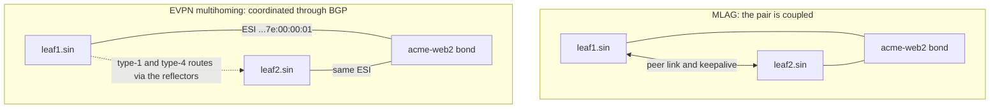

Meridian's small Amsterdam fabric, 4 spines and 4 leaves, already has 16 fabric links, 32 optics, 8 switches with two power supplies each, two route reflectors and two border gateways. The full site has 64 fabric links and 128 optics, and the AI cluster in San Jose has thousands more. Across all three sites something is broken most weeks, and every switch needs a software upgrade once or several times a year. A network that needs everything working is down most of the time, so the question is not "how do we stop failures?" but "when a part fails, or is taken out for work, what does it cost, and who notices?"

A fabric's answers are pairs, many parallel parts, small and deliberately separate failure domains, spare capacity for a loss in the busiest hour, and a way to take any device out of service without dropping a packet. Each has arithmetic behind it and a specific way to fail when the arithmetic is ignored.

## Everything in pairs

Look at Meridian's site and nearly every role comes in twos. A **single point of failure** is a component whose loss alone stops a service; the pairs exist so that no one component is one.

| Role | The pair at `ams` | When one fails | What you lose until it is fixed |
|---|---|---|---|
| Power to a switch | Two power supplies, fed from separate A and B feeds | The other supply carries the whole switch | Protection against the next power fault |
| Server attachment | A bond of two NIC ports to two leaves (`leaf1.ams`, `leaf2.ams`) | The server's bond and the leaves move its traffic to the surviving link | Half the server's bandwidth |
| Route reflectors | `rr1.ams`, `rr2.ams`, every leaf a client of both | Each leaf keeps the same routes from the other reflector | Control-plane redundancy |
| Internet edge | Border gateways `gw1.ams`, `gw2.ams`; two ISPs, ISP1 (AS 64501) and ISP2 (AS 64502) | BGP moves traffic to the other gateway or ISP | Half the edge capacity |
| Inter-site | Two long-haul circuits to `sin` in a square | Traffic detours through the sister spine ([connecting sites and backbones](/learn/fabric-networking/fabric-architecture/connecting-sites-and-backbones)) | Half the inter-site capacity |
| Management access | A separate out-of-band network, with in-band access as the second path | Operators reach devices over the other path | Access during the next incident |

(The AS numbers come from the range reserved for documentation, RFC 5398.)

Spines are the exception: they come in fours, eights or sixteens, because a spine holds no state that members must keep in agreement. Roles that hold shared state (a server's bond, a reflector's view of the overlay, a gateway's sessions) are easiest to make redundant in pairs; stateless roles are cheaper in larger groups, where losing one member costs less.

### Why a pair is less reliable than the arithmetic says

A **failure domain** is the set of components that a single cause takes down together. Redundancy works only across failure domains. If one leaf is available 99.9% of the time (about 8.8 hours down a year, counting failures and maintenance), the textbook pair is down only when both are down at once: $(1 - 0.999)^2 = 10^{-6}$, about 30 seconds a year. That number assumes the two members fail independently.

They rarely do. Both leaves may share a power feed, a rack, a software release, an automation pipeline and an engineer's typo. Reliability engineering models this with a **common-cause fraction** $\beta$ (the beta-factor model): the share of each member's downtime caused by something both members share.

```python
HOURS_PER_YEAR = 8766


def single(a):
    return 1 - a


def pair(a, beta=0.0):
    """Unavailability of a 1+1 pair whose members each have availability a.

    beta is the common-cause fraction: the share of each member's downtime
    caused by something both members share (a feed, a rack, a release, a typo).
    """
    q = 1 - a
    independent = ((1 - beta) * q) ** 2   # both down at once, for unrelated reasons
    common = beta * q                     # one shared cause takes both down
    return independent + common


def show(label, unavail):
    print(f"{label:<34} {100 * (1 - unavail):.5f}%  {unavail * HOURS_PER_YEAR * 60:8.1f} min/year")


a = 0.999   # one leaf, one reflector or one circuit: about 8.8 hours down a year
show("one device", single(a))
for beta in (0.0, 0.01, 0.05, 0.20):
    show(f"pair, common-cause share {beta:.0%}", pair(a, beta))
```

```text
one device                         99.90000%     526.0 min/year
pair, common-cause share 0%        99.99990%       0.5 min/year
pair, common-cause share 1%        99.99890%       5.8 min/year
pair, common-cause share 5%        99.99491%      26.8 min/year
pair, common-cause share 20%       99.97994%     105.5 min/year
```

If one failure in twenty comes from something the members share, the pair is down 27 minutes a year, more than fifty times the independent figure, almost all of it from the shared cause. A third member does nothing for that term; removing the shared cause does, which is why the rest of this lesson is about failure domains rather than box counts. The general serial and parallel arithmetic is in [designing for failure](/learn/system-design/senior-design-skills/designing-for-failure).

Measured data agrees. A study of Microsoft's data center networks (Gill, Jain and Nagappan, SIGCOMM 2011) found redundancy only about 40% effective at reducing the median impact of a failure, largely because failover itself misbehaved or one cause hit both members.

### A pair of one

**What a pair solves:** any single failure in that role is survivable. **How it breaks:** one member fails quietly, nothing pages because the service still works, and the pair runs as a single device for weeks until the second fails. A power supply dead since the last move, a reflector session down since a rebuild, a bond with one member unbundled: none shows to a check that asks "does the service work?". **Signal:** redundancy state, not up or down. Every pair reports "2 of 2", "1 of 2" or "0 of 2", and "1 of 2" is an alert with an owner, even though no customer is affected.

## Dual-homing servers: MLAG against EVPN multihoming (a preview)

A server connected to one leaf loses its network whenever that leaf fails or is upgraded. Dual-homing connects it to two leaves with an LACP bond (link aggregation: two links that behave as one, [switches, VLANs and loops](/learn/fabric-networking/from-zero/switches-vlans-and-loops)), and the two leaves must then behave, towards the server, like one switch. There are two ways to make them do so, and they differ mainly in their failure domains.

**MLAG** (multi-chassis link aggregation) couples the two leaves directly: a **peer link** between them carries traffic and synchronises MAC tables, and a separate **keepalive** tells each switch whether the other is alive. Both send the same LACP system ID, so the server sees one partner. In a VXLAN fabric the pair also shares one VTEP address (a VTEP is the tunnel endpoint on a leaf that wraps tenant frames in VXLAN, [why overlays](/learn/fabric-networking/overlays-vxlan-evpn/why-overlays)), so the rest of the fabric sees the pair as one leaf.

**EVPN multihoming** (RFC 7432, and RFC 8365 for VXLAN) has no peer link. Both leaves configure the same **ethernet segment identifier** (ESI), a 10-byte name for "the bond to this server", and coordinate through BGP routes: one leaf is elected **designated forwarder** for flooded traffic, remote leaves learn that both leaves reach the segment (**aliasing**), and a failed link is announced with a single withdrawal (**mass withdrawal**). [EVPN multihoming](/learn/fabric-networking/overlays-vxlan-evpn/evpn-multihoming) has the route types and the election in full.



The same failure in both designs. Acme's `acme-web2` is bonded to `leaf1.sin` and `leaf2.sin`, and the link to `leaf2.sin` fails:

1. The server's LACP removes the member and sends everything up the link to `leaf1.sin`. This part is identical.
2. **MLAG:** both leaves still advertise the shared VTEP address into the underlay, so the spines' ECMP hash (equal-cost multipath, spreading flows over equal paths: [ECMP and hashing](/learn/fabric-networking/fabric-architecture/ecmp-and-hashing)) still sends about half the traffic for `acme-web2` to `leaf2.sin`, which has no link to it any more and forwards that half across the peer link. The peer link must be sized for it, and the failure is invisible from outside the pair.
3. **EVPN multihoming:** `leaf2.sin` withdraws its per-segment type-1 route. Every remote leaf removes `10.255.2.12` from the next hops of every MAC on that segment at once, and traffic goes straight to `leaf1.sin`. The failure is visible fabric-wide, in BGP.

```viz
{"type": "fabric", "scenario": "evpn-multihoming", "title": "EVPN multihoming: one segment on two leaves, a designated forwarder, aliasing, then a link failure and one mass withdrawal", "caption": "acme-web2 is bonded to leaf1.sin and leaf2.sin with one ESI. The leaves find each other with type-4 routes and elect leaf1.sin designated forwarder; leaf1.ams installs acme-web2's MAC behind both VTEPs (aliasing) and hashes flows over both. Then the link to leaf2.sin fails: leaf2.sin withdraws one per-segment type-1 route, every remote leaf drops 10.255.2.12 for every MAC on the segment at once, and both flows reach acme-web2 through leaf1.sin."}
```

The comparison that matters for redundancy:

| | MLAG | EVPN multihoming |
|---|---|---|
| Coordination | Vendor protocol over a peer link | Standard BGP routes through the reflectors |
| Worst failure | Peer link and keepalive both lost: **split brain**, both switches act alone with one identity (duplicate floods, MAC flapping) | Control-plane trouble delays failover (it rides BGP convergence); no peer link to split, though leaves can briefly disagree on the designated forwarder |
| Coupling | The two leaves usually need compatible software, and some changes need the pair down together | Leaves are independent; any two leaves can share a segment |
| Members per segment | Two | Two is common; the standard allows more |
| Extra capacity | Peer link sized for failover and single-attached ("orphan") hosts | None |
| Vendor mixing | No: both switches of the pair must be the same vendor | Yes, in principle; interoperability needs testing |

**What dual-homing solves:** a leaf failure or upgrade costs a server half its bandwidth instead of its network. **How it breaks:** one bond member silently unbundled (the server is single-homed and nobody knows), MLAG split brain, an EVPN designated forwarder disagreement that duplicates or drops flooded traffic. **Signal:** bond membership per server from both leaves' point of view, the designated forwarder per segment, and type-1 routes from both members present at a remote leaf.

## Failure domains and blast radius

**Blast radius** is what one failure affects: how many servers, tenants, sites or flows notice. A failure domain is the cause side, the blast radius the impact side. Designing for failure means drawing the domains on purpose, so that every likely cause has a small, known radius, and so that the two members of every pair sit in different domains.

The domains nest. From the smallest to the largest, on Meridian:

| Domain | A cause that takes it down | Blast radius at `ams` | How the design contains it |
|---|---|---|---|
| Optic, cable, link | Dirty connector, cut patch cord | One leaf loses 1/4 of its uplinks | ECMP over four spines; gray-failure detection ([optics and the physical layer](/learn/fabric-networking/fabric-architecture/optics-cabling-and-the-physical-layer)) |
| Line card (chassis switches) | Card hardware fault | Every link on that card | Spread a leaf's links across cards; fixed-size spines avoid cards altogether |
| Device | Power supply, ASIC fault, crash | One spine: 1/4 of capacity. One leaf: its single-homed servers | Many spines; dual-homed servers |
| Rack and power feed | Breaker trip, failed power strip (PDU) | Everything in the rack, or on the feed | A and B feeds; pair members in different racks where what they serve is elsewhere |
| Flooding domain | A protocol fault that propagates (an IS-IS purge storm) | Every router in the IS-IS flooding domain (Meridian's level-2 domain) | Smaller areas or domains; protocol hardening |
| Software release | A bug in one version | Every device running that version | Staged rollout; not every spine on the same release at once |
| Change pipeline | A bad template or a command pushed everywhere | Everything the pipeline touches | Canaries, batches that respect pairs, automatic rollback ([safe change and maintenance](/learn/fabric-networking/operating-fabrics/safe-change-and-maintenance)) |

The rows grow in radius and shrink in frequency. Physical faults are frequent and small; software and change faults are rare and large. Most of the large outages with public post-mortems sit in the last three rows.

### Hidden shared fate

The dangerous failure domains are the ones nobody drew:

- **Two circuits in one trench.** Two leased circuits from different carriers can share a duct for the last kilometre. A **shared risk link group** (SRLG) records which links share a physical risk, so planning treats them as one ([connecting sites and backbones](/learn/fabric-networking/fabric-architecture/connecting-sites-and-backbones)).
- **Two power supplies on one feed.** A switch with both supplies on feed A looks dual-powered in the inventory and dies with feed A.
- **Both reflectors in one rack**, or as two virtual machines on one hypervisor: a pair in the configuration, single in the building.
- **One release everywhere.** A route or packet that crashes one spine crashes all four on the same release within seconds.
- **The management plane under the data plane.** If devices reach their time server, authentication or configuration source through the fabric itself, a fabric failure removes the tools needed to fix it. Out-of-band management exists to break that loop ([planes, ASICs and network operating systems](/learn/fabric-networking/from-zero/planes-asics-and-network-operating-systems)).

A generic case study shows how large a flooding domain can be. An operator moved switches' time synchronisation from the out-of-band network onto the data network. One switch model stored IS-IS link-state entries' expiry against its system clock. After a reboot it filled its topology database with the clock at its factory default; then NTP (the network time protocol), now reachable, stepped the clock forward years, every entry looked expired, and the switch flooded a purge for each. Every router in the area deleted those entries, loopbacks became unreachable, BGP next hops stopped resolving, and the overlay fell with the underlay until the originators re-flooded ([underlay failures in production](/learn/fabric-networking/underlay/underlay-failures-in-production) traces it). Two design lessons: the management change created a circular dependency (time needed the network, the network needed time), and a protocol that lets any router delete everyone's state has a blast radius equal to its flooding domain.

### Mapping blast radius in code

The useful tool is a model of what each device depends on, from which you can enumerate every single cause and rank its radius. In the model below, each device lists requirements; a requirement is a set of causes, and the device survives if at least one cause in every set is healthy. Two hidden shared fates are planted in the inventory, as they would be in real data.

```python
# Each component lists its requirements. A requirement is a set of causes, and
# the component survives if at least one cause in every set is still healthy:
# {"feed-A", "feed-B"} is dual power, {"rack-c7"} is "dies with its rack",
# {"nos-spine-4.2"} is the network operating system release it runs.
DUAL = {"feed-A", "feed-B"}
inventory = {
    "spine1.ams": [DUAL, {"rack-s1"}, {"nos-spine-4.2"}],
    "spine2.ams": [DUAL, {"rack-s2"}, {"nos-spine-4.2"}],
    "spine3.ams": [{"feed-A"}, {"rack-s3"}, {"nos-spine-4.2"}],   # both supplies on feed A
    "spine4.ams": [DUAL, {"rack-s4"}, {"nos-spine-4.2"}],
    "rr1.ams":    [DUAL, {"rack-c7"}],
    "rr2.ams":    [DUAL, {"rack-c7"}],                            # same rack as rr1
    "leaf1.ams":  [DUAL, {"rack-r1"}],
    "leaf2.ams":  [DUAL, {"rack-r1"}],                            # leaf1's pair, same rack as its servers
    "leaf3.ams":  [DUAL, {"rack-r3"}],
    "leaf4.ams":  [DUAL, {"rack-r3"}],
}
SPINES = [d for d in inventory if d.startswith("spine")]
PEAK_GBPS, UPLINK_GBPS = 1000, 400        # busiest-hour load per leaf, per-uplink speed


def failed_by(cause):
    return {dev for dev, reqs in inventory.items()
            if any(group <= {cause} for group in reqs)}   # some requirement had only this cause


def impact(cause):
    down = failed_by(cause)
    spines_left = [s for s in SPINES if s not in down]
    rrs_left = 2 - len({"rr1.ams", "rr2.ams"} & down)
    cap = len(spines_left) * UPLINK_GBPS
    util = PEAK_GBPS / cap if cap else float("inf")
    notes = []
    if not spines_left:
        notes.append("no spine left: the site cannot forward between leaves")
    elif util > 1:
        notes.append(f"every leaf's uplinks at {util:.0%}: packet loss")
    elif util > 0.8:
        notes.append(f"every leaf's uplinks at {util:.0%}: over the 80% target")
    if rrs_left == 0:
        notes.append("both reflectors gone: the overlay loses its control plane")
    for pair in (("leaf1.ams", "leaf2.ams"), ("leaf3.ams", "leaf4.ams")):
        if set(pair) <= down:
            notes.append(f"{pair[0]} and {pair[1]} lost, with the servers in their rack")
    severity = (len(spines_left) == 0, rrs_left == 0, util > 1, len(down))
    names = ", ".join(sorted(down)) if 0 < len(down) <= 2 else f"{len(down)} devices" if down else "nothing"
    return severity, f"{cause:<14} {names:<22} " + ("; ".join(notes) or "absorbed by redundancy")


causes = sorted({c for reqs in inventory.values() for group in reqs for c in group})
for _, line in sorted((impact(c) for c in causes), key=lambda r: r[0], reverse=True):  # stable: ties stay A-Z
    print(line)
```

```text
nos-spine-4.2  4 devices              no spine left: the site cannot forward between leaves
rack-c7        rr1.ams, rr2.ams       both reflectors gone: the overlay loses its control plane
rack-r1        leaf1.ams, leaf2.ams   leaf1.ams and leaf2.ams lost, with the servers in their rack
rack-r3        leaf3.ams, leaf4.ams   leaf3.ams and leaf4.ams lost, with the servers in their rack
feed-A         spine3.ams             every leaf's uplinks at 83%: over the 80% target
rack-s1        spine1.ams             every leaf's uplinks at 83%: over the 80% target
rack-s2        spine2.ams             every leaf's uplinks at 83%: over the 80% target
rack-s3        spine3.ams             every leaf's uplinks at 83%: over the 80% target
rack-s4        spine4.ams             every leaf's uplinks at 83%: over the 80% target
feed-B         nothing                absorbed by redundancy
```

Read it from the top. A bug in the spines' shared release has the largest radius, and no hardware redundancy touches it; the fix is staging releases so only a minority of spines change at once. The reflectors in one rack are a hidden pair of one: when both die, every leaf's sessions to them expire after Meridian's 9-second hold time ([BGP sessions and the FSM](/learn/fabric-networking/bgp-fundamentals/bgp-sessions-and-the-fsm)), each leaf deletes every route learned from them, and overlay traffic between leaves stops while traffic within each leaf continues. Graceful restart (a neighbour keeping a dead peer's routes as stale for a restart window, often about two minutes) may hold the overlay up for a while where the implementation applies it to a hold-timer expiry: a window, not a fix ([route reflectors](/learn/fabric-networking/bgp-fundamentals/route-reflectors)). Feed A takes out `spine3.ams` alone, a fault invisible in an inventory that says "two power supplies".

The leaf pairs in one rack are the instructive non-problem: `leaf1.ams` and `leaf2.ams` share `rack-r1`, but so do the servers they serve. A pair may share a domain with everything that depends on it; the rule is not "separate everything" but "nothing should fail because something it does not depend on failed".

The [blast radius](/practice/blast-radius) problem practises the graph version of `failed_by`: given a topology and a failure, find what loses reachability.

## N+1 and headroom math

[Clos and leaf-spine](/learn/fabric-networking/fabric-architecture/clos-and-leaf-spine) derived the rule for one spine lost out of n: each leaf loses 1/n of its uplink, and a load at utilisation u becomes $u \times n / (n - 1)$ on the survivors. That lesson ran it with two spines and with four; here it is with three, a size small sites often start at.

```viz
{"type": "fabric", "scenario": "clos-ecmp", "spines": 3, "variant": "spine-failure", "title": "Three spines, one lost: a third of the capacity gone, utilisation from 62.5% to 93.8%", "caption": "The small Amsterdam fabric with 3 spines and 4 leaves. leaf1.ams hashes six flows 2 / 2 / 2 over the spines and sends 750 Gb/s over 1,200 Gb/s of uplink. spine2.ams loses power, every leaf drops it from its ECMP group, flows C and E move off it, and the same 750 Gb/s meets 800 Gb/s of uplink: 93.8%, close enough to full that every burst queues."}
```

Nothing dropped in that run, and the fabric is still in trouble: at 93.8% any burst fills queues, and the next failure overloads it. The vocabulary for sizing:

- **N** is the number of parallel members needed to carry the busiest hour within the utilisation target.
- **N+1** is one spare: any single member can fail and the target still holds. Four spines where three carry the peak is N+1.
- **N+2** survives two simultaneous losses. The common second loss is not a coincident failure but a planned one: one member out for maintenance when another fails.
- **2N** is a complete duplicate, two independent fabrics or two power systems. It doubles cost and is used where the failure domain must be the whole system, such as A and B power or some storage networks.

Turn the rule around and you get the highest utilisation you may run at the busiest hour, for a target t after losing k of n members:

$$u_{\max} = t \times \frac{n - k}{n}$$

```python
TARGET = 0.80   # Meridian's ceiling for any uplink after a failure


def after(u, n, k):
    """Utilisation of the survivors when k of n equal paths are gone."""
    return float("inf") if k >= n else u * n / (n - k)


def max_steady(n, k, target=TARGET):
    """Highest busiest-hour utilisation that still lands at or under target after k losses."""
    return target * (n - k) / n


print("spines  safe peak for N+1 (k=1)  safe peak for drain + failure (k=2)")
for n in (2, 3, 4, 8, 16):
    print(f"{n:>6}  {max_steady(n, 1):>22.0%}  {max_steady(n, 2):>34.0%}")

# leaf3.ams in the small Amsterdam fabric: 4 spines, 4 x 400G uplinks.
print()
for when, per_uplink in (("14:00", 270), ("02:00", 165)):
    u = per_uplink / 400
    steps = [("normal", 0), ("one drained", 1), ("drained + one failed", 2)]
    row = ", ".join(f"{name} {after(u, 4, k):.1%}" for name, k in steps)
    print(f"leaf3.ams at {when}: {row}")
```

```text
spines  safe peak for N+1 (k=1)  safe peak for drain + failure (k=2)
     2                     40%                                  0%
     3                     53%                                 27%
     4                     60%                                 40%
     8                     70%                                 60%
    16                     75%                                 70%

leaf3.ams at 14:00: normal 67.5%, one drained 90.0%, drained + one failed 135.0%
leaf3.ams at 02:00: normal 41.2%, one drained 55.0%, drained + one failed 82.5%
```

Three readings of the table:

1. **Small n is expensive.** With two spines you may run at 40% and no higher, so 60% of the fabric is insurance; with sixteen, 75%. This is the economic argument for many small spines over a few large ones.
2. **Maintenance is a failure you schedule.** With four spines, one drained plus one failed leaves half the fabric, and staying under 80% through that needs a 40% peak, which almost nobody pays for. Operators schedule maintenance in quiet hours instead: a failure during a drain puts `leaf3.ams` at 135% at 14:00, and at 82.5% (over target, no loss) at 02:00.
3. **The same rule governs every pair.** A pair is n = 2: each of two circuits stays below 40% to land under the 80% target when the other fails (below 50% only avoids loss), and each ISP port must carry the whole edge alone. Power follows it too: with A and B feeds, North American colocation practice keeps each feed below about 40% of its breaker rating, so the survivor stays within the 80% the electrical code lets a breaker carry continuously.

### Partial failures

Most failures remove less than a whole member, and the arithmetic changes with what is lost:

- **One leaf–spine link.** Only that leaf loses 1/n of its uplinks. Every other leaf also stops using that spine *to reach that leaf*, because the spine has no direct path down to it; IS-IS (the underlay routing protocol at Meridian) gives that spine's path a higher cost. The loss is per destination: traffic towards the affected leaf has 1/n less capacity from everywhere.
- **A line card in a chassis spine.** A chassis is a Clos inside a box ([Clos and leaf-spine](/learn/fabric-networking/fabric-architecture/clos-and-leaf-spine)). A failed line card drops the links on it, so leaves cabled to that card each lose one path; a failed fabric module inside the chassis reduces the box's internal capacity by its share (one of six modules, about 17%), with every port still up and no routing change at all. The second kind is a capacity loss that no topology view shows.
- **A gray failure.** A link that stays up but corrupts or drops a fraction of packets keeps its full ECMP share of flows and damages every one of them (TCP's throughput falls steeply with even 1% loss), so it costs more than a dead link, whose flows simply move, until something removes it ([ECMP and hashing](/learn/fabric-networking/fabric-architecture/ecmp-and-hashing)).

Utilisation here means the busiest hour at a high percentile (p95 or p99), per direction, not the daily average; a five-minute average hides the bursts that fill queues when a fabric is suddenly a quarter smaller.

**What headroom solves:** a failure costs capacity without costing packets. **How it breaks:** the headroom is used for growth one quarter at a time until a single loss overloads the fabric; or maintenance is scheduled into the busiest hour. **Signal:** for every leaf and every pair, today's peak against the capacity left after its worst single loss, and the same after the worst loss plus any member currently drained.

## Draining and maintenance as a design input

**Draining** a device makes it carry no traffic while it stays up and connected: routing steers around it, traffic moves to the other members, and only then does work begin, so it can be rebooted, upgraded or recabled without dropping a packet. A device that cannot be drained can be maintained only with an outage, so drainability must be designed in, not improvised.

How each role is drained:

| Device | Mechanism | What it does |
|---|---|---|
| Spine (IS-IS underlay) | Raise the metric on all its links to 16,777,214, the largest value that still leaves a link usable (RFC 5305 excludes links at 16,777,215 from the calculation), or set the IS-IS **overload bit**, a flag in its link-state packet meaning "do not route through me" | Every leaf's shortest-path calculation now prefers the other spines, so the spine leaves every ECMP group; with the metric it remains a last resort, with the overload bit it carries no transit traffic at all ([IS-IS from zero](/learn/fabric-networking/underlay/is-is-from-zero)) |
| Spine (eBGP underlay) | Prepend the AS path or attach the GRACEFUL_SHUTDOWN community (65535:0, RFC 8326), whose receivers lower the route's preference | Paths through the spine lose the BGP comparison; traffic moves before the sessions close ([BGP as the underlay](/learn/fabric-networking/underlay/bgp-as-the-underlay)) |
| Leaf with dual-homed servers | Shut the server-facing bond members (or the EVPN segment) on this leaf, then cost out its uplinks | Servers' bonds and remote leaves move traffic to the partner leaf |
| Border gateway or edge router | Withdraw or depreference its BGP routes first, then cost it out in the IGP (interior gateway protocol, IS-IS here) | Peers stop sending traffic before the underlay stops delivering it ([operating BGP safely](/learn/fabric-networking/bgp-in-the-real-world/operating-bgp-safely)) |

What a drain looks like from a leaf, before the work starts (illustrative output; the next hops are the spine ends of `leaf3.ams`'s /31 links):

```text
leaf3.ams# show ip route 10.255.1.11          (illustrative, spine2.ams drained)
10.255.1.11/32  isis level-2, metric 20, 3 equal-cost paths
    via 10.254.1.4, swp49 (spine1.ams)
    via 10.254.3.4, swp51 (spine3.ams)
    via 10.254.4.4, swp52 (spine4.ams)
    (via 10.254.2.4, swp50 (spine2.ams): metric 16777224, not installed)
```

The whole procedure, with the arithmetic from the previous section as its first step:

```viz
{"type": "fabric", "scenario": "spine-drain", "title": "Draining spine2.ams for an upgrade: refused at 14:00, run hitless at 02:00", "caption": "The pre-check first: at 14:00, draining one of four spines would put leaf3.ams at 360 Gb/s per uplink (90%) and the Singapore traffic at 90% of one circuit, so the tool refuses. At 02:00 the same check gives 55% and 70%. The drain raises spine2.ams's IS-IS metrics to 16,777,214, traffic moves off, the spine is verified empty, rebooted, returns still costed out, is checked, and only then is restored."}
```

Five design rules follow from that run:

1. **Every device must be drainable.** Spines are; a leaf is only if its servers are dual-homed, since single-homed servers lose their network on every leaf upgrade. That is the strongest argument for dual-homing.
2. **Headroom is sized for the drain, not only for the failure.** The pre-check is the headroom table with k = 1, run against live numbers.
3. **Devices come up costed out.** A switch that has rebooted should attract no traffic until its routing tables are complete and its FIB (the forwarding table in the chip) is programmed. IS-IS can set the overload bit on startup until BGP has converged (RFC 3277 describes this); a BGP speaker can advertise deprioritised paths for its first minutes. Without that, a spine attracts traffic the moment its adjacencies form, before its FIB holds every route, and black-holes a share of flows for seconds.
4. **Never two members of the same pair at once.** Batches respect the failure domains: one reflector, one gateway, one spine of four, the next only after the first is verified back.
5. **Order matters where two protocols are involved.** For a router with BGP customers, withdraw BGP first, then cost out the IGP. In a generic case study an operator did it backwards: the underlay stopped delivering traffic through the router while its BGP routes were still advertised and preferred, so traffic kept arriving and was dropped. Monitoring stayed green all night, because every adjacency was in its planned state; customers reported the outage ([operating BGP safely](/learn/fabric-networking/bgp-in-the-real-world/operating-bgp-safely)).

**What draining solves:** planned work costs no packets. **How it breaks:** a drain that leaves a device carrying traffic (a missed link, a static route, a service that ignores the metric), a device restored before it was verified, two drains overlapping. **Signal:** traffic on the drained device's ports falling to the control-plane trickle (kilobits per second of hellos), ECMP width per leaf matching the plan, and the maintenance itself as an event the monitoring knows about.

## What actually fails

Ranked roughly by how often, with what each looks like:

| What fails | How often | Typical blast radius | How it shows |
|---|---|---|---|
| Optics and cables | Weekly at fleet scale, the commonest by count | One link (two to eight with a breakout) | Light levels drifting, CRC errors, flaps, or a gray failure with the link up |
| Links and fibre paths | Often, outside the building most of all (construction, subsea) | One circuit; an SRLG takes several | Loss of signal, carrier tickets, a utilisation spike on the survivor |
| Line cards, power supplies, fans, ASICs | Monthly to yearly per fleet | One device or one card | Hardware alarms, parity or memory errors, a device that reboots |
| Software | Rarer, but correlated | Every device on the release, or a protocol's flooding domain | Daemon crashes, memory growth, the same symptom on many devices at once |
| People and changes | Rarest per change, largest in impact | Whatever the change touched, up to everything | A step change in behaviour aligned with a change record |

The published numbers line up with this shape. Meta's report on training Llama 3 (2024) attributed about 8% of 419 unexpected job interruptions in 54 days to network switches and cables, behind GPUs and memory ([optics, cabling and the physical layer](/learn/fabric-networking/fabric-architecture/optics-cabling-and-the-physical-layer) reads it in detail). Google's SRE book attributes roughly 70% of outages to changes in a live system. The largest public network outage of recent years was a change: on 4 October 2021 a command issued during routine maintenance to assess Facebook's backbone capacity disconnected every backbone link, and an audit tool meant to block such commands had a bug. Facebook's DNS servers, built to withdraw their own BGP anycast routes when they lost the data centers, did exactly that, and the service vanished from the internet. Recovery took about six hours, partly because remote access depended on the same network and engineers had to reach sites in person. A safety mechanism working as designed enlarged the blast radius, and the management path shared fate with what it managed ([leaks, hijacks and RPKI](/learn/fabric-networking/bgp-in-the-real-world/leaks-hijacks-and-rpki) has the BGP side).

## How a fabric degrades instead of failing

A well-built fabric loses capacity in proportion to what broke, rather than losing service. The properties that make that true, and the mechanism behind each:

- **Many small, equal parts.** Losing one of n spines costs 1/n, proportionally and predictably.
- **Local detection.** A leaf sees loss of light on its own port within milliseconds (plus any debounce timer the port is set to) and removes that next hop from its ECMP group before any routing message arrives. In many ASICs and network operating systems the group is one shared object referenced by every prefix that uses it (prefix-independent convergence), so one hardware write repairs thousands of routes at once. A silent failure, a spine that stays powered but stops forwarding, needs BFD (bidirectional forwarding detection, fast hellos between neighbours) to be detected in under a second ([convergence and BFD](/learn/fabric-networking/underlay/convergence-and-bfd)).
- **Control plane off the forwarding path.** Route reflectors carry routes, not packets: losing one costs no traffic at all. The overlay's BGP next hops are leaf loopbacks, so when a leaf dies and IS-IS removes its loopback, remote leaves invalidate every route through it at once (next-hop tracking) instead of waiting for BGP hold timers.
- **Fail-static forwarding.** If a switch's routing process crashes, the forwarding chip keeps forwarding on the last programmed FIB. With graceful restart, its neighbours keep using it while the process recovers. Forwarding outlives the software that programmed it, for a while.
- **No single gateway.** The distributed anycast gateway gives every leaf the same gateway address and MAC, so no host depends on one router for its default route ([VRFs and multi-tenancy](/learn/fabric-networking/overlays-vxlan-evpn/vrfs-and-multi-tenancy)).
- **No layer-2 loops.** A routed fabric bounds every loop with TTL; a large layer-2 domain turns one loop into a site-wide storm ([switches, VLANs and loops](/learn/fabric-networking/from-zero/switches-vlans-and-loops)).

The contrast is designs that fail closed: one big chassis whose control-plane card is a single point of failure, a stateful firewall pair whose state synchronisation fails, a layer-2 domain stretched across sites. Each puts many services in one failure domain.

## Failure modes in production

| Failure | Symptom | Diagnosis | Fix |
|---|---|---|---|
| Pair of one | No symptom until the second member fails, then a full outage of that role | Redundancy state per pair: one member down for days; a bond with one member unbundled | Alert on "1 of 2" with an owner and a deadline |
| Hidden shared fate | Both members of a pair fail in one event | Post-incident: same rack, feed, hypervisor, conduit or release | Record dependencies (rack, feed, SRLG, release) in the source of truth and check pairs against them |
| Failure during maintenance | Packet loss across the site while one spine is drained and another fails | Utilisation after two losses above 100%; maintenance scheduled at peak | Pre-check with live load; schedule in quiet hours; N+2 where it matters |
| Device attracts traffic before it is ready | Seconds of black-holed flows after a spine or leaf reboots | Adjacencies up before the FIB was complete; no overload-on-startup | Come up costed out; restore only after verification |
| MLAG split brain | Duplicate frames, MAC addresses moving between the two leaves, intermittent loss | Peer link and keepalive both down; both switches claim primary | Keepalive on a separate path; move to EVPN multihoming |
| Correlated software bug | Many devices crash or misbehave at once | Same release on every affected device; same trigger (a route, a packet) | Staged rollouts; diversity of release across pair members during rollout |

## Trade-offs: ways to build redundancy

| | 1+1 active/standby | Active/active pair | N+1 group (spines) | 2N (two independent fabrics) |
|---|---|---|---|---|
| Spare capacity | 100% idle until failover | Each member below 50% | 1/n of the group | 100% |
| Failover | A switchover event; standby may be stale | Rehash; the survivor takes both shares | Rehash over n − 1; proportional loss | The other system carries everything |
| Detects a bad standby | Only by testing failover | Continuously, since both carry traffic | Continuously | Continuously if both carry traffic |
| Blast radius of one fault | One member, if failover works | One member | 1/n of capacity | One whole system |
| Complexity | State replication, failover logic | Coordination between the two | Low: stateless members | Two of everything to operate |
| Fits | Stateful appliances | Gateways, reflectors, circuits, dual-homed servers | Spines, ECMP groups | Power, some storage and AI back-ends |

Active/active beats active/standby in one way that matters more than capacity: a member that carries traffic every day proves every day that it works. A standby that has never forwarded a packet may fail at the moment it is needed.

## What the platform should show

A redundancy view answers the on-call engineer's question ("what will the next failure cost?") and the manager's ("are we exposed, and is anyone fixing it?").

- **Redundancy state per role, not up or down.** Every pair and group as "n of m": reflectors 2 of 2, gateways 2 of 2, `acme-web2`'s bond 1 of 2. A degraded pair is yellow and owned.
- **Headroom after the worst single loss, continuously.** For each leaf, circuit and edge port: today's peak divided by the capacity left after its worst single failure, and after its worst failure plus any device currently drained.
- **Shared-fate inventory.** Rack, power feed, SRLG, hypervisor and software release for every device and link, with a check that flags pairs whose members share any of them: the `rack-c7` and `feed-A` findings above, before an incident finds them.
- **Drain state on the topology.** In service, draining, costed out, restoring, for every device, with traffic on drained ports expected to sit at the control-plane trickle.
- **Change-aware monitoring.** The monitoring knows which maintenance is running, which order it should follow, and what it should look like, so an expected adjacency loss does not page and an unexpected traffic drop does.
- **Correlation across devices.** The same alarm on four devices on one release in the same minute is one incident.
- **Blast radius before a change.** For a proposed change, the devices touched, the pairs it hits both members of, and the capacity left during the window.

## Interviewer follow-ups

**"We have two of everything. Why did we still have an outage?"** Model answer: redundancy only works across independent failure domains, and two of everything is often one of something: a shared rack, feed, conduit, release or change pipeline. A 5% common-cause share puts a pair of 99.9% devices down about 27 minutes a year instead of 30 seconds. I would map each pair's dependencies for shared ones, and check whether a member had been down unnoticed before the second failed. Common wrong answer: "add a third device", which does nothing about the shared cause.

**"How much headroom does a four-spine fabric need?"** Model answer: losing one of four spines turns utilisation u into 4u/3, so to stay under 80% after a failure the busiest-hour peak must stay under 60%. If you also want to survive a failure during a maintenance drain, that is two of four gone, and the peak must stay under 40%, which is why maintenance goes into quiet hours instead. Common wrong answer: "25% headroom, because we lose a quarter", which forgets that the remaining three carry the load and sizes the peak at 75%.

**"MLAG or EVPN multihoming?"** Model answer: MLAG couples two vendor-matched switches through a peer link that needs capacity and can split-brain. EVPN multihoming coordinates through standard BGP routes, needs no peer link and lets any leaves share a segment, at the cost of depending on the EVPN control plane for failover. In a fabric already running EVPN, multihoming removes a failure mode. Common wrong answer: "MLAG is faster", stated without a mechanism. An honest addition: "I'd defer to the network team on a given platform's multihoming limits, but I would build the per-segment view of designated forwarder and both members' routes."

**"How do you take a spine out without anyone noticing?"** Model answer: pre-check that the other spines can carry the load at today's traffic, drain by raising its IS-IS metric so leaves stop using it, verify its ports carry only control traffic, do the work, bring it back still costed out, verify routes and optics, restore the metric, and compare with the pre-check. Common wrong answer: "shut its interfaces and rely on ECMP", which turns planned work into an unplanned failure with whatever loss the rehash costs.

## What mid-level engineers get wrong

- **Counting boxes instead of domains.** Two reflectors in one rack are one reflector for planning purposes.
- **Sizing headroom for one failure and nothing else.** Maintenance is a scheduled loss, and failures do not wait for it to finish.
- **Treating "the service works" as "redundancy is intact".** A pair running on one member reports healthy until it is down.
- **Restoring a device as soon as it boots.** A switch whose FIB is still filling black-holes traffic; bring it back costed out and restore it after checks.
- **Assuming hardware failures are the big risk.** They are the frequent risk; the large outages come from software and changes that hit every redundant copy at once.

## Senior signals

- You ask which failure domain each member of a pair is in before you count the pair as redundant, and you can quantify the common-cause effect.
- You size headroom as $u \times n / (n - k)$ for the losses you intend to survive, and you count a maintenance drain as one of them.
- You compare MLAG and EVPN multihoming by their failure modes (peer link and split brain against control-plane dependence), not by feature lists.
- You treat drainability as a design requirement: dual-homed servers, devices that boot costed out, batches that never touch both members of a pair.
- You separate frequent small failures (optics, links) from rare large ones (software, changes) and defend against them differently: detection and automation for the first, staged rollout and blast-radius limits for the second.
- You want "n of m" redundancy state and post-failure headroom on the dashboard, because the dangerous fabric looks healthy with no spare left.

## Check yourself

```quiz
- q: >-
    Meridian's two route reflectors are each available 99.9% of the time. A review finds they are in the same rack, and about 5% of each one's downtime comes from causes that hit the whole rack. Roughly how does the pair's downtime compare with the independent estimate of about 30 seconds a year?
  options: ["About the same, because a rack failure is rare compared with device faults", "Lower, because rack failures are repaired faster than device failures", "About 5% higher, because only 5% of failures are shared between the two", "About 50 times higher, because the shared rack dominates the pair's downtime"]
  answer: 3
  explanation: >-
    A shared cause takes both down at once, so its contribution is beta times one member's unavailability, 0.05 x 0.001 = 5 x 10^-5, against 10^-6 for two independent failures. That is about 27 minutes a year instead of 30 seconds. The 5% is a share of each member's downtime, not a 5% increase in the pair's, and a rare shared cause still outweighs a coincidence of two independent ones.
- q: >-
    A four-spine fabric runs at 70% uplink utilisation in the busiest hour. One spine is drained for an upgrade at that hour, and another spine fails during the window. What do the leaves' uplinks carry?
  options: ["140%, so queues overflow and drop", "70%, because ECMP rebalances the load", "93%, over target but without loss", "105%, slightly over capacity"]
  answer: 0
  explanation: >-
    With two of four spines gone, the remaining two carry everything: 70% x 4 / 2 = 140%. One loss alone would give 70% x 4 / 3, about 93%. ECMP spreads the load over the survivors but cannot add capacity. To survive a drain plus a failure under an 80% target, the peak must stay under 40%, which is why drains are scheduled in quiet hours.
- q: >-
    acme-web2 is dual-homed to leaf1.sin and leaf2.sin, and its link to leaf2.sin fails. In an EVPN multihoming design, how do remote leaves stop sending its traffic to leaf2.sin?
  options: ["leaf2.sin forwards the traffic to leaf1.sin over a peer link", "They relearn each MAC by flooding until leaf1.sin answers", "They wait for the hold timer on their BGP session to leaf2.sin", "leaf2.sin withdraws one type-1 route for the whole segment"]
  answer: 3
  explanation: >-
    Mass withdrawal: leaf2.sin withdraws its per-segment type-1 route, and every remote leaf removes 10.255.2.12 from the next hops of every MAC on that segment at once. Forwarding over a peer link is how MLAG handles it, hidden behind a shared VTEP address. Remote leaves have no session to leaf2.sin (both peer with the reflectors), and EVPN avoids relearning by flooding.
- q: >-
    The blast-radius model ranks a bug in the spines' shared software release above any single rack or feed failure. Which change reduces that radius?
  options: ["Moving the two route reflectors into separate racks", "Staging upgrades so few spines share a new release", "Adding a fifth spine running the same release", "Giving every spine a second, separately fed supply"]
  answer: 1
  explanation: >-
    The release is a failure domain shared by every spine that runs it, so hardware redundancy (more spines, more power supplies) leaves it untouched: the fifth spine crashes with the others. Staging limits how many spines can share a new release's bug at once. Separating the reflectors fixes a different shared fate, the rack.
- q: >-
    A spine reboots after an upgrade. Its adjacencies come up in seconds, and a share of flows across the site is dropped for several seconds afterwards. What design rule was missing?
  options: ["The spine should have come up costed out until its FIB was complete", "The upgrade should have run with the spine left in service", "BFD should have been disabled on the spine during the upgrade", "The leaves should have used a larger ECMP group for that spine"]
  answer: 0
  explanation: >-
    As soon as adjacencies form, leaves add the spine back to their ECMP groups and send it traffic, while its forwarding chip may not yet hold every route, so some flows are black-holed. Coming up with the overload bit or maximum metrics set, and restoring only after verification, prevents it. BFD and group size do not change what an unprogrammed FIB does, and upgrading in service is the opposite of a drain.
```
