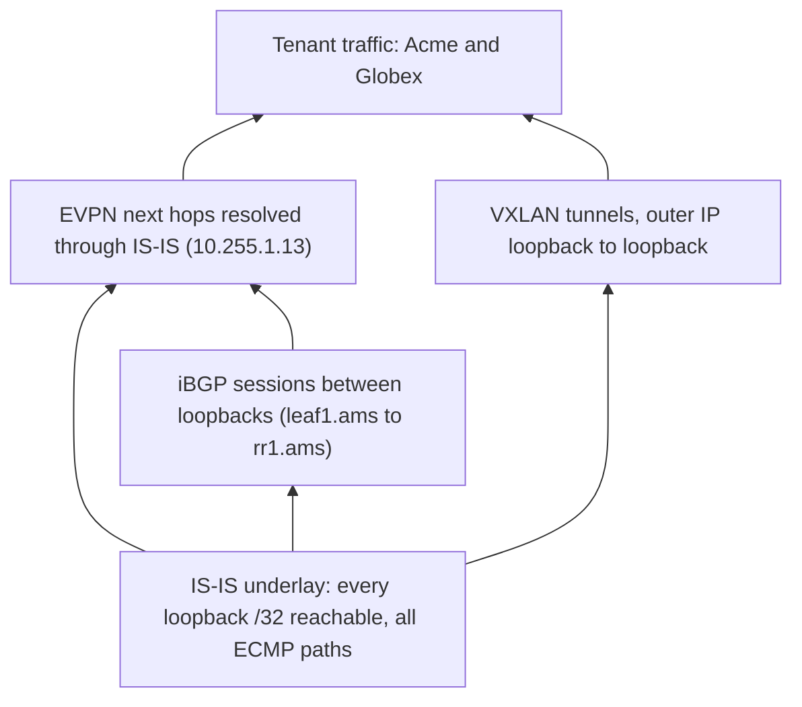

Meridian's Amsterdam site has 24 routers: 4 spines, 16 leaves, 2 route reflectors and 2 border gateways. Each needs a route to the loopback address of the other 23, and a leaf's route to another leaf has four next hops, one per spine. That is 552 routes for one site's loopbacks alone. A script could render them all from a spreadsheet, and they would be correct on the day they were written and wrong within a second of the first fibre cut, because a static route knows nothing about the path beyond its own next hop.

A routing protocol is the program that writes those routes and rewrites them whenever the network changes. Its algorithms are traced step by step on a five-router graph in [routing algorithms](/learn/networking/network-algorithms/routing-algorithms); here they are put to work on a fabric, ending with OSPF, the link-state protocol most networks outside large fabrics run, set against the IS-IS that Meridian runs.

## The job: fill the RIB, then keep it true

A reminder from [the routing table](/learn/fabric-networking/from-zero/the-routing-table): the **RIB** (routing information base) is the control plane's table of every candidate route from every source, and the **FIB** (forwarding information base) is the copy of the winners that the forwarding chip reads for every packet. When two sources offer the same prefix, the lower **administrative distance** wins: on Cisco-style defaults, which FRRouting also uses, connected 0, static 1, eBGP 20, OSPF 110, IS-IS 115, iBGP 200 (Junos calls it "preference" and uses different numbers for the same idea). A routing protocol is one more source of RIB entries, whose purpose is to keep them true without a human.

Every routing protocol, whatever its algorithm, does the same four things:

1. **Find neighbours.** Send hellos on each link (IS-IS, OSPF) or open a TCP session to a configured address (BGP).
2. **Exchange reachability information.** Tell neighbours what this router knows: its own links (link-state), its distance to every destination (distance-vector) or its paths to every destination (path-vector).
3. **Compute and install.** Turn what it has heard into a best route per prefix and hand it to the RIB, which pushes the winners into the FIB.
4. **React.** Notice when a neighbour or link disappears (a hello timer expires, light is lost, a liveness check fails), tell the others, and recompute.

Steps 1 to 3 fill the RIB. Step 4 is why you run the protocol at all.

### A static fabric, traced through one failure

Take the small Amsterdam example used throughout this module: two spines, four leaves, every leaf linked to every spine, every link cost 10. Suppose day-0 statics match what a protocol would have computed: `leaf1.ams` reaches `leaf3.ams`'s loopback `10.255.1.13` via both spines, and `spine2.ams` reaches it over its own link to `leaf3.ams`. Now the `leaf3.ams`–`spine2.ams` fibre is cut.

1. `leaf3.ams` and `spine2.ams` lose light on that port within milliseconds. Each removes the connected subnet `10.254.2.4/31` and every static route whose next hop was on it. `spine2.ams` loses its only route to `10.255.1.13`.
2. `leaf1.ams` sees nothing: both of its own uplinks are fine, so its static route keeps both next hops. It hashes each flow onto one spine (ECMP, equal-cost multipath: [ECMP and hashing](/learn/fabric-networking/fabric-architecture/ecmp-and-hashing)), and about half of its flows to `leaf3.ams` go to `spine2.ams`.
3. `spine2.ams` has no route for those packets and drops them. The same happens to `leaf2.ams` and `leaf4.ams`.
4. Far from the failure, `spine1.ams`'s route to `spine2.ams` goes through all four leaves; flows hashed through `leaf3.ams` die there, because `leaf3.ams` lost its static route to `spine2.ams` with the link.
5. Nothing changes until an engineer edits six routers. Apart from the two ends of the cut fibre, every interface stays green.

With a link-state protocol, `leaf3.ams` and `spine2.ams` each announce "this link is gone" to everyone and every router recomputes: `leaf1.ams` drops `spine2.ams` as a next hop, and `spine2.ams` finds a path to `leaf3.ams` down to another leaf, up to `spine1.ams` and down again. The model below runs both versions with a per-flow forwarding walk.

```python
import hashlib
import heapq

SPINES = ["spine1.ams", "spine2.ams"]
LEAVES = ["leaf1.ams", "leaf2.ams", "leaf3.ams", "leaf4.ams"]
ROUTERS = SPINES + LEAVES
# 10.255.<site>.<n>: spines n = 1, 2; leaves n = 11, 12, ...
LOOPBACK = {r: "10.255.1." + str(int(r[5]) if r.startswith("spine") else 10 + int(r[4]))
            for r in ROUTERS}
METRIC = 10                                   # every fabric link costs the same
FULL = {frozenset((leaf, spine)) for leaf in LEAVES for spine in SPINES}


def neighbours(links, router):
    return sorted(n for link in links if router in link for n in link if n != router)


def spf(links, src):
    """Dijkstra from src. Returns {router: (cost, set of first hops)}, keeping ties (ECMP)."""
    best, heap, done = {src: (0, set())}, [(0, src)], set()
    while heap:
        cost, node = heapq.heappop(heap)
        if node in done:
            continue
        done.add(node)
        for nbr in neighbours(links, node):
            c = cost + METRIC
            hops = {nbr} if node == src else best[node][1]   # inherit the first hop
            if nbr not in best or c < best[nbr][0]:
                best[nbr] = (c, set(hops))
                heapq.heappush(heap, (c, nbr))
            elif c == best[nbr][0]:
                best[nbr][1].update(hops)                     # an equal-cost path: add it
    return best


def protocol_ribs(links):
    """What a link-state IGP installs: every other loopback, all equal-cost next hops."""
    return {r: {LOOPBACK[d]: sorted(h) for d, (c, h) in spf(links, r).items() if d != r}
            for r in ROUTERS}


def static_ribs(day0, links):
    """Routes written once from the day-0 topology. A static next hop disappears only
    when the router's own interface to it goes down; nothing checks the path beyond."""
    out = {}
    for r, table in day0.items():
        out[r] = {p: [n for n in hops if frozenset((r, n)) in links] for p, hops in table.items()}
        out[r] = {p: hops for p, hops in out[r].items() if hops}
    return out


def forward(ribs, src, dst, flow):
    node, ttl = src, 16
    while node != dst:
        hops = ribs[node].get(LOOPBACK[dst])
        if not hops:
            return f"dropped at {node}"
        digest = hashlib.sha256(f"{flow}|{node}".encode()).digest()
        node = hops[digest[0] % len(hops)]          # per-flow ECMP hash, per router
        ttl -= 1
        if ttl == 0:
            return "looped"
    return "delivered"


def loss_report(ribs, flows=64):
    bad = 0
    for src in ROUTERS:
        for dst in ROUTERS:
            if src == dst:
                continue
            results = [forward(ribs, src, dst, f) for f in range(flows)]
            lost = [x for x in results if x != "delivered"]
            if lost:
                bad += 1
                print(f"  {src:>10} -> {dst:<10} {len(lost):>2}/{flows} flows lost, {lost[0]}")
    if not bad:
        print("  every pair delivers every flow")


day0 = protocol_ribs(FULL)
print("leaf1.ams, day 0:", LOOPBACK["leaf3.ams"], "via", day0["leaf1.ams"][LOOPBACK["leaf3.ams"]])
cut = FULL - {frozenset(("leaf3.ams", "spine2.ams"))}
print("\nleaf3.ams-spine2.ams fails. Static routes:")
loss_report(static_ribs(day0, cut))
print("\nA link-state IGP recomputes. Losses:")
igp = protocol_ribs(cut)
loss_report(igp)
for r in ["leaf1.ams", "spine2.ams"]:
    cost, hops = spf(cut, r)["leaf3.ams"]
    print(f"  {r} -> 10.255.1.13: metric {cost} via {sorted(hops)}")

print("\nReachable is not healthy: leaf-to-leaf ECMP width against intent")
for src in LEAVES:
    for dst in LEAVES:
        width = len(igp[src].get(LOOPBACK[dst], []))
        if src != dst and width < len(SPINES):
            print(f"  {src} -> {LOOPBACK[dst]}: {width} of {len(SPINES)} next hops")
```

```text
leaf1.ams, day 0: 10.255.1.13 via ['spine1.ams', 'spine2.ams']

leaf3.ams-spine2.ams fails. Static routes:
  spine1.ams -> spine2.ams 14/64 flows lost, dropped at leaf3.ams
  spine2.ams -> leaf3.ams  64/64 flows lost, dropped at spine2.ams
   leaf1.ams -> leaf3.ams  30/64 flows lost, dropped at spine2.ams
   leaf2.ams -> leaf3.ams  35/64 flows lost, dropped at spine2.ams
   leaf3.ams -> spine2.ams 64/64 flows lost, dropped at leaf3.ams
   leaf4.ams -> leaf3.ams  31/64 flows lost, dropped at spine2.ams

A link-state IGP recomputes. Losses:
  every pair delivers every flow
  leaf1.ams -> 10.255.1.13: metric 20 via ['spine1.ams']
  spine2.ams -> 10.255.1.13: metric 30 via ['leaf1.ams', 'leaf2.ams', 'leaf4.ams']

Reachable is not healthy: leaf-to-leaf ECMP width against intent
  leaf1.ams -> 10.255.1.13: 1 of 2 next hops
  leaf2.ams -> 10.255.1.13: 1 of 2 next hops
  leaf3.ams -> 10.255.1.11: 1 of 2 next hops
  leaf3.ams -> 10.255.1.12: 1 of 2 next hops
  leaf3.ams -> 10.255.1.14: 1 of 2 next hops
  leaf4.ams -> 10.255.1.13: 1 of 2 next hops
```

Three lines carry the point. `static_ribs` keeps a next hop while the router's *own* link to it is up, which is all a static route can test. `hops = {nbr} if node == src else best[node][1]` is how SPF produces a FIB entry: only the first hop of each shortest path matters to the router running it, and equal-cost ties are kept, which is where ECMP comes from. The last block is the first check a fabric platform should run: everything is reachable, but six leaf-to-leaf directions have half their capacity, which no "is it up?" test reports.

**What a routing protocol solves:** routes that follow the topology as it is now, not as it was when someone wrote them. **How it breaks:** the protocol itself fails (an adjacency that will not form, a prefix not advertised), or it is told a lie (a link that is up but dropping packets). **Signal:** a reachability matrix that disagrees with intent, while interfaces and sessions look fine.

## IGP and EGP: inside one administration, between several

An **autonomous system** (AS) is a network under one administration with one routing policy, identified by an AS number; Meridian's internet presence is AS 64500.

An **IGP** (interior gateway protocol; "gateway" is the old word for router) routes inside one AS. Every neighbour is your own router, so an IGP trusts every message, discovers neighbours automatically and optimises the lowest total metric, recomputed as fast as possible after a change. IS-IS, OSPF, RIP and EIGRP are IGPs.

An **EGP** (exterior gateway protocol) routes between ASes. The router on the other end belongs to someone else, so nothing is discovered or trusted: every route is filtered, and path choice follows contracts rather than distance. BGP is the only EGP in use. (There was once a protocol literally named EGP, RFC 904 from 1984, which BGP replaced from 1989.)

| | IGP (IS-IS, OSPF) | EGP (BGP) |
|---|---|---|
| Who is on the other side | Your own routers | Another organisation's router |
| Trust | Complete: every router believes every advertisement | None: filter and limit everything |
| What it optimises | Lowest total metric, fastest recovery | Policy: who may reach what, through whom |
| Neighbour discovery | Automatic hellos on each enabled link | Configured peer addresses |
| What it shares | Topology (link-state) | Reachable prefixes with path attributes |
| Scale it is built for | Thousands of routers, tens of thousands of prefixes | About a million IPv4 prefixes on the internet in the mid-2020s |
| Recovery target | Well under a second when tuned | Seconds to minutes |

The trap is reading these as protocol names rather than roles. Meridian runs BGP inside its own network twice:

| Where | Protocol | Role |
|---|---|---|
| Every fabric link in all three sites and the circuits between them | IS-IS, one level-2 domain, area 49.0001 | IGP: the underlay |
| Leaves to their site's route reflectors, reflectors across sites | iBGP in AS 65000, carrying EVPN | Overlay: which tenant address sits behind which leaf |
| `gw1.ams` and `gw2.ams` to ISP1 (AS 64501) and ISP2 (AS 64502) | eBGP from AS 64500 | EGP: the internet edge |
| The alternative design in [BGP as the underlay](/learn/fabric-networking/underlay/bgp-as-the-underlay) | eBGP, spines AS 65100, each leaf its own AS from 65101 | BGP used as the IGP |

(AS numbers 64496–64511 are reserved for documentation by RFC 5398, and 64512–65534 are private, RFC 6996, which is where the fabric's ASes come from.) The overlay's iBGP is not an IGP: it carries EVPN (Ethernet VPN) routes, which say which tenant MAC and IP address sits behind which leaf, computes nothing about the topology, and relies on IS-IS to reach every peer and every next hop. [What BGP is for](/learn/fabric-networking/bgp-fundamentals/what-bgp-is-for) takes the EGP side apart; the rest of this module is the IGP side.

## Three families in one table

Every routing protocol belongs to one of three algorithm families, and the family predicts how it fails. [Routing algorithms](/learn/networking/network-algorithms/routing-algorithms) traces each on the same five routers.

**Link-state** (IS-IS, OSPF): every router floods a description of its own links to every other router, so all hold the same map, the link-state database, and each runs Dijkstra's shortest-path-first (SPF) algorithm over it from itself. Same map, so their choices agree once the flood has finished.

**Distance-vector** (RIP, EIGRP): each router tells its neighbours only its distance to every destination and adopts the neighbour offering the lowest total: Bellman-Ford run by gossip. Nobody holds a map, so a router cannot tell that a neighbour's route runs back through itself; after a failure, stale distances bounce between routers and climb one step per exchange, the "count to infinity".

**Path-vector** (BGP): distance-vector where each route carries the list of ASes it has crossed. A router that finds its own AS in the list discards the route, which removes count to infinity without revealing anyone's topology, and leaves room for policy to override distance.

| Property | Link-state | Distance-vector | Path-vector |
|---|---|---|---|
| What a router sends | Its own links, to everyone (flooded) | Its distance to every destination, to neighbours | Its paths to every destination, to neighbours |
| Who computes | Every router, over the full map | Every router, from neighbours' claims | Every router, from neighbours' claims plus policy |
| Loop prevention | Identical maps give consistent trees | Split horizon, hold-down timers, a hop limit (RIP's infinity is 16) | Own AS in the path means discard |
| Bad news travels | As fast as the flood: milliseconds | One exchange at a time: with RIP's 30 s periodic updates, counting to infinity can take minutes | Path exploration, timer-paced: seconds to minutes |
| Visibility | The whole topology | None beyond neighbours | Paths, not topology |
| Examples | IS-IS, OSPF | RIP, EIGRP (with its DUAL repair) | BGP |
| In a fabric | The usual underlay | Not used | The overlay, the internet edge, and the eBGP underlay alternative |

Fabrics avoid distance-vector because of the "bad news" row and because it has no map to troubleshoot from. They run link-state because a few hundred routers is small for it, and because "every router holds the same map" is what a tool can read, diff and reason about.

## Convergence: from a broken link to correct forwarding everywhere

**Convergence** is the interval from a change in the network until every router's FIB is consistent with the new topology; until then some packets follow routes that no longer work. For a link-state protocol it has four phases:

1. **Detection.** A router notices the link or neighbour is gone: loss of light on a direct fibre (milliseconds), a missed liveness check, or a protocol hello timer running out.
2. **Propagation.** It waits briefly in case more changes follow, then floods a new advertisement; every router that receives it floods it on.
3. **Computation.** Every router waits a short, deliberate SPF delay (to batch a burst of changes), then reruns SPF.
4. **FIB programming.** The new routes are written into hardware.

The numbers below are for Meridian's Amsterdam–Singapore circuits, as the visualisation runs them. The circuit crosses a carrier's optical network that keeps the spines' ports lit when a fibre breaks inside it, so loss of light never arrives. Detection falls to BFD (Bidirectional Forwarding Detection, a lightweight hello every 300 ms, declared down after 3 misses) or, without it, to IS-IS's own 30 s hold timer (10 s hellos × 3, a common default). The advertisement IS-IS floods is an **LSP** (link-state protocol data unit: one router's list of its neighbours and prefixes).

| Phase | With BFD at 300 ms × 3 | Without BFD | What sets it |
|---|---|---|---|
| Detection | 900 ms | up to 30 s | BFD interval × multiplier, or the IS-IS hold time |
| LSP generation wait | 50 ms | 50 ms | Configured initial delay before originating |
| Flooding | about 2 ms inside a site | same | Hops × per-hop processing; at least 52 ms to the far site over 10,500 km of fibre |
| SPF wait and run | 50 ms + about 1 ms | same | Configured initial SPF delay; the computation itself is cheap |
| FIB update | about 15 ms | same | Hardware programming; fast here because many prefixes share one ECMP group |
| **Total, as seen by `leaf1.ams`** | **about 1,018 ms** | **about 30.1 s** | |
| Data lost at 40 Gb/s on the dead circuit | about 5.1 GB | about 150.6 GB | |

Detection is 88% of the tuned total and almost all of the untuned one; the algorithm, where textbooks spend their time, is about a millisecond. Say that first when someone asks why a network took 30 seconds to heal. [Convergence and BFD](/learn/fabric-networking/underlay/convergence-and-bfd) works the timers, the throttles and prefix-independent FIB updates in detail.

```viz
{"type": "fabric", "scenario": "bfd-convergence", "title": "Where convergence time goes: a silent circuit failure, with and without BFD", "caption": "leaf1.ams sends 80 Gb/s to leaf2.sin over two circuits. A fibre breaks inside the carrier's network and the spines' ports stay up. BFD at 300 ms × 3 detects it in 900 ms; IS-IS then waits 50 ms and floods, leaf1.ams waits 50 ms and runs SPF in about 1 ms, and the FIB update takes about 15 ms, about 1,018 ms in all with 5.1 GB lost. Without BFD the IS-IS hold timer takes up to 30 s and about 150.6 GB is lost."}
```

### Microloops: the cost of routers converging at different moments

During phases 3 and 4 routers are not synchronised. In the run above, `spine1.ams` has removed the circuit and sends Singapore traffic down to a leaf, while that leaf, not yet updated, hashes some of it back up to `spine1.ams`. The packets bounce until their TTL (time to live, the hop counter every router decrements) runs out or the leaf catches up, a few milliseconds later. This **microloop** is normal link-state behaviour: "link-state is loop-free" is true only after convergence. The fixes (ordered FIB updates, precomputed loop-free backup next hops) are in [convergence and BFD](/learn/fabric-networking/underlay/convergence-and-bfd).

The other families converge differently. BGP on the internet waits a minimum route advertisement interval between updates for one prefix (RFC 4271 suggests 30 s for eBGP) and explores longer alternate paths before giving up, which is why an internet-wide withdrawal can take minutes ([convergence and scale](/learn/fabric-networking/bgp-in-the-real-world/convergence-and-scale)). BGP fabrics set that interval to zero so an eBGP underlay converges in well under a second.

**What fast convergence solves:** loss measured in milliseconds, not seconds. **How it breaks:** detection that never fires (a port up while the path is dead), timers so short that a busy control plane misses its own hellos and flaps healthy links, or a FIB that takes seconds to program. **Signal:** per event, which detector fired (loss of light, BFD or hold timer) and the time from detection to FIB; bursts of TTL-expired counters after each change are microloops.

## The underlay's single job: every loopback reachable from everywhere

The **underlay** is the routed network of physical links between fabric devices, plus the IGP that runs over it, and its job is narrower than "routing": to make every device's **loopback** (a virtual interface with no cable, so it stays up whatever happens to any one link) reachable from every other device, over every equal-cost path, and to keep it so through failures. Everything else in the fabric is built on that guarantee, because the loopback is used three times:

- **As the BGP session endpoint.** `leaf1.ams` (`10.255.1.11`) peers with `rr1.ams` (`10.255.1.101`) between loopbacks, so the session survives any single link failure; if the loopback is unreachable the session sits in Active, retrying its TCP connection ([BGP sessions and the FSM](/learn/fabric-networking/bgp-fundamentals/bgp-sessions-and-the-fsm)). An iBGP session between interface addresses would die with that one link.
- **As the BGP next hop.** An EVPN route for Acme's `acme-db1` says "behind `10.255.1.13`", and the router looks up `10.255.1.13` in the IGP's routes to find a real interface: recursive next-hop resolution ([the routing table](/learn/fabric-networking/from-zero/the-routing-table), [iBGP, loops and next hops](/learn/fabric-networking/bgp-fundamentals/ibgp-loops-and-next-hops)).
- **As the tunnel endpoint.** The loopback is also the leaf's VTEP address (VXLAN tunnel endpoint; VXLAN wraps each tenant frame in outer IP and UDP headers), so the outer header of every tenant packet is addressed loopback to loopback, and spines forward it on IGP routes alone ([why overlays](/learn/fabric-networking/overlays-vxlan-evpn/why-overlays)).



Read the diagram as a list of what breaks when the underlay does: everything above it at once, while dashboards may still show the BGP sessions that were up a moment ago.

The underlay's table is correspondingly small: in full-size Amsterdam, 24 loopbacks and the /31 link subnets (64 leaf–spine links, plus the reflectors' and gateways'), about a hundred prefixes; a few hundred across three sites, against a million at the internet edge. Some operators leave the /31s out. No tenant subnet ever enters it: Acme and Globex both use `10.1.1.0/24`, which would collide in one global table, so tenant routes live in BGP EVPN inside per-tenant tables ([VRFs and multi-tenancy](/learn/fabric-networking/overlays-vxlan-evpn/vrfs-and-multi-tenancy)).

### The same failure in IS-IS, flooded and recomputed

The visualisation below runs the failure from the static trace, the `leaf3.ams`–`spine2.ams` cut, through IS-IS: new link-state records with higher sequence numbers, flooding that stops at any router already holding that copy, and SPF on every router. [IS-IS from zero](/learn/fabric-networking/underlay/is-is-from-zero) explains every packet type in it.

```viz
{"type": "fabric", "scenario": "isis-flooding", "title": "One link fails in the Amsterdam underlay: IS-IS floods the change and every router's SPF agrees", "caption": "Two spines, four leaves, one level-2 area. The leaf3–spine2 fibre is cut; leaf3.ams raises its LSP's sequence number from 0x2a to 0x2b (spine2.ams does the same with its own) and floods it via spine1.ams to the other leaves and on to spine2.ams, which acknowledges duplicates without re-flooding them. SPF then gives leaf1.ams a single next hop to 10.255.1.13/32 and spine2.ams a metric-30 path through three leaves. The link is repaired, CSNPs show the databases match, ECMP returns, and the last frame shows lifetimes counting down to the next refresh."}
```

SPF from `spine2.ams` after the cut, by hand. Every link costs 10, and "via" is the first hop out of `spine2.ams`:

| Step | Confirm | Relaxations | Tentative after |
|---|---|---|---|
| 1 | `spine2.ams` (0) | `leaf1`, `leaf2`, `leaf4` = 10, each via itself (no link to `leaf3` any more) | leaf1 10, leaf2 10, leaf4 10 |
| 2 | `leaf1`, `leaf2`, `leaf4` (10) | `spine1` = 20, reached from each leaf: via leaf1, leaf2, leaf4 (three ties) | spine1 20 |
| 3 | `spine1.ams` (20) | `leaf3` = 30, inheriting all three first hops | leaf3 30 |
| 4 | `leaf3.ams` (30) | none | empty |

The result matches the code's output: metric 30 via three leaves. Note that to IS-IS a leaf is a router like any other, so a spine may use a leaf as transit. [BGP as the underlay](/learn/fabric-networking/underlay/bgp-as-the-underlay) shows a design where that path is forbidden by the AS numbering.

**What the underlay solves:** one stable address per device, reachable over every path, so everything above can be addressed to it. **How it breaks:** a loopback not advertised (sessions to that device sit in Active, its EVPN routes cannot resolve), a missing adjacency that silently narrows ECMP, or tenant or external routes leaked into a table meant for a few hundred. **Signal:** an all-pairs check that every RIB and FIB holds every expected loopback with the expected next-hop count, plus the underlay prefix count against baseline.

## OSPF in brief

OSPF (Open Shortest Path First, OSPFv2 in RFC 2328 for IPv4, OSPFv3 in RFC 5340 for IPv6) is the link-state IGP of most enterprise networks and of many data centers: the same job as IS-IS in different packaging, and the one most interviewers met first.

### Adjacencies over IP

OSPF runs directly over IP as protocol 89, with no TCP or UDP. Hellos go every 10 s to the multicast group 224.0.0.5 (all OSPF routers); a neighbour silent for the 40 s dead interval is declared down. Each router has a 32-bit **router ID**, conventionally its loopback. Two neighbours climb a ladder of states: Down, Init (I hear you), 2-Way (you hear me too), ExStart and Exchange (we agree who leads and swap summaries of our databases), Loading (I request what I lack) and Full (our databases match). Only Full adjacencies carry routes. The classic stuck case is ExStart or Exchange: database description packets carry the interface MTU, and a router rejects them when the neighbour's MTU is larger than its own, so routers set to 9,216 and 1,500 hear each other's hellos and never reach Full.

### The LSA and its header

OSPF's unit of information is the **LSA** (link-state advertisement). Each starts with the same 20-byte header. Here is the router LSA `leaf1.ams` would originate if Meridian ran OSPF, describing its four spine links and its loopback:

| Field | Size | Value in `leaf1.ams`'s router LSA | What reads it |
|---|---|---|---|
| LS age | 2 bytes | 37 | Every router; counts *up* in seconds, and at MaxAge (3,600 s) the LSA is flushed |
| Options | 1 byte | 0x02 (E bit: external routes accepted) | Neighbours: capability matching |
| LS type | 1 byte | 1 (router LSA) | Every router: which kind of record this is |
| Link State ID | 4 bytes | 10.255.1.11 | Every router: for a router LSA, the originator's router ID |
| Advertising Router | 4 bytes | 10.255.1.11 | Every router: who originated it |
| LS sequence number | 4 bytes | 0x80000004 | Every router: higher is newer; the first is 0x80000001 |
| LS checksum | 2 bytes | a Fletcher checksum | Every router: rejects a corrupted copy |
| Length | 2 bytes | 132 | Parser: 20 header + 4 flags + 9 links × 12 bytes |

The nine links are the four point-to-point adjacencies to the spines, the four /31 subnets as "stub" links, and the loopback as a stub. The originator refreshes every LSA every 30 minutes (1,800 s) with a new sequence number so it never reaches MaxAge in normal operation.

### LSA types

OSPF splits its database into typed records. The full table is in [routing algorithms](/learn/networking/network-algorithms/routing-algorithms); what matters here is the grouping:

| Types | What they describe | Scope |
|---|---|---|
| 1 router, 2 network | Topology: each router's links, and the routers on each shared segment | One area |
| 3 summary, 4 ASBR summary | Prefixes and costs from other areas, without topology | Re-originated into each area |
| 5 external, 7 NSSA external | Routes from outside OSPF (statics, BGP) | Whole domain, or one "not-so-stubby" area |

Types 1 and 2 are a map; types 3, 4, 5 and 7 are distance-vector claims ("prefix P, cost 30, via me") carried inside a link-state protocol. An ASBR (AS boundary router) is one that injects routes from outside OSPF.

### Areas

An **area** is a part of the OSPF domain that floods its topology only internally. Area 0, the backbone, connects all others; an **area border router** (ABR) sits in area 0 and another area and passes prefixes between them as type-3 summaries. A change inside one area triggers full SPF only there. All inter-area traffic crosses area 0, a rule that keeps summaries from looping (the routing-algorithms lesson shows why).

On Meridian, an OSPF design might put each site's leaves in their own area, with the spines as ABRs and the circuits in area 0. `leaf1.ams` would hold Amsterdam's full topology and one type-3 summary per Singapore loopback. The tempting next step, summarising Singapore's loopbacks into one `10.255.2.0/24`, is the one that hurts: if `leaf2.sin` dies, the summary still covers `10.255.2.12`, so Amsterdam's BGP keeps that next hop and sends VXLAN traffic towards a dead VTEP. That stops only when the route reflectors' sessions to `leaf2.sin` time out and they withdraw its routes: the BGP hold time, often 9 s in a tuned fabric and 90 to 180 s on defaults, instead of milliseconds. Fabrics keep every loopback as its own /32 in the IGP for this reason, which is part of why Meridian runs one flat IS-IS level-2 domain. IS-IS's own hierarchy, levels 1 and 2, is in [IS-IS from zero](/learn/fabric-networking/underlay/is-is-from-zero).

**What areas solve:** flooding and full SPF scoped to one part of a large domain. **How they break:** a summary hides a dead device, and an area cut off from area 0 loses its inter-area routes. **Signal:** every expected loopback present as a /32 on every router, and the ABRs' adjacencies into area 0.

### DR and BDR: the shared-segment problem

On a shared Ethernet segment with *n* OSPF routers, a full mesh of adjacencies would be n(n − 1)/2, each flooding every LSA to the others. OSPF elects a **designated router** (DR) and a **backup designated router** (BDR) instead. Every other router (a "DROther") forms Full adjacencies only with those two and stays at 2-Way with the rest; it sends updates to 224.0.0.6 (all DRs), and the DR re-floods them to 224.0.0.5. The DR also originates the type-2 network LSA, so the segment appears in the map as one node instead of a mesh. Adjacencies fall to 2n − 3: for ten routers, 17 instead of 45.

The election, worked on four routers sharing a campus VLAN:

| Router | Priority | Router ID | Result |
|---|---|---|---|
| R1 | 1 (default) | 10.0.0.1 | DROther |
| R2 | 10 | 10.0.0.2 | DR: highest priority |
| R3 | 1 | 10.0.0.4 | BDR: priority ties with R1, higher router ID wins |
| R4 | 0 | 10.0.0.9 | Never eligible: priority 0 opts out |

The election is not pre-emptive: if R5 joins later with priority 255, R2 stays DR. Only when R2 fails does R3 become DR, and a new BDR is elected, R5 this time. The DR is whoever survived longest, not whoever is configured best.

None of this belongs in a fabric. Every Meridian link joins exactly two routers, yet an Ethernet interface left as OSPF's default "broadcast" type elects a DR anyway, originates a pointless network LSA, and can sit in the Waiting state for up to the 40 s wait timer first. Fabrics configure every link as point-to-point: no election, no wait. IS-IS's equivalent on a broadcast segment is the DIS (designated intermediate system), elected pre-emptively and with no backup, and fabrics turn it off the same way.

**What DR/BDR solves:** quadratic adjacencies and flooding on a shared segment. **How it breaks:** a slow or overloaded DR delays flooding for the whole segment; a reboot moves the role somewhere unexpected; on a point-to-point link left as broadcast, the adjacency takes up to 40 s longer to form. **Signal:** the neighbour table's role column (DR, BDR, DROther) and a network-type check against intent for every fabric interface.

## OSPF and IS-IS compared

Both are link-state: both flood with sequence numbers and acknowledgements, run SPF and install ECMP. The differences are in packaging, each with a consequence an operator feels.

| | OSPF (v2 and v3) | IS-IS |
|---|---|---|
| Origin | IETF: RFC 2328, OSPFv3 RFC 5340 | ISO 10589 for OSI networks; IP added by RFC 1195 in 1990 |
| Transport | IP protocol 89, multicast 224.0.0.5 and .6 | Directly in Ethernet frames, no IP at all |
| Identity | 32-bit router ID | 6-byte system ID inside an address called a NET (`49.0001.0102.5500.1011.00` for `leaf1.ams`) |
| Area boundary | Inside a router: an ABR's interfaces sit in different areas | On a link: each router belongs to one area; levels 1 and 2 |
| Unit of flooding | Many LSAs per router, by type | One LSP (link-state PDU) per router, split into fragments if large |
| Growing the protocol | New LSA types; IPv6 needs OSPFv3, a separate protocol instance | New TLVs (type-length-value fields); IPv6 in the same instance (RFC 5308); routers pass on TLVs they do not understand |
| Ageing | Age counts up to 3,600 s; refresh every 1,800 s | Remaining lifetime counts down from 1,200 s by default (configurable to 65,535); refresh about every 900 s |
| Shared segments | DR and BDR, not pre-emptive | DIS, pre-emptive, no backup |
| MTU mismatch | Stuck in ExStart or Exchange | Hellos padded to the MTU (the default on most platforms), so the adjacency never forms |
| Exposure | Rides IP, so a misrouted or spoofed IP packet can reach the process unless the control plane filters it | Not IP: only a device on the same layer-2 link can send it a packet |
| Default metric | Reference bandwidth (often 100 Mb/s by default) ÷ link bandwidth, so every link of 100 Mb/s or faster costs 1 until it is raised | 10 on every interface on common platforms |
| Typical home | Enterprises, many data centers | Service providers, backbones, large fabrics |

Why Meridian chose IS-IS: one level-2 domain spans all three sites without areas to design; IPv4 and IPv6 share one instance; adjacencies form before any IP routing exists, and the protocol cannot be reached from a distant IP address; and new features (wide metrics, segment routing, flexible algorithms) arrive as TLVs that old routers pass through. The honest addendum: OSPF would also work, plenty of fabrics run it, and the choice often follows what the team and vendors know best. The third option, dropping the IGP entirely for eBGP, is argued both ways in [BGP as the underlay](/learn/fabric-networking/underlay/bgp-as-the-underlay).

## Under the hood: from protocol daemon to the forwarding chip

On a Linux network operating system that uses FRRouting (SONiC, Cumulus Linux and others), each protocol is its own process: `isisd` or `ospfd` keeps the link-state database and runs SPF, `bgpd` the BGP tables. Each sends its winners to `zebra`, FRRouting's RIB manager, which picks one route per prefix by administrative distance and pushes it to the kernel over netlink (Linux's socket interface for routing tables) and, through the platform's switch software, into the ASIC (the forwarding chip) ([planes, ASICs and network operating systems](/learn/fabric-networking/from-zero/planes-asics-and-network-operating-systems)). On `leaf1.ams` with both uplinks healthy, illustrative output:

```text
leaf1.ams# show ip route 10.255.1.13
Routing entry for 10.255.1.13/32
  Known via "isis", distance 115, metric 20, best
  Last update 3d02h14m ago
  * 10.254.1.0, via swp51, weight 1
  * 10.254.2.0, via swp52, weight 1

leaf1.ams$ ip route show 10.255.1.13
10.255.1.13 nhid 112 proto isis metric 20
        nexthop via 10.254.1.0 dev swp51 weight 1
        nexthop via 10.254.2.0 dev swp52 weight 1
```

`swp51` and `swp52` are the uplinks to `spine1.ams` and `spine2.ams`. The kernel tags the route `proto isis`, so a tool reading the kernel table can tell who installed every entry; the kernel's `metric 20` is the fixed priority FRRouting installs routes with, not the IS-IS metric, although here the two happen to match. `nhid 112` is a shared next-hop group: every prefix reached over the same two spines points at it, so a link failure rewrites one group rather than every route, and the ASIC's ECMP groups work the same way (the 15 ms FIB update in the convergence table). The protocol's database, `zebra`'s RIB, the kernel and the ASIC are four copies that can disagree, and a platform should be able to compare any two.

## Failure modes in production

| Failure | Symptom | Diagnosis | Fix |
|---|---|---|---|
| A static route outliving its path | A fraction of flows to one device fail, roughly 1/N of them with N next hops; nothing is down | The static's own next hop is up; the router beyond it lost the route; per-flow probes show the failing flows share one next hop | Remove underlay statics; let the IGP own every loopback |
| Loopback not advertised | BGP sessions to one leaf sit in Active; its EVPN routes are present but unresolvable; all IGP adjacencies are up | The leaf's /32 is missing from every other router's RIB; its own LSP or LSA lacks the prefix | Advertise the loopback; alert on any expected /32 missing anywhere |
| Silent link failure without BFD | 30 s or more of loss on one path after a carrier fault; the port never went down | Hold-timer expiry in the IGP log, no loss-of-signal event | BFD on every link whose port can stay up when the path is dead |
| MTU mismatch on a new link | The adjacency never forms (IS-IS) or sticks in ExStart (OSPF); ECMP is one path short | Compare interface MTUs on both ends; large don't-fragment pings fail | Make the MTUs match; never "ignore MTU" to force it up |
| Routes leaked into the underlay | Underlay prefix count jumps from a few hundred to thousands; overlapping tenant subnets collide; SPF and FIB churn rise | Redistribution of connected or BGP routes into the IGP after a template change | Remove the redistribution; alert on prefix count against baseline |
| Summarised loopbacks | A dead leaf's traffic black-holes for the BGP hold time (seconds to minutes) after it fails | The remote site holds only an aggregate covering the dead /32, so BGP's next-hop tracking (its watch on the IGP route to each next hop) sees no change | Keep every loopback as a /32 in the IGP |

## What the platform should show

- **The loopback matrix.** Every expected loopback present in every device's RIB *and* FIB, with its number of next hops against intent (four on a full-size Amsterdam leaf). The code above is the core of it; the expected widths come from the source of truth.
- **Adjacencies against cabling intent.** Every link that should carry an adjacency, and whether it does: in a Clos a missing one costs capacity, not reachability, so nothing else alarms.
- **Underlay prefix count against baseline.** A few hundred, moving only when devices are added; a step change is a leak.
- **Convergence events as a timeline.** Per event: what failed, which detector fired, time to flood, SPF runs, time to FIB, and TTL-expired bursts (microloops).
- **Churn per device.** LSP or LSA origination rate and SPF runs per minute; one device originating every few seconds is a flapping link.
- **Layer disagreements.** Database versus RIB versus kernel versus ASIC for a sample of prefixes, and any static or tenant route in the underlay table.
- **Redundancy, not only reachability.** "Everything reachable, six leaf-to-leaf directions at half width" is yellow for the engineer on call and a "should someone go to site?" question for the manager: two views of the same data.

## Interviewer follow-ups

**"Our fabric's topology never changes. Why not static routes?"** Model answer: links do change, and a static route tests only its own next hop. In a Clos a failure one hop away leaves upstream routers hashing a share of flows onto a router that has lost the route, about half the traffic to one leaf in the two-spine case, with almost every interface green. Common wrong answer: "statics are faster", when they are only cheaper to evaluate and never repair themselves.

**"What is the difference between an IGP and an EGP? Is iBGP an IGP?"** Model answer: an IGP routes inside one administration, trusts and discovers its neighbours, and optimises metric and recovery time; an EGP routes between administrations with configured peers, filters and policy. iBGP runs inside one AS but is not an IGP: it computes nothing about topology and depends on the IGP to reach its peers and resolve its next hops. eBGP as a fabric underlay shows that roles and protocols are different things. Common wrong answer: "IGP means OSPF and EGP means BGP".

**"Why does the underlay carry /32 loopbacks, and why not summarise them?"** Model answer: the loopback never goes down with one link, so BGP sessions, next hops and VXLAN tunnel endpoints are addressed to it, and each needs its own /32 so one device's failure shows as one route disappearing. A summary keeps covering a dead device's address, and BGP keeps resolving next hops to it. Common wrong answer: "summarise to save TCAM" (the switch's route memory), for a table of a few hundred entries.

**"OSPF or IS-IS for a new data center underlay?"** Model answer: either works; both are link-state with the same convergence behaviour. IS-IS is common in large fabrics and backbones because it runs without IP, carries IPv4 and IPv6 in one instance, grows by TLVs and spans a flat level-2 domain without area design; OSPF is what more engineers know. I'd defer to the network team on vendor feature support; what I'd build is the same either way: adjacency against intent, the loopback matrix and convergence timing. Common wrong answer: a strong preference justified by a feature both have.

## What mid-level engineers get wrong

- **Treating "all adjacencies up" as "underlay healthy".** A missing loopback or a narrowed ECMP group passes that check and still breaks the overlay or halves capacity.
- **Blaming the algorithm for slow convergence.** SPF on a fabric takes about a millisecond; seconds of loss are detection, timers or FIB programming.
- **Putting tenant or internet routes in the underlay** "to make something reachable", which collides overlapping tenant subnets and grows a table sized for hundreds into thousands.
- **Saying BGP "is the EGP" and stopping there,** then being unable to explain an iBGP overlay or an eBGP underlay in the same network.
- **Summarising loopbacks** to tidy the table, hiding the failures the overlay needs to see.

## Senior signals

- You describe a routing protocol by its four steps (find neighbours, exchange, compute, react) and say the fourth is why it exists.
- You separate roles from protocols: IS-IS as the underlay IGP, iBGP as the overlay directory, eBGP at the edge and sometimes as the underlay.
- You state the underlay's job in one sentence, every loopback reachable from everywhere over every equal-cost path, and name its three users: sessions, next hops and tunnel endpoints.
- You put numbers on convergence and say where the time goes: detection first, then deliberate delays, with SPF itself around a millisecond.
- You know OSPF's areas, LSA groups and DR/BDR well enough to say why a fabric uses none of them, and compare OSPF with IS-IS on transport, extensibility and exposure, not taste.
- You measure an underlay by reachability *and* path width against intent, because a Clos degrades silently.

## Check yourself

```quiz
- q: >-
    In the small Amsterdam fabric (two spines, four leaves) with static routes only, the leaf3.ams–spine2.ams link fails. What happens to traffic from leaf1.ams to leaf3.ams's loopback?
  options: ["All of it is lost until leaf1.ams's static route times out", "About a quarter is lost, because spine1.ams carries the rest twice", "None is lost, because leaf1.ams's interfaces never went down", "About half is lost: flows hashed to spine2.ams are dropped there"]
  answer: 3
  explanation: >-
    leaf1.ams's static route keeps both next hops because its own uplinks are up; a static route tests nothing beyond them. Flows hashed onto spine2.ams arrive at a router that lost its only route to 10.255.1.13 with the failed link, and are dropped. Static routes never time out, and leaf1.ams's interfaces being up is exactly why it keeps sending into the failure.
- q: >-
    A fibre breaks inside a carrier network and both spines' ports stay up. With BFD at 300 ms × 3 the fabric recovers in about 1 second; without BFD, in about 30 seconds. Which phase accounts for most of the difference?
  options: ["SPF computation on every router in the domain", "Detecting the failure, by BFD or the IS-IS hold timer", "Flooding the new LSP across both of the sites", "Writing the changed routes into the hardware FIB"]
  answer: 1
  explanation: >-
    Generation, flooding, SPF and FIB together take about 118 ms in both cases. Detection is 900 ms with BFD and up to 30 s with IS-IS's 10-second hellos and multiplier 3. SPF on a few hundred routers takes around a millisecond, so tuning the algorithm changes nothing measurable.
- q: >-
    Meridian runs iBGP in AS 65000 between leaves and route reflectors. Why is that iBGP not the fabric's IGP?
  options: ["It computes no topology and relies on IS-IS to reach peers and next hops", "An IGP must run over UDP, and BGP sessions always run over TCP", "iBGP sessions cannot be sourced from loopback addresses on a leaf", "Only eBGP sessions can ever carry routes between routers in one site"]
  answer: 0
  explanation: >-
    An IGP's role is to learn the topology and make every router reachable. The overlay's iBGP carries tenant reachability ("this MAC is behind 10.255.1.13") and depends on IS-IS both to reach its peer's loopback and to resolve that next hop. iBGP is normally sourced from loopbacks, and OSPF and IS-IS do not use UDP at all.
- q: >-
    An OSPF design summarises each remote site's leaf loopbacks into one /24. What goes wrong when leaf2.sin fails?
  options: ["The summary still covers its /32, so BGP keeps using that next hop", "Every leaf in Amsterdam reruns a full SPF for each loopback", "The DR for the Singapore area must be re-elected before recovery", "OSPF refuses to form adjacencies across summarised areas"]
  answer: 0
  explanation: >-
    Remote routers hold only the aggregate, which stays up while any Singapore loopback exists, so the failure of one /32 is invisible to them and BGP next-hop tracking sees nothing change. Traffic to the dead VTEP black-holes until the route reflectors' BGP sessions to leaf2.sin time out, seconds to minutes later. Summaries reduce SPF work rather than adding it, and fabric links elect no DR.
- q: >-
    Four routers share a segment. R2 has priority 10, R1 and R3 priority 1 (router IDs 10.0.0.1 and 10.0.0.4), R4 priority 0. Later R5 joins with priority 255. Who is DR after R5 joins?
  options: ["R5, because the highest priority always takes over the DR role", "R4, because priority 0 marks the preferred designated router", "R2, because the election does not pre-empt a working DR", "R3, because the highest router ID wins once R5 has joined"]
  answer: 2
  explanation: >-
    R2 won the original election on priority and keeps the role: OSPF's DR election is not pre-emptive, so R5 gains a role only through a later election (it becomes BDR once R2 fails and R3 is promoted). Priority 0 means never eligible. Router ID only breaks ties between equal priorities.
- q: >-
    Which property of IS-IS most directly explains why it can form adjacencies on a brand-new fabric link before any IP routing works there?
  options: ["It refreshes its LSPs every 900 s instead of every 1,800 s", "It runs directly in Ethernet frames rather than inside IP", "It elects a DIS on every link before exchanging any hellos", "Its hellos use TCP, which retries until the link is ready"]
  answer: 1
  explanation: >-
    IS-IS packets are carried straight in layer-2 frames, so two routers on a link can exchange hellos and LSPs with no IP addressing or routes in place, and no distant IP host can send them one. It does not use TCP, fabric links elect no DIS, and the refresh interval has nothing to do with bringing an adjacency up.
```
