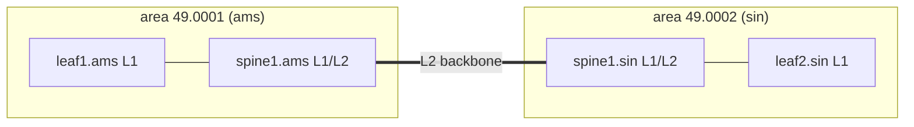

Every BGP session, VXLAN tunnel and RoCE flow in a fabric is addressed to some device's loopback, the always-up virtual interface that names a router (`leaf3.ams` is `10.255.1.13`). The underlay's single job is to make every loopback reachable from everywhere, and to fix the paths within milliseconds when a fibre is cut ([what routing protocols do](/learn/fabric-networking/underlay/what-routing-protocols-do)). Meridian does it with **IS-IS**, a link-state protocol: every router describes its own links in a small record, every router gets a copy of every record, and each one computes shortest paths over the identical map.

The engineering is in keeping the copies identical and current with no central server, no loops, and no dependence on the IP routing being built. This lesson follows a router's order: find neighbours, advertise, spread and expire the advertisements, turn the map into forwarding entries. Dijkstra itself is in [routing algorithms](/learn/networking/network-algorithms/routing-algorithms).

## Where IS-IS came from, and the words it kept

IS-IS was designed at Digital Equipment Corporation in the late 1980s for DECnet Phase V and standardised by ISO as ISO/IEC 10589 (1992). It routed **CLNP**, the Connectionless Network Protocol of the OSI suite, the "seven-layer" family that was meant to replace TCP/IP and mostly did not. RFC 1195 (1990) added IP prefixes to it, producing "Integrated IS-IS", which is what every router runs today. CLNP itself is long gone; the vocabulary stayed.

| IS-IS word | Plain meaning | Rough IP-world equivalent |
|---|---|---|
| IS (intermediate system) | A router | Router |
| ES (end system) | A host | Host |
| PDU (protocol data unit) | A packet of the protocol | Message |
| IIH (IS-IS hello) | Neighbour discovery and keepalive | OSPF hello |
| LSP (link-state PDU) | One router's description of its links and prefixes | OSPF LSA |
| LSDB (link-state database) | The set of every router's LSPs: the map | Same |
| TLV (type, length, value) | An extensible field: 1-byte type, 1-byte length, value | Option |
| SPF (shortest path first) | Dijkstra's algorithm run over the LSDB | Same |
| CSNP / PSNP | Complete / partial lists of LSPs held, for sync and acknowledgement | OSPF database description / LS ack |
| NET | The router's own OSI address: area plus system ID | Router ID plus area |

The TLV is the reason IS-IS aged well. A router that meets a TLV type it does not understand skips it using the length byte and floods the LSP on unchanged, so a feature such as IPv6 (RFC 5308), traffic engineering (RFC 5305) or segment-routing labels (RFC 8667) needs only the routers that use it to understand it.

## IS-IS runs directly on layer 2

IS-IS was built for a network layer that was not IP, so its packets do not ride inside IP. On Ethernet they sit in an old-style IEEE 802.3 frame, which carries a length instead of an EtherType, followed by an 802.2 LLC (logical link control) header whose service access points, `0xfe`, mean "OSI network layer". Here is the hello `leaf1.ams` sends to `spine1.ams` on their link (`10.254.1.0/31`, leaf `.1`, spine `.0`):

| Field | Size | Value in this hello | What reads it |
|---|---|---|---|
| Destination MAC | 6 bytes | `09:00:2b:00:00:05` (point-to-point; level-2 LAN hellos use `01:80:c2:00:00:15`) | Switch ASIC: a trap rule sends it to the CPU |
| Source MAC | 6 bytes | `00:00:5e:00:53:81`, leaf1's port | Neighbour, recorded as the SNPA (subnetwork point of attachment, the layer-2 address) |
| Length | 2 bytes | Bytes that follow (not an EtherType) | Receiver's NIC and driver |
| LLC DSAP, SSAP, control | 3 bytes | `fe fe 03` | Kernel: hand the frame to the IS-IS process |
| Protocol discriminator | 1 byte | `0x83`, IS-IS | IS-IS parser |
| Header length, version, ID length | 3 bytes | 20, 1, 0 (0 means the standard 6 bytes) | Parser |
| PDU type | 1 byte | 17, point-to-point hello (18/20 L1/L2 LSP, 24/25 CSNP, 26/27 PSNP) | Dispatch |
| Version, reserved, max areas | 3 bytes | 1, 0, 0 (0 means 3) | Parser |
| Circuit type | 1 byte | 2: level 2 only | Neighbour: which levels can form |
| Source ID | 6 bytes | `0102.5500.1011`, leaf1's system ID | Neighbour: who is speaking |
| Holding time | 2 bytes | 30 s | Neighbour: drop me after 30 s of silence |
| PDU length, local circuit ID | 3 bytes | total length, 1 | Parser, three-way check |
| TLVs | variable | 240 three-way state, 1 area 49.0001, 129 protocols (IPv4), 132 interface address `10.254.1.1`, 8 padding | Adjacency checks |

Running below IP has consequences you can see in production:

- **Adjacencies form before any IP route exists**, even on unnumbered links (links that borrow the loopback's address instead of having a subnet), so flooding never waits for the routing it builds.
- **Nothing off the wire can reach it.** No router forwards these frames, so nobody more than one link away can send IS-IS packets.
- **IPv4 and IPv6 are both TLVs** in one instance; OSPF traditionally needs OSPFv2 and OSPFv3, two protocols with two databases.
- **There is no fragmentation.** LSPs are built no larger than an originating buffer size, 1,492 bytes by default, and hellos are padded (TLV 8) to the interface's MTU (maximum transmission unit, the largest frame the link carries). A hello too big for the far side never arrives, so an MTU mismatch shows up as an adjacency that will not form rather than as LSPs lost later.

**What layer-2 transport solves:** routing that bootstraps itself and is invisible from outside. **How it breaks:** anything that filters those multicast MACs, such as a misprogrammed trap, control-plane policing (the rate limiter that protects the switch CPU) or a carrier circuit that does not pass them, silently prevents adjacency while ping over IP works. **Signal:** hello counters: sent rising, received flat. `ping` proves nothing about IS-IS.

## System IDs and NETs: naming every router

Each router has a **system ID**, 6 bytes that must be unique across the routing domain, and a **NET** (network entity title), its OSI address. Meridian derives the system ID from the loopback: pad each octet to three digits and regroup the twelve digits in fours.

| Part of `49.0001.0102.5500.1011.00` | Value | Meaning |
|---|---|---|
| AFI (authority and format identifier) | `49` | Private addressing, the OSI equivalent of RFC 1918 space |
| Area ID | `0001` | Together with the AFI, area 49.0001 |
| System ID | `0102.5500.1011` | `010.255.001.011`: leaf1.ams's loopback, 10.255.1.11 |
| NSEL (selector) | `00` | 0 means "the router itself" rather than a service on it |

The derivation is a convention, not protocol, and a good one: unique loopbacks, which the source of truth (the database of intended devices and addresses that configuration is generated from) already enforces, give unique system IDs for free. **How it breaks:** two routers with the same system ID both originate "their" LSP under the same name, and each keeps replacing the other's (the failure table below). **Signal:** a "duplicate system ID" log and one LSP's sequence number climbing by dozens a minute. TLV 137 (dynamic hostname, RFC 5301) maps each system ID to a name, which is why `show` commands print `leaf1.ams` instead of `0102.5500.1011`.

## Hellos and the three-way adjacency

An **adjacency** is IS-IS's word for a neighbour relationship on one link. Routers send IIHs on every IS-IS interface, by default every 10 s with a holding time of 30 s on most platforms; fabrics often lower these or leave fast failure detection to BFD (bidirectional forwarding detection, a tiny hello sent every few hundred milliseconds or less; [convergence and BFD](/learn/fabric-networking/underlay/convergence-and-bfd)). Each hello announces a holding time, and the receiver honours the sender's number, so the two directions can differ.

A hello proves that *my* frames reach *you* only if you tell me so. On point-to-point links that is TLV 240 (RFC 5303): each hello carries the sender's view of the adjacency (Down, Initializing or Up) and the system ID of the neighbour it has heard. `leaf1.ams` and `spine1.ams` bring their link up:

| Time | Hello | It carries | leaf1.ams | spine1.ams |
|---|---|---|---|---|
| 0.0 s | leaf1 → spine1 | state Down, no neighbour | Down | Heard leaf1: Initializing |
| 0.4 s | spine1 → leaf1 | state Initializing, neighbour `0102.5500.1011` | Sees itself listed: Up | Initializing |
| 0.9 s | leaf1 → spine1 | state Up, neighbour `0102.5500.1001` | Up | Sees itself listed: Up |

Before this extension, hearing any hello brought the adjacency up, so a fibre failed in one direction gave an adjacency one side believed in and the other could not use. Now an adjacency stuck in Initializing means frames flow one way only.

Each hello is also checked: the circuit types must share a level; a level-1 adjacency needs a common area (level 2 does not); authentication must match (TLV 10, HMAC-MD5 per RFC 5304 or SHA per RFC 5310); the padded hello must fit; most implementations also want both interface addresses in one subnet. The ordered "adjacency will not come up" checklist is in [underlay failures in production](/learn/fabric-networking/underlay/underlay-failures-in-production).

**Fabrics avoid broadcast mode.** On a shared LAN the routers elect a **DIS** (designated intermediate system) by priority, then highest MAC, and the DIS invents a **pseudonode**, a fake router standing for the segment, so the graph has *n* links instead of *n*(*n* − 1)/2. On a two-router fibre that buys nothing and costs an election plus an extra LSP, so fabric links run point-to-point (RFC 5309), and every LSP ID in this lesson ends in pseudonode `00`. When an adjacency comes up, both routers originate a new LSP listing the new neighbour and synchronise databases (below).

```text
spine1.ams# show isis adjacency                    (illustrative output)
System ID   Interface  Level  State  Hold  SNPA              Uptime
leaf1.ams   down1      L2     Up     27    00:00:5e:00:53:81  41d02h
leaf2.ams   down2      L2     Up     29    00:00:5e:00:53:83  41d02h
leaf3.ams   down3      L2     Init   24    00:00:5e:00:53:85  00:00:06
leaf4.ams   down4      L2     Up     28    00:00:5e:00:53:87  12d07h
```

`leaf3.ams` sits in Init for six seconds and counting: spine1 hears it, but leaf3's hellos do not list spine1, so spine1's hellos are not reaching leaf3. Look at the spine1 → leaf3 direction: the optic's transmit power, the far end's receive counters.

## LSPs: one router's description of itself

An **LSP** says "this is me, these are my neighbours with their metrics, these are the prefixes I own". Its ID is the system ID, a pseudonode byte and a **fragment number**: a router whose description outgrows 1,492 bytes splits it into fragments `-00`, `-01` and so on, up to 256. The header:

| Field | Size | Value in leaf1.ams's LSP | What reads it |
|---|---|---|---|
| Common header | 8 bytes | `83`, length 27, version 1, PDU type 20 (level-2 LSP) | Parser |
| PDU length | 2 bytes | 146 | Parser |
| Remaining lifetime | 2 bytes | 1,200 s, counting down | Every router: when this copy expires |
| LSP ID | 8 bytes | `0102.5500.1011.00-00` | Every router: which LSP this is |
| Sequence number | 4 bytes | `0x00000033` | Every router: is this copy newer than mine? |
| Checksum | 2 bytes | `0x6ffe`, Fletcher, covering LSP ID to the end | Every router: corruption check |
| Flags | 1 byte | `0x03`: partition repair 0, attached 0, overload 0, IS type 3 (level 2) | SPF (overload), level-1 routers (attached) |

| TLV | Name | In leaf1.ams's LSP (full-size Amsterdam, 4 spines) | Read by |
|---|---|---|---|
| 137 | Hostname | `leaf1.ams` | Show commands |
| 1 | Area addresses | 49.0001 | Level-1 adjacency and area checks |
| 129 | Protocols supported | `0xcc`, IPv4 | Neighbours |
| 132 | IP interface address | 10.255.1.11 | Tools mapping addresses to routers (not SPF) |
| 22 | Extended IS reachability | spine1..spine4, metric 10 each: the graph's edges | SPF |
| 135 | Extended IP reachability | 10.255.1.11/32 metric 0; four /31 uplinks metric 10 | Route calculation: prefixes on the node |

The code builds that LSP byte by byte, with the checksum, then parses it back.

```python
import socket
import struct


def system_id(loopback):
    """Meridian's rule: pad each octet to 3 digits, regroup the 12 digits in fours."""
    digits = "".join(f"{int(o):03d}" for o in loopback.split("."))
    return ".".join(digits[i:i + 4] for i in (0, 4, 8))


def tlv(t, value):
    return struct.pack("!BB", t, len(value)) + value


def iso_checksum(data, pos):
    """ISO 8473 Fletcher checksum: choose two bytes at `pos` so both running sums end at 0 mod 255."""
    c0 = c1 = 0
    for b in data:
        c0 = (c0 + b) % 255
        c1 = (c1 + c0) % 255
    n = len(data) - pos                        # bytes from the checksum to the end
    x = ((n - 1) * c0 - c1) % 255
    y = (c1 - n * c0) % 255
    return bytes([x or 255, y or 255])


def build_lsp(host, loopback, area, seq, lifetime, neighbours, prefixes, overload=False):
    sid = bytes.fromhex(system_id(loopback).replace(".", ""))
    tlvs = tlv(137, host.encode())                                      # dynamic hostname
    tlvs += tlv(1, bytes([3]) + bytes.fromhex(area.replace(".", "")))   # area 49.0001, 3 bytes
    tlvs += tlv(129, b"\xcc")                                           # protocols: IPv4
    tlvs += tlv(132, socket.inet_aton(loopback))                        # interface address
    tlvs += tlv(22, b"".join(bytes.fromhex(system_id(lo).replace(".", "")) + b"\x00"  # pseudonode 0
                             + metric.to_bytes(3, "big") + b"\x00"       # 24-bit metric, no sub-TLVs
                             for lo, metric in neighbours))
    tlvs += tlv(135, b"".join(struct.pack("!IB", metric, plen)          # 32-bit metric, control byte
                              + socket.inet_aton(p)[:(plen + 7) // 8]    # only the prefix's bytes
                              for p, plen, metric in prefixes))
    flags = 0x03 | (0x04 if overload else 0)                            # IS type level 2; OL bit
    body = sid + b"\x00\x00" + struct.pack("!IHB", seq, 0, flags) + tlvs  # checksum 0 for now
    body = body[:12] + iso_checksum(body, 12) + body[14:]
    common = bytes([0x83, 27, 1, 0, 20, 1, 0, 0])                       # PDU type 20: L2 LSP
    return common + struct.pack("!HH", 27 + len(tlvs), lifetime) + body


def parse_lsp(pdu):
    length, lifetime = struct.unpack("!HH", pdu[8:12])
    seq, cks, flags = struct.unpack("!IHB", pdu[20:27])
    c0 = c1 = 0
    for b in pdu[12:length]:                   # the checksum skips the lifetime field
        c0 = (c0 + b) % 255
        c1 = (c1 + c0) % 255
    tlvs, i = [], 27
    while i < length:
        tlvs.append(f"{pdu[i]}({pdu[i + 1]}B)")
        i += 2 + pdu[i + 1]
    return {"length": length, "lifetime": lifetime, "seq": f"0x{seq:08x}",
            "checksum": f"0x{cks:04x}", "checksum ok": c0 == c1 == 0,
            "overload": bool(flags & 0x04), "tlvs": tlvs}


lo = "10.255.1.11"
print("NET: 49.0001." + system_id(lo) + ".00")
spines = [f"10.255.1.{s}" for s in (1, 2, 3, 4)]
prefixes = [(lo, 32, 0)] + [(f"10.254.{s}.0", 31, 10) for s in (1, 2, 3, 4)]
lsp = build_lsp("leaf1.ams", lo, "49.0001", 0x33, 1200, [(s, 10) for s in spines], prefixes)
print(len(lsp), "bytes; header:", lsp[:27].hex(" "))
print(parse_lsp(lsp))
aged = lsp[:10] + struct.pack("!H", 157) + lsp[12:]      # the same copy 1,043 s later
print("aged copy checksum ok:", parse_lsp(aged)["checksum ok"])
bad = bytearray(lsp)
bad[-6] ^= 0x01                                            # one metric bit flipped in flight
print("corrupted copy checksum ok:", parse_lsp(bytes(bad))["checksum ok"])
```

```text
NET: 49.0001.0102.5500.1011.00
146 bytes; header: 83 1b 01 00 14 01 00 00 00 92 04 b0 01 02 55 00 10 11 00 00 00 00 00 33 6f fe 03
{'length': 146, 'lifetime': 1200, 'seq': '0x00000033', 'checksum': '0x6ffe', 'checksum ok': True, 'overload': False, 'tlvs': ['137(9B)', '1(4B)', '129(1B)', '132(4B)', '22(44B)', '135(45B)']}
aged copy checksum ok: True
corrupted copy checksum ok: False
```

Read the header: `83` IS-IS, `1b` 27-byte header, `14` type 20, `00 92` 146 bytes, `04 b0` 1,200 s, `01 02 55 00 10 11 00 00` the LSP ID, `00 00 00 33` the sequence number, `6f fe` the checksum, `03` level 2. A neighbour costs 11 bytes and a prefix 9, so a leaf is 146 bytes and the Amsterdam LSDB a few kilobytes. The checksum skips the remaining lifetime, which changes every second on every router, so the aged copy verifies and only real corruption fails ([error detection](/learn/networking/network-algorithms/error-detection) explains Fletcher sums).

**What the LSP solves:** a compact, self-describing record only its originator writes. **How it breaks:** whatever outgrows the fragments goes unadvertised; a corrupt LSP installed everywhere would give everyone the same wrong map, hence the checksum. **Signal:** fragment count per router, checksum-error counters.

## Sequence numbers and remaining lifetime

Two fields decide which copy of an LSP is the truth and when a copy is too old to trust.

The **sequence number** is a 32-bit counter the originator raises each time it changes anything. Comparing two copies of the same LSP ID (ISO 10589's rule):

1. Higher sequence number wins.
2. Equal sequence numbers, and one copy has remaining lifetime 0: the zero-lifetime copy (a purge) wins.
3. Otherwise they are the same LSP.

The **remaining lifetime** is a countdown in seconds from MaxAge, 1,200 s by default, which every router runs on its own copy. The originator refreshes the LSP (same content, sequence plus one, lifetime reset) every 900 s by default; many operators raise the lifetime to its 16-bit maximum, 65,535 s (about 18 hours), to cut refresh traffic. A copy that reaches zero is **purged**: the router strips it to its header, floods it with lifetime 0, and keeps the header 60 s more (ZeroAgeLifetime) so late stale copies are beaten. Routers that implement RFC 6232 add a TLV naming the purging router; without it, the culprit is anonymous.

Worked cases on `leaf3.ams`'s LSP, ID `0102.5500.1013.00-00`, which every router holds at `0x2a`:

| Event | Copy arriving at spine1 | spine1 holds | Result |
|---|---|---|---|
| leaf3–spine2 fibre cut; leaf3 rebuilds its LSP | `0x2b`, 1,200 s | `0x2a`, 1,043 s | Newer: install, acknowledge, flood on |
| A slow neighbour re-sends the old copy | `0x2a`, 1,040 s | `0x2b` | Older: send `0x2b` back to it |
| leaf3 dies and is never repaired; 1,200 s pass | | `0x2b`, 0 s | spine1 purges it: floods `0x2b` with lifetime 0, everyone deletes it |
| leaf3 reboots and starts at sequence `0x01` | `0x01` | `0x2b` (not yet expired) | Older; spine1 sends `0x2b` back, leaf3 sees "its own" LSP is newer than what it holds and jumps to `0x2c` |

The last row is how a rebooted router reclaims its name: the network remembers a higher number than the router does, and the originator outbids it. The space is large: 2³² changes at one per second is 136 years, and running out would mean purging and waiting out MaxAge plus 60 s.

**What sequence numbers and lifetimes solve:** a total order on versions without clocks, and garbage collection of LSPs whose originator has vanished. **How it breaks:** any router may purge any LSP, so one router aging LSPs wrongly can delete the map from every database in the area; [underlay failures in production](/learn/fabric-networking/underlay/underlay-failures-in-production) traces a purge storm caused by a clock jump at boot. **Signal:** purge counters, the purge-originator TLV, the minimum remaining lifetime across the database (a live LSP near zero means its originator stopped refreshing), and sequence velocity per LSP.

## Flooding, CSNP and PSNP

**Flooding** is how one router's new LSP reaches every database. The rule fits in a sentence: when a router receives an LSP newer than its copy, it installs it, acknowledges it, and sends it on every other adjacency; a duplicate is acknowledged and goes nowhere; an older copy gets the router's newer one sent back. There is no hop count and no loop, because a router passes on each version at most once.

On point-to-point links each router keeps two flags per LSP per adjacency: "still to send" (SRM in the standard) and "still to acknowledge" (SSN). A sent LSP stays flagged, and is resent every 5 s (the usual retransmit interval), until the neighbour acknowledges it with a **PSNP** (partial sequence number PDU: a list of LSP ID, sequence, lifetime and checksum entries, 16 bytes each). A copy *received* on a link clears that link's send flag, so two routers flooding the same LSP at each other stop at once.

A **CSNP** (complete sequence number PDU) lists *every* LSP a router holds, in LSP ID order, and synchronises databases:

- **When an adjacency comes up**, both sides send CSNPs. For each entry, the side with the newer copy sends the LSP and the side lacking it requests it with a PSNP. That is how a repaired link or a rebooted router catches up.
- **On broadcast LANs** there are no per-LSP acknowledgements; the DIS sends a CSNP every 10 s, and a router that finds itself behind requests what it lacks.

Here is the flood after the leaf3–spine2 cut on the small Amsterdam fabric (two spines, four leaves), in 1 ms rounds, using the comparison rule above, and on the full-size site.

```python
from collections import defaultdict


def compare(mine, theirs):
    """ISO 10589's rule for two copies of one LSP, each (sequence, remaining lifetime)."""
    if mine is None or theirs[0] > mine[0]:
        return "newer"
    if theirs[0] < mine[0]:
        return "older"
    if (theirs[1] == 0) != (mine[1] == 0):          # same sequence: a purge beats a live copy
        return "newer" if theirs[1] == 0 else "older"
    return "same"


def fabric(spines, leaves, down=()):
    adj = defaultdict(set)
    for s in range(1, spines + 1):
        for l in range(1, leaves + 1):
            a, b = f"spine{s}", f"leaf{l}"
            if (a, b) not in down:
                adj[a].add(b)
                adj[b].add(a)
    return adj


def flood(adj, dbs, origin, copy):
    """Point-to-point flooding in 1 ms rounds: install if newer, acknowledge every copy
    with a PSNP, send on every adjacency the copy did not arrive on."""
    dbs[origin] = copy
    sending = {origin: set(adj[origin])}          # router -> neighbours still flagged to send to
    stats = defaultdict(int)
    t = 0
    while sending:
        t += 1
        arrivals = defaultdict(list)
        for router, targets in sending.items():
            for n in targets:
                arrivals[n].append(router)
                stats["LSP transmissions"] += 1
        sending = {}
        for router, senders in arrivals.items():
            stats["PSNP acks"] += len(senders)    # duplicates are acknowledged too
            verdict = compare(dbs.get(router), copy)
            if verdict == "newer":
                dbs[router] = copy
                stats["duplicates dropped"] += len(senders) - 1   # simultaneous extra copies
                rest = adj[router] - set(senders)  # a copy received on a link clears that link
                if rest:
                    sending[router] = rest
            elif verdict == "same":
                stats["duplicates dropped"] += len(senders)
            else:                                   # older: send our newer copy back (not hit here)
                stats["newer copy sent back"] += len(senders)
        if arrivals:
            stats["ms to sync"] = t
    return dict(stats)


print("compare:", compare((0x2a, 1043), (0x2b, 1200)), compare((0x2b, 1200), (0x2a, 1043)),
      compare((0x2b, 600), (0x2b, 0)), compare((0x2b, 600), (0x2b, 1199)))

for name, spines, leaves in [("small ams", 2, 4), ("full-size ams", 4, 16)]:
    adj = fabric(spines, leaves, down={("spine2", "leaf3")})
    dbs = {r: (0x2a, 1043) for r in adj}
    stats = flood(adj, dbs, "leaf3", (0x2b, 1200))
    links = sum(len(v) for v in adj.values()) // 2
    synced = sum(1 for v in dbs.values() if v == (0x2b, 1200))
    print(f"{name}: {links} links up, {synced}/{len(dbs)} routers hold 0x2b, {stats}")
```

```text
compare: newer older newer same
small ams: 7 links up, 6/6 routers hold 0x2b, {'LSP transmissions': 7, 'PSNP acks': 7, 'duplicates dropped': 2, 'ms to sync': 3}
full-size ams: 63 links up, 20/20 routers hold 0x2b, {'LSP transmissions': 63, 'PSNP acks': 63, 'duplicates dropped': 44, 'ms to sync': 3}
```

Trace the small run by hand. Round 1: leaf3 sends to spine1, its only neighbour (1 transmission). Round 2: spine1 finds `0x2b` newer than `0x2a`, installs it and sends to leaf1, leaf2 and leaf4, not back to leaf3 (3). Round 3: each leaf installs and sends to its other neighbour, spine2 (3). spine2 receives three copies at once, installs one, drops two as duplicates, acknowledges all three and has nobody left to send to. Seven transmissions, three hops.

The full-size site shows the cost of a Clos (every leaf linked to every spine, [Clos and leaf-spine](/learn/fabric-networking/fabric-architecture/clos-and-leaf-spine)). Twenty routers need nineteen deliveries; the flood makes 63, because every leaf hears the LSP from each spine it reaches. Real copies arrive microseconds apart, so some cross in flight and the count approaches its bound of two per link. A cut yields two LSPs, one per end, so up to about 250 transmissions here: trivial, but the reason fabrics with thousands of links want flooding reduction, such as RFC 9667's dynamic flooding over a sparse subset of links.

```viz
{"type": "fabric", "scenario": "isis-flooding", "title": "IS-IS on Meridian's small Amsterdam fabric: an LSP flooded, acknowledged and fed to SPF, then the link repaired", "caption": "The leaf3–spine2 fibre is cut. leaf3.ams's LSP goes from sequence 0x2a to 0x2b with 1,200 s of lifetime and floods to spine1, which acknowledges with a PSNP and floods to leaf1, leaf2 and leaf4; their three copies reach spine2, which installs one and drops the duplicates. All six databases match; SPF leaves leaf1 one next hop to 10.255.1.13/32 and gives spine2 a metric-30 path through three leaves. The repair brings a three-way hello, matching CSNPs, LSPs 0x2c and 0x53 and ECMP again, then the lifetime counting down towards its refresh."}
```

**What flooding solves:** every database converges to the same newest copies within milliseconds, with no coordinator. **How it breaks:** a link that drops large frames, a filter, or a CPU too busy to read its input queue leaves one database behind; a flapping link regenerates LSPs as fast as the generation throttle allows, and every router floods and recomputes each one. **Signal:** retransmission counters (acks not arriving), the number of LSPs and a checksum of (ID, sequence) pairs compared across routers, and LSP generation rate per originator.

## SPF: from the database to next hops

With identical databases, each router runs Dijkstra's shortest-path algorithm with itself as the root. Three IS-IS details shape the result.

**The two-way check.** An edge from A to B is used only if A's LSP lists B *and* B's lists A. In the milliseconds when leaf1 holds leaf3's `0x2b` (no spine2) but still spine2's old `0x51` (listing leaf3), the check already removes the link: one end's news is enough.

**Next hops, not just distances.** A router needs the *first hop* of every shortest path, all of them when several tie: that set becomes an ECMP group (equal-cost multipath, flows hashed across next hops, [ECMP and hashing](/learn/fabric-networking/fabric-architecture/ecmp-and-hashing)). The next-hop *address* comes from the neighbour's hello (TLV 132), not from any LSP.

**Topology first, prefixes after.** SPF runs over the TLV 22 edges, then hangs each node's TLV 135 prefixes on it: route metric = distance to the node + prefix metric. A change touching only prefixes needs only that second step, a **partial route calculation**, not a new SPF.

`leaf1.ams` on the healthy small fabric, every link metric 10:

| Step | Router finalised (distance) | Updates | Next-hop sets |
|---|---|---|---|
| 0 | leaf1.ams (0) | spine1 10, spine2 10 | spine1 {spine1}, spine2 {spine2} |
| 1 | spine1.ams (10) | leaf2, leaf3, leaf4 at 20 | each {spine1} |
| 2 | spine2.ams (10) | leaf2, leaf3, leaf4 at 20 again: equal | each {spine1, spine2} |
| 3–5 | leaf2, leaf3, leaf4 (20) | only spines, already final | |
| prefixes | | 10.255.1.13/32 = 20 + 0; 10.254.1.4/31 (leaf3–spine1) = 10 via spine1 + 10 | {spine1, spine2}; {spine1} |

After the cut, leaf3 is reached only through spine1, still at 20, and the FIB (forwarding information base, the table the forwarding chip uses) loses one member of the group:

```text
leaf1.ams# show ip route 10.255.1.13               (illustrative output)
10.255.1.13/32  isis level-2  metric 20
    via 10.254.1.0, uplink1 (spine1.ams)
        (before the cut also via 10.254.2.0, uplink2 (spine2.ams))
```

From spine2's root the same database gives leaf3 at metric 30, down to any of three leaves, up to spine1 and down again: three equal-cost next hops. To IS-IS a leaf is just another router and will carry transit when the topology calls for it; the eBGP underlay of [BGP as the underlay](/learn/fabric-networking/underlay/bgp-as-the-underlay) forbids that path. The exercise at the end implements this computation.

The arithmetic is cheap: [routing algorithms](/learn/networking/network-algorithms/routing-algorithms) measured under a millisecond for 1,000 routers in pure Python, and Meridian has about 70. Detection, batching waits and hardware programming take the time ([convergence and BFD](/learn/fabric-networking/underlay/convergence-and-bfd)).

## Levels and areas

IS-IS has two **levels**, two separate flooding domains with separate databases. **Level 1** routes inside one area. **Level 2** is the backbone between areas. A router is L1-only, L2-only, or L1/L2 (running both, with one LSDB each). Three rules make it work:

- **An area belongs to a router, not to an interface.** A router's NET names its area, so area boundaries fall on the links *between* routers. (OSPF puts the boundary inside a router; [what routing protocols do](/learn/fabric-networking/underlay/what-routing-protocols-do) compares them.)
- **Level-1 adjacencies need a common area; level-2 adjacencies do not.** The L2 routers must form one connected backbone.
- **Level-1 routers see only their area.** An L1/L2 router with backbone connectivity sets the **attached (ATT) bit** in its level-1 LSP, and L1 routers install a default route towards the nearest attached router. L2 prefixes can be leaked into level 1, marked with an up/down bit so they are never leaked back up, which would loop (RFC 5302).



Meridian rejected that design because of the overlay. EVPN, the BGP-carried tenant routes of [EVPN, the control plane](/learn/fabric-networking/overlays-vxlan-evpn/evpn-the-control-plane), names a remote leaf's loopback as each route's next hop: `leaf1.ams`'s route to `acme-web2` points at `leaf2.sin`, `10.255.2.12`. An L1-only `leaf1.ams` has only a default route, which many BGP implementations refuse for next-hop resolution, so every remote loopback must be leaked back into level 1, and the levels buy little. Worse, the default hides a dead remote leaf: traffic flows on towards the backbone and dies there. At 24 routers per site and about 70 overall, one level-2 domain is small, so every Meridian router is L2-only in area `49.0001`. Large ISP backbones run hundreds to a few thousand routers in one level 2 for the same reason: every router sees every loopback.

## Wide metrics

The original IS-IS metric was **narrow**: 6 bits per link (1–63) in TLV 2, prefixes in TLVs 128 and 130, and a maximum path metric of 1,023. Derive metrics from bandwidth with a 1 Tb/s reference and a 10 Gb/s link needs 100, which does not fit; a latency-based metric for a long-haul circuit needs tens of thousands. **Wide metrics** (RFC 5305) replaced them: TLV 22 carries a 24-bit link metric (up to 16,777,215) with sub-TLVs for traffic engineering, and TLV 135 a 32-bit prefix metric.

Meridian sets its leaf-spine links to 10 and its long-haul circuits to their one-way latency in microseconds: about 52,500 for the 10,500 km from Amsterdam to Singapore, at 5 µs per km, a number only wide metrics can hold. Two values are special. The maximum, 16,777,215, means "do not use this link in SPF" (RFC 5305); one below it, 16,777,214, is the largest usable metric and the usual "cost out" value for maintenance.

**How it breaks:** during a migration from narrow to wide, a router that reads only one style computes a different graph from its neighbours, and different graphs make loops. The safe path is a transition mode in which every router advertises both, then wide only. **Signal:** a mixture of TLV 2 and TLV 22 across the LSDB, and traceroutes that bounce between two routers.

## The overload bit

The **overload bit** (OL) in an LSP's flags, meaningful in fragment 0, says "do not route *through* me". The router's own prefixes stay reachable, but SPF extends no path beyond it. ISO meant it for a router out of memory for the database; operators use it three ways:

1. **Boxes that must never carry transit.** `rr1.ams` and `rr2.ams` attach to all four spines, so spine1 to spine2 through a reflector costs 20, the same as through a leaf: after a leaf-spine cut, a server-class reflector becomes a transit path. A permanent bit keeps them reachable and out of the forwarding path.
2. **Boot.** A router whose adjacencies are up in seconds may still be programming its forwarding chip or, if it does IP lookups for external destinations, learning its BGP table, and drops traffic sent through it. RFC 3277's fix: set overload at startup, clear it when BGP converges or a timer expires (Meridian's spines use 180 s).
3. **Maintenance.** Overload on a spine moves transit traffic off it at once.

Overload and maximum metric are not the same drain:

| | Overload bit | Links at metric 16,777,214 |
|---|---|---|
| Router used for transit | Never, even if it is the only path | Only if it is the only path |
| Its own loopback | Reachable | Reachable |
| What changes in the LSP | One flag bit | Every TLV 22 entry |
| Both spines of the small fabric drained at once | Leaves partitioned from each other | Traffic still flows, through the spines as last resort |

That last row is the classic mistake: overload cannot be a last resort. [Underlay failures in production](/learn/fabric-networking/underlay/underlay-failures-in-production) works the drain both ways in code; the procedure around it (pre-check, drain, verify, work, restore) is in [safe change and maintenance](/learn/fabric-networking/operating-fabrics/safe-change-and-maintenance).

**Signal:** the OL flag in the database (`ATT/P/OL` in most `show` output) compared with intent; a router whose boot timer should have cleared it ten minutes ago is capacity silently lost.

```text
leaf1.ams# show isis database level-2               (illustrative output)
LSP ID                 Seq Num     Checksum  Lifetime  ATT/P/OL
spine1.ams.00-00       0x0000005c  0x3a1d       870    0/0/0
spine2.ams.00-00       0x00000051  0x91c4       210    0/0/1
leaf1.ams.00-00     *  0x00000033  0x6ffe      1200    0/0/0
leaf2.ams.00-00        0x0000002f  0x5b02       655    0/0/0
leaf3.ams.00-00        0x0000002b  0xc417      1190    0/0/0
leaf4.ams.00-00        0x000009e1  0x0e6a      1199    0/0/0
rr1.ams.00-00          0x00000019  0x77b0       950    0/0/1
```

The asterisk marks this router's own LSP. Two routers deserve a second look, and the platform section's code finds them: spine2 is overloaded with no maintenance scheduled and has only 210 s left, although a copy refreshed every 900 s never falls below about 300 s; leaf4's sequence number is far above its peers'.

## Why large backbones choose IS-IS

Many of the largest ISP backbones adopted IS-IS in the 1990s and kept it, and many fabrics run it as their underlay. The reasons are this lesson's mechanisms:

- **One flat level scales.** One LSP per router (hundreds of bytes to a few kilobytes) and at most two transmissions per link per change: thousands of routers in one level 2 need no area design.
- **Extensibility without flag days.** Unknown TLVs flood unchanged, so IPv6, traffic engineering and segment routing arrived a router at a time.
- **Independence from IP**, and no reachability from off the wire.
- **Fewer moving parts.** One LSP format per level, extended by TLVs, against OSPF's family of LSA types with different flooding scopes.
- **Metric-based operations.** A drain is one metric or one bit, its effect computable in advance from the database.

The case against, in a single data center, is made in [BGP as the underlay](/learn/fabric-networking/underlay/bgp-as-the-underlay): one protocol everywhere, policy at every hop, and failures confined by AS paths rather than flooded to every router.

| | IS-IS | OSPFv2 + OSPFv3 | eBGP underlay (RFC 7938) |
|---|---|---|---|
| Transport | Layer 2, no IP | IP protocol 89 | TCP 179 on each link |
| IPv4 and IPv6 | One instance, TLVs | Two protocols | One protocol, two address families |
| What each router knows | Whole topology | Whole topology per area | Paths only, no topology |
| Blast radius of one bad router | Its whole level (a purge reaches everyone) | Its area | Its neighbours' policies limit it |
| New features | New TLVs, flooded transparently | New LSA types, opaque LSAs | New attributes or address families |
| Draining a node | Overload bit or metric | Max metric (RFC 6987) | AS-path prepending or withdrawal |

## Failure modes in production

| Failure | Symptom | Diagnosis | Fix |
|---|---|---|---|
| One-way link | Adjacency stuck in Init on one side | Three-way state; optic transmit and receive power; receive counters on the far end | Replace the optic or fibre; fix the filter eating hellos |
| MTU mismatch | Adjacency never forms (padded hellos dropped); with padding off, it forms and large LSPs never cross | Hello padding size against interface MTU on both ends; LSP retransmit counters climbing | Match MTUs; keep padding on |
| Duplicate system ID | One LSP's sequence number climbs by dozens a minute; SPF runs constantly; routes flap | "Duplicate system ID" log; two routers originating the same LSP ID | Unique IDs from unique loopbacks, checked in the source of truth |
| LSPs aged out or purged | Loopbacks vanish across the area at once; every BGP next hop unresolvable | Purge counters, RFC 6232 originator TLV, clock steps on the purging router | Find and isolate the purging router; see [underlay failures in production](/learn/fabric-networking/underlay/underlay-failures-in-production) |
| Overload left set | A spine carries nothing after a reboot; fabric at three-quarters capacity | OL flag in the LSDB versus intent; why the boot condition never cleared | Clear it; alert on OL older than its timer |
| Narrow/wide mismatch | Loops or black holes during a metric migration | Mixed TLV 2 / TLV 22 in the database | Transition mode everywhere first |
| Flapping link | CPU high on every router; SPF and LSP generation counters racing | LSP generation rate per originator; one adjacency's flap count | Dampen or shut the link; throttles ([convergence and BFD](/learn/fabric-networking/underlay/convergence-and-bfd)) |

## Under the hood: what an IS-IS daemon does

On a Linux network operating system that runs FRRouting's `isisd` (SONiC is one), trap rules in the forwarding chip send frames for the IS-IS multicast MACs to the CPU through control-plane policing ([planes, ASICs and NOSes](/learn/fabric-networking/from-zero/planes-asics-and-network-operating-systems)). Linux has no kernel IS-IS, so the daemon reads raw packet sockets filtered for LLC frames and parses every byte, as the code above does. It keeps the LSDB sorted by LSP ID, which is why CSNPs come out in order and split into ranges, with send and acknowledge flags per LSP per interface. SPF results go to the routing manager (`zebra`), which installs them in the kernel over netlink (Linux's route-programming socket); on SONiC they also pass through a Redis database to the agent that programs the chip through SAI (the switch abstraction interface). When thousands of routes change, the chip write usually dominates.

## What the platform should show

The protocol exposes everything needed to catch underlay trouble before the overlay does. Surface:

- **Adjacencies against intended topology**, per link: state, uptime, flaps, which side is stuck in Init. A missing adjacency is invisible device by device; compare with the source of truth and LLDP (the link-layer discovery protocol, in which each port announces who is on the other end of the cable).
- **Database consistency**: every router's (LSP ID, sequence) pairs compared. Disagreement for more than a second or two is a flooding fault.
- **Sequence velocity per LSP**: a refresh every 15 minutes is normal; 35 a minute is a duplicate system ID or a flapping link.
- **Minimum remaining lifetime** per LSP: a live LSP far below its refresh point has an originator that stopped refreshing.
- **Purges** with their originator, and each database's LSP count over time; a collapse across many routers is an emergency.
- **Overload bits and maximum metrics against intent**, so a forgotten drain becomes an alert, not a capacity mystery.
- **SPF runs and duration per router**: churn and its cost.

A first version of the consistency checks is a few dozen lines over data polled from each router (LSP IDs by hostname):

```python
def lsdb_findings(dbs, earlier, minutes, intended_overload):
    """dbs: router -> {lsp_id: (seq, remaining_lifetime, overload)}, as polled from each router.
    earlier: lsp_id -> sequence number `minutes` ago, from the same poller."""
    out = []
    # 1. Consistency: the newest copy of each LSP is the reference; anyone behind is out of sync.
    newest = {}
    for db in dbs.values():
        for lsp, (seq, _, _) in db.items():
            newest[lsp] = max(seq, newest.get(lsp, 0))
    for router, db in dbs.items():
        behind = [l for l, s in newest.items() if db.get(l, (0,))[0] < s]
        if behind:
            out.append(f"{router}: database behind on {', '.join(sorted(behind))}")
    # 2. Refresh: a live LSP far below its lifetime means its originator stopped refreshing.
    for lsp in newest:
        low = min(db[lsp][1] for db in dbs.values() if db.get(lsp, (0,))[0] == newest[lsp])
        if 0 < low < 300:
            out.append(f"{lsp}: only {low} s of lifetime left anywhere, originator not refreshing")
    # 3. Sequence velocity: a healthy LSP changes on refresh or a real event, not every few seconds.
    for lsp, seq in newest.items():
        rate = (seq - earlier.get(lsp, seq)) / minutes
        if rate > 10:
            out.append(f"{lsp}: sequence rising {rate:.0f}/min, duplicate system ID or a flapping link")
    # 4. Overload bit against intent: who is refusing transit, and should they be?
    flagged = {l for db in dbs.values() for l, (_, _, ol) in db.items() if ol}
    for lsp in sorted(flagged ^ intended_overload):
        state = "set" if lsp in flagged else "clear"
        out.append(f"{lsp}: overload bit {state}, intent says {'clear' if state == 'set' else 'set'}")
    return out


dbs = {
    "leaf1.ams": {"spine1.ams": (0x5c, 870, False), "spine2.ams": (0x51, 210, True),
                  "leaf3.ams": (0x2b, 1190, False), "leaf4.ams": (0x9e1, 1199, False),
                  "rr1.ams": (0x19, 950, True)},
    "leaf2.ams": {"spine1.ams": (0x5c, 868, False), "spine2.ams": (0x51, 209, True),
                  "leaf3.ams": (0x2a, 31, False), "leaf4.ams": (0x9e1, 1198, False),
                  "rr1.ams": (0x19, 949, True)},
}
earlier = {"spine1.ams": 0x5c, "spine2.ams": 0x51, "leaf3.ams": 0x2a, "leaf4.ams": 0x931, "rr1.ams": 0x19}
for line in lsdb_findings(dbs, earlier, minutes=5, intended_overload={"rr1.ams"}):
    print(line)
```

```text
leaf2.ams: database behind on leaf3.ams
spine2.ams: only 209 s of lifetime left anywhere, originator not refreshing
leaf4.ams: sequence rising 35/min, duplicate system ID or a flapping link
spine2.ams: overload bit set, intent says clear
```

Snapshots polled seconds apart disagree briefly during any flood, so a real check wants the disagreement to persist across two polls; streaming ([telemetry and observability](/learn/fabric-networking/operating-fabrics/telemetry-and-observability)) narrows the window. For managers the same data collapses to one colour per site: green when every intended adjacency is up and the databases match, yellow when redundancy is lost but every loopback is reachable, red when any loopback is not.

## Interviewer follow-ups

**"IS-IS doesn't run over IP. Why does that matter?"** Model answer: adjacencies and flooding work before any IP route exists; nothing off the wire can reach it; IPv4 and IPv6 are both TLVs in one instance. The cost: no fragmentation, so LSPs are sized to fit and hellos padded to catch MTU mismatches, and `ping` between neighbours proves nothing about IS-IS. Common wrong answer: "it runs over UDP", or an IP protocol number by analogy with OSPF's 89.

**"How does flooding stop without a TTL?"** Model answer: a router forwards an LSP only when it is newer than its copy, so each version crosses each link at most once in each direction and the flood dies when every database holds it; PSNPs and CSNPs make it reliable. Common wrong answer: "split horizon", which is a distance-vector rule.

**"A router reboots and starts its sequence numbers at 1. Why doesn't the network ignore it?"** Model answer: during database synchronisation neighbours send back its old, higher-numbered LSP, and the originator re-originates above it. Common wrong answer: "the old LSP has to age out first", which would mean 20 minutes of a stale map.

**"Overload bit or max metric to drain both spines of a small pod?"** Model answer: max metric, because overload forbids transit even as a last resort, so overloading both spines partitions the leaves; overload suits one box, and permanently suits route reflectors. Common wrong answer: "they're equivalent". An honest addition: "I'd defer to the network team on their platforms' drain behaviour, but I'd make the tooling refuse a drain that leaves any loopback unreachable, which it can compute from the LSDB before the change."

**"Why would a backbone pick IS-IS over OSPF?"** Model answer: one protocol for both address families, TLV extensibility for traffic engineering and segment routing, a flat level 2 that holds the whole backbone, and independence from IP. Both run Dijkstra over flooded state; the differences are operational. Common wrong answer: "IS-IS converges faster", which depends on timers and tuning, not on the protocol.

## What mid-level engineers get wrong

- **Treating adjacency Up as healthy.** Up means hellos work; it says nothing about whether the databases match. Alert on LSDB disagreement, not only adjacency state.
- **Thinking only the originator can remove an LSP.** Any router can purge any LSP, which is how one router's bad clock erases a whole area.
- **Assuming areas reduce risk in a fabric.** Level-1 defaults hide remote loopbacks that the overlay's next hops need, and the leaking required to fix it removes most of the benefit.
- **Ignoring metric style during migrations.** A mixed narrow/wide domain computes different graphs on different routers, and different graphs loop.

## Exercise: SPF next hops

The [SPF next hops](/practice/spf-next-hops) problem drills the same computation on other graphs.

```exercise
id: isis-spf
title: Compute IS-IS routes and ECMP next hops from an LSDB
prompt: |
  Implement the route calculation an IS-IS router runs over its link-state
  database. `lsps` maps each router name to its LSP:
  `{"neighbors": {name: metric}, "prefixes": {prefix: metric}}`, plus
  `"overload": true` when the overload bit is set. `source` is the router
  computing routes. Metrics are positive integers.

  Rules:
  1. Two-way check: use the edge u -> v only if v has an LSP and v's
     `neighbors` also lists u.
  2. Run Dijkstra from `source`. Track, for each router, the set of first
     hops (the source's neighbours) over all equal-cost shortest paths.
  3. Overload: a router other than `source` with `overload` set is reached
     normally and its prefixes are used, but no path continues through it.
  4. Every prefix advertised by a reachable router other than `source` gets
     metric = distance to that router + prefix metric. If several routers
     advertise it, keep the lowest total and merge the next hops of all
     routers that tie. Leave out prefixes that `source` advertises itself.

  Return `{prefix: {"metric": m, "next_hops": [sorted neighbour names]}}`
  for every reachable prefix. On the healthy small Amsterdam fabric
  (2 spines, 4 leaves, metric 10, each router advertising its loopback at
  metric 0), leaf1.ams reaches 10.255.1.13/32 at metric 20 via
  ["spine1.ams", "spine2.ams"].
languages: [python, javascript]
entry: spf_next_hops
starter:
  python: |
    def spf_next_hops(lsps, source):
        # dist[router], first_hops[router], then hang prefixes on routers
        return {}
  javascript: |
    function spf_next_hops(lsps, source) {
      // dist[router], firstHops[router], then hang prefixes on routers
      return {};
    }
tests:
  - args: [{"spine1.ams": {"neighbors": {"leaf1.ams": 10, "leaf2.ams": 10, "leaf3.ams": 10, "leaf4.ams": 10}, "prefixes": {"10.255.1.1/32": 0}}, "spine2.ams": {"neighbors": {"leaf1.ams": 10, "leaf2.ams": 10, "leaf3.ams": 10, "leaf4.ams": 10}, "prefixes": {"10.255.1.2/32": 0}}, "leaf1.ams": {"neighbors": {"spine1.ams": 10, "spine2.ams": 10}, "prefixes": {"10.255.1.11/32": 0}}, "leaf2.ams": {"neighbors": {"spine1.ams": 10, "spine2.ams": 10}, "prefixes": {"10.255.1.12/32": 0}}, "leaf3.ams": {"neighbors": {"spine1.ams": 10, "spine2.ams": 10}, "prefixes": {"10.255.1.13/32": 0}}, "leaf4.ams": {"neighbors": {"spine1.ams": 10, "spine2.ams": 10}, "prefixes": {"10.255.1.14/32": 0}}}, "leaf1.ams"]
    expected: {"10.255.1.1/32": {"metric": 10, "next_hops": ["spine1.ams"]}, "10.255.1.12/32": {"metric": 20, "next_hops": ["spine1.ams", "spine2.ams"]}, "10.255.1.13/32": {"metric": 20, "next_hops": ["spine1.ams", "spine2.ams"]}, "10.255.1.14/32": {"metric": 20, "next_hops": ["spine1.ams", "spine2.ams"]}, "10.255.1.2/32": {"metric": 10, "next_hops": ["spine2.ams"]}}
    label: "healthy small fabric from leaf1.ams: ECMP over both spines"
  - args: [{"spine1.ams": {"neighbors": {"leaf1.ams": 10, "leaf2.ams": 10, "leaf3.ams": 10, "leaf4.ams": 10}, "prefixes": {"10.255.1.1/32": 0}}, "spine2.ams": {"neighbors": {"leaf1.ams": 10, "leaf2.ams": 10, "leaf3.ams": 10, "leaf4.ams": 10}, "prefixes": {"10.255.1.2/32": 0}}, "leaf1.ams": {"neighbors": {"spine1.ams": 10, "spine2.ams": 10}, "prefixes": {"10.255.1.11/32": 0}}, "leaf2.ams": {"neighbors": {"spine1.ams": 10, "spine2.ams": 10}, "prefixes": {"10.255.1.12/32": 0}}, "leaf3.ams": {"neighbors": {"spine1.ams": 10}, "prefixes": {"10.255.1.13/32": 0}}, "leaf4.ams": {"neighbors": {"spine1.ams": 10, "spine2.ams": 10}, "prefixes": {"10.255.1.14/32": 0}}}, "leaf1.ams"]
    expected: {"10.255.1.1/32": {"metric": 10, "next_hops": ["spine1.ams"]}, "10.255.1.12/32": {"metric": 20, "next_hops": ["spine1.ams", "spine2.ams"]}, "10.255.1.13/32": {"metric": 20, "next_hops": ["spine1.ams"]}, "10.255.1.14/32": {"metric": 20, "next_hops": ["spine1.ams", "spine2.ams"]}, "10.255.1.2/32": {"metric": 10, "next_hops": ["spine2.ams"]}}
    label: "half-flooded: only leaf3's new LSP has arrived (two-way check)"
  - args: [{"spine1.ams": {"neighbors": {"leaf1.ams": 10, "leaf2.ams": 10, "leaf3.ams": 10, "leaf4.ams": 10}, "prefixes": {"10.255.1.1/32": 0}}, "spine2.ams": {"neighbors": {"leaf1.ams": 10, "leaf2.ams": 10, "leaf4.ams": 10}, "prefixes": {"10.255.1.2/32": 0}}, "leaf1.ams": {"neighbors": {"spine1.ams": 10, "spine2.ams": 10}, "prefixes": {"10.255.1.11/32": 0}}, "leaf2.ams": {"neighbors": {"spine1.ams": 10, "spine2.ams": 10}, "prefixes": {"10.255.1.12/32": 0}}, "leaf3.ams": {"neighbors": {"spine1.ams": 10}, "prefixes": {"10.255.1.13/32": 0}}, "leaf4.ams": {"neighbors": {"spine1.ams": 10, "spine2.ams": 10}, "prefixes": {"10.255.1.14/32": 0}}}, "spine2.ams"]
    expected: {"10.255.1.1/32": {"metric": 20, "next_hops": ["leaf1.ams", "leaf2.ams", "leaf4.ams"]}, "10.255.1.11/32": {"metric": 10, "next_hops": ["leaf1.ams"]}, "10.255.1.12/32": {"metric": 10, "next_hops": ["leaf2.ams"]}, "10.255.1.13/32": {"metric": 30, "next_hops": ["leaf1.ams", "leaf2.ams", "leaf4.ams"]}, "10.255.1.14/32": {"metric": 10, "next_hops": ["leaf4.ams"]}}
    label: "spine2.ams after the cut reaches leaf3 through three leaves"
    hidden: true
  - args: [{"spine1.ams": {"neighbors": {"leaf1.ams": 10, "leaf2.ams": 10, "leaf3.ams": 10, "leaf4.ams": 10}, "prefixes": {"10.255.1.1/32": 0}, "overload": true}, "spine2.ams": {"neighbors": {"leaf1.ams": 10, "leaf2.ams": 10, "leaf3.ams": 10, "leaf4.ams": 10}, "prefixes": {"10.255.1.2/32": 0}}, "leaf1.ams": {"neighbors": {"spine1.ams": 10, "spine2.ams": 10}, "prefixes": {"10.255.1.11/32": 0}}, "leaf2.ams": {"neighbors": {"spine1.ams": 10, "spine2.ams": 10}, "prefixes": {"10.255.1.12/32": 0}}, "leaf3.ams": {"neighbors": {"spine1.ams": 10, "spine2.ams": 10}, "prefixes": {"10.255.1.13/32": 0}}, "leaf4.ams": {"neighbors": {"spine1.ams": 10, "spine2.ams": 10}, "prefixes": {"10.255.1.14/32": 0}}}, "leaf1.ams"]
    expected: {"10.255.1.1/32": {"metric": 10, "next_hops": ["spine1.ams"]}, "10.255.1.12/32": {"metric": 20, "next_hops": ["spine2.ams"]}, "10.255.1.13/32": {"metric": 20, "next_hops": ["spine2.ams"]}, "10.255.1.14/32": {"metric": 20, "next_hops": ["spine2.ams"]}, "10.255.1.2/32": {"metric": 10, "next_hops": ["spine2.ams"]}}
    label: "spine1.ams overloaded for maintenance"
  - args: [{"spine1.ams": {"neighbors": {"leaf1.ams": 10, "leaf2.ams": 10, "leaf3.ams": 10, "leaf4.ams": 10}, "prefixes": {"10.255.1.1/32": 0}, "overload": true}, "spine2.ams": {"neighbors": {"leaf1.ams": 10, "leaf2.ams": 10, "leaf3.ams": 10, "leaf4.ams": 10}, "prefixes": {"10.255.1.2/32": 0}, "overload": true}, "leaf1.ams": {"neighbors": {"spine1.ams": 10, "spine2.ams": 10}, "prefixes": {"10.255.1.11/32": 0}}, "leaf2.ams": {"neighbors": {"spine1.ams": 10, "spine2.ams": 10}, "prefixes": {"10.255.1.12/32": 0}}, "leaf3.ams": {"neighbors": {"spine1.ams": 10, "spine2.ams": 10}, "prefixes": {"10.255.1.13/32": 0}}, "leaf4.ams": {"neighbors": {"spine1.ams": 10, "spine2.ams": 10}, "prefixes": {"10.255.1.14/32": 0}}}, "leaf1.ams"]
    expected: {"10.255.1.1/32": {"metric": 10, "next_hops": ["spine1.ams"]}, "10.255.1.2/32": {"metric": 10, "next_hops": ["spine2.ams"]}}
    label: "both spines overloaded: only the spines themselves are reachable"
    hidden: true
  - args: [{"spine1.ams": {"neighbors": {"leaf1.ams": 10, "leaf2.ams": 10, "leaf3.ams": 10, "leaf4.ams": 10}, "prefixes": {"10.255.1.1/32": 0}}, "spine2.ams": {"neighbors": {"leaf1.ams": 100, "leaf2.ams": 10, "leaf3.ams": 10, "leaf4.ams": 10}, "prefixes": {"10.255.1.2/32": 0}}, "leaf1.ams": {"neighbors": {"spine1.ams": 10, "spine2.ams": 100}, "prefixes": {"10.255.1.11/32": 0}}, "leaf2.ams": {"neighbors": {"spine1.ams": 10, "spine2.ams": 10}, "prefixes": {"10.255.1.12/32": 0}}, "leaf3.ams": {"neighbors": {"spine1.ams": 10, "spine2.ams": 10}, "prefixes": {"10.255.1.13/32": 0}}, "leaf4.ams": {"neighbors": {"spine1.ams": 10, "spine2.ams": 10}, "prefixes": {"10.255.1.14/32": 0}}}, "leaf1.ams"]
    expected: {"10.255.1.1/32": {"metric": 10, "next_hops": ["spine1.ams"]}, "10.255.1.12/32": {"metric": 20, "next_hops": ["spine1.ams"]}, "10.255.1.13/32": {"metric": 20, "next_hops": ["spine1.ams"]}, "10.255.1.14/32": {"metric": 20, "next_hops": ["spine1.ams"]}, "10.255.1.2/32": {"metric": 30, "next_hops": ["spine1.ams"]}}
    label: "leaf1-spine2 costed out to 100 (both directions)"
    hidden: true
  - args: [{"spine1.ams": {"neighbors": {"leaf1.ams": 10, "leaf2.ams": 10, "leaf3.ams": 10, "leaf4.ams": 10}, "prefixes": {"10.255.1.1/32": 0}}, "spine2.ams": {"neighbors": {"leaf1.ams": 10, "leaf2.ams": 10, "leaf3.ams": 10, "leaf4.ams": 10}, "prefixes": {"10.255.1.2/32": 0}}, "leaf1.ams": {"neighbors": {"spine1.ams": 10, "spine2.ams": 10}, "prefixes": {"10.255.1.11/32": 0}}, "leaf2.ams": {"neighbors": {"spine1.ams": 10, "spine2.ams": 10}, "prefixes": {"10.255.1.12/32": 0, "10.255.1.250/32": 5}}, "leaf3.ams": {"neighbors": {"spine1.ams": 10, "spine2.ams": 10}, "prefixes": {"10.255.1.13/32": 0, "10.255.1.250/32": 0}}, "leaf4.ams": {"neighbors": {"spine1.ams": 10, "spine2.ams": 10}, "prefixes": {"10.255.1.14/32": 0, "10.255.1.250/32": 0}}}, "leaf1.ams"]
    expected: {"10.255.1.1/32": {"metric": 10, "next_hops": ["spine1.ams"]}, "10.255.1.12/32": {"metric": 20, "next_hops": ["spine1.ams", "spine2.ams"]}, "10.255.1.13/32": {"metric": 20, "next_hops": ["spine1.ams", "spine2.ams"]}, "10.255.1.14/32": {"metric": 20, "next_hops": ["spine1.ams", "spine2.ams"]}, "10.255.1.2/32": {"metric": 10, "next_hops": ["spine2.ams"]}, "10.255.1.250/32": {"metric": 20, "next_hops": ["spine1.ams", "spine2.ams"]}}
    label: "an anycast prefix from three leaves, one at a worse prefix metric"
  - args: [{"leaf1.ams": {"neighbors": {}, "prefixes": {"10.255.1.11/32": 0}}}, "leaf1.ams"]
    expected: {}
    label: "a router with no adjacencies"
hints:
  - "Seed the search with the source at distance 0; when you relax an edge out of the source, the first-hop set is just that neighbour, otherwise it is the parent's set."
  - "On a strictly shorter path replace the first-hop set; on an equal one take the union."
  - "Finalise an overloaded router (record its distance and first hops) but do not relax its edges."
```

## Senior signals

- You explain IS-IS from its transport up: hellos and LSPs in LLC frames, not IP, which is why it bootstraps itself, cannot be reached from off the wire, and pads hellos to find MTU mismatches.
- You decide "newer" by sequence number, then purge, and know the originator outbids stale copies of its own LSP after a reboot; you know any router may purge any LSP, so one router's aging bug has a whole level as its blast radius.
- You describe flooding as "forward only if newer, acknowledge everything", bound its cost at two transmissions per link per change, and know that in a Clos each leaf receives every LSP once from each spine.
- You read SPF output as next-hop sets with the two-way check, and can say why a leaf becomes transit in IS-IS but not in an eBGP underlay.
- You choose one level-2 domain for a fabric whose overlay needs every loopback, and give the reason in terms of next-hop resolution.
- You pick overload for reflectors and single-box drains, and maximum metric when more than one box goes at once.
- You build tooling on database consistency, sequence velocity, lifetimes, purges and overload state, not adjacency state alone.

## Check yourself

```quiz
- q: >-
    spine1.ams holds leaf3.ams's LSP at sequence 0x2b with 600 s of lifetime left. A copy arrives with sequence 0x2b and remaining lifetime 0. What does spine1 do?
  options: ["Raises the sequence to 0x2c and re-originates the LSP itself", "Treats it as a purge: deletes its copy and floods the purge on", "Sends its own 0x2b back, because a live copy beats an expired one", "Ignores it, because the sequence number is not higher"]
  answer: 1
  explanation: >-
    With equal sequence numbers, a zero-lifetime copy is newer: it is a purge, so spine1 removes the LSP body, floods the purge to its other neighbours and keeps the header for ZeroAgeLifetime. Ignoring it would be right only for a true duplicate, sending the live copy back inverts the rule, and a router re-originates only its own LSPs, never someone else's.
- q: >-
    After the leaf3–spine2 fibre is cut, leaf1.ams has received leaf3's new LSP (no spine2 neighbour) but still holds spine2's old LSP, which lists leaf3. What is leaf1's route to 10.255.1.13/32?
  options: ["Metric 30 via spine1, because one path is now longer", "No route at all, because the two LSPs disagree", "Metric 20 via spine1 only, because the two-way check fails", "Metric 20 via both spines, until spine2's new LSP arrives"]
  answer: 2
  explanation: >-
    SPF uses an edge only when both ends' LSPs list each other. leaf3's LSP no longer lists spine2, so the leaf3–spine2 edge is unusable even though spine2's stale LSP still claims it; one end's news is enough. The path through spine1 is unchanged at metric 20, so the route survives with one next hop instead of two.
- q: >-
    Why does Meridian run every router as level 2 in one area instead of making each site a level-1 area?
  options: ["Level-2 flooding is faster, because it uses CSNPs instead of PSNPs", "Level-1 leaves would get only a default, but EVPN next hops need every loopback", "Level-1 areas cannot run over leased long-haul circuits between sites", "IS-IS supports only one area per routing domain in practice"]
  answer: 1
  explanation: >-
    EVPN routes resolve their next hop, a remote leaf's loopback, through the underlay. An L1-only leaf would have only a default route towards the nearest attached router, which many implementations will not use for next-hop resolution and which hides a dead remote leaf; leaking all loopbacks back in removes most of the benefit. The levels flood the same way, and multiple areas are common.
- q: >-
    An operator sets the overload bit on both spines of the small Amsterdam fabric at once for maintenance. What happens to traffic from leaf1.ams to leaf3.ams?
  options: ["It shifts to the spine with the lower system ID", "It keeps flowing, because overload only raises the path metric", "It stops, because no path may transit an overloaded router", "It flows through the route reflectors, which take over transit"]
  answer: 2
  explanation: >-
    Overload forbids transit even when the router is the only path, so with both spines overloaded the leaves cannot reach each other; only the spines' own prefixes stay reachable. Maximum metric would leave them usable as a last resort. The reflectors carry their own permanent overload bit, and nothing picks a spine by system ID.
- q: >-
    One LSP's sequence number on a fabric is rising by about 35 per minute while every adjacency is up, and SPF runs constantly. What is the most likely cause?
  options: ["Two routers configured with the same system ID", "A router whose clock jumped forward at boot", "A narrow-metric router mixed into a wide-metric domain", "An MTU mismatch dropping that router's large LSPs"]
  answer: 0
  explanation: >-
    Two routers originating the same LSP ID each see a copy they did not create with a higher sequence number, and each re-originates above it, so the number climbs steadily and every change floods and triggers SPF. An MTU mismatch stalls flooding rather than speeding it up; a clock jump causes purges; a metric-style mismatch gives inconsistent paths without sequence churn.
- q: >-
    During a fibre cut in the full-size Amsterdam site (4 spines, 16 leaves), roughly how many times is leaf3's new LSP transmitted, and why?
  options: ["Thousands of times, because each router floods every copy it receives", "19 times, once per router, because duplicates are suppressed at the sender", "Once per spine, because leaves never re-flood LSPs from other leaves", "About once per link, because each leaf hears it from every spine it reaches"]
  answer: 3
  explanation: >-
    Every leaf receives the LSP from each spine it still reaches and installs only the first copy, so the flood costs about one transmission per link (63 here) and at most two per link when copies cross. A sender cannot know which neighbours already have it, so it cannot suppress to one per router; leaves do re-flood; and only newer copies are passed on, so it never multiplies.
```
