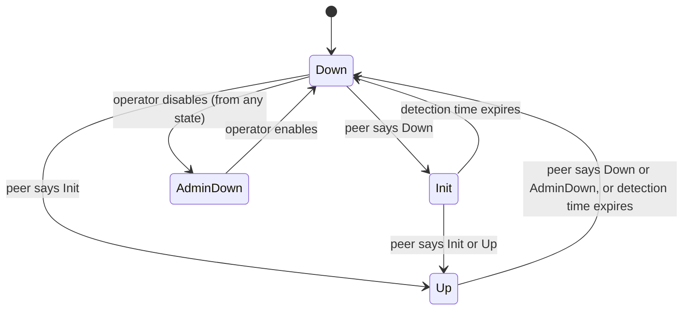

A fibre breaks. Every packet hashed onto it is lost until every router whose forwarding table points at the dead link has been told and has rewritten that table. "Routing heals itself" hides the question that matters in production and in interviews: how fast, and where does the time go? For a cut the port notices, a tuned fabric recovers in about a tenth of a second. For one it does not notice, the same fabric can take 30 seconds and lose 150 GB on one 40 Gb/s path.

**Convergence** is the process, and the time, from a topology change until every router forwards according to the new topology. It has four phases: **detection** (a router notices), **propagation** (it tells the others), **computation** (each recomputes its routes) and **FIB programming** (each writes the result into its forwarding hardware). Reminders from [IS-IS from zero](/learn/fabric-networking/underlay/is-is-from-zero): an adjacency is two neighbours' relationship, kept alive by hellos; an LSP (link-state PDU) is the packet in which a router describes its links; SPF (shortest path first, Dijkstra) turns the LSPs into routes.

## The four phases on one timeline

Take the case Meridian worries about most. `leaf1.ams` sends 80 Gb/s to `leaf2.sin` (loopback `10.255.2.12`), split by ECMP (equal-cost multipath: each flow hashed onto one of several equal routes) over the square's two Amsterdam–Singapore circuits, `spine1.ams`–`spine1.sin` and `spine2.ams`–`spine2.sin` ([connecting sites and backbones](/learn/fabric-networking/fabric-architecture/connecting-sites-and-backbones)). Intra-site links cost 10 and circuits 1,000, so either path costs 1,020. A fibre breaks inside the carrier network that carries circuit 1, and the carrier's equipment keeps sending light to both spines: neither port goes down.

| Phase | What happens | Meridian's value | Running total |
|---|---|---|---|
| Detection | BFD on circuit 1 misses 3 packets at 300 ms intervals; IS-IS drops the adjacency | 900 ms (worst case) | 900 ms |
| Propagation | `spine1.ams` waits 50 ms to batch further changes, generates a new LSP, floods it; it reaches the Amsterdam leaves | 50 + 2 ms | 952 ms |
| Computation | `leaf1.ams` waits its initial SPF delay, then runs SPF | 50 + 1 ms | 1,003 ms |
| FIB programming | The new next-hop set is written into the ASIC | 15 ms | 1,018 ms |

Detection is 88% of the total. Once a failure is detected, a well-tuned link-state fabric spends about a tenth of a second on everything else, and the deliberate waits (50 ms twice) dwarf the flooding and SPF work (3 ms).

```viz
{"type": "fabric", "scenario": "bfd-convergence", "title": "A carrier fibre cut with the ports still up: BFD at 300 ms × 3, flooding, SPF and FIB, then the same cut without BFD", "caption": "leaf1.ams sends 80 Gb/s to leaf2.sin, 40 Gb/s per circuit. A fibre breaks inside the carrier's network and both spine ports stay up. BFD declares the session down at 900 ms; a 50 ms LSP-generation wait, 2 ms of flooding, a 50 ms SPF wait, a 1 ms SPF run and a 15 ms FIB write bring recovery to 1,018 ms, about 5.1 GB lost on circuit 1. Without BFD the 30-second IS-IS hold time detects it: about 30.1 s and 150.6 GB."}
```

Applications see longer than 1,018 ms, because TCP backs off. A flow that lost a segment at the cut retransmits after its RTO (retransmission timeout), about 305 ms on the 105 ms Amsterdam–Singapore round trip (roughly RTT plus Linux's 200 ms floor), and doubles the wait each time, so retransmissions leave at 305, 915 and 2,135 ms. The path is back at 1,018 ms, but the flow resumes at about 2.2 s, double the network's outage ([TCP deep dive](/learn/networking/fundamentals/tcp-deep-dive)). A GPU training job waits for its slowest flow, so it stalls for all of it ([why AI traffic is different](/learn/fabric-networking/ai-fabrics/why-ai-traffic-is-different)).

## Detection, part one: the port notices

Most failures are detected by hardware. When fibre runs directly between two ports, a cut removes the received light: the optic reports **loss of signal**, or the PCS (physical coding sublayer, which finds the boundaries of the encoded bits) loses block lock, within microseconds. Ethernet's link fault signalling (IEEE 802.3) makes the port that sees the fault send "remote fault" back, so both ends go down even when one strand of the pair broke. The NOS (network operating system) learns of it by interrupt or polling within milliseconds to tens of milliseconds and tells the routing daemons. Two refinements follow:

- **Debounce** (carrier delay, link debounce or hold-time down, by vendor) reports a down transition only if it lasts, say, 100 ms. It hides blips from a marginal optic and adds its full value to every real cut; defaults range from 0 to seconds on older platforms ([optics, cabling and the physical layer](/learn/fabric-networking/fabric-architecture/optics-cabling-and-the-physical-layer)).
- **Local repair in hardware.** Many ASICs can remove a dead port from every ECMP group themselves, in well under a millisecond, where the NOS enables it (otherwise the NOS does it in milliseconds) ([ECMP and hashing](/learn/fabric-networking/fabric-architecture/ecmp-and-hashing)). A leaf that loses one of four uplinks has repaired its own traffic before IS-IS has generated anything.

Loss of light is the best detector: fast, free and almost never wrong. But it sees only the fibre attached to the port, so it misses a **carrier in the middle** (circuit 1's light comes from the carrier's Amsterdam transponder, so unless the carrier propagates the fault by switching off its laser, the port stays up), a **hung neighbour with live optics** (a frozen ASIC or line card still transmits idle signal), **one-way failures through equipment** such as a media converter, and **partial loss**, a gray failure that needs error counters and probes instead.

**What it solves:** sub-millisecond detection of a cut on the attached fibre. **How it breaks:** anything between the two routers that keeps the light on hides the failure; a long debounce delays every detection. **Signal:** carrier-transition counters and "link down" logs with the reason (local fault, remote fault, loss of signal), and for the hidden case, traffic on a port that stops arriving at its neighbour.

For the hidden cases the fallback is the protocol's own hellos: on common defaults IS-IS sends one every 10 s and drops the adjacency after 30 s of silence (FRRouting: 3 s × 10, also 30 s). Hellos can be tuned to 1 s with a 3 s hold, but each is handled by the IS-IS process on the CPU and padded to the full MTU (so that an MTU mismatch blocks the adjacency): a 9,216-byte hello per second on each of 64 links is real work. A tiny, purpose-built detector is the better design.

## Detection, part two: BFD

**BFD**, Bidirectional Forwarding Detection (RFC 5880; RFC 5881 for single-hop IP), is a hello protocol and nothing else. Two routers send each other small UDP packets at a negotiated interval; a router that receives none for a **detection time** declares the session down and tells its **clients**, the protocols registered with it: IS-IS, BGP, OSPF, static routes. One session per link serves them all, and its packets and logic are simple enough to run in the line card or ASIC instead of on the CPU.

### The packet, field by field

`spine1.ams`'s control packet to `spine1.sin`: 24 bytes in UDP to port 3784, from a source port in 49152–65535, with IP TTL 255. The receiver accepts only TTL 255, proof that the sender is directly attached (BGP's GTSM uses the same idea, [BGP sessions and the FSM](/learn/fabric-networking/bgp-fundamentals/bgp-sessions-and-the-fsm)).

| Field | Size | Value in this example | What reads it |
|---|---|---|---|
| Version | 3 bits | 1 | Peer: drops other versions |
| Diagnostic | 5 bits | 0 (no diagnostic); 1 "control detection time expired" after a timeout | Peer and logs: why this side last went down |
| State | 2 bits | 3 (Up); 0 AdminDown, 1 Down, 2 Init | Peer's state machine |
| Flags P, F, C, A, D, M | 6 bits | C = 1 | P/F: poll and final, for changing timers; C: BFD is independent of the control plane; A: authentication present; D: demand mode; M: multipoint, reserved |
| Detect Mult | 1 byte | 3 | Peer: multiplies this side's interval to get its detection time |
| Length | 1 byte | 24 | Parser |
| My Discriminator | 4 bytes | `0x0000a101` | Peer: copies it into the Your Discriminator of its own packets |
| Your Discriminator | 4 bytes | `0x0000b201` (0 until learned) | Peer: its own discriminator echoed back, so it finds the session in O(1) |
| Desired Min TX Interval | 4 bytes | 300,000 µs | Peer: how fast this side would like to send |
| Required Min RX Interval | 4 bytes | 300,000 µs | Peer: how fast this side is willing to receive |
| Required Min Echo RX Interval | 4 bytes | 0 (echo off) | Peer: whether echo mode may be used |

With headers the frame is 70 bytes, 90 on the wire: 2.4 kbit/s at 300 ms, 0.2 Mbit/s even at 3.3 ms. Bandwidth is never the cost; deadlines are. A spine with 64 sessions at 50 ms must send 1,280 packets a second, each on time.

### The three-way handshake

A session is Up only once both sides have proved they hear each other: that is the "bidirectional".



Bring-up of circuit 1 after the repair, traced:

| Step | `spine1.ams` sends | `spine1.sin` sends | Why |
|---|---|---|---|
| 1 | State Down, My Disc `a101`, Your Disc 0, TX 1 s | | Not yet Up, so RFC 5880 limits it to one packet a second |
| 2 | | State Init, My Disc `b201`, Your Disc `a101` | Heard a Down from a stranger: "I hear you" |
| 3 | State Up, Your Disc `b201` | | Heard Init: the peer hears it, and it hears the peer |
| 4 | | State Up | Heard Up: both directions proven |
| 5 | Desired TX 300 ms with the Poll bit | Final bit | A timer change is confirmed by a poll and its final reply before it takes effect |
| 6 | Every 300 ms, minus up to 25% random jitter | The same | Jitter stops many sessions on one box from firing in lockstep |

A one-way failure stops at step 2: the side that cannot hear stays Down, so neither reaches Up.

### Timers, worked

A side transmits at the slower of its own Desired Min TX and the peer's Required Min RX, so a slow receiver is never flooded. Each side's detection time is **the remote's multiplier times the remote's agreed transmit interval**: the remote says how many of its packets may be missed. The code works a mismatched pair, the detection window, and the TCP stall from the timeline:

```python
from dataclasses import dataclass


@dataclass
class BfdEnd:
    name: str
    desired_min_tx_ms: float   # how fast I would like to send
    required_min_rx_ms: float  # how fast I am willing to receive
    detect_mult: int           # how many of my intervals you may miss


def negotiate(a, b):
    """RFC 5880 asynchronous mode: each side's transmit interval and detection time."""
    out = {}
    for local, remote in ((a, b), (b, a)):
        # I send no faster than I want to and no faster than you accept.
        tx = max(local.desired_min_tx_ms, remote.required_min_rx_ms)
        out[local.name] = {"sends every": tx}
    for local, remote in ((a, b), (b, a)):
        # I declare you dead after YOUR multiplier times YOUR agreed transmit interval.
        out[local.name]["declares peer down after"] = remote.detect_mult * out[remote.name]["sends every"]
    return out


def detection_window(interval_ms, detect_mult):
    """Earliest and latest detection, measured from the failure.
    The last packet arrived between one interval before the failure and the failure itself."""
    detect = interval_ms * detect_mult
    return detect - interval_ms, detect


def tcp_stall(recovered_ms, rtt_ms, rto_min_ms=200):
    """How long a TCP flow that lost a segment at t=0 waits until it is ACKed.
    Linux's RTO is roughly srtt + max(4 * rttvar, 200 ms); the RTT is stable, so rttvar is small."""
    rto = rtt_ms + rto_min_ms
    t = 0.0
    while True:
        t += rto                     # the next retransmission leaves at t
        if t >= recovered_ms:        # the path is back: this copy gets through
            return t + rtt_ms        # and its ACK returns one round trip later
        rto *= 2                     # exponential backoff


ams = BfdEnd("spine1.ams", 300, 300, 3)
sin = BfdEnd("spine1.sin", 100, 100, 5)   # a template that drifted
for name, r in negotiate(ams, sin).items():
    print(f"{name}: sends every {r['sends every']:.0f} ms, declares peer down after {r['declares peer down after']:.0f} ms")

for interval, mult in [(300, 3), (50, 3), (3.3, 3)]:
    lo, hi = detection_window(interval, mult)
    pps = 1000 / interval
    print(f"{interval:>5} ms x {mult}: detected {lo:6.1f}-{hi:6.1f} ms after the cut, {pps:5.0f} packets/s per session each way")

rtt = 2 * 10_500 * 0.005             # ams-sin: 10,500 km at 5 us/km each way
for label, recovered in [("BFD 50 ms x 3", 268), ("BFD 300 ms x 3", 1018), ("IS-IS hold 30 s", 30118)]:
    print(f"{label:<16} network back at {recovered:>6} ms, TCP flow resumes at {tcp_stall(recovered, rtt):>8.0f} ms")
```

```text
spine1.ams: sends every 300 ms, declares peer down after 1500 ms
spine1.sin: sends every 300 ms, declares peer down after 900 ms
  300 ms x 3: detected  600.0- 900.0 ms after the cut,     3 packets/s per session each way
   50 ms x 3: detected  100.0- 150.0 ms after the cut,    20 packets/s per session each way
  3.3 ms x 3: detected    6.6-   9.9 ms after the cut,   303 packets/s per session each way
BFD 50 ms x 3    network back at    268 ms, TCP flow resumes at      410 ms
BFD 300 ms x 3   network back at   1018 ms, TCP flow resumes at     2240 ms
IS-IS hold 30 s  network back at  30118 ms, TCP flow resumes at    38840 ms
```

`spine1.sin`'s drifted template asks for 100 ms, but `spine1.ams` will not receive faster than 300 ms, so both send at 300 ms. `spine1.sin` uses `spine1.ams`'s multiplier, 3 × 300 = 900 ms; `spine1.ams` uses `spine1.sin`'s 5: 1,500 ms. One cut is detected 600 ms apart at the two ends, so tooling must compare the *negotiated* values at both ends with intent. The timer runs from the last packet, which arrived up to one interval before the cut, so 300 ms × 3 detects in 600–900 ms (the visualisation shows the worst case). With 50 ms × 3, TCP's first retransmission at 305 ms already finds the path repaired.

```viz
{"type": "fabric", "scenario": "bfd-convergence", "interval": 50, "multiplier": 3, "title": "The same carrier fibre cut with BFD at 50 ms × 3: 150 ms detection, 268 ms to recovery", "caption": "Identical cut and topology; BFD now declares the session down at 150 ms. The LSP-generation wait, flooding, SPF wait and run, and FIB write still add 118 ms, so traffic recovers at 268 ms with about 1.3 GB lost on circuit 1. Without BFD it is still about 30.1 s; even 1-second IS-IS hellos with a 3-second hold would detect 20 times more slowly than this BFD."}
```

### Where BFD runs, and its variants

Whether 50 ms × 3 is safe depends on where the session lives. In software (FRRouting's `bfdd`, for instance) the daemon is scheduled like any process, so a CPU busy with a BGP table load or a packet storm can miss three of its own transmissions and the peer declares a healthy link dead; software BFD usually stays at 100–300 ms. Offloaded, the line card or ASIC generates and checks the packets itself, at intervals down to a few milliseconds on many current chips (SONiC exposes such engines through SAI, the switch abstraction API). The C flag advertises which kind the sender is. Meridian runs offloaded BFD at 100 ms × 3 inside sites and 300 ms × 3 on circuits, slower on purpose so that a carrier event recovering in tens of milliseconds (a protected circuit switches in about 50 ms) does not trigger an intercontinental reroute.

Variants worth knowing: **echo mode** (UDP 3785) sends packets addressed to the sender itself, which the neighbour's forwarding plane routes straight back, testing its data path. **Multihop BFD** (RFC 5883, UDP 4784) runs between loopbacks, such as `leaf1.ams` to `rr1.ams`, and across ECMP tests only the path its packets hash onto. **Micro-BFD** (RFC 7130) runs one session per member of a link bundle, because a single session tests one hashed member and a dead member it never crosses keeps eating its share. And IS-IS can advertise that BFD is required (RFC 6213), so the adjacency waits for BFD; without it, BFD configured on one end only leaves an adjacency with no fast detection that nobody notices.

**What BFD solves:** detecting a failed path that the ports cannot see, in tens to hundreds of milliseconds, for every protocol at once. **How it breaks:** too aggressive for where it runs, and it declares healthy links dead under CPU load; configured on one end only, it protects nothing; on a bundle or across ECMP, it tests one path out of many. **Signal:** BFD state changes with their diagnostic code (1, detection time expired, on both ends at once points at the path; on one box's sessions all at once, at that box), flap counts, and the negotiated intervals and multipliers per end.

## Propagation: generating and flooding the news

The adjacency loss changes `spine1.ams`'s own LSP, but it does not send it at once. An **LSP generation throttle** waits an initial 50 ms (Meridian's setting) in case more changes arrive, 200 ms for a second change, backing off to 5 s while changes continue: a line card failure that drops 16 adjacencies over 20 ms becomes one LSP, not 16.

Flooding is then fast. A router receiving an LSP with a higher sequence number installs it and sends it out of every other interface, so in a Clos it reaches every leaf in one hop and every spine in two, at 1–2 ms per hop plus propagation: under a microsecond within a building, 52.5 ms across the 10,500 km to Singapore. SPF uses a link only if both ends list it (the two-way check), so `spine1.ams`'s LSP alone removes the circuit everywhere in Amsterdam without waiting for `spine1.sin`'s.

Flooding has its own pacing, set when router CPUs were slow: a common default sends at most one LSP per 33 ms per interface, about 30 a second. One failure is one or two LSPs. But a rebooting router must receive the whole database, one LSP per router (hundreds in a large domain), and the purge storm in [underlay failures in production](/learn/fabric-networking/underlay/underlay-failures-in-production) refloods every LSP at once: at 30 a second, 300 LSPs take 10 seconds while routers compute on partial databases. IETF work on IS-IS fast flooding raises the rate with flow control.

**A BGP underlay** has no flood ([BGP as the underlay](/learn/fabric-networking/underlay/bgp-as-the-underlay)): BFD tears down the session, the router drops the routes learned on it, reruns best path and sends withdrawals to its other neighbours, hop by hop. RFC 4271 suggests a minimum route advertisement interval (MRAI) of 30 s for eBGP, which would make every hop wait; fabrics set it to 0. The internet's longer timers and the path hunting they cause are in [convergence and scale](/learn/fabric-networking/bgp-in-the-real-world/convergence-and-scale).

**What propagation solves:** every router learns the same change, in the same form. **How it breaks:** generation throttles that back off during instability; flooding paced too slowly for a burst; MRAI left at internet defaults in a fabric. **Signal:** the time from a device's adjacency-down log to the LSP sequence number change on remote devices; LSP retransmission counters; BGP update queue depths.

## Computation: SPF and its throttle

Dijkstra over a site's few hundred nodes takes under a millisecond on a switch CPU ([routing algorithms](/learn/networking/network-algorithms/routing-algorithms) measures plain Python at 0.7 ms for 1,000 routers), and implementations shorten it: **partial route calculation** recomputes only affected prefixes when a prefix, not a link, changed, and **incremental SPF** only the part of the tree below a change.

The time goes into a deliberate wait with two purposes. Batching: one failure produces several LSPs over tens of milliseconds, and one SPF after they arrive beats five on partial information. Stability: a flapping link must not make every router recompute every 300 ms forever. RFC 8405 standardises the throttle as a three-state machine, so every router waits the same way: a first change in a quiet network waits INITIAL_SPF_DELAY, changes within the next TIME_TO_LEARN wait SHORT_SPF_DELAY, and after that, until the network has been quiet for HOLDDOWN, LONG_SPF_DELAY. The simulation uses the RFC's example values and replays what `leaf1.ams` sees: the circuit cut's two LSPs, a flapping optic elsewhere, then a lone change.

```python
INITIAL, SHORT, LONG = 50, 200, 2000          # ms: RFC 8405's example values
TIME_TO_LEARN, HOLDDOWN = 500, 10_000


def spf_backoff(events, until):
    """RFC 8405 SPF back-off: when SPF runs, given the times IGP changes arrive."""
    state, timers, runs, log = "QUIET", {}, [], []
    events = sorted(events)
    t = 0
    while True:
        nxt_event = events[0] if events else float("inf")
        name, due = min(timers.items(), key=lambda kv: (kv[1], kv[0] != "spf"), default=("", float("inf")))
        t = min(nxt_event, due)
        if t > until:
            return runs, log
        if due <= nxt_event:                       # a timer fires first
            del timers[name]
            if name == "spf":
                runs.append(t)
                log.append(f"{t:>7} ms  {state:<10} SPF runs")
            elif name == "learn":
                state = "LONG_WAIT"                # past the first burst: treat more as instability
                log.append(f"{t:>7} ms  -> LONG_WAIT")
            elif name == "holddown":
                state = "QUIET"                    # quiet for HOLDDOWN: back to fast reactions
                log.append(f"{t:>7} ms  -> QUIET")
            continue
        events.pop(0)                              # an IGP change (an LSP that alters topology)
        if state == "QUIET":
            timers.update(spf=t + INITIAL, holddown=t + HOLDDOWN, learn=t + TIME_TO_LEARN)
            state = "SHORT_WAIT"
        else:
            timers["holddown"] = t + HOLDDOWN
            if "spf" not in timers:                # a run already scheduled absorbs this change
                timers["spf"] = t + (SHORT if state == "SHORT_WAIT" else LONG)
        log.append(f"{t:>7} ms  {state:<10} change arrives, SPF due at {timers['spf']} ms")


# leaf1.ams: spine1.ams's LSP at 0 ms, spine1.sin's (via Singapore and circuit 2) 59 ms later,
# then from 20 s an optic on another circuit flaps every 300 ms for 3 s, then one change at 40 s.
events = [0, 59] + [20_000 + 300 * k for k in range(11)] + [40_000]
runs, log = spf_backoff(events, until=60_000)
print("\n".join(log))
print("SPF runs:", len(runs), "for", len(events), "changes")
```

```text
      0 ms  SHORT_WAIT change arrives, SPF due at 50 ms
     50 ms  SHORT_WAIT SPF runs
     59 ms  SHORT_WAIT change arrives, SPF due at 259 ms
    259 ms  SHORT_WAIT SPF runs
    500 ms  -> LONG_WAIT
  10059 ms  -> QUIET
  20000 ms  SHORT_WAIT change arrives, SPF due at 20050 ms
  20050 ms  SHORT_WAIT SPF runs
  20300 ms  SHORT_WAIT change arrives, SPF due at 20500 ms
  20500 ms  SHORT_WAIT SPF runs
  20500 ms  -> LONG_WAIT
  20600 ms  LONG_WAIT  change arrives, SPF due at 22600 ms
  20900 ms  LONG_WAIT  change arrives, SPF due at 22600 ms
  21200 ms  LONG_WAIT  change arrives, SPF due at 22600 ms
  21500 ms  LONG_WAIT  change arrives, SPF due at 22600 ms
  21800 ms  LONG_WAIT  change arrives, SPF due at 22600 ms
  22100 ms  LONG_WAIT  change arrives, SPF due at 22600 ms
  22400 ms  LONG_WAIT  change arrives, SPF due at 22600 ms
  22600 ms  LONG_WAIT  SPF runs
  22700 ms  LONG_WAIT  change arrives, SPF due at 24700 ms
  23000 ms  LONG_WAIT  change arrives, SPF due at 24700 ms
  24700 ms  LONG_WAIT  SPF runs
  33000 ms  -> QUIET
  40000 ms  SHORT_WAIT change arrives, SPF due at 40050 ms
  40050 ms  SHORT_WAIT SPF runs
  40500 ms  -> LONG_WAIT
  50000 ms  -> QUIET
SPF runs: 7 for 14 changes
```

Trace it by hand. The first LSP arrives at 0 and SPF runs at 50, the timeline's 50 ms. `spine1.sin`'s LSP, about 59 ms later because it crossed circuit 2, waits SHORT and runs at 259, changing nothing. In the flap, changes get 50 ms, then 200 ms, then from 20,500 ms everything waits 2 s: nine changes cost two runs. The price: a change at 20,600 is acted on at 22,600, and a real failure during a flap waits as long, until 10 s of quiet (33,000 ms). The lone change at 40 s gets 50 ms again. RFC 8405 exists because vendors' throttles differed, so after one failure some routers recomputed at 50 ms and others at 200 ms or 5 s, and routers finishing at different moments disagree about paths: the next section's microloops.

**What the throttle solves:** batching related changes and protecting CPUs from a flapping link. **How it breaks:** a router in LONG_WAIT reacts to a real failure seconds late; mismatched throttles across vendors widen the window in which routers disagree. **Signal:** SPF logs with the trigger, the delay applied and the run time; SPF runs per minute per router; the throttle state.

## FIB programming: when the protocol has converged and traffic has not

SPF produces the RIB (routing information base, the software table of chosen routes); traffic moves only when the FIB, the ASIC's forwarding table, is rewritten. Between them is a chain of queues from routing daemon to chip SDK ([planes, ASICs and network operating systems](/learn/fabric-networking/from-zero/planes-asics-and-network-operating-systems) traces it on SONiC), and one route takes milliseconds.

The number of writes depends on the FIB's shape. In a **flat FIB** each prefix holds its own next hops, so moving off `spine1.ams` rewrites every prefix that used it. Hardware programming rates span an order of magnitude, a few thousand to tens of thousands of routes a second by platform, so 2,000 tenant prefixes take a tenth of a second to a second, and a million-prefix internet table tens of seconds or more. In a **hierarchical FIB** prefixes point to a shared next-hop group ("`leaf3.ams`'s loopback via {spine1, spine2}"), and the failure rewrites one group: every prefix moves at once, in the timeline's 15 ms. That is the hardware half of prefix-independent convergence (PIC); the BGP half is in [convergence and scale](/learn/fabric-networking/bgp-in-the-real-world/convergence-and-scale). Until then a dashboard reading the RIB says "converged" while packets still go to the dead path.

**What it solves:** turning computed routes into line-rate forwarding. **How it breaks:** per-prefix programming makes convergence proportional to table size; a write that fails (table full, SDK error) leaves RIB and FIB disagreeing. **Signal:** RIB-to-hardware acknowledgement latency, FIB write errors, and route counts per stage that do not match.

## Microloops: routers converging at different moments

If a router already on the new topology sends a packet to a neighbour still on the old one, and the neighbour's old path leads back, the packet bounces between them until one updates or its TTL (time to live, the hop counter every router decrements) reaches zero: a **microloop**.

The circuit cut makes one. `spine1.ams` sees the failure directly and converges first, at 966 ms (900 + 50 SPF wait + 1 + 15 FIB). Its new route to Singapore goes down to any Amsterdam leaf, up to `spine2.ams` and across circuit 2, cost 1,030, ECMP over all its leaves. The leaves converge at 1,018 ms. In between, a leaf still sends some Singapore flows to `spine1.ams`, which sends some down to a leaf that hashes them straight back. The simulation uses the small example (two spines and four leaves in Amsterdam, two and two in Singapore), gives each router its own hash seed, and walks 16 flows from `leaf1.ams` at several moments:

```python
import heapq
import zlib

# Small example: 2 spines and 4 leaves in ams, 2 spines and 2 leaves in sin.
LINKS = {}
for s in ("spine1", "spine2"):
    for n in range(1, 5):
        LINKS[(f"{s}.ams", f"leaf{n}.ams")] = 10
    for n in range(1, 3):
        LINKS[(f"{s}.sin", f"leaf{n}.sin")] = 10
LINKS[("spine1.ams", "spine1.sin")] = 1000      # circuit 1
LINKS[("spine2.ams", "spine2.sin")] = 1000      # circuit 2
CIRCUIT1 = ("spine1.ams", "spine1.sin")
DST = "leaf2.sin"


def graph(links):
    g = {}
    for (a, b), cost in links.items():
        g.setdefault(a, {})[b] = cost
        g.setdefault(b, {})[a] = cost
    return g


def dist_to(g, dst):
    """Dijkstra from the destination (links are symmetric): every router's distance to dst."""
    dist, heap = {dst: 0}, [(0, dst)]
    while heap:
        d, u = heapq.heappop(heap)
        if d > dist[u]:
            continue
        for v, c in g[u].items():
            if d + c < dist.get(v, float("inf")):
                dist[v] = d + c
                heapq.heappush(heap, (d + c, v))
    return dist


def fib(g, dst):
    """Each router's ECMP next hops towards dst: neighbours on a shortest path."""
    dist = dist_to(g, dst)
    return {r: sorted(n for n, c in g[r].items() if c + dist[n] == dist[r]) for r in g if r != dst}, dist


before_g = graph(LINKS)
after_g = graph({k: v for k, v in LINKS.items() if k != CIRCUIT1})
old, old_dist = fib(before_g, DST)
new, _ = fib(after_g, DST)

# Loop-free alternate check (RFC 5286) at spine1.ams: is any neighbour N guaranteed
# not to send the packet back?  dist(N, D) < dist(N, S) + dist(S, D)
S = "spine1.ams"
for n in sorted(before_g[S]):
    if n == "spine1.sin":
        continue
    lhs, rhs = old_dist[n], before_g[S][n] + old_dist[S]
    print(f"LFA via {n}: {lhs} < {rhs}? {lhs < rhs}")

# When each router switches to its new FIB (ms after the cut), BFD 300 ms x 3:
DETECT, LSP_GEN, HOP, SPF_WAIT, SPF_RUN, FIB_WRITE = 900, 50, 2, 50, 1, 15
switch = {}
for r in before_g:
    if r in CIRCUIT1:   # sees the failure itself
        switch[r] = DETECT + SPF_WAIT + SPF_RUN + FIB_WRITE
lsp_at = {r: DETECT + LSP_GEN for r in CIRCUIT1}          # both ends originate an LSP
frontier = list(lsp_at)
while frontier:                                           # flood hop by hop, earliest copy wins
    u = frontier.pop(0)
    for v, c in after_g[u].items():
        t = lsp_at[u] + HOP + (52.5 if c == 1000 else 0)  # the long-haul circuit adds 52.5 ms
        if t < lsp_at.get(v, float("inf")):
            lsp_at[v] = t
            frontier.append(v)
for r in before_g:
    switch.setdefault(r, lsp_at[r] + SPF_WAIT + SPF_RUN + FIB_WRITE)


def walk(flow, t, ttl=64):
    """Forward one packet of `flow` from leaf1.ams at time t; each router hashes with its own seed."""
    r, path = "leaf1.ams", ["leaf1.ams"]
    while r != DST:
        if ttl == 0:
            return "loops until TTL expires", path
        hops = (new if t >= switch[r] else old)[r]
        nh = hops[zlib.crc32(f"{r}|{flow}".encode()) % len(hops)]
        if t >= 0 and (r, nh) in (CIRCUIT1, CIRCUIT1[::-1]):
            return "black-holed on circuit 1", path
        r, ttl = nh, ttl - 1
        path.append(r)
    return "delivered", path


flows = [f"10.255.1.11:{49152 + i}->10.255.2.12:4789" for i in range(16)]
print("switch to new FIB at:", {r: switch[r] for r in ("spine1.ams", "leaf1.ams", "leaf3.ams", "spine2.ams")})
for t in (-1, 500, 950, 970, 1000, 1017, 1018):
    tally = {}
    for f in flows:
        outcome, _ = walk(f, t)
        tally[outcome] = tally.get(outcome, 0) + 1
    print(f"t={t:>5} ms  " + ", ".join(f"{k}: {v}" for k, v in sorted(tally.items())))
for f in flows:
    outcome, path = walk(f, 1000)
    if outcome.startswith("loops"):
        print("looping flow at 1000 ms:", " > ".join(path[:6]), "...")
        break
```

```text
LFA via leaf1.ams: 1020 < 1020? False
LFA via leaf2.ams: 1020 < 1020? False
LFA via leaf3.ams: 1020 < 1020? False
LFA via leaf4.ams: 1020 < 1020? False
switch to new FIB at: {'spine1.ams': 966, 'leaf1.ams': 1018, 'leaf3.ams': 1018, 'spine2.ams': 1020}
t=   -1 ms  delivered: 16
t=  500 ms  black-holed on circuit 1: 6, delivered: 10
t=  950 ms  black-holed on circuit 1: 6, delivered: 10
t=  970 ms  delivered: 14, loops until TTL expires: 2
t= 1000 ms  delivered: 14, loops until TTL expires: 2
t= 1017 ms  delivered: 14, loops until TTL expires: 2
t= 1018 ms  delivered: 16
looping flow at 1000 ms: leaf1.ams > spine1.ams > leaf2.ams > spine1.ams > leaf2.ams > spine1.ams ...
```

Three periods. Until 966 ms, the 6 of 16 flows that `leaf1.ams` hashes onto `spine1.ams` (a small sample is not an exact half) are black-holed into the dead circuit. From 966 to 1,018 ms `spine1.ams` sends them down to a leaf: four meet a leaf that hashes them to `spine2.ams` and take the detour, two meet one that hashes them back and loop, because each router's hash of a flow is deterministic. After 1,018 ms every leaf goes straight to `spine2.ams`. The loop window, 52 ms, is the LSP generation wait plus the flood: the head start of the router next to the failure.

A microloop is worse than a black hole of the same length. A packet with TTL 64 crosses its loop's spine–leaf link about 31 times each way before it dies. Both looping flows here bounce between `spine1.ams` and `leaf2.ams`, so 2/16 of 80 Gb/s, 10 Gb/s, offers that one link about 310 Gb/s in each direction: most of a 400G link, and unrelated traffic sharing it is dropped too. The signal is a burst of TTL-expired discards and a utilisation spike on spine–leaf links right after a failure.

### Why no fast reroute exists here, and what fixes it

**Fast reroute** precomputes a backup next hop so the router beside a failure switches the moment detection fires, without waiting for propagation and SPF. The classic form is the **loop-free alternate** (LFA, RFC 5286): neighbour N is safe for destination D if dist(N, D) < dist(N, S) + dist(S, D), that is, N's own shortest path does not come back through S. The output's first four lines apply it at `spine1.ams`: every leaf is 1,020 from `leaf2.sin`, exactly 10 + 1,010, because its ECMP set includes `spine1.ams`. Equality fails. No LFA exists, the normal case above a spine in a Clos, where every leaf has equal paths through every spine, including the one asking for help. What does work:

- **TI-LFA** (topology-independent LFA) with segment routing: `spine1.ams` precomputes the post-failure path and on failure pushes a segment list that forces the packet through a leaf to `spine2.ams`. The leaf forwards on the segment, not the destination address, so it cannot hash the packet back. It covers every single-link failure, switches within milliseconds of detection, and is common in SR-MPLS backbones ([MPLS and segment routing](/learn/fabric-networking/overlays-vxlan-evpn/mpls-and-segment-routing)); a plain IP VXLAN fabric like Meridian's has no segments to push.
- **Ordered FIB updates** (RFC 6976) and **local convergence delay** (RFC 8333) sequence updates so routers far from the failure move first. Here `spine1.ams` would hold its old route until the leaves had moved: without a precomputed repair that turns the 52 ms loop into a 52 ms black hole, which is why RFC 8333 is paired with fast reroute. Standardised, rarely deployed in data centers.
- **Uniform throttles** (RFC 8405) narrow the window to the flooding time.
- **An eBGP underlay** with spines sharing one AS makes `spine1.ams` reject a path through a leaf and `spine2.ams` (its own AS is in it), so it drops instead of looping until the leaves converge: a short black hole instead of a microloop ([BGP as the underlay](/learn/fabric-networking/underlay/bgp-as-the-underlay)).

The same shape appears inside a site: cut `leaf1.ams`–`spine1.ams`, and `leaf1.ams` repairs its own traffic in hardware, but the other leaves send `leaf1.ams`-bound traffic to `spine1.ams` for about 120 ms, and its only way on is down through a leaf.

## Graceful restart: not converging on purpose

When a router's routing software restarts (a crash, an upgrade, a switchover to a standby processor), its ASIC keeps forwarding with the last FIB. If neighbours react normally, they reroute around a router that was forwarding perfectly, then reroute back when it returns: two disruptions for zero failures. **Graceful restart** (GR) is the agreement to wait. The restarting router keeps forwarding on its retained FIB (nonstop forwarding); its neighbours, as **helpers**, keep the adjacency and routes through it for a bounded time while it resynchronises. IS-IS does it with a Restart TLV in hellos (RFC 8706, replacing RFC 5306):

| Step | Restarting router (`spine3.ams`) | Helper (`leaf1.ams`) |
|---|---|---|
| 1 | Process restarts; ASIC keeps forwarding; sends hellos with Restart Request (RR) | Sees RR: keeps the adjacency up, does not reflood or rerun SPF |
| 2 | Waits (timer T1, about 3 s per interface, retried a few times) | Replies with Restart Acknowledgement (RA) and sends a CSNP listing every LSP it holds |
| 3 | Requests and receives missing LSPs until its database matches the CSNPs (timer T2 caps this, about 60 s) | Sends the requested LSPs |
| 4 | Runs SPF, reconciles the FIB, regenerates its own LSP | Sees nothing change; no route ever moved |

In BGP (RFC 4724) the helper marks the peer's routes stale and keeps forwarding on them while it waits, up to the advertised Restart Time (a 12-bit field, at most 4,095 s), for the session to return; it then deletes whatever the peer has not re-advertised by its End-of-RIB marker ([convergence and scale](/learn/fabric-networking/bgp-in-the-real-world/convergence-and-scale) has the details and the long-lived variant). **Nonstop routing** (NSR) goes further on routers with two control processors: the standby holds synchronised protocol state, so neighbours never see a restart.

GR is a bet that the forwarding plane is fine and the topology will not change meanwhile. If forwarding is actually broken, helpers send traffic into it for the whole restart time. Hence BFD's C flag (RFC 5882): a control-plane-independent BFD session going down means *forwarding* failed, so the helper should abandon GR and converge at once. In a Clos, many operators disable underlay GR or keep it short: with four spines and fast detection, routing around a restarting box costs a quarter of capacity for a second, while trusting stale state for a minute risks an invisible black hole. GR earns its keep in planned upgrades (SONiC's warm reboot aims to keep the data plane forwarding while the NOS restarts) and on boxes without a redundant path, such as a single border router.

**What GR solves:** a software restart without a network-wide reroute. **How it breaks:** helpers keep forwarding into a router whose data plane is dead; the topology changes during the restart and the retained FIB is wrong. **Signal:** GR helper events and their duration, stale route counts, and BFD state with its C flag during the restart.

## Realistic end-to-end numbers

Each number is the sum of the four phases; the right-hand column says what dominates and therefore what to change.

| Failure | Detection | Rest (propagate, compute, program) | Traffic loss lasts | Dominated by |
|---|---|---|---|---|
| Leaf–spine fibre cut, direct fibre, no debounce | Loss of light, ~1–10 ms | Local repair in hardware; remote leaves ~50 + 2 + 50 + 1 + 15 ms | Under 10 ms for the leaf's own traffic, ~120 ms fabric-wide | The deliberate LSP and SPF waits |
| Same, 2 s debounce left at an old default | 2 s | as above | ~2.1 s | Debounce |
| Carrier cut, fault not propagated, BFD 300 ms × 3 | 600–900 ms | ~118 ms | 0.7–1.0 s (TCP flows stall about twice that) | BFD interval |
| Same, offloaded BFD 50 ms × 3 | 100–150 ms | ~118 ms | ~0.2–0.27 s | BFD and the throttles about equally |
| Same, no BFD | IS-IS hold, up to 30 s | ~118 ms | Up to ~30 s | Hello hold time |
| Spine ASIC hung, ports lit | BFD only (or 30 s) | ~118 ms | As BFD | BFD presence |
| Edge router, flat FIB, a million prefixes to rewrite | Any | Tens of seconds of FIB writes | Tens of seconds | FIB programming rate |
| Backbone link, TI-LFA precomputed, fast detection | ~10–50 ms | Local switch, then normal convergence behind it | Often under 50 ms | Detection |
| Control-plane restart with GR, topology stable | Not detected, by design | None | Zero | GR helper behaviour |

Two lessons from the table. Sub-second convergence is a detection problem first; once detection is fast, it becomes a throttle-and-FIB problem. And the 50 ms figure that backbone engineers quote comes from SONET/SDH transport protection; routed networks reach it only with fast detection plus precomputed repair.

## Under the hood: one failure inside one switch

On SONiC with FRRouting, software BFD is `bfdd`, holding a UDP socket and a timer per session; when a detection time passes it marks the session Down with diagnostic 1 and notifies its clients through `zebra`, the RIB manager. Offloaded, the ASIC's BFD engine raises an event that becomes the same notification. `isisd` drops the adjacency, schedules LSP generation and SPF under its throttles, and hands routes to `zebra`, which pushes them to the agent that programs the ASIC. Each hand-off is a queue, so a box busy with thousands of BGP changes programs a one-route IGP change late. Running BFD in its own daemon keeps a long BGP computation from starving it, the isolation offload gives in hardware.

## Failure modes in production

| Failure | Symptom | Diagnosis | Fix |
|---|---|---|---|
| Circuit "up" but dead, no BFD | Half the traffic to a site lost for up to 30 s | Port up, IS-IS adjacency up until the hold time, traffic counters on the port flat at zero received | BFD on every circuit; ask the carrier for fault propagation |
| BFD too aggressive for where it runs | Adjacencies and BGP sessions on one box flap during CPU spikes (table loads, upgrades, a punted packet storm) | Diagnostic 1 on many sessions of one device at once; CPU graphs; BFD running in software | Offload to hardware or relax to 100–300 ms; dampen BFD flaps |
| BFD faster than the carrier's protection | Every carrier protection switch (~50 ms) causes a full reroute and a latency step | BFD down events coinciding with carrier notices; detection time below 50 ms | Keep circuit detection above the carrier's switch time |
| Mismatched or one-sided BFD | One end detects 600 ms later than the other, or the adjacency runs with no fast detection at all | Negotiated multiplier and intervals per end; BFD sessions present versus intent | Render both ends from one template; require BFD in the adjacency (RFC 6213) |
| SPF stuck in long back-off | A real failure takes seconds to act on while some other link flaps | SPF log shows 2 s delays; the throttle state is long-wait | Cost out or dampen the flapping link; investigate the optic |
| Slow FIB programming | Protocol converged, traffic lost for seconds longer; worse with table size | RIB-to-hardware acknowledgement latency; per-prefix next hops | Hierarchical FIB and PIC; fewer, shared next-hop groups |
| Microloop saturating a link | Brief loss for unrelated traffic during convergence | TTL-expired discards and a utilisation spike on spine–leaf links right after a failure | Uniform throttles; TI-LFA where segment routing exists; accept and measure where it does not |
| GR hides a dead box | Traffic black-holed for the restart time after a reload that broke forwarding | GR helper active while probes through the box fail | Honour BFD's C flag; short GR timers; disable GR where redundancy exists |

## Trade-offs: how to detect a failure

| Detector | Typical detection | Catches | Misses | Cost and risk |
|---|---|---|---|---|
| Loss of light / link fault | Microseconds in hardware, plus debounce | Cuts on the attached fibre, dead optics | Carrier in the middle, hung neighbour, partial loss | Free; false positives only from a marginal optic |
| IS-IS hellos (default) | Up to 30 s | Anything that stops hellos | Every case that needs sub-second recovery | Free at default; MTU-sized packets on the CPU when tuned |
| BFD in software | 300 ms–1 s at 100–300 ms × 3 | Any path failure the packets cross | Partial loss; members it does not hash onto | CPU scheduling causes false positives if too aggressive |
| BFD offloaded | 10–150 ms | The same, plus faster | The same | Needs hardware support; too fast and it flaps on carrier protection events |
| Micro-BFD per bundle member | As BFD | A dead member in a bundle | Partial loss | One session per member |
| BGP hold timer alone | 6–9 s (fabric), 60–180 s (edge) | Silent peer, dead process | Every case that needs sub-second recovery | No extra protocol |

## What the platform should show

A convergence event spans many devices and lasts about a second, invisible to a once-a-minute poll. Tooling must reconstruct it:

- **A per-event timeline, phase by phase.** Join port-down logs, BFD changes with diagnostic codes, adjacency changes, LSP sequence numbers seen per device, SPF runs (trigger, delay, duration) and FIB acknowledgements into one timeline, and report each phase: "1,018 ms, of which 900 BFD" says what to tune. Clocks must agree to about a millisecond (NTP on a good network, PTP better), or order events by causality.
- **The loss window from the data plane.** Only probes over every ECMP path, every few milliseconds, prove when traffic recovered ([active measurement](/learn/fabric-networking/operating-fabrics/active-measurement)).
- **BFD coverage against intent.** A session on every link and circuit, Up, both ends' negotiated values matching intent, offloaded where intended; circuits without BFD in red.
- **Flap counts with diagnostic codes, grouped by device:** many sessions on one box at once is the box; one session is the path.
- **SPF and LSP churn and throttle state per router:** long back-off means a flapping link somewhere.
- **RIB-versus-FIB lag and write errors,** **TTL-expired discards** during convergence (the microloop fingerprint), and **GR events** with stale-route counts.

Engineers want one event's timeline; managers want the trend, convergence time per failure class per month and circuits still lacking BFD ([telemetry and observability](/learn/fabric-networking/operating-fabrics/telemetry-and-observability)).

## Interviewer follow-ups

**"A link fails. Where does the time go?"** Model answer: detection (loss of light, else BFD's interval times multiplier, else the IGP hold time), propagation (a generation wait, then 1–2 ms per flooding hop), computation (an SPF wait, then a sub-millisecond run), FIB programming (one group write if hierarchical, per prefix otherwise). Detection usually dominates; once it is fast, the throttles do. Common wrong answer: "Dijkstra", the cheapest phase.

**"Why not set IS-IS hellos to 100 ms instead of running BFD?"** Model answer: hellos are handled by the routing process on the CPU and padded to the MTU, so fast hellos are heavy and share fate with a busy control plane; BFD is a 70-byte packet that can run in hardware and serves every protocol from one session. Common wrong answer: "IS-IS cannot go below a second"; some implementations can, and the point is cost and fate-sharing.

**"Should we set BFD to 10 ms × 3 everywhere?"** Model answer: only where it is offloaded and nothing underneath recovers on its own. On a carrier circuit with a 50 ms protection switch, 30 ms detection turns every carrier event into a reroute; in software it fires falsely under CPU load. I'd compare BFD flap rates with CPU and carrier events before and after. Common wrong answer: "faster is always safer", which trades rare slow detection for frequent false reroutes. Honest addition: "I'd defer to the network team on each platform's hardware minimum, but I'd build the report showing which sessions are offloaded."

**"What is a microloop, and how do you prevent one in a leaf-spine fabric?"** Model answer: two routers on different topologies pointing at each other, packets bouncing until TTL expiry and multiplying load on that link. The spine beside the failure converges first and sends traffic down to leaves still pointing at it; no LFA exists because the leaves' ECMP includes that spine. Mitigations: uniform throttles (RFC 8405), TI-LFA with segment routing, ordered updates; in a plain IP fabric, measure it and keep the window short. Common wrong answer: "spanning tree prevents loops", a layer-2 mechanism absent from a routed fabric.

**"Should a fabric enable graceful restart?"** Model answer: it trades a reroute for trust in stale state. With redundant spines and fast detection, routing around a restarting box is cheap, so many fabrics disable or shorten it in the underlay; it pays for planned upgrades and single points such as a border router, and a control-plane-independent BFD session going down must cancel it. Common wrong answer: "always on, it prevents outages", until it holds traffic in a dead box for two minutes.

## What mid-level engineers get wrong

- **Treating "port up" as "path up".** A carrier circuit or a hung neighbour keeps the port up; without BFD the detector is a 30-second hold timer.
- **Quoting the configured BFD timer as the detection time.** It is the *remote* multiplier times the *negotiated* interval, and it ranges over one interval depending on when the last packet arrived.
- **Reading the RIB as convergence.** Traffic moves when the FIB moves; per-prefix programming can lag by seconds.
- **Tuning every wait to 0 ms.** A multi-LSP failure then costs several SPFs on partial data, and a flapping link keeps every CPU busy.
- **Measuring convergence from the control plane alone.** Only data-plane probes show the loss window, including microloops and FIB lag.

## Senior signals

- You split convergence into detection, propagation, computation and FIB programming, and know which dominates in a given failure.
- You say BFD exists for failures the port cannot see, run it offloaded where it is fast, and keep it slower than any protection switch beneath it.
- You know SPF is cheap and the throttles are the cost, and that RFC 8405 aligns them to shrink microloop windows.
- You can show on a Clos why no loop-free alternate exists above a spine, and name TI-LFA as the fix where segment routing exists.
- You treat graceful restart as a bet on stale state, tied to BFD's control-plane-independent flag.
- You measure the loss window with data-plane probes and reconstruct each event as a phase-by-phase timeline.

## Check yourself

```quiz
- q: >-
    spine1.ams runs BFD with 300 ms transmit and receive intervals and multiplier 3. spine1.sin's template asks for 100 ms intervals and multiplier 5. After a silent failure, how long does spine1.ams wait at most before declaring the session down?
  options: ["500 ms, the peer's multiplier times the peer's 100 ms", "300 ms, because the faster configured side always wins", "900 ms, its own multiplier times its own interval", "1,500 ms, the peer's multiplier times the agreed 300 ms"]
  answer: 3
  explanation: >-
    Each side sends at the slower of its own desired interval and the peer's required receive interval, so both send every 300 ms. Detection time uses the remote side's multiplier, because the remote declares how many of its packets may be missed: 5 × 300 = 1,500 ms at spine1.ams, while spine1.sin uses 3 × 300 = 900 ms. Using one's own multiplier is the common slip, and 100 ms is never used because spine1.ams refuses to receive that fast.
- q: >-
    A fibre breaks inside a carrier's network on a leased circuit. Both spine ports stay up. Without BFD, what detects the failure, and roughly when?
  options: ["The IS-IS hold timer, up to about 30 s on common defaults", "SPF notices the missing link at its next scheduled run", "ECMP removes the member in hardware within a millisecond", "Loss of light on the spine ports, within milliseconds"]
  answer: 0
  explanation: >-
    The spines receive light from the carrier's equipment, not from each other, so the ports never go down and hardware ECMP pruning, which reacts to port state, never fires. SPF only runs when an LSP changes, which needs detection first. The remaining detector is IS-IS's own hello hold time, three missed hellos at 10 s on common defaults.
- q: >-
    After a circuit failure, spine1.ams converges 52 ms before the leaves. Why do some packets loop between spine1.ams and a leaf during that window?
  options: ["IS-IS sends data packets along with the LSP until SPF completes", "The leaf's old ECMP set still includes spine1.ams, so it may hash them back", "The leaf's TTL check is disabled while it waits for its SPF delay", "Spine1.ams floods the packets to every leaf while its tables are empty"]
  answer: 1
  explanation: >-
    spine1.ams's new path goes down through a leaf to spine2.ams. A leaf that has not yet converged still has spine1.ams in its ECMP set, and for some flows its hash picks it, so the packet returns and repeats until TTL expiry or the leaf updates. Routers do not flood data packets in a routed fabric, IS-IS does not carry data, and TTL is always decremented.
- q: >-
    Why does spine1.ams have no loop-free alternate (RFC 5286) for traffic to Singapore when its circuit fails?
  options: ["Its leaves are reachable only at higher cost than the circuit itself", "LFA works only for IPv6 destinations and not for IPv4 loopbacks", "LFA needs BFD to be offloaded to hardware before it can activate", "Each leaf's shortest path to Singapore can pass through spine1.ams"]
  answer: 3
  explanation: >-
    A neighbour is a safe alternate only if its distance to the destination is strictly less than its distance back to the failing router plus that router's distance. Every leaf reaches Singapore at 1,020, exactly 10 + 1,010, because its ECMP set includes spine1.ams: equality fails, so the leaf might hash the packet back. That is typical above a spine in a Clos, which is why TI-LFA with segment routing exists. LFA does not depend on address family or BFD placement.
- q: >-
    An optic elsewhere in the domain has been flapping for a minute. Then a real link fails. Under RFC 8405's back-off, what happens to the SPF for the real failure?
  options: ["It runs after the long delay, about 2 s with the RFC's example values", "It runs after the initial delay, 50 ms, as it does for any change", "It runs at once, because a link failure bypasses the SPF throttle", "It is skipped, because the throttle discards changes during flapping"]
  answer: 0
  explanation: >-
    Continued changes put the router in the long-wait state, where any new change waits LONG_SPF_DELAY, and it stays there until HOLDDOWN passes with no changes. The throttle does not distinguish a real failure from another flap, and it delays SPF but never discards a change. That is the cost of stability, and why a flapping link should be costed out quickly.
- q: >-
    IS-IS shows the new topology on a leaf within 120 ms of a failure, but data-plane probes show loss lasting 1.5 s. The leaf holds 20,000 tenant prefixes. What is the most likely explanation?
  options: ["The flood to the leaf was paced at one LSP per 33 ms per interface", "Its FIB rewrites the next hops of every prefix one by one", "BFD on the leaf's uplinks is configured too aggressively for the CPU", "The leaf's SPF computation takes over a second for 20,000 prefixes"]
  answer: 1
  explanation: >-
    The protocol has converged, so the remaining delay is between the RIB and the hardware. With a flat FIB every one of 20,000 prefixes is rewritten; at tens of thousands of writes a second that is around a second. A hierarchical FIB rewrites one next-hop group and moves them all at once. SPF and a single LSP flood are milliseconds, and an aggressive BFD causes false failures, not slow recovery.
```
