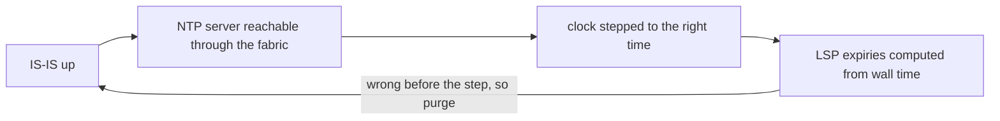

The underlay fails in two shapes. In the common one, a single adjacency (two neighbouring routers agreeing to exchange routing information over the link between them) refuses to come up, and one link's worth of capacity is missing until someone finds the mismatched setting. In the rare one, every link stays up while the routers' shared map of the network empties, and every loopback, BGP session, VXLAN tunnel and tenant above it goes with it. The underlay's one job is to make every loopback reachable ([what routing protocols do](/learn/fabric-networking/underlay/what-routing-protocols-do)), and everything in this track rides on it.

The examples run on Meridian's IS-IS underlay (one level-2 domain spanning all three sites, area 49.0001, system IDs derived from loopbacks), shown in Amsterdam as the small example with two or four spines and four leaves. [IS-IS from zero](/learn/fabric-networking/underlay/is-is-from-zero) builds the protocol; this lesson breaks it.

## Scope first: one adjacency, one box, or the whole area

Before any command, ask how much is broken: each scope shares something different, and what is shared is the suspect.

| What you see | Scope | What the broken things share | Look at first |
|---|---|---|---|
| One adjacency down; both routers' other adjacencies up | One link | A cable, two optics, two interface configurations | The checklist below, on both ends |
| Every adjacency on one router down | One device | Its IS-IS process, CPU, configuration, software release, system ID, clock | Process state, the last change or upgrade, control-plane drops, logs |
| The same kind of adjacency down on many routers at once | One change | A template, a key rollover, a release | The change log of the last hour |
| Every adjacency up, but routes missing on every router | The link-state database | LSPs and purges, which flood area-wide | LSP count per router, purge originator (the case study) |
| Adjacencies up, one router's routes missing everywhere | That router's LSPs | LSP authentication, LSP size against MTU | Database sync and retransmit counters |

Some reminders from [IS-IS from zero](/learn/fabric-networking/underlay/is-is-from-zero). An **LSP** (link-state PDU, a protocol data unit, IS-IS's word for a packet) is one router's description of itself: its neighbours, link metrics and prefixes. Every router keeps every LSP in its **link-state database** (LSDB) and runs **SPF** (shortest path first, Dijkstra's algorithm) over it to fill its forwarding table. The database is the same on every router in a flooding domain, so the last two rows break everywhere at once even though the cause sits on one box.

Scope also sets urgency: one link is a ticket for a technician, a database-wide failure is an outage of every site in the domain.

Worked example of the one-box row: at 14:02:31 `leaf2.ams` loses all four spine adjacencies in the same second. Four cables do not fail together, so look for what they share. Its hellos-received counters went flat on every uplink 30 s earlier, exactly one holding time, while the spines still log hellos sent. Its control-plane policer's drop counter is climbing: a host behind `leaf2.ams` is flooding ARP, which the leaf punts to its CPU ([planes, ASICs and network operating systems](/learn/fabric-networking/from-zero/planes-asics-and-network-operating-systems)), the shared policer drops the IS-IS hellos with it, and every holding time expires together. Per-link checks would find nothing wrong.

## How an adjacency forms: what each hello lets the neighbour check

IS-IS runs directly on layer 2, not over IP. Each router sends **hellos** (IIHs) on every enabled interface, every 10 s with a 30 s holding time on Meridian, a common default. A hello is a list of claims about the sender; the receiver checks each against its own configuration and silently discards a hello that fails, apart from a counter. Knowing the fields is knowing the checklist. Here is the point-to-point hello `leaf1.ams` sends to `spine1.ams` on the link `10.254.1.0/31`:

| Field | Size | Value from `leaf1.ams` | What the receiver checks |
|---|---|---|---|
| Common header | 8 bytes | protocol `0x83`, PDU type 17 (point-to-point IIH) | A LAN hello (type 15 or 16) on a port configured point-to-point is ignored, and vice versa |
| Circuit type | 1 byte | 2 (level 2 only) | At least one level in common with its own |
| Source ID | 6 bytes | `0102.5500.1011` | Must not equal its own system ID |
| Holding time | 2 bytes | 30 s | Declare the sender dead after this long without a hello |
| PDU length, local circuit ID | 2 + 1 bytes | the hello's length, 1 | Parsing |
| TLV 1, area addresses | variable | `49.0001` | For a level-1 adjacency, an area in common |
| TLV 10, authentication | variable | HMAC-SHA-256 digest | Digest computed with its own key must match |
| TLV 129 and 132, protocols and IP address | variable | IPv4, `10.254.1.1` | Address families in common; implementations differ on subnet checks |
| TLV 240, three-way adjacency | 1 to 15 bytes of value | state, and the neighbour's system ID if heard | Whether the sender has heard *me* |
| TLV 8, padding | up to 255 bytes each | enough to fill the interface MTU | Nothing: its job is to make the frame big |

A **TLV** (type, length, value) is IS-IS's extension mechanism: a 1-byte code, a 1-byte length and up to 255 bytes of data. The **system ID** is the router's 6-byte identity, unique in the domain. Meridian derives it from the loopback by padding each octet to three digits and regrouping: `10.255.1.11` becomes `010 255 001 011`, then `0102.5500.1011`. Unique loopbacks give unique system IDs, which matters below.

The **three-way handshake** (RFC 5303) is what TLV 240 carries. Each side's state for the adjacency is:

1. **Down:** no acceptable hello heard.
2. **Initializing:** acceptable hellos are arriving, but they do not list me as their heard neighbour yet.
3. **Up:** acceptable hellos arrive and list my system ID, so the neighbour hears me too.

**State is per side.** One side Initializing and the other reporting nothing means a fault in one direction only, which names a short list of causes.

## The adjacency-down checklist

Work it bottom-up, the order the hello itself travels: the port, the frame size, the authentication, then the IS-IS fields. Check both ends every time, because most items are a disagreement between two configurations rather than a fault in one.

### 1. The interface itself

**Solves:** an adjacency needs a working link with IS-IS enabled on both ends. **Breaks:** the link is down (an optic, a cable, a port shut by a previous change), IS-IS is not enabled on one end, the port is cabled to the wrong neighbour, or one end is a broadcast (LAN) circuit and the other point-to-point, which is easy to miss: valid hellos of the wrong PDU type, discarded by both. **Signal:** interface state and errors first (down or CRC errors is [the physical layer's problem](/learn/fabric-networking/fabric-architecture/optics-cabling-and-the-physical-layer)); LLDP (Link Layer Discovery Protocol, each port announcing its device and port name) shows who is really on the other end; the IS-IS interface view shows circuit type and hellos sent.

### 2. MTU mismatch

The **MTU** (maximum transmission unit) is the largest frame a port accepts; Meridian's fabric ports are 9,216 bytes ([transport as the network sees it](/learn/fabric-networking/from-zero/transport-as-the-network-sees-it)). IS-IS has no fragmentation, so it deliberately **pads its hellos with TLV 8 to the full interface MTU**: the adjacency comes up only if the link carries full-size PDUs. Without padding, small hellos would pass and any LSP larger than the smaller MTU would be dropped and retransmitted forever, routes missing for no visible reason. At the default LSP size of 1,492 bytes LSPs still fit a 1,500-byte port; operators who raise the LSP size towards the jumbo MTU lose them. Padding turns that silent failure into a loud one. (Some implementations pad only until the adjacency is Up, which still catches a mismatch at bring-up.)

Worked example: `spine1.ams` gets a replacement line card, and its port to `leaf1.ams` comes back at a default MTU of 1,500.

1. `leaf1.ams` sends hellos padded to about 9,200 bytes. `spine1.ams`'s port counts each as an oversize frame (a "giant") and, on most platforms, drops it before IS-IS sees it.
2. `spine1.ams` sends 1,500-byte hellos. `leaf1.ams` accepts them; their TLV 240 does not list `leaf1.ams`, because the spine has never heard it.
3. `leaf1.ams` moves to **Initializing** and stays there. `spine1.ams` has **no adjacency** at all.

```text
leaf1.ams# show isis adjacency                      (illustrative output)
Interface   System ID        Hostname     Level  State         Hold
Ethernet1   0102.5500.1001   spine1.ams   L2     Initializing  28
Ethernet2   0102.5500.1002   spine2.ams   L2     Up            27

spine1.ams# show interface Ethernet1 counters errors (illustrative output)
Interface   FCS   Oversize   Undersize   Discards
Ethernet1   0     4,117      0           0
```

The oversize counter rising by one every 10 s (one per hello) is the fingerprint. With padding off you get the quiet version: an Up adjacency whose database stops synchronising once an LSP outgrows the small end. **Signal:** asymmetric state (Initializing on one side, nothing on the other), oversize or giant counters on the small-MTU end, and MTU values that differ from the source of truth.

### 3. Authentication

IS-IS can sign its PDUs in TLV 10: HMAC-MD5 (RFC 5304) or the generic cryptographic form with SHA-2 (RFC 5310). Many implementations configure hello authentication separately from LSP and sequence-number PDU authentication, which gives two different failures.

- **Hello key mismatch:** each side discards the other's hellos. Both stay Down, and an "authentication failure" counter or log rises on both ends.
- **Hellos match, LSP keys do not:** the adjacency comes **Up**, but each side rejects the other's LSPs, so the neighbour's links and prefixes never enter the database. This one is nastier, because an adjacency dashboard is green.

Key rollover is where this bites: key chains carry send and accept lifetimes in wall-clock time, so a device with a wrong clock picks the wrong key by itself. **Signal:** authentication-failure counters per interface, and a key-chain change or lifetime boundary in the last hour.

### 4. Level and area

IS-IS has two levels: level 1 (L1) routes inside an area and level 2 (L2) between areas. A router can run L1, L2 or both. An adjacency forms only at a level both ends run, and **an L1 adjacency also needs an area address in common**; L2 does not. Meridian is one L2 domain, so every link should be L2. The classic breakage is a template rendering a new leaf as level-1 only. The spines run level 2 only, the two share no level, both ends discard the hellos, and both stay Down. **Signal:** "level mismatch" or "area mismatch" counters, and a circuit type in the IS-IS interface view that differs from intent.

### 5. Duplicate system ID

Two routers with the same system ID break IS-IS in two different ways, depending on where they sit.

- **Neighbours:** a router that receives a hello carrying its own system ID refuses the adjacency and usually logs a duplicate. Both stay Down.
- **Not neighbours:** worse. Both originate LSPs with the same LSP ID. Each one, receiving "its own" LSP with a higher sequence number and contents it did not write, follows the rule that an originator must out-number any stale copy of itself: it re-originates with sequence number + 1. The other does the same. The two copies alternate across the area, the sequence number climbs as fast as each router's LSP generation throttle allows (several times a second down to once every few seconds), and every router reruns SPF on every flip. Routes to both routers flap area-wide.

It happens when a replacement gets a copied template, or a loopback is reused before the old device has gone. Deriving the system ID from the loopback turns "unique loopbacks", which the source of truth already enforces, into "unique system IDs". **Signal:** a duplicate-system-ID log, and one LSP ID whose sequence number rises far faster than the normal refresh, about once every 15 minutes at default timers.

### 6. Hello and hold timers

Each router puts its own **holding time** in its hellos, and the neighbour uses that value to time the sender out. The two ends' hello intervals therefore **do not need to match** in IS-IS: `leaf1.ams` can send every 10 s with a 30 s holding time while `spine1.ams` sends every 3 s with 9 s. OSPF is different: its hello and dead intervals must match, or no adjacency forms. A timer mismatch is the one checklist item that does not stop an IS-IS adjacency.

**Breaks:** a holding time too close to the hello interval (3 s hellos, 4 s hold) drops the adjacency whenever one hello is late, and a CPU busy with a large SPF or an upgrade sends hellos late. Defaults vary: 10 s hellos with a multiplier of 3 is common; FRRouting uses 3 s with a multiplier of 10. Fabrics keep hellos moderate and detect failures with BFD (Bidirectional Forwarding Detection), in [convergence and BFD](/learn/fabric-networking/underlay/convergence-and-bfd). **Signal:** "hold time expired" resets that correlate with CPU spikes.

### The checklist as code

The model exchanges hellos both ways over `leaf1.ams`–`spine1.ams`, runs the receiver's checks in the order above, and applies the three-way rule to each side.

```python
def system_id(loopback):
    """10.255.1.11 -> 0102.5500.1011: each octet padded to 3 digits, regrouped in fours."""
    d = "".join(f"{int(o):03d}" for o in loopback.split("."))
    return ".".join(d[i:i + 4] for i in range(0, 12, 4))


def hello(cfg):
    """What one side's point-to-point IIH carries (the fields the receiver checks)."""
    return {"pdu": "p2p-iih" if cfg["circuit"] == "p2p" else "lan-iih",
            "size": cfg["mtu"],                # padded to the interface MTU
            "source_id": system_id(cfg["loopback"]),
            "levels": cfg["levels"], "areas": cfg["areas"],
            "auth": cfg["key"], "holding_time": cfg["hello"] * cfg["multiplier"]}


def accept(me, h):
    """Run the receiver's checks on a hello; return None (accepted) or the drop reason."""
    if h["size"] > me["mtu"]:
        return "oversize frame dropped by the port"    # never reaches IS-IS at all
    if h["pdu"] != ("p2p-iih" if me["circuit"] == "p2p" else "lan-iih"):
        return "PDU type mismatch (p2p vs broadcast)"
    if h["auth"] != me["key"]:
        return "authentication failure"
    if h["source_id"] == system_id(me["loopback"]):
        return "duplicate system ID"
    common = set(h["levels"]) & set(me["levels"])
    if "L1" in common and not set(h["areas"]) & set(me["areas"]):
        common.discard("L1")                           # L1 needs a shared area; L2 does not
    if not common:
        return "level or area mismatch"
    return None                                        # holding time is used, never compared


def bring_up(a, b):
    """Exchange hellos both ways and apply the three-way handshake (RFC 5303)."""
    a_drop, b_drop = accept(a, hello(b)), accept(b, hello(a))
    def state(my_drop, peer_drop):
        if my_drop:
            return "Down", my_drop          # I heard nothing usable
        if peer_drop:
            return "Initializing", ""       # I hear you, but your hellos don't list me
        return "Up", ""
    return state(a_drop, b_drop), state(b_drop, a_drop)


LEAF = {"loopback": "10.255.1.11", "circuit": "p2p", "mtu": 9216, "levels": ["L2"],
        "areas": ["49.0001"], "key": "k-2026a", "hello": 10, "multiplier": 3}
SPINE = dict(LEAF, loopback="10.255.1.1")
cases = {
    "healthy": (LEAF, SPINE),
    "spine port left at MTU 1500": (LEAF, dict(SPINE, mtu=1500)),
    "spine rolled to a new key": (LEAF, dict(SPINE, key="k-2026b")),
    "leaf rendered as level 1 only": (dict(LEAF, levels=["L1"]), SPINE),
    "leaf loopback copied from spine1": (dict(LEAF, loopback="10.255.1.1"), SPINE),
    "leaf hello 10 s, spine 3 s": (LEAF, dict(SPINE, hello=3)),
    "spine port left as broadcast": (LEAF, dict(SPINE, circuit="broadcast")),
}
print("system IDs:", system_id("10.255.1.11"), system_id("10.255.1.1"))
for name, (leaf, spine) in cases.items():
    (ls, lr), (ss, sr) = bring_up(leaf, spine)
    print(f"{name:<33} leaf1: {ls:<12} spine1: {ss:<12} {lr or sr}")
```

```text
system IDs: 0102.5500.1011 0102.5500.1001
healthy                           leaf1: Up           spine1: Up
spine port left at MTU 1500       leaf1: Initializing spine1: Down         oversize frame dropped by the port
spine rolled to a new key         leaf1: Down         spine1: Down         authentication failure
leaf rendered as level 1 only     leaf1: Down         spine1: Down         level or area mismatch
leaf loopback copied from spine1  leaf1: Down         spine1: Down         duplicate system ID
leaf hello 10 s, spine 3 s        leaf1: Up           spine1: Up
spine port left as broadcast      leaf1: Down         spine1: Down         PDU type mismatch (p2p vs broadcast)
```

Two lines carry the lesson. `h["size"] > me["mtu"]` comes first because the port drops the frame before IS-IS sees it, and it is the only case here with asymmetric states. A unidirectional link, where one direction fails without the link going down, produces the same asymmetry, so the oversize counter is what tells the two apart. And `holding_time` is carried but never compared, which is why the timer case comes up.

| Check | Both sides Down | One side Initializing | Up, but routes missing | First counter to read |
|---|---|---|---|---|
| Interface, circuit type | Link down, IS-IS off, p2p vs LAN | Unidirectional link | | Interface state, LLDP |
| MTU | | Hellos padded past the small end's MTU | Padding disabled: large LSPs dropped | Oversize / giant frames |
| Authentication | Hello keys differ | | LSP keys differ | Authentication failures |
| Level and area | No common level, or L1-only with different areas | | | Level / area mismatch |
| System ID | Duplicate on neighbours | | Duplicate elsewhere: LSP fight | Sequence-number rate |
| Timers | | | Flaps when the hold time is too tight | Hold-time-expired resets |

## Flapping and dampening

A **flap** is a link or adjacency going down and up repeatedly, usually from a dying optic, a dirty connector or a marginal cable ([optics, cabling and the physical layer](/learn/fabric-networking/fabric-architecture/optics-cabling-and-the-physical-layer)). A dead link costs one convergence event; a flapping link costs one every few seconds, paid by every router in the area.

### What one flap costs

When the `leaf3.ams`–`spine2.ams` link drops, both routers originate a new LSP without that adjacency. Flooding carries both LSPs to every router in the area. Every router runs SPF and reprograms the changed routes in hardware, traffic hashed onto the link is lost until the leaf's forwarding table moves it, and BGP re-evaluates every next hop that resolved through it ([iBGP, loops and next hops](/learn/fabric-networking/bgp-fundamentals/ibgp-loops-and-next-hops)). When it comes back, all of that happens again. In an area of 500 routers, each transition puts two new LSPs on every router and costs about 500 SPF runs, and a flap is two transitions, from one bad optic.

### Dampening at three layers

1. **At the interface: debounce.** A short down-delay (carrier delay) hides a glitch shorter than itself; an **up-delay** keeps a link out of use until it has stayed up for some seconds. Every millisecond of down-delay is added to real failures, so fabrics keep it short.
2. **At the link: dampening with a decaying penalty.** Each flap adds a penalty, the penalty halves every half-life, and above a suppress threshold the link is held down until the penalty decays below a reuse threshold. Typical values (Cisco's IP event dampening defaults): 1,000 per flap, 5 s half-life, suppress at 2,000, reuse at 1,000, at most 20 s suppressed. BGP route flap dampening (RFC 2439) is the same algorithm for routes ([convergence and scale](/learn/fabric-networking/bgp-in-the-real-world/convergence-and-scale)).
3. **In the protocol: backoff.** IS-IS implementations throttle LSP generation and SPF with backoff (RFC 8405 standardises the SPF back-off; LSP generation throttles are vendor-defined): the first event is handled in milliseconds, a burst stretches the wait to seconds ([convergence and BFD](/learn/fabric-networking/underlay/convergence-and-bfd) traces both). That caps CPU cost but does not stop traffic chasing the link; dampening does.

The penalty arithmetic for an optic that drops for 200 ms every 2 s, seven times:

```python
HALF_LIFE, PENALTY, SUPPRESS, REUSE, MAX_SUPPRESS = 5.0, 1000, 2000, 1000, 20.0
CEILING = REUSE * 2 ** (MAX_SUPPRESS / HALF_LIFE)   # 16,000: decays to REUSE in 20 s


class Dampener:
    def __init__(self):
        self.penalty, self.t, self.suppressed = 0.0, 0.0, False

    def decay_to(self, t):
        self.penalty *= 0.5 ** ((t - self.t) / HALF_LIFE)   # exponential decay
        self.t = t
        if self.suppressed and self.penalty < REUSE:
            self.suppressed = False                          # stable long enough: reuse

    def flap(self, t):
        self.decay_to(t)
        self.penalty = min(self.penalty + PENALTY, CEILING)
        if self.penalty > SUPPRESS:
            self.suppressed = True


# An optic loses light for 200 ms every 2 s for 12 s, then holds steady.
flaps = [2.0 * k for k in range(7)]                  # t = 0, 2, ..., 12
d, transitions, events = Dampener(), 0, []
for t in [x / 10 for x in range(0, 401)]:            # 0.0 .. 40.0 s in 100 ms steps
    if t in flaps:
        was = d.suppressed
        d.flap(t)
        if not was:                                  # IS-IS sees the link go down...
            transitions += 1 if d.suppressed else 2  # ...and back up, unless now held down
        events.append(f"t={t:4.1f}s flap      penalty {d.penalty:6.0f}  {'SUPPRESSED' if d.suppressed else 'in use'}")
    else:
        was = d.suppressed
        d.decay_to(t)
        if was and not d.suppressed:
            transitions += 1                         # released: the adjacency comes back once
            events.append(f"t={t:4.1f}s reuse     penalty {d.penalty:6.0f}  in use again")
print("\n".join(events))
print(f"{len(flaps)} flaps: {2 * len(flaps)} adjacency transitions undamped, {transitions} damped")
```

```text
t= 0.0s flap      penalty   1000  in use
t= 2.0s flap      penalty   1758  in use
t= 4.0s flap      penalty   2332  SUPPRESSED
t= 6.0s flap      penalty   2767  SUPPRESSED
t= 8.0s flap      penalty   3097  SUPPRESSED
t=10.0s flap      penalty   3347  SUPPRESSED
t=12.0s flap      penalty   3537  SUPPRESSED
t=21.2s reuse     penalty    988  in use again
7 flaps: 14 adjacency transitions undamped, 6 damped
```

Trace the second flap by hand: 1,000 decays for 2 s to 1,000 × 0.5^(2/5) = 758, plus 1,000 is 1,758, below 2,000. The third makes 2,332 and the link is held down; later flaps add penalty without reaching IS-IS. The link returns once 3,537 decays below 1,000, 9.1 s after the last flap: 6 transitions instead of 14.

**How dampening breaks:** too aggressive, and a healthy link stays out after one burst while ECMP (equal-cost multipath) quietly runs on three uplinks of four. **Signal:** flap counts per link per hour, suppression exported as its own status, and the optic's receive-power history.

## Case study: a purge storm from a clock jump

This incident emptied every router's map of the network while every link and adjacency stayed up, and its root cause was a time-synchronisation change that looked like a management-network tidy-up. It is told on Meridian; the mechanism is a real failure class.

### What a purge is for

Every LSP carries a **remaining lifetime**, a 16-bit count of seconds that starts at 1,200 by default. Every router decrements its stored copy once a second. The originator refreshes its LSP well before that, about every 900 s by default, with a higher sequence number and a fresh lifetime. If a copy reaches zero, the router holding it **purges** it: it floods the LSP with a remaining lifetime of 0 and its body removed, and every router that receives the purge deletes that LSP from its database and floods the purge on.

The reason: if a router dies, nobody is left to withdraw its LSP, so its stale description must expire by itself, and any router may notice first. The consequence: **any router in the area can delete any other router's LSP from every database**. The originator's one defence is that, on receiving a purge of an LSP it knows is valid, it re-issues it with a higher sequence number, which beats the purge.

### The timeline

Meridian had recently moved its switches' NTP (Network Time Protocol) from the out-of-band management network, `172.16.0.0/16`, to a server reached through the fabric itself, behind `leaf1.ams`. `leaf4.ams`'s network operating system stored each LSP's expiry as an absolute wall-clock time (time of receipt plus remaining lifetime) instead of counting the lifetime down.

| Clock on `leaf4.ams` | Event | Effect |
|---|---|---|
| 2000-01-01 00:00:00 | `leaf4.ams` reboots after a software upgrade; its hardware clock has lost its setting | Nothing checks the clock before routing starts |
| 2000-01-01 00:00:41 | Adjacencies to both spines come up; the spines send the other five LSPs | Expiries stored in the year 2000: `spine1.ams`'s, with 1,043 s left, "expires at 00:18:04" |
| 2000-01-01 00:00:52 | Underlay up, so the NTP query on UDP 123 finally reaches the server | Time now depends on the network |
| 2026-10-31 09:00:52 | NTP steps the clock forward 846,752,400 s, about 26 years 10 months | Every stored expiry is now 26 years in the past |
| next aging pass | The aging check finds five expired LSPs | Five purges, sequence numbers unchanged, lifetime 0, each with a purge-originator TLV naming `0102.5500.1014` |
| milliseconds later | Purges flood through both spines to every router | Every router deletes every LSP except `leaf4.ams`'s and its own; SPF finds almost nothing |
| at once | BGP next-hop tracking marks every EVPN route unusable | VXLAN tunnels removed, tenant traffic stops site-wide |
| tens of milliseconds later | Each originator sees a purge of its own valid LSP and re-issues it: `spine1.ams` 0x5c → 0x5d, `leaf3.ams` 0x2a → 0x2b, and so on | New copies flood, replace the purges; `leaf4.ams` stores 2026 expiries; SPF rebuilds |

No link went down and no adjacency dropped: a dashboard of adjacency states stayed green through the whole outage.

```viz
{"type": "fabric", "scenario": "isis-purge-storm", "title": "A purge storm: one leaf's clock jumps 26 years and the site's topology vanishes", "caption": "Two spines and four leaves in area 49.0001, NTP reached through the fabric. leaf4.ams boots in the year 2000, stores LSP expiries as wall-clock times, and NTP steps it to 2026: it purges the five LSPs it did not originate, the purges flood, SPF everywhere finds almost nothing and the overlay falls. Each originator re-issues its LSP with a higher sequence number, the topology returns, and the last frames give the fixes and the signals."}
```

### Why the shortcut fails

Storing "expires at" instead of "seconds remaining" is equivalent only while the clock moves forward at one second per second; a step breaks it. It is the timeout bug software engineers know: measure durations with a monotonic clock (Linux `CLOCK_MONOTONIC`, Python's `time.monotonic()`), never wall time ([time and ordering](/learn/system-design/distributed-systems/time-and-ordering) covers step versus slew). ISO 10589, the IS-IS standard, describes aging as a countdown. The two designs:

```python
from datetime import datetime, timedelta, timezone


class Clock:
    """A box's two clocks: wall time (NTP can step it) and monotonic time (only moves forward)."""
    def __init__(self, wall):
        self.wall, self.mono = wall, 0.0

    def tick(self, seconds):
        self.wall += timedelta(seconds=seconds)
        self.mono += seconds

    def ntp_step(self, correct):
        step = correct - self.wall
        self.wall = correct                         # monotonic time is untouched
        return step.total_seconds()


class CountdownLsdb:
    """What ISO 10589 intends: store remaining lifetime, count it down."""
    def __init__(self, clock):
        self.clock, self.lsps = clock, {}

    def install(self, lsp_id, seq, remaining):
        self.lsps[lsp_id] = (seq, remaining, self.clock.mono)

    def expired(self):
        return [i for i, (_, rem, at) in self.lsps.items() if rem - (self.clock.mono - at) <= 0]


class WallClockLsdb(CountdownLsdb):
    """The shortcut: store an absolute expiry time computed from wall time."""
    def install(self, lsp_id, seq, remaining):
        self.lsps[lsp_id] = (seq, self.clock.wall + timedelta(seconds=remaining), None)

    def expired(self):
        return [i for i, (_, expiry, _) in self.lsps.items() if expiry <= self.clock.wall]


# leaf4.ams boots with its clock at 2000-01-01; adjacencies come up 41 s later and the
# spines send it the other five LSPs (sequence number, remaining lifetime in seconds).
RECEIVED = {"spine1.ams": (0x5C, 1043), "spine2.ams": (0x51, 611), "leaf1.ams": (0x33, 878),
            "leaf2.ams": (0x2F, 1150), "leaf3.ams": (0x2A, 402)}
for impl in (CountdownLsdb, WallClockLsdb):
    clock = Clock(datetime(2000, 1, 1, tzinfo=timezone.utc))
    db = impl(clock)
    clock.tick(41)
    for lsp_id, (seq, remaining) in RECEIVED.items():
        db.install(lsp_id, seq, remaining)
    clock.tick(11)                                              # t = 52 s: NTP answers
    step = clock.ntp_step(datetime(2026, 10, 31, 9, 0, 52, tzinfo=timezone.utc))
    clock.tick(1)                                               # next once-a-second aging pass
    purges = [(i, db.lsps[i][0], 0) for i in db.expired()]      # (LSP ID, same seq, lifetime 0)
    print(f"{impl.__name__:<14} step +{step:,.0f} s, "
          f"purges {len(purges)}: {', '.join(f'{i} {s:#x}' for i, s, _ in purges) or 'none'}")

# Every originator that receives a purge of its own, still-valid LSP fights back:
reissued = {i: seq + 1 for i, (seq, _) in RECEIVED.items()}
print("re-issued:", ", ".join(f"{i} {s:#x}" for i, s in reissued.items()))
```

```text
CountdownLsdb  step +846,752,400 s, purges 0: none
WallClockLsdb  step +846,752,400 s, purges 5: spine1.ams 0x5c, spine2.ams 0x51, leaf1.ams 0x33, leaf2.ams 0x2f, leaf3.ams 0x2a
re-issued: spine1.ams 0x5d, spine2.ams 0x52, leaf1.ams 0x34, leaf2.ams 0x30, leaf3.ams 0x2b
```

The countdown version saw 12 seconds pass, because 12 seconds passed. The wall-clock version saw 26 years. Note that the purges keep each LSP's sequence number: a purge wins against a stored copy with the *same* sequence number, which is why every router accepted them, and loses against a higher one, which is why the re-issued LSPs ended it.

### Why the whole domain, and why minutes

The blast radius of a purge is the flooding domain. The timeline treats the six-router example as the whole domain, but Meridian's level-2 domain spans all three sites, about 70 routers. `leaf4.ams` holds all their LSPs, so on the real fabric it purges about 69, the purges cross the long-haul circuits, and Singapore and San Jose lose their topology in the same second as Amsterdam: one leaf's clock, a three-site outage. Areas or one domain per site would bound it, at the cost of inter-level design and of leaking every remote loopback the overlay needs as a next hop; most fabrics stay flat and protect the clock instead ([redundancy and failure domains](/learn/fabric-networking/fabric-architecture/redundancy-and-failure-domains)).

Recovery took two very different times. IS-IS heals in one flooding round trip after the originators fight back: well under a second in six routers. In a real area of hundreds of routers and thousands of LSPs, flooding is paced to tens of LSPs per second per interface (a gap of about 33 ms between LSPs is a common default), so each wave of purges and replacements takes tens of seconds. Even Meridian's 70 LSPs need over 2 s to cross one interface at that pace, and SPF throttles backing off during the churn add more: seconds of outage, close to Meridian's 9 s BGP hold timers ([BGP sessions and the FSM](/learn/fabric-networking/bgp-fundamentals/bgp-sessions-and-the-fsm)), and far beyond them in a larger area. Once the gap outlasts them, the leaves' iBGP sessions to the route reflectors, between loopbacks the underlay no longer reaches, expire, reconnect and resend every EVPN route, and MAC and ARP state is relearned. Tenants then see minutes.

### The circular dependency



Steady state hid it, because every running device already had the right time; only a reboot exposed it. The general rule is that the management plane (time, logging, configuration access) must not depend on the data plane it manages. That is what the out-of-band network is for ([planes, ASICs and network operating systems](/learn/fabric-networking/from-zero/planes-asics-and-network-operating-systems)).

### Fixes, and the other road to a purge storm

- **Take time over out-of-band management,** so the clock is right before routing starts, or hold routing until time sync completes.
- **Age LSPs by countdown.** A vendor fix: ask for it, and test clock steps in the lab before deploying a platform.
- **Find the culprit fast.** RFC 6232's purge-originator TLV (TLV 13) stamps the purging router's system ID into each purge; without it, you cannot tell from any router's database who started it.
- **Corrupt LSPs.** ISO 10589 originally told a router to purge an LSP that arrived with a bad checksum. On a device corrupting frames in memory, that turned bit errors into area-wide purges. Modern implementations discard a corrupt LSP instead, and some still expose a knob to choose: make sure it is set to discard.

The same incident, told for its lessons about change management alongside other outages, is in [incidents and what they teach](/learn/fabric-networking/operating-fabrics/incidents-and-what-they-teach).

## Costing out a device: metrics or the overload bit

To work on a spine without dropping traffic, you **cost it out**: make every other router's SPF route around it while it is still up and forwarding. A hard shutdown loses every packet sent into the device during detection and reconvergence; a costed-out device keeps forwarding whatever still reaches it until every leaf has moved: make before break. IS-IS has two tools for it.

### Raising metrics

With wide metrics (RFC 5305), a link metric is 24 bits. The largest value SPF still uses is **16,777,214** (2^24 − 2); 16,777,215 means "do not use this link at all". Metrics are directional: each router advertises the cost of *leaving* it over each link. When `spine2.ams` raises the metric on all its links from 10 to 16,777,214, any path that transits it must leave it over one of those links, so leaf to leaf through `spine2.ams` costs 10 + 16,777,214 = 16,777,224, against 20 through any other spine. Every leaf drops it from its ECMP set. Traffic *to* `spine2.ams`'s own loopback still costs 10, so its BGP sessions, management and monitoring keep working.

A metric can cost out **one link** as well as a device, and a maximum metric is still a metric, so **the device remains a last resort**: if it is the only path left, traffic uses it.

### The overload bit

Every LSP header has an **overload (OL) bit**, which says "do not use me for transit": other routers' SPF still reaches the prefixes the router advertises itself (its loopback, its attached subnets) but never computes a path *through* it. ISO 10589 meant it for a router whose database had run out of memory; operators use it for maintenance and above all for **startup**. A freshly booted router has adjacencies within seconds, but its BGP tables and forwarding hardware may take minutes to fill. Overload on startup, for a fixed time (300 s is common) or until BGP has converged, stops it attracting transit traffic it would black-hole (RFC 3277).

The difference is absolute versus relative, and it matters on the day something else is already broken:

```python
import heapq

MAX_METRIC = 16_777_214           # 2**24 - 2: the largest metric SPF still uses
LINK_EXCLUDED = 16_777_215        # 2**24 - 1: RFC 5305, "do not use this link in SPF"


def fabric(spines, leaves, metric=10):
    """Directed metrics: each router advertises the cost of leaving it over each link."""
    m = {}
    for s in spines:
        for l in leaves:
            m[(s, l)] = m[(l, s)] = metric
    return m


def spf(metrics, source, overloaded=()):
    """Dijkstra returning, per destination, (cost, set of first-hop neighbours)."""
    adj = {}
    for (a, b), cost in metrics.items():
        if cost < LINK_EXCLUDED:
            adj.setdefault(a, []).append((b, cost))
    best, heap, done = {source: (0, set())}, [(0, source)], set()
    while heap:
        cost, u = heapq.heappop(heap)
        if u in done:
            continue
        done.add(u)
        if u in overloaded and u != source:
            continue                      # reachable itself, but never a transit node
        for v, w in adj.get(u, []):
            hops = {v} if u == source else best[u][1]
            new = cost + w
            if v not in best or new < best[v][0]:
                best[v] = (new, set(hops))
                heapq.heappush(heap, (new, v))
            elif new == best[v][0]:
                best[v][1].update(hops)   # equal cost: another ECMP next hop
    return best


def show(label, metrics, overloaded=(), dests=("leaf3.ams", "spine2.ams")):
    table = spf(metrics, "leaf1.ams", overloaded)
    for d in dests:
        cost, hops = table.get(d, (None, set()))
        print(f"{label:<37} leaf1 -> {d:<10} " +
              (f"cost {cost:>10,}  via {', '.join(sorted(hops))}" if cost is not None else "UNREACHABLE"))


SPINES = [f"spine{n}.ams" for n in range(1, 5)]
LEAVES = [f"leaf{n}.ams" for n in range(1, 5)]
base = fabric(SPINES, LEAVES)
show("normal", base)
drained = {k: (MAX_METRIC if k[0] == "spine2.ams" else v) for k, v in base.items()}
show("spine2 max metric", drained)
show("spine2 overload bit", base, overloaded={"spine2.ams"})

# Edge case: a two-spine site where spine1.ams has already failed.
two = {k: v for k, v in fabric(SPINES[:2], LEAVES).items() if "spine1.ams" not in k}
show("2 spines, spine1 dead, spine2 metric",
     {k: (MAX_METRIC if k[0] == "spine2.ams" else v) for k, v in two.items()}, dests=("leaf3.ams",))
show("2 spines, spine1 dead, spine2 overload", two, overloaded={"spine2.ams"}, dests=("leaf3.ams",))
```

```text
normal                                leaf1 -> leaf3.ams  cost         20  via spine1.ams, spine2.ams, spine3.ams, spine4.ams
normal                                leaf1 -> spine2.ams cost         10  via spine2.ams
spine2 max metric                     leaf1 -> leaf3.ams  cost         20  via spine1.ams, spine3.ams, spine4.ams
spine2 max metric                     leaf1 -> spine2.ams cost         10  via spine2.ams
spine2 overload bit                   leaf1 -> leaf3.ams  cost         20  via spine1.ams, spine3.ams, spine4.ams
spine2 overload bit                   leaf1 -> spine2.ams cost         10  via spine2.ams
2 spines, spine1 dead, spine2 metric  leaf1 -> leaf3.ams  cost 16,777,224  via spine2.ams
2 spines, spine1 dead, spine2 overload leaf1 -> leaf3.ams  UNREACHABLE
```

With four spines the two tools forward identically. The last two lines are the edge case: with the other spine already dead, the maximum metric keeps the site connected through the expensive path, while the overload bit partitions it. The line `if u in overloaded and u != source: continue` is the whole difference: an overloaded node is reached, but its links are never relaxed.

```viz
{"type": "fabric", "scenario": "spine-drain", "title": "Costing out spine2.ams with a maximum metric: pre-check, drain, verify, reboot, restore", "caption": "Four spines and four leaves in Amsterdam. A pre-check blocks the change at 14:00 because leaf3.ams's uplinks would reach 90%, then passes at 02:00. spine2.ams raises its five link metrics from 10 to 16,777,214, every leaf drops it from ECMP, traffic moves off with no loss, the spine is verified empty, rebooted, checked while still costed out, restored to metric 10 and compared against the pre-check snapshot."}
```

The full procedure belongs to [safe change and maintenance](/learn/fabric-networking/operating-fabrics/safe-change-and-maintenance). Two underlay points remain. **Order matters when BGP runs on the device:** a border gateway taken out of IS-IS before its BGP routes are withdrawn keeps attracting traffic it cannot deliver ([operating BGP safely](/learn/fabric-networking/bgp-in-the-real-world/operating-bgp-safely)). And with an [eBGP underlay](/learn/fabric-networking/underlay/bgp-as-the-underlay) the drain uses the GRACEFUL_SHUTDOWN community (RFC 8326) or AS-path prepending instead.

**How costing out breaks:** it is forgotten. A spine left at maximum metric runs the site on three spines of four for weeks, nothing alarming, until the next failure finds a quarter less capacity than planned. **Signal:** metrics and overload bits diffed against the source of truth, with each deviation's age.

## Failure modes in production

| Failure | Symptom | Diagnosis | Fix |
|---|---|---|---|
| MTU mismatch after a hardware swap | One side Initializing, the other no adjacency | Oversize counters rising once per hello on the small-MTU end | Set the MTU from the source of truth; diff after every replacement |
| LSP authentication mismatch | Adjacency Up, neighbour's prefixes missing | Authentication failures on LSPs or SNPs, database not in sync | Align the keys; alert on key-chain lifetimes |
| Template renders the wrong level | New leaf never forms adjacencies; both ends Down | Level-mismatch counters; circuit type differs from intent | Fix the template; validate rendered config before pushing |
| Duplicate system ID on non-neighbours | Routes to two routers flap area-wide; SPF runs constantly | One LSP ID's sequence number climbing far faster than its refresh | Re-derive the ID from a unique loopback |
| Flapping optic | Periodic loss for flows on one link; SPF churn on every router | Adjacency transitions per hour; falling receive power | Dampen, drain the link, replace the optic |
| Purge storm from a clock step | Every adjacency up, LSP count collapsed on every router in the domain, overlay down | Clock-step log on one device; purge-originator TLV naming it | Re-originate (automatic); move NTP to out-of-band; vendor fix for aging |
| Overload bit left on, or set on the last path | Leaves partitioned, or a spine idle for weeks | Overload bit or maximum metric that differs from the source of truth | Restore it; pre-check that a drain never removes the last path |
| Hellos starved by CPU | Adjacencies drop during upgrades or big SPF runs | Hold-time expiries correlated with CPU, control-plane drops | Moderate hold times plus BFD; check control-plane policing |

## Trade-offs: ways to take a device out of service

| Method | Traffic loss | Still a last resort? | Granularity | Device itself reachable? | Main risk |
|---|---|---|---|---|---|
| Shut interfaces or reboot | Every packet in flight during detection and reconvergence | No | Link or device | No | Loss on every change |
| Maximum metric (16,777,214) | None if the rest has headroom | Yes | Per link or whole device | Yes | Forgotten afterwards; hidden capacity loss |
| Overload bit | None if the rest has headroom | No: never transit | Whole device only | Yes, its own prefixes | Partitions the network if it is the last path |
| Overload on startup | Avoids black-holing while BGP and the FIB fill | No | Whole device, time-limited | Yes | A timer too short for a slow table load |
| eBGP underlay: graceful shutdown or prepend | None if the rest has headroom | Yes | Per session | Yes | Only works if every peer honours the community |

## Under the hood: clocks, NTP and the IS-IS process

On a Linux-based network operating system (SONiC, Cumulus Linux), IS-IS is a user-space daemon such as FRRouting's `isisd`: hellos are generated by the CPU, and received ones are punted from the ASIC through the control-plane policer, which is why a busy CPU or a storm sharing the policer drops adjacencies.

Time arrives through `ntpd` or `chrony`. `ntpd` steps the clock when the offset exceeds 128 ms and otherwise **slews** it, running the clock fast or slow by at most 500 parts per million, about 43 s a day. It refuses offsets above 1,000 s (its panic threshold) unless started with `-g`, which distributions commonly pass at boot; `chrony` steps when configured to (`makestep`, typically only after boot). Slewing 26 years is impossible, so a box booting with a dead clock *will* step, and any deadline computed from wall time before the step is wrong afterwards. `CLOCK_MONOTONIC` ignores steps, which is why timers belong on it; ISO 10589's per-second countdown is that design in protocol form.

## What the platform should show

Tooling should make each failure above visible within seconds and name its scope:

- **Adjacencies against intent.** Every cabled fabric link in the source of truth should have one Up adjacency at level 2. Show missing ones by link, not by device, and show **asymmetric state** (Initializing on one end, absent on the other) as its own category, because it names MTU or a unidirectional link.
- **Drop counters by reason, per interface:** oversize, authentication, level or area mismatch, duplicate system ID. These turn the checklist into a lookup.
- **LSP count per router, across the area at once.** Every router should hold the same count, roughly the number of routers (plus fragments). One router low is a sync problem on that router; every router collapsing in the same second is a purge storm, and the alert should say so.
- **Purges, with their originator** resolved to a hostname: "purges from `leaf4.ams`" turns an hour of hunting into a sentence.
- **Sequence-number velocity per LSP ID.** Faster than one refresh per few minutes means a flap or a duplicate system ID.
- **Clock health on every device:** NTP offset, sync source, and every step as an event with its size. A step next to an LSP collapse in the same minute names the incident before the phone rings.
- **Flap counts and dampening state,** with suppressed shown separately from down.
- **Cost-out state:** every metric and overload bit that differs from intent, with the change that set it and its age. "`spine2.ams` at maximum metric for 19 days, no open change" is an alert.
- **Both views from one data set.** The engineer needs the counter and the link; the manager needs "one link down, redundancy intact" versus "site-wide outage, the underlay is gone".

The source of truth, collection and correlation behind this list are built in [telemetry and observability](/learn/fabric-networking/operating-fabrics/telemetry-and-observability) and [the troubleshooting method](/learn/fabric-networking/operating-fabrics/the-troubleshooting-method).

## Interviewer follow-ups

**"An IS-IS adjacency went down. What do you check?"** Model answer: scope first, this adjacency or every one on the box. One link: interface and LLDP, circuit type, MTU (hellos are padded to it), authentication, level and area, duplicate system ID, timers, on both ends. Every adjacency on the box: the process, CPU, a recent change. Common wrong answer: opening the BGP summary, which shows the symptom, not the cause.

**"One side shows Initializing and the other shows nothing. What does that tell you?"** Model answer: hellos cross in one direction only: either they are too big for the far end (MTU, confirmed by oversize counters there) or the link is unidirectional. Authentication or level mismatches fail both directions. Common wrong answer: "the neighbour's IS-IS process is slow, wait".

**"How can one router's clock take down a whole site?"** Model answer: any IS-IS router may purge any LSP, and purges flood the whole domain. A router that ages LSPs against wall time and has its clock stepped forward sees every LSP as expired and purges them all. The topology vanishes while every link stays up and overlay next hops stop resolving. Originators re-issue with higher sequence numbers, so IS-IS recovers in seconds, and BGP in minutes if its sessions timed out. Fixes: time over out-of-band, aging by countdown, alerts on clock steps and purge originators. Common wrong answer: "NTP packets flooded the network".

**"Would you drain a spine with the overload bit or a maximum metric?"** Model answer: with spare spines they forward identically. The maximum metric keeps the device as a last resort, so it cannot partition the network; the overload bit is absolute, and the right tool at startup while BGP and the forwarding table fill. An honest addition: "I'd defer to the network team on which one their platforms and runbooks standardise on, but I'd build the check that no drain removes the last path and the alert for a cost-out older than its change."


## What mid-level engineers get wrong

- **Debugging the overlay first.** EVPN routes missing and BGP sessions flapping on every leaf at once is an underlay symptom. Start from the IS-IS database, not from BGP.
- **Treating "adjacencies up" as "underlay healthy".** The purge storm kept every adjacency up. The database, the LSP count per router, is the health signal.
- **Measuring durations with wall-clock time in their own tooling.** The bug that purged the domain also produces negative latencies, timeouts that fire at once or never, and caches that never expire.

## Senior signals

- You ask for scope before running anything: one adjacency, every adjacency on one box, or the whole database.
- You read adjacency state per side, and know that Initializing opposite nothing means hellos cross one way: an MTU mismatch (hellos are padded on purpose so it fails loudly) or a unidirectional link.
- You explain the purge storm from two facts, that any router can purge any LSP and that purges flood the area, and generalise it: durations belong on a monotonic clock, and the management plane must not depend on the data plane.
- You choose between maximum metric and the overload bit by what happens when the device is the last path, and you alert on a cost-out that outlives its change.
- You put the database itself (LSP counts, purge originators, sequence-number velocity, clock steps) on the dashboard, not only adjacency states.

## Check yourself

```quiz
- q: >-
    After a line-card replacement on spine1.ams, leaf1.ams shows its adjacency to spine1.ams as Initializing, spine1.ams shows no adjacency to leaf1.ams at all, and an oversize-frame counter on spine1.ams's port rises every few seconds. What is the most likely cause?
  options: ["leaf1.ams was rendered as level 1 only while spine1.ams is level 2", "The two ends use different hello intervals and hold times", "The two ends are configured with different authentication keys", "The replaced port has a smaller MTU than leaf1.ams's padded hellos"]
  answer: 3
  explanation: >-
    IS-IS pads hellos to the interface MTU, so leaf1.ams's large hellos are dropped by spine1.ams's smaller-MTU port while spine1.ams's smaller hellos arrive. leaf1.ams hears the spine but is not listed in its hellos, so it sits in Initializing. An authentication or level mismatch fails in both directions and leaves both sides Down. Different hello timers do not block an IS-IS adjacency at all, because each side uses the holding time the other advertises.
- q: >-
    leaf1.ams sends IS-IS hellos every 10 s with a 30 s holding time; spine1.ams sends every 3 s with a 9 s holding time. What happens?
  options: ["The adjacency comes up, then flaps every 9 s on the spine's timer", "Both sides adopt the lower holding time, as BGP does with hold time", "No adjacency forms until the hello intervals are made to match", "The adjacency comes up and each side times out the other on its own terms"]
  answer: 3
  explanation: >-
    Each IS-IS hello carries its sender's holding time, and the receiver uses that value for that neighbour, so spine1.ams waits 30 s for leaf1.ams and leaf1.ams waits 9 s for spine1.ams. Nothing is compared or negotiated. Matching intervals is an OSPF requirement, and minimum-of-two negotiation is BGP's rule for hold time.
- q: >-
    During an outage, every IS-IS adjacency stays Up, but every router's link-state database in all three sites drops from about 70 LSPs to two in the same second, and tenant traffic stops. Where should you look first?
  options: ["At hello timers, since adjacencies must be flapping too fast to see", "At the BGP route reflectors, since EVPN routes are being withdrawn", "At purges in the database and the router named in their purge-originator TLV", "At the optics and CRC counters on the spine uplinks across the site"]
  answer: 2
  explanation: >-
    Adjacencies up with the database collapsing everywhere at once is the signature of purges, which any router can send and which flood the whole area. The purge-originator TLV names the router that sent them; check its clock. Link faults would take adjacencies down. The reflectors show a symptom: EVPN next hops stop resolving because the underlay vanished. Flapping adjacencies would show transitions, not a steady Up.
- q: >-
    Why did a single leaf's clock step purge LSPs that other routers had originated, instead of only affecting the leaf itself?
  options: ["NTP replies are flooded by IS-IS, so every router's clock jumped too", "SPF treats LSPs from a router with a wrong clock as a routing loop", "LSPs carry wall-clock timestamps that every router compares to its own", "Any router may purge an expired LSP, and the purge floods to every router"]
  answer: 3
  explanation: >-
    Aging is distributed so a dead router's stale LSP still disappears, which means any router can purge any LSP and every router honours the purge. LSPs carry a remaining lifetime, not a timestamp; the bug was the leaf's own conversion of that lifetime into a wall-clock expiry. NTP is unicast UDP and was never flooded, and SPF has no notion of clocks.
- q: >-
    A two-spine site has already lost spine1.ams to a hardware fault. Someone now starts maintenance on spine2.ams. Which cost-out method keeps leaf-to-leaf traffic flowing?
  options: ["Raising its metrics to 16,777,214, because that path remains a last resort", "Neither one, because IS-IS needs at least one spine left at normal metric", "Either one, because both leave spine2.ams reachable and usable as before", "Setting the overload bit, because it removes spine2.ams cleanly from ECMP"]
  answer: 0
  explanation: >-
    A maximum metric still lets SPF use spine2.ams when it is the only path, at a cost of 16,777,224 between leaves. The overload bit is absolute: spine2.ams stays reachable itself but is never used for transit, so every leaf loses every other leaf. Both tools behave identically only while other spines exist, and a pre-check should block the change either way.
- q: >-
    A leaf with a duplicated system ID sits several hops away from the other router using that ID. What symptom shows it?
  options: ["Both routers' adjacencies stay Down with a duplicate-ID log at each end", "One LSP ID's sequence number climbs several times a second, area-wide", "Both routers report the adjacency between them as Initializing", "Every router's SPF ignores the duplicated LSP ID as a corrupt entry"]
  answer: 1
  explanation: >-
    Each router sees an LSP with its own ID and a higher sequence number it did not write, and re-originates to beat it; the other does the same, so the sequence number climbs fast and routes to both flap everywhere. A duplicate ID refuses an adjacency only between direct neighbours, which these are not. Nothing treats the LSP as corrupt, because both copies are well-formed.
```
