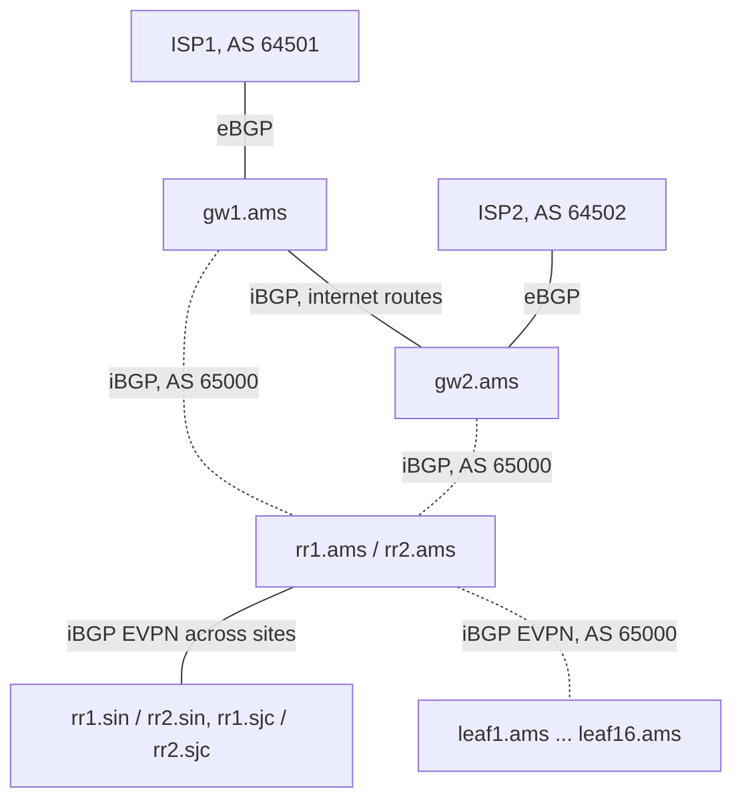

Meridian owns `203.0.113.0/24`. For anyone on the internet to reach it, about 78,000 other networks must learn that this block is reached through Meridian, and Meridian must learn where the internet's million or so other blocks live. These networks share no internal map and no common measure of distance, and each wants traffic to follow its contracts rather than the shortest line. Inside Meridian's fabric the problem differs: 16 Amsterdam leaves must learn which tenant addresses sit behind which other leaf, across three sites, without flooding.

BGP, the Border Gateway Protocol, solves both: it is the routing protocol that runs *between* independently operated networks, general enough that data centers use it inside too. This lesson builds the module's vocabulary; [BGP sessions and the FSM](/learn/fabric-networking/bgp-fundamentals/bgp-sessions-and-the-fsm) then opens the session itself.

A reminder from [the routing table](/learn/fabric-networking/from-zero/the-routing-table): a **prefix** is a block of addresses written as address and length (`203.0.113.0/24` is the 256 addresses from `203.0.113.0` to `203.0.113.255`), and a **route** is a prefix plus where to send packets for it. BGP delivers routes, with enough attached for each network to choose among them.

## Autonomous systems: the unit BGP routes between

An **autonomous system** (AS) is a set of IP prefixes run by one or more operators under a single, well-defined routing policy (RFC 1930). "Routing policy" is the key phrase: an AS is defined by who decides how traffic enters and leaves, not by geography, company boundaries or the number of routers.

- **One company can run several ASes.** Meridian is AS 64500 to the internet, while its fabric's overlay uses AS 65000 internally.
- **One AS can span the world.** Meridian's three sites are one AS 64500 to the outside; a global CDN is typically one AS across hundreds of cities.
- **An AS is not a router.** AS 64500 is every gateway, switch and link inside Meridian's border, made one AS by sharing one policy towards the outside.

Inside an AS, an **IGP** (interior gateway protocol: IS-IS or OSPF, [what routing protocols do](/learn/fabric-networking/underlay/what-routing-protocols-do)) computes shortest paths over a map every router shares. Between ASes there is no shared map. Each AS sees only its neighbours' announcements ("these prefixes, through me, along this path of ASes"): ASes are the nodes of the internet's graph, and BGP speaks across its edges.

**What the AS solves:** a unit of routing policy that can be named ("prefer routes from AS 64501"). **How it breaks:** the loop check assumes numbers are unique, so two networks using the same number reject each other's routes as loops. **Signal:** routes rejected as AS loops between networks that never exchanged them.

## AS numbers: who hands them out and what the ranges mean

An **AS number** (ASN) is an integer naming one AS. IANA (the Internet Assigned Numbers Authority) hands blocks of numbers to the five **regional internet registries** (RIRs: ARIN, RIPE NCC, APNIC, LACNIC and AFRINIC), which assign them to organisations that need one, usually because they connect to two or more networks under their own policy. Well over 100,000 numbers have been assigned; roughly 78,000 appear in the global routing table at any time, most of them **stub** networks that originate their own prefixes and carry nobody else's traffic.

### 2-byte and 4-byte numbers

BGP-4 (RFC 4271) carries the ASN in a 2-byte field, so the original space held 65,536 numbers, of which about 64,000 were assignable publicly. RFC 4893 (2007, replaced by RFC 6793) extended ASNs to 4 bytes, 4,294,967,296 numbers, and from about 2009 to 2010 the registries began assigning 4-byte numbers by default. Two problems had to be solved without upgrading the internet at once:

- **The OPEN message's 2-byte field.** A speaker with a number above 65,535 writes **AS_TRANS, 23456**, in that field and puts its real number in the four-octet AS capability ([BGP sessions and the FSM](/learn/fabric-networking/bgp-fundamentals/bgp-sessions-and-the-fsm) shows the bytes).
- **Paths crossing old routers.** Between two 4-byte speakers the AS_PATH holds 4-byte numbers. To a 2-byte-only speaker, a 4-byte speaker sends an AS_PATH in which every large number is replaced by 23456, plus a new optional attribute, **AS4_PATH**, carrying the real path. The old router passes AS4_PATH on untouched (optional transitive attributes travel even when not understood) and prepends its own number to AS_PATH only; the next 4-byte speaker rebuilds the true path from the two.

Four-byte numbers are written in **asplain** (`65551`) or **asdot** (`1.15`: the high and low 16-bit halves, RFC 5396). asplain is the default almost everywhere; asdot survives in old configurations and breaks regular expressions that do not expect a dot.

### The ranges every engineer should recognise

| Range | Count | Meaning | Defined in |
|---|---|---|---|
| 0 | 1 | Reserved; a path containing it is malformed and treated as a withdrawal | RFC 7607 |
| 1–23455, 23457–64495 | about 64,000 | Public 2-byte numbers, assigned by the RIRs | IANA registry |
| 23456 | 1 | AS_TRANS, the placeholder for 4-byte numbers in 2-byte fields | RFC 6793 |
| 64496–64511 | 16 | Documentation and examples | RFC 5398 |
| 64512–65534 | 1,023 | Private use | RFC 6996 |
| 65535 | 1 | Reserved | RFC 7300 |
| 65536–65551 | 16 | Documentation (4-byte) | RFC 5398 |
| 65552–131071 | 65,520 | Reserved by IANA | IANA registry |
| 131072–4199999999 | about 4.2 billion | Public 4-byte numbers | IANA registry |
| 4200000000–4294967294 | 94,967,295 | Private use (4-byte) | RFC 6996 |
| 4294967295 | 1 | Reserved | RFC 7300 |

Every public number and address in this track comes from the documentation ranges: AS 64496–64511 (RFC 5398), the prefixes `192.0.2.0/24`, `198.51.100.0/24` and `203.0.113.0/24` (RFC 5737) and `2001:db8::/32` (RFC 3849). Meridian's AS 64500 and its ISPs' 64501 and 64502 stand in for the public numbers a real operator would hold; on the real internet these ranges are filtered like any number that should never appear.

**Private ASNs** are the AS equivalent of `10.0.0.0/8`: free inside your network, meaningless outside, never supposed to appear in an internet path. They serve wherever BGP runs between parts of one organisation:

- **Meridian's overlay.** AS 65000 carries EVPN (the BGP extension that tells leaves where tenant addresses live) between leaves and route reflectors, unseen outside.
- **The eBGP underlay alternative** from [BGP as the underlay](/learn/fabric-networking/underlay/bgp-as-the-underlay): spines AS 65100, each leaf its own AS from 65101. The 1,023 2-byte private numbers run out in a large fabric, which is why RFC 7938 points to the 4-byte private range, about 95 million numbers, for one-ASN-per-switch designs.
- **Customers of an ISP** that need BGP only to that provider (for two links to it, say) get a private ASN from the ISP, which strips it from the AS_PATH before passing the customer's prefix on. Forgetting that is a failure mode below.

**What the ranges solve:** numbers for internal use without a registry, and example numbers that never collide with a real network. **How they break:** a private or documentation number escapes into internet paths, or two internal networks pick the same private number. **Signal:** private ASNs in paths seen by public route collectors; routes between two of your own sites rejected as AS loops.

## The internet as a network of networks

The internet has no centre and no owner: tens of thousands of ASes, each connected to a few others, each connection a business arrangement as much as a cable:

- **Transit.** A customer pays a provider to carry its traffic to and from the whole internet. Meridian buys transit from ISP1 and ISP2; both ISPs buy it from a larger transit provider, AS 64496.
- **Peering.** Two networks exchange traffic between their own customers directly, usually without payment, because both save on transit. ISP2 peers with a content network, AS 64511, which originates `192.0.2.0/24`.
- **Internet exchanges** (IXPs) are shared switches where hundreds of networks meet to peer, cheaper than a private cable to each.

A few very large "tier-1" networks reach everything without buying transit; everyone else buys from somebody ([how the internet is glued together](/learn/fabric-networking/bgp-in-the-real-world/how-the-internet-is-glued-together)). In the mid-2020s a router taking a **full table** (every route on the internet) holds about a million IPv4 prefixes and over 200,000 IPv6 prefixes, and both keep growing.

### One announcement, traced

BGP is a **path-vector** protocol: each route carries the list of ASes it has passed through, the **AS_PATH**, and each AS adds its own number when it passes a route to another AS. [Routing algorithms](/learn/networking/network-algorithms/routing-algorithms) explains why this provenance fixes distance-vector's count-to-infinity. Here is what it looks like on Meridian's corner of the internet: four ASes in a ring, with Meridian announcing only to ISP1 in this run.

```viz
{"type": "fabric", "scenario": "bgp-update-propagation", "title": "One BGP announcement around four ASes, rejected as an AS loop at home", "caption": "gw1.ams originates 203.0.113.0/24 with an empty AS_PATH, tells gw2.ams over iBGP, then announces it to ISP1. Each eBGP hop prepends one AS and replaces NEXT_HOP: 64500, 64501 64500, 64496 64501 64500. ISP2 hands the four-AS path to gw2.ams, which finds 64500 in it and discards it. Traffic then flows the opposite way to the announcement."}
```

The state after each step, as the visualisation builds it:

| Step | Who holds `203.0.113.0/24` | AS_PATH | NEXT_HOP | Status |
|---|---|---|---|---|
| 1 | `gw1.ams` | (empty) | local | originated |
| 2 | `gw2.ams` | (empty) | 10.255.1.201 (`gw1.ams`'s loopback) | best, via iBGP |
| 3 | ISP1 (AS 64501) | 64500 | 198.51.100.3 | accepted |
| 4 | Transit (AS 64496) | 64501 64500 | 198.51.100.7 | accepted |
| 5 | ISP2 (AS 64502) | 64496 64501 64500 | 198.51.100.8 | accepted |
| 6 | `gw2.ams`, from ISP2 | 64502 64496 64501 64500 | 198.51.100.0 | rejected: AS loop |

Four things to read off it:

1. **AS_PATH grows only at AS boundaries.** Inside AS 64500 the path stays empty; it gains one number per AS crossed, not per router.
2. **The path reads right to left.** The rightmost number is the **origin AS**, the network that announced the prefix first. The leftmost is the neighbour that sent the route.
3. **NEXT_HOP is replaced at each boundary** with the sender's address on the shared link, which is where the receiver will send traffic. The path is the route's history; the next hop is the packets' immediate step.
4. **The loop check is per AS.** `gw2.ams` never sent this route, but its AS did, so its own number in the path proves the route has been through AS 64500. Without the check the announcement would circle the ring forever, because a BGP route carries no hop limit. Loops inside an AS, where the path does not grow, are [iBGP, loops and next hops](/learn/fabric-networking/bgp-fundamentals/ibgp-loops-and-next-hops).

Traffic flows the opposite way. An announcement is an invitation ("send packets for this prefix to me"): a packet entering ISP2 for `203.0.113.10` follows each AS's next hop back through the transit provider and ISP1 to `gw1.ams`. Meridian controls what it announces; every other network decides where to send the resulting traffic.

**What path-vector solves:** loop-free routing between networks that will not share their maps. **How it breaks:** the path says which networks a route crossed, not how fast or loaded they are, and any AS can lie about what it originates. **Signal:** the AS_PATH and origin AS of your own prefixes as seen from outside, on public route collectors and looking glasses.

## Why policy beats shortest path

An IGP chooses the lowest total metric because every router in one network wants the same thing: fast delivery. Between networks, the routers want different things, and most of the difference is money.

**Transit is billed by usage.** The common scheme is the 95th percentile: the provider samples the port's traffic every five minutes, sorts the month's samples, discards the top 5%, and bills the highest remaining one. A 30-day month has 30 × 288 = 8,640 samples, so the top 432 are free, which is 36 hours of bursting. A backup job that runs for 20 hours at double the normal rate costs almost nothing extra (its samples push a few ordinary peaks into the billed position); one that runs for 37 hours sets the whole month's bill at its rate.

That turns into three preferences nearly every network applies. The first two, with the export rule below, are what Gao and Rexford (2001) showed keeps global routing stable; the third is common practice:

- **A route learned from a customer is preferred over one from a peer**, because the customer pays you to carry its traffic.
- **A peer's route is preferred over a provider's**, because peering is free and transit costs money.
- **Path length only breaks ties** within the same kind of neighbour.

BGP expresses these preferences with **LOCAL_PREF**, a number a network attaches to routes as it accepts them (higher wins) and shares among its own routers. The decision process compares LOCAL_PREF *before* AS_PATH length ([the best-path algorithm](/learn/fabric-networking/bgp-fundamentals/the-best-path-algorithm) has the whole order), so a route from a paying customer beats a shorter route from a provider every time.

**Worked example 1: ISP2 and its customer.** Suppose Meridian announces its prefix to both ISPs and, wanting less traffic through ISP2, makes the path it sends ISP2 look longer by repeating its own number (**prepending**): `64500 64500 64500 64500`. ISP2 now holds two routes to `203.0.113.0/24`: four ASes long from its customer `gw2.ams`, and three ASes long (`64496 64501 64500`) from its transit provider. Shortest path would pay AS 64496 to reach a customer who pays ISP2. ISP2 gives customer routes LOCAL_PREF 200 and provider routes 80, so it keeps the four-AS route: prepending moves only networks with no stronger preference ([traffic engineering with BGP](/learn/fabric-networking/bgp-in-the-real-world/traffic-engineering-with-bgp)).

**Worked example 2: Meridian's own exit.** For the content network's `192.0.2.0/24`, `gw2.ams` learns `64502 64511` from ISP2 (two ASes) and `gw1.ams` learns `64501 64496 64511` from ISP1 (three ASes). Shortest path says ISP2. But Meridian's ISP1 port is flat-rate with spare capacity while ISP2 bills at the 95th percentile, so the gateways give ISP1's routes LOCAL_PREF 150 and send the traffic the long way round. AS_PATH length says nothing about latency either: two ASes can mean a detour through another continent, five can sit in one city.

```python
import math

# LOCAL_PREF by who sent the route: customers pay, peers are free, providers cost money.
REL_PREF = {"customer": 200, "peer": 100, "provider": 80}


def shortest(routes):
    return min(routes, key=lambda r: len(r["as_path"]))


def by_policy(routes):
    # Relationship first; AS_PATH length only breaks ties, the order the decision process uses.
    return min(routes, key=lambda r: (-REL_PREF[r["learned_from"]], len(r["as_path"])))


def show(title, routes):
    print(title)
    for name, pick in (("shortest AS_PATH", shortest), ("policy", by_policy)):
        r = pick(routes)
        path = " ".join(map(str, r["as_path"]))
        print(f"  {name:<16} -> via {r['neighbour']:<9} ({r['learned_from']}), path {path}")


# Example 1: ISP2's view of Meridian's prefix after Meridian prepends towards ISP2.
show("ISP2, route to 203.0.113.0/24:", [
    {"neighbour": "gw2.ams", "learned_from": "customer", "as_path": [64500, 64500, 64500, 64500]},
    {"neighbour": "Transit", "learned_from": "provider", "as_path": [64496, 64501, 64500]},
])

# Example 2: Meridian's gateways prefer ISP1 (flat-rate) over ISP2 (billed on usage).
routes = [
    {"neighbour": "ISP2", "as_path": [64502, 64511]},
    {"neighbour": "ISP1", "as_path": [64501, 64496, 64511]},
]
meridian_pref = {"ISP1": 150, "ISP2": 100}
print("Meridian, route to 192.0.2.0/24:")
print("  shortest AS_PATH -> via", shortest(routes)["neighbour"])
print("  policy           -> via", max(routes, key=lambda r: (meridian_pref[r["neighbour"]], -len(r["as_path"])))["neighbour"])


def p95(samples):
    """Transit billing: sort a month of 5-minute samples, discard the top 5%, bill the next one."""
    s = sorted(samples)
    return s[math.ceil(0.95 * len(s)) - 1]


day = 288                                     # 5-minute samples per day
month = [6 + 3 * math.sin(2 * math.pi * i / day) for i in range(30 * day)]   # 3 to 9 Gb/s daily cycle
print(f"\nsamples in 30 days: {len(month)}, free: {len(month) - math.ceil(0.95 * len(month))}")
print(f"daily cycle only:           billed at {p95(month):.2f} Gb/s")
for hours in (20, 36, 37):
    burst = list(month)
    for i in range(hours * 12):               # a backup job at 18 Gb/s, 12 samples per hour
        burst[10 * day + i] = 18.0
    print(f"plus {hours:>2} h burst at 18 Gb/s:  billed at {p95(burst):.2f} Gb/s")
```

```text
ISP2, route to 203.0.113.0/24:
  shortest AS_PATH -> via Transit   (provider), path 64496 64501 64500
  policy           -> via gw2.ams   (customer), path 64500 64500 64500 64500
Meridian, route to 192.0.2.0/24:
  shortest AS_PATH -> via ISP2
  policy           -> via ISP1

samples in 30 days: 8640, free: 432
daily cycle only:           billed at 8.97 Gb/s
plus 20 h burst at 18 Gb/s:  billed at 8.99 Gb/s
plus 36 h burst at 18 Gb/s:  billed at 9.00 Gb/s
plus 37 h burst at 18 Gb/s:  billed at 18.00 Gb/s
```

### Export policy: what you announce, and to whom

Import policy chooses among routes; **export policy** decides which routes each neighbour hears. If Meridian passed ISP2's routes on to ISP1, ISP1 could send content-network traffic in through one paid transit port and out through the other: Meridian paying twice to carry strangers' traffic. So Meridian announces to its providers only its own prefix (and its customers', if it had any). Breaking the rule "routes from providers and peers go only to customers" is a **route leak** ([leaks, hijacks and RPKI](/learn/fabric-networking/bgp-in-the-real-world/leaks-hijacks-and-rpki)).

Policy is written as match-and-set rules, often keyed on **communities**, tags attached to routes ([policy and communities](/learn/fabric-networking/bgp-in-the-real-world/policy-and-communities)). Whatever the syntax, you decide your outbound path completely and can only *influence* the inbound one, which is someone else's LOCAL_PREF.

**What policy solves:** routing that follows contracts, costs and capacity instead of a single metric. **How it breaks:** an export rule missing (a leak), an import preference forgotten (traffic exits through the expensive or congested provider), or an assumption that the other side will honour your prepending. **Signal:** utilisation per upstream against its commit and its 95th percentile so far this month; the AS_PATH your prefix shows from outside.

## eBGP and iBGP: one protocol, two rule sets

A router compares each neighbour's AS with its own. Different: the session is **eBGP** (external BGP). Same: **iBGP** (internal BGP). The messages are identical; what changes is what the router does to a route as it passes it on.

Why iBGP exists: `gw1.ams` learns routes from ISP1 and `gw2.ams` from ISP2, and each needs both to make one consistent decision for the AS. The IGP cannot carry them: IS-IS is built for thousands of internal prefixes, not a million external ones, and has nowhere to put an AS_PATH or LOCAL_PREF.

| Rule | eBGP | iBGP | Deeper in |
|---|---|---|---|
| Neighbour's AS | different from mine | the same as mine | |
| AS_PATH when passing a route on | prepends my AS | unchanged | this lesson |
| NEXT_HOP when passing a route on | set to my own address | unchanged by default; next-hop-self sets it to mine | [iBGP, loops and next hops](/learn/fabric-networking/bgp-fundamentals/ibgp-loops-and-next-hops) |
| LOCAL_PREF | never sent | sent, so the whole AS shares one preference | [updates, attributes and RIBs](/learn/fabric-networking/bgp-fundamentals/updates-attributes-and-ribs) |
| Re-advertising a learned route to a neighbour of the same kind | yes | no: a route from one iBGP peer is never sent to another | [route reflectors](/learn/fabric-networking/bgp-fundamentals/route-reflectors) |
| Loop prevention | own AS in the AS_PATH | that re-advertisement rule (plus reflector attributes) | [iBGP, loops and next hops](/learn/fabric-networking/bgp-fundamentals/ibgp-loops-and-next-hops) |
| Default IP TTL of the session's packets | 1: the peer must be one hop away | high (64 or 255, by implementation): the peer may be anywhere in the AS | [BGP sessions and the FSM](/learn/fabric-networking/bgp-fundamentals/bgp-sessions-and-the-fsm) |
| Usual peering address | the interface address on the shared link | the loopback, reached through the IGP | |
| Preference among equal routes | preferred over iBGP late in the decision process | | [the best-path algorithm](/learn/fabric-networking/bgp-fundamentals/the-best-path-algorithm) |

The re-advertisement rule exists because inside an AS the path does not grow and cannot reveal a loop; the price is a full mesh of n(n − 1)/2 sessions, which route reflectors avoid. iBGP also brings the module's central trap: an iBGP route's next hop is usually several hops away, and every router in between must know how to reach it ([the BGP black hole](/learn/fabric-networking/bgp-fundamentals/the-bgp-black-hole)).

Here is the result on `gw2.ams` for the content network's prefix, after Meridian's import policy (illustrative output, simplified):

```text
gw2.ams# show bgp ipv4 unicast 192.0.2.0/24            (illustrative output)
BGP routing table entry for 192.0.2.0/24
Paths: 2 available, best #2
  Path 1: 64502 64511, eBGP from 198.51.100.0 (ISP2)
      next hop 198.51.100.0, origin IGP, localpref 100
  Path 2: 64501 64496 64511, iBGP from 10.255.1.201 (gw1.ams)
      next hop 10.255.1.201, origin IGP, localpref 150, best
```

Path 1 arrived over eBGP: ISP2 prepended its number and the next hop is its link address. Path 2 crossed one iBGP session after `gw1.ams`: the AS_PATH is unchanged, LOCAL_PREF 150 was set by `gw1.ams` on import and carried along, and the next hop is `gw1.ams`'s loopback because the gateways set themselves as next hop on iBGP (next-hop-self), so no internal router needs a route to ISP1's link. Path 2 wins on LOCAL_PREF before length is compared.

**What the split solves:** routes cross AS boundaries with provenance (eBGP), and every border router in an AS shares one view and one preference (iBGP). **How it breaks:** the re-advertisement rule leaves routers without routes when the mesh is incomplete; an unchanged next hop the IGP cannot reach makes a route unusable. **Signal:** prefix counts that differ between routers that should hold the same table, and routes marked "inaccessible" or "unresolved" next hop.

## Where BGP runs: data center, backbone and internet

BGP started at the border between networks, hence its name; a large operator now runs more BGP sessions inside its data centers than at its edge. Meridian's sessions:



### In the data center

- **The overlay.** Every Amsterdam leaf is an iBGP client of both reflectors in AS 65000: 16 × 2 = 32 sessions, carrying EVPN routes that say which tenant MAC and IP addresses sit behind which leaf. A **route reflector** passes iBGP routes between its clients ([route reflectors](/learn/fabric-networking/bgp-fundamentals/route-reflectors)); without one, 16 leaves would need 16 × 15 / 2 = 120 sessions. The routes themselves are [EVPN, the control plane](/learn/fabric-networking/overlays-vxlan-evpn/evpn-the-control-plane).
- **The underlay, in many fabrics.** Meridian uses IS-IS to make every loopback reachable; many data centers use eBGP instead (RFC 7938): spines share one AS, each leaf has its own, and the AS_PATH loop check, the rule `gw2.ams` applied above, stops routes turning back through a second spine.

```viz
{"type": "fabric", "scenario": "ebgp-clos-underlay", "title": "BGP inside a fabric: an AS per leaf, a spine rejecting a looped path", "caption": "Two spines in AS 65100, four leaves in AS 65101 to 65104, one eBGP session per link. leaf1.ams's loopback reaches leaf3.ams through both spines with AS_PATH 65100 65101 and is installed as ECMP; spine2.ams discards a copy readvertised by leaf3.ams because it contains 65100; a link failure is handled by an explicit withdrawal."}
```

- **Down to the hosts.** Servers run BGP too, often where software engineers meet it first. Calico can peer each Kubernetes node with its top-of-rack leaf to announce pod subnets; MetalLB in BGP mode and many software load balancers announce a service's virtual IP from every instance, and the leaf spreads traffic across them with ECMP (equal-cost multipath, [ECMP and hashing](/learn/fabric-networking/fabric-architecture/ecmp-and-hashing)). When an instance dies its route is withdrawn and traffic stops arriving: health checking by routing ([load balancing](/learn/networking/application-protocols/load-balancing) covers the layer above).

### In the backbone

Between Meridian's sites the six reflectors are fully meshed, 6 × 5 / 2 = 15 sessions, so a tenant route learned in Amsterdam reaches Singapore's leaves. A carrier's backbone has the same shape at larger scale: iBGP between border routers carries the full table and customer VPN routes, reflectors keep the session count down, and the IGP carries only loopbacks. Many backbones keep inner routers free of BGP by tunnelling border to border with MPLS labels ([MPLS and segment routing](/learn/fabric-networking/overlays-vxlan-evpn/mpls-and-segment-routing)), the trick VXLAN plays in the fabric.

### At the internet edge

The gateways run eBGP to the outside: `gw1.ams` to ISP1, `gw2.ams` to ISP2, `gw1.sin` to ISP2 as well, and the same pattern to clouds and exchanges ([connecting sites and backbones](/learn/fabric-networking/fabric-architecture/connecting-sites-and-backbones)). They sit in both worlds: towards the fabric they are reflector clients like any leaf, advertising a default route with their loopback as next hop; towards the ISPs and each other they speak as AS 64500. Presenting a second number relies on a per-neighbour "local AS" setting, which can replace the internal number in the AS_PATH rather than add to it; which session types allow it varies by implementation, and many operators use their public number throughout instead. Either way 65000 never reaches the internet: the gateways announce only `203.0.113.0/24` and strip private numbers from anything they pass on.

| Where | Session type | ASNs | Routes carried | Typical hold time | What breaks |
|---|---|---|---|---|---|
| Leaf to reflector (overlay) | iBGP, loopback to loopback | 65000 | Hundreds to tens of thousands of EVPN routes | 9 s, or longer with BFD | Reflector pair lost: no new tenant routes |
| Leaf to spine (eBGP underlay) | eBGP, per link | 65100 and 65101 up | Loopbacks and link subnets, a few hundred | 3 to 9 s plus BFD | Duplicate leaf ASN: silent AS-loop drops |
| Host to leaf | eBGP, per server | Private, often one shared by all nodes | A few pod subnets or service VIPs | Seconds | Withdrawals lag a dead pod; one host announces too much |
| Reflector to reflector, across sites | iBGP | 65000 | Every tenant route at every site | 9 to 90 s | Partitioned sites keep stale routes until hold expiry |
| Gateway to ISP | eBGP, directly connected | 64500 and the ISP's | Full table in (about a million IPv4, 200,000 IPv6), one prefix out | 90 to 180 s (RFC 4271 suggests 90), often with BFD | Leaks; a silent peer black-holing until hold expiry |

**What BGP everywhere solves:** one protocol and one mental model for "who can reach what", from a pod's address to the whole internet. **How it breaks:** the same rules bite everywhere: an AS loop drops routes between two leaves sharing a number exactly as it drops Meridian's prefix at `gw2.ams`. **Signal:** session state and prefix counts grouped by role, because each role has a different normal.

## Do you need BGP at all?

Design reviews and interviews ask it, and many networks do not.

| Option | Needs an ASN and your own addresses | Survives an ISP failure | Control of inbound traffic | Control of outbound traffic | Operating cost |
|---|---|---|---|---|---|
| Static default route to one ISP | No | No | None | None | Lowest: nothing to run |
| Two ISPs, static defaults, each ISP's addresses | No | Outbound only: inbound connections to ISP1's addresses die with ISP1 | None | Crude (which default wins) | Low, plus DNS changes on failure |
| BGP to one ISP with a private ASN | No: the ISP strips it | Only across links to that ISP | Little | Per link to that ISP | Moderate |
| Multihomed BGP with your own ASN and prefix | Yes: an RIR ASN and at least a /24 (IPv4) or /48 (IPv6), the smallest prefixes most networks accept | Both directions, in seconds to minutes | Influence only (prepending, communities, more-specifics) | Full (LOCAL_PREF) | Highest: full-table routers, filters, registry records, monitoring |

The last row is what repays BGP's cost: addresses that are yours, reachable through either provider. Without them, losing ISP1 loses every address ISP1 lent you.

## Under the hood: how a router applies these rules

A BGP daemon (FRRouting's `bgpd` on SONiC or Cumulus, the routing process in EOS or Junos) keeps, per neighbour, a configured remote AS. When the session comes up, it checks the OPEN's AS against that value (a mismatch is NOTIFICATION 2/2, Bad Peer AS) and marks the session external or internal by comparing it with its own AS. Every rule in the eBGP/iBGP table hangs off that flag.

On receipt, before import policy runs, the daemon scans the AS_PATH for its own AS and discards the route on a match (most let an operator accept a few occurrences, the "allowas-in" knob that eBGP underlays sometimes need). Many also check that the leftmost AS equals the neighbour's ("enforce first AS"), which catches a neighbour sending a path that does not start with its own number; exchange route servers, which do not insert their AS, are the usual exception. On export over eBGP, it prepends its own AS to an **AS_SEQUENCE** segment (an ordered list), sets NEXT_HOP to its own address, and drops LOCAL_PREF. Some implementations also skip sending a route to a neighbour whose AS is already in the path, since it would be dropped anyway (sender-side loop detection). An AS_PATH may also hold an **AS_SET**, an unordered set left by route aggregation, which RFC 6472 recommends against.

The code below classifies ASNs, converts asdot, and encodes an AS_PATH the way it goes on the wire to a 4-byte and to a 2-byte-only speaker, then rebuilds the true path downstream.

```python
import struct

AS_TRANS = 23456
RANGES = [  # first, last, meaning (source)
    (0, 0, "reserved, never valid in a path (RFC 7607)"),
    (1, 23455, "public, 2-byte"),
    (23456, 23456, "AS_TRANS placeholder (RFC 6793)"),
    (23457, 64495, "public, 2-byte"),
    (64496, 64511, "documentation (RFC 5398)"),
    (64512, 65534, "private (RFC 6996)"),
    (65535, 65535, "reserved (RFC 7300)"),
    (65536, 65551, "documentation (RFC 5398)"),
    (65552, 131071, "reserved by IANA"),
    (131072, 4199999999, "public, 4-byte"),
    (4200000000, 4294967294, "private (RFC 6996)"),
    (4294967295, 4294967295, "reserved (RFC 7300)"),
]


def classify(asn):
    return next(meaning for first, last, meaning in RANGES if first <= asn <= last)


def asdot(asn):
    """RFC 5396 asdot: 4-byte numbers as high.low 16-bit halves; 2-byte numbers unchanged."""
    return str(asn) if asn < 65536 else f"{asn >> 16}.{asn & 0xFFFF}"


def from_asdot(text):
    high, _, low = text.partition(".")
    return int(high) << 16 | int(low) if low else int(high)


def attribute(flags, type_code, value):
    # flags 0x40 = well-known transitive, 0xC0 = optional transitive; then type code and length.
    return struct.pack("!BBB", flags, type_code, len(value)) + value


def as_path(path, four_byte):
    """Path attributes for one AS_SEQUENCE (segment type 2), as sent to a 4-byte or a 2-byte speaker."""
    if four_byte:
        return attribute(0x40, 2, struct.pack("!BB", 2, len(path)) + b"".join(struct.pack("!I", a) for a in path))
    two = [a if a < 65536 else AS_TRANS for a in path]          # what an old speaker can hold
    attrs = attribute(0x40, 2, struct.pack("!BB", 2, len(two)) + b"".join(struct.pack("!H", a) for a in two))
    if any(a >= 65536 for a in path):                           # the real numbers ride in AS4_PATH, type 17
        attrs += attribute(0xC0, 17, struct.pack("!BB", 2, len(path)) + b"".join(struct.pack("!I", a) for a in path))
    return attrs


def reconstruct(two_byte_path, as4_path):
    """A 4-byte speaker downstream rebuilds the true path (RFC 6793, section 4.2.3)."""
    keep = len(two_byte_path) - len(as4_path)
    return two_byte_path[:keep] + as4_path


for asn in (0, 13335, 23456, 64500, 65000, 65535, 65551, 70000, 396982, 4200000101):
    print(f"{asn:>10}  asdot {asdot(asn):>11}  {classify(asn)}")
print(from_asdot("1.15"), from_asdot("6.3766"))

path = [64500, 65551]            # Meridian, then a 4-byte customer network behind it
print("to a 4-byte peer:", as_path(path, True).hex(" "))
print("to a 2-byte peer:", as_path(path, False).hex(" "))
# The old speaker (say AS 64501) prepends itself in 2-byte form and passes AS4_PATH on untouched.
print("rebuilt:", reconstruct([64501, 64500, AS_TRANS], [64500, 65551]))
```

```text
         0  asdot           0  reserved, never valid in a path (RFC 7607)
     13335  asdot       13335  public, 2-byte
     23456  asdot       23456  AS_TRANS placeholder (RFC 6793)
     64500  asdot       64500  documentation (RFC 5398)
     65000  asdot       65000  private (RFC 6996)
     65535  asdot       65535  reserved (RFC 7300)
     65551  asdot        1.15  documentation (RFC 5398)
     70000  asdot      1.4464  reserved by IANA
    396982  asdot      6.3766  public, 4-byte
4200000101  asdot 64086.60005  private (RFC 6996)
65551 396982
to a 4-byte peer: 40 02 0a 02 02 00 00 fb f4 00 01 00 0f
to a 2-byte peer: 40 02 06 02 02 fb f4 5b a0 c0 11 0a 02 02 00 00 fb f4 00 01 00 0f
rebuilt: [64501, 64500, 65551]
```

Read the 4-byte encoding: `40` flags, `02` type AS_PATH, `0a` 10 bytes of value, `02` segment type AS_SEQUENCE, `02` two ASNs, then `00 00 fb f4` (64500) and `00 01 00 0f` (65551). The 2-byte version carries `fb f4 5b a0` (64500 and 23456), then AS4_PATH (`c0 11`: optional transitive, type 17) with the real numbers. The rebuild keeps the one leading entry AS4_PATH does not cover (64501, added by the old speaker) and takes the rest from AS4_PATH. For filter writers: in a 2-byte world 23456 stands for every 4-byte network at once.

## Failure modes in production

| Failure | Symptom | Diagnosis | Fix |
|---|---|---|---|
| Private ASN leaked to an upstream | Your prefix is missing from public route collectors via one ISP, or visible with 65000 in its path | The gateway's Adj-RIB-Out (what it sends) for that neighbour; collector paths for your prefix | Strip private ASNs on export; originate the aggregate at the gateway in the public AS |
| Two leaves (or two sites) with the same private ASN | Those two cannot reach each other's loopbacks or prefixes; everything else works; every session Established | Received-but-rejected counts showing "AS loop"; the ASN inventory | Unique ASN per leaf and per site, checked in the source of truth; allowas-in only where the design calls for it ([BGP as the underlay](/learn/fabric-networking/underlay/bgp-as-the-underlay)) |
| Policy written on AS 23456 or asdot | A filter meant for one network matches thousands, or a regular expression silently matches nothing | Paths containing 23456; filters containing dots | Write policy on real 4-byte numbers in asplain; retire 2-byte-only speakers |
| Over-long AS_PATH from runaway prepending | Memory and CPU spikes, sessions reset on some implementations | AS_PATH length distribution per neighbour | A maximum AS_PATH length on import; RFC 7606 error handling. In February 2009 one small network's prepending error produced paths over 250 ASes long, and routers on some software versions reset sessions on them, churning routes internet-wide |
| Shortest path assumed at the edge | Egress through the expensive or congested provider, a 95th-percentile bill jump, latency up | Per-upstream utilisation against commit; which LOCAL_PREF each route received | Explicit import policy per upstream ([traffic engineering with BGP](/learn/fabric-networking/bgp-in-the-real-world/traffic-engineering-with-bgp)) |
| Wrong neighbour AS in a template | Session cycles OpenSent to Idle | NOTIFICATION 2/2, Bad Peer AS | Correct the template ([BGP sessions and the FSM](/learn/fabric-networking/bgp-fundamentals/bgp-sessions-and-the-fsm)) |

The duplicate-ASN case fools people because nothing is down. If `leaf4.ams` is built from a copy of `leaf3.ams`'s template and both are AS 65103, `leaf4.ams`'s loopback reaches `leaf3.ams` with AS_PATH `65100 65103`, and `leaf3.ams` faithfully discards it as a loop. Every other leaf pair works, and every session is green.

## What the platform should show

- **An ASN inventory in the source of truth**, every number classified, uniqueness enforced where the design requires it, allocation automated for new leaves.
- **Sessions by role and type** (overlay, underlay, host, edge), because a leaf's reflector sessions and a gateway's ISP session have different normal prefix counts and timers.
- **What you send each external neighbour**, from the Adj-RIB-Out (streamed by BMP, the BGP Monitoring Protocol), compared with intent: only intended prefixes, no private ASNs.
- **How the world sees you:** your prefixes' origin AS and paths on public route collectors (RIPE RIS, RouteViews), alerting on an unexpected origin (a possible hijack) or an upstream through which your prefix has vanished.
- **Rejected routes by reason:** AS loop, first-AS mismatch, private or reserved ASN, policy. A sudden run of AS-loop rejections between two internal devices is a duplicate ASN.
- **Egress per upstream against its commit**, with the month's 95th percentile so far: the number finance asks about.

A few dozen lines turn that state into alerts:

```python
from collections import defaultdict


def is_private(asn):
    return 64512 <= asn <= 65534 or 4200000000 <= asn <= 4294967294


OWN_AS = 64500
INTENT = {"announce": {"203.0.113.0/24"}, "upstreams": {64501, 64502}}

# eBGP-underlay alternative (lesson 03-03): one private AS per leaf, from the source of truth.
leaf_asn = {"leaf1.ams": 65101, "leaf2.ams": 65102, "leaf3.ams": 65103, "leaf4.ams": 65103}

# What each gateway is sending, read from its Adj-RIB-Out (for example over BMP).
sent = {
    ("gw1.ams", 64501): {"203.0.113.0/24": [64500]},
    ("gw2.ams", 64502): {"203.0.113.0/24": [64500], "203.0.113.128/25": [64500, 65000]},
}

# How the outside world sees Meridian: AS_PATHs from a public route collector's peers.
seen_outside = {"203.0.113.0/24": [[64496, 64501, 64500], [64511, 64496, 64501, 64500]]}


def audit():
    alerts = []
    owners = defaultdict(list)
    for leaf, asn in leaf_asn.items():
        owners[asn].append(leaf)
    for asn, leaves in owners.items():
        if len(leaves) > 1:
            alerts.append(f"AS {asn} on {', '.join(leaves)}: each drops the other's routes as AS loops")
    for (gw, peer_as), routes in sent.items():
        for prefix, path in routes.items():
            if prefix not in INTENT["announce"]:
                alerts.append(f"{gw} -> AS {peer_as}: {prefix} is not in the intended announcements")
            leaked = [a for a in path if is_private(a)]
            if leaked:
                alerts.append(f"{gw} -> AS {peer_as}: {prefix} carries private AS {leaked} in its AS_PATH")
    for prefix, paths in seen_outside.items():
        origins = {p[-1] for p in paths}
        if origins != {OWN_AS}:
            alerts.append(f"{prefix}: originated by {sorted(origins - {OWN_AS})} as well as us: possible hijack")
        via = {p[-2] for p in paths if len(p) > 1}          # the AS that handed it to the internet
        for missing in sorted(INTENT["upstreams"] - via):
            alerts.append(f"{prefix}: no path through AS {missing} seen outside: upstream filtering or not propagating")
    return alerts


for line in audit():
    print(line)
```

```text
AS 65103 on leaf3.ams, leaf4.ams: each drops the other's routes as AS loops
gw2.ams -> AS 64502: 203.0.113.128/25 is not in the intended announcements
gw2.ams -> AS 64502: 203.0.113.128/25 carries private AS [65000] in its AS_PATH
203.0.113.0/24: no path through AS 64502 seen outside: upstream filtering or not propagating
```

Only an outside view produces the last alert: `gw2.ams` sends the prefix over an Established session, yet nobody reaches Meridian through ISP2, perhaps because ISP2's filters (built from routing registry records and RPKI, [leaks, hijacks and RPKI](/learn/fabric-networking/bgp-in-the-real-world/leaks-hijacks-and-rpki)) do not list it yet. All inbound traffic arrives through ISP1; the redundancy exists only on paper.

## Exercise: audit a received AS_PATH

```exercise
id: check-as-path
title: Accept or reject a route by its AS_PATH
prompt: |
  A border router receives a route over eBGP. Write `check_as_path(local_asn, peer_asn, as_path)`
  that applies these checks in this order and returns a two-element list `[verdict, asn]`:

  1. An empty `as_path` is malformed on eBGP: return `["malformed", None]` (`null` in JavaScript).
  2. The leftmost ASN must be the neighbour's: otherwise return `["first-as", <leftmost ASN>]`.
  3. If `local_asn` appears anywhere in the path: return `["loop", local_asn]`.
  4. Scan the path left to right and return the first ASN that is private or reserved:
     `["private", asn]` for 64512-65534 or 4200000000-4294967294;
     `["reserved", asn]` for 0, 23456, 65535, 4294967295 or 65552-131071.
  5. Otherwise return `["accept", None]`.

  Treat the documentation ranges (64496-64511 and 65536-65551) as public, as this track does.
languages: [python, javascript]
entry: check_as_path
starter:
  python: |
    def check_as_path(local_asn, peer_asn, as_path):
        # your code here
        return ["accept", None]
  javascript: |
    function check_as_path(local_asn, peer_asn, as_path) {
      // your code here
      return ["accept", null];
    }
tests:
  - args: [64501, 64500, [64500]]
    expected: ["accept", null]
    label: ISP1 hears Meridian's prefix
  - args: [64500, 64502, [64502, 64496, 64501, 64500]]
    expected: ["loop", 64500]
    label: gw2.ams hears its own prefix back
  - args: [64501, 64500, [64500, 65000]]
    expected: ["private", 65000]
    label: a private ASN leaked
  - args: [64501, 64500, []]
    expected: ["malformed", null]
    label: empty path
  - args: [64501, 64500, [64496, 64500]]
    expected: ["first-as", 64496]
  - args: [64502, 64500, [64500, 23456]]
    expected: ["reserved", 23456]
    hidden: true
  - args: [64502, 64501, [64501, 4200000001, 0]]
    expected: ["private", 4200000001]
    hidden: true
  - args: [64500, 64501, [64501, 65551, 70000, 64500]]
    expected: ["loop", 64500]
    hidden: true
hints:
  - "Do the checks in the stated order and return as soon as one fails: a looped path that also contains a reserved ASN reports the loop."
  - "Write a helper that returns \"private\", \"reserved\" or None for one ASN, using range comparisons rather than a set of every number."
```

## Interviewer follow-ups

**"What is the difference between eBGP and iBGP?"** Model answer: one protocol; eBGP when the neighbour's AS differs from yours, iBGP when it matches. eBGP prepends the AS and sets itself as next hop; iBGP leaves both unchanged, carries LOCAL_PREF, and never passes one iBGP peer's route to another, which forces a full mesh or reflectors. Common wrong answer: "eBGP is for the internet and iBGP is for inside the data center", which fails on an eBGP-underlay fabric, where every leaf-spine session is eBGP.

**"Why would BGP choose a longer AS_PATH?"** Model answer: AS_PATH length is compared only after LOCAL_PREF, which networks set by relationship and cost: customer over peer over provider, because customers pay, peers are free and providers charge. An ISP keeps a long customer route over a shorter provider route, so prepending towards your own provider rarely moves traffic. Common wrong answer: "BGP picks the lowest-latency path"; it knows nothing about latency, and AS_PATH length counts networks, not distance.

**"Why would a data center run BGP at all, when no other company is inside it?"** Model answer: as the underlay (RFC 7938), per-link eBGP with the AS_PATH loop check replaces an IGP; as the overlay, its address families carry tenant MAC and IP routes; on hosts, pods and load balancers announce addresses, with a withdrawal as the health signal. Common wrong answer: "BGP is only for talking to ISPs."

**"What is a private ASN, and what happens if one reaches the internet?"** Model answer: 64512–65534 and 4200000000–4294967294, the AS equivalent of RFC 1918 addresses: for fabrics and for customers peering with a single provider. Many networks drop routes carrying them, so a leak can make your prefix vanish from one upstream; where accepted, they corrupt the loop check, because unrelated networks reuse the same numbers. Strip them on export and watch public collectors for them. Common wrong answer: "it doesn't matter, the AS number is only informational".

**"Your company has one ISP. Do you need BGP?"** Model answer: usually not; a static default does the job, and BGP repays its cost when you multihome with your own addresses. With two links to one ISP, BGP with a private ASN gives link failover. An honest addition: "I'd defer to the network team on the provider contracts and the routing registry paperwork, but I'd measure failover time and per-link utilisation before and after." Common wrong answer: "yes, any company connected to the internet runs BGP", which buys full-table routers and filter upkeep for no gain.

## What mid-level engineers get wrong

- **Believing BGP picks the shortest or fastest path.** It picks by policy first; the latency and cost surprises get blamed on "the internet".
- **Treating the AS as a router or a site.** The loop check, AS_PATH length and LOCAL_PREF all work per AS, so a three-site network with one AS is one hop in every path.
- **Reusing private ASNs across sites or leaves without checking.** The AS-loop rule then drops routes between them with every session up.
- **Assuming you control inbound traffic.** Your announcements influence it; every other network's LOCAL_PREF decides it.
- **Thinking BGP sits in the packet path.** BGP runs beforehand and fills the forwarding table; a packet never meets BGP, only the result ([the packet walk](/learn/fabric-networking/from-zero/the-packet-walk)).

## Senior signals

- You define an AS by its routing policy and read an AS_PATH right to left to its origin, one entry per AS, not per router.
- You recognise private, documentation and reserved ASNs on sight, know AS_TRANS 23456 and AS4_PATH, and never write policy on 23456.
- You explain BGP's choices in money: customer over peer over provider via LOCAL_PREF before path length, with 95th-percentile billing behind egress policy.
- You state the eBGP and iBGP rules as a short list (prepend, next hop, LOCAL_PREF, re-advertisement, TTL) and tie the iBGP rule to route reflectors and next-hop resolution.
- You place BGP in the fabric, on hosts, in the backbone and at the edge, each with its own normal prefix count and timers.
- You check how the outside world sees your prefixes, not only your sessions, because an Established session can sit in front of an upstream that drops your route.

## Check yourself

```quiz
- q: >-
    gw2.ams (AS 64500) receives Meridian's own 203.0.113.0/24 from ISP2 with AS_PATH 64502 64496 64501 64500. gw2.ams never announced this prefix to anyone. What does it do?
  options: ["Accepts it as a backup path in case the iBGP route is withdrawn", "Discards it, because its own AS number is already in the path", "Accepts it, because gw2.ams itself never sent this route out", "Discards it, because a four-AS path exceeds BGP's hop limit"]
  answer: 1
  explanation: >-
    The loop check is per AS: AS 64500 in the path proves the route has already been through Meridian, whichever router sent it. Keeping it as a backup would invite exactly the loop the rule prevents. BGP has no hop limit on paths; the AS_PATH itself is the loop detector.
- q: >-
    Meridian prepends its AS three extra times on announcements to ISP2. ISP2 now has a four-AS path from its customer Meridian and a three-AS path via its transit provider. Which does ISP2 most likely use?
  options: ["The customer path, because customer routes get a higher LOCAL_PREF", "Both equally, because BGP load-shares across the two paths", "The transit path, because providers always rank above customers", "The transit path, because the shorter AS_PATH wins"]
  answer: 0
  explanation: >-
    ISP2 sets LOCAL_PREF by relationship, and LOCAL_PREF is compared before AS_PATH length, so its paying customer's route wins regardless of prepending. Choosing the provider route would mean paying transit to reach a customer who pays ISP2. BGP does not load-share across paths with different attributes by default.
- q: >-
    In an eBGP-underlay fabric, leaf3.ams and leaf4.ams were both configured as AS 65103. All BGP sessions are Established. What do you expect to see?
  options: ["The spines rejecting both leaves for having a duplicate router ID", "Every leaf losing its routes to every other leaf in the site", "leaf3.ams and leaf4.ams unable to reach each other, everything else fine", "Both leaves' sessions to the spines cycling with NOTIFICATION 2/2"]
  answer: 2
  explanation: >-
    Each leaf receives the other's routes with AS_PATH 65100 65103, finds its own AS and discards them as a loop. Routes to and from every other leaf carry different numbers and are accepted. The spines are configured to expect AS 65103 on both sessions, so there is no Bad Peer AS error, and router IDs are a separate value.
- q: >-
    What makes a BGP session eBGP rather than iBGP?
  options: ["The peer being directly connected on a shared link", "The session carrying routes for internet prefixes", "The peer being located in a different physical site", "The peer's AS number differing from the router's own"]
  answer: 3
  explanation: >-
    The only test is whether the two ASNs differ. iBGP peers can be a hop apart and eBGP peers can be multihop; eBGP inside a data center carries no internet routes at all; Meridian's iBGP spans three sites.
- q: >-
    A public route collector shows a prefix with AS_PATH 64496 64501 65010. What has most likely happened?
  options: ["AS 65010 hijacked the prefix from its rightful origin, AS 64501", "AS 64501 did not strip its BGP customer's private ASN on export", "A 2-byte speaker wrote 65010 as a placeholder for a 4-byte ASN", "AS 64501 prepended a second ASN of its own to steer traffic away"]
  answer: 1
  explanation: >-
    65010 is in the private range: typically a customer that runs BGP only to AS 64501 with a number 64501 assigned, and 64501 should have removed it before passing the route to its provider. A private origin is a stripping failure, not by itself evidence of a hijack. The placeholder for 4-byte numbers is 23456, and prepending repeats a network's own number rather than adding a different one.
- q: >-
    Meridian's ISP2 port bills at the 95th percentile of 5-minute samples over a 30-day month. A backup job doubles the traffic for 30 hours. What happens to the bill?
  options: ["It doubles, because the billed rate is the month's peak", "It rises by the 30 hours' share of the month, about 4%", "It doubles, because any burst above the commit is charged in full", "It barely moves, because the top 36 hours of samples are not billed"]
  answer: 3
  explanation: >-
    30 days have 8,640 samples; the top 5%, 432 samples or 36 hours, are discarded. A 30-hour burst falls entirely inside them, so the billed sample is still an ordinary daily peak, at most a little higher one. A burst of 37 hours or more would set the bill at the burst rate. Peak billing and pro-rated averages are not how the 95th percentile works.
```
