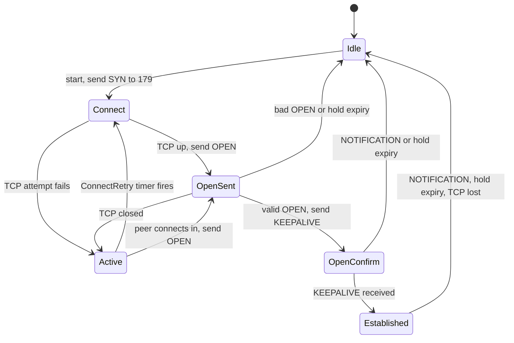

Two routers exchanging routes, a few thousand in a fabric or the internet's million, must deliver each exactly once and in order, and notice quickly when the other side has gone, because every route from a dead neighbour points traffic into a hole. BGP, the Border Gateway Protocol, hands reliable delivery to TCP, sends only changes, and adds a small state machine plus a heartbeat on top. That design explains what you see in every BGP session: the TCP handshake on port 179, four message types (a fifth, ROUTE-REFRESH, came later), six states, the hold timer, and a state called "Active" that means the session is not working.

This lesson builds one session on the Meridian fabric: `leaf1.ams` (loopback `10.255.1.11`) to its route reflector `rr1.ams` (`10.255.1.101`), both in the overlay's AS 65000. A route reflector relays BGP routes between leaves so they need not all peer with each other ([route reflectors](/learn/fabric-networking/bgp-fundamentals/route-reflectors)). [What BGP is for](/learn/fabric-networking/bgp-fundamentals/what-bgp-is-for) defines an autonomous system (AS), iBGP (a session inside one AS) and eBGP (between two); the [next lesson](/learn/fabric-networking/bgp-fundamentals/updates-attributes-and-ribs) opens the UPDATE message.

## Why BGP rides on TCP

A **BGP speaker** is a router running BGP; a **peer** (or **neighbour**) is another speaker it is configured to talk to; a **session** is the conversation between them. BGP has no discovery: unlike IS-IS, whose hellos find neighbours on every link ([IS-IS from zero](/learn/fabric-networking/underlay/is-is-from-zero)), BGP talks only to addresses an operator or template wrote down. (Data-center "BGP unnumbered", as in FRRouting, comes closest: given only an interface, it learns the peer's IPv6 link-local address from the router advertisements sent on it.) The session is one **TCP** connection, the transport that numbers every byte, retransmits losses and delivers in order ([transport as the network sees it](/learn/fabric-networking/from-zero/transport-as-the-network-sees-it)). One side connects to the other's port **179**, reserved for BGP, from an ephemeral (temporary, random) port.

What TCP gives BGP:

- **Incremental updates.** Nothing is lost, so after the initial table BGP sends only changes; a stable session carrying a million routes uses almost no bandwidth. RIP resends its whole table every 30 s.
- **No reinvented transport.** BGP has no sequence numbers, acknowledgements or retransmission of its own. A message is at most 4,096 bytes (65,535 with RFC 8654's extended-message capability), written into a stream TCP segments as it likes.
- **Flow control.** A slow receiver shrinks its TCP window and the sender waits, rather than routes being dropped.

What it costs:

- **The peer must be reachable first.** For iBGP between loopbacks, the underlay (IS-IS on Meridian) must already route to `10.255.1.101`. BGP depends on the IGP (interior gateway protocol, the routing protocol inside one network), never the reverse.
- **Head-of-line blocking.** A KEEPALIVE written behind 2 MB of UPDATEs waits for all of them, and one lost segment holds back everything behind it.
- **TCP's liveness check is useless here.** Linux's first TCP keepalive probe comes after 7,200 idle seconds ([TCP deep dive](/learn/networking/fundamentals/tcp-deep-dive)), and acknowledgements come from the kernel, not the BGP process, so a hung daemon still has its bytes acknowledged. Hence BGP's own heartbeat.

Three details decide whether a SYN (TCP's connection request) even arrives. A directly connected eBGP session, such as `gw1.ams` to ISP1 (AS 64501), sends with an IP TTL (time to live, the hop counter each router decrements) of 1, so it fails if the peer is not one hop away; eBGP to a remote loopback needs "multihop". GTSM (RFC 5082, the Generalized TTL Security Mechanism) inverts this: send with TTL 255 and accept only a TTL that proves the packet crossed no more than the expected number of hops (255 for a directly connected peer). A distant attacker's packets arrive with a lower TTL, and no sender can set it above 255. Segments can also be signed with TCP MD5 (RFC 2385) or TCP-AO (RFC 5925); one that fails verification is dropped by the kernel without a reply.

**What TCP solves:** reliable, ordered, flow-controlled delivery of a large table. **How it breaks:** no route to the peer, a filter on port 179, a signature or TTL mismatch, and BGP never gets as far as its first message. **Signal:** the session never leaves Connect or Active; a packet capture shows SYNs and either nothing or an RST (reset) back.

A successful connection on Meridian looks like this (illustrative, simplified `tcpdump` output; times from the trace further down):

```text
10:00:10.000400 10.255.1.11.40123 > 10.255.1.101.179: [S]  win 64240, mss 9176
10:00:10.000600 10.255.1.101.179 > 10.255.1.11.40123: [S.] win 65160, mss 9176
10:00:10.000700 10.255.1.11.40123 > 10.255.1.101.179: [.]  ack
10:00:10.000750 10.255.1.11.40123 > 10.255.1.101.179: [P.] length 57: BGP OPEN, AS 65000, hold 9, ID 10.255.1.11
10:00:10.000900 10.255.1.101.179 > 10.255.1.11.40123: [P.] length 65: BGP OPEN, AS 65000, hold 90, ID 10.255.1.101
10:00:10.001100 10.255.1.11.40123 > 10.255.1.101.179: [P.] length 19: BGP KEEPALIVE
10:00:10.001500 10.255.1.101.179 > 10.255.1.11.40123: [P.] length 19: BGP KEEPALIVE
10:00:10.002000 10.255.1.101.179 > 10.255.1.11.40123: [P.] length 4049: BGP UPDATE (EVPN routes)
```

The maximum segment size (MSS) of 9,176 bytes is the fabric's 9,216-byte IP MTU (maximum transmission unit, the largest packet a link carries) minus 40 bytes of IP and TCP headers. It matters again in the failure section.

## The message header and the four messages

Every BGP message starts with the same 19-byte header. TCP delivers a stream, not packets, so the length field tells the receiver where each message ends.

| Field | Size | Value in a KEEPALIVE | What reads it |
|---|---|---|---|
| Marker | 16 bytes | `ff` × 16 | Receiver's framing check; anything else is NOTIFICATION 1/1 "connection not synchronised" |
| Length | 2 bytes | 19 | Receiver's stream parser: where the next message starts |
| Type | 1 byte | 4 | Dispatch: 1 OPEN, 2 UPDATE, 3 NOTIFICATION, 4 KEEPALIVE, 5 ROUTE-REFRESH |

The all-ones marker is a fossil of early authentication, kept "for compatibility". A KEEPALIVE is the header alone.

## OPEN: what two routers must agree on

The first thing each side writes after the handshake is an OPEN, a proposal: who I am, how long you may stay silent before I give up on you, and what I can do. Here is `leaf1.ams`'s, built and parsed by the Python below.

| Field | Size | Value in `leaf1.ams`'s OPEN | What reads it |
|---|---|---|---|
| Header | 19 bytes | marker, length 57, type 1 | Framing |
| Version | 1 byte | 4 (since 1994) | Peer: anything but 4 is NOTIFICATION 2/1 |
| My Autonomous System | 2 bytes | 65000 (`fd e8`) | Peer: compared with the AS it was configured to expect |
| Hold Time | 2 bytes | 9 (`00 09`) | Peer: the session uses the smaller of the two proposals |
| BGP Identifier | 4 bytes | 10.255.1.11 (`0a ff 01 0b`) | Peer: collision resolution, loop checks, best-path tie-break |
| Optional Parameters Length | 1 byte | 28 | Parser |
| Optional Parameters | 28 bytes | four capabilities | Peer: the intersection becomes the session's feature set |

**My Autonomous System** is 2 bytes, which ran out once the internet had tens of thousands of networks. Four-byte AS numbers (RFC 6793) travel in a capability, and a speaker above 65,535 writes the placeholder **AS_TRANS, 23456**, here. The receiver compares the real AS with the one configured for this neighbour; a mismatch is NOTIFICATION 2/2 "Bad Peer AS", usually a template typo.

**Hold Time** is how many seconds the sender will wait without hearing from the peer before declaring it dead. Both sides use the **minimum** of the two proposals, which must be 0 (never time out) or at least 3.

**BGP Identifier**, the router ID, is a 32-bit number written like an IPv4 address, conventionally the loopback (`10.255.1.11`). It must be unique within the AS: it breaks ties in [best-path selection](/learn/fabric-networking/bgp-fundamentals/the-best-path-algorithm), is stamped into reflected routes for loop prevention, and decides which connection survives when two routers connect simultaneously. An iBGP OPEN carrying the receiver's own identifier is refused with 2/3 "Bad BGP Identifier" (RFC 6286).

**Capabilities** (RFC 5492) are how BGP grew without a version 5: each is a code, a length and a value, and the session gets only what both sides announce.

| Code | Capability | In `leaf1.ams`'s OPEN | If one side lacks it |
|---|---|---|---|
| 1 | Multiprotocol extensions (RFC 4760): one per address family | AFI 1 / SAFI 1 (IPv4 unicast); AFI 25 / SAFI 70 (L2VPN EVPN) | That family is not exchanged, and the session still comes up |
| 2 | Route refresh (RFC 2918) | present | Re-applying a changed import policy needs a session reset or a stored copy of everything received |
| 65 | Four-octet AS (RFC 6793) | AS 65000 | AS numbers above 65,535 travel as 23456 plus an extra attribute |
| 64 | Graceful restart (RFC 4724) | not in this example | A control-plane restart withdraws the peer's routes at once ([convergence and scale](/learn/fabric-networking/bgp-in-the-real-world/convergence-and-scale)) |
| 69 | ADD-PATH (RFC 7911) | not in this example | Only one path per prefix is advertised |

An **address family** is the kind of route a session carries, named by an AFI (address family identifier: 1 IPv4, 2 IPv6, 25 layer-2 VPN) and a SAFI (subsequent AFI: 1 unicast, 70 EVPN). That is how one protocol carries internet routes, IPv6 and the tenant MAC addresses of the [EVPN control plane](/learn/fabric-networking/overlays-vxlan-evpn/evpn-the-control-plane). The row that bites is the first: a family missing on one side does not fail the session, it leaves an Established session carrying nothing in that family.

The code builds the OPEN as the table describes, parses it back, and runs the receiver's checks.

```python
import socket
import struct

MARKER = b"\xff" * 16
TYPES = {1: "OPEN", 2: "UPDATE", 3: "NOTIFICATION", 4: "KEEPALIVE", 5: "ROUTE-REFRESH"}
FAMILIES = {(1, 1): "ipv4-unicast", (2, 1): "ipv6-unicast", (25, 70): "l2vpn-evpn"}


def message(msg_type, body=b""):
    # Every BGP message: 16-byte marker, 2-byte total length, 1-byte type.
    return MARKER + struct.pack("!HB", 19 + len(body), msg_type) + body


def capability(code, value=b""):
    cap = struct.pack("!BB", code, len(value)) + value
    return struct.pack("!BB", 2, len(cap)) + cap  # optional parameter type 2 = Capabilities


def build_open(asn, hold_time, router_id, families):
    params = b"".join(capability(1, struct.pack("!HBB", afi, 0, safi)) for afi, safi in families)
    params += capability(2)                          # route refresh, no value
    params += capability(65, struct.pack("!I", asn))  # the real ASN, 4 bytes
    my_as = asn if asn <= 0xFFFF else 23456           # AS_TRANS for 4-byte ASNs
    body = struct.pack("!BHH4sB", 4, my_as, hold_time, socket.inet_aton(router_id), len(params))
    return message(1, body + params)


def parse(msg):
    if msg[:16] != MARKER:
        raise ValueError("NOTIFICATION 1/1: connection not synchronised")
    length, msg_type = struct.unpack("!HB", msg[16:19])
    out = {"type": TYPES[msg_type], "length": length}
    if msg_type != 1:
        return out
    version, my_as, hold, rid, plen = struct.unpack("!BHH4sB", msg[19:29])
    out.update(version=version, my_as=my_as, hold=hold, router_id=socket.inet_ntoa(rid), families=[])
    i = 29
    while i < 29 + plen:                       # walk optional parameters
        end = i + 2 + msg[i + 1]
        j = i + 2
        while j < end:                         # walk capabilities inside one parameter
            code, clen = msg[j], msg[j + 1]
            value = msg[j + 2:j + 2 + clen]
            if code == 1:
                afi, _, safi = struct.unpack("!HBB", value)
                out["families"].append(FAMILIES.get((afi, safi), f"afi {afi}/safi {safi}"))
            elif code == 2:
                out["route_refresh"] = True
            elif code == 65:
                out["asn4"] = struct.unpack("!I", value)[0]
            j += 2 + clen
        i = end
    return out


def check_open(local, peer, expected_peer_as, internal):
    """What the receiver of an OPEN decides: a NOTIFICATION, or the session's parameters."""
    if peer["version"] != 4:
        return "send NOTIFICATION 2/1 Unsupported Version Number"
    if peer.get("asn4", peer["my_as"]) != expected_peer_as:
        return "send NOTIFICATION 2/2 Bad Peer AS"
    if internal and peer["router_id"] == local["router_id"]:
        return "send NOTIFICATION 2/3 Bad BGP Identifier"
    if peer["hold"] in (1, 2):
        return "send NOTIFICATION 2/6 Unacceptable Hold Time"
    hold = min(local["hold"], peer["hold"])
    common = [f for f in local["families"] if f in peer["families"]]
    return {"hold": hold, "keepalive": hold // 3, "families": common}


leaf = build_open(65000, 9, "10.255.1.11", [(1, 1), (25, 70)])
rr = build_open(65000, 90, "10.255.1.101", [(1, 1), (2, 1), (25, 70)])
print(len(leaf), "bytes:", leaf[16:].hex(" "))
print(parse(leaf))
print(parse(message(4)))
print("leaf1 decides:", check_open(parse(leaf), parse(rr), 65000, internal=True))
rr2 = build_open(65000, 90, "10.255.1.101", [(25, 70)])  # template copied rr1's router ID
print("rr1 decides:  ", check_open(parse(rr), parse(rr2), 65000, internal=True))
spine = build_open(65100, 9, "10.255.1.1", [(1, 1)])  # eBGP underlay variant (lesson 03-03)
leaf3 = build_open(65103, 9, "10.255.1.13", [(1, 1)])  # configured to expect AS 65101: a typo
print("leaf3 decides:", check_open(parse(leaf3), parse(spine), 65101, internal=False))
```

```text
57 bytes: 00 39 01 04 fd e8 00 09 0a ff 01 0b 1c 02 06 01 04 00 01 00 01 02 06 01 04 00 19 00 46 02 02 02 00 02 06 41 04 00 00 fd e8
{'type': 'OPEN', 'length': 57, 'version': 4, 'my_as': 65000, 'hold': 9, 'router_id': '10.255.1.11', 'families': ['ipv4-unicast', 'l2vpn-evpn'], 'route_refresh': True, 'asn4': 65000}
{'type': 'KEEPALIVE', 'length': 19}
leaf1 decides: {'hold': 9, 'keepalive': 3, 'families': ['ipv4-unicast', 'l2vpn-evpn']}
rr1 decides:   send NOTIFICATION 2/3 Bad BGP Identifier
leaf3 decides: send NOTIFICATION 2/2 Bad Peer AS
```

Read the hex after the marker: `00 39` length 57, `01` OPEN, `04` version, `fd e8` AS 65000, `00 09` hold time, `0a ff 01 0b` identifier, `1c` 28 bytes of parameters. Then four parameters of type `02`: `01 04 00 01 00 01` IPv4 unicast, `01 04 00 19 00 46` AFI 25 / SAFI 70, `02 00` route refresh, `41 04 00 00 fd e8` capability 65 carrying 65000 in four bytes. The reflector's OPEN is 65 bytes, because it also offers IPv6 unicast; the leaf does not, so the session carries two families.

**What OPEN solves:** both ends agree on identity, timers and features before any route moves. **How it breaks:** an AS, identifier or hold-time mismatch refuses the session; a family mismatch quietly narrows it. **Signal:** NOTIFICATION code 2 with a subcode naming the field, or negotiated families that differ from intent.

## KEEPALIVE: 19 bytes that say "still here"

Once OPENs are accepted, each side sends a KEEPALIVE, the bare 19-byte header. The first confirms the OPEN. After that they are the heartbeat, sent every **keepalive interval**, conventionally a third of the negotiated hold time and never more than once a second (RFC 4271). Every KEEPALIVE *or UPDATE* received restarts the hold timer, so a busy session needs no keepalives and a quiet one sends nothing else.

With TCP, IP and Ethernet headers a KEEPALIVE is about 90 bytes on the wire, 240 bit/s at one every 3 s; a reflector with 1,000 clients handles about 333 a second each way. The real cost of a short interval is sensitivity to delay, worked below.

## UPDATE, ROUTE-REFRESH and End-of-RIB: what flows once the session is up

An **UPDATE** carries routes: in one message it can withdraw prefixes and announce new ones with their path attributes (AS path, next hop and the rest). Its anatomy belongs to the [next lesson](/learn/fabric-networking/bgp-fundamentals/updates-attributes-and-ribs). Three session-level facts belong here:

- **The initial transfer is the whole table.** On Established each side sends every route its export policy allows: about 1,300 EVPN routes from `rr1.ams`, done in milliseconds, or about a million IPv4 prefixes for a full internet table, seconds to minutes depending on the receiver's CPU rather than the link.
- **End-of-RIB marks its end.** RFC 4724 (graceful restart) defines an empty UPDATE (23 bytes for IPv4 unicast) as "that is everything"; most implementations send it on every session, a few only when that capability was negotiated. Without it a tool cannot tell a session still loading from one complete and short of routes.
- **ROUTE-REFRESH** (type 5) asks the peer to resend its table, so a changed import policy can be applied without a reset.

## NOTIFICATION: the only way to say goodbye

BGP has no "close" message. A speaker ending a session sends a NOTIFICATION and closes TCP, and every route learned from that peer is withdrawn locally. Graceful restart (RFC 4724) keeps routes only when a session drops *without* a NOTIFICATION, as when a process restarts; RFC 8538 extends that to every NOTIFICATION except a Hard Reset, where both ends support it.

| Field | Size | Example: hold timer expired | What reads it |
|---|---|---|---|
| Header | 19 bytes | type 3 | Framing |
| Error code | 1 byte | 4 | Peer, logs, monitoring |
| Error subcode | 1 byte | 0 | Peer, logs, monitoring |
| Data | variable | empty | Depends on the error: the offending field, or a shutdown text |

| Code | Name | Common subcodes | Usually means |
|---|---|---|---|
| 1 | Message Header Error | 1 not synchronised, 2 bad length, 3 bad type | A software bug or a corrupted stream; rare |
| 2 | OPEN Message Error | 1 version, 2 bad peer AS, 3 bad BGP identifier, 4 unsupported optional parameter, 6 unacceptable hold time, 7 unsupported capability | The two ends are configured differently |
| 3 | UPDATE Message Error | 1 malformed attribute list, 3 missing well-known attribute, 11 malformed AS_PATH | A route the receiver cannot parse |
| 4 | Hold Timer Expired | none | The peer was silent for the whole hold time |
| 5 | Finite State Machine Error | 1–3: unexpected message in OpenSent, OpenConfirm, Established (RFC 6608) | An implementation bug or interoperability problem |
| 6 | Cease | 1 maximum prefixes reached, 2 administrative shutdown, 3 peer de-configured, 4 administrative reset, 5 connection rejected, 7 connection collision resolution, 8 out of resources, 10 BFD down (a fast liveness check failed) | Deliberate, mostly: an operator, a guard rail or a liveness detector ended it |

Two refinements matter. RFC 8203 lets an administrative shutdown carry a short text ("planned maintenance, contact the NOC") that appears in the peer's logs. RFC 7606 replaced "any malformed UPDATE resets the session" with "treat as withdraw" for the affected routes. The old rule turned one bad route into a cascade: in August 2010 an experimental announcement with an unusual optional attribute was passed on corrupted by one vendor's software, and its receivers reset their sessions as RFC 4271 required, churning a noticeable part of the internet for under an hour.

**What NOTIFICATION solves:** the side ending a session says why, in a machine-readable code. **How it breaks:** if the path is already dead, it never arrives, and the peer learns only from its own hold timer. **Signal:** the last code, subcode and *which side sent it*, the most useful fields a BGP monitoring tool can store.

## The finite state machine

A **finite state machine** (FSM) is a fixed set of states plus, for each event, a rule naming the next state. BGP's has six, and runs separately per peer: a router with 40 neighbours has 40, each in its own state.



Three timers drive it. The **ConnectRetry timer** paces TCP attempts (RFC 4271 suggests 120 s; Meridian's fabric uses 10 s). The **Hold timer** detects a silent peer: a large value (4 minutes suggested) while waiting for the first OPEN, then the negotiated hold time. The **Keepalive timer** paces this side's own KEEPALIVEs.

### Idle

Idle is "not trying": connections from this peer are refused. A start event leaves it: an operator enabling the neighbour, the process starting, or an automatic restart after an error. With RFC 4271's optional peer-oscillation damping, each consecutive failure lengthens the wait in Idle, so a flapping session returns more slowly every time. Displays qualify it: `Idle (Admin)` is shut down on purpose; `Idle (PfxCt)` on several platforms means a maximum-prefix limit tripped.

### Connect

Connect is "my TCP attempt is in flight": a SYN has gone to the peer's port 179 and the speaker also listens for the peer to connect in. Handshake complete: send OPEN, go to OpenSent. An RST fails the attempt at once: go to Active. Silently dropped SYNs fail slowly (the kernel retries a SYN for about two minutes), so the ConnectRetry timer usually fires first and starts a fresh attempt, still in Connect. Where the display is faithful, sitting in Connect hints at a filter, bouncing into Active at a refusal.

### Active

Active is the state in which the session is *least* active. It means "I have no TCP connection; I am listening on 179, and when ConnectRetry fires I will try again from Connect". A session seen in Active is cycling because TCP will not come up. (This is the original specification's flow, RFC 1771, and what most displays show; RFC 4271 routes a failed attempt through Idle unless the optional DelayOpen is on, so implementations differ in the state you catch mid-cycle. Everywhere, Active means no TCP yet.) If the peer connects in meanwhile, the session goes straight to OpenSent.

### OpenSent

OpenSent is "TCP is up and my OPEN is sent; waiting for yours". The peer's OPEN gets the checks from the code above. Pass: send KEEPALIVE, set the negotiated hold time, go to OpenConfirm. Fail: send NOTIFICATION code 2, go to Idle. *Stuck* in OpenSent means working TCP to a peer that never sends an OPEN: its BGP process hung while its kernel still completes handshakes, or a middlebox (a firewall or similar device in the path) eats the data. The large pre-OPEN hold timer ends it after about 4 minutes with NOTIFICATION 4/0, and the cycle repeats.

### OpenConfirm

OpenConfirm is "we exchanged acceptable OPENs; I am waiting for your KEEPALIVE to confirm you accepted mine". A peer that disliked this side's OPEN sends a NOTIFICATION instead. Connection collisions are resolved here (below).

### Established

Established is the working state: routes flow, and each UPDATE or KEEPALIVE received restarts the hold timer. Leaving it for any reason drops to Idle and withdraws the peer's routes, which is why a flap is expensive: every prefix is withdrawn and re-learned, and the churn ripples to every router that heard them.

**What the FSM solves:** both ends move through the same checkpoints, so neither sends routes before the other has accepted its identity and timers. **How it breaks:** a fault at one layer pins the session in the state just below it: no TCP in Connect or Active, no OPEN in OpenSent, a refused OPEN looping back to Idle. **Signal:** the current state, the time spent in it and the sequence of transitions, which together name the failing layer.

### Traced: `leaf1.ams` comes up to `rr1.ams`

`rr1.ams` reboots and `leaf1.ams` brings the session back. Meridian's reflectors accept leaf sessions from a listen range (the site's loopbacks, `10.255.1.0/24`) and never initiate, a common design that lets a new leaf join without touching them, so the leaf connects in.

| Time (s) | Event | On the wire | `leaf1.ams` | `rr1.ams` |
|---|---|---|---|---|
| 0.0000 | Neighbour enabled | SYN to 10.255.1.101:179 | Idle → Connect | still booting |
| 0.0004 | Nothing listening on 179 yet | RST back | Connect → Active, retry in 10 s | |
| 10.0004 | ConnectRetry fires | new SYN | Active → Connect | listening |
| 10.0007 | Handshake completes | OPEN (hold 9) | Connect → OpenSent | accepts, → OpenSent, sends OPEN (hold 90) |
| 10.0011 | Reflector's OPEN passes checks | KEEPALIVE | OpenSent → OpenConfirm; hold = min(9, 90) = 9 s | same checks on leaf1's OPEN, → OpenConfirm |
| 10.0015 | Reflector's KEEPALIVE arrives | | OpenConfirm → Established | Established on leaf1's KEEPALIVE |
| 10.0020 | Table transfer | UPDATEs, then End-of-RIB | hold timer restarts on each | |
| every 3 s | Keepalive timer | KEEPALIVE each way | hold timer restarts | |
| 598.0015 | Last KEEPALIVE from the reflector | | | BGP process hangs; the kernel still ACKs |
| 607.0015 | 9 s of silence | NOTIFICATION 4/0 | Established → Idle, rr1's routes withdrawn | |

In the last two rows `rr1.ams`'s kernel kept acknowledging, and only the missing BGP messages revealed the dead process. `leaf1.ams` loses nothing, because it holds the same routes from `rr2.ams`: that is why reflectors come in pairs. The simulator reproduces the leaf's column from the transition table.

```python
R, O, H = "retry", "open", "hold"  # timer lengths, resolved per peer below

# (state, event) -> (next state, action, timers to set or stop)
FSM = {
    ("Idle", "ManualStart"):            ("Connect", "send SYN to port 179", {"ConnectRetry": R}),
    ("Connect", "TcpFails"):            ("Active", "listen on 179, wait to retry", {"ConnectRetry": R}),
    ("Connect", "ConnectRetryExpires"): ("Connect", "abandon attempt, new SYN", {"ConnectRetry": R}),
    ("Active", "ConnectRetryExpires"):  ("Connect", "send SYN to port 179", {"ConnectRetry": R}),
    ("Connect", "TcpUp"):               ("OpenSent", "send OPEN", {"ConnectRetry": None, "Hold": O}),
    ("Active", "TcpUp"):                ("OpenSent", "send OPEN", {"ConnectRetry": None, "Hold": O}),
    ("OpenSent", "OpenOk"):             ("OpenConfirm", "send KEEPALIVE", {"Hold": H}),
    ("OpenSent", "OpenBad"):            ("Idle", "send NOTIFICATION 2/x, close TCP", {}),
    ("OpenSent", "TcpClosed"):          ("Active", "listen on 179", {"Hold": None, "ConnectRetry": R}),
    ("OpenSent", "HoldExpires"):        ("Idle", "send NOTIFICATION 4/0, close TCP", {}),
    ("OpenConfirm", "Keepalive"):       ("Established", "send UPDATEs", {"Hold": H}),
    ("OpenConfirm", "HoldExpires"):     ("Idle", "send NOTIFICATION 4/0, close TCP", {}),
    ("Established", "Keepalive"):       ("Established", "", {"Hold": H}),
    ("Established", "Update"):          ("Established", "", {"Hold": H}),
    ("Established", "HoldExpires"):     ("Idle", "send NOTIFICATION 4/0, flush routes", {}),
    ("Established", "Notification"):    ("Idle", "close TCP, flush routes", {}),
}


class BgpPeer:
    def __init__(self, connect_retry=10.0, hold=9.0, open_hold=240.0):
        self.state, self.timers, self.log = "Idle", {}, []
        self.length = {R: connect_retry, O: open_hold, H: hold}

    def handle(self, t, event):
        if (self.state, event) not in FSM:
            if self.state == "Idle":
                return                      # Idle ignores everything but a start
            nxt, action, timers = "Idle", "send NOTIFICATION 5 (FSM error)", {}
        else:
            nxt, action, timers = FSM[(self.state, event)]
        for name, length in timers.items():
            if length is None:
                self.timers.pop(name, None)
            else:
                self.timers[name] = t + self.length[length]
        if nxt == "Idle":
            self.timers.clear()             # leaving the session stops every timer
        if nxt != self.state or event.endswith("Expires"):
            self.log.append(f"{t:9.4f}  {self.state:<11} {event:<20} -> {nxt:<11} {action}")
        self.state = nxt


def run(peer, script, until):
    """Replay scripted events, firing any timer that comes due first."""
    script, i = sorted(script), 0
    while True:
        at = script[i][0] if i < len(script) else float("inf")
        name, due = min(peer.timers.items(), key=lambda kv: kv[1], default=("", float("inf")))
        if min(at, due) > until:
            return
        if due <= at:
            del peer.timers[name]
            peer.handle(due, name + "Expires")
        else:
            peer.handle(*script[i])
            i += 1


leaf1 = BgpPeer(connect_retry=10.0, hold=9.0)    # leaf1.ams's view of rr1.ams
script = [(0.0, "ManualStart"), (0.0004, "TcpFails"),          # rr1.ams still booting: RST
          (10.0007, "TcpUp"), (10.0011, "OpenOk"), (10.0015, "Keepalive"), (10.0020, "Update")]
script += [(10.0015 + 3 * k, "Keepalive") for k in range(1, 197)]  # rr1 goes silent after 598 s
run(leaf1, script, until=700)
print("\n".join(leaf1.log))
```

```text
   0.0000  Idle        ManualStart          -> Connect     send SYN to port 179
   0.0004  Connect     TcpFails             -> Active      listen on 179, wait to retry
  10.0004  Active      ConnectRetryExpires  -> Connect     send SYN to port 179
  10.0007  Connect     TcpUp                -> OpenSent    send OPEN
  10.0011  OpenSent    OpenOk               -> OpenConfirm send KEEPALIVE
  10.0015  OpenConfirm Keepalive            -> Established send UPDATEs
 607.0015  Established HoldExpires          -> Idle        send NOTIFICATION 4/0, flush routes
```

Nobody scripted the timer events; they fall out of the timers. The model omits the leaf's own Keepalive timer and RFC 4271's optional features (DelayOpen, damping, passive mode), which change details, not the shape.

```viz
{"type": "fabric", "scenario": "bgp-fsm", "title": "A BGP session from TCP on port 179 to Established, then a hold-timer expiry", "caption": "Two routers: the TCP handshake to port 179, OPENs crossing (OpenSent), KEEPALIVEs confirming them (OpenConfirm), Established and the first UPDATE; then one side goes silent, the other's hold timer runs out and it sends NOTIFICATION code 4."}
```

### Connection collision

When both routers initiate, as both do by default, both connections may complete at once: two TCP connections for one session. Each side notices when an OPEN arrives on the second while the first is in OpenConfirm (or OpenSent), compares the BGP Identifiers, and keeps the connection *initiated by the higher identifier*, closing the other with Cease subcode 7, "connection collision resolution". Both run the same comparison, so they agree. An occasional Cease 7 is normal; a steady stream means something keeps resetting the session and the two sides keep racing.

## Hold timers, worked

Defaults vary: Cisco IOS, Arista EOS and FRRouting propose 180 s with 60 s keepalives; Junos and RFC 4271's suggestion are 90 s with 30 s; FRRouting's data-center profile uses 9 s with 3 s.

**Example 1: negotiation.** `leaf1.ams` proposes 9 and `rr1.ams` 90. Both use 9 for this session, keepalives every 3 s; the reflector's other sessions keep their own values, because hold time belongs to the session. If either side proposed 0, the minimum would be 0 and the session would never time out, which is why several implementations let an operator set a minimum and refuse anything lower with NOTIFICATION 2/6.

**Example 2: how long a silent peer goes unnoticed.** The timer runs from the *last message received*. (BFD, Bidirectional Forwarding Detection, in the table is a separate lightweight hello protocol that tests the path every few hundred milliseconds and tells BGP when it fails.) A peer dying just after a keepalive is detected a full hold time later; one dying just before its next keepalive, after hold minus interval:

| Negotiated hold / keepalive | Detection after the peer goes silent | Where you see it |
|---|---|---|
| 180 s / 60 s | 120–180 s | Vendor defaults, much of the internet edge |
| 90 s / 30 s | 60–90 s | RFC 4271's suggestion, Junos default |
| 9 s / 3 s | 6–9 s | Data-center fabrics |
| BFD at 300 ms × 3 | about 0.9 s | Anywhere sub-second matters ([convergence and BFD](/learn/fabric-networking/underlay/convergence-and-bfd)) |
| Interface down | milliseconds | Directly connected sessions whose link actually drops |

`gw1.ams` proposes 180 to ISP1 and ISP1 proposes 90, so the session runs at 90 / 30. Suppose ISP1's router dies with the circuit still up (a carrier switch sits between the ports), so `gw1.ams`'s interface never goes down. It keeps sending traffic to ISP1 for 60 to 90 s, 75 on average: at 4 Gb/s outbound, about 37 GB dropped before the routes are withdrawn and traffic moves to ISP2. BFD on the session would cut that to under a second, the argument for BFD at the internet edge.

**Example 3: why packet loss alone rarely kills a session.** A lost KEEPALIVE is retransmitted by TCP. What expires a hold timer is an outage longer than TCP can bridge, and exponential backoff stretches it: each retransmission waits twice as long as the last, from Linux's 200 ms minimum, so the link can be back for seconds before the next retry, and later keepalives cannot overtake the stuck one.

```python
def arrival(sent, outage, rto=0.2):
    """When a TCP segment sent at `sent` gets through an outage [start, end).
    Each retransmission waits twice as long as the last (Linux's minimum RTO is 200 ms)."""
    t = sent
    while outage[0] <= t < outage[1]:
        t, rto = t + rto, rto * 2
    return t


def survives(hold, keepalive, outage):
    sends = [k * keepalive for k in range(1000)]
    last_heard = max(s for s in sends if s < outage[0])
    first_lost = min(s for s in sends if s >= outage[0])
    # TCP delivers in order: later keepalives queue behind the one being retransmitted.
    gap = arrival(first_lost, outage) - last_heard
    return gap, gap <= hold


for hold, keepalive in [(9, 3), (90, 30)]:
    for length in [0.5, 4.0, 5.5, 8.0, 50.0, 70.0]:
        gap, ok = survives(hold, keepalive, (10.0, 10.0 + length))
        print(f"hold {hold:>2}s  outage {length:>4}s  silence seen {gap:5.1f}s  {'up' if ok else 'HOLD TIMER EXPIRED'}")
```

```text
hold  9s  outage  0.5s  silence seen   3.0s  up
hold  9s  outage  4.0s  silence seen   6.0s  up
hold  9s  outage  5.5s  silence seen   9.2s  HOLD TIMER EXPIRED
hold  9s  outage  8.0s  silence seen   9.2s  HOLD TIMER EXPIRED
hold  9s  outage 50.0s  silence seen  54.0s  HOLD TIMER EXPIRED
hold  9s  outage 70.0s  silence seen 105.2s  HOLD TIMER EXPIRED
hold 90s  outage  0.5s  silence seen  30.0s  up
hold 90s  outage  4.0s  silence seen  30.0s  up
hold 90s  outage  5.5s  silence seen  30.0s  up
hold 90s  outage  8.0s  silence seen  30.0s  up
hold 90s  outage 50.0s  silence seen  81.0s  up
hold 90s  outage 70.0s  silence seen  81.0s  up
```

Trace the 5.5 s row (outage 10.0 to 15.5) by hand. The 12.0 keepalive is lost; TCP retries at 12.2, 12.6, 13.4 and 15.0, all inside the outage, then at 18.2, 9.2 s after the last message heard at 9.0. A 9 s session dies from a 5.5 s outage, while the 90 s session survives 70 s. (Real timeouts start from the measured round-trip time; the doubling is what matters.) Short timers buy fast detection and pay in sensitivity to brief outages and to anything delaying the sender, such as a busy CPU or keepalives queued behind UPDATEs. Fabrics with short, uncontended links therefore run 3/9, full-table edges rarely go below 30/90, and sub-second detection goes to BFD, which runs in a lightweight process or in hardware.

**What the hold timer solves:** detecting a peer whose process or path died while TCP looks fine. **How it breaks:** too long, and traffic black-holes for minutes; too short, and CPU load or a brief outage flaps the session. **Signal:** NOTIFICATION 4/0 from the side whose timer ran out, and uptimes clustering at a fixed period when the cause is systematic.

## Why a session sits in Active

Active means the TCP connection will not complete, so the cause is below BGP. Walk it in the order the packets travel:

| Cause | What TCP sees | Signal | Fix |
|---|---|---|---|
| No route to the peer address (IGP down, loopback not advertised) | SYN never sent, or sent into a default route | `ip route get <peer>` / `show route <peer>` empty or wrong; some platforms stay in Idle instead | Fix the underlay first ([underlay failures](/learn/fabric-networking/underlay/underlay-failures-in-production)) |
| Wrong source address: session sourced from an uplink instead of the loopback | SYN from an address the peer does not know; reset, or accepted and closed at once | Peer logs a connection from an unknown neighbour | Source the session from the loopback |
| Peer not configured, or its BGP process down | RST from port 179, or accepted and closed at once | Capture shows SYN then RST (or FIN) immediately | Configure the far side |
| Access list (ACL), firewall or control-plane policing dropping 179 | SYN, no reply, retransmitted SYNs | Capture on the near side shows SYNs; nothing arrives at the far side | Permit 179 between the two addresses |
| TCP MD5 / TCP-AO key mismatch | Segments dropped silently by the kernel | Kernel or daemon logs "invalid MD5 digest" or "no MD5 digest" | Make the keys match |
| eBGP to a loopback without multihop, or a GTSM mismatch | No SYN at all (the peer is not on a connected subnet, so many implementations refuse to try), packets expiring after one hop (TTL 1), or packets discarded for low TTL | Daemon reports the peer as not directly connected; ICMP (IP's control messages) time-exceeded; drop counters for TTL security | Allow multihop for that peer, or make TTL security match on both ends |
| Both sides passive | Nothing on the wire at all | No SYNs in either direction | One side must initiate |

**Control-plane policing** (CoPP) is the rate limiter protecting a switch's CPU from floods. A BGP packet is addressed to the switch itself, so it is "punted" from the forwarding chip to the CPU through that policer ([planes, ASICs and NOSes](/learn/fabric-networking/from-zero/planes-asics-and-network-operating-systems)); a rule that is too tight drops SYNs, and the session sits in Active only when the box is busy.

## Troubleshooting a session that will not come up

Scope first, before any command: one session, every session on the box, or a whole site? One session is cabling, an address or a key on that pair. Every session on one router is the router: its process, underlay, clock or CPU. A whole site is the underlay or a shared change. Then read the state, which names the layer to look at:

| What you see | What it means | Look at next |
|---|---|---|
| Idle, never moving | Disabled, admin down, max-prefix tripped, or damped after flapping | The qualifier (`Admin`, `PfxCt`) and the last NOTIFICATION |
| Connect / Active cycling | No TCP | The Active table above: route, source, filter, key, TTL |
| Stuck in OpenSent | TCP up, no OPEN back | Peer's BGP process; a middlebox on the path |
| OpenSent or OpenConfirm, then Idle, repeating | OPEN refused | NOTIFICATION code 2 and its subcode, and which side sent it |
| Established, flapping on a regular period | Hold timer expiring | MTU on the path, CPU, keepalives starved |
| Established, zero prefixes | Session fine, routes are not | Negotiated families, End-of-RIB, import and export policy |

Three worked cases on Meridian:

**`leaf9.ams` sits in Active after a hardware replacement.** Its re-rendered template forgot to source BGP from the loopback, so its SYNs to `rr2.ams` leave from its uplink address (`10.254.1.17` here), not `10.255.1.19`. That is outside the reflector's listen range, so the reflector refuses the connection (an RST, or accept and close) and logs an unknown address. The fix is one template line; the lesson is to diff rendered configuration against intent ([network automation](/learn/fabric-networking/operating-fabrics/network-automation-and-source-of-truth)).

**`gw2.ams` to ISP2 flaps every three minutes.** Both sides propose 180. The state cycles Established → Idle with NOTIFICATION 4/0 sent by `gw2.ams`, and received prefixes stall at a few hundred before each reset. The circuit is a carrier's layer-2 service carrying 1,500-byte frames, but both router ports are set to 9,216, so both advertise an MSS of 9,176. The SYN, the small OPENs and 19-byte KEEPALIVEs fit, and the session comes up. The first UPDATEs, written while the send buffer is nearly empty, leave in small segments and arrive; once ISP2's full table backs up, segments grow to full size and the carrier's switch discards them, sending no ICMP "too big" because it is a layer-2 device. TCP keeps retransmitting the oversized segment, ISP2's keepalives queue behind it, and 180 s later `gw2.ams`'s hold timer expires. The signature: uptime about the hold time and a stalled partial prefix count. The fix is to match the MTU to the circuit ([transport as the network sees it](/learn/fabric-networking/from-zero/transport-as-the-network-sees-it) has the mechanism). The neighbour address below is from 198.51.100.0/24, a range reserved for documentation (RFC 5737), as are AS numbers 64496–64511 (RFC 5398).

```text
gw2.ams# show bgp ipv4 unicast summary          (illustrative output)
BGP router identifier 10.255.1.202, local AS number 64500
Neighbor        V    AS    MsgRcvd  MsgSent   Up/Down  State/PfxRcd
198.51.100.0    4  64502        54       19  00:02:51          212
gw2.ams# show bgp neighbor 198.51.100.0 | include Last reset
  Last reset 00:02:58, due to BGP Notification sent, hold time expired
```

**`rr2.ams` will not peer with `rr1.ams` after a rebuild.** `rr1.ams` answers its OPEN with NOTIFICATION 2/3 Bad BGP Identifier: the template copied `rr1.ams`'s router ID. The leaf sessions to `rr2.ams` came up, because the leaves have different IDs, so the fault hides until the reflectors fail to exchange routes.

The operational playbook, including checks around maintenance, is in [operating BGP safely](/learn/fabric-networking/bgp-in-the-real-world/operating-bgp-safely); the general method is in [the troubleshooting method](/learn/fabric-networking/operating-fabrics/the-troubleshooting-method).

## Failure modes in production

| Failure | Symptom | Diagnosis | Fix |
|---|---|---|---|
| Session never reaches TCP | Active or Connect for hours | Capture SYN/RST; check route to the peer, source, filters, key, TTL | Fix the layer that fails, usually the underlay or the template |
| OPEN refused | Repeated OpenSent → Idle; peer's routes never appear | NOTIFICATION 2/2 (AS), 2/3 (identifier), 2/6 (hold time), 2/7 (capability) | Correct the mismatched field on one side |
| Family not negotiated | Established, zero routes in one family (EVPN missing, IPv4 fine) | Compare negotiated families with intent; no End-of-RIB ever arrives for that family | Enable the family on both ends; the session resets to renegotiate |
| Hold-timer flap from MTU | Uptime ≈ hold time, NOTIFICATION 4/0, partial prefix count | Large-segment ping with don't-fragment set across the path; TCP retransmits on the BGP socket | Match MTU end to end |
| Hold-timer flap from CPU | Sessions with short timers drop during big table churn or a software upgrade | Flaps correlate with CPU spikes; long-timer sessions survive | Longer hold times plus BFD; keepalives on a separate thread or in hardware |
| Max-prefix tripped | `Idle (PfxCt)`, Cease 6/1 | Peer sent more prefixes than the configured limit (a leak upstream, or growth) | Investigate the peer first; then raise the limit or wait for the auto-restart |
| Silent peer at the edge | Traffic black-holed for a minute or more before failover | Hold timer of 90–180 s with no BFD; the interface never went down | BFD on the session |

## Trade-offs: how routing protocols transport themselves

BGP's choice of TCP is clearest next to the IGPs' choices.

| | BGP | IS-IS | OSPF |
|---|---|---|---|
| Transport | TCP port 179 | Directly on layer 2, no IP at all | IP protocol 89, no TCP |
| Neighbour discovery | None: configured addresses (or a listen range) | Hellos on every enabled link | Hellos on every enabled link |
| Reliability | TCP's | Own: sequence numbers and acknowledgements (CSNP/PSNP) | Own: acknowledged LSAs |
| Liveness | Hold timer, 3 s to minutes, plus BFD | Hello hold time, a few seconds to 30 s, plus BFD | Dead interval, 40 s default, plus BFD |
| Peers several hops away | Yes, that is iBGP's normal case | No, neighbours share a link | No, except virtual links |
| Scales to | A million routes per session | Thousands of routers, tens of thousands of prefixes | Similar per area |
| Costs | Depends on the IGP to reach the peer; head-of-line blocking | Needs layer-2 adjacency | Needs IP on the link before it starts |

One-hop neighbours with modest tables need only a light transport; distant peers and huge tables suit a byte stream. The algorithms are compared in [routing algorithms](/learn/networking/network-algorithms/routing-algorithms).

## Under the hood: what a BGP daemon does

On a Linux network operating system (FRRouting on SONiC or Cumulus, for example), `bgpd` listens on port 179 and holds one TCP socket per peer; the kernel performs every handshake. For each accepted connection the daemon looks the source address up in its neighbours and listen ranges and closes the socket on no match, which is how leaf9's attempts end on such a reflector. TCP MD5 is a socket option (`TCP_MD5SIG`), so a key mismatch never reaches the daemon; GTSM uses `IP_MINTTL`, so the kernel discards low-TTL packets. FRRouting runs socket I/O and keepalive generation on their own threads, so a large best-path recomputation cannot starve keepalives, which is how older single-threaded designs flapped under load.

## What the platform should show

Tooling must tell an on-call engineer within seconds whether a session problem matters and where to look. Surface:

- **State, time in state and flap count** over the last hour and day: Active for 41 seconds after a reboot is not Active for 41 days.
- **The last NOTIFICATION, decoded, with its direction.** "Sent 4/0" points at the peer or the path; "received 2/2" at this side's configuration. Keep any RFC 8203 shutdown text.
- **The flap period,** as a histogram: uptimes clustering near the hold time mean MTU or CPU.
- **Negotiated versus intended:** hold time, keepalive and families from the device, diffed against the source of truth. The commonest silent failure is an Established session missing a family.
- **Prefixes per family, received, accepted and advertised, against a baseline, plus End-of-RIB.** "0 of ~1,342 routes, table complete" is an alert; "212, still loading" is not yet.
- **Sessions in intent but absent on the device,** which a device-centric dashboard never shows as down.
- **TCP health of the BGP socket** where exposed (`ss -ti` on a Linux NOS): retransmits rising before a hold-timer flap point at the path, not the peer.
- **Redundancy, not only state.** `leaf1.ams` losing `rr1.ams` with `rr2.ams` up is yellow (still routing, redundancy lost); losing both is red. Managers need the colour, engineers the reason.

Polling every minute misses a 20-second flap; the BGP Monitoring Protocol (BMP, RFC 7854) streams each peer-up with both OPENs and each peer-down with its NOTIFICATION ([convergence and scale](/learn/fabric-networking/bgp-in-the-real-world/convergence-and-scale), [telemetry](/learn/fabric-networking/operating-fabrics/telemetry-and-observability)). Turning that state into one line for the engineer is a few dozen lines:

```python
OPEN_ERRORS = {1: "unsupported version", 2: "bad peer AS", 3: "bad BGP identifier",
               4: "unsupported optional parameter", 6: "unacceptable hold time", 7: "unsupported capability"}


def triage(p):
    """One line for the engineer, from state the device already exposes."""
    state, err = p["state"], p.get("last_error")       # err: (direction, code, subcode)
    if state == "Established":
        missing = sorted(set(p["intended_families"]) - set(p["negotiated_families"]))
        if missing:
            return f"up, but {', '.join(missing)} not negotiated: compare capabilities on both ends"
        if p["end_of_rib"] and p["prefixes"] < 0.5 * p["baseline"]:
            return f"up, table complete with {p['prefixes']} of ~{p['baseline']} prefixes: check policy"
        return "healthy"
    if p.get("admin_down"):
        return "shut down by an operator"
    if state in ("Connect", "Active"):
        return "no TCP session: route to peer, source address, port 179 filters, MD5, TTL"
    if state == "OpenSent":
        return "TCP up, no OPEN back: peer's BGP process, or a middlebox eating it"
    if err and err[1] == 2:
        return f"OPEN refused ({err[0]}): {OPEN_ERRORS.get(err[2], err[2])}, a config mismatch"
    if err and err[1] == 4:
        flaps = p["uptimes_s"]
        if len(flaps) >= 3 and max(flaps) - min(flaps) < 30:
            return f"hold timer expiring every ~{sum(flaps) // len(flaps)} s: MTU on the path, or CPU"
        return "hold timer expired: peer went silent (dead process, link, or congestion)"
    return f"down: last error {err}"


peers = {
    "leaf7.ams-rr1": {"state": "Established", "intended_families": ["ipv4-unicast", "l2vpn-evpn"],
                      "negotiated_families": ["ipv4-unicast"], "prefixes": 0, "baseline": 1342,
                      "end_of_rib": True},
    "gw2.ams-isp2": {"state": "Idle", "last_error": ("sent", 4, 0), "uptimes_s": [183, 181, 184, 182]},
    "rr2.ams-rr1": {"state": "Idle", "last_error": ("received", 2, 3)},
    "leaf9.ams-rr2": {"state": "Active"},
}
for name, peer in peers.items():
    print(f"{name:<17} {triage(peer)}")
```

```text
leaf7.ams-rr1     up, but l2vpn-evpn not negotiated: compare capabilities on both ends
gw2.ams-isp2      hold timer expiring every ~182 s: MTU on the path, or CPU
rr2.ams-rr1       OPEN refused (received): bad BGP identifier, a config mismatch
leaf9.ams-rr2     no TCP session: route to peer, source address, port 179 filters, MD5, TTL
```

None of this proves traffic flows: a session can be Established, complete and correct while packets die in a router that never heard of the destination, the subject of [the BGP black hole](/learn/fabric-networking/bgp-fundamentals/the-bgp-black-hole).

## Interviewer follow-ups

**"Walk me through the BGP states."** Model answer: name each by what is on the wire (Idle not trying, Connect a SYN in flight, Active no TCP and waiting to retry, OpenSent my OPEN out, OpenConfirm waiting for the KEEPALIVE that accepts it, Established routes flowing), then the practice: stuck in Active is TCP, cycling OpenSent to Idle is a refused OPEN, flapping out of Established is the hold timer. Common wrong answer: reciting the names and calling Active "actively exchanging routes".

**"A session is stuck in Active. What do you check?"** Model answer: scope first, this peer or all. Then TCP from the bottom: a route to the peer, sourced from the address it expects; a capture showing SYNs, RSTs or silence; port 179 filters, CoPP, keys and TTL on both ends; both sides passive. Common wrong answer: checking the AS number or hold time, OPEN fields that cannot matter before TCP is up.

**"Why does BGP use TCP when IS-IS and OSPF don't?"** Model answer: BGP peers can be many hops apart and exchange a million routes, so reliable, ordered, flow-controlled delivery lets it send only changes; the IGPs talk to one-hop neighbours with modest tables. The costs: dependence on the IGP, head-of-line blocking, and the need for BGP's own hold timer, because the kernel acknowledges even when the BGP process is dead. Common wrong answer: "TCP makes BGP secure"; TCP gives reliability, and MD5, TCP-AO and GTSM add protection.

**"Hold time 9 seconds or 180 on an internet edge?"** Model answer: neither alone. 180 allows up to three minutes of black-holing when a peer fails silently; 9 makes the session sensitive to CPU load during full-table churn and to short outages that TCP backoff stretches. The usual answer is a moderate hold time plus BFD, which runs independently of the BGP process. Common wrong answer: "lower is always better". An honest addition: "I'd defer to the network team on the BFD intervals a given platform supports in hardware, but I'd measure flap rate against CPU and hold time before and after the change."

## What mid-level engineers get wrong

- **Treating Established as healthy.** It says TCP works and the OPENs matched, nothing about families, prefix counts or traffic. Dashboards built on it go green during outages.
- **Assuming hold time is per router.** It is the per-session minimum, so one peer proposing 0 disables liveness detection.
- **Enabling a new address family on one end only.** The session stays up and the family silently carries nothing.

## Senior signals

- You describe each state by what is on the wire, and know BGP needs its own hold timer because the kernel, not the BGP process, acknowledges TCP.
- You negotiate hold time as the minimum of two proposals, put detection between hold − keepalive and hold, and hand sub-second detection to BFD.
- You read a NOTIFICATION's code, subcode and direction first, and know a peer that went silent sends none: its NOTIFICATION cannot cross a dead path.
- You recognise a flap whose period equals the hold time as MTU or CPU, and can say why small OPENs pass while full-size UPDATE segments do not.
- You check negotiated families, End-of-RIB and prefix counts against intent, because the worst session failures stay Established.

## Check yourself

```quiz
- q: >-
    A BGP session on a leaf has shown "Active" for twenty minutes. What does that tell you?
  options: ["The session is exchanging routes and the table is still loading", "TCP to port 179 is not completing, so the router keeps retrying", "OPENs were exchanged and the router waits for a KEEPALIVE", "An operator shut the session down and it is waiting to be enabled"]
  answer: 1
  explanation: >-
    Active means there is no TCP connection: the attempt failed and the router listens and retries when the ConnectRetry timer fires. Waiting for a KEEPALIVE after OPENs is OpenConfirm, a deliberate shutdown is Idle (Admin), and a loading table is Established. The cause is below BGP: reachability, source address, filters, keys or TTL.
- q: >-
    leaf1.ams proposes a hold time of 9 s and rr1.ams proposes 90 s. What does the session use?
  options: ["90 s, because the larger proposal protects against false expiry", "Neither: differing proposals are refused with NOTIFICATION 2/6", "9 s on both ends, with keepalives about every 3 s", "9 s on the leaf and 90 s on the reflector, each its own value"]
  answer: 2
  explanation: >-
    Both sides use the minimum of the two proposals, and each sends keepalives at about a third of it. Hold time belongs to the session, so the reflector's other sessions keep their own values. NOTIFICATION 2/6 is for unacceptable values such as 1 or 2 seconds, or one below a configured minimum, not for a difference.
- q: >-
    Why does BGP need a hold timer when it already runs over TCP, which retransmits lost data?
  options: ["TCP has no way of retransmitting data on long-lived sessions", "Hold timers are needed to rate-limit how fast UPDATEs are sent", "TCP keepalives would add too much traffic on fabric links", "The kernel acknowledges segments even when the BGP process has hung"]
  answer: 3
  explanation: >-
    TCP acknowledgements are generated by the kernel, so a router whose BGP daemon is wedged still looks alive to TCP, and Linux's own keepalive would not probe for two hours anyway. Only the absence of BGP messages shows the process is dead. TCP retransmits fine; the timer is about liveness, not loss, and has nothing to do with pacing UPDATEs.
- q: >-
    A session to an ISP comes up, receives a few hundred prefixes, and is reset with "hold time expired" every three minutes. The negotiated hold time is 180 s. The most likely cause is:
  options: ["An MTU mismatch that drops only full-size segments", "A duplicate BGP identifier between the two routers", "A TCP MD5 key mismatch between the two routers", "A wrong peer AS number configured on one side"]
  answer: 0
  explanation: >-
    Small packets (handshake, OPEN, KEEPALIVE) pass, so the session reaches Established. The full-table UPDATEs fill maximum-size segments that a lower-MTU hop drops silently, TCP keeps retransmitting them, keepalives queue behind them, and the hold timer expires one hold time later. A key mismatch would stop TCP entirely. A wrong AS or a duplicate identifier would refuse the OPEN, so the session would never be Established.
- q: >-
    A leaf's session to its reflector is Established and has received End-of-RIB, but the leaf has no EVPN routes from it, while IPv4 routes arrive normally. What should you check first?
  options: ["The negotiated families, since EVPN may be enabled on one end only", "The hold time, because a short timer drops EVPN routes first", "The TCP MSS, because EVPN routes need larger segments to fit", "The router IDs, because EVPN requires them to match across the pair"]
  answer: 0
  explanation: >-
    Address families are capabilities: the session carries only those both OPENs announced, and a family missing on one side does not stop the session from coming up. Hold time and MSS affect the whole session, not one family. Router IDs must differ, not match. Compare the negotiated families with what the source of truth intends.
- q: >-
    leaf1.ams logs that its session to rr1.ams went down with "NOTIFICATION sent, 4/0 hold timer expired". What does that tell you?
  options: ["leaf1.ams heard nothing from rr1.ams for a full hold time", "An operator on leaf1.ams reset the session by hand", "leaf1.ams refused rr1.ams's OPEN for its hold time value", "rr1.ams heard nothing from leaf1.ams for a full hold time"]
  answer: 0
  explanation: >-
    The side whose hold timer runs out sends code 4, so leaf1.ams received no KEEPALIVE or UPDATE for the negotiated hold time: look at rr1.ams's BGP process, the path between them, or something delaying rr1.ams's sends. Had rr1.ams's timer expired, leaf1.ams would log the NOTIFICATION as received. A manual reset is Cease 6/4, and a refused hold time is 2/6, which can only happen before Established.
```
