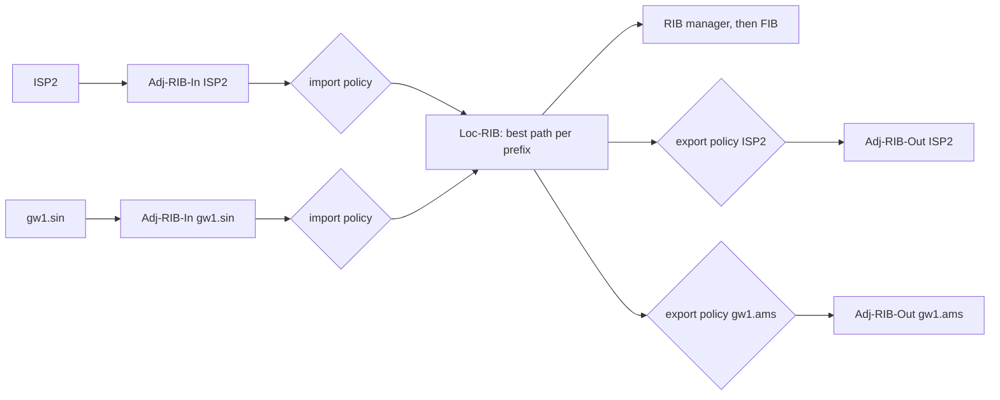

An Established BGP session carries nothing by itself. Routes move only in UPDATE messages, and what a router does with each one (store, discard, pick, install, pass on) decides where traffic goes. Most "BGP mysteries" live in that chain: the peer sent two prefixes and the router shows one; the route is in the BGP table and traffic ignores it; a neighbour received a route nobody meant to send.

This lesson follows one UPDATE through one router. Meridian's Amsterdam border gateway `gw2.ams` (loopback `10.255.1.202`) has its eBGP session to ISP2 (AS 64502) back after maintenance. Until now it reached `192.0.2.0/24`, a content network's prefix (AS 64511), through `gw1.sin` (`10.255.2.201`) in Singapore over iBGP. Meridian is AS 64500 to the internet, announcing `203.0.113.0/24`. Public addresses and AS numbers here come from the documentation ranges (RFC 5737 for IPv4, RFC 5398 for AS numbers, RFC 3849 for IPv6 `2001:db8::/32`). [BGP sessions and the FSM](/learn/fabric-networking/bgp-fundamentals/bgp-sessions-and-the-fsm) brought the session up; [what BGP is for](/learn/fabric-networking/bgp-fundamentals/what-bgp-is-for) defines autonomous systems (AS), eBGP (between ASes) and iBGP (inside one).

## The UPDATE message, field by field

An UPDATE does two jobs in one message: it can **withdraw** prefixes the sender no longer offers and **announce** prefixes with the path attributes that describe how to reach them. A prefix in BGP's vocabulary is **NLRI**, network layer reachability information, which in plain IPv4 is an address block such as `192.0.2.0/24`. Here is ISP2's 70-byte UPDATE to `gw2.ams`, the one the visualisation below replays:

| Field | Size | Value in ISP2's UPDATE | What reads it |
|---|---|---|---|
| Header (marker, length, type) | 19 bytes | `ff` × 16, 70, 2 (UPDATE) | Framing ([previous lesson](/learn/fabric-networking/bgp-fundamentals/bgp-sessions-and-the-fsm)) |
| Withdrawn Routes Length | 2 bytes | 0 | Parser: how many bytes of withdrawals follow |
| Withdrawn Routes | variable | empty | Every RIB holding a path from this peer for those prefixes |
| Total Path Attribute Length | 2 bytes | 38 | Parser |
| Path Attributes | variable | ORIGIN, AS_PATH, NEXT_HOP, MED, COMMUNITIES (38 bytes) | Import policy, the decision process, forwarding |
| NLRI | the rest | `192.0.2.0/24`, `192.0.2.128/25` (9 bytes) | Everything: these are the prefixes the attributes describe |

Four rules follow from that layout, each visible in production.

**One set of attributes per message.** The attributes apply to every prefix in the NLRI field, so a sender packs prefixes with identical attributes together: with these 38 bytes of attributes, a 4,096-byte message (the maximum; 65,535 with RFC 8654's extended messages) carries 1,008 `/24`s. Real tables pack far worse: prefixes from different origins have different AS paths, so the message count tracks the number of distinct attribute sets, and a full table of about a million IPv4 prefixes (2025) takes on the order of a hundred thousand UPDATEs or more.

**Withdrawals carry no attributes**, only prefixes. ISP2 withdrawing `192.0.2.0/24` sends 27 bytes: the 19-byte header, a withdrawn length of 4, the 4-byte prefix, and a path attribute length of 0.

**A new announcement replaces the old one.** BGP keeps one path per prefix *per peer*. If ISP2 later sends `192.0.2.0/24` with a different AS path, the new path silently replaces the old one, an **implicit withdraw** in RFC 4271's terms. A session going down withdraws everything learned from it at once (unless graceful restart, RFC 4724, keeps those routes as stale for a few minutes while the peer restarts).

**An empty UPDATE means "that is all".** With no withdrawals, attributes or NLRI, the message is 23 bytes: the End-of-RIB marker from the previous lesson, which tells the receiver the initial table is complete.

### How a prefix is packed

NLRI and withdrawn routes use the same compact encoding: one byte giving the prefix length in bits, then only as many address bytes as that length needs, $\lceil \text{length} / 8 \rceil$. Trace the 9 bytes of ISP2's NLRI by hand:

| Bytes | Length byte | Address bytes | Padded with zeros | Prefix |
|---|---|---|---|---|
| `18 c0 00 02` | `0x18` = 24 | 3 bytes: 192, 0, 2 | 192.0.2.0 | `192.0.2.0/24` |
| `19 c0 00 02 80` | `0x19` = 25 | 4 bytes: 192, 0, 2, 128 | 192.0.2.128 | `192.0.2.128/25` |

A default route `0.0.0.0/0` is the single byte `00`, a `/32` is five bytes, and a `/17` needs three address bytes because 17 bits spill into the third. Only that arithmetic says where one prefix ends, so one wrong length byte corrupts every prefix after it; that is why a malformed NLRI field still resets the session under the gentler error handling below.

## Path attributes: the type-length-value inside

Each attribute is a small type-length-value record: a flags byte, a type code, a length (one byte, or two if the extended-length flag is set) and the value.

| Flag bit | Name | Meaning when set |
|---|---|---|
| `0x80` | Optional | Implementations need not understand it (clear: well-known, every BGP speaker must) |
| `0x40` | Transitive | Pass it on even if you do not understand it |
| `0x20` | Partial | Some router on the way passed it on without understanding it |
| `0x10` | Extended length | The length field is 2 bytes, for values over 255 bytes |

The first two bits sort attributes into four categories, and the category decides what happens to an attribute a router has never heard of. **Well-known mandatory** attributes (ORIGIN, AS_PATH, NEXT_HOP) must be in every UPDATE that announces prefixes (NEXT_HOP only when they sit in the classic NLRI field); a missing one is an UPDATE error. **Well-known discretionary** ones (LOCAL_PREF) every speaker understands but need not be present. An unknown **optional transitive** attribute (COMMUNITIES was once new) is passed on with the Partial bit set, which is how new attributes spread across an internet of old software. An unknown **optional non-transitive** attribute is dropped and not passed on; MED is a well-understood member of this category.

That pass-it-on rule has a cost: a router can forward an attribute it cannot check, and routers downstream may choke on it. After incidents in which one odd attribute reset sessions across the internet (one is in [BGP sessions and the FSM](/learn/fabric-networking/bgp-fundamentals/bgp-sessions-and-the-fsm)), RFC 7606 changed the response to most malformed attributes from "reset the session" to "treat this UPDATE's prefixes as withdrawn". The session survives, but routes vanish quietly, and only a treat-as-withdraw counter shows why.

The code below builds ISP2's UPDATE from these rules and parses it back, along with the withdrawal and End-of-RIB.

```python
import ipaddress
import struct

MARKER = b"\xff" * 16
# Attribute flag bits (first byte of every attribute)
OPTIONAL, TRANSITIVE, PARTIAL, EXTENDED = 0x80, 0x40, 0x20, 0x10
NAMES = {1: "ORIGIN", 2: "AS_PATH", 3: "NEXT_HOP", 4: "MED", 5: "LOCAL_PREF",
         8: "COMMUNITIES", 14: "MP_REACH_NLRI", 15: "MP_UNREACH_NLRI", 16: "EXT_COMMUNITIES"}


def prefix_bytes(prefix):
    # NLRI encoding: one length byte, then only as many address bytes as the length needs.
    net = ipaddress.ip_network(prefix)
    return bytes([net.prefixlen]) + net.network_address.packed[:(net.prefixlen + 7) // 8]


def attribute(flags, code, value):
    if len(value) > 255:
        return struct.pack("!BBH", flags | EXTENDED, code, len(value)) + value
    return struct.pack("!BBB", flags, code, len(value)) + value


def as_path(asns):
    # One AS_SEQUENCE segment (type 2), four bytes per ASN (four-octet AS capability negotiated).
    return attribute(TRANSITIVE, 2, struct.pack("!BB", 2, len(asns)) + b"".join(struct.pack("!I", a) for a in asns))


def community(text):
    high, low = (int(x) for x in text.split(":"))
    return struct.pack("!HH", high, low)


def update(withdrawn=(), attrs=b"", nlri=()):
    w = b"".join(prefix_bytes(p) for p in withdrawn)
    body = struct.pack("!H", len(w)) + w + struct.pack("!H", len(attrs)) + attrs
    body += b"".join(prefix_bytes(p) for p in nlri)
    return MARKER + struct.pack("!HB", 19 + len(body), 2) + body


def read_prefixes(data, afi_bytes=4):
    out, i = [], 0
    while i < len(data):
        length = data[i]
        n = (length + 7) // 8
        addr = data[i + 1:i + 1 + n] + bytes(afi_bytes - n)   # pad the missing bytes with zeros
        out.append(f"{ipaddress.ip_address(addr)}/{length}")
        i += 1 + n
    return out


def parse(msg):
    length, = struct.unpack("!H", msg[16:18])
    wlen, = struct.unpack("!H", msg[19:21])
    withdrawn = read_prefixes(msg[21:21 + wlen])
    alen, = struct.unpack("!H", msg[21 + wlen:23 + wlen])
    i, end, attrs = 23 + wlen, 23 + wlen + alen, []
    while i < end:
        flags, code = msg[i], msg[i + 1]
        if flags & EXTENDED:
            vlen, hdr = struct.unpack("!H", msg[i + 2:i + 4])[0], 4
        else:
            vlen, hdr = msg[i + 2], 3
        kind = ("optional " if flags & OPTIONAL else "well-known ") + \
               ("transitive" if flags & TRANSITIVE else "non-transitive")
        attrs.append(f"{NAMES.get(code, code)} ({kind}, {hdr + vlen} B)")
        i += hdr + vlen
    return {"length": length, "withdrawn": withdrawn, "attributes": attrs,
            "nlri": read_prefixes(msg[end:length])}


# ISP2 -> gw2.ams, as in the visualisation
attrs = (attribute(TRANSITIVE, 1, b"\x00")                                  # ORIGIN IGP
         + as_path([64502, 64511])
         + attribute(TRANSITIVE, 3, ipaddress.ip_address("198.51.100.0").packed)
         + attribute(OPTIONAL, 4, struct.pack("!I", 0))                     # MED 0
         + attribute(OPTIONAL | TRANSITIVE, 8, community("64502:3010")))
announce = update(attrs=attrs, nlri=["192.0.2.0/24", "192.0.2.128/25"])
withdraw = update(withdrawn=["192.0.2.0/24"])
end_of_rib = update()

print(len(announce), "bytes:", announce[16:].hex(" "))
for name, msg in [("announce", announce), ("withdraw", withdraw), ("end-of-RIB", end_of_rib)]:
    print(f"{name:<10}", parse(msg))
# How many /24s with these attributes fit in one 4,096-byte UPDATE?
print("max /24s per message:", (4096 - (19 + 2 + 2 + len(attrs))) // 4)
```

```text
70 bytes: 00 46 02 00 00 00 26 40 01 01 00 40 02 0a 02 02 00 00 fb f6 00 00 fb ff 40 03 04 c6 33 64 00 80 04 04 00 00 00 00 c0 08 04 fb f6 0b c2 18 c0 00 02 19 c0 00 02 80
announce   {'length': 70, 'withdrawn': [], 'attributes': ['ORIGIN (well-known transitive, 4 B)', 'AS_PATH (well-known transitive, 13 B)', 'NEXT_HOP (well-known transitive, 7 B)', 'MED (optional non-transitive, 7 B)', 'COMMUNITIES (optional transitive, 7 B)'], 'nlri': ['192.0.2.0/24', '192.0.2.128/25']}
withdraw   {'length': 27, 'withdrawn': ['192.0.2.0/24'], 'attributes': [], 'nlri': []}
end-of-RIB {'length': 23, 'withdrawn': [], 'attributes': [], 'nlri': []}
max /24s per message: 1008
```

Read the hex after the marker: `00 46` length 70, `02` UPDATE, `00 00` no withdrawals, `00 26` 38 bytes of attributes. `40 01 01 00` is ORIGIN (flags well-known transitive, type 1, length 1, value 0). `40 02 0a` opens a 10-byte AS_PATH: segment type `02` (AS_SEQUENCE), two ASNs of four bytes each. `40 03 04 …` is NEXT_HOP, `80 04 …` MED (optional non-transitive), `c0 08 …` the community, and the last 9 bytes the NLRI traced above. How the decision process ranks these attributes is [the best-path algorithm](/learn/fabric-networking/bgp-fundamentals/the-best-path-algorithm); the next section covers what each one *is*.

## The six attributes you will be asked about

The [routing algorithms lesson](/learn/networking/network-algorithms/routing-algorithms) summarises each attribute in a line. Here each gets its mechanism, how it breaks and the signal that shows it.

### ORIGIN: how the route entered BGP

A one-byte code set by the originating AS: 0 **IGP** (named after the interior gateway protocols, such as IS-IS, that route inside an AS; in practice it means the route was explicitly listed for BGP to announce), 1 **EGP** (learned from EGP, BGP's 1980s predecessor; extinct), 2 **INCOMPLETE** (redistributed into BGP from elsewhere, such as static routes). Displays show `i`, `e` and `?`. Lower is preferred, late in the decision process.

- **Solves:** a weak hint about how deliberate an announcement is.
- **Breaks:** quietly, when a prefix is announced from two routers and one of them switches from an explicit list to redistribution: its copy becomes INCOMPLETE, and neighbours tied on everything earlier now prefer the other router's path.
- **Signal:** a prefix's origin code changing between snapshots.

### AS_PATH: where the route has been

A list of **segments**: AS_SEQUENCE (type 2), an ordered path, or AS_SET (type 1), an unordered set left by aggregating routes with different paths, now recommended against (RFC 6472). Each AS **prepends** its own number when it sends a route over eBGP, so the leftmost AS is the neighbour and the rightmost the origin: in `64502 64511`, ISP2 heard it from the content network, which originated it. Inside an AS the path does not change.

It has three jobs. **Loop prevention:** a router that sees its own AS in a received path discards the route ([iBGP, loops and next hops](/learn/fabric-networking/bgp-fundamentals/ibgp-loops-and-next-hops)). **A distance:** path length counts networks, not hops or milliseconds. **Policy input:** filters match on it ("from this customer, accept only paths ending in its AS"). Towards an old two-byte speaker, a four-byte ASN is written as AS_TRANS (23456) and the real path rides in AS4_PATH (RFC 6793).

- **Solves:** loops between ASes, a policy-free tie-breaker, provenance.
- **Breaks:** through **prepending** (`64500 64500 64500`, to look longer), the main inbound traffic-engineering tool ([traffic engineering with BGP](/learn/fabric-networking/bgp-in-the-real-world/traffic-engineering-with-bgp)): in February 2009 one small ISP's prepending error produced a path over 250 ASNs long that hit a bug in widely deployed router software and reset sessions far beyond it. A path not ending in the expected origin signals a hijack or leak ([leaks, hijacks and RPKI](/learn/fabric-networking/bgp-in-the-real-world/leaks-hijacks-and-rpki)).
- **Signal:** origin AS and path length per prefix over time.

### NEXT_HOP: where to send the packet

The IPv4 address to forward to. Over eBGP the sender writes its own address on the shared link: ISP2's `198.51.100.0`, the far end of the `/31` whose near end is `gw2.ams`'s `198.51.100.1`. Over iBGP it passes **unchanged** by default, so `gw1.ams` would receive an address the Meridian underlay does not carry; Meridian's gateways rewrite it to their own loopback (**next-hop-self**, [iBGP, loops and next hops](/learn/fabric-networking/bgp-fundamentals/ibgp-loops-and-next-hops)). The receiver **resolves** the next hop recursively down to a connected neighbour ([the routing table](/learn/fabric-networking/from-zero/the-routing-table)); a route whose next hop does not resolve is kept but cannot be best.

- **Solves:** separates "which exit" (BGP) from "how to reach it" (the IGP, Meridian's IS-IS).
- **Breaks:** an unresolvable next hop makes a route invisible to forwarding while it sits, accepted, in the BGP table.
- **Signal:** routes per peer marked "inaccessible" or "unresolved", which should be zero.

### LOCAL_PREF: this AS's own preference

A 4-byte number, higher preferred, and the first real step of the decision process, ahead of AS_PATH length. It is set on import (Meridian sets 100 on transit routes; a network might set 200 on paying customers' routes) and carried on every iBGP UPDATE, so every router in the AS agrees on the exit. It is **never sent over eBGP**, and one arriving from an eBGP peer is ignored (RFC 4271): preference is an internal business decision. The default of 100 is an implementation convention, not an RFC value.

- **Solves:** a consistent, policy-driven outbound choice across the AS.
- **Breaks:** a missing set statement on one gateway shifts the whole AS's exit, with nothing malformed to see.
- **Signal:** LOCAL_PREF per prefix per entry point against intent; a gateway's outbound share moving with no capacity change.

### MED: a neighbour's hint about which door to use

MULTI_EXIT_DISC, a 4-byte number, lower preferred, sent by an AS to a neighbour it connects to in several places: "of my links to you, prefer this one". It is **optional non-transitive**: the receiver may pass it to its iBGP peers but never to another AS, since it describes the sender's links.

Three rules surprise people. It is compared **only between routes from the same neighbouring AS** unless "always compare MED" is enabled. A route **without** MED counts as MED 0, the best value (RFC 4271), hence vendors' "missing as worst" option. And because it applies to some pairs of paths and not others, the winner can depend on arrival order ([the best-path algorithm](/learn/fabric-networking/bgp-fundamentals/the-best-path-algorithm)).

- **Solves:** a neighbour steering your traffic onto its preferred link, by agreement.
- **Breaks:** best paths that change with arrival order; a MED leaked from another AS.
- **Signal:** best-path flips for a prefix with no new UPDATE for it.

### COMMUNITIES: tags that drive policy

A list of 4-byte values written `ASN:value` (RFC 1997), optional transitive, with no built-in meaning: the AS in the high half defines the low half. ISP2 tags `192.0.2.0/24` with `64502:3010`, its own code for where it learned the route; Meridian adds `64500:102`, "learned from ISP2 at `gw2.ams`". Policy elsewhere matches the tag instead of re-deriving the facts. Well-known values include NO_EXPORT (`65535:65281`, "do not send outside the receiving AS") and NO_ADVERTISE (`65535:65282`, "send to no peer"). **Extended communities** (8 bytes: type, subtype, value) carry EVPN's route targets below, and **large communities** (RFC 8092, 12 bytes) fit four-byte ASNs. Using them is [policy and communities](/learn/fabric-networking/bgp-in-the-real-world/policy-and-communities).

- **Solves:** decoupling where a fact is learned (ingress) from where it is acted on (egress).
- **Breaks:** a provider strips communities at its edge, so a customer's "prepend towards Europe" request does nothing; an internal community leaks to a peer that acts on it.
- **Signal:** expected communities missing after a peer change; requested actions absent from public route collectors.

Other attributes appear later: ORIGINATOR_ID and CLUSTER_LIST guard [route reflection](/learn/fabric-networking/bgp-fundamentals/route-reflectors), and MP_REACH_NLRI and MP_UNREACH_NLRI are the last section's subject.

## Three RIBs and two policies

RFC 4271 describes a BGP speaker's memory as three kinds of **RIB** (routing information base): an input table per peer, one table of selected routes, and an output table per peer. Implementations organise memory differently but behave as if the model were true, and show commands, monitoring and interviewers use its vocabulary. Downstream of BGP sit two more tables: the router's own RIB, which merges every protocol's routes, and the **FIB** (forwarding information base), the copy in the forwarding chip that packets are looked up in.



**Adj-RIB-In** (one per peer) holds the routes as the peer sent them, changing only when that peer sends an UPDATE or the session drops. The **pre-policy** view is exactly what arrived; the **post-policy** view is what survived import policy, with its modifications.

**Import policy** runs on each route from a peer, rule by rule: accept, reject, or accept with changes (set LOCAL_PREF, add a community, prepend). Typical internet-edge rules reject paths containing your own AS, bogons (addresses that should never be routed, such as private ranges), your own prefixes, and anything longer than `/24`, the de facto limit for IPv4 internet routes (`/48` for IPv6). RFC 8212 says an eBGP session with no policy configured should accept and send nothing, so a forgotten policy fails closed; FRRouting and several vendors follow it by default, others still need it switched on.

**Loc-RIB** (one per router) holds the best path per prefix, chosen by the [decision process](/learn/fabric-networking/bgp-fundamentals/the-best-path-algorithm) from every accepted path. Strictly, RFC 4271 puts only the winners here and leaves the losers in the post-policy Adj-RIB-In; implementations show all candidates with the best marked as one "BGP table", and operators call that whole table the Loc-RIB, as this lesson and its visualisation do. Paths whose next hop does not resolve stay in it but cannot win.

**Export policy** (per peer) decides what each neighbour may receive and what to change, such as next-hop-self over iBGP; over eBGP the protocol itself prepends your AS, drops LOCAL_PREF and by default sets your own address as next hop. Before policy, a fixed protocol rule applies: a path learned from one iBGP peer is not sent to another iBGP peer, the rule that forces either a full mesh or [route reflectors](/learn/fabric-networking/bgp-fundamentals/route-reflectors).

**Adj-RIB-Out** (one per peer) is what this router last told that peer. BGP sends differences: the router compares the new export result with the Adj-RIB-Out and sends UPDATEs or withdrawals for what changed. Only the best path is advertised per prefix, unless ADD-PATH (RFC 7911, a capability that lets a sender label and advertise several paths per prefix) is negotiated.

```viz
{"type": "fabric", "scenario": "bgp-ribs", "title": "One UPDATE from ISP2 through gw2.ams: Adj-RIB-In, import policy, Loc-RIB, FIB, export policy, Adj-RIB-Out", "caption": "ISP2 sends a 70-byte UPDATE carrying 192.0.2.0/24 and 192.0.2.128/25 with one set of attributes. Import policy rejects the /25 and sets LOCAL_PREF 100 plus community 64500:102 on the /24. In the Loc-RIB the new path ties with gw1.sin's iBGP path down to eBGP over iBGP and wins, the FIB entry moves from Singapore to the ISP2 link, and export sends a 76-byte UPDATE with next-hop-self to the iBGP peers while ISP2 receives only 203.0.113.0/24. gw1.ams then moves to gw2.ams's path on IGP cost, and the last frame shows the per-peer counts: received 2, accepted 1, best 1."}
```

### Traced: one UPDATE through `gw2.ams`

| Step | Table | What happens to `192.0.2.0/24` | What happens to `192.0.2.128/25` |
|---|---|---|---|
| 1 | Adj-RIB-In (ISP2), pre-policy | Stored: AS_PATH `64502 64511`, NEXT_HOP `198.51.100.0`, MED 0, community `64502:3010` | Stored, same attributes |
| 2 | Import policy | No own AS, not a bogon, not longer than `/24`: accept; set LOCAL_PREF 100, add `64500:102` | Longer than `/24`: reject |
| 3 | Adj-RIB-In (ISP2), post-policy | One usable route | Absent (kept pre-policy only if configured) |
| 4 | Loc-RIB | Two paths: ISP2 (eBGP) and `gw1.sin` (iBGP). Tie on LOCAL_PREF 100, path length 2, ORIGIN IGP, MED 0; eBGP beats iBGP; ISP2's is best | |
| 5 | RIB and FIB | Next hop `198.51.100.0` resolves over the connected `/31`; the FIB entry moves from `gw1.sin` (about 10,500 km of fibre, roughly 52 ms one way) to the ISP2 port | |
| 6 | Export policy | To `gw1.ams` and `gw1.sin`: send, NEXT_HOP rewritten to `10.255.1.202`, LOCAL_PREF 100 included. To ISP2: deny, only Meridian's own block goes to a provider | |
| 7 | Adj-RIB-Out | `gw1.ams` and `gw1.sin` are sent a 76-byte UPDATE; ISP2's still holds only `203.0.113.0/24` with AS_PATH `64500` | |

The outbound UPDATE is 6 bytes longer than the one received: LOCAL_PREF adds 7 bytes, the second community 4, and dropping the `/25` saves 5. The AS_PATH is unchanged, because a route gains an AS number only when it leaves the AS. Sending ISP2's routes on to ISP1 would offer free transit between two providers, the leak [how the internet is glued together](/learn/fabric-networking/bgp-in-the-real-world/how-the-internet-is-glued-together) explains.

### Keeping the pre-policy copy

A changed import policy must be re-run over everything the peer sent, including routes it rejected last time; a session reset gets them back by withdrawing and re-learning every route. **Soft reconfiguration inbound** keeps the whole pre-policy Adj-RIB-In in memory, on the order of a hundred megabytes or more per full-table peer depending on the implementation. **ROUTE-REFRESH** (RFC 2918, a negotiated capability) asks the peer to resend its Adj-RIB-Out for one family with no reset; enhanced route refresh (RFC 7313) brackets the resend with markers so routes the peer no longer sends can be deleted. **BMP** (the BGP Monitoring Protocol, RFC 7854) streams the pre-policy view to an external collector instead. Without any of these, a prefix the peer sent and policy rejected looks exactly like one it never sent.

## From best path to RIB to FIB

The Loc-RIB's best path is BGP's *proposal* for forwarding, not the forwarding decision. Three more gates stand between it and a packet.

**Gate 1: the next hop must resolve.** Inside the decision process, a path whose next hop has no route is not a candidate, which turns underlay trouble into BGP trouble.

**Gate 2: the RIB manager compares protocols.** BGP hands its best path to the router's RIB manager (`zebra` in FRRouting), which also holds IS-IS, static and connected routes. For the same prefix it picks by **administrative distance**, a trust ranking of sources: Cisco and FRRouting use 20 for eBGP and 200 for iBGP, so an IS-IS route (115) beats an iBGP route but loses to an eBGP one; Junos uses 170 for all BGP. A static route to `192.0.2.0/24` forgotten on `gw2.ams` (distance 1) would win, and BGP's best path would be marked not installed ("RIB-failure" on Cisco). Several implementations still advertise such a route to peers unless told to advertise only installed routes; Junos by default advertises only active ones. The RIB itself is [the routing table](/learn/fabric-networking/from-zero/the-routing-table).

**Gate 3: hardware must accept it.** The RIB's winner, its next hop resolved to an outgoing port and a neighbour MAC address, is written to the FIB. Programming runs at thousands to tens of thousands of routes a second depending on the platform, so a full table takes tens of seconds to minutes, and a write can fail when a hardware table is full ([planes, ASICs and network operating systems](/learn/fabric-networking/from-zero/planes-asics-and-network-operating-systems)). FRRouting can hold an advertisement back until hardware confirms the route, so neighbours are not sent traffic the router cannot forward yet.

**Multipath** changes one thing: paths that tie down to the IGP-cost step of the decision process are installed together as ECMP (equal-cost multipath) next hops ([ECMP and hashing](/learn/fabric-networking/fabric-architecture/ecmp-and-hashing)), while BGP still advertises one best path to its peers.

On a Linux-based network operating system the result looks like this (illustrative output, FRRouting-style, abbreviated):

```text
gw2.ams# show bgp ipv4 unicast 192.0.2.0/24
BGP routing table entry for 192.0.2.0/24
Paths: (2 available, best #1)
  Advertised to peers: 10.255.1.201 10.255.2.201
  64502 64511
    198.51.100.0 from 198.51.100.0 (198.51.100.0)
      Origin IGP, metric 0, localpref 100, valid, external, best (eBGP over iBGP)
      Community: 64502:3010 64500:102
  64502 64511
    10.255.2.201 (metric 120) from 10.255.2.201 (10.255.2.201)
      Origin IGP, metric 0, localpref 100, valid, internal
gw2.ams# show ip route 192.0.2.0/24
B>* 192.0.2.0/24 [20/0] via 198.51.100.0, to-isp2
```

`[20/0]` is the administrative distance and metric; `B>*` means a BGP route, selected by the RIB, installed in the FIB. The losing iBGP path stays in the BGP table as a ready backup.

### The whole pipeline in code

The model below keeps the three RIBs, runs both policies, picks the best path with a simplified decision process (the full one is [lesson 04-06](/learn/fabric-networking/bgp-fundamentals/the-best-path-algorithm)), installs it with its administrative distance, and prints the UPDATEs and withdrawals the Adj-RIB-Out diff produces. Step 3 is the failure case: ISP2 withdraws the prefix.

```python
import ipaddress
from dataclasses import dataclass, replace

LOCAL_AS, LOOPBACK = 64500, "10.255.1.202"                  # gw2.ams
OWN_BLOCKS = ["203.0.113.0/24"]
IGP_COST = {"10.255.1.201": 20, "10.255.2.201": 120}       # IS-IS cost to other gateways
CONNECTED = [ipaddress.ip_network("198.51.100.0/31")]      # the link to ISP2
PEERS = {"ISP2": {"ebgp": True, "my_addr": "198.51.100.1"},
         "gw1.ams": {"ebgp": False}, "gw1.sin": {"ebgp": False}}
DISTANCE = {True: 20, False: 200}                          # eBGP, iBGP administrative distance


@dataclass(frozen=True)
class Route:
    prefix: str
    as_path: tuple
    next_hop: str
    origin: int = 0                 # 0 IGP, 1 EGP, 2 incomplete
    med: int = 0
    local_pref: int = 100
    communities: tuple = ()
    peer: str = "local"
    ebgp: bool = False


def resolvable(nh):
    return nh in IGP_COST or nh == LOOPBACK or any(ipaddress.ip_address(nh) in n for n in CONNECTED)


def import_policy(peer, r):
    if not PEERS[peer]["ebgp"]:
        return r                                            # iBGP: trust what colleagues send
    net = ipaddress.ip_network(r.prefix)
    if LOCAL_AS in r.as_path or net.prefixlen > 24 or r.prefix in OWN_BLOCKS:
        return None                                         # loop, too specific, or our own block
    return replace(r, local_pref=100, communities=r.communities + ("64500:102",))


def better(a, b):
    """Simplified decision process (the full one is lesson 04-06): (winner, deciding step)."""
    steps = [("LOCAL_PREF", lambda r: -r.local_pref), ("AS_PATH length", lambda r: len(r.as_path)),
             ("ORIGIN", lambda r: r.origin)]
    if a.as_path[:1] == b.as_path[:1]:
        steps.append(("MED", lambda r: r.med))              # MED only between routes from one AS
    steps += [("eBGP over iBGP", lambda r: not r.ebgp),
              ("IGP cost", lambda r: IGP_COST.get(r.next_hop, 0)), ("neighbour", lambda r: r.peer)]
    for name, key in steps:
        if key(a) != key(b):
            return (a, name) if key(a) < key(b) else (b, name)
    return a, "identical"


class Speaker:
    def __init__(self):
        self.adj_in = {p: {} for p in PEERS}                 # pre-policy, per peer
        self.accepted = {p: {} for p in PEERS}               # post-policy, per peer
        self.loc_rib, self.fib = {}, {}
        self.adj_out = {p: {} for p in PEERS}                # what each peer was last sent
        self.local = {p: Route(p, (), LOOPBACK) for p in OWN_BLOCKS}

    def receive(self, peer, announce=(), withdraw=()):
        for r in announce:
            r = replace(r, peer=peer, ebgp=PEERS[peer]["ebgp"])
            self.adj_in[peer][r.prefix] = r                  # replaces any older path: implicit withdraw
            kept = import_policy(peer, r)
            if kept:
                self.accepted[peer][r.prefix] = kept
            else:
                self.accepted[peer].pop(r.prefix, None)
        for p in withdraw:
            self.adj_in[peer].pop(p, None)
            self.accepted[peer].pop(p, None)
        self.decide()

    def decide(self):
        prefixes = set(self.local) | {p for t in self.accepted.values() for p in t}
        self.loc_rib = {}
        for p in sorted(prefixes):
            if p in self.local:
                self.loc_rib[p] = (self.local[p], "locally originated")
                continue
            paths = [t[p] for t in self.accepted.values() if p in t and resolvable(t[p].next_hop)]
            if not paths:
                continue                                    # no usable path: not best, not installed
            best, why = paths[0], "only path"
            for other in paths[1:]:
                best, why = better(best, other)
            self.loc_rib[p] = (best, why)
            self.fib[p] = (DISTANCE[best.ebgp], best.next_hop)  # no competing protocol here
        for p in set(self.fib) - set(self.loc_rib):
            del self.fib[p]
        self.export()

    def export(self):
        for peer, cfg in PEERS.items():
            out = {}
            for p, (r, _) in self.loc_rib.items():
                if cfg["ebgp"] and p in OWN_BLOCKS:          # to a provider: our own blocks only
                    out[p] = replace(r, as_path=(LOCAL_AS,) + r.as_path, next_hop=cfg["my_addr"],
                                     local_pref=None, med=None)
                elif not cfg["ebgp"] and r.peer != peer and (r.ebgp or r.peer == "local"):
                    out[p] = replace(r, next_hop=LOOPBACK)    # iBGP: never re-send iBGP-learned paths
            for p in sorted(set(self.adj_out[peer]) | set(out)):
                if p not in out:
                    print(f"  -> {peer}: WITHDRAW {p}")
                elif self.adj_out[peer].get(p) != out[p]:
                    path = " ".join(map(str, out[p].as_path)) or "(empty)"
                    print(f"  -> {peer}: UPDATE {p} AS_PATH {path} NEXT_HOP {out[p].next_hop}")
            self.adj_out[peer] = out

    def show(self, prefix):
        r, why = self.loc_rib[prefix]
        distance, nh = self.fib[prefix]
        print(f"  best {prefix}: from {r.peer} ({why}); installed at distance {distance} via {nh}")
        for peer in PEERS:
            print(f"  {peer:<8} received {len(self.adj_in[peer])} accepted {len(self.accepted[peer])}"
                  f" best {sum(1 for x, _ in self.loc_rib.values() if x.peer == peer)}"
                  f" advertised {len(self.adj_out[peer])}")


gw2 = Speaker()
print("0. sessions up: gw2.ams advertises Meridian's own block")
gw2.decide()
print("1. gw1.sin's path arrives over iBGP")
gw2.receive("gw1.sin", [Route("192.0.2.0/24", (64502, 64511), "10.255.2.201", communities=("64502:3010",))])
gw2.show("192.0.2.0/24")
print("2. ISP2's session returns: one UPDATE, two prefixes")
isp2 = dict(as_path=(64502, 64511), next_hop="198.51.100.0", communities=("64502:3010",))
gw2.receive("ISP2", [Route("192.0.2.0/24", **isp2), Route("192.0.2.128/25", **isp2)])
gw2.show("192.0.2.0/24")
print("3. ISP2 withdraws 192.0.2.0/24")
gw2.receive("ISP2", withdraw=["192.0.2.0/24"])
gw2.show("192.0.2.0/24")
```

```text
0. sessions up: gw2.ams advertises Meridian's own block
  -> ISP2: UPDATE 203.0.113.0/24 AS_PATH 64500 NEXT_HOP 198.51.100.1
  -> gw1.ams: UPDATE 203.0.113.0/24 AS_PATH (empty) NEXT_HOP 10.255.1.202
  -> gw1.sin: UPDATE 203.0.113.0/24 AS_PATH (empty) NEXT_HOP 10.255.1.202
1. gw1.sin's path arrives over iBGP
  best 192.0.2.0/24: from gw1.sin (only path); installed at distance 200 via 10.255.2.201
  ISP2     received 0 accepted 0 best 0 advertised 1
  gw1.ams  received 0 accepted 0 best 0 advertised 1
  gw1.sin  received 1 accepted 1 best 1 advertised 1
2. ISP2's session returns: one UPDATE, two prefixes
  -> gw1.ams: UPDATE 192.0.2.0/24 AS_PATH 64502 64511 NEXT_HOP 10.255.1.202
  -> gw1.sin: UPDATE 192.0.2.0/24 AS_PATH 64502 64511 NEXT_HOP 10.255.1.202
  best 192.0.2.0/24: from ISP2 (eBGP over iBGP); installed at distance 20 via 198.51.100.0
  ISP2     received 2 accepted 1 best 1 advertised 1
  gw1.ams  received 0 accepted 0 best 0 advertised 2
  gw1.sin  received 1 accepted 1 best 0 advertised 2
3. ISP2 withdraws 192.0.2.0/24
  -> gw1.ams: WITHDRAW 192.0.2.0/24
  -> gw1.sin: WITHDRAW 192.0.2.0/24
  best 192.0.2.0/24: from gw1.sin (only path); installed at distance 200 via 10.255.2.201
  ISP2     received 1 accepted 0 best 0 advertised 1
  gw1.ams  received 0 accepted 0 best 0 advertised 1
  gw1.sin  received 1 accepted 1 best 1 advertised 1
```

Three lines repay a second look. In step 1, `gw2.ams` sends nothing about `192.0.2.0/24`: its only path came from an iBGP peer, and split horizon forbids passing it to another. In step 2, the ISP2 row reads received 2, accepted 1: the rejected `/25` survives only in the pre-policy table. In step 3, the new best path is the iBGP one again, which `gw2.ams` may not re-advertise, so its peers get **withdrawals** and `gw1.ams` falls back to the path it already holds from `gw1.sin`. Nobody scripted those withdrawals; they fall out of the Adj-RIB-Out diff.

## Multiprotocol BGP: AFI, SAFI and why BGP carries everything

The UPDATE above is IPv4-only: the NLRI field holds IPv4 prefixes and NEXT_HOP is 4 bytes. RFC 4760 extended BGP without changing the message by adding two optional non-transitive attributes, **MP_REACH_NLRI** (type 14, "announce these") and **MP_UNREACH_NLRI** (type 15, "withdraw these"), each labelled with an **address family**: an AFI (address family identifier) and a SAFI (subsequent address family identifier). Each side lists its families as capabilities in its OPEN, and a session carries only those both listed ([BGP sessions and the FSM](/learn/fabric-networking/bgp-fundamentals/bgp-sessions-and-the-fsm)).

| Field of MP_REACH_NLRI | Size | Value when `gw2.ams` announces `2001:db8::/32` to ISP2 | What reads it |
|---|---|---|---|
| AFI | 2 bytes | 2 (IPv6) | Receiver: which address family's tables |
| SAFI | 1 byte | 1 (unicast) | Receiver: which kind of route within it |
| Length of next hop | 1 byte | 16 (32 when a link-local address is added) | Parser |
| Next hop | variable | `2001:db8:ffff::1`, `gw2.ams`'s address on the ISP2 link in this example | Next-hop resolution |
| Reserved | 1 byte | 0 | Nobody |
| NLRI | variable | `20 20 01 0d b8`: length 32, then 4 bytes | Everything |

The attribute is 29 bytes, and the whole UPDATE is 65: the 19-byte header, the two 2-byte length fields (4), ORIGIN (4), AS_PATH `64500` (9) and MP_REACH_NLRI (29). There is no NEXT_HOP attribute and the classic NLRI field is empty, because the family's next hop travels inside MP_REACH_NLRI. Withdrawals for the family go in MP_UNREACH_NLRI, and the family's End-of-RIB is an UPDATE whose only content is an empty MP_UNREACH_NLRI for that AFI/SAFI. The global IPv6 table held a little over 200,000 prefixes in 2025, about a fifth of the IPv4 table.

| AFI / SAFI | Family | NLRI carries | Where you meet it |
|---|---|---|---|
| 1 / 1 | IPv4 unicast | IPv4 prefixes | The internet, the eBGP underlay ([BGP as the underlay](/learn/fabric-networking/underlay/bgp-as-the-underlay)) |
| 2 / 1 | IPv6 unicast | IPv6 prefixes | The IPv6 internet |
| 1 / 4 | IPv4 labelled unicast | Prefix plus an MPLS label (a short forwarding tag) | Backbones stitching MPLS domains |
| 1 / 128 | VPNv4 (MPLS L3VPN) | Label, route distinguisher, IPv4 prefix | Provider VPNs ([MPLS and segment routing](/learn/fabric-networking/overlays-vxlan-evpn/mpls-and-segment-routing)) |
| 25 / 70 | L2VPN EVPN | Route type, then MAC, IP, labels or VNIs | Data center overlays ([EVPN, the control plane](/learn/fabric-networking/overlays-vxlan-evpn/evpn-the-control-plane)) |
| 1 / 133 | IPv4 flow specification | Match rules (addresses, ports) instead of prefixes | Distributing filters to drop attack traffic |
| 16388 / 71 | BGP link state | Topology nodes and links | Exporting the IGP's map to a controller |

### VPNs: making overlapping prefixes unique

Two of Meridian's tenants both use `10.1.1.0/24`: Acme (VRF ACME, a VRF being a separate routing table per tenant) and Globex (VRF GLOBEX). Advertised as plain `10.1.1.0/24`, they would be two paths to one prefix and BGP would pick one, delivering one tenant's traffic to the other. VPN families prefix every route with an 8-byte **route distinguisher** (RD): `10.255.1.11:50001:10.1.1.0/24` from `leaf1.ams` for Acme and `10.255.1.12:50002:10.1.1.0/24` from `leaf2.ams` for Globex are different NLRI, so both survive best-path selection on every router. The RD only separates; who imports the route is decided by the **route target** (RT), an extended community: `65000:50001` is imported into VRF ACME and `65000:50002` into VRF GLOBEX. MPLS VPNv4 invented this pair; EVPN reuses it ([VRFs and multi-tenancy](/learn/fabric-networking/overlays-vxlan-evpn/vrfs-and-multi-tenancy) works the import rules).

### EVPN: MAC addresses as routes

EVPN's NLRI is not a prefix but a typed record. The type-2 route `leaf1.ams` sends for Acme's web server, over its iBGP session to the route reflectors (in the fabric's private overlay AS 65000, separate from the internet-facing AS 64500):

| Part | Value | Purpose |
|---|---|---|
| Route type | 2 (MAC/IP advertisement) | Tells the parser which layout follows |
| Route distinguisher | `10.255.1.11:10100` | Uniqueness, as above |
| Ethernet segment ID, Ethernet tag | 0, 0 | Zero for a single-homed host in a VLAN-based service ([EVPN multihoming](/learn/fabric-networking/overlays-vxlan-evpn/evpn-multihoming) uses the segment ID) |
| MAC address | `00:00:5e:00:53:0a` | `acme-web1`'s MAC |
| IP address | `10.1.1.10` | Lets remote leaves answer ARP locally |
| Label 1 / label 2 | VNI 10100 / VNI 50001 | The layer-2 and layer-3 segment identifiers VXLAN will carry |
| Next hop (in MP_REACH_NLRI) | `10.255.1.11` | `leaf1.ams`'s loopback, its VXLAN tunnel endpoint |
| Extended communities | RT `65000:10100`, RT `65000:50001`, encapsulation VXLAN, router MAC | Which tenants import it, how to tunnel to it, and the inner MAC to use when routing over the L3VNI |

**Why one protocol for all of it.** Every family inherits TCP transport, incremental updates, policy, communities, route reflectors, the decision process and the tooling around them. A new kind of reachability needs an NLRI format and a code point, not a new protocol and new operational habits. The cost is **fate sharing**: a reset triggered by one family takes down every family on the session, and a family enabled on only one end leaves an Established session carrying nothing for it. Some operators run a session per family for isolation; most fabrics accept the sharing.

## Failure modes in production

| Failure | Symptom | Diagnosis | Fix |
|---|---|---|---|
| Import policy drops more than intended | A peer "sent" routes the router does not have; traffic uses a worse exit | Received (pre-policy) count above accepted; the rejected prefixes are visible only with a pre-policy copy or BMP | Correct the policy; refresh with ROUTE-REFRESH rather than a reset |
| Next hop unresolvable | Route accepted, in the BGP table, never best; traffic uses another exit or none | Route marked inaccessible; `show route <next hop>` empty; underlay lost the address | Fix the underlay or set next-hop-self ([iBGP, loops and next hops](/learn/fabric-networking/bgp-fundamentals/ibgp-loops-and-next-hops)) |
| BGP best not installed | BGP shows a best path; forwarding follows something else | RIB shows a lower-distance static or IGP route for the same prefix ("RIB-failure") | Remove the stale static or change the design; decide whether to advertise only installed routes |
| Export leak | A provider or peer receives routes it should not; traffic arrives through you uninvited | Adj-RIB-Out to that peer contains prefixes beyond your own; public route collectors show you as transit | Fix export policy, add max-prefix limits on the far side, alert on Adj-RIB-Out diffs |
| Treat-as-withdraw | Some prefixes vanish from one peer while the session stays up | Malformed-attribute counters or logs on the receiver; the sender's software version | Fix the sender; filter the offending attribute at the edge as a stopgap |
| Soft reconfiguration memory | Control-plane memory climbs with each full-table peer; the daemon slows or is killed | Per-peer memory accounting; soft reconfiguration enabled on full-table sessions | Use ROUTE-REFRESH, and BMP for pre-policy visibility |
| Family missing | Established, zero routes in one family | Negotiated families differ from intent; no End-of-RIB for that family | Enable the family on both ends |

## Trade-offs: how to see and re-apply what a peer sent

| | Session reset | Soft reconfiguration inbound | ROUTE-REFRESH / enhanced refresh | BMP pre-policy feed |
|---|---|---|---|---|
| Traffic impact of re-applying policy | Every route withdrawn and re-learned | None | None | Not a re-apply mechanism |
| Router memory | None extra | A full copy of each peer's table | None extra | None on the router beyond buffers; the collector stores it |
| Needs the peer's support | No | No | Yes, a negotiated capability | No (the monitored router streams it) |
| Shows rejected routes on demand | No | Yes, on the router | No, they are re-filtered on arrival | Yes, with history, off the router |
| Best for | Nothing, today | Old peers without route refresh | Default for policy changes | Tooling and audits |

## Under the hood: what a BGP daemon stores

FRRouting's `bgpd` keeps a table per address family, indexed by prefix; each prefix node holds one path per sending peer, flagged valid, best, multipath and so on. Attributes are **interned**: a path points into a hash table of unique attribute sets, so thousands of prefixes with identical attributes share one stored copy. Memory grows with *distinct* attribute sets as well as prefixes, so tagging each prefix with a unique community inflates it.

Best-path runs are batched: an UPDATE marks prefixes as changed and a work queue recomputes them, so a burst costs one decision per prefix, not one per message. The pre-policy Adj-RIB-In exists only with soft reconfiguration on. Outbound, peers with identical export policy share an **update group** that computes the Adj-RIB-Out and formats each UPDATE once: a reflector with 1,000 clients and one policy does the work once, not 1,000 times. Pacing UPDATEs is [convergence and scale](/learn/fabric-networking/bgp-in-the-real-world/convergence-and-scale).

BMP exposes each RIB to a collector: RFC 7854 the pre- and post-policy Adj-RIB-In, RFC 8671 the Adj-RIB-Out, RFC 9069 the Loc-RIB. With all four, "what did ISP2 send, what did we keep, choose and tell everyone" is a query for any prefix at any moment.

## What the platform should show

Tooling should surface:

- **The per-peer, per-family funnel:** received (pre-policy), accepted (post-policy), best, installed, advertised. Each gap names a stage: import policy, the decision process or an unresolved next hop, then the RIB or hardware. The `bgp-ribs` frames end on ISP2's numbers: received 2, accepted 1, best and installed 1, advertised to the iBGP peers 1. Many platforms' summary prefix count is post-policy, so a filtered prefix never appears in it.
- **Unresolved next hops** per peer, alerting above zero.
- **BGP best against RIB selected against FIB programmed** for the prefixes that matter ([the routing table](/learn/fabric-networking/from-zero/the-routing-table) has the RIB-to-FIB half).
- **Per-prefix history** from BMP: each timestamped change of best path, AS_PATH, origin AS and communities, so "when did traffic to this prefix move and why" is a query.
- **Exports against intent:** what each eBGP peer was sent against what the source of truth says to announce ([network automation and source of truth](/learn/fabric-networking/operating-fabrics/network-automation-and-source-of-truth)). An extra prefix towards a provider is a leak; a missing one is an inbound outage.
- **Error and pressure counters:** treat-as-withdraw events, End-of-RIB per family, daemon memory per peer.

The export audit is a set difference, and the fastest leak detector you can build:

```python
INTENDED = {"ISP1": {"203.0.113.0/24"}, "ISP2": {"203.0.113.0/24"}}


def export_audit(adj_rib_out):
    """Compare what each provider was sent with what Meridian means to announce."""
    findings = []
    for peer, sent in adj_rib_out.items():
        extra, missing = set(sent) - INTENDED[peer], INTENDED[peer] - set(sent)
        if extra:
            findings.append(f"{peer}: LEAK, {len(extra)} unintended prefixes, e.g. {sorted(extra)[0]}")
        if missing:
            findings.append(f"{peer}: not announcing {', '.join(sorted(missing))}")
    return findings or ["exports match intent"]


print(export_audit({"ISP1": ["203.0.113.0/24"], "ISP2": ["203.0.113.0/24"]}))
print(export_audit({"ISP1": ["203.0.113.0/24", "192.0.2.0/24", "198.51.100.0/24"], "ISP2": []}))
```

```text
['exports match intent']
['ISP1: LEAK, 2 unintended prefixes, e.g. 192.0.2.0/24', 'ISP2: not announcing 203.0.113.0/24']
```

The data comes from BMP's Adj-RIB-Out feed or from polling each gateway; the intent from the source of truth. Engineers need the prefix list; managers need "is anything leaking right now, yes or no".

## Interviewer follow-ups

**"What is inside a BGP UPDATE?"** Model answer: withdrawn routes, path attributes, NLRI; one attribute set covers every prefix in the message, withdrawals carry prefixes only, and a new announcement replaces the peer's previous path (implicit withdraw). Other families ride in MP_REACH_NLRI and MP_UNREACH_NLRI. Common wrong answer: "one UPDATE per route, sent periodically", which describes RIP, not BGP.

**"Explain Adj-RIB-In, Loc-RIB and Adj-RIB-Out."** Model answer: what each peer sent (pre- and post-policy), the selected best path per prefix, and what each peer was told after export policy; BGP sends only differences from the Adj-RIB-Out. Then the operational point: without a pre-policy copy, "the peer never sent it" and "we filtered it" look the same. Common wrong answer: three copies of the same table.

**"BGP shows the route as best, but traffic doesn't follow it. Why?"** Model answer: the best path is a proposal. Another protocol may win the RIB on administrative distance, hardware may not have programmed it, multipath may spread traffic, or the next router may choose differently; compare BGP, RIB and FIB on the device, then walk the path. Common wrong answer: "BGP best means forwarding", or blaming a firewall first.

**"Why does BGP carry EVPN and VPN routes instead of a new protocol?"** Model answer: a new family needs only a new NLRI format; transport, policy, reflectors, best path and tooling are reused. The RD makes overlapping tenant prefixes unique and the RT decides who imports them; the cost is fate sharing across families on one session. Common wrong answer: "the route target makes tenant routes unique" (that is the RD; the RT only steers import). An honest addition: "I'd defer to the network team on splitting families into separate sessions, but I'd measure per-family prefix counts and End-of-RIB so a missing family is visible either way."

## What mid-level engineers get wrong

- **Reading the BGP table as the forwarding table.** The best path can lose in the RIB, fail in hardware, or be one of several multipath next hops.
- **Concluding "the peer didn't send it" from the post-policy view.** A filtered prefix looks the same as a missing one, so the ticket goes to the wrong team.
- **Expecting LOCAL_PREF or MED to behave across AS boundaries.** LOCAL_PREF set towards a provider is ignored; MED from one neighbour is not compared with another neighbour's by default.
- **Keying routes by prefix alone in internal tools.** In VPN and EVPN families the key is RD plus prefix; otherwise Acme's and Globex's `10.1.1.0/24` collapse into one row.
- **Ignoring export.** Monitoring only what you receive misses leaks, the failures that make the news.

## Exercise: decode an UPDATE

```exercise
id: decode-update
title: Decode the withdrawn routes, attributes and NLRI of a BGP UPDATE
prompt: |
  `msg` is a complete BGP UPDATE message as a list of byte values (0 to 255), starting
  with the 16-byte marker. Return an object with three keys:

  - `withdrawn`: the withdrawn IPv4 prefixes, in order, as strings like "192.0.2.0/24"
  - `attributes`: the type code of each path attribute, in order (for example 1 for ORIGIN)
  - `nlri`: the announced IPv4 prefixes, in order

  Layout after the 19-byte header: a 2-byte withdrawn routes length, the withdrawn routes,
  a 2-byte total path attribute length, the attributes, then the NLRI up to the message
  length (bytes 16 and 17 of the header). Every 2-byte number is big-endian.

  A prefix is one length byte (0 to 32) followed by ceil(length / 8) address bytes; pad the
  rest of the address with zeros. Each attribute is a flags byte, a type code byte and a
  length: one byte, or two bytes if the flags have the extended-length bit 0x10 set
  (senders may set it even on short attributes). Skip each attribute's value using its length.

  Example: an UPDATE whose withdrawn routes field is `18 c0 00 02` and which has no
  attributes and no NLRI returns {"withdrawn": ["192.0.2.0/24"], "attributes": [], "nlri": []}.
languages: [python, javascript]
entry: decode_update
starter:
  python: |
    def decode_update(msg):
        # your code here
        return {"withdrawn": [], "attributes": [], "nlri": []}
  javascript: |
    function decode_update(msg) {
      // your code here
      return { withdrawn: [], attributes: [], nlri: [] };
    }
tests:
  - args: [[255,255,255,255,255,255,255,255,255,255,255,255,255,255,255,255,0,70,2,0,0,0,38,64,1,1,0,64,2,10,2,2,0,0,251,246,0,0,251,255,64,3,4,198,51,100,0,128,4,4,0,0,0,0,192,8,4,251,246,11,194,24,192,0,2,25,192,0,2,128]]
    expected: {"withdrawn": [], "attributes": [1, 2, 3, 4, 8], "nlri": ["192.0.2.0/24", "192.0.2.128/25"]}
    label: ISP2's 70-byte UPDATE from the lesson
  - args: [[255,255,255,255,255,255,255,255,255,255,255,255,255,255,255,255,0,27,2,0,4,24,192,0,2,0,0]]
    expected: {"withdrawn": ["192.0.2.0/24"], "attributes": [], "nlri": []}
    label: a withdrawal only
  - args: [[255,255,255,255,255,255,255,255,255,255,255,255,255,255,255,255,0,23,2,0,0,0,0]]
    expected: {"withdrawn": [], "attributes": [], "nlri": []}
    label: End-of-RIB, an empty UPDATE
  - args: [[255,255,255,255,255,255,255,255,255,255,255,255,255,255,255,255,0,56,2,0,0,0,27,64,1,1,2,64,2,6,2,1,0,0,251,244,64,3,4,10,255,1,202,64,5,4,0,0,0,200,0,32,10,255,1,202]]
    expected: {"withdrawn": [], "attributes": [1, 2, 3, 5], "nlri": ["0.0.0.0/0", "10.255.1.202/32"]}
    label: a default route and a /32
  - args: [[255,255,255,255,255,255,255,255,255,255,255,255,255,255,255,255,0,54,2,0,2,8,10,0,25,64,1,1,0,80,2,0,10,2,2,0,0,251,240,0,0,251,255,64,3,4,198,51,100,0,20,172,16,16]]
    expected: {"withdrawn": ["10.0.0.0/8"], "attributes": [1, 2, 3], "nlri": ["172.16.16.0/20"]}
    hidden: true
    label: an attribute with the extended-length flag
  - args: [[255,255,255,255,255,255,255,255,255,255,255,255,255,255,255,255,0,66,2,0,10,25,198,51,100,0,26,203,0,113,128,0,25,64,1,1,0,64,2,6,2,1,0,0,251,255,64,3,4,203,0,113,1,224,99,2,171,205,24,203,0,113,17,10,1,0]]
    expected: {"withdrawn": ["198.51.100.0/25", "203.0.113.128/26"], "attributes": [1, 2, 3, 99], "nlri": ["203.0.113.0/24", "10.1.0.0/17"]}
    hidden: true
    label: withdrawals and announcements together, with an unknown optional attribute
hints:
  - "Keep one index into the list. Read the withdrawn length at bytes 19 and 20, decode prefixes until you reach 21 plus that length, then read the attribute length from the next two bytes."
  - "For a prefix of length L, the number of address bytes is (L + 7) // 8 in Python or Math.ceil(L / 8) in JavaScript; a /0 has none."
  - "An attribute occupies 3 + value length bytes, or 4 + value length when flags & 0x10 is set."
```

## Senior signals

- You describe an UPDATE as withdrawals, one attribute set and the prefixes it covers, with implicit withdraw replacing a peer's old path.
- You know what each attribute category does when a router has never seen the attribute, and where LOCAL_PREF and MED stop.
- You treat BGP's best path as a proposal that must still win the RIB and reach hardware, and debug by comparing the three.
- You ask for the pre-policy view before concluding a peer never sent a route, and know what keeping it costs.
- You explain multiprotocol BGP as new NLRI formats on the same machinery, RD for uniqueness and RT for import, with fate sharing as the price.
- You monitor exports as closely as imports, because leaks are what you send.

## Check yourself

```quiz
- q: >-
    gw2.ams receives one UPDATE from ISP2 announcing 192.0.2.0/24 and 192.0.2.128/25. Import policy rejects the /25. Which statement about the message and the tables is true?
  options: ["The /25 is placed in the Loc-RIB but marked as not best by the router", "Each prefix needs its own UPDATE, so ISP2 must have sent two messages", "Both prefixes share one set of attributes, and the /25 remains only pre-policy", "Rejecting the /25 makes gw2.ams send ISP2 a NOTIFICATION and reset"]
  answer: 2
  explanation: >-
    One UPDATE carries one attribute set for any number of prefixes, so both arrived together. Import policy runs between the Adj-RIB-In and the Loc-RIB, so a rejected prefix never reaches the Loc-RIB; it survives only in a pre-policy copy, if the router keeps one. Rejecting a route by policy is normal and sends nothing to the peer; NOTIFICATIONs are for protocol errors.
- q: >-
    A leaf shows a BGP route to 192.0.2.0/24 as best, learned over iBGP, but the routing table forwards that prefix using a static route someone added. What explains it?
  options: ["The static has a lower administrative distance and wins the RIB", "The FIB always prefers static routes over any dynamic protocol route", "The static route was received more recently, so it wins by being newest", "The BGP path loses because its MED is higher than the static's metric"]
  answer: 0
  explanation: >-
    BGP's best path is offered to the RIB manager, which compares routes for the same prefix from different sources by administrative distance: static 1 against iBGP 200. The BGP path is shown as best but not installed (RIB-failure on some platforms). MED is compared only between BGP paths, age is a late BGP tie-breaker, and the FIB installs whatever the RIB selected, not a fixed protocol order.
- q: >-
    gw2.ams sets LOCAL_PREF 300 on the routes it announces to ISP2, hoping ISP2 will prefer Meridian's link. What happens?
  options: ["ISP2 copies it into MED, since MED is LOCAL_PREF's external version", "ISP2 prefers the link, as LOCAL_PREF outranks every other attribute", "ISP2 resets the session, as LOCAL_PREF on eBGP is a protocol error", "Nothing: LOCAL_PREF is not sent over eBGP and is ignored if received"]
  answer: 3
  explanation: >-
    LOCAL_PREF expresses an AS's own preference and travels on iBGP only; it is not included in eBGP UPDATEs, and a receiver ignores one from an eBGP peer. To influence how a neighbour sends traffic to you, you use MED (towards one neighbour with several links), AS-path prepending, more-specific prefixes or the neighbour's own communities. It is not a session-reset error, and nothing converts it into MED.
- q: >-
    A monitoring dashboard shows that ISP2 sent 0 routes for 198.51.100.0/24, and the team concludes ISP2 never announced it. What should you check before accepting that?
  options: ["Whether the session is Established, since routes only appear afterwards", "Whether the dashboard reads the router's FIB rather than its BGP table", "Whether the count is post-policy, since filtered prefixes would vanish", "Whether the hold time is short enough for the route to have arrived"]
  answer: 2
  explanation: >-
    Many counters and show commands report the post-policy Adj-RIB-In, where a prefix rejected by import policy looks identical to one never sent. A pre-policy view (soft reconfiguration, a hidden-route display or BMP's pre-policy feed) distinguishes the two. Session state and hold time do not explain a single missing prefix, and the FIB would hide the route for different reasons, such as losing the best-path decision.
- q: >-
    Acme and Globex both use 10.1.1.0/24 and their routes cross the same route reflectors in the EVPN family. Why do both survive best-path selection?
  options: ["The VNI in the next hop field separates them before best path runs", "Reflectors run best path per VRF, so the tenants never actually meet", "Each route is keyed by RD plus prefix, so they are two separate NLRI", "The route target is part of the NLRI, so the two prefixes look different"]
  answer: 2
  explanation: >-
    The route distinguisher is prepended to the prefix inside the NLRI, so 10.255.1.11:50001:10.1.1.0/24 and 10.255.1.12:50002:10.1.1.0/24 are different routes and no router picks one over the other. The route target is an extended community attribute that decides which VRF imports the route; it does not make the key unique. Reflectors hold no tenant VRFs, and the VNI is a label in the NLRI, not the next hop.
- q: >-
    After ISP2 withdraws 192.0.2.0/24, gw2.ams's best path becomes the one it learned from gw1.sin over iBGP. What does gw2.ams send to gw1.ams?
  options: ["An UPDATE with gw1.sin's path and with its own loopback as next hop", "An UPDATE with gw1.sin's path, since gw1.ams needs the replacement", "A withdrawal, since an iBGP-learned best path is not re-sent to iBGP peers", "Nothing at all, since gw1.ams will time out the old route by itself"]
  answer: 2
  explanation: >-
    gw2.ams last advertised ISP2's path to gw1.ams. Its new best came from an iBGP peer, and the iBGP split-horizon rule forbids passing it to another iBGP peer, so the Adj-RIB-Out diff produces a withdrawal; gw1.ams falls back to the path it already holds directly from gw1.sin. BGP routes do not time out on their own, so silence would leave a stale path pointing at gw2.ams.
```
