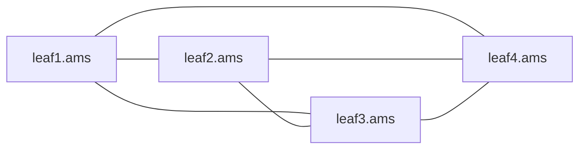

A BGP route is a claim: "this prefix is reachable, and here is the address to send it to". Passed from router to router, a claim can go wrong in two ways. It can come back to where it started and keep circulating, vouched for by copies of itself, long after the original is withdrawn. And the address it names can be one the receiver has no idea how to reach. BGP handles the first with two different loop rules, one between networks and one inside a network, and the second by handing the address to the interior routing protocol to resolve. Most "BGP is up but the route is not used" mysteries are one of these three rules doing exactly what it says.

Some reminders from earlier lessons. An **autonomous system** (AS) is a network run under one routing policy with its own AS number; **eBGP** is a BGP session between two ASes and **iBGP** a session inside one ([what BGP is for](/learn/fabric-networking/bgp-fundamentals/what-bgp-is-for)). Two of a route's path attributes matter here ([updates, attributes and RIBs](/learn/fabric-networking/bgp-fundamentals/updates-attributes-and-ribs)). **AS_PATH** is the list of AS numbers the route has crossed, newest on the left. **NEXT_HOP** is the IP address the receiver should forward matching traffic to. The **IGP** (interior gateway protocol, IS-IS on Meridian) routes inside one network and knows every router's **loopback**, a /32 on a virtual interface that never goes down, so it stays reachable while any path to the router exists ([IS-IS from zero](/learn/fabric-networking/underlay/is-is-from-zero)).

The examples run on Meridian's internet edge in Amsterdam: border gateways `gw1.ams` (loopback `10.255.1.201`) and `gw2.ams` (`10.255.1.202`), both in AS 64500, with ISP1 (AS 64501) attached to `gw1.ams` and ISP2 (AS 64502) to `gw2.ams`. As a small example, the site has two spines, `spine1.ams` and `spine2.ams`. Public addresses come from 192.0.2.0/24, 198.51.100.0/24 and 203.0.113.0/24, and AS numbers 64496–64511, ranges reserved for documentation (RFC 5737, RFC 5398).

## eBGP: the AS_PATH is the loop detector

Every time a route crosses an AS boundary, the sending router **prepends** its own AS number to the AS_PATH. Every receiver of an eBGP route scans the whole AS_PATH for **its own** AS number, and if it is there, the route has already been through this network and is coming back: RFC 4271 calls this an AS loop and excludes the route from best-path selection. Most implementations discard it on arrival. That is enough, because a loop between ASes must pass through some AS twice.

Trace Meridian's own prefix, `203.0.113.0/24`, around the ring formed by its two providers and a transit provider (AS 64496) that both buy from:

| Step | Sender → receiver | AS_PATH as received | Receiver's check | Result |
|---|---|---|---|---|
| 1 | `gw1.ams` (64500) → ISP1 (64501) | 64500 | 64501 absent | accept |
| 2 | ISP1 → transit (64496) | 64501 64500 | 64496 absent | accept |
| 3 | transit → ISP2 (64502) | 64496 64501 64500 | 64502 absent | accept |
| 4 | ISP2 → `gw2.ams` (64500) | 64502 64496 64501 64500 | **64500 present** | discard |

In step 4, `gw2.ams` never sent this route and still rejects it: the check is per AS, not per router. Without it, `gw2.ams` would hold a path to its own prefix running out through ISP2, around the internet and back in through `gw1.ams`.

```python
def export_ebgp(local_as, as_path):
    """Sending to an eBGP peer: prepend our own AS on the left."""
    return [local_as] + as_path


def accept_ebgp(local_as, as_path, allowas_in=0):
    """Receiving from an eBGP peer: our AS in the path means the route has been here."""
    return as_path.count(local_as) <= allowas_in


# Meridian's 203.0.113.0/24 around the ring: gw1.ams -> ISP1 -> transit -> ISP2 -> gw2.ams
path = []
for sender, receiver in [(64500, 64501), (64501, 64496), (64496, 64502), (64502, 64500)]:
    path = export_ebgp(sender, path)
    verdict = "accept" if accept_ebgp(receiver, path) else "REJECT: own AS in path"
    print(f"AS {sender} -> AS {receiver}: AS_PATH {' '.join(map(str, path)):<23} {verdict}")

# A customer that reuses private AS 65010 at two sites, joined through provider AS 64501
path = export_ebgp(64501, export_ebgp(65010, []))  # site A's route as site B receives it
print("site B, default:     ", accept_ebgp(65010, path))
print("site B, allowas-in 1:", accept_ebgp(65010, path, allowas_in=1))
```

```text
AS 64500 -> AS 64501: AS_PATH 64500                   accept
AS 64501 -> AS 64496: AS_PATH 64501 64500             accept
AS 64496 -> AS 64502: AS_PATH 64496 64501 64500       accept
AS 64502 -> AS 64500: AS_PATH 64502 64496 64501 64500 REJECT: own AS in path
site B, default:      False
site B, allowas-in 1: True
```

```viz
{"type": "fabric", "scenario": "bgp-update-propagation", "title": "Meridian's prefix around four ASes: the AS_PATH grows at each eBGP hop and gw2.ams rejects its own AS", "caption": "gw1.ams originates 203.0.113.0/24 and passes it to gw2.ams over iBGP with an empty AS_PATH, then announces it to ISP1. ISP1, the transit provider (AS 64496) and ISP2 each prepend their own AS and replace NEXT_HOP with their own address. When ISP2 sends the route to gw2.ams, gw2.ams finds 64500 in the path and discards it, and the closing frames show traffic following the next hops back the other way to gw1.ams."}
```

Notice the iBGP hop early in that run: when `gw1.ams` passes the route to `gw2.ams`, the AS_PATH stays empty. That detail is the reason for the next section.

### Where the AS check bites

**A fabric that shares AS numbers.** In the eBGP underlay design, both spines of a site share AS 65100 ([BGP as the underlay](/learn/fabric-networking/underlay/bgp-as-the-underlay)). A path that has been through one spine carries 65100, so the other spine rejects it when a leaf passes it up: the rule, used on purpose, forbids spine-leaf-spine detours.

**A customer that reuses one AS at several sites.** Enterprises often run the same private AS (65010 above) at every branch, joined through a provider. Site B rejects site A's routes, because 65010 is already in the path. Either the customer accepts its own AS up to N times (**allowas-in**, the last line of the code), or the provider rewrites the customer's AS to its own before sending (**as-override**). Both switch off loop detection for that AS, so a backdoor link between the two sites can now carry a loop.

The check also covers an AS_SET, the unordered list an aggregating router can record (RFC 6472 recommends against sending them). A sender may skip peers whose AS is already in the path, which only saves an UPDATE; the receiver's check is what guarantees correctness.

**What it solves:** loops between ASes, with no timers or counters, because the route carries its own history. **How it breaks:** reused AS numbers make legitimate routes look looped, and allowas-in or as-override removes the protection. **Signal:** a prefix the peer says it sent that never appears in the received table; implementations that keep discarded routes list them as rejected or hidden with "AS loop" as the reason, the field a tool should read.

## iBGP: the path does not grow, so routes must not be relayed

Inside an AS, nothing is prepended. It cannot be: if `gw1.ams` added 64500 before passing a route to `gw2.ams`, `gw2.ams` would find its own AS and discard it. So the AS_PATH is identical on every router in the AS and says nothing about which routers a route crossed: an iBGP loop is invisible to it.

RFC 4271's answer is a blunt rule, usually called **iBGP split horizon**: a route learned from an iBGP peer is never advertised to another iBGP peer. Routes learned over eBGP, and routes the router originates itself, go to every iBGP peer. A route therefore crosses at most one iBGP session, from the router that brought it into the AS to each of the others, and cannot circulate.

To see what the rule prevents, take four leaves of Meridian's Amsterdam overlay in AS 65000 (small example). `leaf3.ams` advertises Acme's `10.1.2.0/24` with NEXT_HOP `10.255.1.13`, its own loopback. The simulator runs synchronous rounds: each router advertises last round's best path, then picks a new best from what it heard. With no AS_PATH difference between copies, the tie-break is the lowest **router ID** (the 32-bit identifier each router announces in its OPEN, its loopback on Meridian) of the peer that sent it, as in [the best-path algorithm](/learn/fabric-networking/bgp-fundamentals/the-best-path-algorithm).

```python
import ipaddress

LOOPBACK = {"leaf1.ams": "10.255.1.11", "leaf2.ams": "10.255.1.12",
            "leaf3.ams": "10.255.1.13", "leaf4.ams": "10.255.1.14"}
RID = {name: ipaddress.ip_address(ip) for name, ip in LOOPBACK.items()}
ORIGIN = "leaf3.ams"  # advertises Acme's 10.1.2.0/24 with NEXT_HOP 10.255.1.13


def simulate(sessions, split_horizon, withdraw_at, rounds):
    peers = {r: set() for r in LOOPBACK}
    for a, b in sessions:
        peers[a].add(b)
        peers[b].add(a)
    best = {r: None for r in LOOPBACK}  # router -> (learned from, NEXT_HOP)
    for t in range(rounds):
        # 1. What each router advertises this round, from last round's best path.
        sent = {}
        for r, path in best.items():
            if path is None:
                continue
            if split_horizon and path[0] != "local":
                continue  # learned over iBGP: never re-advertised to iBGP peers
            for p in peers[r]:
                sent[(r, p)] = path[1]  # NEXT_HOP passes through unchanged
        # 2. Each router picks a best path from what it received.
        for r in LOOPBACK:
            if r == ORIGIN and t < withdraw_at:
                best[r] = ("local", LOOPBACK[r])
                continue
            heard = [(p, sent[(p, r)]) for p in peers[r] if (p, r) in sent]
            # No AS_PATH growth inside an AS; tie-break on the lowest peer router ID.
            best[r] = min(heard, key=lambda h: RID[h[0]]) if heard else None
        row = "  ".join(f"{r[:5]}<{best[r][0][:5] if best[r] else '-':<5}" for r in LOOPBACK)
        print(f"  round {t}: {row}")


ALL = sorted(LOOPBACK)
MESH = [(a, b) for i, a in enumerate(ALL) for b in ALL[i + 1:]]
print(f"full mesh of {len(ALL)}: {len(MESH)} sessions = n(n-1)/2")
print("Full mesh, split horizon on; leaf3 withdraws in round 2")
simulate(MESH, split_horizon=True, withdraw_at=2, rounds=4)
print("Session leaf3-leaf4 missing, split horizon on")
simulate([s for s in MESH if s != ("leaf3.ams", "leaf4.ams")], True, withdraw_at=9, rounds=2)
RING = [("leaf1.ams", "leaf2.ams"), ("leaf2.ams", "leaf4.ams"),
        ("leaf4.ams", "leaf3.ams"), ("leaf3.ams", "leaf1.ams")]
print("Ring of 4 sessions, split horizon OFF; leaf3 withdraws in round 4")
simulate(RING, split_horizon=False, withdraw_at=4, rounds=7)
```

```text
full mesh of 4: 6 sessions = n(n-1)/2
Full mesh, split horizon on; leaf3 withdraws in round 2
  round 0: leaf1<-      leaf2<-      leaf3<local  leaf4<-
  round 1: leaf1<leaf3  leaf2<leaf3  leaf3<local  leaf4<leaf3
  round 2: leaf1<leaf3  leaf2<leaf3  leaf3<-      leaf4<leaf3
  round 3: leaf1<-      leaf2<-      leaf3<-      leaf4<-
Session leaf3-leaf4 missing, split horizon on
  round 0: leaf1<-      leaf2<-      leaf3<local  leaf4<-
  round 1: leaf1<leaf3  leaf2<leaf3  leaf3<local  leaf4<-
Ring of 4 sessions, split horizon OFF; leaf3 withdraws in round 4
  round 0: leaf1<-      leaf2<-      leaf3<local  leaf4<-
  round 1: leaf1<leaf3  leaf2<-      leaf3<local  leaf4<leaf3
  round 2: leaf1<leaf3  leaf2<leaf1  leaf3<local  leaf4<leaf3
  round 3: leaf1<leaf2  leaf2<leaf1  leaf3<local  leaf4<leaf2
  round 4: leaf1<leaf2  leaf2<leaf1  leaf3<leaf1  leaf4<leaf2
  round 5: leaf1<leaf2  leaf2<leaf1  leaf3<leaf1  leaf4<leaf2
  round 6: leaf1<leaf2  leaf2<leaf1  leaf3<leaf1  leaf4<leaf2
```

Read the third run by hand: it is the failure the rule exists for. In round 2, `leaf2.ams` hears the route from `leaf1.ams` and takes it. In round 3, `leaf1.ams` hears it back from `leaf2.ams` and, unable to tell an echo of its own route from a genuine one, prefers it on router ID (`10.255.1.12` beats `10.255.1.13`). In round 4 `leaf3.ams` withdraws, and nothing changes: `leaf1.ams` and `leaf2.ams` believe each other, and `leaf3.ams` learns its own former prefix back from `leaf1.ams`. The **ghost route** is stable forever: BGP routes do not age out, and nothing in the copies reveals that the original is gone. Every ghost still carries NEXT_HOP `10.255.1.13`, so Acme's traffic goes to `leaf3.ams` and dies there; had each router rewritten the next hop to itself, it would also be a forwarding loop between `leaf1.ams` and `leaf2.ams`, bounded only by the packets' TTL (time to live, the hop counter each router decrements).

With split horizon, the first run withdraws cleanly one round after the origin does. The second run shows the price: remove a single session, and `leaf4.ams` never learns the route at all, because `leaf1.ams` and `leaf2.ams` hold it and are forbidden to relay it.

### Why split horizon forces a full mesh

If a route may cross only one iBGP session, every router that learns a route from outside the AS, or originates one, must have a session to every other router in the AS. That is a **full mesh**: every pair of iBGP speakers has its own session.



For n speakers, each needs n − 1 sessions, and each session joins two speakers, so the total is

$$\frac{n(n-1)}{2}$$

For 4 leaves that is 4 × 3 / 2 = 6, the six lines above. The number grows with the square of n:

| iBGP speakers | Sessions per router | Total sessions | Where |
|---|---|---|---|
| 4 | 3 | 6 | The small Amsterdam example |
| 6 | 5 | 15 | Meridian's six border gateways in AS 64500, two per site |
| 16 | 15 | 120 | Every leaf in `ams` |
| 48 | 47 | 1,128 | Three sites of 16 leaves each |
| 100 | 99 | 4,950 | A mid-sized backbone |
| 1,000 | 999 | 499,500 | A large network; never built this way |

The session count is only the first cost. A 49th leaf means editing all 48 existing leaves. At a 3 s keepalive interval, 1,128 sessions exchange about 752 KEEPALIVEs a second across the fabric (1,128 × 2 directions ÷ 3 s). And every update is replicated by its originator: a host moving to `leaf1.ams` makes `leaf1.ams` send the same EVPN route 47 times, where with a reflector pair it sends 2.

Two designs relax split horizon under control. **Route reflectors** (RFC 4456) may re-advertise iBGP routes to their clients and stamp two attributes, ORIGINATOR_ID and CLUSTER_LIST, that restore loop detection inside the AS; Meridian's overlay uses them ([route reflectors](/learn/fabric-networking/bgp-fundamentals/route-reflectors)). **Confederations** (RFC 5065) split the AS into private sub-ASes joined by eBGP-like sessions that record sub-AS numbers in an AS_CONFED_SEQUENCE segment, so the ordinary loop check works between them, while NEXT_HOP and LOCAL_PREF (the AS-wide preference for an exit) pass unchanged as inside one AS; the outside world still sees one AS. Reflectors are the default almost everywhere.

**What split horizon solves:** loops and ghost routes inside an AS, where the AS_PATH cannot detect them. **How it breaks:** one missing session in the mesh leaves a router without the routes the other end learned, while every session that does exist is healthy. **Signal:** prefix counts that differ between routers that should hold identical tables; the expected n(n − 1)/2 sessions compared with what the devices report.

## NEXT_HOP: eBGP rewrites it, iBGP carries it

NEXT_HOP is set according to who sends the route to whom (RFC 4271, section 5.1.3):

| Situation | NEXT_HOP the receiver sees | Example |
|---|---|---|
| Originated by the router itself, sent to an iBGP peer | The router's own address: the session's source, its loopback in practice | `leaf3.ams` sends `10.1.2.0/24` with `10.255.1.13` |
| Sent to an eBGP peer | The sender's own address on the shared link | ISP2 sends `192.0.2.0/24` to `gw2.ams` with `198.51.100.0` |
| Learned over eBGP, passed on to an iBGP peer | **Unchanged**: still the external neighbour's address | `gw2.ams` passes it to `gw1.ams` with `198.51.100.0` |
| Reflected by a route reflector | Unchanged (RFC 4456 says a reflector should not modify it) | `rr1.ams` reflects `leaf3.ams`'s route with `10.255.1.13` |

The rule is "the next hop names the exit": the router that heard the route from outside, where traffic should leave. Preserving its address has three consequences. Each router reaches the exit by its own IGP shortest path, not via whoever passed the route along. Each router can compare its own IGP distance to competing exits, which is how "hot-potato" routing hands traffic off at the nearest exit ([the best-path algorithm](/learn/fabric-networking/bgp-fundamentals/the-best-path-algorithm)). And a route reflector, which only relays routes, never becomes a point traffic has to cross; this is why `rr1.ams` can sit beside the spines, out of the forwarding path.

The cost shows up at the edge. When `gw2.ams` passes ISP2's route to `gw1.ams` unchanged, the next hop is `198.51.100.0`, ISP2's address on the /31 link to `gw2.ams`. IS-IS on Meridian carries loopbacks and fabric links, not links to other companies, so `gw1.ams` has no route to that address. RFC 4271 keeps a route with an unresolvable next hop in the BGP table but excludes it from best-path selection. The session is Established, the prefix was received, and the path is never used: `gw1.ams` stays on ISP1's longer path. Illustrative output:

```text
gw1.ams# show bgp ipv4 unicast 192.0.2.0/24          (illustrative output)
Paths: (2 available, best #1)
  64501 64496 64511
    198.51.100.2 from 198.51.100.2 (ISP1)
      Origin IGP, localpref 100, valid, external, best
  64502 64511
    198.51.100.0 (inaccessible) from 10.255.1.202 (gw2.ams)
      Origin IGP, localpref 100, internal
```

The word to look for is "inaccessible" (some platforms say "unresolved" or list the route as hidden): BGP has the route and the next hop does not resolve.

### next-hop-self

There are two fixes.

**next-hop-self** makes the border router rewrite NEXT_HOP to its own loopback on routes it sends to iBGP peers. `gw2.ams` resends the route with `10.255.1.202`, which IS-IS carries, and the path becomes usable. Every route ISP2 sent now points at `gw2.ams`, and `gw2.ams` itself forwards to ISP2, resolving `198.51.100.0` on its connected link. This is standard practice at almost every internet edge.

**Carrying the external link in the IGP** keeps the next hop unchanged and advertises `198.51.100.0/31` into IS-IS (as a passive interface: the subnet is advertised, no adjacency is attempted), so every router can resolve ISP2's address.

The choice is a trade-off in how a failure is signalled. Suppose the ISP2 link goes down while `gw2.ams` stays up, and ISP2 had sent the full internet table, about a million IPv4 routes. With next-hop-self, `gw1.ams` learns of it only through BGP: `gw2.ams` withdraws every prefix, which takes seconds to tens of seconds depending on CPU and how many prefixes fit in each UPDATE. Meanwhile traffic still heads for `gw2.ams`, which has no alternative to offer: `gw1.ams` advertises only its best path, the one through `gw2.ams`, so its ISP1 path never reached `gw2.ams` (unless `gw1.ams` also advertises it, with ADD-PATH or a best-external option). With the link in IS-IS, one link-state update removes the /31, and every path using that next hop becomes unusable at once on every router. The price is external addresses in the IGP, one more thing a misconfiguration can leak. Most networks keep the IGP clean and accept the slower edge-link failover.

### The next hop in an overlay

In Meridian's EVPN overlay the next hop is the payload. A leaf originates a route for a tenant's MAC or subnet with NEXT_HOP set to its loopback, which is also its **VTEP** (VXLAN tunnel endpoint, the address that encapsulated traffic for that leaf is sent to) ([EVPN, the control plane](/learn/fabric-networking/overlays-vxlan-evpn/evpn-the-control-plane)). The reflectors pass it on unchanged, so a remote leaf tunnels straight to the right leaf. Two misconfigurations rewrite it. next-hop-self on a reflector would pull every tenant's traffic towards a box that is not a VTEP; FRRouting and Cisco IOS, among others, ignore a plain next-hop-self on reflected routes and need an explicit "force" or "all" form. And where spines carry the overlay over eBGP, eBGP's default would replace the next hop with the spine's link address, so the spines must preserve it (automatic for EVPN on some implementations, configured on others).

**What next-hop-self solves:** iBGP routes whose external next hop the IGP cannot reach. **How it breaks:** missing on a border router, every route from that ISP is received and unusable; applied where it does not belong, traffic is dragged through a reflector or a spine. **Signal:** paths received but not eligible, with an "inaccessible" or "unresolved" next hop; in an overlay, EVPN routes whose next hop is not a VTEP address in the source of truth.

## Recursive next-hop resolution

A BGP next hop is usually not on an attached link: `10.255.1.202` is two hops from `gw1.ams`. Forwarding hardware cannot send a packet "to 10.255.1.202"; it needs an outgoing interface and a directly connected neighbour's MAC address. **Recursive resolution** bridges the gap: the router looks the next hop up in its own routing table, and repeats until it reaches a directly connected address.

For `192.0.2.0/24` on `gw1.ams`, with next-hop-self on `gw2.ams`:

1. **BGP** picks the best path: NEXT_HOP `10.255.1.202`, AS_PATH 64502 64511, one AS shorter than ISP1's 64501 64496 64511.
2. **Longest-prefix match** for `10.255.1.202` in the routing table: the IS-IS route `10.255.1.202/32`, metric 20, with two equal-cost next hops, `10.254.1.200` (`spine1.ams`) and `10.254.2.200` (`spine2.ams`) ([the routing table](/learn/fabric-networking/from-zero/the-routing-table) covers the lookup).
3. **Longest-prefix match** for each of those: `10.254.1.200` is on the connected link `10.254.1.200/31` to `spine1.ams`, and `10.254.2.200` on `10.254.2.200/31` to `spine2.ams`. Recursion stops.
4. **The FIB** (forwarding information base, the table the forwarding chip uses) gets `192.0.2.0/24` with two physical next hops, the spines' addresses, each with its interface and, from ARP, its MAC ([ARP and the default gateway](/learn/fabric-networking/from-zero/arp-and-the-default-gateway)). A packet for `192.0.2.10` is hashed over the two spines ([ECMP and hashing](/learn/fabric-networking/fabric-architecture/ecmp-and-hashing)).

BGP chose the exit, `gw2.ams`; IS-IS chose the way to it, either spine. Neither knows the other's half. The same split runs Meridian's overlay: `leaf1.ams` holds an EVPN route for `acme-web2` whose next hop is `leaf2.sin`'s loopback, `10.255.2.12`, and IS-IS says how to reach that loopback, through the spines and the inter-site circuits.

```viz
{"type": "fabric", "scenario": "bgp-next-hop-resolution", "title": "gw1.ams resolves an iBGP next hop through IS-IS: unusable without next-hop-self, two spines with it, gone when gw2.ams dies", "caption": "ISP2 announces 192.0.2.0/24 to gw2.ams, which passes it to gw1.ams over iBGP with NEXT_HOP 198.51.100.0 unchanged; gw1.ams finds no route to that address and stays on ISP1. With next-hop-self the next hop is 10.255.1.202, resolved through the IS-IS /32 into a FIB entry with both spines. The gw2.ams–spine1.ams link failing changes only the IS-IS step; gw2.ams losing power removes the /32, the path becomes unusable and traffic moves to ISP1 while the iBGP session still shows Established, until its hold timer expires."}
```

The code builds `gw1.ams`'s routing table as the visualisation shows it and resolves both paths in six situations; the last two add a summary route the visualisation does not have.

```python
import ipaddress

ISP1, ISP2_LINK, GW2 = "198.51.100.2", "198.51.100.0", "10.255.1.202"
SPINE1, SPINE2 = "10.254.1.200", "10.254.2.200"


def rib(gw2_spine1_up=True, gw2_alive=True, summary=False):
    """gw1.ams's routing table: prefix -> (source, list of next hops or an interface)."""
    r = {"10.254.1.200/31": ("connected", "to-spine1"),
         "10.254.2.200/31": ("connected", "to-spine2"),
         "198.51.100.2/31": ("connected", "to-isp1"),
         "10.255.1.1/32": ("isis", [SPINE1])}
    if gw2_alive:
        r[GW2 + "/32"] = ("isis", [SPINE1, SPINE2] if gw2_spine1_up else [SPINE2])
    if summary:  # other sites' loopbacks, summarised and reached through the spines
        r["10.255.0.0/16"] = ("isis", [SPINE1, SPINE2])
    return {ipaddress.ip_network(p): v for p, v in r.items()}


def lookup(table, addr, host_routes_only=False):
    addr = ipaddress.ip_address(addr)
    hits = [n for n in table if addr in n and n.prefixlen > 0]  # never via a default route
    if host_routes_only:
        hits = [n for n in hits if n.prefixlen == 32 or table[n][0] == "connected"]
    return max(hits, key=lambda n: n.prefixlen, default=None)


def resolve(table, next_hop, depth=0, **policy):
    """Recursive resolution: follow next hops until each ends on a connected interface."""
    if depth > 4:
        return None, "recursion too deep"
    net = lookup(table, next_hop, **policy)
    if net is None:
        return None, f"no route to {next_hop}"
    source, via = table[net]
    if source == "connected":
        return [(next_hop, via)], f"{next_hop} is on {via}"
    adjacencies = []
    for hop in via:  # IGP next hops can themselves need resolving
        resolved, _ = resolve(table, hop, depth + 1, **policy)
        adjacencies += resolved or []
    return adjacencies or None, f"{next_hop} via {source} {net}"


def best_path(table, paths, **policy):
    usable = []
    for name, as_path, nh in paths:
        adj, why = resolve(table, nh, **policy)
        print(f"    {name:<5} AS_PATH {as_path:<17} NEXT_HOP {nh:<13} {'ok' if adj else 'UNUSABLE'}: {why}")
        if adj:
            usable.append((len(as_path.split()), name, adj))
    length, name, adj = min(usable)  # equal LOCAL_PREF here; shortest AS_PATH wins
    print(f"    best: {name}; FIB 192.0.2.0/24 -> {', '.join(f'{ip} ({i})' for ip, i in adj)}")


via_isp1 = ("ISP1", "64501 64496 64511", ISP1)
cases = [
    ("1. iBGP without next-hop-self", rib(), ISP2_LINK, {}),
    ("2. next-hop-self on gw2.ams", rib(), GW2, {}),
    ("3. gw2.ams-spine1.ams link down", rib(gw2_spine1_up=False), GW2, {}),
    ("4. gw2.ams loses power", rib(gw2_alive=False), GW2, {}),
    ("5. gw2.ams dead, /16 summary present", rib(gw2_alive=False, summary=True), GW2, {}),
    ("6. same, host routes only", rib(gw2_alive=False, summary=True), GW2, {"host_routes_only": True}),
]
for title, table, gw2_nh, policy in cases:
    print(title)
    best_path(table, [via_isp1, ("gw2", "64502 64511", gw2_nh)], **policy)
```

```text
1. iBGP without next-hop-self
    ISP1  AS_PATH 64501 64496 64511 NEXT_HOP 198.51.100.2  ok: 198.51.100.2 is on to-isp1
    gw2   AS_PATH 64502 64511       NEXT_HOP 198.51.100.0  UNUSABLE: no route to 198.51.100.0
    best: ISP1; FIB 192.0.2.0/24 -> 198.51.100.2 (to-isp1)
2. next-hop-self on gw2.ams
    ISP1  AS_PATH 64501 64496 64511 NEXT_HOP 198.51.100.2  ok: 198.51.100.2 is on to-isp1
    gw2   AS_PATH 64502 64511       NEXT_HOP 10.255.1.202  ok: 10.255.1.202 via isis 10.255.1.202/32
    best: gw2; FIB 192.0.2.0/24 -> 10.254.1.200 (to-spine1), 10.254.2.200 (to-spine2)
3. gw2.ams-spine1.ams link down
    ISP1  AS_PATH 64501 64496 64511 NEXT_HOP 198.51.100.2  ok: 198.51.100.2 is on to-isp1
    gw2   AS_PATH 64502 64511       NEXT_HOP 10.255.1.202  ok: 10.255.1.202 via isis 10.255.1.202/32
    best: gw2; FIB 192.0.2.0/24 -> 10.254.2.200 (to-spine2)
4. gw2.ams loses power
    ISP1  AS_PATH 64501 64496 64511 NEXT_HOP 198.51.100.2  ok: 198.51.100.2 is on to-isp1
    gw2   AS_PATH 64502 64511       NEXT_HOP 10.255.1.202  UNUSABLE: no route to 10.255.1.202
    best: ISP1; FIB 192.0.2.0/24 -> 198.51.100.2 (to-isp1)
5. gw2.ams dead, /16 summary present
    ISP1  AS_PATH 64501 64496 64511 NEXT_HOP 198.51.100.2  ok: 198.51.100.2 is on to-isp1
    gw2   AS_PATH 64502 64511       NEXT_HOP 10.255.1.202  ok: 10.255.1.202 via isis 10.255.0.0/16
    best: gw2; FIB 192.0.2.0/24 -> 10.254.1.200 (to-spine1), 10.254.2.200 (to-spine2)
6. same, host routes only
    ISP1  AS_PATH 64501 64496 64511 NEXT_HOP 198.51.100.2  ok: 198.51.100.2 is on to-isp1
    gw2   AS_PATH 64502 64511       NEXT_HOP 10.255.1.202  UNUSABLE: no route to 10.255.1.202
    best: ISP1; FIB 192.0.2.0/24 -> 198.51.100.2 (to-isp1)
```

Case 3 is the division of labour in action: a fabric link fails, the FIB entry for `192.0.2.0/24` loses a next hop, and BGP sends and changes nothing, because the exit is the same. Case 4 is failover done right: `gw2.ams`'s loopback leaves the routing table and its paths become unusable.

Case 5 is the trap. Suppose IS-IS also carries `10.255.0.0/16`, a summary of the other sites' loopbacks reached through the spines. When `gw2.ams` dies, its /32 disappears, but `10.255.1.202` still falls inside the /16, so the next hop still "resolves", the path stays best, and traffic for `192.0.2.0/24` heads for an exit that no longer exists and is dropped until the BGP session's hold timer expires. A **covering route**, a shorter prefix that contains the address, has made a dead exit look alive. Case 6 is the fix used in practice: a resolution policy that accepts only host routes (/32s) for loopback next hops.

### The rules resolvers apply

Real implementations guard the bare recursion:

- **Not through the default route.** A default route (`0.0.0.0/0`) matches every address, so every next hop would always look reachable. FRRouting (the open-source routing suite inside SONiC and Cumulus Linux) refuses it by default; other implementations allow it by default and have a switch to restrict it. The `prefixlen > 0` filter in `lookup` is this rule.
- **Not through itself.** A BGP route for `10.255.1.0/24` with next hop `10.255.1.202`, and no more specific route to that address, would resolve through itself; routers refuse it. When the address is a BGP peer's, the session comes up, learns a preferred route to the peer through the peer itself, loses its real path, drops and repeats: the classic "recursive routing failure" flap.
- **A depth limit.** Static routes can point at addresses that resolve through other static routes; implementations cap the chain, as `depth > 4` does here.
- **Only certain sources.** Many networks resolve BGP next hops only through IGP or connected routes, never through other BGP routes, which removes a class of circular dependencies.

### Next-hop tracking: how fast resolution reacts

Older implementations re-checked next hops on a periodic scan (every 60 s on classic Cisco IOS), so a dead exit could attract traffic for up to a minute. Modern ones use **next-hop tracking**: BGP registers each next hop with the routing table and is notified the moment the route resolving it changes. In the visualisation's last frames, `gw2.ams` loses power, IS-IS withdraws `10.255.1.202/32` within about a second (detection, flooding and SPF; [convergence and BFD](/learn/fabric-networking/underlay/convergence-and-bfd) has the timings), next-hop tracking marks the path unusable, and traffic moves to ISP1. The iBGP session to `gw2.ams` still shows Established until its **hold timer** (the silence a BGP speaker tolerates before declaring its peer dead, [sessions and the FSM](/learn/fabric-networking/bgp-fundamentals/bgp-sessions-and-the-fsm)) runs out, up to 9 s later with the fabric's 9 s hold time, 90 s with RFC 4271's suggested value; some implementations can be told to drop a session as soon as the peer's address leaves the routing table. Next-hop tracking, not the session, decided how quickly traffic left a dead exit.

### Hierarchical FIB: one change, a million routes

`gw1.ams` holds about a million internet prefixes; suppose half of them have `gw2.ams` as their best exit. With each prefix stored beside its physical next hops, case 3 would rewrite half a million hardware entries: tens of seconds at the tens of thousands of updates a second typical of router software (the rate depends on chip and platform). Instead, routers store routes **hierarchically**: each BGP prefix points to a shared next-hop entry for `10.255.1.202`, and that entry points to the two spine adjacencies. When the way to `gw2.ams` changes, one shared entry is rewritten and every prefix behind it follows at once. Vendors call this **BGP PIC Core** (prefix-independent convergence): convergence time that does not depend on how many prefixes share a next hop. **PIC Edge** also precomputes a backup exit (here ISP1) and switches to it as soon as the primary next hop fails.

### What resolution does not do

Resolution chooses only the first hop. `spine1.ams` must also know where to send a packet for `192.0.2.10`; if the spines carry only IS-IS routes, they drop it while every session is up and every next hop resolves. Tunnelling to `10.255.1.202` (MPLS or VXLAN) or running BGP on the spines fixes it, the subject of [the BGP black hole](/learn/fabric-networking/bgp-fundamentals/the-bgp-black-hole).

**What recursive resolution solves:** BGP can name an exit anywhere in the network while the IGP handles the path to it, and IGP changes reach every BGP route without a BGP message. **How it breaks:** a next hop the IGP does not carry makes paths unusable; a covering or default route makes a dead next hop look alive; a next hop resolving through itself flaps the session. **Signal:** per-path next-hop status (valid, inaccessible), and for each next hop the route that resolves it, its prefix length and its source.

## Failure modes in production

| Failure | Symptom | Diagnosis | Fix |
|---|---|---|---|
| Missing next-hop-self on a border router | Routes from one ISP received on every router but used only on the router attached to it; traffic takes the longer path | Paths flagged "inaccessible"; next hop is an external link address absent from the IGP | next-hop-self towards iBGP peers, or carry the link in the IGP |
| Next hop resolved through a covering route | After a router dies, traffic to its prefixes is black-holed until a hold timer expires | Next hop resolved by a /16 or a default instead of a /32 | Resolve loopback next hops only through host routes; never through the default route |
| Incomplete iBGP mesh | One router lacks the external routes another learned; no session is down | Prefix counts differ between routers that should match; expected sessions minus actual sessions is non-zero | Add the session, or move to reflectors so a new router needs only two |
| Recursive routing failure | A session between loopbacks flaps on a fixed period | Logs report the peer's address resolving through a route learned from that peer | Make the IGP carry the peer's loopback; filter that loopback out of BGP |
| Underlay loss takes the overlay with it | Every overlay route unusable at once across a site, then sessions drop | Loopback /32s vanish from IS-IS; next hops go invalid before any session changes | Restore the underlay; protect it from the trigger |
| allowas-in hiding a real loop | A route circulates between two sites of one customer through a backdoor link | The same AS appears twice in the path, accepted only because of allowas-in | Limit the count to 1; tag each site's routes with a site-of-origin community so a site rejects its own; filter the backdoor |
| Next hop rewritten in the overlay | Tenant traffic tunnels to a reflector or spine, or is dropped there | EVPN routes carry a next hop that is not a leaf VTEP | Remove next-hop-self from reflected routes; preserve the next hop on eBGP overlay spines |

The underlay row is why next-hop resolvability deserves its own alert. In the purge storm of [underlay failures in production](/learn/fabric-networking/underlay/underlay-failures-in-production), one router's clock jump erased the IS-IS database everywhere: every loopback /32 vanished, every overlay next hop became unresolvable and tenant traffic stopped, while the BGP sessions stayed Established for up to a hold time more. A dashboard watching sessions was the last to know.

## Trade-offs

Keeping iBGP loop-free:

| | Full mesh | Route reflectors | Confederations |
|---|---|---|---|
| Sessions for n routers | n(n − 1)/2 | About 2 per client, plus the reflectors' own mesh | A full mesh inside each sub-AS, a few sessions between them |
| Adding a router | Touch every existing router | Touch the new router (and the reflectors, unless they accept any peer from a configured subnet) | Touch its sub-AS |
| Loop prevention | Split horizon | ORIGINATOR_ID and CLUSTER_LIST | AS_CONFED_SEQUENCE in the AS_PATH |
| Path visibility | Every router sees every exit | Each client sees the reflector's best path per prefix, unless ADD-PATH (RFC 7911) sends more | Full inside a sub-AS, best path between them |
| Typical use | A handful of border routers | Data-center overlays, most backbones | Very large carriers, mergers |

Where the next hop points:

| | next-hop-self at the edge | External links in the IGP | Next hop unchanged (overlay) |
|---|---|---|---|
| Next hop seen inside the AS | Border router's loopback | External neighbour's address | Originating leaf's VTEP |
| IGP contents | Internal only | Plus every external /31 | Internal only |
| Edge link fails | Per-prefix BGP withdrawals, seconds or more | One IGP change invalidates all paths at once | Not applicable |
| Border router fails | Loopback leaves the IGP: fast | Fast | Not applicable |
| Risk | Slower edge failover | External addresses leak into the IGP | Breaks if anything rewrites it |

## Under the hood: next hops in a real router

On SONiC or Cumulus Linux, FRRouting's `bgpd` does not read the kernel's routing table itself. It registers each next hop with `zebra`, FRRouting's routing-table manager, which runs the recursion and notifies `bgpd` whenever the answer changes: next-hop tracking. Illustrative output of the next-hop cache on `gw1.ams` with next-hop-self in place:

```text
gw1.ams# show bgp nexthop                            (illustrative output)
Current BGP nexthop cache:
 10.255.1.202 valid [IGP metric 20], #paths 1004270
  gate 10.254.1.200, if to-spine1
  gate 10.254.2.200, if to-spine2
 198.51.100.2 valid [IGP metric 0], #paths 1003915
  if to-isp1
```

The cache shows the hierarchy: two next hops, each shared by about a million paths. Since Linux 5.3 `zebra` can install the shared part as a separate kernel **nexthop object** (`ip nexthop show`) that routes reference, so changing it is one kernel operation (older kernels store every route's next hops inline); forwarding chips hold the same structure as next-hop groups. `ip route get 192.0.2.10` returns the outgoing interface and gateway the recursion produced.

## What the platform should show

Tooling should make the three rules visible, because each fails while sessions look healthy. Surface:

- **Per peer: received, eligible and best.** Received but not eligible is the signature of an unresolved next hop or an AS-loop discard; a border peer with every prefix ineligible is a missing next-hop-self.
- **Per next hop: resolved or not, and through what.** The resolving route's prefix, prefix length and source. A loopback next hop resolved by anything other than a /32 is a latent black hole; one resolved through the default route is worse.
- **Mesh completeness from intent.** Without reflectors, compute the expected n(n − 1)/2 pairs from the source of truth and diff them against the sessions devices report: a missing session is invisible in any per-device view.
- **AS-loop rejections and allowas-in use.** Count discarded routes by reason where the device exposes them; list every peer with allowas-in or as-override, each a disabled safety check.
- **Next-hop changes correlated with IGP events.** Next hops going invalid together with loopbacks leaving IS-IS is an underlay incident, and the alert should say so.
- **The overlay's next hops against the VTEP inventory.** An EVPN route whose next hop is not a known leaf loopback means something rewrote it.

The core checks are short:

```python
import ipaddress
from itertools import combinations

GATEWAYS = ["gw1.ams", "gw2.ams", "gw1.sin", "gw2.sin", "gw1.sjc", "gw2.sjc"]


def mesh_gaps(speakers, established):
    """Every pair of iBGP speakers without a route reflector needs its own session."""
    up = {frozenset(pair) for pair in established}
    expected = list(combinations(speakers, 2))
    return len(expected), [pair for pair in expected if frozenset(pair) not in up]


def next_hop_findings(paths):
    """paths: (prefix, BGP next hop, prefix of the route that resolved it, or None)."""
    for prefix, nh, via in paths:
        if via is None:
            yield f"{prefix}: next hop {nh} unresolved, path unusable (missing next-hop-self?)"
        elif ipaddress.ip_network(via).prefixlen < 32 and nh.startswith("10.255."):
            yield f"{prefix}: loopback next hop {nh} resolved by covering route {via}, not a /32"


established = [p for p in combinations(GATEWAYS, 2) if set(p) != {"gw2.ams", "gw1.sjc"}]
expected, gaps = mesh_gaps(GATEWAYS, established)
print(f"AS 64500 iBGP: {expected - len(gaps)} of {expected} full-mesh sessions up")
for a, b in gaps:
    print(f"  missing {a} <-> {b}: neither hears the routes the other learned by eBGP")
for finding in next_hop_findings([
        ("192.0.2.0/24", "10.255.1.202", "10.255.1.202/32"),
        ("192.0.2.128/25", "198.51.100.0", None),
        ("198.51.100.128/25", "10.255.3.202", "10.255.0.0/16")]):
    print(" ", finding)
```

```text
AS 64500 iBGP: 14 of 15 full-mesh sessions up
  missing gw2.ams <-> gw1.sjc: neither hears the routes the other learned by eBGP
  192.0.2.128/25: next hop 198.51.100.0 unresolved, path unusable (missing next-hop-self?)
  198.51.100.128/25: loopback next hop 10.255.3.202 resolved by covering route 10.255.0.0/16, not a /32
```

The engineer on call needs "14 of 15 sessions, one pair missing"; a manager needs the colour: every exit still reachable, redundancy reduced. Both come from the same data.

## Interviewer follow-ups

**"Why does iBGP need a full mesh?"** Model answer: iBGP does not prepend the AS, so the AS_PATH cannot detect a loop inside an AS. RFC 4271 therefore forbids relaying an iBGP-learned route to another iBGP peer, so every router must peer directly with every router that brings routes in: n(n − 1)/2 sessions, 1,128 for 48 leaves. Reflectors and confederations relax the rule with their own loop detection. Common wrong answer: "for redundancy"; the mesh exists because of the no-relay rule.

**"A prefix is in the BGP table but not in the forwarding table. What do you check?"** Model answer: whether the path is eligible at all, meaning whether its next hop resolves and through which route. Then whether a better path won, or a route from another protocol with a better administrative preference holds the prefix. The commonest cause at an edge is an external next hop without next-hop-self. Common wrong answer: restarting the session, which re-learns the same unusable path.

**"Why doesn't iBGP set next-hop-self everywhere by default?"** Model answer: the next hop names the exit. Rewriting it everywhere would route traffic through whoever relayed the route, a reflector included, and hide the real exit from hot-potato comparisons. In an EVPN overlay the next hop is the tunnel's VTEP and must survive end to end. next-hop-self belongs where routes enter the AS. Common wrong answer: "it would be fine, BGP would pick the best path anyway".

**"A border router loses power. How quickly does traffic move off it?"** Model answer: as fast as its loopback leaves the IGP, typically within about a second, because next-hop tracking invalidates every path using that next hop at once and a hierarchical FIB repoints them in one operation. The caveat: if a covering route still contains the loopback, the next hop stays resolvable and traffic black-holes until the hold timer. Common wrong answer: "after the hold time", which describes the session, not the forwarding. An honest addition: "I'd defer to the network team on the platform's resolution policy, but I'd measure it: kill a test loopback and time how long paths stay eligible."

## What mid-level engineers get wrong

- **Treating "received" as "used".** A route with an unresolvable next hop is never installed, and dashboards counting received prefixes call it healthy.
- **Assuming iBGP relays routes like eBGP.** Designing a chain of iBGP sessions, or removing "redundant" mesh sessions, leaves routers silently without routes.
- **Applying next-hop-self everywhere**, reflectors and overlay spines included, pulling traffic through devices built never to carry it.
- **Trusting any route that resolves a next hop.** A summary or default route keeps a dead exit's paths alive until a hold timer expires.
- **Reading the AS-loop check as per router.** It is per AS: `gw2.ams` rejects a route that `gw1.ams` sent, and two sites sharing a private AS reject each other's routes.

## Senior signals

- You explain the full mesh as a consequence of the AS_PATH not growing inside an AS, and do the n(n − 1)/2 arithmetic for the network in front of you.
- You say "BGP picks the exit, the IGP picks the path to it", and know that an IGP change moves traffic without a single BGP message.
- For a route received and unused, you check next-hop resolution first, and ask what resolves each next hop: a /32 for loopbacks, because a covering route makes a dead router look alive.
- You know traffic leaves a dead exit at the speed of the IGP and next-hop tracking, not the BGP hold timer, and that hierarchical FIBs make that independent of the number of prefixes.
- You distinguish reaching the next hop from reaching the destination, and name encapsulation or BGP on every hop as the fix.

## Check yourself

```quiz
- q: >-
    gw2.ams (AS 64500) receives Meridian's own prefix 203.0.113.0/24 from ISP2 with AS_PATH 64502 64496 64501 64500. gw2.ams never advertised that prefix to anyone. What does it do?
  options: ["Accepts it, because gw2.ams itself never sent the route", "Discards it, because the AS_PATH is longer than four", "Accepts it as a backup path with a lower LOCAL_PREF", "Discards it, because its own AS appears in the AS_PATH"]
  answer: 3
  explanation: >-
    The eBGP loop check is per AS, not per router: any route carrying the receiver's AS number has already been through this network, whichever router sent it. gw1.ams announced it to ISP1, so the route has looped back. There is no length limit at four, and BGP does not keep looped routes as backups.
- q: >-
    Why does a router not re-advertise a route learned from one iBGP peer to another iBGP peer?
  options: ["Re-advertising would double the keepalive load on each session", "The next hop would have to be rewritten at every iBGP hop", "iBGP sessions cannot carry more than one copy of each prefix", "The AS_PATH does not change inside an AS, so loops would go unseen"]
  answer: 3
  explanation: >-
    iBGP does not prepend the local AS, so every copy of a route inside the AS has the same AS_PATH and a loop cannot be detected from it. Forbidding relay means a route crosses at most one iBGP session. The side effect is the full mesh. Next hops are deliberately left unchanged across iBGP, and keepalives are unrelated to route relay.
- q: >-
    gw1.ams shows the iBGP session to gw2.ams Established and 1,000,000 prefixes received from it, but none is used, and gw1.ams sends all traffic through ISP1. The paths' next hop is 198.51.100.0, ISP2's link address. What is the most likely fix?
  options: ["A higher LOCAL_PREF on routes learned from gw2.ams", "allowas-in on gw1.ams for the iBGP session", "A shorter hold time on the gw1.ams to gw2.ams session", "next-hop-self on gw2.ams towards its iBGP peers"]
  answer: 3
  explanation: >-
    iBGP leaves the external next hop unchanged, and IS-IS does not carry the ISP's link, so gw1.ams cannot resolve 198.51.100.0 and the paths are ineligible. next-hop-self makes gw2.ams advertise its own loopback, which IS-IS carries. A higher LOCAL_PREF cannot make an ineligible path win, allowas-in concerns AS loops, and the hold time is irrelevant to resolution.
- q: >-
    The link between gw2.ams and spine1.ams fails. gw1.ams's best path for 192.0.2.0/24 has next hop 10.255.1.202 (gw2.ams), which IS-IS still reaches through spine2.ams. What changes on gw1.ams?
  options: ["The BGP session flaps and the route is re-learned through spine2", "Only the FIB entry, which drops to one spine; BGP sends nothing", "gw2.ams withdraws and re-advertises the prefix with a new next hop", "Nothing until the next periodic BGP scan, up to 60 s later"]
  answer: 1
  explanation: >-
    BGP chose the exit, which has not changed; IS-IS recomputes the way to 10.255.1.202 and next-hop tracking updates the resolved FIB entry, so the route now uses spine2 only. No BGP message is sent, and the session between loopbacks survives because IS-IS still reaches them. Periodic 60 s scanning describes old implementations without next-hop tracking.
- q: >-
    gw2.ams loses power, and its loopback 10.255.1.202/32 disappears from IS-IS. gw1.ams also has an IS-IS route 10.255.0.0/16 through the spines. What happens to traffic for gw2.ams's prefixes?
  options: ["It moves to ISP1 at once, because the /32 is gone", "It is sent to the spines and dropped until the hold timer expires", "It loops between gw1.ams and the spines until the TTL expires", "It is dropped on gw1.ams, because the FIB entry is deleted"]
  answer: 1
  explanation: >-
    10.255.1.202 still matches the /16, so the next hop still resolves and the path stays best; gw1.ams keeps forwarding towards the spines and a gateway that is gone, and the packets are dropped there. Only when the iBGP hold timer expires are gw2.ams's paths removed. Resolving loopback next hops only through /32 routes would have made the path unusable at once and moved traffic to ISP1.
- q: >-
    Meridian considers running its 48 overlay leaves in a full iBGP mesh with no route reflectors. How many sessions is that, and what does adding a 49th leaf cost?
  options: ["96 sessions; the new leaf needs 2, and only it is changed", "1,128 sessions; the new leaf needs 2, so only two leaves change", "1,128 sessions; the new leaf needs 48, so every existing leaf changes", "2,304 sessions; the new leaf needs 48, and only it is changed"]
  answer: 2
  explanation: >-
    A full mesh has n(n-1)/2 sessions, 48 x 47 / 2 = 1,128; counting each session from both ends gives the 2,304 figure, twice the real number. The 49th leaf needs a session to each of the 48 others, so each of them must be configured too. Two sessions per leaf describes a reflector pair, which is why Meridian uses one.
```
