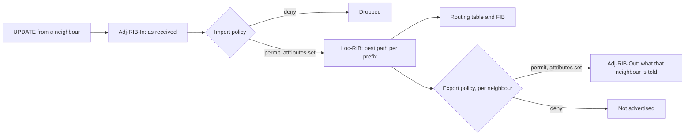

Meridian's border gateway `gw1.ams` hears about a million routes from its transit provider and a handful from a customer, and for each it must answer two questions: do I believe this, and whom do I tell? BGP's decision process ([the best-path algorithm](/learn/fabric-networking/bgp-fundamentals/the-best-path-algorithm)) answers neither; it only picks the best of several paths to one prefix. The answers are **policy**: rules an operator writes and the router runs on every route crossing every session. A customer pays to reach the whole internet, a peer swaps its customers' traffic for yours at no charge, a transit provider is paid to carry yours, and routes must flow accordingly. Policy is also where most famous BGP outages start: one missing filter turns a small network into a route leak that pulls part of the internet's traffic through it.

This lesson builds Meridian's internet-edge policy. Meridian is AS 64500 announcing `203.0.113.0/24`. In Amsterdam, `gw1.ams` has a BGP customer, AS 64505 (`198.51.100.0/24`), and the transit provider ISP1 (AS 64501); `gw2.ams` peers with a content network, AS 64511 (`192.0.2.0/24`); the two gateways talk iBGP. All prefixes and AS numbers here come from ranges reserved for documentation (RFC 5737 for IPv4, RFC 5398 for AS numbers 64496–64511), apart from one private-use 4-byte AS number in the large-communities example.

Three reminders. An **autonomous system** (AS) is a network under one routing policy, identified by a number; **eBGP** runs between ASes and **iBGP** inside one ([what BGP is for](/learn/fabric-networking/bgp-fundamentals/what-bgp-is-for)). A router keeps routes in the **Adj-RIB-In** per neighbour (as received), the **Loc-RIB** (best path per prefix) and the **Adj-RIB-Out** per neighbour (as sent) ([updates, attributes and RIBs](/learn/fabric-networking/bgp-fundamentals/updates-attributes-and-ribs)). **LOCAL_PREF** is a number set inside an AS; the highest wins at the first step operators control in best-path selection, and it is never sent to another AS.

## Where policy runs: import and export

Policy runs at two points on every session, and they do different jobs.



**Import policy** runs once on each route as it arrives. It accepts or rejects it and sets the attributes the decision process reads: LOCAL_PREF, communities (tags, below), sometimes MED (a neighbour's hint about which of its entry points to use). Running before best-path selection, import is where you express *preference*; a route rejected there can never be used or passed on.

**Export policy** runs per neighbour on best paths only (BGP advertises one path per prefix unless ADD-PATH is on, [convergence and scale](/learn/fabric-networking/bgp-in-the-real-world/convergence-and-scale)). It decides what that neighbour learns and can change what it sees: prepend Meridian's AS, set MED, add or strip communities. Export is where you express *obligation and restraint*.

Routes flow one way and traffic the other. When Meridian advertises `192.0.2.0/24` to ISP1, it offers to carry ISP1's traffic for that prefix. Export is therefore the dangerous direction: a route sent by mistake is an offer the internet may accept within seconds.

Two defaults sit under any policy. Inside an AS, iBGP split horizon stops a route learned from one iBGP peer being sent to another ([iBGP, loops and next hops](/learn/fabric-networking/bgp-fundamentals/ibgp-loops-and-next-hops)). Between ASes, RFC 8212 (2017) says an eBGP session with no policy must accept and send nothing. FRRouting enforces that by default; for decades many platforms accepted and announced everything on a fresh eBGP session, which is how several leaks began. A healthy edge shows three numbers per session (illustrative output; layouts vary):

```text
gw1.ams# show bgp ipv4 unicast summary                   (illustrative output)
Neighbor            AS    Up/Down    Received   Accepted   Advertised
customer-64505   64505    41d03h            3          2      1003401
isp1             64501    12d19h      1003418    1003401            2
gw2.ams (iBGP)   64500    97d11h            2          2      1003402
```

Received minus accepted is what import rejected: one bad route from the customer, 17 bogons and over-long prefixes from ISP1. Advertised is what export let through: the customer, which pays for the whole internet, gets the full table; ISP1 gets two routes, Meridian's block and the customer's /24, and a million there would be a leak.

**What it solves:** separating "what I believe" from "what I promise others" on every session. **How it breaks:** a missing or permissive export policy leaks; a too-strict import policy drops routes a customer paid to have carried. **Signal:** received, accepted and advertised counts per session, against a baseline.

## Prefix lists: matching on the destination

The most basic match is on the prefix itself. A **prefix list** is an ordered list of entries, each a block and an allowed range of prefix lengths, often written with `ge` (greater than or equal) and `le` (less than or equal). A route matches an entry when two things hold: its network lies inside the block (its first *n* bits equal the block's, where *n* is the block's length, the subnet test of [IP addressing and subnets](/learn/fabric-networking/from-zero/ip-addressing-and-subnets)), and its own length falls in the range. With no range, an entry matches only that exact prefix.

Meridian's import filter for the customer is the block `198.51.100.0/24` with lengths 24 to 25 ("le 25"):

| Route offered | Inside 198.51.100.0/24? | Length in 24..25? | Result |
|---|---|---|---|
| 198.51.100.0/24 | yes | 24, yes | match |
| 198.51.100.128/25 | yes: first 24 bits `11000110.00110011.01100100` equal | 25, yes | match |
| 198.51.100.64/26 | yes | 26, no | no match |
| 198.51.0.0/16 | no: it *contains* the block, it is not inside it | 16, no | no match |
| 203.0.113.0/24 | no | 24 | no match |

Two lists carry most real filtering. One is a customer's registered space, generated from the **IRR** (Internet Routing Registry: public databases where networks publish which AS originates which prefix) and from RPKI ([leaks, hijacks and RPKI](/learn/fabric-networking/bgp-in-the-real-world/leaks-hijacks-and-rpki)) by tools such as the open-source bgpq4. Large customers need tens of thousands of entries, so these lists are generated, never typed. The other is the **bogon** list: space that must never appear on the public internet, such as the private ranges `10.0.0.0/8`, `172.16.0.0/12` and `192.168.0.0/16` (RFC 1918), the carrier-grade NAT range `100.64.0.0/10`, loopback, link-local and multicast. Operators add one clever entry, `0.0.0.0/0` with lengths 25 to 32, matching *any* IPv4 prefix longer than /24. Refusing those (and IPv6 longer than /48) is the common practice RFC 7454 (BCP 194) describes; without it the global table would fill with everyone's /28s.

The classic bug is the missing range: an entry of exactly `198.51.100.0/24` silently rejects the customer's /25, the session stays up, and a week later the customer reports that its traffic engineering does not work.

**What it solves:** accepting only prefixes a neighbour is entitled to announce. **How it breaks:** stale lists (the customer added a block and nobody regenerated), missing length ranges, or a list too loose to stop a leak. **Signal:** received minus accepted on a customer session, and the specific prefixes rejected.

## Route maps: match, then set

A prefix list only answers "does this match". A **route map** is the program around it: an ordered list of terms, each with match conditions, an action (permit or deny) and set actions. The name differs by platform: *route map* on Cisco, Arista EOS and FRRouting; *policy statement* with *terms* on Juniper Junos; *routing policy* with *statements* on Nokia SR Linux and in OpenConfig, the vendor-neutral data model.

Within one term, conditions of different kinds must all hold (AND); entries inside one list are alternatives (OR). Conditions can test the prefix (a prefix list), the tags a route carries (a community list, exact or by regular expression), the AS path (a regular expression: `^64505$` is "originated by AS 64505 and received from it directly", `_64511_` is "passes through AS 64511"), the next hop, the RPKI validation state or the neighbour. Set actions change LOCAL_PREF or MED, add, remove or replace communities, prepend the AS path or rewrite the next hop.

How evaluation ends differs between platforms, and whoever reads policy must know which model applies:

| Behaviour | Route maps (Cisco, EOS, FRRouting) | Junos policy statements |
|---|---|---|
| A term matches | Its permit or deny ends evaluation, unless `continue` is set | A term with `accept` or `reject` ends evaluation; without one, its actions apply and the next term runs |
| No term matches | Implicit deny: the route is dropped | Falls through to the next policy in the chain, then to the protocol default, which for BGP accepts, unless RFC 8212 behaviour is turned on |
| A reference to a list that does not exist | Platform-specific; on some, the match succeeds for every route | Rejected when the configuration is committed |

Traced by hand: Meridian's import policy on the ISP1 session has three terms, and four routes arrive.

| Term | Match | Action |
|---|---|---|
| 10 | prefix in the bogon list or in Meridian's own 203.0.113.0/24 (any length) | deny |
| 20 | community GRACEFUL_SHUTDOWN (below) | permit; add 64500:300; LOCAL_PREF 0 |
| 30 | anything | permit; add 64500:300; LOCAL_PREF 100 |

| Route from ISP1 | Term 10 | Term 20 | Term 30 | Result |
|---|---|---|---|---|
| 192.0.2.0/24, AS path 64501 64511 | no | no | match | accepted, 64500:300, LOCAL_PREF 100 |
| 10.0.0.0/8, AS path 64501 64496 | match | | | denied: bogon |
| 203.0.113.128/25, AS path 64501 64496 | match | | | denied: a more-specific of Meridian's own block (a possible hijack) |
| 198.51.100.0/24 with 65535:0 | no | match | | accepted, LOCAL_PREF 0: used only if nothing else exists |

Order is meaning. Swap terms 10 and 20 and a bogon tagged GRACEFUL_SHUTDOWN is accepted.

**What it solves:** expressing business rules as an ordered, testable program over route attributes. **How it breaks:** wrong term order, a missing final term on a platform whose default accepts, a reference to a list that does not exist. **Signal:** a per-route trace of which term decided, which most platforms can produce on request and which tooling should store.

## Communities: tags that travel with a route

A prefix list classifies a route only where it arrives. The router that later exports it is often a different one, which knows only what the route carries. **Communities** let a route carry a label. The COMMUNITIES attribute (RFC 1997, 1996) is a list of 32-bit values, conventionally written as two 16-bit halves, `ASN:value`. The high half says whose dictionary the value belongs to: `64500:100` means whatever AS 64500 says it means. The protocol defines only a handful of well-known values; the rest is convention, and most transit providers publish their community guide.

Here is the attribute on the customer's /25 after Meridian's import policy, carrying Meridian's tag and the customer's NO_EXPORT:

| Field | Size | Value here | What reads it |
|---|---|---|---|
| Attribute flags | 1 byte | `0xC0`: optional, transitive | Every BGP speaker's parser |
| Type code | 1 byte | 8 (COMMUNITIES) | Parser: dispatch to the community decoder |
| Length | 1 byte | 8: two communities | Parser |
| Community 1 | 4 bytes | `FB F4 00 64` = 64500:100 | Meridian's export policies |
| Community 2 | 4 bytes | `FF FF FF 01` = NO_EXPORT | Every BGP implementation, before export |

**Optional transitive** means a router that does not understand the attribute must still pass it on. The consequence: unless someone strips them, communities travel on to the next AS and beyond. Meridian therefore removes its internal tags on the way out and treats communities arriving from outside as untrusted input.

**What it solves:** a classification one router makes and another acts on. **How it breaks:** a session that does not send communities, stripping too much or too little, or a tag honoured from a sender not entitled to it. **Signal:** one route's communities compared at the importing and the exporting router.

### Standard communities

By convention, standard communities come in two flavours. **Informational** ones record facts: where a route was learned, from which kind of neighbour. Meridian's `64500:100` says "learned from a customer". **Action** ones are requests a neighbour has promised to honour: many transit providers let a customer attach, say, `64501:70` for "set my LOCAL_PREF to 70 in your network" or `64501:666` for "discard traffic to this prefix" ([traffic engineering with BGP](/learn/fabric-networking/bgp-in-the-real-world/traffic-engineering-with-bgp), and blackholing below). The ranges `0:x` and `65535:x` are reserved; the second holds the well-known values.

### Extended communities

Extended communities (RFC 4360, 2006, attribute type code 16) are 8 bytes: a type byte, a subtype byte and a 6-byte value. In the type byte, the top bit records how IANA allocates the type, and `0x40` marks a *non-transitive* community, one that must not leave the AS. The main user is VPN and EVPN routing, where the **route target** says which tenant tables (VRFs) import a route. Acme's layer-2 segment on Meridian uses route target `65000:10100` ([VRFs and multi-tenancy](/learn/fabric-networking/overlays-vxlan-evpn/vrfs-and-multi-tenancy)):

| Field | Size | Value | What reads it |
|---|---|---|---|
| Type | 1 byte | `0x00`: two-byte AS number follows, transitive | Parser |
| Subtype | 1 byte | `0x02`: route target | VRF import policy on every leaf |
| Global administrator | 2 bytes | `FD E8` = 65000 | Import policy |
| Local administrator | 4 bytes | `00 00 27 74` = 10100 | Import policy |

Other extended communities in a fabric: the **encapsulation** community (type `0x03`, subtype `0x0c`, tunnel type 8 for VXLAN) telling a receiving leaf how to reach the advertiser; EVPN's **MAC Mobility**, a sequence number for a host that moved ([EVPN, the control plane](/learn/fabric-networking/overlays-vxlan-evpn/evpn-the-control-plane)); and **link bandwidth**, which some data centers use to weight multipath by capacity. A route target is a community used as policy: a VRF imports every route whose route target matches, which is why a route target copied by mistake from one tenant to another leaks routes between them ([the overlay packet walk](/learn/fabric-networking/overlays-vxlan-evpn/the-overlay-packet-walk)).

### Large communities

Four-byte AS numbers (RFC 6793) broke standard communities: AS 4200000010, from the private-use range of RFC 6996, does not fit in a 16-bit half. Large communities (RFC 8092, 2017, type code 32) use 12 bytes: three 32-bit fields, the **global administrator** (the AS that defines the meaning) and two local data parts, written `4200000010:1:100`, which invites the convention `ASN:function:parameter`. Meridian uses one for location: `64500:10:1` means "learned in site 1, Amsterdam".

The code builds all three attributes from the values above and prints the bytes, plus the well-known values:

```python
import struct


def standard(c):
    """RFC 1997: "64500:100" is two 16-bit halves, 4 bytes."""
    asn, value = map(int, c.split(":"))
    return struct.pack("!HH", asn, value)


def route_target(c):
    """RFC 4360: type 0x00 (2-byte AS, transitive), subtype 0x02 (route target), AS, 4-byte value."""
    asn, value = map(int, c.split(":"))
    return struct.pack("!BBHI", 0x00, 0x02, asn, value)


def vxlan_encap():
    """RFC 9012 encapsulation extended community: type 0x03, subtype 0x0c, tunnel type 8 = VXLAN."""
    return struct.pack("!BB4xH", 0x03, 0x0C, 8)


def large(c):
    """RFC 8092: "global:local1:local2", three 32-bit numbers, 12 bytes."""
    return struct.pack("!III", *map(int, c.split(":")))


def attribute(type_code, values):
    body = b"".join(values)
    # Flags 0xC0: optional (bit 7) and transitive (bit 6). Length fits one byte here.
    return struct.pack("!BBB", 0xC0, type_code, len(body)) + body


WELL_KNOWN = {"NO_EXPORT": "65535:65281", "NO_ADVERTISE": "65535:65282", "GRACEFUL_SHUTDOWN": "65535:0",
              "BLACKHOLE": "65535:666"}

print("COMMUNITIES         ", attribute(8, [standard("64500:100"), standard(WELL_KNOWN["NO_EXPORT"])]).hex(" "))
print("EXTENDED_COMMUNITIES", attribute(16, [route_target("65000:10100"), vxlan_encap()]).hex(" "))
print("LARGE_COMMUNITY     ", attribute(32, [large("4200000010:1:100"), large("64500:10:1")]).hex(" "))
for name, c in WELL_KNOWN.items():
    print(f"{name:<18} {c:<12} 0x{standard(c).hex().upper()}")
```

```text
COMMUNITIES          c0 08 08 fb f4 00 64 ff ff ff 01
EXTENDED_COMMUNITIES c0 10 10 00 02 fd e8 00 00 27 74 03 0c 00 00 00 00 00 08
LARGE_COMMUNITY      c0 20 18 fa 56 ea 0a 00 00 00 01 00 00 00 64 00 00 fb f4 00 00 00 0a 00 00 00 01
NO_EXPORT          65535:65281  0xFFFFFF01
NO_ADVERTISE       65535:65282  0xFFFFFF02
GRACEFUL_SHUTDOWN  65535:0      0xFFFF0000
BLACKHOLE          65535:666    0xFFFF029A
```

Read the first line: flags `c0`, type `08`, length `08`, then `fb f4 00 64` (64500 is `0xFBF4`, 100 is `0x64`) and `ff ff ff 01`. In the large community, `fa 56 ea 0a` is 4200000010. The `!` in each `struct` format is network byte order (big-endian), which every BGP field uses.

| | Standard | Extended | Large |
|---|---|---|---|
| Size per value | 4 bytes | 8 bytes | 12 bytes |
| Written as | `64500:100` | `rt 65000:10100`, typed | `64500:10:1` |
| Fits a 4-byte AS number | no | only with a 2-byte value | yes |
| Transitivity | always transitive | per type: a bit can keep it inside the AS | always transitive |
| Typical use | internet edge tags and actions, well-known values | route targets, VPNs, EVPN, encapsulation | internet edge for networks with 4-byte AS numbers, structured plans |
| Support | universal | universal on VPN-capable routers | most current implementations, years later than the others |

## Well-known communities

The range `65535:0` to `65535:65535` (`0xFFFF0000` upward) is reserved, and IANA registers the well-known values in it:

| Name | Value | RFC | Effect | Built in, or needs receiver policy? |
|---|---|---|---|---|
| NO_EXPORT | 65535:65281 | 1997 | Do not advertise to any eBGP neighbour (in a confederation, stay inside it) | Built in |
| NO_ADVERTISE | 65535:65282 | 1997 | Do not advertise to any neighbour at all | Built in |
| NO_EXPORT_SUBCONFED | 65535:65283 | 1997 | Do not advertise outside the local member AS of a confederation | Built in |
| GRACEFUL_SHUTDOWN | 65535:0 | 8326 | "This path is about to go away": set its LOCAL_PREF to 0 | Policy (some platforms have a switch) |
| BLACKHOLE | 65535:666 | 7999 | Discard traffic to this prefix | Policy, and an agreement |

(A confederation splits one large AS into member ASes that look like one AS from outside. Reserved values for long-lived graceful restart belong to [convergence and scale](/learn/fabric-networking/bgp-in-the-real-world/convergence-and-scale).)

### NO_EXPORT and NO_ADVERTISE

The router checks these before running export policy, against the route as it sits in its own table, whether the tag arrived with the route or import policy added it. A route carrying NO_EXPORT goes to iBGP peers and to no eBGP peer, whatever the export policy says. A route carrying NO_ADVERTISE goes nowhere.

The common use is the sender's: attach NO_EXPORT on export to ask the *neighbour* to keep a route to itself. Meridian's customer has two links into Meridian and announces `198.51.100.128/25` tagged NO_EXPORT beside its /24. Inside Meridian the /25 steers traffic for that half onto one link; the internet sees only the /24, so the global table does not grow. Meridian does the same towards ISP1 in [traffic engineering with BGP](/learn/fabric-networking/bgp-in-the-real-world/traffic-engineering-with-bgp).

NO_ADVERTISE is stricter and rarer: the receiving router uses the route itself and tells nobody, not even its iBGP peers. A customer can attach it to steer traffic onto one specific link without that router spreading the route through Meridian, and RFC 7999 suggests it (or NO_EXPORT) beside BLACKHOLE so that a blackhole route stops at the first router that acts on it.

**What they solve:** limiting how far a route travels without asking every router along the way to hold a filter for it. **How it breaks:** many edges delete every community arriving from outside, a sensible defence against abuse. Whether "delete all" also removes well-known values depends on the platform and on how the match is written; where it does, the /25 loses its NO_EXPORT and escapes. **Signal:** the /25 appearing in public route collectors, the BGP feeds that projects such as RouteViews and RIPE RIS gather from hundreds of networks.

### GRACEFUL_SHUTDOWN

Shutting down an eBGP session withdraws its routes, and for the seconds (in a fabric) to minutes (with full tables) that other routers take to choose an alternative, some still forward towards a router that no longer has a path. Planned maintenance loses traffic. RFC 8326 (2018) moves traffic *before* the session goes down. Meridian taking `gw1.ams`'s ISP1 session down:

1. `gw1.ams` re-advertises `203.0.113.0/24` to ISP1 tagged `65535:0`. ISP1's import policy matches it and sets LOCAL_PREF 0, so ISP1's routers prefer another path to Meridian, via ISP2 or a peer. Inbound traffic moves.
2. `gw1.ams` sets LOCAL_PREF 0 on the routes it learned from ISP1 and re-advertises them over iBGP, so every other Meridian router moves outbound traffic to its next-best path.
3. Both directions now flow elsewhere *while the old path still works*, so nothing is dropped. The ISP1 interface counters fall to near zero.
4. The session is shut down. Its withdrawals change no best path.

Step 1 works only if ISP1 has the matching import term: the community is a request. The surrounding order of operations is [operating BGP safely](/learn/fabric-networking/bgp-in-the-real-world/operating-bgp-safely). **What it solves:** planned maintenance with no dropped traffic. **How it breaks:** the neighbour has no term for `65535:0`, or a "delete all communities" on its import removes it first. **Signal:** if the counters do not fall after step 1, the neighbour does not honour the community, and shutting the session will drop traffic.

### BLACKHOLE and remote-triggered blackholing

A **distributed denial-of-service** (DDoS) attack floods one address from many sources. Suppose `203.0.113.50` is hit with 300 Gb/s while Meridian's links to ISP1 and ISP2 are 100 Gb/s each. Filtering on `gw1.ams` is too late: the links are full before packets reach it, and every customer behind them suffers. **Remote-triggered blackholing** (RTBH) asks the upstream to drop the traffic at *its* edge. Meridian announces `203.0.113.50/32` to both ISPs tagged BLACKHOLE (or the provider's own, often `ASN:666`) plus NO_EXPORT. ISP1's import policy accepts a /32 only when it carries the tag and lies inside Meridian's registered space, and points it at a discard next hop, so ISP1's routers drop everything for that address.

The trade is explicit: the attacker wins for `203.0.113.50`, now unreachable from everyone, and the other 255 addresses survive. Finer tools exist, such as BGP Flowspec (RFC 8955), which matches ports and protocols, and scrubbing services, but RTBH works with any provider that offers it. Meridian offers the same to its customers as `64500:666`. **What it solves:** keeping an attack off links the victim cannot filter. **How it breaks:** honour a blackhole tag from the wrong session, or for space the sender does not own, and anyone can make Meridian drop a victim's traffic. **Signal:** a /32 with a blackhole tag in the table, which tooling should list with who sent it and since when.

## Tag at ingress, act at egress

Put the pieces together and you get the design almost every multi-homed network uses: **classify each route once, on the session where it enters, by attaching a community; make every later decision by matching the community.** The reasons are mechanical:

1. **The exporting router has lost the context.** `gw2.ams` exports the customer route that `gw1.ams` learned. Over iBGP `gw2.ams` sees a prefix, an AS path and a next hop; whether AS 64505 is a customer, a peer or a provider is a commercial fact nowhere in the route unless someone wrote it there.
2. **Scale.** A million transit routes become one class, matched by one tag.
3. **Churn lands in one place.** A new customer changes one import filter; every export policy keeps working.
4. **It can be audited.** "Which routes tagged peer or transit are being sent to a peer?" is a query over Adj-RIB-Out.

Meridian's plan:

| Community | Meaning | Set where | LOCAL_PREF set with it |
|---|---|---|---|
| 64500:100 | learned from a customer | import, customer sessions | 200 |
| 64500:200 | learned from a peer | import, peer sessions | 150 |
| 64500:300 | learned from transit | import, transit sessions | 100 |
| 64500:10:*site* (large) | site where learned (1 ams, 2 sin, 3 sjc) | import, every external session | none |
| 64500:666 | customer asks Meridian to blackhole | sent by customers, honoured for their own space | none |

The LOCAL_PREF order follows money: customer routes earn revenue, peer routes are free, transit routes cost. The export rules follow the same economics. Customers pay for everything, so they receive everything; peers and providers receive only Meridian's own prefixes and its customers' routes, because anything else means carrying traffic between two networks that pay Meridian nothing. That rule, valley-free routing, is worked through in [how the internet is glued together](/learn/fabric-networking/bgp-in-the-real-world/how-the-internet-is-glued-together).

| Learned from | Send to a customer | Send to a peer | Send to transit |
|---|---|---|---|
| Meridian itself | yes | yes | yes |
| A customer (64500:100) | yes | yes | yes |
| A peer (64500:200) | yes | no | no |
| Transit (64500:300) | yes | no | no |

```viz
{"type": "fabric", "scenario": "community-policy", "title": "Meridian's edge: tag at import, match at export, NO_EXPORT held inside AS 64500", "caption": "gw1.ams tags the customer's /24 and its NO_EXPORT /25 with 64500:100 and LOCAL_PREF 200, gw2.ams tags the peer's route 64500:200 (150), ISP1's full table gets 64500:300 (100); iBGP gives both gateways the same table. The peer and ISP1 each receive only 203.0.113.0/24 and the customer's /24, with internal tags stripped; the customer receives the full table, the peer's route and Meridian's own; the /25 never leaves Meridian."}
```

The model below runs the same edge as data: the import policies tag and prefer, the gateways share routes over iBGP, each picks the highest LOCAL_PREF (then the shortest AS path), and export runs per neighbour after the NO_EXPORT check. Then it breaks the edge two ways.

```python
from ipaddress import ip_network

NO_EXPORT, NO_ADVERTISE, GSHUT = "65535:65281", "65535:65282", "65535:0"
MERIDIAN, CUSTOMER_ASNS = 64500, {64505}


def in_list(prefix, entries):
    """Prefix-list entry (block, ge, le): the prefix sits inside block and its length is in [ge, le]."""
    net = ip_network(prefix)
    return any(net.subnet_of(ip_network(block)) and ge <= net.prefixlen <= le for block, ge, le in entries)


def matches(match, route):
    # Every condition in a term must hold (AND); the entries of one prefix list are alternatives (OR).
    if "prefix_list" in match and not in_list(route["prefix"], match["prefix_list"]):
        return False
    if "community" in match and match["community"] not in route["communities"]:
        return False
    return True


def apply(policy, route):
    """Route-map semantics: the first term that matches decides; no match is an implicit deny."""
    for match, action, sets in policy:
        if not matches(match, route):
            continue
        if action == "deny":
            return None
        r = dict(route, communities=list(route["communities"]))
        if "strip" in sets:  # remove every community beginning "64500:", Meridian's internal tags
            r["communities"] = [c for c in r["communities"] if not c.startswith(sets["strip"])]
        r["communities"] += [c for c in sets.get("add", []) if c not in r["communities"]]
        r["local_pref"] = sets.get("local_pref", r["local_pref"])
        return r
    return None


OWN = [("203.0.113.0/24", 24, 32)]
BOGONS = [("10.0.0.0/8", 8, 32), ("172.16.0.0/12", 12, 32), ("192.168.0.0/16", 16, 32),
          ("100.64.0.0/10", 10, 32), ("0.0.0.0/0", 25, 32)]  # last entry: anything longer than /24
IMPORT = {
    "customer": [({"prefix_list": [("198.51.100.0/24", 24, 25)]}, "permit", {"add": ["64500:100"], "local_pref": 200}),
                 ({}, "deny", {})],
    "peer": [({"prefix_list": [("192.0.2.0/24", 24, 24)]}, "permit", {"add": ["64500:200"], "local_pref": 150}),
             ({}, "deny", {})],
    "transit": [({"prefix_list": BOGONS + OWN}, "deny", {}),
                ({"community": GSHUT}, "permit", {"add": ["64500:300"], "local_pref": 0}),
                ({}, "permit", {"add": ["64500:300"], "local_pref": 100})],
}
ALLOW_LIST = [({"prefix_list": [("203.0.113.0/24", 24, 24)]}, "permit", {"strip": "64500:"}),
              ({"community": "64500:100"}, "permit", {"strip": "64500:"}),
              ({}, "deny", {})]
DENY_LIST = [({"community": "64500:200"}, "deny", {}),  # the tempting alternative: name what must not go
             ({"community": "64500:300"}, "deny", {}),
             ({}, "permit", {"strip": "64500:"})]

NEIGHBOURS = {"customer AS 64505": ("gw1.ams", 64505, "customer"),
              "ISP1 AS 64501": ("gw1.ams", 64501, "transit"),
              "peer AS 64511": ("gw2.ams", 64511, "peer")}
RECEIVED = {  # (prefix, AS_PATH, communities) as each neighbour sent them
    "customer AS 64505": [("198.51.100.0/24", [64505], []), ("198.51.100.128/25", [64505], [NO_EXPORT]),
                          ("203.0.113.0/24", [64505], [])],  # a typo on the customer's side
    "peer AS 64511": [("192.0.2.0/24", [64511], [])],
    "ISP1 AS 64501": [("192.0.2.0/24", [64501, 64511], []), ("198.51.100.0/24", [64501, 64505], []),
                      ("10.0.0.0/8", [64501, 64496], []), ("203.0.113.128/25", [64501, 64496], [])],
}


def tables(ibgp_sends_communities=True):
    """Each gateway's routes: its own imports, plus what the other gateway sends it over iBGP.

    A simplification: real iBGP sends only the other gateway's best paths; here it sends every accepted
    route, which gives the same winners on this data."""
    learned = {"gw1.ams": [], "gw2.ams": []}
    for name, routes in RECEIVED.items():
        gw, _, role = NEIGHBOURS[name]
        for prefix, path, comms in routes:
            r = apply(IMPORT[role], {"prefix": prefix, "as_path": path, "communities": comms, "local_pref": 100})
            if r:
                learned[gw].append(r)
    own = {"prefix": "203.0.113.0/24", "as_path": [], "communities": [], "local_pref": 100}
    rib = {}
    for gw, other in (("gw1.ams", "gw2.ams"), ("gw2.ams", "gw1.ams")):
        over_ibgp = [dict(r, communities=r["communities"] if ibgp_sends_communities else [])
                     for r in learned[other] if NO_ADVERTISE not in r["communities"]]
        rib[gw] = [own] + learned[gw] + over_ibgp
    return rib


def best(routes):
    """Highest LOCAL_PREF, then shortest AS_PATH: the first two steps of the decision process."""
    out = {}
    for r in routes:
        cur = out.get(r["prefix"])
        if cur is None or (r["local_pref"], -len(r["as_path"])) > (cur["local_pref"], -len(cur["as_path"])):
            out[r["prefix"]] = r
    return list(out.values())


def audit(role, route):
    """An independent check that ignores tags: valley-free export and NO_EXPORT as received."""
    if role == "customer":
        return ""
    if route["as_path"] and route["as_path"][0] not in CUSTOMER_ASNS:
        return "  LEAK: not ours, not a customer's"
    if any(p == route["prefix"] and NO_EXPORT in c for rs in RECEIVED.values() for p, _, c in rs):
        return "  LEAK: arrived with NO_EXPORT"
    return ""


def advertise(title, rib, export_to_others):
    print(title)
    for name, (gw, asn, role) in NEIGHBOURS.items():
        policy = [({}, "permit", {"strip": "64500:"})] if role == "customer" else export_to_others
        for r in best(rib[gw]):
            if NO_EXPORT in r["communities"] or NO_ADVERTISE in r["communities"]:
                continue  # well-known communities: enforced by BGP itself, before any policy
            if asn in r["as_path"]:
                continue  # the neighbour would reject its own AS in the path
            out = apply(policy, r)
            if out:
                path = " ".join(str(a) for a in [MERIDIAN] + out["as_path"])
                print(f"  {gw} -> {name:<18} {out['prefix']:<18} AS_PATH {path:<12}{audit(role, out)}".rstrip())


advertise("1. As designed: tags carried over iBGP, allow-list export", tables(), ALLOW_LIST)
advertise("2. iBGP drops communities, allow-list export", tables(ibgp_sends_communities=False), ALLOW_LIST)
advertise("3. iBGP drops communities, deny-list export", tables(ibgp_sends_communities=False), DENY_LIST)
```

```text
1. As designed: tags carried over iBGP, allow-list export
  gw1.ams -> customer AS 64505  203.0.113.0/24     AS_PATH 64500
  gw1.ams -> customer AS 64505  192.0.2.0/24       AS_PATH 64500 64511
  gw1.ams -> ISP1 AS 64501      203.0.113.0/24     AS_PATH 64500
  gw1.ams -> ISP1 AS 64501      198.51.100.0/24    AS_PATH 64500 64505
  gw2.ams -> peer AS 64511      203.0.113.0/24     AS_PATH 64500
  gw2.ams -> peer AS 64511      198.51.100.0/24    AS_PATH 64500 64505
2. iBGP drops communities, allow-list export
  gw1.ams -> customer AS 64505  203.0.113.0/24     AS_PATH 64500
  gw1.ams -> customer AS 64505  192.0.2.0/24       AS_PATH 64500 64511
  gw1.ams -> ISP1 AS 64501      203.0.113.0/24     AS_PATH 64500
  gw1.ams -> ISP1 AS 64501      198.51.100.0/24    AS_PATH 64500 64505
  gw2.ams -> peer AS 64511      203.0.113.0/24     AS_PATH 64500
3. iBGP drops communities, deny-list export
  gw1.ams -> customer AS 64505  203.0.113.0/24     AS_PATH 64500
  gw1.ams -> customer AS 64505  192.0.2.0/24       AS_PATH 64500 64511
  gw1.ams -> ISP1 AS 64501      203.0.113.0/24     AS_PATH 64500
  gw1.ams -> ISP1 AS 64501      198.51.100.0/24    AS_PATH 64500 64505
  gw1.ams -> ISP1 AS 64501      192.0.2.0/24       AS_PATH 64500 64511   LEAK: not ours, not a customer's
  gw2.ams -> peer AS 64511      203.0.113.0/24     AS_PATH 64500
  gw2.ams -> peer AS 64511      198.51.100.0/24    AS_PATH 64500 64505
  gw2.ams -> peer AS 64511      198.51.100.128/25  AS_PATH 64500 64505   LEAK: arrived with NO_EXPORT
```

**Run 1** matches the visualisation. ISP1's paths to `192.0.2.0/24` and the customer's /24 (LOCAL_PREF 100) lose to the peer's (150) and the customer's own (200), so Meridian pays no transit for traffic it can deliver directly. The customer's mistaken `203.0.113.0/24`, ISP1's bogon and ISP1's more-specific of Meridian's space die at import. The customer receives Meridian's block and the peer's route; in production the full table too, but every transit route in this sample lost its best-path contest.

**Run 2** changes one thing: the gateways stop sending each other communities over iBGP. On several platforms (Cisco IOS among them) a neighbour gets no communities unless the session is configured to send them, and a rebuilt template can drop that setting without an error. `gw2.ams` sees the customer's routes untagged, its allow-list does not match, and the peer stops receiving `198.51.100.0/24`; its traffic to the customer detours through its own transit and ISP1's paid link. A ticket, but no leak: an allow-list on tags **fails closed**.

**Run 3** keeps the broken iBGP and swaps in the tempting shorter policy, "deny peer and transit tags, permit the rest". Untagged routes pass, and two leaks follow. `gw1.ams` offers ISP1 the peer's `192.0.2.0/24`, so Meridian would carry ISP1's traffic to its peer for free over a link it pays for. `gw2.ams` sends the customer's /25 to the peer, because NO_EXPORT was a community too and was lost with the rest. A deny-list on tags **fails open**. The `audit` check ignores tags, using the AS path and what was received, and catches both leaks.

**What it solves:** export decisions made with facts the exporting router could not otherwise know. **How it breaks:** tags lost in transit, a route that entered without one, or a deny-list that lets untagged routes through. **Signal:** external routes in any gateway's Loc-RIB that carry no 64500:x class tag.

## Failure modes in production

| Failure | Symptom | Diagnosis | Fix |
|---|---|---|---|
| Route leak: a permissive or missing export policy | Traffic for unrelated destinations crossing Meridian; external route collectors show paths like `64501 64500 64511` | Adj-RIB-Out to a peer or provider holds routes whose next AS after 64500 is not a customer | Allow-list export on tags, RFC 8212 defaults, an independent valley-free audit |
| Prefix list without a length range | Customer reports its more-specific "does nothing"; received 3, accepted 2 | Per-route trace shows the /25 denied by the final term | Regenerate the list with `le 25` from the customer's IRR or RPKI data |
| Communities not carried over iBGP | Routes missing at one gateway's neighbours (allow-list) or leaking (deny-list) | Compare the communities on a route at the importing and the exporting router | Enable sending communities on every iBGP and reflector session; alert on untagged external routes |
| "Delete all communities" removes NO_EXPORT | A customer's NO_EXPORT more-specific visible on the public internet | Public collectors show the /25; inbound policy deletes every community | Delete selectively (the neighbour's own or Meridian's), or re-add NO_EXPORT for that session |
| Action communities honoured from anyone | A victim's traffic dropped, or paths prepended, at another network's request | Blackhole or prepend tags arriving on sessions not entitled to send them | Honour action communities only from customers, for their own space; strip the rest at ingress |
| Policy edited but not applied | A change "does nothing" until a session reset hours later | No route refresh since the policy changed | Route refresh after every import change, triggered by the deployment tooling |

The best-known recent leak combines these. On 24 June 2019 a small US network passed routes from one provider, including more-specifics made by a route-optimisation tool, to another, a large transit network that accepted them without filtering or a prefix limit. For about two hours traffic for parts of Cloudflare, Amazon and others crossed a network that could not carry it ([leaks, hijacks and RPKI](/learn/fabric-networking/bgp-in-the-real-world/leaks-hijacks-and-rpki) tells it in full). Communities as an attack surface are measured too: a 2018 study ("BGP Communities: Even more Worms in the Routing Can", IMC 2018) found communities commonly travel several AS hops beyond the network that defined them, far enough for a distant network to trigger another's blackholing.

## Trade-offs: how to decide what a neighbour receives

| Approach | Survives iBGP hops | Scales to a full table | When it goes stale or is lost | Who maintains it |
|---|---|---|---|---|
| Per-prefix lists at every export | yes, but only if every gateway carries every list | no: a million entries per neighbour | Fails open or closed depending on how it is written | Generated per customer, copied to every router |
| AS-path filters at export (`^64505_`) | yes: the AS path travels | yes | A customer's new downstream AS is dropped until the filter changes | Per customer, but needs the customer's downstream ASes |
| Community tags set at import, matched at export | only if communities are sent on every session | yes: one match per class | Allow-list fails closed; deny-list fails open | One plan for the whole AS; one import filter per session |
| An independent audit (AS path against the customer list) | yes | yes | It is a check, not a policy: it alarms rather than blocks | Platform team |

Production edges combine the first three: a prefix list at import (what a customer may announce), communities to classify, and an AS-path sanity check at export, with the fourth running continuously outside the router.

## Under the hood: what policy costs a router

Policy runs in control-plane software, never in the forwarding chip. A daemon such as FRRouting stores each distinct set of path attributes once and lets every route with that set point to it (it "interns" them), so a million transit routes with a few thousand distinct attribute combinations cost little memory. Communities are part of the set. Classifying tags (three values for a million routes) keep sharing high; a tag unique per route, such as a timestamp encoded as a community, destroys it. Ten such communities on a million paths is 40 MB of community values alone.

Export policy is evaluated per **update group**: neighbours with identical export policy share one evaluation per route change, and the resulting UPDATE is copied to every member. Two hundred customer sessions on one policy cost one evaluation instead of two hundred; a one-off tweak for one customer moves it into its own group. Uniform policy is a performance property, not only hygiene.

Changing import policy needs the routes as they arrived. Either the router keeps a pre-policy copy of every Adj-RIB-In (soft reconfiguration, roughly another copy of each neighbour's table) or it asks the neighbour to resend everything with ROUTE-REFRESH ([BGP sessions and the FSM](/learn/fabric-networking/bgp-fundamentals/bgp-sessions-and-the-fsm)), seconds to minutes for a full table. Policy touches forwarding hardware in one case: a blackholed prefix is installed in the FIB (forwarding information base, the chip's table) with a discard next hop, so the drop happens at line rate.

## What the platform should show

An edge policy is a program running on routers, so the platform should treat it like one: version it, test it, and observe it.

- **Received, accepted, best and advertised per session, against a baseline.** A transit session advertising more than Meridian's own and its customers' prefixes is a leak in progress; a customer session accepting fewer routes than it announced is a filter to check.
- **A per-route explanation.** For any prefix and neighbour: the term that decided, and communities and LOCAL_PREF before and after. Engineers close tickets with this; most platforms expose it through a policy test command.
- **A community census per session.** Counts of each Meridian tag in every Adj-RIB-Out. Any 64500:200 or 64500:300 route towards a peer or provider, or any route towards an external neighbour that arrived with NO_EXPORT, is an alarm. So are external routes missing a 64500:x tag, the precondition for run 3.
- **An independent check that ignores tags,** like `audit` above, run continuously, because it fails differently from the policy it checks.
- **Policy in the source of truth, with a pre-change diff in routes, not lines.** "Adds 0 routes to ISP1, removes 2 from the peer" is reviewable; a 40-line text diff is not. Model-based tools in the style of Batfish compute it before deployment ([network automation and source of truth](/learn/fabric-networking/operating-fabrics/network-automation-and-source-of-truth), [safe change and maintenance](/learn/fabric-networking/operating-fabrics/safe-change-and-maintenance)).
- **The outside view.** Public route collectors and looking glasses show what the internet believes about `203.0.113.0/24`, the only place a neighbour's leak of Meridian's routes is visible.
- **Streaming, not polling.** BMP, the BGP Monitoring Protocol (RFC 7854), streams pre- and post-policy Adj-RIB-In, and Adj-RIB-Out since RFC 8671, so all of this can be computed off the router.

Managers need one line ("edge policy compliant, no leaks, two sessions below baseline"); engineers need the per-route trace behind it. Both come from the same data.

## Interviewer follow-ups

**"What does NO_EXPORT do, and what doesn't it do?"** Model answer: a route carrying it goes to iBGP peers and to no eBGP neighbour, checked before export policy; you usually attach it on export to ask a neighbour to keep a more-specific to itself. It does not stop anyone *using* the route, and a "delete all communities" on import can remove it. Common wrong answer: "it stops my router exporting the route I tag", when the tag constrains whoever *holds* the route, including the neighbour you send it to.

**"Why tag routes with communities instead of filtering prefixes at the exporting router?"** Model answer: the exporting router often did not learn the route and cannot tell a customer route from a transit route by looking at it; the tag carries that fact. One match replaces a million prefixes, a new customer changes one import filter, and an allow-list on tags fails closed. Common wrong answer: "communities are faster to evaluate", true but not why the design exists.

**"A customer says its new prefix is not reachable from the internet. Where do you look?"** Model answer: scope first (from where, since when), then walk the route: received on the customer session, accepted or denied by a stale prefix list, tagged 64500:100, advertised to transit and peers; then outside, in public collectors and the upstreams' looking glasses, since upstreams filter on IRR and RPKI data too. Common wrong answer: checking only that the session is Established. Honest addition: "I'd defer to the network team on each upstream's filtering process, but I'd build the received, accepted, advertised and externally visible view that answers this in one screen."

**"How does remote-triggered blackholing work, and what's the catch?"** Model answer: you announce the attacked /32 to the upstream with its blackhole community and NO_EXPORT; its import policy points the /32 at a discard next hop, dropping the attack at its edge before your links fill. The catch: the target goes fully offline, and the provider must accept such /32s only from you and only for your space, or the community becomes a weapon. Common wrong answer: "it filters the attack traffic", when it drops all traffic to the address.

## What mid-level engineers get wrong

- **Writing deny-list exports** ("deny transit, permit the rest"). Anything untagged or newly tagged escapes; the allow-list version fails closed.
- **Assuming communities travel everywhere by default.** Several platforms send none to a neighbour until told to, so a tag set on one gateway may never reach the other.
- **Exact-match prefix lists** for customers who announce more-specifics, silently rejecting the /25 the customer depends on.
- **Trusting received communities.** An action community honoured from any session lets a stranger blackhole or reroute your traffic.
- **Changing import policy and expecting an effect** without a route refresh, or resetting a session to apply it and causing a flap.

## Exercise

```exercise
id: run-policy
title: Run a route map over a batch of routes
prompt: |
  Implement a small policy engine. `routes` is a list of objects
  `{"prefix": "198.51.100.0/24", "communities": ["64500:100"], "local_pref": 200}`
  (IPv4 only, communities as `"ASN:value"` strings). `policy` is a list of terms
  `{"match": {...}, "action": "permit" | "deny", "set": {...}}`; `set` may be absent.

  Match conditions (all present ones must hold; an empty `match` matches every route):
  - `prefix_list`: a list of `[block, ge, le]` entries, with `ge` at least the block's length.
    A route matches an entry when its first n bits equal the block's (n = the block's length)
    and its own length is between `ge` and `le` inclusive. It matches the list if any entry matches.
  - `community`: a string the route must carry.

  Terms run in order; the first matching term decides. `deny` drops the route; `permit` applies
  the set actions and keeps it. A route that matches no term is dropped. Set actions, in this order:
  `remove` (a list; an entry ending in `*` removes every community starting with the text before
  the `*`, so `"64500:*"` removes all of AS 64500's tags), then `add` (append any not already
  present), then `local_pref`.

  `session` is `"import"`, `"ibgp"` or `"ebgp"`. Before the policy runs, on `"ibgp"` and `"ebgp"`
  drop routes carrying NO_ADVERTISE (`"65535:65282"`); on `"ebgp"` also drop routes carrying
  NO_EXPORT (`"65535:65281"`). This check uses the communities the route had before the policy, so a
  NO_EXPORT added by an export policy is still sent. On `"ebgp"` the output LOCAL_PREF is `null`,
  because LOCAL_PREF never leaves the AS.

  Return `[prefix, communities sorted as strings, local_pref]` for each surviving route, in input order.
languages: [python, javascript]
entry: run_policy
starter:
  python: |
    def run_policy(policy, routes, session):
        # your code here
        return []
  javascript: |
    function run_policy(policy, routes, session) {
      // your code here
      return [];
    }
tests:
  - args: [[{"match": {"prefix_list": [["203.0.113.0/24", 24, 24]]}, "action": "permit", "set": {"remove": ["64500:*"]}}, {"match": {"community": "64500:100"}, "action": "permit", "set": {"remove": ["64500:*"]}}, {"match": {}, "action": "deny"}], [{"prefix": "203.0.113.0/24", "communities": [], "local_pref": 100}, {"prefix": "198.51.100.0/24", "communities": ["64500:100"], "local_pref": 200}, {"prefix": "198.51.100.128/25", "communities": ["65535:65281", "64500:100"], "local_pref": 200}, {"prefix": "192.0.2.0/24", "communities": ["64500:200"], "local_pref": 150}], "ebgp"]
    expected: [["203.0.113.0/24", [], null], ["198.51.100.0/24", [], null]]
    label: "export to a peer: own block and customer routes only"
  - args: [[{"match": {}, "action": "permit"}], [{"prefix": "203.0.113.0/24", "communities": [], "local_pref": 100}, {"prefix": "198.51.100.0/24", "communities": ["64500:100"], "local_pref": 200}, {"prefix": "198.51.100.128/25", "communities": ["65535:65281", "64500:100"], "local_pref": 200}, {"prefix": "192.0.2.0/24", "communities": ["64500:200"], "local_pref": 150}], "ibgp"]
    expected: [["203.0.113.0/24", [], 100], ["198.51.100.0/24", ["64500:100"], 200], ["198.51.100.128/25", ["64500:100", "65535:65281"], 200], ["192.0.2.0/24", ["64500:200"], 150]]
    label: "iBGP: NO_EXPORT routes still go to internal peers"
  - args: [[{"match": {"prefix_list": [["198.51.100.0/24", 24, 25]]}, "action": "permit", "set": {"add": ["64500:100"], "local_pref": 200}}, {"match": {}, "action": "deny"}], [{"prefix": "198.51.100.0/24", "communities": [], "local_pref": 100}, {"prefix": "198.51.100.128/25", "communities": ["65535:65281"], "local_pref": 100}, {"prefix": "198.51.100.64/26", "communities": [], "local_pref": 100}, {"prefix": "203.0.113.0/24", "communities": [], "local_pref": 100}, {"prefix": "198.51.0.0/16", "communities": [], "local_pref": 100}], "import"]
    expected: [["198.51.100.0/24", ["64500:100"], 200], ["198.51.100.128/25", ["64500:100", "65535:65281"], 200]]
    label: "import from a customer: tag, prefer, filter by length"
  - args: [[], [{"prefix": "192.0.2.0/24", "communities": [], "local_pref": 100}], "import"]
    expected: []
    label: "an empty policy drops everything"
  - args: [[{"match": {}, "action": "permit", "set": {"add": ["64500:300"]}}], [{"prefix": "192.0.2.0/24", "communities": ["65535:65282"], "local_pref": 100}, {"prefix": "198.51.100.0/24", "communities": ["65535:65281"], "local_pref": 120}, {"prefix": "203.0.113.0/24", "communities": ["65535:65282", "64500:1"], "local_pref": 100}], "ibgp"]
    expected: [["198.51.100.0/24", ["64500:300", "65535:65281"], 120]]
    label: "NO_ADVERTISE stays on this router"
    hidden: true
  - args: [[{"match": {"prefix_list": [["10.0.0.0/8", 8, 32], ["192.168.0.0/16", 16, 32], ["203.0.113.0/24", 24, 32]]}, "action": "deny"}, {"match": {"community": "65535:0"}, "action": "permit", "set": {"add": ["64500:300"], "local_pref": 0}}, {"match": {}, "action": "permit", "set": {"add": ["64500:300"], "local_pref": 100}}], [{"prefix": "192.0.2.0/24", "communities": ["65535:0", "64501:10"], "local_pref": 100}, {"prefix": "198.51.100.0/24", "communities": ["64501:10"], "local_pref": 100}, {"prefix": "203.0.113.128/25", "communities": [], "local_pref": 100}, {"prefix": "10.1.0.0/16", "communities": [], "local_pref": 100}], "import"]
    expected: [["192.0.2.0/24", ["64500:300", "64501:10", "65535:0"], 0], ["198.51.100.0/24", ["64500:300", "64501:10"], 100]]
    label: "import from transit: bogons out, GRACEFUL_SHUTDOWN to LOCAL_PREF 0"
    hidden: true
  - args: [[{"match": {"prefix_list": [["203.0.113.0/24", 25, 25]]}, "action": "permit", "set": {"remove": ["64500:*"], "add": ["65535:65281"]}}, {"match": {"prefix_list": [["203.0.113.0/24", 24, 24]]}, "action": "permit", "set": {"remove": ["64500:*"]}}, {"match": {"community": "64500:100"}, "action": "permit", "set": {"remove": ["64500:*"]}}, {"match": {}, "action": "deny"}], [{"prefix": "203.0.113.0/24", "communities": ["64500:1"], "local_pref": 100}, {"prefix": "203.0.113.128/25", "communities": ["64500:1"], "local_pref": 100}, {"prefix": "198.51.100.0/24", "communities": ["64500:100", "64505:7"], "local_pref": 200}, {"prefix": "192.0.2.0/24", "communities": ["64500:200"], "local_pref": 150}], "ebgp"]
    expected: [["203.0.113.0/24", [], null], ["203.0.113.128/25", ["65535:65281"], null], ["198.51.100.0/24", ["64505:7"], null]]
    label: "export to transit: a NO_EXPORT /25 added by policy is still sent"
hints:
  - "Convert a dotted IPv4 address to an integer (a*2^24 + b*2^16 + c*2^8 + d) and compare the two networks after dropping the low 32 - n bits."
  - "In JavaScript, bit shifts work on signed 32-bit integers and a shift by 32 does nothing; dividing by 2 ** (32 - n) and flooring avoids both traps."
  - "Do the NO_ADVERTISE and NO_EXPORT check on the route's original communities, before looking at any term."
  - "Remember the implicit deny: falling off the end of the term list drops the route."
```

## Senior signals

- You separate import (what I believe, and how much I prefer it) from export (what I offer to carry), and treat export as the direction that causes incidents.
- You design edge policy as tag at ingress, act at egress, with export written as an allow-list on tags so that missing tags fail closed.
- You know which well-known communities are enforced by the protocol (NO_EXPORT, NO_ADVERTISE) and which are requests needing the receiver's policy (GRACEFUL_SHUTDOWN, BLACKHOLE), and check the receiver honours them before relying on them.
- You treat received communities as untrusted input: honour action communities only from entitled sessions, for their own space, and strip the rest.
- You read a route target as a community used for import policy, which is why a copied route target leaks tenants.
- You ask for policy to be versioned, simulated as a route diff before deployment, and audited continuously by a check that does not depend on the tags it audits.

## Check yourself

```quiz
- q: >-
    gw1.ams receives the customer's 198.51.100.128/25 carrying NO_EXPORT. Which of Meridian's neighbours can learn this route from Meridian?
  options: ["gw2.ams over iBGP, but no eBGP neighbour of Meridian", "No neighbour at all, not even gw2.ams over iBGP", "Every neighbour, since Meridian's own export policy permits it", "Only customers, because NO_EXPORT applies only to providers"]
  answer: 0
  explanation: >-
    NO_EXPORT keeps a route inside the AS: iBGP peers such as gw2.ams receive it, and no eBGP neighbour does, whether customer, peer or provider. The check runs before export policy, so a permissive policy cannot override it. Refusing even iBGP peers is NO_ADVERTISE, a different well-known community.
- q: >-
    Meridian's customer import filter is the single entry 198.51.100.0/24 with lengths 24 to 25. The customer announces 198.51.100.0/24, 198.51.100.128/25 and 198.51.100.64/26. What is accepted?
  options: ["The /24 and the /25; the /26 is too long", "All three, as all lie inside 198.51.100.0/24", "Only the /24, since entries match exact prefixes", "The /25 and the /26, the more-specific routes"]
  answer: 0
  explanation: >-
    An entry matches a route that lies inside the block and whose length is within the range. All three lie inside the /24, but the /26 has length 26, outside 24 to 25, so it falls to the final deny. Without the length range the entry would match only the exact /24, the common bug that silently drops a customer's more-specific.
- q: >-
    After a template change, gw1.ams and gw2.ams stop sending communities to each other over iBGP. With an export policy of "permit own prefix, permit 64500:100, deny the rest", what happens at gw2.ams's peer?
  options: ["The peer receives every route, because untagged routes pass", "The peer stops receiving customer routes learned at gw1.ams", "The peer receives transit routes, because nothing is tagged 64500:300", "Nothing changes, because BGP restores tags from the AS path"]
  answer: 1
  explanation: >-
    The customer's routes reach gw2.ams untagged, so the permit-64500:100 term no longer matches and the final deny drops them: an allow-list on tags fails closed. The peer loses Meridian's customer routes, a service problem but not a leak. A deny-list policy would fail open instead and leak untagged peer and transit routes. Nothing reconstructs communities from the AS path.
- q: >-
    Why were large communities (RFC 8092) introduced?
  options: ["Routers cannot attach more than one standard community to each route", "A 4-byte AS number does not fit in a standard community's 16-bit half", "Standard communities cannot be carried across eBGP sessions at all", "Extended communities are non-transitive, so no tag could leave an AS"]
  answer: 1
  explanation: >-
    A standard community is two 16-bit halves, ASN:value, so a network with a 4-byte AS number such as 4200000010 cannot put its own number in the high half. Large communities use three 32-bit fields. Standard communities are transitive and a route may carry many; extended communities can be transitive or not, chosen per type.
- q: >-
    Before maintenance, gw1.ams re-advertises 203.0.113.0/24 to ISP1 tagged GRACEFUL_SHUTDOWN (65535:0), but traffic on the ISP1 link does not fall. What is the most likely explanation?
  options: ["ISP1 must first reset the session to apply the new tag", "BGP ignores well-known communities on eBGP sessions", "ISP1's import policy does not act on the community", "The route needs NO_EXPORT as well before it takes effect"]
  answer: 2
  explanation: >-
    GRACEFUL_SHUTDOWN is a request: the receiver must have an import term matching 65535:0 and setting LOCAL_PREF 0. Without it, ISP1 keeps preferring the path, and shutting the session will drop traffic during reconvergence. The community arrives in an ordinary UPDATE, needs no reset, and needs no NO_EXPORT; well-known communities are not ignored on eBGP.
- q: >-
    Under a 300 Gb/s attack on 203.0.113.50, Meridian announces 203.0.113.50/32 to ISP1 with ISP1's blackhole community. What is the result?
  options: ["ISP1 drops all traffic to 203.0.113.50, sparing the rest of the /24", "ISP1 filters the attack and keeps legitimate traffic to the address", "ISP1 rejects the /32, as it filters every prefix longer than /24", "Meridian's gateways drop the attack before it reaches the servers"]
  answer: 0
  explanation: >-
    Remote-triggered blackholing points the /32 at a discard next hop at ISP1's edge, so ISP1 drops every packet for that address, attack and legitimate alike, before it fills Meridian's links. The rest of the /24 survives. Dropping at Meridian's gateways is too late because the links are already full. ISP1 accepts this /32 because its policy makes an exception for blackhole-tagged routes inside Meridian's registered space.
```
