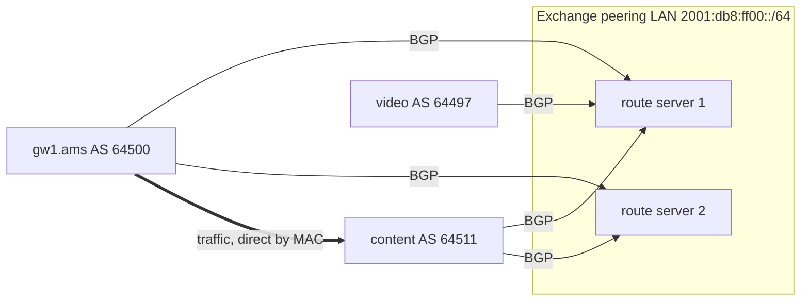

Meridian sends about 25 Gb/s to the internet at its busiest, and every bit crosses a link somebody pays for. Its border gateways `gw1.ams` and `gw2.ams` reach the world through ISP1 (AS 64501) and ISP2 (AS 64502). The routes BGP chooses from exist only because of contracts: who agreed to carry whose traffic, at what price, and to whom each network passes the routes it hears. Forget one line of export filter and Meridian's links fill with strangers' traffic.

[What BGP is for](/learn/fabric-networking/bgp-fundamentals/what-bgp-is-for) defined an autonomous system (AS: a network under one routing policy, named by a number), the AS_PATH (the ASes a route has crossed, newest first), LOCAL_PREF (a rank set on import, highest wins, compared before path length) and 95th-percentile billing. Every AS number and prefix here is from a documentation range: RFC 5398 for AS 64496–64511, RFC 5737 for `192.0.2.0/24`, `198.51.100.0/24` and `203.0.113.0/24`, RFC 3849 for `2001:db8::/32`.

## Transit and peering: the two contracts

The mid-2020s global routing table carries routes from roughly 75,000 ASes, and almost every link between two of them is one of two business relationships, which decides the routes that cross it.

**Transit** is reachability for sale. A **provider** carries a **customer**'s traffic to and from the whole internet: it sends the customer every route it has (a "full table") or a default route, and announces the customer's prefixes to everyone. The customer pays per Mb/s at the 95th percentile, usually with a minimum commitment. Meridian buys transit from ISP1 and ISP2; both buy from AS 64496.

**Peering** is a swap. Two networks exchange traffic between *their own customers*, each sending only its own and its customers' prefixes, never the full table. Most peering is **settlement-free**: neither pays, because each saves the transit it would buy to reach the other. ISP1 and ISP2 peer, so a packet between their customers crosses one free link instead of climbing to AS 64496 and back down through two paid ones.

The routes are the product, so the relationship shows in what each side sends:

| Relationship | Who pays | A sends B | B sends A | Typical between |
|---|---|---|---|---|
| A is B's provider (transit) | B pays A | Everything (full table or default) | B's prefixes and B's customers' | An ISP and an enterprise, a regional ISP and a global one |
| Settlement-free peers | Nobody | A's own and A's customers' prefixes | B's own and B's customers' | Networks of similar size, or content and eyeball networks |
| Paid peering | One side pays a fee, no full table | As peering | As peering | A content network and a large access network with a traffic imbalance |
| Partial transit | Customer pays | Routes for one region, or the provider's peers' routes only | As transit | A network filling a gap without buying a full table |
| Siblings | Same owner | Everything | Everything | Two ASes of one company after a merger |

An **eyeball network** is an access ISP whose customers are people watching, browsing and downloading; a **content network** is one that mostly sends (video, software updates, cloud services). The two need each other, which is why they peer.

**Who peers with whom** is negotiated. Networks publish a **peering policy**: *open* (anyone at a shared location), *selective* (if conditions hold: a minimum volume, a traffic ratio no worse than about 2:1 or 3:1, several common locations, a 24-hour operations contact) or *restrictive* (rarely, often an incumbent that prefers to sell transit). **PeeringDB**, a public database the networks maintain themselves, lists each network's ASN, policy, exchanges, buildings and expected prefix counts.

**What the contract solves:** networks that do not trust each other agree who carries what, priced so each side gains. **How it breaks:** a relationship encoded wrongly in policy (a peer treated as a customer) exports routes that should stay private; a peer stops upgrading a congested link because the traffic is imbalanced. **Signal:** utilisation per neighbour against its contract, and routes seen on a session that do not match the relationship (a peer sending you a full table).

### Should Meridian peer? The arithmetic

Peering is not free. An internet exchange costs a port fee, a cross-connect (the fibre run inside a colocation building from your cage to the exchange's switch) and a router port. Flow export (sampled packet records, [telemetry](/learn/fabric-networking/operating-fabrics/telemetry-and-observability)) gives outbound traffic by destination AS; PeeringDB says which of those networks are at the exchange, with what policy.

```python
# Should Meridian join the Amsterdam exchange? Every price here is an assumption to replace with quotes.
TRANSIT_PER_MBPS = 0.25        # $ per Mb/s per month, billed at the 95th percentile
IXP_MONTHLY = {"100G port at the exchange": 2500, "cross-connect to the exchange": 300,
               "router port and optics, amortised": 1200}
SHARE = {"open": 1.0, "selective": 0.5, "restrictive": 0.0}   # chance the network peers with you

# Outbound traffic now on transit, by destination origin AS (95th percentile, Gb/s), from flow export.
flows = [
    (64511, "content network", 6.0, "open"),
    (64497, "video platform", 4.0, "open"),
    (64498, "cloud provider", 3.5, "selective"),
    (64499, "eyeball ISP", 2.0, "restrictive"),
    (64503, "game publisher", 0.8, "open"),
    (64504, "small host", 0.1, "open"),
    (None, "everything not at the exchange", 9.0, None),
]

cost = sum(IXP_MONTHLY.values())
print(f"exchange cost: ${cost:,}/month = {cost / TRANSIT_PER_MBPS / 1000:.1f} Gb/s of transit")
moved = 0.0
for asn, name, gbps, policy in sorted(flows, key=lambda f: -f[2]):
    if asn is None:
        continue
    expect = gbps * SHARE[policy]
    moved += expect
    print(f"  AS {asn} {name:<16} {gbps:>4.1f} Gb/s  {policy:<11} expect {expect:>4.2f} Gb/s off transit")
total = sum(f[2] for f in flows)
print(f"expected off transit: {moved:.2f} of {total:.1f} Gb/s")
for price in (0.10, 0.25, 0.50, 1.00):              # the same decision in a cheaper or dearer market
    net = moved * 1000 * price - cost
    print(f"  transit at ${price:.2f}/Mb/s: break-even {cost / price / 1000:>4.1f} Gb/s, net {'+' if net >= 0 else '-'}${abs(net):,.0f}/month")
```

```text
exchange cost: $4,000/month = 16.0 Gb/s of transit
  AS 64511 content network   6.0 Gb/s  open        expect 6.00 Gb/s off transit
  AS 64497 video platform    4.0 Gb/s  open        expect 4.00 Gb/s off transit
  AS 64498 cloud provider    3.5 Gb/s  selective   expect 1.75 Gb/s off transit
  AS 64499 eyeball ISP       2.0 Gb/s  restrictive expect 0.00 Gb/s off transit
  AS 64503 game publisher    0.8 Gb/s  open        expect 0.80 Gb/s off transit
  AS 64504 small host        0.1 Gb/s  open        expect 0.10 Gb/s off transit
expected off transit: 12.65 of 25.4 Gb/s
  transit at $0.10/Mb/s: break-even 40.0 Gb/s, net -$2,735/month
  transit at $0.25/Mb/s: break-even 16.0 Gb/s, net -$838/month
  transit at $0.50/Mb/s: break-even  8.0 Gb/s, net +$2,325/month
  transit at $1.00/Mb/s: break-even  4.0 Gb/s, net +$8,650/month
```

At these assumed prices the exchange loses money. That is a real outcome: transit in major European and US hubs costs well under a dollar per Mb/s per month at high commits, and several times that in less competitive markets, where the same 12.65 Gb/s pays handsomely. Networks peer anyway for what the script does not price: latency (one AS hop in the same city instead of a detour), capacity at peak and a path that survives a provider failure. Two cautions: the 95th percentile of a sum is not the sum of 95th percentiles, so the real saving needs the five-minute samples recomputed; and "selective" is a guess until someone asks.

## Tier-1 networks and the shape of the hierarchy

A **tier-1** network reaches every prefix without paying anyone: it buys no transit, and reaches everything through its customers plus settlement-free peering with every other tier-1. There are about fifteen to twenty, and they must form a **complete clique**: each peers with every other.

Why complete? If tier-1s X and Y stop peering, a customer that buys only from X has no path to Y's single-homed customers: X and Y buy no transit, and other tier-1s will not carry X–Y traffic for free (a peer's routes go only to customers, the rule below). The internet partitions. In October 2005 Level 3 ended its peering with Cogent and for a few days single-homed customers of each could not reach the other's; Sprint and Cogent repeated it in 2008.

Below the clique, **tier-2** networks buy some transit and peer widely; **stub** networks like Meridian only buy. Routers holding a full table and no default route are in the **default-free zone** (DFZ): a tier-1's border routers, and multi-homed edges like `gw1.ams`. A network's size is its **customer cone**: itself, its customers, their customers and so on (below, AS 64496's cone is all five other networks). The cone is what it announces to peers, and CAIDA's AS Rank orders networks by it, using relationships inferred from public paths.

**The hierarchy has flattened.** Twenty years ago most traffic climbed to a tier-1 and back down. Today most bytes come from a handful of content and cloud networks with global backbones, connected to eyeball ISPs at exchanges, over private links and through caches inside the ISP. A video stream to a home typically crosses no tier-1; tier-1s matter for the long tail, not the volume.

**What the clique solves:** global reachability without anyone at the top paying. **How it breaks:** depeering partitions single-homed customers; a congested peering link that neither side upgrades degrades everything crossing it. **Signal:** prefixes that become unreachable from one provider only, and loss concentrated on one inter-AS link at peak hours.

## Internet exchanges: one switch, hundreds of networks

Peering with 300 networks over private cables means 300 router ports and 300 cross-connects. An **internet exchange point** (IXP) replaces them with one: a layer-2 switching fabric, usually spread across several colocation buildings in a metro, to which each member connects one or two router ports. Members share one **peering LAN**, a single subnet (an IPv4 /21 or /22 at a large exchange, a /24 or smaller at a small one, plus an IPv6 /64) with one address per member router. Any two members run BGP across it and send traffic router to router, the exchange switching frames by MAC address. The exchange is not in the AS_PATH and does not route; it is a very large, very well-behaved Ethernet segment ([switches, VLANs and loops](/learn/fabric-networking/from-zero/switches-vlans-and-loops)).

The largest exchanges (DE-CIX Frankfurt, AMS-IX, LINX) each connect on the order of a thousand networks and publish traffic peaks around or above ten terabits per second, figures that grow every year. Many exchange fabrics are EVPN over VXLAN or MPLS underneath ([why overlays](/learn/fabric-networking/overlays-vxlan-evpn/why-overlays)), one flat segment across many buildings. Because one misbehaving member hurts every other, exchanges police the LAN: one MAC address per port, only the IPv4 (0x0800), IPv6 (0x86DD) and ARP (0x0806) EtherTypes, no spanning-tree, DHCP or IPv6 router-advertisement packets, and no proxy ARP, since a router answering ARP for addresses it does not own attracts other members' traffic.

**What the exchange solves:** one port and one cross-connect reach hundreds of networks. **How it breaks:** a member's loop or proxy ARP pollutes the shared LAN; a member port runs full at peak while the rest of the exchange is idle; a fault in the exchange fabric drops every session on it at once. **Signal:** utilisation of your exchange port, BGP sessions on the peering LAN going down together, and unknown MACs or ARP replies for your addresses.

### A packet across the exchange, traced

Meridian joins an Amsterdam exchange whose IPv6 peering LAN is `2001:db8:ff00::/64`. Some exchanges encode each member's ASN in its address; here Meridian's `gw1.ams` is `2001:db8:ff00::a506:4500:1` and the content network's router is `2001:db8:ff00::a506:4511:1`.

1. **Session.** `gw1.ams` opens BGP to `::a506:4511:1` on TCP port 179 ([BGP sessions and the FSM](/learn/fabric-networking/bgp-fundamentals/bgp-sessions-and-the-fsm)); the routers share a LAN, so eBGP's default TTL of 1 works.
2. **Routes.** AS 64511 announces its IPv6 prefixes with AS_PATH `64511` and NEXT_HOP `2001:db8:ff00::a506:4511:1` (its IPv4 prefixes ride a second session between the routers' IPv4 peering-LAN addresses). Meridian gives them LOCAL_PREF 150 (peer), above the 100 for provider routes, so they beat the path through ISP2.
3. **Forwarding.** For a packet to AS 64511, `gw1.ams` resolves the NEXT_HOP to a MAC with neighbour discovery (IPv6's ARP, [ARP and the default gateway](/learn/fabric-networking/from-zero/arp-and-the-default-gateway)) and sends the frame out of its exchange port.
4. **The exchange** looks up the destination MAC and delivers the frame unchanged to the content network's port. The IP hop limit is not decremented: the exchange is layer 2.
5. **Traceroute** shows `gw1.ams`, then the content router's peering-LAN address, then the content network's interior: a peering-LAN address is how you spot an exchange in a traceroute ([the packet walk](/learn/fabric-networking/from-zero/the-packet-walk)).

### Route servers: one session instead of a thousand

With 800 members, a full bilateral mesh is 800 × 799 / 2 = 319,600 sessions, each negotiated by email. Exchanges run **route servers** instead (RFC 7947): BGP speakers on the peering LAN that each member peers with once, which collect every member's routes, filter them and re-announce them to the rest. A route server is the eBGP cousin of a [route reflector](/learn/fabric-networking/bgp-fundamentals/route-reflectors): a control-plane relay that never forwards a packet. Three rules make it transparent:

- **It does not add its ASN to the AS_PATH.** AS 64511's route reaches Meridian as `64511`, as if direct. Members must therefore disable the check many routers apply on eBGP by default, that the first AS in a received path is the neighbour's.
- **It does not change NEXT_HOP.** The route keeps the originating member's peering-LAN address, so traffic goes member to member.
- **It does not change MED or communities it does not act on.**



Route servers also give small networks filtering for free: the exchange builds each member's allowed prefixes from the **IRR** (Internet Routing Registry, databases where networks register the prefixes they and their customers originate) and drops announcements failing **RPKI** origin validation (signed statements of which AS may originate a prefix), both in [leaks, hijacks and RPKI](/learn/fabric-networking/bgp-in-the-real-world/leaks-hijacks-and-rpki). Members steer distribution with communities ([policy and communities](/learn/fabric-networking/bgp-in-the-real-world/policy-and-communities)) by a common convention: `0:<peer-as>` "not to this member", `<rs-as>:<peer-as>` "to this member", `0:<rs-as>` "to nobody" (combined with the previous for an allow list).

**Path hiding**, traced. A route server keeping one best path per prefix can hide reachability. Members A (AS 64497) and B (AS 64503) both announce `2001:db8:6506::/48`, originated by AS 64506, a customer of A directly and of B through B's customer AS 64504. A tags its announcement `0:64500`, "not to Meridian".

| Step | Route server with one shared table | Route server with a table per member |
|---|---|---|
| 1. Routes in | A's path `64497 64506`, B's path `64503 64504 64506` | same |
| 2. Best path | A's (shorter), one choice for everyone | chosen separately for each receiving member |
| 3. Export to Meridian | A's route is barred by `0:64500`; B's was not chosen, so Meridian gets nothing | Meridian's table excludes A's route, so B's is best and is sent |
| 4. Result | Meridian sends that traffic over transit although a peer path exists | Meridian uses B over the exchange |

Route-server software (BIRD and OpenBGPD are common) avoids this with per-member tables or ADD-PATH, at a memory cost proportional to members × routes.

**What the route server solves:** one session gives a member hundreds of peers, filtered once and well. **How it breaks:** a route-server outage drops every multilateral session at once (hence two, on different software); path hiding; a member that forgot the first-AS check rejects everything. **Signal:** prefix counts per route-server session against baseline, the two route servers disagreeing, and traffic shifting from exchange to transit with no change on your side.

## The valley-free rule

Every export decision so far follows one rule, written down by Lixin Gao and Jennifer Rexford in 2001 from how operators already behaved. Label every inter-AS link from each end's point of view: the neighbour is your *customer*, your *peer* or your *provider*. Then:

| Route learned from | Export to customers | Export to peers | Export to providers |
|---|---|---|---|
| A customer (or your own prefix) | Yes | Yes | Yes |
| A peer | Yes | No | No |
| A provider | Yes | No | No |

and on import, prefer customer routes over peer routes over provider routes, whatever the AS_PATH length (Meridian, like the visualisation, uses LOCAL_PREF 200, 150 and 100). The rule follows the money: you carry traffic only when someone pays you to, or when it reaches your own customers.

Its consequence for paths gives it its name. Label each link a packet crosses "up" (customer to provider), "across" (peer to peer) or "down" (provider to customer). Every path the rule permits has the shape **up\*, at most one across, down\***: a mountain, never a valley. A *valley* goes down and then up again: a network carrying traffic between two of its providers, paying both and earning nothing.

```viz
{"type": "fabric", "scenario": "valley-free", "title": "Valley-free export on six networks, then a leak that makes a valley", "caption": "Transit AS 64496 above ISP1 and ISP2, which peer with each other; Meridian buys from both, the content network AS 64511 from ISP2, and AS 64505 from Meridian. Customer routes are exported to everyone, peer and provider routes only to customers, so ISP1 passes 192.0.2.0/24 down to Meridian but not up to AS 64496. Then Meridian's export filter to ISP1 is lost: ISP1 prefers the leaked route as a customer route (LOCAL_PREF 200 over its peer's 150) despite the longer path, and its traffic for AS 64511 runs down into Meridian and back up to ISP2. AS 64496 still prefers the shorter path, so the leak stops there. The last frame lists the guard rails."}
```

The simulator below runs the rule on the same six networks: every AS offers its best routes to the neighbours its export rule allows, each picks by LOCAL_PREF then path length (lowest neighbour ASN standing in for the later tie-breaks of [the best-path algorithm](/learn/fabric-networking/bgp-fundamentals/the-best-path-algorithm)), and rounds repeat until nothing changes. Then it removes one export filter.

```python
from collections import defaultdict

# Each link once: (a, b, what b is to a). Meridian's corner of the internet.
LINKS = [
    (64496, 64501, "customer"), (64496, 64502, "customer"),   # Transit sells to both ISPs
    (64501, 64502, "peer"),                                    # ISP1 and ISP2 peer
    (64501, 64500, "customer"), (64502, 64500, "customer"),   # Meridian buys from both
    (64502, 64511, "customer"),                                # the content network buys from ISP2
    (64500, 64505, "customer"),                                # Meridian sells to AS 64505
]
NAME = {64496: "Transit", 64501: "ISP1", 64502: "ISP2", 64500: "Meridian",
        64511: "Content", 64505: "Customer"}
ORIGINS = {"203.0.113.0/24": 64500, "198.51.100.0/24": 64505, "192.0.2.0/24": 64511}
PREF = {"customer": 200, "peer": 150, "provider": 100}       # LOCAL_PREF by relationship
FLIP = {"customer": "provider", "provider": "customer", "peer": "peer"}


def relations(links):
    rel = defaultdict(dict)                 # rel[a][b]: what b is to a
    for a, b, r in links:
        rel[a][b], rel[b][a] = r, FLIP[r]
    return rel


def exports(learned_from, to_whom):
    """Gao-Rexford: own and customer routes go to everyone; the rest only to customers."""
    return learned_from in ("self", "customer") or to_whom == "customer"


def propagate(rel, leaks=frozenset()):
    """Rounds of 'every AS offers its best routes to its neighbours' until nothing changes.
    leaks: (exporter, neighbour) pairs whose export filter is missing."""
    best = {a: {p: ("self", []) for p, o in ORIGINS.items() if o == a} for a in rel}
    while True:
        new = {}
        for a in rel:
            new[a] = dict((p, r) for p, r in best[a].items() if r[0] == "self")
            for p in ORIGINS:
                if p in new[a]:
                    continue
                offers = []
                for nb, nb_is in rel[a].items():
                    route = best[nb].get(p)
                    if route is None or a in route[1]:            # nothing to offer, or AS loop
                        continue
                    if not (exports(route[0], rel[nb][a]) or (nb, a) in leaks):
                        continue
                    path = [nb] + route[1]                         # nb prepends itself
                    offers.append((PREF[nb_is], -len(path), -nb, nb_is, path))
                if offers:
                    _, _, _, nb_is, path = max(offers)             # LOCAL_PREF, then shortest, then lowest ASN
                    new[a][p] = (nb_is, path)
        if new == best:
            return best
        best = new


def valley_free(rel, traffic_path):
    """Traffic from traffic_path[0] to traffic_path[-1]: up* (across)? down*."""
    going_down = False
    for x, y in zip(traffic_path, traffic_path[1:]):
        step = rel[x][y]                     # provider = up, peer = across, customer = down
        if step in ("provider", "peer") and going_down:
            return False
        if step in ("peer", "customer"):
            going_down = True
    return True


def show(rel, best, prefix):
    for a in (64496, 64501, 64502, 64500, 64511, 64505):
        r = best[a].get(prefix)
        if r is None:
            print(f"  {NAME[a]:<9} no route")
            continue
        path = " ".join(map(str, r[1])) or "(own)"
        walk = [a] + r[1]
        vf = "valley-free" if valley_free(rel, walk) else "VALLEY"
        print(f"  {NAME[a]:<9} via {r[0]:<8} LOCAL_PREF {PREF.get(r[0], '-'):<3} AS_PATH {path:<23} {vf}")


rel = relations(LINKS)
normal = propagate(rel)
for p in ORIGINS:
    print(p)
    show(rel, normal, p)
leaked = propagate(rel, leaks={(64500, 64501)})   # Meridian's export filter to ISP1 is lost
print("192.0.2.0/24 after Meridian leaks it to ISP1")
show(rel, leaked, "192.0.2.0/24")
```

```text
203.0.113.0/24
  Transit   via customer LOCAL_PREF 200 AS_PATH 64501 64500             valley-free
  ISP1      via customer LOCAL_PREF 200 AS_PATH 64500                   valley-free
  ISP2      via customer LOCAL_PREF 200 AS_PATH 64500                   valley-free
  Meridian  via self     LOCAL_PREF -   AS_PATH (own)                   valley-free
  Content   via provider LOCAL_PREF 100 AS_PATH 64502 64500             valley-free
  Customer  via provider LOCAL_PREF 100 AS_PATH 64500                   valley-free
198.51.100.0/24
  Transit   via customer LOCAL_PREF 200 AS_PATH 64501 64500 64505       valley-free
  ISP1      via customer LOCAL_PREF 200 AS_PATH 64500 64505             valley-free
  ISP2      via customer LOCAL_PREF 200 AS_PATH 64500 64505             valley-free
  Meridian  via customer LOCAL_PREF 200 AS_PATH 64505                   valley-free
  Content   via provider LOCAL_PREF 100 AS_PATH 64502 64500 64505       valley-free
  Customer  via self     LOCAL_PREF -   AS_PATH (own)                   valley-free
192.0.2.0/24
  Transit   via customer LOCAL_PREF 200 AS_PATH 64502 64511             valley-free
  ISP1      via peer     LOCAL_PREF 150 AS_PATH 64502 64511             valley-free
  ISP2      via customer LOCAL_PREF 200 AS_PATH 64511                   valley-free
  Meridian  via provider LOCAL_PREF 100 AS_PATH 64502 64511             valley-free
  Content   via self     LOCAL_PREF -   AS_PATH (own)                   valley-free
  Customer  via provider LOCAL_PREF 100 AS_PATH 64500 64502 64511       valley-free
192.0.2.0/24 after Meridian leaks it to ISP1
  Transit   via customer LOCAL_PREF 200 AS_PATH 64502 64511             valley-free
  ISP1      via customer LOCAL_PREF 200 AS_PATH 64500 64502 64511       VALLEY
  ISP2      via customer LOCAL_PREF 200 AS_PATH 64511                   valley-free
  Meridian  via provider LOCAL_PREF 100 AS_PATH 64502 64511             valley-free
  Content   via self     LOCAL_PREF -   AS_PATH (own)                   valley-free
  Customer  via provider LOCAL_PREF 100 AS_PATH 64500 64502 64511       valley-free
```

Trace three rows by hand. **Meridian's own prefix** at the transit provider: both ISPs offer customer routes of equal length, and the lowest-ASN tie-break picks ISP1, `64501 64500`. **ISP1's route to `192.0.2.0/24`**: ISP2 learned it from a customer, so it may send it to its peer ISP1; ISP1 learned it from a peer, so it sends it only to its customer Meridian, not up to AS 64496. Its traffic walks ISP1 → ISP2 (across) → AS 64511 (down): a mountain. **After the leak**, ISP1 holds the peer route at 150 and Meridian's leaked route at 200. LOCAL_PREF is compared before path length, so the longer, leaked path wins, and ISP1's traffic walks ISP1 → Meridian (down) → ISP2 (up): the valley. Two mistakes were needed: Meridian's export, and ISP1 accepting from a customer a prefix that customer had never registered. In June 2019 the same pair of mistakes, a small network leaking one provider's routes to another and that provider accepting them unfiltered, degraded parts of Cloudflare and other large networks for about two hours; [leaks, hijacks and RPKI](/learn/fabric-networking/bgp-in-the-real-world/leaks-hijacks-and-rpki) takes it apart.

### Why the rule is load-bearing

BGP is not guaranteed to converge. Griffin, Shepherd and Wilfong showed that with arbitrary policies, ASes can each prefer a path through the next in a circle and chase each other forever (the textbook case is called BAD GADGET). Gao and Rexford proved the positive result: if every AS prefers customer routes, exports by the table above, and no AS is indirectly its own provider, BGP converges to a stable state without global coordination. The rule is a stability guarantee bought with economics.

Real networks bend it. **Siblings** exchange everything; **partial transit** and **regional relationships** (peers in Europe, customer and provider in Asia) make the label depend on the prefix; **backup links** carry provider routes only on failure. So a valley in an observed path is a strong leak heuristic, not a proof.

**The newer defence** tells BGP the relationship. RFC 9234 (2022) adds a **BGP Role** capability in the OPEN (provider, customer, peer, route server, route-server client), checked by both ends, and an **Only-to-Customer (OTC)** attribute. A route going down to a customer or across to a peer is stamped with an ASN if it carries no stamp yet, meaning "this route has come down or across; it may only keep going down". A router never sends a stamped route up or across, and rejects a stamped route arriving from a customer, or from a peer with someone else's ASN in the stamp. With roles on both ends, one missing export line no longer leaks; deployment is still partial in the mid-2020s, so filters stay.

**What the rule solves:** routes that follow contracts, and a BGP that provably settles. **How it breaks:** one missing export filter creates a valley, and the receiving provider's customer preference amplifies it. **Signal:** your Adj-RIB-Out (the routes you send a neighbour) to a provider or peer holding anything but own and customer routes; your AS between two larger networks in paths at public route collectors (RIPE RIS, RouteViews).

## The full table: size, growth and what it costs

A default-free router holds every prefix on the internet: in the mid-2020s about one million IPv4 and 230,000 IPv6 prefixes. Geoff Huston's annual BGP reports put IPv4 growth at a few per cent a year (about 50,000 prefixes) and IPv6 at roughly 10 to 15% a year. It grows faster than the number of networks because:

- **IPv4 exhaustion fragments the space.** Most regional registries ran out of fresh IPv4 between 2011 (APNIC first) and 2020; addresses now move on a transfer market in small blocks, each a new route.
- **More-specifics steer traffic.** A network announces its /22 plus four /24s to steer inbound traffic ([traffic engineering with BGP](/learn/fabric-networking/bgp-in-the-real-world/traffic-engineering-with-bgp)) and rarely withdraws them.
- **The /24 floor.** Networks reject IPv4 prefixes longer than /24 (IPv6 longer than /48). That convention is what bounds the table, and why over half of IPv4 routes are /24s.

Two memories hold the table and fail differently. The **RIB** (routing information base) sits in ordinary RAM: every path from every peer. `gw1.ams` with two full tables holds about two million IPv4 paths plus IPv6, at roughly a hundred to a few hundred bytes each depending on the implementation: hundreds of megabytes. The **FIB** (forwarding information base), the best route per prefix, lives in the forwarding chip's longest-prefix-match memory ([the routing table](/learn/fabric-networking/from-zero/the-routing-table), [planes, ASICs and NOSes](/learn/fabric-networking/from-zero/planes-asics-and-network-operating-systems)), fixed by the silicon, where an IPv6 entry often costs two or four IPv4 slots.

```python
# When does a forwarding table fill? Table sizes and growth are rounded mid-2020s figures (see text).
V4_NOW, V4_PER_YEAR = 1_000_000, 50_000
V6_NOW, V6_PER_YEAR = 230_000, 30_000


def entries(year, v6_width):
    """Hardware entries used `year` years from now; an IPv6 prefix often costs 2 (or 4) IPv4 slots,
    and v6_width 0 models a partition that holds IPv4 only."""
    return V4_NOW + V4_PER_YEAR * year + v6_width * (V6_NOW + V6_PER_YEAR * year)


for name, capacity, v6_width in [("old router, 512k IPv4-only partition", 512_000, 0),
                                 ("edge router, 1.5M entries, IPv6 = 2", 1_500_000, 2),
                                 ("edge router, 2.5M entries, IPv6 = 2", 2_500_000, 2),
                                 ("data-center switch, 256k entries", 256_000, 2)]:
    used = entries(0, v6_width)
    years = next((y for y in range(0, 50) if entries(y, v6_width) > 0.9 * capacity), None)
    when = "already past 90%" if years == 0 else f"90% full in about {years} years"
    print(f"{name:<38} {used / capacity:>6.0%} used today, {when}")
```

```text
old router, 512k IPv4-only partition     195% used today, already past 90%
edge router, 1.5M entries, IPv6 = 2       97% used today, already past 90%
edge router, 2.5M entries, IPv6 = 2       58% used today, 90% full in about 8 years
data-center switch, 256k entries         570% used today, already past 90%
```

The capacities are illustrative, not vendor figures; the method is the point. The first row is history: on **12 August 2014** the IPv4 table passed 512,000 routes, the default IPv4 hardware partition on a widely deployed generation of older routers. Routes beyond it could not be installed, those routers fell back to software forwarding or dropped traffic, and several ISPs had outages despite months of public warning. The 768,000 threshold in 2019 did far less damage because operators had re-partitioned.

The last row is why a fabric never sees the full table: leaf-spine switching chips hold at most hundreds of thousands of entries, sized for a fabric's thousands to tens of thousands of routes, while edge routers use routing chips with large on-chip or external memory. Meridian takes full tables only on `gw1.ams` and `gw2.ams`; spines and leaves get a default route. In between sit **default plus partial** (the providers' customer routes, tens of thousands) and **selective FIB installation** (install in hardware only routes whose next hop differs from the default's).

**What the full table solves:** exact exit choice per destination. **How it breaks:** the FIB fills and new routes are silently not installed (traffic to them drops or follows a default); RIB memory and convergence time grow with every full-table peer. **Signal:** FIB utilisation per chip with a projected fill date, "route install failed" counters, and RIB versus FIB counts diverging.

## Cloud and CDN interconnection

**Content networks** peer as widely as they can, usually with an open policy at every major exchange; build **private network interconnects** (PNIs: a dedicated cross-connect between two networks' routers in one building, in multiples of 100 or 400 Gb/s) once traffic outgrows a shared exchange port; and place **caches inside eyeball ISPs** that serve popular content without crossing any inter-AS link. The cache design, Netflix Open Connect's included, is in [CDNs and the edge](/learn/networking/application-protocols/cdns-and-edge); on the BGP side each cache holds a session with the ISP's routers that tells it which client prefixes it serves. Capacity is where disputes play out: in 2013 and 2014 links between large US access networks and the transit providers carrying video stayed congested at peak for months, until direct paid interconnection deals were signed in 2014.

**Clouds** sell dedicated private connections (AWS Direct Connect, Azure ExpressRoute, Google Cloud Interconnect), mechanically the same thing built from pieces this track has covered:

1. A physical port on the cloud's router in a colocation building, or a share of one through a partner who owns the port ("hosted" or "partner" connections).
2. An 802.1Q VLAN per logical connection on that port ([switches, VLANs and loops](/learn/fabric-networking/from-zero/switches-vlans-and-loops)); AWS calls each a virtual interface.
3. One eBGP session per VLAN, usually from a private ASN, often with an MD5 key and BFD for fast failure detection ([convergence and BFD](/learn/fabric-networking/underlay/convergence-and-bfd)).
4. The cloud announces the virtual network's prefixes; the customer announces its own, within a limit. AWS, for example, documents a limit of 100 prefixes per BGP session on a private virtual interface; advertise more and the session goes to Idle, a cliff rather than a warning.

Customers pay because egress over a dedicated connection is billed below internet egress ([NAT, firewalls and cloud networking](/learn/networking/fundamentals/nat-firewalls-and-cloud-networking) works the bill), latency and capacity are predictable, and traffic stays off the public internet (unencrypted unless MACsec or IPsec is added).

On Meridian, Acme wants its VRF `ACME` (its private routing table in the fabric) joined to its cloud network. `gw1.ams` puts a VLAN on its cross-connect to the cloud into VRF `ACME`, with an eBGP session inside it; the cloud's prefixes become EVPN type-5 (IP prefix) routes and reach every Acme leaf ([VRFs and multi-tenancy](/learn/fabric-networking/overlays-vxlan-evpn/vrfs-and-multi-tenancy)). Globex can have its own VLAN and session with the same `10.1.1.0/24`, in its own VRF.

**What dedicated interconnects solve:** cheaper, predictable, private paths to the networks carrying the most traffic. **How they break:** the prefix limit drops the session when a tenant adds routes; without BFD a dead path black-holes traffic for a hold time (90 seconds by default in many implementations); one direction returns over the internet; jumbo frames on one side only. **Signal:** prefixes advertised against the limit, per-VLAN traffic and errors, and both directions' paths from synthetic probes.

## What a public interconnection fabric sells

Picture Acme in a colocation campus needing connections to three clouds, two software-as-a-service providers and a partner. With physical cross-connects that is six fibre runs, six router ports and six orders, each taking days to weeks. Colocation and network-as-a-service operators sell a shortcut: a **public interconnection fabric**.

The customer buys one physical port into the operator's switching fabric (two, on different switches, for redundancy) and then creates **virtual connections** through an API or portal, each one a layer-2 path from its port to another port on the fabric: a cloud's, a partner's, another site of its own in another metro across the operator's backbone. The product, broken down:

| Component | What the customer gets | How the operator builds it |
|---|---|---|
| Port | 1, 10, 100 or 400 Gb/s into the fabric, at a monthly fee | A leaf port, like Meridian's tenant ports |
| Virtual connection | A point-to-point layer-2 circuit at a bandwidth tier (from about 50 Mb/s to tens of Gb/s), provisioned in minutes, billed per connection | A VLAN on each end; between them an EVPN instance or point-to-point service (EVPN-VPWS, or an MPLS pseudowire) across the overlay; a policer enforcing the tier |
| Cloud on-ramp | Connections to the major clouds without owning a cloud port | The operator holds pre-built ports to each cloud's routers and carves hosted connections out of them |
| VLAN translation | The customer's VLAN 100 can meet the cloud's VLAN 2345 | The ingress and egress leaves rewrite the tag |
| Virtual router (optional) | A routing instance inside the fabric that holds the BGP sessions to the clouds | A VRF per customer on the fabric's edge, as on `gw1.ams` above |
| Directory | Who else is on the fabric, and a request flow to connect to them | A database and approval workflow |

So it sells **time** (minutes instead of weeks), **reach** (one port, many destinations, other metros), **elasticity** (a bandwidth tier changed by API) and **fewer physical ports**. Underneath is the multi-tenant fabric this track builds: leaves, an EVPN overlay with one service instance per connection, a backbone between metros like Meridian's site square ([connecting sites and backbones](/learn/fabric-networking/fabric-architecture/connecting-sites-and-backbones)), and an automation layer that turns an API call into configuration on two leaves and a policer ([network automation](/learn/fabric-networking/operating-fabrics/network-automation-and-source-of-truth)). The customer's BGP session to the cloud rides through it; unless the customer buys the virtual router, the fabric is layer 2 and never sees that session.

That boundary shapes how it fails. The customer's BGP to the cloud flaps while the fabric port is clean, and the first question is whose problem it is. A burst above the tier is dropped by the policer, which looks like random loss from inside. One end is provisioned and the other awaits approval, so the customer sees "up" and nothing passes. The customer tags a VLAN the order does not have. The signals must be per virtual connection, not per port: state at both ends, bytes and policer drops per direction, optical levels on the port, and an end-to-end probe across each connection.

## Failure modes in production

| Failure | Symptom | Diagnosis | Fix |
|---|---|---|---|
| Route leak through a missing export filter | Your provider links fill with traffic not addressed to you; strangers' latency rises | Adj-RIB-Out to a provider or peer contains provider- or peer-learned routes; collectors show your AS between two larger ASes | Restore the export filter keyed on the customer community; ask the provider to filter your session by registered prefixes and set a max-prefix limit |
| Route-server outage at an exchange | Traffic to many peers shifts to transit at once; transit utilisation jumps | Both multilateral sessions down or one route server sending far fewer prefixes | Run sessions to both route servers; bilateral sessions with the largest peers |
| FIB exhaustion | Some destinations unreachable or slow from one router type only, on a date the table crosses a threshold | "Route install failed" logs, FIB counters at 100%, RIB and FIB counts diverging | Re-partition, default plus partial table, or replace hardware; alert on a projected fill date months ahead |
| Congested peering link | Loss and latency at peak hours to one network only | Utilisation on that PNI or exchange port near 100% while transit has headroom | Add capacity, or lower LOCAL_PREF on that peer's routes so some traffic overflows to transit |
| Cloud prefix limit exceeded | Interconnect session to the cloud drops to Idle after a tenant adds subnets | Prefixes advertised against the documented allocation | Summarise announcements (such limits are often fixed); alert at 80% |
| Proxy ARP or a loop on an exchange LAN | Traffic for many members lands on one member, or the LAN floods | Exchange's MAC and ARP monitoring; the member port in violation | The exchange shuts the member port; the member fixes its router |

## Trade-offs: ways to reach another network

| | Transit | Exchange, bilateral | Exchange, route server | PNI | Embedded cache | Cloud dedicated connection | Fabric virtual connection |
|---|---|---|---|---|---|---|---|
| Reach | The whole internet | One network per session | Hundreds of networks | One network | One content source | One cloud | Anything on the fabric |
| Cost model | Per Mb/s, 95th percentile | Port plus cross-connect, shared by all peers | Same port, no extra | Cross-connect and a router port each | Space and power in the ISP | Port plus lower egress rate | Port plus per-connection fee |
| Capacity | As much as you buy | Shared port | Shared port | Dedicated 100–400G | Local | Dedicated | Policed tier |
| Time to set up | Days to weeks | An email exchange | Minutes once on the exchange | Weeks (fibre) | Months | Days | Minutes |
| Failure domain | The provider | The exchange fabric | The exchange and its route servers | One cable | The cache | One port and session | The operator's fabric |
| Control | You choose exits; others choose your inbound | Per peer | Communities only | Full | The content network's | Per session | Per connection |

## Under the hood: how relationships become policy

Without RFC 9234's roles, BGP knows no relationship, only sessions and attributes. Meridian encodes it as communities set on import (`64500:100` customer, `64500:200` peer, `64500:300` provider, mapped to LOCAL_PREF 200, 150 and 100) and exports to providers and peers with one match, "own prefixes and `64500:100`, nothing else"; the visualisation's leak is that match missing from one session ([policy and communities](/learn/fabric-networking/bgp-in-the-real-world/policy-and-communities) has the mechanics). A route server does the same for a whole exchange: it regenerates each member's prefix filter from the IRR every few hours to daily, checks origins against RPKI data from a validator, and keeps a table per member so that `0:<peer-as>` exclusions hide no paths.

## What the platform should show

Edge tooling tells a peering engineer what to buy and an on-call engineer what broke a minute ago. Surface:

- **Every external session's relationship, from the source of truth,** checked against its import and export policy. A "peer" running the "customer" policy is a leak waiting to happen.
- **An export audit:** each provider's and peer's Adj-RIB-Out (streamed with BMP, the BGP Monitoring Protocol), alerting on anything not own or customer-tagged, within seconds of the leak's first UPDATE; run the same check on a proposed policy change to catch it before it is pushed.
- **Utilisation per neighbour against its contract:** 95th percentile month to date per transit port against commit, and peak use of each PNI and exchange port with the peers filling it (flow data keyed by next-hop MAC).
- **A monthly peering-candidate report:** destination ASes carried over transit, ranked by traffic, joined with PeeringDB presence and policy.
- **Your prefixes as the world sees them:** AS_PATHs and origin at public collectors, valley checks on paths through your AS, RPKI status.
- **FIB headroom per chip type** with a projected fill date, and RIB versus FIB counts.
- **Sessions against their limits:** prefixes advertised to each cloud against its allocation, and route-server prefix counts against baseline, the two route servers compared.

## Interviewer follow-ups

**"What is the difference between transit and peering, in BGP terms?"** Model answer: a transit provider sends you every route and announces yours to everyone, and you pay; a peer sends only its own and its customers' routes, usually for free, so it never gives you a path to the rest of the internet. The routes exchanged are the contract. Common wrong answer: "peering is a direct connection, transit goes through someone else"; both can be the same kind of cable in the same building.

**"Explain the valley-free rule and why it matters."** Model answer: customer routes go to everyone, peer and provider routes only to customers, and customer routes are preferred; so every valid path climbs, crosses at most one peering link and descends. It follows the money, and Gao and Rexford showed that with no provider cycles it guarantees BGP converges. Breaking it is a route leak, and the receiver's customer preference makes the leaked path win even when longer. Common wrong answer: calling it a loop-prevention rule; the AS_PATH check prevents loops, valley-free prevents carrying traffic nobody pays for.

**"Our traffic to a content network goes over transit. Should we peer with them?"** Model answer: measure first. Flow data gives the traffic to their ASN at the 95th percentile, PeeringDB their locations and policy; compare its transit cost with port, cross-connect and router costs, then add the latency and capacity benefits. Then choose the route server, a bilateral session or, above a few tens of Gb/s, a PNI. Common wrong answer: "peering is free, so always peer". Honest addition: "I'd defer to the peering team on commercial terms, but I'd build the candidate report and the before-and-after latency measurement."

## What mid-level engineers get wrong

- **Treating the AS_PATH as the topology.** It is the route's history under policy; the shortest path in the graph is often not exportable, and two short AS hops can be a continent apart.
- **Thinking an exchange routes traffic.** It switches frames on one LAN; the route server carries routes, never packets, and neither appears in the AS_PATH.
- **Labelling relationships once.** Relationships are per link and sometimes per region or prefix; a tool that hard-codes "ISP1 is a provider" breaks the day ISP1 also becomes a peer in Singapore.
- **Watching session state and nothing else at the edge.** A leak, a hidden path and a full FIB all happen with every session Established.

## Senior signals

- You describe transit and peering by the routes each side sends, and a leak as a route crossing a link it should not.
- You state the valley-free rule as export plus preference, know it is BGP's convergence guarantee, and know RFC 9234 roles and OTC move it into the protocol.
- You know an exchange is a layer-2 LAN whose route servers keep NEXT_HOP and stay out of the AS_PATH, and can name path hiding and the first-AS check.
- You size full-table hardware by FIB entries, IPv6 width and growth rate, and cite 512k day as the cost of ignoring a projection.
- You decide on peering with flow data, PeeringDB and 95th-percentile arithmetic, and know when cheap transit makes the answer "not for cost reasons".
- You see a public interconnection fabric as a multi-tenant EVPN fabric with an API and policers, and monitor it per connection.

## Check yourself

```quiz
- q: >-
    ISP1 learns 192.0.2.0/24 from its peer ISP2. To which neighbours may ISP1 export it under the valley-free rule?
  options: ["To every neighbour, because peering routes are free", "To its other peers, but never to its customers", "To its transit provider, to give it a shorter path", "To its customers only, such as Meridian"]
  answer: 3
  explanation: >-
    Routes learned from a peer or a provider go only to customers. Exporting a peer's route to a provider or another peer would offer to carry traffic between two networks that pay nothing for it, which is a route leak. Only customer routes (and your own prefixes) go to everyone.
- q: >-
    Meridian's export filter to ISP1 is lost and it announces a route learned from ISP2. ISP1 already has the same prefix from its peer ISP2 with a shorter AS_PATH. Why does ISP1 switch to the leaked path?
  options: ["It arrives from a customer, so its higher LOCAL_PREF wins before path length", "The peer route is withdrawn by ISP2 as soon as the leak appears", "The leaked path is newer, and BGP prefers the most recent route", "Meridian's route carries a lower MED than the peer's route does"]
  answer: 0
  explanation: >-
    ISP1 gives customer routes a higher LOCAL_PREF (200) than peer routes (150), and LOCAL_PREF is compared before AS_PATH length, so the longer leaked path wins. Route age is a late tie-break and MED is only compared between routes from the same neighbouring AS. ISP2 withdraws nothing. This is why a provider should accept from a customer only the prefixes that customer has registered.
- q: >-
    An exchange's route server passes AS 64511's route to Meridian. What does Meridian receive?
  options: ["AS_PATH 64511 with NEXT_HOP of AS 64511's router on the peering LAN", "AS_PATH 64511 with NEXT_HOP set to the route server's peering-LAN address", "AS_PATH with the route server's ASN prepended, NEXT_HOP of the route server", "AS_PATH with the route server's ASN prepended, NEXT_HOP of AS 64511's router"]
  answer: 0
  explanation: >-
    A route server is transparent: it neither adds its own ASN nor changes NEXT_HOP, so traffic flows member to member across the exchange LAN and path lengths are unaffected. That is also why members must disable the check that the first AS in a received path is the neighbour's AS.
- q: >-
    Why do Meridian's leaf and spine switches receive a default route from the border gateways rather than the full internet table?
  options: ["Full tables would exceed the RAM available to the BGP daemon", "Their forwarding chips hold far fewer prefixes than the table has", "The full table would make the IGP's SPF runs too slow", "BGP cannot carry internet routes inside an AS over iBGP"]
  answer: 1
  explanation: >-
    The limit is forwarding memory: fabric switching chips have longest-prefix-match tables sized for a fabric's thousands to tens of thousands of routes, while the internet table is over a million IPv4 prefixes plus IPv6 entries that often take double width. RIB memory in RAM is the easy part, iBGP carries external routes routinely, and BGP routes are not in the IGP's SPF.
- q: >-
    Two tier-1 networks stop peering. Which customers lose reachability to each other?
  options: ["Customers that buy transit only from one of the two tier-1s", "Only customers who are multi-homed to both of the networks", "None, because traffic reroutes through a third tier-1 network", "Every customer of both networks, until they agree to peer again"]
  answer: 0
  explanation: >-
    A third tier-1 learned each network's routes as peer routes and exports them only to its own customers, so it will not carry traffic between the two. Single-homed customers have no other path; multi-homed customers fail over through their other provider, and customers of both keep reaching each other through either.
- q: >-
    A customer of a public interconnection fabric reports random packet loss on its virtual connection to a cloud. The physical port shows no errors and its BGP session to the cloud stays up. What should the platform show first?
  options: ["The number of prefixes the cloud announces on the BGP session", "Policer drops on that virtual connection against its bandwidth tier", "The route server's prefix count for the customer's own ASN", "The optical receive power trend on the customer's physical port"]
  answer: 1
  explanation: >-
    A virtual connection is rate-limited to the tier the customer bought, and traffic above it is dropped by a policer, which looks like random loss from inside while the port and session stay healthy. Clean port counters make an optical problem unlikely, a prefix problem would affect reachability rather than cause loss, and route servers belong to exchanges, not to point-to-point virtual connections.
```
