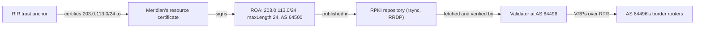

A BGP UPDATE is a claim: "send traffic for this prefix to me, through this chain of networks". Nothing in the message proves it. The receiver checks its own policy, compares the claim with others for the same prefix, and if it wins, installs it and tells its neighbours. Within minutes one network's claim sits in routers all over the internet. When the claim is false, because a network announced address space it does not hold (a **hijack**) or passed on routes it should have kept to itself (a **route leak**), traffic follows it just as faithfully.

This lesson follows both on Meridian's internet edge. Meridian is AS 64500, announcing `203.0.113.0/24` and `2001:db8::/32` (plus a `/48` per site) through ISP1 (AS 64501) and ISP2 (AS 64502), which both buy transit from AS 64496. A content network, AS 64511, sends traffic towards Meridian; an unrelated network, AS 64510, is about to announce part of Meridian's block. All addresses and AS numbers come from documentation ranges (RFC 5737, RFC 3849, RFC 5398); public incidents keep their real numbers.

Two reminders. An **autonomous system** (AS) is one network under one routing policy ([what BGP is for](/learn/fabric-networking/bgp-fundamentals/what-bgp-is-for)). Every UPDATE carries an **AS_PATH**, the ASes the route has crossed, most recent first, so the last one is the **origin**, the network claiming to hold the prefix ([updates, attributes and RIBs](/learn/fabric-networking/bgp-fundamentals/updates-attributes-and-ribs)).

## Why BGP believes anything

BGP was designed in 1989 for a small internet whose operators largely knew each other. Its only checks are local: a router discards a path containing its own AS number, refuses unconfigured neighbours, and applies its **import policy**, the filters and preferences its operator wrote for arriving routes ([policy and communities](/learn/fabric-networking/bgp-in-the-real-world/policy-and-communities)). Nothing says who holds `203.0.113.0/24` or who really connects to whom. Every network must answer, for every route, three questions BGP cannot:

1. **Is the origin allowed to originate this prefix?** A hijack fails this.
2. **Is the path real?** A forged path, where the attacker writes the right origin after its own AS, fails this.
3. **Should this route have reached me through this neighbour at all?** A leak fails this: the origin and the path are real, but a network in the middle passed the route on against its own policy.

## Hijacks: announcing space you do not hold

A **prefix hijack** is an announcement whose origin is not authorised for that address space. Most are accidents (a typo, an internal route redistributed into BGP); some are deliberate.

| Kind | What the attacker announces | Who believes it | Example |
|---|---|---|---|
| Exact-prefix (origin) hijack | The victim's own prefix, with itself as origin | Networks to which the attacker's path is shorter or more preferred than the real one | China Telecom, April 2010: about 37,000 prefixes re-originated for about 18 minutes |
| Sub-prefix (more-specific) hijack | A longer prefix inside the victim's | Every network that accepts it, whatever the path length | Pakistan Telecom and YouTube, February 2008 |
| Forged-origin (path) hijack | The prefix with the victim's AS written as origin after its own: `64510 64500` | Same as exact-prefix, and it passes origin checks | Used to defeat RPKI origin validation |
| Squatting | Space that is allocated but not announced by its holder | Everyone, since nothing competes | Spam and abuse from dormant blocks |

A **black-holing** hijack drops what it attracts. An **interception** hijack keeps one clean path back to the victim (by not announcing the bogus route towards it) and forwards traffic after reading it, adding only latency. In April 2018 attackers announced more-specific `/24`s of Amazon's Route 53 DNS space for about two hours, answered DNS queries for a cryptocurrency wallet site themselves and sent its users to a phishing server: roughly $150,000 stolen with no interception needed.

**How it breaks things:** traffic goes to the wrong network wherever the bogus route wins. **Signal:** at the victim, inbound traffic drops or latency rises while every session looks normal; at public route collectors, a new origin or more-specific for the victim's space.

## More-specific wins

Every router forwards a packet by **longest-prefix match**: of all the routes containing the destination address, it uses the one with the longest prefix, the most precise claim anyone made ([the routing table](/learn/fabric-networking/from-zero/the-routing-table)). BGP's best-path algorithm, with LOCAL_PREF (the operator's preference score for a route), AS_PATH length and the rest, only compares routes for the *same* prefix ([the best-path algorithm](/learn/fabric-networking/bgp-fundamentals/the-best-path-algorithm)). A `/25` and a `/24` are different routes: both are installed, and the lookup picks the `/25` for every address inside it.

Trace it at AS 64496 once AS 64510 announces `203.0.113.0/25`, the lower half of Meridian's block:

| Destination | Routes containing it | Longest | Goes to |
|---|---|---|---|
| `203.0.113.10` | `203.0.113.0/24` via ISP1 (path `64501 64500`), `203.0.113.0/25` via AS 64510 (path `64510`) | /25 | AS 64510, which drops it |
| `203.0.113.200` | `203.0.113.0/24` only (`.200` is in the upper half, `203.0.113.128/25`) | /24 | Meridian via ISP1 |

A `/25` path ten ASes long would win just as well.

There is a floor. Most networks drop IPv4 routes longer than `/24` and IPv6 longer than `/48`, which keeps the global table (about a million IPv4 and over 200,000 IPv6 routes in 2025) bounded. The documentation ranges are single `/24`s, so the example uses a `/25`; on the real internet the victim would hold a `/22`, say, and the attacker announce a `/24` inside it, the YouTube case below. The floor is also a defence: space announced as `/24`s can only be matched, not out-specificed, and a matched prefix competes on path, where the real origin usually does well.

The simulation compares exact-prefix and sub-prefix hijacks on a small internet. It ignores commercial policy (shortest AS path wins; ties go to the lower neighbour AS number) and marks three networks as stubs that never pass routes on.

```python
# A toy internet: who connects to whom. Every link carries routes both ways.
LINKS = [(64500, 64501), (64500, 64502), (64501, 64496), (64501, 64503), (64502, 64496),
         (64502, 64497), (64502, 64511), (64496, 64510), (64496, 64511), (64497, 64498),
         (64498, 64499), (64499, 64510)]
STUBS = {64500, 64503, 64511}   # networks that never pass on routes they learn
MERIDIAN, HIJACKER = 64500, 64510


def propagate(origins, rov=frozenset()):
    """BGP for one prefix, policy-free: every AS keeps the shortest loop-free AS path its
    neighbours offer (ties: lowest neighbour ASN). ASes in `rov` drop paths not from Meridian."""
    nbrs = {}
    for a, b in LINKS:
        nbrs.setdefault(a, set()).add(b)
        nbrs.setdefault(b, set()).add(a)
    best = {o: (o,) for o in origins}
    for _ in range(len(nbrs)):                      # synchronous rounds until nothing changes
        new = {o: (o,) for o in origins}
        for asn in nbrs.keys() - set(origins):
            offers = [(len(best[n]), n, best[n]) for n in nbrs[asn]
                      if n in best and asn not in best[n]          # AS_PATH loop check
                      and (n in origins or n not in STUBS)         # stubs do not re-export
                      and not (asn in rov and best[n][-1] != MERIDIAN)]
            if offers:
                new[asn] = (asn,) + min(offers)[2]
        if new == best:
            break
        best = new
    return best


def destination(asn, routes_24, routes_25):
    """Where traffic for 203.0.113.10 goes from `asn`: any /25 route beats every /24 route."""
    for table in (routes_25, routes_24):
        if asn in table:
            path = table[asn]
            return ("HIJACKED" if path[-1] == HIJACKER else "ok") + " via " + " ".join(map(str, path[1:]))
    return "no route"


cases = {
    "same /24 from 64510": (propagate({MERIDIAN, HIJACKER}), {}),
    "/25 from 64510": (propagate({MERIDIAN}), propagate({HIJACKER})),
    "/25, ROV at 64496": (propagate({MERIDIAN}), propagate({HIJACKER}, rov={64496})),
}
print(f"{'AS':<6}" + "".join(f"{name:<34}" for name in cases))
for asn in sorted({a for link in LINKS for a in link} - {MERIDIAN, HIJACKER}):
    print(f"{asn:<6}" + "".join(f"{destination(asn, *tables):<34}" for tables in cases.values()))
```

```text
AS    same /24 from 64510               /25 from 64510                    /25, ROV at 64496
64496 HIJACKED via 64510                HIJACKED via 64510                ok via 64501 64500
64497 ok via 64502 64500                HIJACKED via 64498 64499 64510    HIJACKED via 64498 64499 64510
64498 HIJACKED via 64499 64510          HIJACKED via 64499 64510          HIJACKED via 64499 64510
64499 HIJACKED via 64510                HIJACKED via 64510                HIJACKED via 64510
64501 ok via 64500                      HIJACKED via 64496 64510          ok via 64500
64502 ok via 64500                      HIJACKED via 64496 64510          HIJACKED via 64497 64498 64499 64510
64503 ok via 64501 64500                HIJACKED via 64501 64496 64510    ok via 64501 64500
64511 HIJACKED via 64496 64510          HIJACKED via 64496 64510          HIJACKED via 64502 64497 64498 64499 64510
```

Trace AS 64497. With the same `/24` from both origins it hears `64502 64500` from ISP2 (two ASes) and `64498 64499 64510` from AS 64498 (three), and keeps the real route: an exact-prefix hijack splits the internet by distance, and four of eight networks stay correct. With a `/25`, AS 64497 holds both prefixes and the lookup takes the `/25` however long its path, so every network is hijacked, Meridian's own ISPs included. The animation below follows this `/25`. In the third column AS 64496 drops the bogus route (origin validation, below): networks reached only through it are safe, but ISP2 learns the `/25` the long way round through AS 64497, and the content network follows ISP2. Protection is only as good as the validating networks between you and the hijacker.

```viz
{"type": "fabric", "scenario": "route-hijack", "title": "A /25 hijack takes half of Meridian's traffic, then RPKI origin validation marks it Invalid", "caption": "AS 64510 announces 203.0.113.0/25 to the transit network AS 64496, which accepts it unfiltered and passes it on. Longest-prefix match sends 203.0.113.10 to AS 64510, where it is dropped, while 203.0.113.200 still reaches Meridian. Meridian publishes a ROA (203.0.113.0/24, maxLength 24, AS 64500), AS 64496's validator feeds its routers over RTR, the /25 is Invalid on both origin and length, it is withdrawn and traffic returns. The last frame shows what origin validation cannot catch: the exact /24 with Meridian forged as origin."}
```

## Case study: YouTube and Pakistan Telecom, 2008

In February 2008 Pakistan's telecom regulator ordered YouTube blocked in the country. On Sunday 24 February, Pakistan Telecom (AS 17557) created a route for `208.65.153.0/24`, inside YouTube's `208.65.152.0/22`, pointing at a null interface so its customers' YouTube traffic would be discarded. Meant to stay inside AS 17557, the route reached its upstream PCCW (AS 3491), which did not filter what this customer announced and passed it to the world. Times UTC, from RIPE NCC's analysis of its route collectors:

| Time | Event | Effect |
|---|---|---|
| 18:47 | AS 17557 announces `208.65.153.0/24` to AS 3491 | Within minutes most of the internet's routers prefer the `/24` over YouTube's `/22`; YouTube is unreachable for most of the world |
| 20:07 | YouTube (AS 36561) announces `208.65.153.0/24` itself | Now two origins for the same prefix: networks closer to YouTube return, the rest stay hijacked (the first column of the simulation) |
| 20:18 | YouTube announces `208.65.153.0/25` and `208.65.153.128/25` | Longer than the bogus `/24`, so wherever they propagate they win; the `/24` floor means some networks drop them |
| about 21:00 | PCCW withdraws AS 17557's announcements | The bogus route disappears; YouTube later withdraws its emergency more-specifics |

About two hours of global outage from a route meant for one country. Three points generalise. The originator's mistake was ordinary; the outage happened because its provider accepted anything from a customer. The victim's only immediate tool was to out-specific the hijacker, possible because the `/22` left room. And YouTube's own routers showed nothing wrong: the hijack was visible only from outside, at public **route collectors** (RIPE RIS and RouteViews, which peer with hundreds of networks and archive every UPDATE) and **looking glasses** (web pages that run read-only BGP queries on another network's routers). A customer prefix filter at PCCW would have stopped it, as would origin validation today against a ROA for the `/22`; a max-prefix limit would not, since one extra prefix trips nothing.

## Route leaks: right routes, wrong direction

A **route leak** (RFC 7908) is a route propagated beyond its intended scope: prefix and origin may be genuine, but a network in the middle passed it to a neighbour its own policy says should not have it. The policy in question is the **valley-free rule** (Gao-Rexford) of [how the internet is glued together](/learn/fabric-networking/bgp-in-the-real-world/how-the-internet-is-glued-together): a **customer** pays a **provider** for transit and two **peers** swap their customers' traffic for free, so customer routes are exported to everyone, peer and provider routes only to customers, and every network prefers customer over peer over provider routes (with LOCAL_PREF), whatever the path length. RFC 7908 names six kinds of leak:

| Type | What happens | Typical cause |
|---|---|---|
| 1, hairpin | A multihomed customer passes routes from one provider to another | Missing export filter on a multihomed edge (Meridian, below) |
| 2, lateral | A network passes one peer's routes to another peer | Export policy written for customers applied to peers |
| 3 and 4 | Provider routes to a peer, or peer routes to a provider | Same mistakes on other session types |
| 5, re-origination | A network announces routes it learned as if it originated them | Redistribution of BGP into an IGP and back; China Telecom 2010 |
| 6, internal more-specifics | Routes meant for internal traffic engineering escape | A route optimiser's synthetic more-specifics (Verizon 2019, below) |

The preference order makes a leak worse than it looks. When Meridian leaks a route learned from ISP2 to ISP1, ISP1 holds it from a *customer*, which beats the same route from its peer ISP2 though the leaked path is one AS longer. ISP1's traffic for that destination goes down into Meridian and back up to ISP2, a valley. Meridian's transit links, sized for its own traffic, congest and drop, and Meridian pays both providers for the privilege. The previous lesson traces this leak hop by hop and animates it; here the question is how the rest of the internet stops it.

A leak needs two mistakes: the leaker's export and the receiver's import. On 24 June 2019 a small network's "BGP optimiser" generated more-specific routes internally to steer traffic. Its customer, multihomed to Verizon (AS 701), leaked them (roughly 20,000 prefixes, by Cloudflare's count) to Verizon, which accepted them unfiltered. As more-specifics of real routes belonging to Cloudflare, Amazon and others, they won everywhere, and for about two hours much of those networks' traffic squeezed through a small regional network: a type 1 leak of type 6 routes, which a prefix filter or a max-prefix limit on Verizon's customer session would have stopped.

**What leak prevention solves:** routes reach only the neighbours the business relationship intends. **How it breaks:** a missing export filter plus a missing import filter, often during a policy change. **Signal:** your AS between two of your providers in collector paths (`... 64501 64500 64502 ...`), transit traffic for others' destinations, and exported prefix counts jumping; diffing each Adj-RIB-Out (what you last sent a neighbour, [updates, attributes and RIBs](/learn/fabric-networking/bgp-fundamentals/updates-attributes-and-ribs)) against intent catches it first.

## Not every BGP outage is an attack: Facebook, October 2021

On 4 October 2021, from about 15:40 UTC, Facebook, Instagram and WhatsApp were unreachable for about six hours. It was a routing incident, but nobody hijacked or leaked anything. Facebook's own account gives the chain:

1. During routine maintenance, a command meant to assess backbone capacity disconnected the whole backbone; the audit tool meant to block such commands had a bug.
2. Facebook's authoritative DNS servers sit at edge sites reached by **anycast** (many sites announce the same prefix; each user reaches the nearest). Each site withdraws its announcement when it cannot reach the data centers, the right behaviour for one sick site.
3. Every site failed that check at once and withdrew, so the prefixes holding Facebook's DNS servers vanished from the internet, and resolvers worldwide returned failures.
4. Recovery was slow because engineers' tools and remote access depended on the network that was down.

Collectors showed withdrawals from AS 32934 at about 15:40 and renewed announcements a little after 21:00. None of this lesson's defences would have helped: the legitimate origin withdrew its own routes. The lessons are health checks whose failures are independent across sites, out-of-band access that does not depend on production, and reachability measured from outside; [incidents and what they teach](/learn/fabric-networking/operating-fabrics/incidents-and-what-they-teach) has the full timeline.

## IRR filtering: building customer filters from a registry

The oldest defence answers question 1 for customers. An **Internet Routing Registry** (IRR) is a public database where networks publish what they intend to announce, in RPSL (Routing Policy Specification Language, RFC 2622). The five regional internet registries (RIRs, which allocate address space: AFRINIC, APNIC, ARIN, LACNIC, RIPE NCC) run IRRs; others, such as RADb, are independent. Two object types matter:

```text
route:      203.0.113.0/24          (illustrative RPSL objects)
origin:     AS64500
descr:      Meridian, IPv4 aggregate

route:      198.51.100.0/24
origin:     AS64505
descr:      Meridian's BGP customer

as-set:     AS64500:AS-CUSTOMERS
members:    AS64500, AS64505
```

A `route` (or `route6`) object pairs a prefix with the AS allowed to originate it. An `as-set` names a network's **customer cone**, itself plus every AS it gives transit to, and may nest. ISP1 expands `AS64500:AS-CUSTOMERS` to ASes, collects every route object they originate, and generates a prefix list (with a tool such as `bgpq4`, daily or hourly):

```text
ISP1 import filter for AS 64500, generated from IRR      (illustrative)
  permit 203.0.113.0/24
  permit 198.51.100.0/24
  deny   everything else
```

With this at PCCW, `208.65.153.0/24` would have hit "deny". Large transit networks require it of customers, as does MANRS (Mutually Agreed Norms for Routing Security, an industry initiative started by the Internet Society). Its weaknesses come from the data:

- **No proof of authority** in some registries. RIR databases tie objects to the holder of the space; third-party registries historically let anyone register anything. In August 2022 attackers registered forged IRR objects, announced a more-specific of an Amazon prefix that their upstream accepted on the strength of them, and redirected a cryptocurrency bridge's users.
- **Staleness.** Objects for space given up years ago still authorise it, and a new prefix without an object is silently filtered.
- **Size and scope.** A large customer's as-set can expand to hundreds of thousands of prefixes, straining router memory and the generation pipeline, and nobody can list everything a peer or provider might legitimately send.

**What it solves:** customers can announce only what they registered. **How it breaks:** forged, stale or missing objects, or a filter that failed to regenerate. **Signal:** received prefixes rejected by the filter (a counter per session), and the diff of each regenerated filter against the last one.

## RPKI: signed statements about who may originate what

The **Resource Public Key Infrastructure** (RPKI, RFC 6480) answers question 1 with cryptography instead of a database anyone can write to. A **certificate** here is a signed statement binding a public key to IP blocks and AS numbers (RFC 3779 adds those to X.509 certificates). Each RIR is a **trust anchor** with a self-signed certificate for all its space, which validators locate through a trust anchor locator (TAL). Each member's certificate lists exactly the space it was allocated, so a holder can sign statements about its own space and nothing else.



The statement that matters is the **Route Origin Authorisation** (ROA, RFC 6482, updated by RFC 9582 in 2024): "AS X may originate these prefixes, up to this length". Meridian's, field by field:

| Field | Size | Value in Meridian's ROA | What reads it |
|---|---|---|---|
| asID | an integer, up to 32 bits | 64500 | Validator: becomes the origin in each VRP |
| ipAddrBlocks, IPv4 | prefix plus optional maxLength per entry | `203.0.113.0/24`, maxLength 24 | Validator: one VRP per entry |
| ipAddrBlocks, IPv6 | same | `2001:db8::/32`; `2001:db8:100::/48`, `2001:db8:200::/48`, `2001:db8:300::/48` (one per site), each maxLength equal to its own length | Validator |
| End-entity certificate | a kilobyte or so | one-time key, resources `203.0.113.0/24` and `2001:db8::/32` | Validator: resources must sit inside the parent certificate's |
| Signature | 256 bytes (RSA-2048) | over the content, by the end-entity key | Validator |

A ROA names one AS, so a prefix with two origins (Meridian, and a DDoS-scrubbing service announcing Meridian's space during an attack) needs two ROAs. **maxLength** is the longest prefix authorised. Meridian announces its IPv6 `/32` plus one `/48` per site, so its ROA lists those four prefixes at their own lengths rather than maxLength 48 on the `/32`, which would authorise 65,536 `/48`s it never sends; its IPv4 entry allows only the `/24`. RFC 9319 recommends exactly that: every length you authorise and do not announce is a more-specific an attacker can forge. A ROA for **AS 0** says "nobody may originate this" (RFC 6483), right for space you hold and do not announce.

ROAs, certificates, **manifests** (lists of every file a holder publishes) and revocation lists live in repositories fetched over rsync or RRDP (the RPKI Repository Delta Protocol, RFC 8182, over HTTPS). A **validator** (Routinator, rpki-client, Fort) walks the tree from each trust anchor, checks every signature, manifest, expiry and resource containment, and reduces what survives to **validated ROA payloads** (VRPs): (prefix, maxLength, origin AS) triples, several hundred thousand for the whole internet. Routers never touch a certificate: they receive VRPs over the **RPKI-to-Router protocol** (RTR, RFC 8210), a small TCP protocol carrying each IPv4 VRP as a 20-byte PDU (protocol data unit, one message):

| Field | Size | Value for Meridian's IPv4 VRP | What reads it |
|---|---|---|---|
| Protocol version | 1 byte | 1 | Router: RTR version negotiation |
| PDU type | 1 byte | 4 (IPv4 prefix; 6 is IPv6, a 32-byte PDU) | Router: parser |
| Zero | 2 bytes | 0 | |
| Length | 4 bytes | 20 | Router: framing |
| Flags | 1 byte | 1 (announce; 0 withdraws) | Router: add or remove the VRP |
| Prefix length | 1 byte | 24 | Router |
| Max length | 1 byte | 24 | Router |
| Zero | 1 byte | 0 | |
| IPv4 prefix | 4 bytes | `cb 00 71 00` (203.0.113.0) | Router |
| AS number | 4 bytes | 64500 (`00 00 fb f4`) | Router |

Each version of the data has a serial: the router asks for changes since the one it holds, and the server notifies it when data changes. RFC 8210's default timers: refresh every 3,600 s, retry 600 s after a failure, and data expiry after 7,200 s without a refresh. Validators re-fetch every few minutes to an hour (Routinator's default is 10 minutes), so a new ROA takes effect in roughly ten minutes to an hour: publish it before the announcement it authorises.

## Route origin validation, step by step

**Route origin validation** (ROV, RFC 6811) checks each received route against the VRPs. A VRP **covers** a route if its prefix contains the route's prefix, and **matches** it if it covers it, the route is no longer than maxLength, and the origin equals the VRP's AS. Then:

1. If any VRP matches, the route is **Valid**.
2. Otherwise, if any VRP covers it, the route is **Invalid**: someone published a ROA for this space and this route breaks it.
3. Otherwise it is **NotFound**: no ROA says anything about this space.

A path ending in an AS_SET (an unordered set left by aggregation) has no single origin, so a covered one is Invalid. NotFound routes are accepted, because about half the internet's routes have no ROA (NIST's RPKI monitor put ROA coverage of IPv4 routes just past half in 2024).

```python
import ipaddress

# Validated ROA payloads (VRPs), as a validator hands them to routers: (prefix, maxLength, AS).
VRPS = [
    ("203.0.113.0/24", 24, 64500),      # Meridian's IPv4 block
    ("2001:db8::/32", 32, 64500),       # Meridian's IPv6 aggregate
    ("2001:db8:100::/48", 48, 64500),   # one /48 per site: ams, sin, sjc
    ("2001:db8:200::/48", 48, 64500),
    ("2001:db8:300::/48", 48, 64500),
    ("198.51.100.0/24", 24, 64505),     # Meridian's BGP customer
]


def origin_as(as_path):
    """The origin is the last AS in the path; a trailing AS_SET (a Python set here) has none."""
    last = as_path[-1] if as_path else None
    return last if isinstance(last, int) else None


def rov(prefix, as_path, vrps):
    """RFC 6811 route origin validation: Valid, Invalid or NotFound, plus the reason."""
    route, origin = ipaddress.ip_network(prefix), origin_as(as_path)
    problems = []
    for vrp_prefix, max_length, asn in vrps:
        vrp = ipaddress.ip_network(vrp_prefix)
        if vrp.version != route.version or not route.subnet_of(vrp):
            continue                                   # this VRP does not cover the route
        wrong_origin = origin != asn or asn == 0       # AS 0 is never a valid origin
        too_long = route.prefixlen > max_length
        if not wrong_origin and not too_long:
            return "Valid", f"matches {vrp_prefix}-{max_length} AS {asn}"
        if wrong_origin:
            problems.append(f"origin {origin} is not AS {asn}")
        if too_long:
            problems.append(f"/{route.prefixlen} is longer than maxLength {max_length}")
    return ("Invalid", "; ".join(problems)) if problems else ("NotFound", "no VRP covers it")


ROUTES = [  # what AS 64496 receives: prefix, AS_PATH (leftmost is the neighbour)
    ("203.0.113.0/24", [64501, 64500]),           # Meridian via ISP1
    ("203.0.113.0/25", [64510]),                  # the hijack
    ("203.0.113.0/25", [64510, 64500]),           # the hijack with Meridian forged as origin
    ("203.0.113.0/24", [64510, 64500]),           # exact prefix, forged origin
    ("192.0.2.0/24", [64511]),                    # content network, no ROA published
    ("198.51.100.0/24", [64501, 64500, 64505]),   # Meridian's customer via Meridian
    ("198.51.100.0/24", [64501, 64500]),          # Meridian re-originating its customer's block
    ("2001:db8:100::/48", [64502, 64500]),        # one of Meridian's IPv6 site prefixes
    ("2001:db8:400::/48", [64510, 64500]),        # a /48 Meridian never announces, forged origin
    ("203.0.113.0/24", [64501, {64500, 64505}]),  # aggregated with an AS_SET at the end
]
for prefix, path in ROUTES:
    state, why = rov(prefix, path, VRPS)
    shown = " ".join("{" + ",".join(map(str, sorted(a))) + "}" if isinstance(a, set) else str(a) for a in path)
    print(f"{prefix:<18} {shown:<20} {state:<9} {why}")

loose = [("203.0.113.0/24", 25, 64500)] + VRPS[1:]   # a ROA that allows /25s Meridian never sends
print("with maxLength 25:", rov("203.0.113.0/25", [64510, 64500], loose))
```

```text
203.0.113.0/24     64501 64500          Valid     matches 203.0.113.0/24-24 AS 64500
203.0.113.0/25     64510                Invalid   origin 64510 is not AS 64500; /25 is longer than maxLength 24
203.0.113.0/25     64510 64500          Invalid   /25 is longer than maxLength 24
203.0.113.0/24     64510 64500          Valid     matches 203.0.113.0/24-24 AS 64500
192.0.2.0/24       64511                NotFound  no VRP covers it
198.51.100.0/24    64501 64500 64505    Valid     matches 198.51.100.0/24-24 AS 64505
198.51.100.0/24    64501 64500          Invalid   origin 64500 is not AS 64505
2001:db8:100::/48  64502 64500          Valid     matches 2001:db8:100::/48-48 AS 64500
2001:db8:400::/48  64510 64500          Invalid   /48 is longer than maxLength 32
203.0.113.0/24     64501 {64500,64505}  Invalid   origin None is not AS 64500
with maxLength 25: ('Valid', 'matches 203.0.113.0/24-25 AS 64500')
```

Read the rows against the rules. The hijack is Invalid twice over. Forging Meridian as origin fixes the AS but not the length, so the forged `/25` stays Invalid; under a ROA allowing `/25`s (last line) it turns Valid. The same holds in IPv6: listing each site's `/48` keeps the forged `2001:db8:400::/48` Invalid, where maxLength 48 on the `/32` would have made it Valid. The forged exact `/24` is Valid: ROV checks who is named as origin, not whether the path is true. The re-originated customer block is Invalid, which is how ROV catches a type 5 leak.

What a router does with the state is policy, and one choice is a trap. **Drop Invalid** is the recommended policy, adopted since 2019 by many of the largest transit networks. **De-prefer Invalid** sounds safer and does almost nothing against sub-prefix hijacks: no competing route of that length exists, so LOCAL_PREF compares with nothing and longest-prefix match installs the Invalid `/25` anyway. Validation state is per router and not carried in BGP (RFC 8097 defines an optional extended community to carry it inside one AS), so every router with external sessions needs an RTR feed, ideally from two validators running different software. When VRPs change, routers re-evaluate the routes they hold, asking peers to resend with ROUTE-REFRESH if they kept no unmodified copy ([BGP sessions and the FSM](/learn/fabric-networking/bgp-fundamentals/bgp-sessions-and-the-fsm)).

**What ROV solves:** origin hijacks, more-specifics beyond maxLength and re-origination leaks are dropped wherever networks validate. **How it breaks:** a wrong ROA makes validating networks drop your own routes; a dead validator lets RTR data expire, every route becomes NotFound, and protection fails open without a route changing. **Signal:** Invalid routes dropped per session, the ROV state of your announcements seen from outside, and each router's RTR data age.

## Max-prefix limits: the blunt guard rail

A **maximum-prefix limit** caps how many routes a router accepts from one neighbour. Near it (a threshold such as 80%) the router logs a warning. Past it, the usual setting tears the session down with NOTIFICATION Cease subcode 1, "maximum number of prefixes reached" (RFC 4486), and holds it in Idle until an operator or a restart timer clears it (`Idle (PfxCt)` on several platforms, [BGP sessions and the FSM](/learn/fabric-networking/bgp-fundamentals/bgp-sessions-and-the-fsm)); some implementations can instead only warn or discard the excess. Whether routes are counted before or after import policy varies; counted after, a leak the filter already blocks never trips it. On Meridian's edge:

| Session | Normally receives | Limit | What it catches |
|---|---|---|---|
| `gw1.ams` from its customer AS 64505 | 1 | 10, warn at 8 | The customer leaking its own provider's full table: the 11th prefix tears the session down |
| A peer at an exchange | about 450, the value the peer publishes in PeeringDB | 600 | A peer leaking its transit routes to you |
| `gw1.ams` from ISP1, full table | about 1,000,000 IPv4 | 1,200,000 | A deaggregation event (a network suddenly announcing its blocks as many more-specifics), or growth beyond what the router's forwarding table can hold |

**PeeringDB** is the public database where networks publish peering details, including the prefix counts to use as limits. The last row also protects hardware: many switch chips hold a few hundred thousand routes, short of a full table, and an overflowing forwarding table misbehaves in vendor-specific ways.

Max-prefix is blunt both ways. It catches nothing small: one hijacked prefix, or a leak of fifty, passes. And a trip drops *every* route from that neighbour, so a single-homed customer goes offline until the session restarts. The Verizon leak would have tripped any sane limit; the YouTube hijack none. Choosing limits, restart timers and outbound limits is in [operating BGP safely](/learn/fabric-networking/bgp-in-the-real-world/operating-bgp-safely).

**What it solves:** a mass leak stops at the first session that sees it. **How it breaks:** a limit set too low trips on legitimate growth; one set too high, or counted after a filter, never trips. **Signal:** received count against the limit per session, and Cease 6/1 in the session's last NOTIFICATION.

## Checking the path: BGPsec and ASPA

ROV leaves question 2 (is the path real?) and question 3 (should it have come this way?) open: a forged origin on the exact `/24` passes it, as does every leak that keeps the true origin, Verizon 2019 included.

**BGPsec** (RFC 8205, 2017) answers question 2 completely: each router signs, with an RPKI-certified key, the path so far plus the AS it sends to, and receivers verify every signature, so no hop can be inserted or removed. It has essentially no production deployment, for structural reasons: a path is protected only if every AS on it signs, so early adopters gain nothing; one prefix per UPDATE and a signature per hop to verify is a large CPU cost on a full table; and a leaked path is a real path, correctly signed.

**ASPA** (Autonomous System Provider Authorisation, specified in IETF drafts that spent years being finalised, so check their current status; rpki-client, Routinator, OpenBGPD and BIRD already implement it) covers question 3 and the common forged-origin case with far less machinery. Each AS publishes one signed object listing its providers; Meridian's says "AS 64501 and AS 64502". A receiver checks the path for the valley-free shape: from the origin it may only climb, each AS listed as a provider by the one before, then cross at most one peering link, then only descend. A route from a customer or peer must climb all the way; one from a provider may climb, then descend. A hop that must climb where the lower AS's ASPA does not list the upper makes the path **Invalid**.

```python
# Signed ASPA objects: customer AS -> the set of its providers.
ASPA = {
    64500: {64501, 64502},   # Meridian buys transit from ISP1 and ISP2
    64505: {64500},          # Meridian's own BGP customer
    64501: {64496},          # ISP1 and ISP2 buy transit from AS 64496
    64502: {64496},
    64510: {64496},
    64511: {64496, 64502},   # the content network buys transit from AS 64496 and ISP2
    64496: set(),            # provider-free: its ASPA lists only AS 0
}


def hop(customer, provider):
    """Does `customer` attest that `provider` is one of its providers?"""
    if customer not in ASPA:
        return "unknown"
    return "yes" if provider in ASPA[customer] else "no"


def ramp(seq):
    """How many ASes, from seq[0] onwards, form a chain where each next AS may be a provider
    of the one before: the longest chain with no 'no', and the longest with only 'yes'."""
    max_len = min_len = 1
    while max_len < len(seq) and hop(seq[max_len - 1], seq[max_len]) != "no":
        max_len += 1
    while min_len < len(seq) and hop(seq[min_len - 1], seq[min_len]) == "yes":
        min_len += 1
    return max_len, min_len


def aspa_verify(as_path, from_provider):
    """ASPA path verification. as_path is as received: leftmost is the neighbour."""
    seq = []
    for asn in reversed(as_path):           # origin first, prepends collapsed
        if not seq or seq[-1] != asn:
            seq.append(asn)
    n = len(seq)
    up_max, up_min = ramp(seq)              # climbing from the origin
    if not from_provider:                   # from a customer or peer: uphill all the way
        return "Valid" if up_min == n else "Invalid" if up_max < n else "Unknown"
    if n <= 2:
        return "Valid"
    down_max, down_min = ramp(seq[::-1])    # from our provider back down towards the origin
    if up_max + down_max < n:
        return "Invalid"                    # no single peak can explain the path
    return "Unknown" if up_min + down_min < n else "Valid"


CASES = [  # (where, prefix, AS_PATH as received, received from a provider?)
    ("AS 64496 from ISP1", "203.0.113.0/24", [64501, 64500], False),
    ("AS 64496 from 64510", "203.0.113.0/24", [64510, 64500], False),         # forged origin
    ("ISP1 from Meridian", "192.0.2.0/24", [64500, 64502, 64511], False),     # Meridian's leak
    ("AS 64496 from ISP1", "192.0.2.0/24", [64501, 64500, 64502, 64511], False),
    ("Meridian from ISP1", "192.0.2.0/24", [64501, 64496, 64502, 64511], True),
    ("64510 from AS 64496", "192.0.2.0/24", [64496, 64501, 64502, 64511], True),  # ISP1 leaked
]
for where, prefix, path, from_provider in CASES:
    print(f"{where:<20} {prefix:<16} {' '.join(map(str, path)):<32} {aspa_verify(path, from_provider)}")
```

```text
AS 64496 from ISP1   203.0.113.0/24   64501 64500                      Valid
AS 64496 from 64510  203.0.113.0/24   64510 64500                      Invalid
ISP1 from Meridian   192.0.2.0/24     64500 64502 64511                Invalid
AS 64496 from ISP1   192.0.2.0/24     64501 64500 64502 64511          Invalid
Meridian from ISP1   192.0.2.0/24     64501 64496 64502 64511          Valid
64510 from AS 64496  192.0.2.0/24     64496 64501 64502 64511          Invalid
```

Trace the forged origin by hand. AS 64496 receives `64510 64500` from its customer, so the path must climb from the origin: 64500 to 64510 must be customer to provider. Meridian's ASPA does not list 64510, so the hop is "no" and the route Invalid, the route ROV called Valid. The leak is caught at its first hop: ISP1 receives `64500 64502 64511` from its customer Meridian, and the climb from 64502 to 64500 needs ISP2 to list Meridian as a provider. The last row is a downstream check at AS 64510: the climb from the origin stops at ISP2 (which does not list ISP1), the descent back from AS 64510 stops at AS 64496 (which lists no providers, so ISP1 cannot be one), and ISP1 sits between, explained by no single peak: ISP1 leaked a peer route to its provider.

Like ROAs, ASPA deploys partially: a hop from an AS that published nothing is "unknown" and never makes a path Invalid, so protection grows as more networks publish. A simpler leak defence is already standardised: **BGP roles** (RFC 9234) let both ends of a session declare the relationship (provider, customer, peer) in the OPEN, and an **Only-to-Customer** attribute marks routes that may only travel downhill, so the next network can stop a leak without RPKI.

**What path checks solve:** forged adjacencies and leaks that keep the true origin, which ROV passes. **How they break:** an ASPA that omits a new provider invalidates your own routes through it, and a hop where nobody published is never judged. **Signal:** ASPA-Invalid routes per session, and your own announcements' ASPA state seen from outside.

## Trade-offs: what each defence buys

| Defence | Stops | Misses | Who must deploy it | How it fails | Status |
|---|---|---|---|---|---|
| IRR customer filters | Customers announcing space they did not register | Anything from peers and providers; forged or stale objects | Each provider, per customer session | Stale filter blocks a new legitimate prefix | Standard practice at large transits, uneven elsewhere |
| RPKI ROV | Origin hijacks, more-specifics beyond maxLength, re-origination | Forged origin on an allowed prefix; leaks keeping the true origin | Holders publish ROAs; networks between victim and attacker validate | Wrong ROA drops your own routes; dead validator fails open | About half of IPv4 routes covered by 2024; many large transits drop Invalid |
| Max-prefix | Mass leaks, full-table leaks, deaggregation | One prefix or a small leak | Each network, per session | Trip drops all of a neighbour's routes | Universal |
| BGP roles and OTC (RFC 9234) | Leaks at the next network | Hijacks | Both ends of a session | A wrong role on one session | Standardised 2022, supported by some implementations |
| ASPA | Leaks, forged origins with a fake adjacency | Paths through ASes that published nothing | Holders publish provider lists; networks verify | Forgotten provider makes your routes Invalid | Late-stage IETF drafts; early implementations |
| BGPsec | Any path forgery between signing ASes | Leaks; everything where one AS does not sign | Every AS on the path, with router keys | CPU cost, one prefix per UPDATE | Standardised 2017, effectively undeployed |

## Failure modes in production

| Failure | Symptom | Diagnosis | Fix |
|---|---|---|---|
| Your space hijacked by a more-specific | Inbound traffic to part of your space drops or detours; your sessions all healthy | Collectors show a new origin or prefix inside yours; looking glasses at distant networks show the path | Contact the origin's upstream network operations centre (PeeringDB lists contacts); announce matching or more-specific routes if the `/24` floor allows; ROAs with tight maxLength for next time |
| Self-inflicted Invalid | A new more-specific for traffic engineering, or a scrubbing provider announcing your space during an attack, reaches only part of the internet | ROV state of the new announcement against current VRPs: no ROA allows that length or that origin | Publish the ROA first, wait for it to propagate (minutes to an hour), then announce |
| Validator outage | Nothing visible: routes stay, Invalid routes start being accepted after RTR data expires | RTR session state and data age on routers; validator VRP count dropping to zero | Two validators from different software; alert on data age, not only session state |
| Expired or broken RPKI publication | Your ROA disappears; your routes go NotFound, or Invalid if a covering ROA from your provider's block remains | Validator logs for your repository; your ROA missing from public validator output | Monitor your own ROAs from outside; fix the CA or hosting; check renewals |
| Stale IRR filter | New customer prefix unreachable from the provider's side | Provider's filter lacks the prefix; route object missing or created after the last regeneration | Create the object, ask for a regeneration, verify at the provider's looking glass |
| Max-prefix trip on legitimate growth | Session in `Idle (PfxCt)`, Cease 6/1; a customer or peer offline | Received count had been climbing towards the limit for weeks | Alert at 80% of the limit; review limits against PeeringDB and baselines |
| Your own export leak | Inbound traffic on transit links for others' destinations; your AS between two providers at collectors | Adj-RIB-Out to each provider contains routes beyond your own and your customers' | Export by "learned from customer" community, never by "everything not denied"; outbound prefix limits where supported |

## Under the hood: where validation runs

A validator is a long-running process, not a router feature. It holds the whole RPKI tree, objects from tens of thousands of certificate authorities in on the order of a hundred repositories (most hosted by the RIRs), fetches them in parallel and keeps each repository's last good copy until it expires. The RTR server is built in (Routinator) or separate (StayRTR beside rpki-client). Routers keep VRPs in a prefix-keyed table, look each route up as it enters the Adj-RIB-In, attach the state and let import policy act before best-path selection, in microseconds per route. Two consequences for tooling: the state exists only on each router, so you read it through the router's API or BMP (the BGP Monitoring Protocol, which streams a router's BGP tables to a collector) or recompute it from the same VRPs; and a router keeps validating against data up to the expire interval old (two hours by default) without an error.

## What the platform should show

Hijacks are invisible from inside the victim's network, so Meridian's platform must look from outside as well as in:

- **Your prefixes as the internet sees them,** from public collectors (RIPE RIS live, RouteViews) and looking glasses: alert on a new origin, a more-specific inside your space, an AS adjacent to yours that is not a provider, and visibility far below normal (the Facebook signature). The open-source BGPalerter does this.
- **ROV state of your own announcements before you make them:** a planned `/25` or a scrubbing provider's origin checked against current VRPs in the change pipeline ([safe change and maintenance](/learn/fabric-networking/operating-fabrics/safe-change-and-maintenance)).
- **Validator and RTR health:** VRP count per validator against yesterday's, RTR data age on every edge router. Zero VRPs is an outage of your defence with no route changing.
- **Invalid routes dropped per session,** as a rate: a burst from one neighbour is a leak or hijack somewhere behind it.
- **Max-prefix headroom per session,** with the trend. Managers want "no session within 20% of its limit"; engineers want which session and its growth curve.
- **Exports against intent:** each neighbour's Adj-RIB-Out, streamed over BMP, diffed against what may be exported.
- **Your IRR and RPKI objects** (route objects, as-sets, ROAs, ASPA) against what you announce.

The core of the outside view is a few dozen lines over collector data:

```python
import ipaddress

INTENT = {"203.0.113.0/24": 64500, "2001:db8::/32": 64500}   # what Meridian originates
UPSTREAMS = {64501, 64502}                                    # the only ASes adjacent to 64500
VRPS = [("203.0.113.0/24", 24, 64500), ("2001:db8::/32", 32, 64500),
        ("2001:db8:100::/48", 48, 64500), ("2001:db8:200::/48", 48, 64500),
        ("2001:db8:300::/48", 48, 64500)]


def covered_by(prefix, blocks):
    net = ipaddress.ip_network(prefix)
    return [b for b in blocks if ipaddress.ip_network(b).version == net.version
            and net.subnet_of(ipaddress.ip_network(b))]


def rov_state(prefix, origin):
    net, covering = ipaddress.ip_network(prefix), []
    for p, max_len, asn in VRPS:
        if covered_by(prefix, [p]):
            covering.append(asn == origin and net.prefixlen <= max_len)
    return "NotFound" if not covering else "Valid" if any(covering) else "Invalid"


def check(observations, baseline, planned=()):
    """observations: (collector peer AS, prefix, AS_PATH) seen at public route collectors;
    baseline: how many collector peers normally see each of Meridian's prefixes."""
    alerts, seen_by = [], {p: set() for p in INTENT}
    for peer, prefix, path in observations:
        if not covered_by(prefix, INTENT):
            continue                                     # not Meridian's space
        origin = path[-1]
        if prefix in INTENT and origin == INTENT[prefix]:
            seen_by[prefix].add(peer)
            if len(path) > 1 and path[-2] not in UPSTREAMS:
                alerts.append(f"SUSPECT  {prefix} via {path[-2]}, not an upstream: forged origin or leak")
        elif prefix in INTENT:
            alerts.append(f"HIJACK   {prefix} originated by AS {origin} (seen from AS {peer})")
        else:
            alerts.append(f"HIJACK   more-specific {prefix} from AS {origin}, RPKI {rov_state(prefix, origin)}")
    for prefix, who in seen_by.items():
        if len(who) < 0.5 * baseline[prefix]:          # withdrawn, filtered or Invalid somewhere
            alerts.append(f"REACH    {prefix} visible from {len(who)} of the usual {baseline[prefix]} collector peers")
    for prefix in planned:                               # check before announcing, not after
        if rov_state(prefix, 64500) != "Valid":
            alerts.append(f"PRECHECK {prefix} would be RPKI {rov_state(prefix, 64500)}: update the ROA first")
    return sorted(set(alerts))


feed = [
    (64496, "203.0.113.0/24", [64496, 64501, 64500]),
    (64511, "203.0.113.0/24", [64511, 64496, 64501, 64500]),
    (64497, "203.0.113.0/24", [64497, 64502, 64500]),
    (64499, "203.0.113.0/25", [64499, 64510]),                # the sub-prefix hijack
    (64498, "203.0.113.0/24", [64498, 64499, 64510, 64500]),  # forged origin, exact prefix
    (64496, "2001:db8::/32", [64496, 64502, 64500]),
]
baseline = {"203.0.113.0/24": 5, "2001:db8::/32": 4}
for line in check(feed, baseline, planned=["203.0.113.128/25", "2001:db8:300::/48"]):
    print(line)
```

```text
HIJACK   more-specific 203.0.113.0/25 from AS 64510, RPKI Invalid
PRECHECK 203.0.113.128/25 would be RPKI Invalid: update the ROA first
REACH    2001:db8::/32 visible from 1 of the usual 4 collector peers
SUSPECT  203.0.113.0/24 via 64510, not an upstream: forged origin or leak
```

Four lines, four incidents: a sub-prefix hijack, a planned change that would black-hole itself, an IPv6 prefix that has mostly vanished, and a forged-origin path that ROV cannot see but the adjacency check can. The planned `/48` is silent: the ROA lists it. A production version consumes a stream, keeps per-collector history and mutes announced maintenance ([telemetry](/learn/fabric-networking/operating-fabrics/telemetry-and-observability) covers the pipeline).

## Interviewer follow-ups

**"Someone announces a more-specific of our prefix. What happens, and what do you do?"** Model answer: every network that accepts it sends that part of our space to them by longest-prefix match, within minutes, whatever the path length, and our own routers show nothing. Detect it from outside (collectors, an alerting tool), contact the origin's upstream, and announce matching or longer prefixes if our block is larger than `/24`, as YouTube did. Long term: ROAs with tight maxLength, so validating networks drop it. Common wrong answer: "BGP prefers the shorter AS path, so the real route wins." Path length never compares different prefixes.

**"We publish ROAs. Are we protected from hijacks?"** Model answer: partly. Networks running ROV drop origin hijacks and more-specifics beyond our maxLength; the rest, and anyone reached only through them, still believe the hijack. A forged origin on our exact prefix is Valid, and leaks keep the true origin. ROAs also add a way to hurt ourselves: a new announcement or origin without a ROA is Invalid. Common wrong answer: "Yes, RPKI makes BGP secure."

**"How would you know if Meridian were leaking routes?"** Model answer: diff each provider's and peer's Adj-RIB-Out against intent, continuously, over BMP; from outside, watch for AS 64500 between two other networks in collector paths and for transit traffic to destinations that are not ours. A jump in exported prefix counts is the cheapest alarm. Common wrong answer: "Watch session state", which never changes during a leak. Honest addition: "I'd defer to the network team on the export policy itself, but I'd build the diff and the alert."

**"Would RPKI have prevented Facebook's 2021 outage?"** Model answer: no. The legitimate origin withdrew its own routes when one backbone failure made every DNS site fail its health check at once. The fixes are uncorrelated health checks, guard rails on automation, out-of-band access independent of production, and external reachability monitoring. Common wrong answer: treating every BGP outage as a hijack.

## What mid-level engineers get wrong

- **Believing path length protects against hijacks.** Only against an exact-prefix hijack, and only for networks nearer you; a more-specific beats any path.
- **Setting maxLength generously "for flexibility".** Every length allowed and not announced is a more-specific an attacker can forge with your AS as origin and pass ROV.
- **Announcing before publishing.** A new more-specific or origin without a ROA is Invalid at the networks that protect you, and ROAs take minutes to an hour to propagate.
- **Monitoring the validator's process, not its data.** A validator can run with zero VRPs, and routers fail open when RTR data expires.
- **Using max-prefix as a security control.** It stops floods, not targeted hijacks, and a trip takes a whole neighbour down.

## Senior signals

- You separate three questions (is the origin allowed, is the path real, should the route have come this way) and name the defences for each: ROV; BGPsec or ASPA; filters, roles or ASPA.
- You explain hijack reach by longest-prefix match first, and know the `/24` and `/48` floor limits both attackers and a victim's counter-announcement.
- You describe a leak as two mistakes, the leaker's export and the receiver's import, and say why a leaked customer route beats a shorter peer route.
- You publish ROAs that list exactly what you announce, check ROV in the change pipeline before any new announcement, and alert on validator data age.
- You know ROV protects you only where networks between you and the attacker validate, and that "drop Invalid" works where "de-prefer Invalid" does not.
- You read Facebook 2021 as a correlated-failure lesson and build outside-in reachability monitoring because of it.

## Check yourself

```quiz
- q: >-
    AS 64510 announces 203.0.113.0/25 with an AS path three hops longer than the path to Meridian's 203.0.113.0/24. At a network that accepts both, where does traffic for 203.0.113.10 go?
  options: ["To AS 64510, because longest-prefix match prefers the /25", "Split between the two by ECMP, because both routes match", "To Meridian, because the /24 was learned first and is older", "To Meridian, because its AS path is three hops shorter"]
  answer: 0
  explanation: >-
    The /24 and the /25 are different prefixes, so BGP never compares their paths; both are installed and the forwarding lookup uses the longest match containing the address. AS_PATH length, route age and multipath only decide between routes for the same prefix. That is why a sub-prefix hijack reaches every network that accepts it.
- q: >-
    Meridian's ROA is 203.0.113.0/24, maxLength 24, AS 64500. AS 64510 announces 203.0.113.0/24 with AS_PATH "64510 64500". What does route origin validation say?
  options: ["Invalid, because the route arrived from AS 64510", "NotFound, because the path holds two ASes", "Valid, because the origin and length match the ROA", "Invalid, because the path is longer than the ROA allows"]
  answer: 2
  explanation: >-
    ROV checks only the origin, the last AS in the path, and the prefix length. Both match, so the forged path is Valid. Detecting that AS 64510 is not really adjacent to Meridian needs a path check: ASPA would mark it Invalid because Meridian's ASPA does not list AS 64510 as a provider. A ROA has no notion of path length.
- q: >-
    A network chooses to lower LOCAL_PREF on RPKI-Invalid routes instead of dropping them. Why does that fail against a sub-prefix hijack?
  options: ["No other route for the /25 exists, so the Invalid one is still installed", "LOCAL_PREF is not carried to eBGP peers, so the change has no effect", "Validation runs after best-path selection, too late to change the result", "Invalid routes have no LOCAL_PREF set, so the policy never matches them"]
  answer: 0
  explanation: >-
    Preference only ranks routes for the same prefix. With no legitimate /25 to compare against, the de-preferred Invalid /25 is still the only, and therefore best, route for that prefix, and longest-prefix match sends traffic to it. Dropping Invalid removes it. Validation actually runs at import, before best-path selection, and LOCAL_PREF does apply inside the network.
- q: >-
    Both of a network's RPKI validators have been down for four hours. What happens to BGP routes at its border routers?
  options: ["Once RTR data expires, routes become NotFound and are accepted", "Routers keep the last data forever, so nothing changes at all", "Routers fetch and verify the ROAs themselves until a validator returns", "Every route is treated as Invalid and dropped, cutting the network off"]
  answer: 0
  explanation: >-
    Routers discard RTR data after its expire interval (7,200 s by default in RFC 8210). With no VRPs, nothing is covered, every route is NotFound, and NotFound is accepted: protection fails open while no route changes. Routers never verify certificates themselves. That is why validator data age, not process state, needs an alert.
- q: >-
    Meridian's BGP customer AS 64505 normally announces one prefix, and its session has a max-prefix limit of 10 set to tear down. It accidentally leaks 900,000 routes learned from another provider. What happens?
  options: ["Meridian drops the leaked routes and keeps the one legitimate prefix", "Meridian closes the session with Cease 6/1, dropping all 64505's routes", "Nothing, because max-prefix only applies to routes Meridian sends", "Meridian accepts the first 10 routes and silently drops the rest"]
  answer: 1
  explanation: >-
    Exceeding a tear-down limit closes the session with NOTIFICATION Cease subcode 1 and holds it in Idle until an operator or a restart timer brings it back. Every route from the neighbour goes, including the legitimate one, so the customer is offline meanwhile: max-prefix protects the rest of the internet bluntly. Telling leaked routes from legitimate ones is the job of a prefix filter.
- q: >-
    Which defence would have prevented Facebook's October 2021 outage?
  options: ["Max-prefix limits on the sessions between Facebook and its peers", "RPKI route origin validation at the networks Facebook peers with", "None of these, since Facebook's own servers withdrew the routes", "IRR prefix filters at the transit providers serving Facebook"]
  answer: 2
  explanation: >-
    Facebook's DNS sites withdrew their own anycast routes when a backbone failure made all of them fail their health check at once. The internet removed routes their legitimate origin withdrew; origin validation, prefix filters and max-prefix all check unwanted announcements, not missing ones. The fixes were guard rails on the change tooling, health checks whose failures are independent, and out-of-band access.
```
