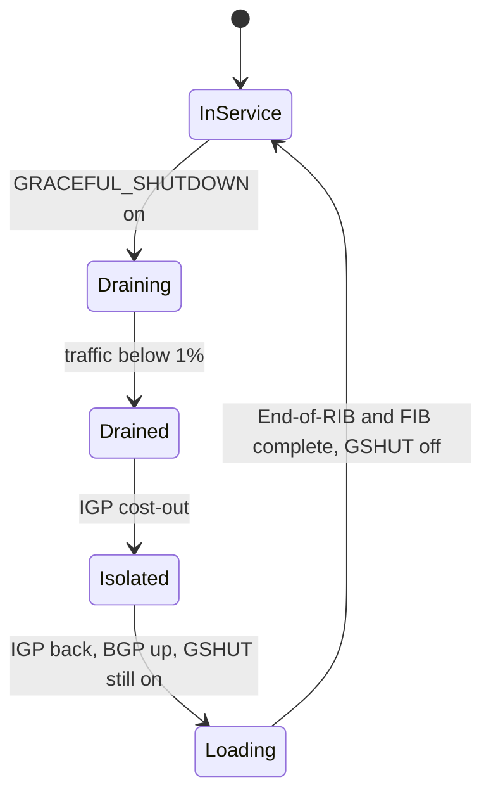

A router that carries traffic attracts it in two ways. The IGP (interior gateway protocol, IS-IS on Meridian) tells every other router how to reach it, and BGP tells the world which destinations sit behind it. Taking it out of service means removing both, and the order decides the night. Remove BGP first and traffic leaves quietly. Remove the IGP first and the router keeps attracting traffic it can no longer deliver: every session stays up, every dashboard stays green, and the first report comes from a customer.

Below, that mistake is traced on Meridian's border gateway `gw1.ams`, followed by the correct procedure, the GRACEFUL_SHUTDOWN community that makes it lossless, max-prefix limits and filters as guard rails, a ladder for "BGP is up but traffic is wrong", and what to monitor beyond session state. It builds on [the BGP black hole](/learn/fabric-networking/bgp-fundamentals/the-bgp-black-hole) and on Meridian's two-ISP setup from [traffic engineering with BGP](/learn/fabric-networking/bgp-in-the-real-world/traffic-engineering-with-bgp).

## Two protocols, two kinds of attraction

A BGP route's next hop is usually a loopback (a router's always-up virtual address, `10.255.1.11` for `leaf1.ams`), which the router looks up a second time in the IGP's routes to find the real outgoing interface ([iBGP, loops and next hops](/learn/fabric-networking/bgp-fundamentals/ibgp-loops-and-next-hops)). BGP says *what* is behind a router; the IGP says *how to get there*. Every packet needs both.

Meridian's Amsterdam edge, simplified to the parts this lesson needs (the route reflectors exist but are not drawn, and the Singapore connection to ISP1 from the traffic-engineering lesson is left out):

| Device | Role | Facts that matter tonight |
|---|---|---|
| `gw1.ams` (loopback `10.255.1.201`) | Border gateway to ISP1 (AS 64501) | Carries all ISP1 traffic: about 6 Gb/s inbound and 4 Gb/s outbound at peak on a 10 Gb/s circuit |
| `gw2.ams` (`10.255.1.202`) | Border gateway to ISP2 (AS 64502) | Backup: 1 Gb/s on its own 10 Gb/s circuit, because Meridian prepends towards ISP2 and gives ISP1's routes LOCAL_PREF 200 |
| `leaf1.ams` (`10.255.1.11`) | Leaf | Meridian's public servers, `203.0.113.0/26` |
| `spine1.ams`, `spine2.ams` | Spines | IS-IS only; connect the gateways to the leaves |

Meridian is AS 64500 and announces `203.0.113.0/24`; the addresses and AS numbers are from the ranges reserved for documentation (RFC 5737 and RFC 5398). LOCAL_PREF, as a reminder, is the attribute a network sets on routes it receives to choose its own exit; higher wins, and it is compared before AS path length ([the best-path algorithm](/learn/fabric-networking/bgp-fundamentals/the-best-path-algorithm)).

`gw1.ams` announces the `/24` from a **static discard route** (a null route): a hand-configured route for the whole `/24` that drops any packet no more specific route claims. Operators do this on purpose, because an announcement tied to a static route never flaps when one server subnet comes or goes. Packets to `203.0.113.10` match the more specific `/26`, a BGP route from `leaf1.ams` with next hop `10.255.1.11`, which only IS-IS can resolve.

Here is `gw1.ams`'s view in steady state (illustrative output, simplified):

```text
gw1.ams# show ip route 203.0.113.10
203.0.113.0/26  via 10.255.1.11 (recursive)  bgp, internal, LOCAL_PREF 100
                  via 10.254.9.0 spine1.ams  isis L2, metric 20
                  via 10.254.9.2 spine2.ams  isis L2, metric 20
203.0.113.0/24  discard                        static, announced to ISP1
```

Two things draw traffic to `gw1.ams`:

- **Inbound**, from the internet: its eBGP announcement of `203.0.113.0/24` to ISP1. That session runs over the directly connected link to ISP1 and needs no IGP at all.
- **Outbound**, from Meridian's leaves: the internet routes it learned from ISP1 and passed to the route reflectors with its own loopback as next hop (next-hop-self). Leaves follow them while IS-IS can resolve `10.255.1.201`.

And `gw1.ams` needs IS-IS to deliver what it attracts inbound. Hence the rule: **never leave a router in a state where it attracts traffic it cannot deliver.** Withdraw the attraction (BGP) first, prove nothing arrives, then remove the means of delivery (the IGP). Restore in the reverse order.

**What the ordering solves:** traffic moves before the path it was using breaks. **How it breaks:** the steps are swapped, or a step is skipped because "it will reconverge anyway". **Signal:** a device in the middle of maintenance still carrying traffic, which needs change-aware monitoring to see.

## The wrong order, traced

The plan said: drain BGP on `gw1.ams`, isolate it from IS-IS, upgrade, restore. At 02:00 the engineer swaps the first two steps and shuts `gw1.ams`'s IS-IS adjacencies, which removes the router from the IGP along with its own IS-IS routes. (The IS-IS overload bit, from [underlay failures in production](/learn/fabric-networking/underlay/underlay-failures-in-production), would have hidden the mistake until the reboot: it stops others using `gw1.ams` for transit but leaves its own routes, and so its delivery, intact.)

| Time | What happens | Outbound (leaves to internet) | Inbound (internet to `203.0.113.0/26`) |
|---|---|---|---|
| 02:00:00.0 | `gw1.ams`'s IS-IS adjacencies to both spines shut | Leaves still use next hop `10.255.1.201` | ISP1 delivers to `gw1.ams` |
| 02:00:00.1 | `gw1.ams` loses every IS-IS route; next hop `10.255.1.11` for the `/26` is unresolvable, so the `/26` leaves its FIB (forwarding table) | Spines drop packets for `10.255.1.201`, now unknown | Longest match for `203.0.113.10` is the `/24` discard route: dropped |
| about 02:00:01 | The spines' updated link-state packets reach every router; SPF removes `10.255.1.201`; next-hop tracking invalidates every route through it | Leaves without an internet route | Dropped |
| 02:00:01 to about 02:00:30 | `gw2.ams` re-runs best path: with `gw1.ams`'s routes unusable, its own ISP2 routes win, and it advertises them through the reflectors; the iBGP sessions from `gw1.ams` to the reflectors, which can no longer reach `10.255.1.201`, die when BFD or Meridian's 9 s hold timer notices (vendor defaults are 90 or 180 s) | Recovered through `gw2.ams` after seconds to tens of seconds of loss, depending on how many routes must be re-sent | Dropped |
| 02:45 | A customer reports Meridian unreachable; the engineer restores IS-IS | Unchanged | Delivered again |

Outbound heals because every iBGP route through `gw1.ams` depends on IS-IS: once its loopback disappears, routes pointing at it are unusable everywhere. Inbound does not heal, because nothing about the inbound attraction depends on IS-IS. The eBGP session runs across a direct link, so it stays Established; the `/24` comes from a static route, so it stays announced; ISP1 still prefers it (LOCAL_PREF 200 for a customer, against 100 for the path through its peer ISP2), so ISP1 keeps sending. At 6 Gb/s for 45 minutes, about 2 TB of inbound traffic, nearly all of Meridian's internet-facing load, goes into the discard route.

```viz
{"type": "fabric", "scenario": "maintenance-order", "variant": "igp-first", "title": "Costing out gw1.ams's IGP before its BGP: outbound recovers, inbound is discarded", "caption": "gw1.ams's IS-IS adjacencies are shut while its eBGP session to ISP1 stays Established. The /26 behind leaf1.ams becomes unresolvable, outbound traffic moves to gw2.ams after seconds of loss, but ISP1 keeps delivering inbound traffic, which gw1.ams drops on its /24 discard route while every protocol dashboard looks normal."}
```

The protocol dashboard during those 45 minutes:

| Signal | Value | Reading |
|---|---|---|
| eBGP session to ISP1 | Established | Healthy |
| Prefixes advertised to ISP1 | 1, as usual | Healthy |
| IS-IS on `gw1.ams` | Down | Expected: the maintenance plan says so |
| ISP1 circuit, inbound | About 6 Gb/s, normal | Healthy: packets arrive before they are dropped |
| Discard counter on `gw1.ams` | Climbing at line rate | The only device signal of the outage |
| Probe to `203.0.113.10` from outside, through ISP1 | Failing | The only end-to-end signal |

Operators have run exactly this night: a router with customers behind it, costed out of the IGP before its BGP was withdrawn, attracted traffic it could not deliver for hours while monitoring stayed green. Each protocol did what it was designed to do; the combination black-holed traffic ([incidents and what they teach](/learn/fabric-networking/operating-fabrics/incidents-and-what-they-teach) tells it end to end).

### The same trap without a maintenance

If both of `gw1.ams`'s uplinks fail, from a line card fault or a bad cable pull, the result is identical with no human mistake: IS-IS gone, eBGP up, the `/24` announced, inbound discarded. So the static-discard pattern needs a seatbelt. **Conditional advertisement** announces the aggregate only while a route inside it exists (a BGP aggregate built from contributing routes behaves the same); when `gw1.ams` loses the routes behind it, it withdraws the `/24` and ISP1 moves to ISP2's path. The trade-off is stability against fate-sharing: pick condition routes that disappear only when the gateway is truly cut off, such as the spines' loopbacks that only IS-IS supplies, not one server subnet that may come and go.

## The right order: make before break

The procedure for `gw1.ams` has gates between the steps. Each gate is a measurement, not a timer.

1. **Pre-check.** `gw2.ams` is Established to ISP2 with a full table, and its circuit can absorb the load: 6 Gb/s plus its own 1 Gb/s is 7 Gb/s of 10, 70 %. At 4 Gb/s of its own it would reach 10, and the answer is another night.
2. **Drain BGP.** Attach GRACEFUL_SHUTDOWN to everything `gw1.ams` sends ISP1, and lower to 0 the LOCAL_PREF of the internet routes it passes inside Meridian (next section).
3. **Gate: verify drained.** Inbound and outbound on the ISP1 circuit fall to near zero, against a stated threshold such as 1 % of the usual peak. Then close the eBGP session with an administrative shutdown (NOTIFICATION Cease 6/2, with an RFC 8203 text such as "planned maintenance, contact the NOC").
4. **Cost out the IGP.** Set the IS-IS overload bit or shut the adjacencies. No BGP route points at `gw1.ams` any more, so not a packet moves.
5. **Work.** Upgrade, reboot.
6. **Restore the IGP first**, so the iBGP sessions between loopbacks can come up, with IS-IS overload on startup against the boot race in [the BGP black hole](/learn/fabric-networking/bgp-fundamentals/the-bgp-black-hole).
7. **Restore BGP with GRACEFUL_SHUTDOWN still applied**, so sessions come up and routes load while nobody prefers them.
8. **Gate: wait for End-of-RIB** from ISP1 and both reflectors (the marker that a peer's initial table is complete, [BGP sessions and the FSM](/learn/fabric-networking/bgp-fundamentals/bgp-sessions-and-the-fsm)), and for the FIB count to match the RIB count.
9. **Remove GRACEFUL_SHUTDOWN.** `gw1.ams`'s routes become preferred again while `gw2.ams`'s still work, so traffic returns without loss.
10. **Post-check.** Traffic back to the usual split; no community, overload bit or LOCAL_PREF 0 left behind.

```viz
{"type": "fabric", "scenario": "maintenance-order", "variant": "bgp-first", "title": "Draining gw1.ams's BGP first with GRACEFUL_SHUTDOWN, then its IGP", "caption": "gw1.ams tags its announcement to ISP1 with 65535:0 and gives its internal routes LOCAL_PREF 0. Inbound moves to ISP2 and gw2.ams, outbound follows to gw2.ams, the engineer sees the gateway's counters fall and closes the ISP1 session, and only then shuts IS-IS, losing no packets; the restore runs in reverse."}
```

The rule generalises to every device that speaks BGP, with a different meaning of "drain" for each role:

| Device | What attracts traffic to it | Drain first | Then | Meridian example |
|---|---|---|---|---|
| Border gateway | eBGP announcements outward, iBGP routes inward | GRACEFUL_SHUTDOWN both ways; verify counters | IS-IS overload or shutdown | `gw1.ams` |
| Leaf with tenants | EVPN routes for its hosts, which name its loopback as the tunnel endpoint | Dual-attached servers: shut the leaf's server ports so EVPN withdraws them and the partner leaf takes over ([EVPN multihoming](/learn/fabric-networking/overlays-vxlan-evpn/evpn-multihoming)); single-attached servers have no second path, so for them the change is an announced outage | IS-IS cost-out | `leaf1.ams` |
| Spine, IS-IS only | IGP transit | Nothing: no BGP | Overload bit or maximum metric, with a headroom pre-check | `spine2.ams` ([safe change and maintenance](/learn/fabric-networking/operating-fabrics/safe-change-and-maintenance)) |
| Spine in an eBGP underlay | BGP is the IGP | GRACEFUL_SHUTDOWN or AS-path prepending on all its sessions | Nothing else | AS 65100 ([BGP as the underlay](/learn/fabric-networking/underlay/bgp-as-the-underlay)) |
| Route reflector | No data traffic, only control | Check every client is Established to the other reflector with a complete table | Shut its sessions, then the IGP | `rr1.ams` |

The reflector row works because each leaf holds the same routes from `rr2.ams` with the same next hops: its best path moves to the other copy and the FIB does not change at all.



## Graceful shutdown: why a plain withdrawal still drops packets

The obvious drain is to withdraw the routes or shut the sessions. It still loses traffic, because **a router advertises only its best path for each prefix.** In steady state `gw2.ams`'s best path to the internet is the iBGP route from `gw1.ams` (LOCAL_PREF 200 beats its own ISP2 routes at 100), and a router never relays an iBGP-learned route to another iBGP peer. So `gw2.ams` advertises nothing: the backup exists only inside `gw2.ams`. After a withdrawal the alternative must be discovered and propagated *after* the old path is gone, and in between the leaves have no route. That is break before make.

**GRACEFUL_SHUTDOWN** (RFC 8326, 2018) turns it into make before break. It is a well-known community, `65535:0` (a community is a tag attached to a route that policy can match, [policy and communities](/learn/fabric-networking/bgp-in-the-real-world/policy-and-communities)). The draining router re-advertises its routes with the community, and the receiver's import policy sets LOCAL_PREF to 0 (the RFC's recommended value). The draining router also sets LOCAL_PREF 0 on the routes it receives from that peer, so its own iBGP neighbours stop preferring that exit. The route stays valid and keeps carrying traffic, but loses to any other path, so every router with an alternative switches while the old path still works. Only then is the session shut.

The simulator models `gw1.ams`, `gw2.ams` and `leaf1.ams` as clients of `rr1.ams`, each advertising only its best path, with `d` seconds per hop for a change to be sent and processed.

```python
import heapq

CLIENTS = ["gw1.ams", "gw2.ams", "leaf1.ams"]   # route-reflector clients
RR = "rr1.ams"


class Router:
    def __init__(self, name, own_path=None):
        self.name = name
        self.own = own_path          # (LOCAL_PREF, exit) learned over eBGP, or None
        self.heard = {}              # Adj-RIB-In: iBGP neighbour -> (LOCAL_PREF, exit)
        self.sent = {}               # Adj-RIB-Out: iBGP neighbour -> what we last sent
        self.export = True           # False once the operator stops advertising

    def receive(self, src, msg):
        if msg is None:
            self.heard.pop(src, None)
        else:
            self.heard[src] = msg

    def best(self):
        paths = [(p, "eBGP") for p in [self.own] if p] + [(p, n) for n, p in self.heard.items()]
        return max(paths, default=None)  # highest LOCAL_PREF wins (ties do not occur here)

    def to_send(self, neighbour):
        b = self.best()
        if b is None or not self.export:
            return None
        path, source = b
        if self.name != RR:          # a client never relays an iBGP-learned path
            return path if source == "eBGP" else None
        return path if source != neighbour else None   # reflector: to every client but the source


def simulate(drain, d=5.0, until=40.0):
    """drain is 'withdraw' or 'gshut'; d is the time one iBGP hop takes to send and process
    the change (seconds; for a full table it depends on CPU, table size and update pacing)."""
    r = {"gw1.ams": Router("gw1.ams", (200, "ISP1")), "gw2.ams": Router("gw2.ams", (100, "ISP2")),
         "leaf1.ams": Router("leaf1.ams"), RR: Router(RR)}
    links = {RR: CLIENTS, **{c: [RR] for c in CLIENTS}}
    queue, log = [], []

    def advertise(name, t):
        for n in links[name]:
            msg = r[name].to_send(n)
            if r[name].sent.get(n) != msg:
                r[name].sent[n] = msg
                heapq.heappush(queue, (t + d, name, n, msg))

    for name in r:                   # steady state: let the initial advertisements settle
        advertise(name, -100.0)
    while queue and queue[0][0] < 0:
        t, src, dst, msg = heapq.heappop(queue)
        r[dst].receive(src, msg)
        advertise(dst, t)

    gw1 = r["gw1.ams"]
    if drain == "withdraw":
        gw1.export = False           # stop advertising: a withdrawal goes to the reflector
        advertise("gw1.ams", 0.0)
    else:
        gw1.own = (0, "ISP1")        # GRACEFUL_SHUTDOWN: same path, LOCAL_PREF 0
        advertise("gw1.ams", 0.0)

    leaf_exit = [(0.0, r["leaf1.ams"].best())]
    while queue and queue[0][0] <= until:
        t, src, dst, msg = heapq.heappop(queue)
        r[dst].receive(src, msg)
        log.append(f"{t:5.1f}s  {src:<9} -> {dst:<9} {'withdraw' if msg is None else f'LOCAL_PREF {msg[0]:>3} via {msg[1]}'}")
        if dst == "leaf1.ams":
            leaf_exit.append((t, r[dst].best()))
        advertise(dst, t)
    return log, leaf_exit


for drain in ["withdraw", "gshut"]:
    log, leaf_exit = simulate(drain)
    print(f"--- drain by {drain}")
    print("\n".join(log))
    no_route = sum(t2 - t1 for (t1, b), (t2, _) in zip(leaf_exit, leaf_exit[1:]) if b is None)
    print(f"leaf1.ams without a route to the internet: {no_route:.0f} s, "
          f"{no_route * 4 / 8:.1f} GB lost at 4 Gb/s outbound")
```

```text
--- drain by withdraw
  5.0s  gw1.ams   -> rr1.ams   withdraw
 10.0s  rr1.ams   -> gw2.ams   withdraw
 10.0s  rr1.ams   -> leaf1.ams withdraw
 15.0s  gw2.ams   -> rr1.ams   LOCAL_PREF 100 via ISP2
 20.0s  rr1.ams   -> gw1.ams   LOCAL_PREF 100 via ISP2
 20.0s  rr1.ams   -> leaf1.ams LOCAL_PREF 100 via ISP2
leaf1.ams without a route to the internet: 10 s, 5.0 GB lost at 4 Gb/s outbound
--- drain by gshut
  5.0s  gw1.ams   -> rr1.ams   LOCAL_PREF   0 via ISP1
 10.0s  rr1.ams   -> gw2.ams   LOCAL_PREF   0 via ISP1
 10.0s  rr1.ams   -> leaf1.ams LOCAL_PREF   0 via ISP1
 15.0s  gw2.ams   -> rr1.ams   LOCAL_PREF 100 via ISP2
 20.0s  rr1.ams   -> gw1.ams   LOCAL_PREF 100 via ISP2
 20.0s  rr1.ams   -> gw2.ams   withdraw
 20.0s  rr1.ams   -> leaf1.ams LOCAL_PREF 100 via ISP2
 25.0s  gw1.ams   -> rr1.ams   withdraw
leaf1.ams without a route to the internet: 0 s, 0.0 GB lost at 4 Gb/s outbound
```

Trace the withdrawal by hand. At 5 s the reflector learns that `gw1.ams` withdrew; it has no other path, so at 10 s it withdraws from `gw2.ams` and `leaf1.ams`. Only now does `gw2.ams`'s own ISP2 path become its best, which it advertises (15 s), and the reflector passes it to the leaf (20 s). The leaf has no route from 10 s to 20 s: two hops of propagation, 5 GB of outbound traffic at 4 Gb/s.

The graceful run has the same message pattern, but the first message is the same route at LOCAL_PREF 0. The leaf always has a working route: `gw1.ams`'s at 0 (still delivered, since `gw1.ams` still forwards to ISP1), then `gw2.ams`'s at 100 from 20 s. At 25 s `gw1.ams` withdraws, because its best is now `gw2.ams`'s path. `d` is an assumption: milliseconds for a few routes, seconds to tens of seconds for a million, set by CPU and update pacing ([convergence and scale](/learn/fabric-networking/bgp-in-the-real-world/convergence-and-scale)); the gap is always two hops' worth. ISP1's own routers behave the same way: they path-hunt after a withdrawal and switch cleanly after a LOCAL_PREF drop.

Three details decide whether graceful shutdown works in practice:

- **The receiver must act on it.** Inside Meridian, Meridian writes both ends. An ISP needs a policy matching `65535:0`; many publish one, and implementations differ in whether they honour it without explicit policy, so test it. Otherwise fall back to the provider's own LOCAL_PREF community ([traffic engineering with BGP](/learn/fabric-networking/bgp-in-the-real-world/traffic-engineering-with-bgp)) or a withdrawal and a few seconds of loss.
- **Why LOCAL_PREF and not prepending.** ISP1 ranks customer routes at 200 and peer routes at 100, and LOCAL_PREF is compared before AS path length, so a route prepended five times still wins at ISP1.
- **Why 0 and not a withdrawal.** A path with LOCAL_PREF 0 remains a last resort. If `gw2.ams` fails mid-drain, traffic falls back to `gw1.ams` rather than vanishing.

Graceful shutdown is not **graceful restart**. Graceful restart (RFC 4724, [convergence and scale](/learn/fabric-networking/bgp-in-the-real-world/convergence-and-scale)) asks peers to *keep* forwarding to a router whose control plane restarts: "keep sending, I will be back". Graceful shutdown says "send elsewhere, I am going". Mistaking one for the other keeps traffic flowing into a box about to go dark.

**What graceful shutdown solves:** traffic moves to alternatives while the old path still works. **How it breaks:** a receiver ignores the community; the community is never removed after the work, leaving a gateway idle for months; or it is removed before End-of-RIB, attracting traffic to a half-loaded router. **Signal:** traffic on the drained device against time, and every route carrying `65535:0` or LOCAL_PREF 0 that has no open change behind it.

## Max-prefix: a fuse on every session

Some failures arrive from a neighbour: a customer redistributes its internal routes, a peer leaks its whole table, or more-specifics escape, as in June 2019, when routes generated by one network's route optimiser were leaked by its customer to a large transit provider that accepted and propagated them worldwide ([leaks, hijacks and RPKI](/learn/fabric-networking/bgp-in-the-real-world/leaks-hijacks-and-rpki)). A **maximum-prefix limit** is a per-session, per-address-family cap on how many routes this router will take from a neighbour. It is a fuse: when the count passes the limit, the router sends NOTIFICATION Cease subcode 1, "maximum number of prefixes reached" (RFC 4486, whose data field carries the address family and the limit), and closes the session (`Idle (PfxCt)` on some platforms). Three choices define it:

- **What is counted.** Some implementations count every prefix received, before import policy; some count only the prefixes policy accepts; some offer both. The difference is decisive, as the code shows.
- **When to warn.** At typically 75–90 % of the limit, an alarm without touching the session, so the limit is raised for organic growth before it trips.
- **After a trip.** Stay down until an operator clears it, or restart after a configured timer (often minutes to an hour); against a persisting leak, the session flaps every timer period.

Choosing the number, worked:

| Session | Normal count | Limit | Why |
|---|---|---|---|
| `gw2.ams` from ISP2, full table | About 1.0 million IPv4 routes (2025) | 1,200,000, warn at 90 % | Growth is a few percent a year ([how the internet is glued together](/learn/fabric-networking/bgp-in-the-real-world/how-the-internet-is-glued-together)); 20 % headroom is years, and the warning comes first |
| ISP2 from Meridian, a customer | 1 | 10 | Meridian has one prefix; anything beyond ten is a mistake |
| An exchange peer | The count it publishes | Its PeeringDB "recommended maximum" plus a margin | Networks publish the limit they want peers to set |
| `leaf1.ams` from `rr1.ams`, EVPN | About 1,342 | 10,000, warn only | A trip would disconnect the leaf from every tenant route: the fuse would cost more than the fault |

The code is one import pipeline, filters (next section) plus a limit. It runs ISP2's side of the session four ways while Meridian, its export policy lost, sends its `/24` followed by ISP1's table (512 routes from benchmarking space standing in for a million). The last run is Meridian's own import from ISP2.

```python
import ipaddress
from collections import Counter

net = ipaddress.ip_network
# Special-purpose space no internet peer should send. 192.0.2.0/24, 198.51.100.0/24, 203.0.113.0/24
# and 198.18.0.0/15 are bogons on the real internet too, but in this lesson they play public space.
BOGONS = [net(p) for p in ("0.0.0.0/8", "10.0.0.0/8", "100.64.0.0/10", "127.0.0.0/8",
                           "169.254.0.0/16", "172.16.0.0/12", "192.168.0.0/16", "224.0.0.0/4", "240.0.0.0/4")]
PRIVATE_AS = range(64512, 65535)


def verdict(route, s):
    """Why an import policy rejects a route, or None to accept it."""
    p, path = net(route["prefix"]), route["as_path"]
    if p.prefixlen == 0:
        return None if s.get("accept_default") else "default route"
    if any(p.subnet_of(b) for b in BOGONS):
        return "bogon"
    if any(p.overlaps(o) for o in s.get("own", [])):
        return "our own space"
    if p.prefixlen > 24:
        return "longer than /24"
    if not path or path[0] != s["peer_as"]:
        return "first AS is not the peer"
    if len(path) > 50 or any(a in PRIVATE_AS for a in path):
        return "bad AS_PATH"
    if "allowed" in s and not any(p.subnet_of(net(a)) for a in s["allowed"]):
        return "not in the customer's prefix list"
    return None


def import_session(s, routes):
    received, accepted, rejected, warned = 0, 0, Counter(), False
    for route in routes:
        received += 1
        reason = verdict(route, s)
        if reason:
            rejected[reason] += 1
        else:
            accepted += 1
        count = received if s["count"] == "received" else accepted
        if count > s["max_prefix"]:
            return (f"{s['name']}: TEARDOWN after {received} received: Cease 6/1, "
                    f"{s['count']} count {count} > limit {s['max_prefix']}; session Idle, restart in 30 min")
        if not warned and count >= 0.9 * s["max_prefix"]:
            warned = True
            print(f"{s['name']}: warning, {count} {s['count']} prefixes is 90% of the limit")
    return f"{s['name']}: up, {received} received, {accepted} accepted, rejected {dict(rejected)}"


# Meridian (AS 64500) loses its export policy towards ISP2 and sends its own /24 followed by
# ISP1's table. 198.18.0.0/15 (RFC 2544 benchmarking space) stands in for that table: 512 /24s.
leak = [{"prefix": "203.0.113.0/24", "as_path": [64500]}]
leak += [{"prefix": str(p), "as_path": [64500, 64501, 64496]}
         for p in net("198.18.0.0/15").subnets(new_prefix=24)]

base = {"peer_as": 64500, "max_prefix": 10}
print(import_session({**base, "name": "ISP2, prefix list, limit on received", "count": "received",
                      "allowed": ["203.0.113.0/24"]}, leak))
print(import_session({**base, "name": "ISP2, prefix list, limit on accepted", "count": "accepted",
                      "allowed": ["203.0.113.0/24"]}, leak))
print(import_session({**base, "name": "ISP2, no prefix list, limit on accepted", "count": "accepted"}, leak))
print(import_session({**base, "name": "ISP2, no prefix list, no limit", "count": "accepted",
                      "max_prefix": 10**9}, leak))

# Meridian's own import from ISP2: a few routes that each filter exists for.
feed = [
    {"prefix": "192.0.2.0/24", "as_path": [64502, 64496]},
    {"prefix": "198.51.100.0/24", "as_path": [64502, 64511]},
    {"prefix": "10.0.0.0/8", "as_path": [64502, 64496]},
    {"prefix": "203.0.113.0/25", "as_path": [64502, 64511]},
    {"prefix": "198.51.100.128/25", "as_path": [64502, 64511]},
    {"prefix": "192.0.2.0/24", "as_path": [64496, 64502]},
    {"prefix": "198.51.100.0/24", "as_path": [64502, 65010, 64511]},
    {"prefix": "0.0.0.0/0", "as_path": [64502]},
]
print(import_session({"name": "gw2.ams from ISP2", "peer_as": 64502, "count": "accepted",
                      "max_prefix": 1_200_000, "own": [net("203.0.113.0/24")]}, feed))
```

```text
ISP2, prefix list, limit on received: warning, 9 received prefixes is 90% of the limit
ISP2, prefix list, limit on received: TEARDOWN after 11 received: Cease 6/1, received count 11 > limit 10; session Idle, restart in 30 min
ISP2, prefix list, limit on accepted: up, 513 received, 1 accepted, rejected {"not in the customer's prefix list": 512}
ISP2, no prefix list, limit on accepted: warning, 9 accepted prefixes is 90% of the limit
ISP2, no prefix list, limit on accepted: TEARDOWN after 11 received: Cease 6/1, accepted count 11 > limit 10; session Idle, restart in 30 min
ISP2, no prefix list, no limit: up, 513 received, 513 accepted, rejected {}
gw2.ams from ISP2: up, 8 received, 2 accepted, rejected {'bogon': 1, 'our own space': 1, 'longer than /24': 1, 'first AS is not the peer': 1, 'bad AS_PATH': 1, 'default route': 1}
```

The four ISP2 runs are the design space. A limit on *received* prefixes trips on the eleventh route although the prefix list would have rejected all 512: the fuse blows for a fault the filter had contained, and Meridian loses ISP2. A limit on *accepted* prefixes stays up and counts 512 rejections, a signal worth alarming on. Without a prefix list the accepted limit is the only defence. With neither, ISP2 accepts all 513 and passes them on, the shape of the 2019 leak.

**What max-prefix solves:** a bounded worst case for what a neighbour can push into your tables and through you to others. **How it breaks:** a limit below organic growth trips on a normal day (the global IPv4 table passing 512K (524,288) routes on 12 August 2014 broke routers whose hardware tables were allocated 512K IPv4 entries by default, the same failure with a fixed limit); identical tight limits on both ISP sessions trip together on one shared event and cut a dual-homed network off from both; an automatic restart against a persistent leak flaps forever. **Signal:** count as a percentage of limit per session, warnings before trips, and Cease 6/1 as its own alert class.

## Filters as guard rails

Max-prefix bounds *how many*; filters decide *which*. **Import filters** decide what a router accepts, **export filters** what it advertises. The final run of the code above shows the import set every internet-facing session needs, each rejecting one route:

| Filter | Rejected in the run | What it prevents |
|---|---|---|
| Bogons: private, loopback, link-local, multicast, reserved space | `10.0.0.0/8` | Unroutable space attracting traffic towards a peer |
| Our own space | `203.0.113.0/25` | A more-specific of Meridian's own prefix pulling Meridian's inbound traffic out through someone else, a hijack in effect |
| Longer than /24 (IPv4) or /48 (IPv6) | `198.51.100.128/25` | Table bloat; the conventional most-specific the internet carries (RFC 7454 documents the practice) |
| First AS must be the peer's (except an exchange's route server, which does not add its own AS) | path `64496 64502` | A neighbour passing on routes that claim to come from somewhere else |
| AS path sanity: private AS numbers, absurd lengths | path with 65010 | Leaked internal routes, and paths long enough to stress parsers |
| Default route, unless asked for | `0.0.0.0/0` | One peer silently becoming the exit for everything |
| Customer prefix lists, built from routing registries | (the ISP2 runs) | A customer announcing anyone's space ([leaks, hijacks and RPKI](/learn/fabric-networking/bgp-in-the-real-world/leaks-hijacks-and-rpki) adds RPKI origin validation) |

**Export filters** decide whether Meridian causes the next incident. Meridian should advertise exactly `203.0.113.0/24` to each ISP and nothing learned from the other; carrying ISP1's routes to ISP2 makes Meridian free transit between two providers, the leak of [how the internet is glued together](/learn/fabric-networking/bgp-in-the-real-world/how-the-internet-is-glued-together). The robust form is an explicit export list plus communities tagged at ingress ("learned from a provider") that egress policy refuses to send to other providers. RFC 8212 (2017) made the safe default normative: an eBGP session with no policy configured sends and accepts nothing, where many older implementations sent and accepted everything.

Inside the fabric: an underlay session from a leaf carries its loopback and links, nothing else; a leaf never accepts a default route from a server; EVPN imports only the route targets of tenants the leaf serves.

**What filters solve:** a neighbour's mistake stays at the boundary. **How they break:** too tight, a customer's new prefix is rejected and its traffic never arrives (the customer calls); too loose, a leak passes; stale, a registry-built list misses changes. A filter change applied with a hard session reset withdraws everything while the session re-forms; apply it with ROUTE-REFRESH (RFC 2918), which asks the peer to resend without dropping the session. **Signal:** rejected-route counts per session and per reason, and the advertised set per session diffed against intent.

## The session troubleshooting playbook

[BGP sessions and the FSM](/learn/fabric-networking/bgp-fundamentals/bgp-sessions-and-the-fsm) covers a session that will not come up: the state names the failing layer. Most production BGP problems start *after* Established, and the playbook for them is a ladder. Each rung is one question about one table, and you climb in order because each rung depends on the one below it.

| Rung | Question | Where to look | Typical finding |
|---|---|---|---|
| 0 | Scope: one prefix, one peer, one router, one site? | Several vantage points | One router means local; every router means a shared change |
| 1 | Is the session up and stable? | State, uptime, last NOTIFICATION and its direction | Flapping at the hold time: MTU or CPU |
| 2 | Did the peer send the route? | Adj-RIB-In before policy | Not sent: the problem is on the peer's side |
| 3 | Did import policy accept it? | Received versus accepted, reject reason | A prefix list without the new prefix |
| 4 | Is it the best path, and if not, which step lost? | Loc-RIB, every candidate | A LOCAL_PREF or a GRACEFUL_SHUTDOWN left behind |
| 5 | Is it installed? | Next-hop resolution, RIB versus FIB | Next hop unresolvable, or a full hardware table |
| 6 | Is it advertised onward? | Adj-RIB-Out per peer | Export policy dropped it |
| 7 | What does the world see? | Looking glasses, public collectors (RIPE RIS, RouteViews) | The ISP filters it, or RPKI marks it invalid |
| 8 | Does the traffic follow? | Traceroute both ways, interface and discard counters, probes | The return path is the broken one |

Adj-RIB-In, Loc-RIB and Adj-RIB-Out are the three stages of a router's BGP table: what each peer sent, what this router chose, what it sends each peer ([updates, attributes and RIBs](/learn/fabric-networking/bgp-fundamentals/updates-attributes-and-ribs)).

**A worked case.** At 14:10 an engineer edits `gw1.ams`'s export prefix list to add an IPv6 prefix. By 14:20 the ISP1 circuit shows almost no inbound traffic and ISP2's is at 7 Gb/s; users report Meridian slow from the internet at peak. Rung 0: all of Meridian, inbound only, so shared and edge. Rung 1: both ISP sessions Established for weeks. Rungs 2 to 5 concern routes received; this is about routes sent, so go to rung 6:

```text
gw1.ams# show bgp ipv4 unicast neighbor 198.51.100.2 advertised-routes   (illustrative output)
Total number of prefixes 0
gw2.ams# show bgp ipv4 unicast neighbor 198.51.100.0 advertised-routes
   Network            Next Hop        Path
*> 203.0.113.0/24     198.51.100.1    64500 64500 64500 i
Total number of prefixes 1
```

`gw1.ams` advertises nothing to ISP1; the edited list replaced the IPv4 entry instead of adding to it. Nothing failed, ISP1 moved to its peer path through ISP2 as designed, and only capacity on the ISP2 circuit made it visible. Rung 7 confirms it from outside: every path to `203.0.113.0/24` that public collectors see ends in `64502 64500 64500 64500`, and none ends in `64501 64500`. A monitor that compares the advertised count with intent catches it at 14:10, not at peak.

Keep the playbook itself safe: read before you clear, because a hard reset destroys the state you are diagnosing and withdraws every route from that peer, and never clear every session on a gateway "to see if it helps", which costs minutes of churn and teaches nothing.

**What the ladder solves:** "BGP is broken" becomes one table that differs from intent. **How it breaks:** starting at the top with a traceroute and a session reset, which destroys the state you need, or stopping at rung 1 because the session is up. **Signal:** the first rung whose answer differs from intent; a tool that shows received, accepted, best, installed and advertised side by side for one prefix makes the climb one screen.

## What to monitor beyond session state

[Why "session Established" is not a health check](/learn/fabric-networking/bgp-fundamentals/the-bgp-black-hole) lists what the state does not prove. Three signals cover most of the gap.

**Prefix counts per session and family: received, accepted and advertised**, each against its own baseline. A drop is the classic silent failure: `leaf7.ams` Established with 0 EVPN routes accepted against a usual 1,342. A jump is a leak: ISP2's feed rising from a million to 1.16 million in minutes. An advertised count off intent by even one is a policy error, because intent is exact. Two full-table feeds should also agree within a few percent.

**Next-hop resolvability.** Count routes whose next hop is unresolvable: zero in a healthy fabric, otherwise a missing next-hop-self or a decommissioned device still advertising. Check *how* each resolves: a loopback next hop resolving through a summary or default instead of a `/32` keeps routes alive after their exit is gone ([iBGP, loops and next hops](/learn/fabric-networking/bgp-fundamentals/ibgp-loops-and-next-hops)). Routes per next hop is the blast radius of losing that device ([blast radius](/practice/blast-radius) and [unresolvable next hops](/practice/unresolvable-next-hops) practise both computations).

**Route churn.** Updates and withdrawals per minute per session, and best-path changes per router. Backgrounds differ, so alert on a multiple of the baseline: a leak, a flapping link inside a provider or a session restarting after a max-prefix trip shows as an order-of-magnitude jump. Per-prefix flap history separates one unstable prefix from a storm.

One more check catches the maintenance trap directly: **every announced aggregate must have at least one route inside it.** The code turns snapshots of state devices already expose into these alerts.

```python
import ipaddress
from statistics import median


def check(s):
    """Alerts for one BGP speaker's snapshot. Every check reads state devices already expose."""
    alerts = []
    for peer, p in s["sessions"].items():
        if p["state"] != "Established":
            continue                                   # session-state alerting lives elsewhere
        base = median(p["accepted_history"])
        if p["accepted"] < 0.5 * base:
            alerts.append(f"{peer}: accepted {p['accepted']:,} vs usual {base:,.0f}, session up")
        elif p["accepted"] > 1.1 * base:
            alerts.append(f"{peer}: accepted {p['accepted']:,} vs usual {base:,.0f}: leak or deaggregation?")
        if "intended_advertised" in p and p["advertised"] != p["intended_advertised"]:
            alerts.append(f"{peer}: advertising {p['advertised']:,} prefixes, intent says {p['intended_advertised']}")
        usual = median(p["updates_per_min_history"])
        if p["updates_per_min"] > 10 * max(usual, 1):
            alerts.append(f"{peer}: {p['updates_per_min']:,} updates/min vs usual {usual:,.0f}: churn")
    if s["unresolved_next_hops"]:
        alerts.append(f"{s['unresolved_next_hops']:,} BGP routes with an unresolvable next hop")
    for nh, via in s["next_hop_resolved_via"].items():
        if not via.endswith("/32"):
            alerts.append(f"next hop {nh} resolves via {via}, not a host route")
    for agg in s["announced_aggregates"]:
        inside = [r for r in s["rib"] if ipaddress.ip_network(r).subnet_of(ipaddress.ip_network(agg))
                  and r != agg]
        if not inside:
            alerts.append(f"announces {agg} but holds no route inside it: arriving traffic is discarded")
    return alerts or ["ok"]


def session(accepted, history, upm, upm_history, **extra):
    return {"state": "Established", "accepted": accepted, "accepted_history": history,
            "updates_per_min": upm, "updates_per_min_history": upm_history, **extra}


full = [998_000, 999_500, 1_001_200]
gw1_isp1 = dict(advertised=1, intended_advertised=1)
snapshots = {
    "gw1.ams, steady": {
        "sessions": {"ISP1": session(1_001_400, full, 900, [700, 1_100, 850], **gw1_isp1)},
        "unresolved_next_hops": 0, "next_hop_resolved_via": {"10.255.1.11": "10.255.1.11/32"},
        "announced_aggregates": ["203.0.113.0/24"], "rib": ["203.0.113.0/24", "203.0.113.0/26"]},
    "gw1.ams, IS-IS shut before BGP": {
        "sessions": {"ISP1": session(1_001_400, full, 900, [700, 1_100, 850], **gw1_isp1)},
        "unresolved_next_hops": 0, "next_hop_resolved_via": {},
        "announced_aggregates": ["203.0.113.0/24"], "rib": ["203.0.113.0/24"]},
    "gw1.ams, export prefix list edited": {
        "sessions": {"ISP1": session(1_001_400, full, 900, [700, 1_100, 850],
                                     advertised=0, intended_advertised=1)},
        "unresolved_next_hops": 0, "next_hop_resolved_via": {"10.255.1.11": "10.255.1.11/32"},
        "announced_aggregates": [], "rib": ["203.0.113.0/24", "203.0.113.0/26"]},
    "gw2.ams, ISP2 leaking more-specifics": {
        "sessions": {"ISP2": session(1_164_000, full, 41_000, [650, 900, 1_000])},
        "unresolved_next_hops": 0, "next_hop_resolved_via": {},
        "announced_aggregates": [], "rib": []},
    "leaf2.sin, leaf3.ams dead behind a summary": {
        "sessions": {"rr1.sin": session(1_336, [1_330, 1_342, 1_351], 2, [3, 2, 4])},
        "unresolved_next_hops": 12, "next_hop_resolved_via": {"10.255.1.13": "10.255.1.0/24"},
        "announced_aggregates": [], "rib": []},
    "leaf7.ams, import policy change": {
        "sessions": {"rr1.ams": session(0, [1_330, 1_342, 1_351], 0, [3, 2, 4])},
        "unresolved_next_hops": 0, "next_hop_resolved_via": {},
        "announced_aggregates": [], "rib": []},
}
for name, snap in snapshots.items():
    print(f"{name}:")
    for alert in check(snap):
        print(f"  {alert}")
```

```text
gw1.ams, steady:
  ok
gw1.ams, IS-IS shut before BGP:
  announces 203.0.113.0/24 but holds no route inside it: arriving traffic is discarded
gw1.ams, export prefix list edited:
  ISP1: advertising 0 prefixes, intent says 1
gw2.ams, ISP2 leaking more-specifics:
  ISP2: accepted 1,164,000 vs usual 999,500: leak or deaggregation?
  ISP2: 41,000 updates/min vs usual 900: churn
leaf2.sin, leaf3.ams dead behind a summary:
  12 BGP routes with an unresolvable next hop
  next hop 10.255.1.13 resolves via 10.255.1.0/24, not a host route
leaf7.ams, import policy change:
  rr1.ams: accepted 0 vs usual 1,342, session up
```

The second snapshot is the 02:00 incident: session, count and churn normal, only the aggregate check fires. The fifth combines two failures from [iBGP, loops and next hops](/learn/fabric-networking/bgp-fundamentals/ibgp-loops-and-next-hops). Production baselines compare by time of day, not a median. Polling shows a level, not a history: the BGP Monitoring Protocol (BMP, RFC 7854) streams every route received, before and after policy, and every session change to a collector, so "what did this router know at 02:01" is answerable later ([telemetry and observability](/learn/fabric-networking/operating-fabrics/telemetry-and-observability)).

## What the platform should show

The engineer running the maintenance needs the next step and whether it is safe; the manager needs to know whether anything is at risk. The same data serves both:

- **Maintenance state per device**, from the change system: in service, draining, drained, isolated, loading. A device in "isolated" that still carries traffic, or one "in service" whose routes carry `65535:0`, is a page, not a dashboard tile.
- **Gates as measurements.** "Inbound below 1 % of baseline for 60 s", "End-of-RIB from all peers and FIB count equal to RIB count", shown as pass or fail before the next step unlocks.
- **Outside-in probes through each ISP** to an address inside every announced prefix. They were the only end-to-end signal at 02:00 ([active measurement](/learn/fabric-networking/operating-fabrics/active-measurement)).
- **Prefix counts as a percentage of limit**, warnings before trips, and rejected counts by reason.
- **Leftovers with age**: every GRACEFUL_SHUTDOWN, LOCAL_PREF 0, overload bit and maximum metric that differs from intent, and the change that set it.
- **Plan validation before the change runs.** The ordering rule is mechanical, so software should enforce it:

```python
RULES = [  # (step that must come first, step that must come later, why)
    ("bgp-drain", "igp-cost-out", "costing out the IGP first strands traffic BGP still attracts"),
    ("verify-drained", "igp-cost-out", "nothing proves the BGP drain worked"),
    ("igp-restore", "bgp-restore", "BGP sessions to loopbacks need the IGP back first"),
    ("wait-end-of-rib", "remove-gshut", "traffic would return before the routes are installed"),
    ("bgp-restore", "wait-end-of-rib", "End-of-RIB only arrives once sessions are back"),
]


def check_plan(device, steps, state):
    """Refuse a maintenance plan whose order or preconditions would drop traffic."""
    problems = []
    names = [s for s, _ in steps]
    for first, later, why in RULES:
        if later in names and (first not in names or names.index(first) > names.index(later)):
            problems.append(f"'{first}' must come before '{later}': {why}")
    if "bgp-drain" in names and "remove-gshut" not in names:
        problems.append("the drain is never undone: the device stays drained after the work")
    alternate = state["alternate_exit"][device]
    if state["sessions"][alternate] != "Established":
        problems.append(f"alternate exit {alternate} is {state['sessions'][alternate]}: no path to drain onto")
    load = state["traffic_gbps"][device] + state["traffic_gbps"][alternate]
    if load > 0.8 * state["capacity_gbps"][alternate]:
        problems.append(f"{alternate} would carry {load} Gb/s, over 80% of its {state['capacity_gbps'][alternate]}")
    return problems or ["plan accepted"]


state = {
    "alternate_exit": {"gw1.ams": "gw2.ams"},
    "sessions": {"gw2.ams": "Established"},
    "traffic_gbps": {"gw1.ams": 6, "gw2.ams": 1},
    "capacity_gbps": {"gw2.ams": 10},
}
good = [("bgp-drain", "gshut"), ("verify-drained", "< 1% of baseline"), ("igp-cost-out", "overload"),
        ("upgrade", ""), ("igp-restore", ""), ("bgp-restore", "gshut kept"),
        ("wait-end-of-rib", ""), ("remove-gshut", "")]
backwards = [("igp-cost-out", "shut adjacencies"), ("bgp-drain", "gshut"), ("upgrade", ""),
             ("bgp-restore", ""), ("igp-restore", "")]
print("good plan:     ", check_plan("gw1.ams", good, state))
print("backwards plan:")
for p in check_plan("gw1.ams", backwards, state):
    print("  ", p)
state["traffic_gbps"]["gw2.ams"] = 3
print("busy evening:  ", check_plan("gw1.ams", good, state))
```

```text
good plan:      ['plan accepted']
backwards plan:
   'bgp-drain' must come before 'igp-cost-out': costing out the IGP first strands traffic BGP still attracts
   'verify-drained' must come before 'igp-cost-out': nothing proves the BGP drain worked
   'igp-restore' must come before 'bgp-restore': BGP sessions to loopbacks need the IGP back first
   the drain is never undone: the device stays drained after the work
busy evening:   ['gw2.ams would carry 9 Gb/s, over 80% of its 10']
```

The backwards plan fails four ways, including the omission that causes the slow outage: a drain never undone leaves a gateway idle until the next failure finds it. The busy-evening run is the pre-check from step 1: the same plan is refused at 7 p.m. and accepted at 2 a.m. This is the "pre-check, drain, validate, work, restore, validate" shape of [safe change and maintenance](/learn/fabric-networking/operating-fabrics/safe-change-and-maintenance), specialised to BGP.

## Failure modes in production

| Failure | Symptom | Diagnosis | Fix |
|---|---|---|---|
| IGP costed out before BGP | Inbound lost for one gateway's share; every session up | Discard counter climbing; aggregate announced with nothing inside it; outside probe failing | Restore the IGP; drain BGP first; conditional advertisement |
| Drain by withdrawal | Seconds of loss at every drain, worse with bigger tables | Leaves without a route between withdrawal and the alternative's arrival | GRACEFUL_SHUTDOWN; ADD-PATH or best-external so backups are pre-advertised ([convergence and scale](/learn/fabric-networking/bgp-in-the-real-world/convergence-and-scale)) |
| GRACEFUL_SHUTDOWN removed too early | Loss for a minute or more after the work | Traffic returns before End-of-RIB; FIB count below RIB count | Gate removal on End-of-RIB and FIB programming |
| Drain never undone | A gateway idle for weeks; the other runs hot | `65535:0` or LOCAL_PREF 0 with no open change | Post-check; leftovers report with age |
| Max-prefix on received routes trips on a filtered leak | Session down, Cease 6/1, although nothing bad was accepted | Count type is pre-policy | Limit accepted routes; keep a generous received limit as a backstop |
| Same tight limit on both ISPs | Both sessions down at once on one shared event | Two Cease 6/1 within seconds | Different counting or limits per provider; warnings that someone reads |
| Export policy edit drops the announcement | Traffic shifts to the other ISP and saturates it | Advertised count differs from intent | Diff advertised set against intent on every policy change |
| Hard reset used to apply policy | Minutes of churn, a full table withdrawn and re-learned | Session uptime reset, churn spike | ROUTE-REFRESH |

## Trade-offs: ways to move traffic off a BGP router

| Method | Loss while draining | Needs the peer's cooperation | Moves inbound | Moves outbound | Keeps a last resort | Typical use |
|---|---|---|---|---|---|---|
| Shut the device or its links | Seconds to minutes | No | Yes, by failure | Yes, by failure | No | Emergencies only |
| Withdraw routes or shut sessions | Propagation gap, seconds | No | Yes | Yes | No | Peers that ignore GRACEFUL_SHUTDOWN |
| GRACEFUL_SHUTDOWN (LOCAL_PREF 0) | None if alternatives exist | Yes, a receiving policy | Yes | Yes | Yes | The default for planned work |
| AS-path prepending | None, but incomplete | No | Partly: loses to LOCAL_PREF | Only in an eBGP underlay | Yes | eBGP-underlay spines; peers without communities |
| Provider's LOCAL_PREF community | None | Yes, the provider's published community | Yes | No | Yes | Providers without GRACEFUL_SHUTDOWN support |
| IGP overload or metric only | None for transit | No | No: BGP still attracts | No: its loopback stays reachable | Yes | IGP-only devices such as spines |

## Under the hood

Turning on GRACEFUL_SHUTDOWN is cheap to type and expensive to execute. The router re-runs export policy for every route on every affected session and re-sends each with the new community or LOCAL_PREF: for `gw1.ams`, about a million routes to each reflector, which re-run best path and re-advertise to every client whose best changed. Update groups (peers with identical outbound policy share one formatted UPDATE) keep that to seconds, but a drain should be watched, not assumed instant.

Rung 3 of the ladder needs the routes a peer sent *before* policy, which a router discards by default. Keeping a pre-policy copy per peer (soft reconfiguration inbound) costs a second full table of memory on a transit session; ROUTE-REFRESH and its enhanced form (RFC 7313) ask the peer to resend instead, and BMP exports the pre-policy view to a collector.

Max-prefix counting runs as routes arrive, so a trip happens mid-transfer, after the eleventh route in the code, not the 513th. Next-hop tracking (the BGP process registers each next hop with the routing table and is called back when its resolving route changes) is why the leaves dropped the routes through `gw1.ams` within about a second at 02:00 instead of waiting for the hold timer; the recovery itself waited for `gw2.ams`'s routes to propagate.

## Interviewer follow-ups

**"You need to upgrade an internet edge router. Walk me through it."** Model answer: pre-check the other exit (up, full table, headroom for the combined load, with numbers); GRACEFUL_SHUTDOWN outward and LOCAL_PREF 0 inward; verify traffic near zero; shut the eBGP sessions; cost out the IGP; work; restore the IGP, then BGP with the community on; wait for End-of-RIB and FIB programming; remove the community; verify. Common wrong answer: "shut the BGP sessions, the network reconverges", which loses traffic during the propagation gap, or any order that touches the IGP first.

**"Why not withdraw the routes? BGP reconverges in seconds."** Model answer: BGP advertises only best paths, so the backup exit is invisible until the primary is withdrawn; the gap is two or more propagation hops, seconds to tens of seconds for a full table, and the provider's internal routers path-hunt the same way. LOCAL_PREF 0 keeps the old path valid while the new one spreads. Common wrong answer: confusing it with graceful restart, which does the opposite.

**"How do you choose a max-prefix limit, and what happens when it trips?"** Model answer: from the session's normal accepted count and growth, with a warning at 75–90 % so the limit is raised first; customers get a small fixed limit, exchange peers their published recommendation. A trip sends Cease 6/1 and drops the whole session: a fuse, worth it at the edge, often warn-only inside a fabric. Say whether it counts before or after policy. Common wrong answer: "set it to the full-table size", which trips on growth. Honest addition: "I'd defer to the network team on per-platform restart behaviour, but I'd track count as a percentage of limit and alert on every warning."

**"Every BGP session is up and users say you're unreachable through one ISP. What do you check?"** Model answer: scope first, then the ladder from rung 6: what each gateway advertises to that ISP against intent, what public collectors and looking glasses see, whether the ISP accepts it (its filters, RPKI validity), then a probe through that ISP and the discard counters. Common wrong answer: restarting sessions, which destroys the evidence.

## What mid-level engineers get wrong

- **Thinking the IGP cost-out drains BGP.** It moves transit and next hops; an eBGP announcement over a direct link ignores it. Result: the 02:00 outage.
- **Treating "BGP reconverges" as lossless.** Only alternatives that are already advertised take over instantly.
- **Confusing graceful shutdown with graceful restart.** One asks peers to leave, the other to stay.
- **Setting max-prefix to today's count.** It trips on the next normal growth, often on both sessions at once.
- **Applying policy changes with a hard reset.** A full withdrawal and re-learn to apply one line.

## Senior signals

- You state the ordering as a rule about attraction and delivery, so it applies to any device, not as a memorised two-step checklist.
- You explain why a withdrawal loses traffic (only best paths are advertised) and why LOCAL_PREF 0 does not, and you name the dependency: the receiver must honour `65535:0`.
- You gate each maintenance step on a measurement (traffic below a threshold, End-of-RIB, FIB complete), not on a timer.
- You treat max-prefix as a fuse with a cost, choose what it counts, and keep limits on redundant sessions from tripping together.
- You check the advertised set against intent, because export mistakes are silent on your side and loud on everyone else's.
- You monitor prefix counts, next-hop resolvability, churn and aggregate coverage, and you probe from outside, because every failure here kept its sessions up.

## Check yourself

```quiz
- q: >-
    During maintenance an engineer shuts gw1.ams's IS-IS adjacencies before touching BGP. gw1.ams announces 203.0.113.0/24 to ISP1 from a static discard route over a directly connected eBGP session. What happens to inbound traffic from ISP1?
  options: ["It is delivered normally, because gw1.ams still has the static route installed", "It loops between ISP1 and gw1.ams until the TTL expires on every packet", "It moves to ISP2 within seconds, because the eBGP session follows IS-IS down", "It arrives at gw1.ams and is discarded, because the announcement does not depend on IS-IS"]
  answer: 3
  explanation: >-
    The eBGP session runs over the direct link and the aggregate comes from a static route, so neither depends on IS-IS: the session stays Established and the prefix stays announced. Without IS-IS, gw1.ams cannot resolve the next hop of the /26 behind leaf1.ams, so the longest match becomes the /24 discard route and inbound packets are dropped. Outbound recovers by itself, because iBGP routes through gw1.ams do depend on its loopback in IS-IS. The static route is installed, but it is a discard route, so having it delivers nothing.
- q: >-
    Why does draining gw1.ams by withdrawing its routes cause a few seconds of loss on the leaves, while GRACEFUL_SHUTDOWN causes none?
  options: ["A withdrawal resets the iBGP sessions to the reflectors, while a community change does not", "Withdrawals are rate-limited by MRAI timers, while community changes are always sent immediately", "GRACEFUL_SHUTDOWN preinstalls the backup path in every FIB, while a withdrawal has to wait for SPF", "Routers advertise only their best path, so gw2.ams's exit is unknown until gw1.ams's path is gone"]
  answer: 3
  explanation: >-
    While gw1.ams's path is best at gw2.ams, gw2.ams advertises nothing, so the reflectors and leaves have never heard of the ISP2 exit. A withdrawal makes them lose the old path before the new one reaches them. LOCAL_PREF 0 keeps the old path valid while gw2.ams's own path becomes best and propagates, so the leaves always have a working route. A withdrawal does not reset sessions, MRAI paces both kinds of update alike, and GRACEFUL_SHUTDOWN does not install anything in advance; it changes which path wins.
- q: >-
    ISP1 gives customer routes LOCAL_PREF 200 and peer routes 100, and does not honour GRACEFUL_SHUTDOWN. Meridian prepends its AS five times on gw1.ams's announcement to ISP1 to drain it. What does ISP1 do?
  options: ["It load-balances across both paths, because their attributes are now considered equal", "It moves to the path through ISP2, because that AS path is now shorter", "It drops the route as malformed, because five prepends exceed the safe AS path length", "It keeps sending to gw1.ams, because LOCAL_PREF is compared before AS path length"]
  answer: 3
  explanation: >-
    Best-path selection compares LOCAL_PREF before AS path length, and ISP1's customer route at 200 beats its peer route at 100 however long the customer's path is. Prepending changes the choice only of networks where LOCAL_PREF ties. That is why GRACEFUL_SHUTDOWN works at the LOCAL_PREF step, and why the fallback with a provider that ignores it is the provider's own LOCAL_PREF community or a withdrawal. Five prepends are well within normal AS path filters.
- q: >-
    ISP2 has a prefix list allowing only 203.0.113.0/24 from Meridian and a maximum-prefix limit of 10 on received routes. Meridian accidentally sends ISP1's full table to ISP2. What happens?
  options: ["Nothing happens, because a limit only applies to routes that pass the prefix list", "The prefix list rejects the leaked routes and the session stays up with one accepted", "ISP2 accepts the first ten routes and silently drops the remainder of the table", "The limit trips on received routes and the session goes down, taking 203.0.113.0/24 with it"]
  answer: 3
  explanation: >-
    A limit on received routes counts before import policy, so it trips on the eleventh route even though the prefix list would have rejected every leaked one. The session closes with Cease 6/1 and Meridian's own prefix is withdrawn from ISP2 along with it. Had the limit counted accepted routes, the session would have stayed up with 1 accepted and 512 rejected. Limits close the whole session; they do not keep the first N routes.
- q: >-
    After an upgrade, gw1.ams's sessions are back up. When should GRACEFUL_SHUTDOWN be removed?
  options: ["After the IS-IS overload bit has been set on the router again", "As soon as all BGP sessions reach Established again", "Before the BGP sessions are brought back up, to speed convergence", "After End-of-RIB from every peer and the FIB matching the RIB"]
  answer: 3
  explanation: >-
    Established says only that the session is up; the table may still be loading and the hardware still being programmed. Removing the community too early attracts traffic to a router that has only part of its routes, a black hole like the boot race. End-of-RIB from every peer shows the tables are complete, and a FIB count equal to the RIB count shows the hardware is ready. Removing it before the sessions come up would attract traffic to a router with no routes at all.
- q: >-
    gw1.ams's session to ISP1 is Established, it advertises one prefix as usual, its churn is normal, but inbound traffic is being discarded. Which check catches this?
  options: ["An alert on any BGP session that leaves the Established state", "An alert on an aggregate announced with no route inside it in the RIB", "An alert on received prefix counts that drop below the baseline", "An alert on update rates that exceed ten times the usual baseline"]
  answer: 1
  explanation: >-
    Every session-level signal is normal: the session is up, the advertised count matches intent and churn is at baseline. What has changed is that the routes behind the announced aggregate have gone, so arriving traffic matches only the discard route. A coverage check (for each announced aggregate, at least one route inside it present) catches it on the device; an outside-in probe through ISP1 catches it end to end.
```
