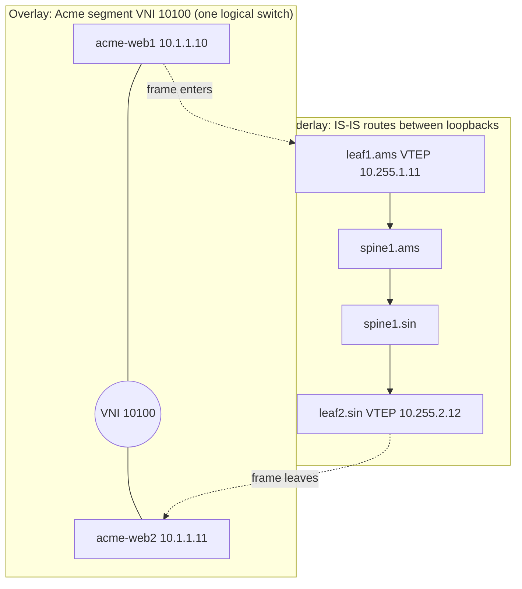

Acme rents servers from Meridian in two places. `acme-web1` (`10.1.1.10`) sits behind `leaf1.ams` in Amsterdam, and `acme-web2` (`10.1.1.11`) sits behind `leaf2.sin` in Singapore. Acme wants both in one subnet, `10.1.1.0/24`, on one Ethernet segment, so a virtual machine can move between them without changing its address and a cluster heartbeat that uses broadcast still works. Globex, another tenant, uses the same subnet `10.1.1.0/24` and the same VLAN number 100, and must never see a single Acme frame.

Meridian's fabric wants the opposite. Every link between a leaf and a spine is its own routed /31 subnet, every device is a router, and layer 2 ends at the port where a server plugs in. That is what makes the fabric fast to converge, loop-safe and able to use every link at once. A tenant asking for one Ethernet segment across 10,500 km of fibre is asking the routed fabric to behave like a switch.

An **overlay** resolves the conflict. The fabric stays routed; the tenant's frame is wrapped in a new header at the first leaf, carried across as an ordinary IP packet, and unwrapped at the last leaf. The next lessons open the header ([VXLAN encapsulation](/learn/fabric-networking/overlays-vxlan-evpn/vxlan-encapsulation)) and the control plane that fills the tables ([EVPN, the control plane](/learn/fabric-networking/overlays-vxlan-evpn/evpn-the-control-plane)).

## What tenants want: a segment and a wall

A **tenant** is a customer or internal team that gets a slice of the network to itself. What a tenant asks for comes down to two things.

**A layer-2 segment.** A segment is one broadcast domain: every host in it receives every broadcast, hosts reach each other by MAC address without a router, and they share one IP subnet ([switches, VLANs and loops](/learn/fabric-networking/from-zero/switches-vlans-and-loops) built this up from a single switch). Tenants want segments that span racks, rows and sometimes sites, for concrete reasons:

- **Workload mobility.** Live migration (VMware vMotion, KVM) resumes a virtual machine on a new host with the same IP and MAC, so open TCP connections survive only if the subnet exists at the new location. The hypervisor then announces the VM's MAC from its new port (a RARP or gratuitous ARP frame) so every switch relearns where it is.
- **Software that assumes one link.** Clusters that elect a leader by broadcast heartbeat, appliances that fail over by moving a virtual IP. None of them work across a router.
- **Bring-your-own addressing.** A bare-metal customer migrating from its own data center keeps its subnets and gateway rather than renumbering hundreds of servers.

**A wall.** Isolation means Acme's broadcasts, unknown-destination floods and frames never reach a Globex port, and that both can use `10.1.1.0/24` at once. On one switch, VLANs give the wall: the MAC table is keyed by (VLAN, MAC), and a frame in VLAN 100 is flooded only to VLAN 100 ports. Overlapping IP addresses additionally need separate routing tables, VRFs (virtual routing and forwarding instances), covered in [VRFs and multi-tenancy](/learn/fabric-networking/overlays-vxlan-evpn/vrfs-and-multi-tenancy).

- **Solves:** mobility, legacy software and migrations without renumbering; safe sharing of one physical network.
- **Breaks:** a segment is a failure domain. A loop, a flood or a misbehaving host inside it affects every port in it, wherever those ports are.
- **Signal:** per-segment broadcast and unknown-unicast rates, MAC-move (flap) counters, the number of leaves and sites a segment spans.

## What the fabric wants: routing everywhere

Meridian's sites are leaf-spine Clos fabrics ([Clos and leaf-spine](/learn/fabric-networking/fabric-architecture/clos-and-leaf-spine)). Each of `leaf1.ams`'s four uplinks is a separate layer-3 link (`10.254.1.0/31` to `spine1.ams`, and so on), IS-IS gives every leaf four equal-cost paths to every other leaf, and ECMP (equal-cost multipath: hashing each flow onto one of several equally good next hops) uses all four ([ECMP and hashing](/learn/fabric-networking/fabric-architecture/ecmp-and-hashing)). A dead spine costs a quarter of the capacity, not connectivity, and a routing loop is bounded because every IP packet carries a TTL (a hop counter each router decrements).

Now try to give Acme its segment the old way: configure VLAN 100 on every leaf and every spine, and trunk it (carry it, tagged, over every inter-switch link). Three things go wrong.

1. **The loop problem returns.** A leaf-spine fabric is full of loops by design: `leaf1.ams` → `spine1.ams` → `leaf2.ams` → `spine2.ams` → `leaf1.ams` is one. Ethernet frames have no TTL, so a broadcast in a looped VLAN circles forever. The cure, spanning tree, blocks redundant ports until the topology is a tree. Amsterdam's 20 switches keep 19 of their 64 leaf-spine links, roughly one uplink per leaf, so about 70% of the capacity sits idle, and failover waits for spanning tree to reconverge (under a second to a few seconds with RSTP).
2. **Every switch learns every MAC.** A spine that bridges every VLAN holds every MAC in the site. Hardware MAC tables hold tens of thousands to a few hundred thousand entries, depending on the chip and how its shared memory is partitioned, so the most shared box becomes the scaling limit.
3. **The failure domain becomes the whole fabric.** One server with a bridging bug and the storm reaches every switch that carries the VLAN, across sites if the VLAN is stretched.

The visualisation shows the mechanism on a three-switch triangle, the smallest loop there is.

```viz
{"type": "fabric", "scenario": "broadcast-storm", "title": "Why fabrics refuse to stretch layer 2: one broadcast circling a three-switch loop, then spanning tree blocking a port", "caption": "leaf1.ams, leaf2.ams and leaf3.ams wired in a triangle, every port in VLAN 100, spanning tree off. One ARP broadcast from acme-web1 is flooded both ways round, comes back, makes acme-web1's MAC flap between two ports and circles forever, because an Ethernet frame has no TTL. Then RSTP elects leaf1.ams root, puts leaf3.ams's port 50 into discarding, and the same broadcast reaches each host exactly once, at the cost of one idle link."}
```

A leaf-spine fabric has far more loops than a triangle. The routed design throws spanning tree out of the core, and the question becomes how to offer tenants layer 2 without putting layer 2 back into the core.

## The 4,094-VLAN limit

The VLAN number lives in the 802.1Q tag, a 4-byte field inserted into the Ethernet header on trunk links. Its VLAN identifier (VID) is 12 bits, which is 4,096 values; 0 means "priority tag, no VLAN" and 4095 is reserved, leaving **4,094 usable VLANs** (IEEE 802.1Q).

The limit bites because of *where* a VLAN number is significant. Trunked across the fabric, "100" is a fabric-wide name: every switch that carries it must agree it means Acme's web segment, so no other tenant can use 100. A few thousand tenants with a handful of segments each need more than 4,094 names in one site. Fewer are free in practice: several platforms reserve VLAN IDs for internal use (such as one hidden VLAN per routed port), so the vendor's scale sheet is the real number.

### The workaround: stack two tags

Carriers hit the limit first and answered with **QinQ** (IEEE 802.1ad): a second, outer tag in front of the customer's, 12 + 12 bits, about 16.7 million combinations. It fixes the numbering and nothing else: the core is still bridged, learns every customer MAC, needs spanning tree and floods unknown destinations. **Provider Backbone Bridging** (802.1ah, "MAC-in-MAC") wraps the customer frame in a backbone Ethernet header with a 24-bit service identifier, so the core learns only backbone MACs: a real overlay, but its core is still bridged.

### The overlay's move: make the VLAN local

VXLAN, Meridian's overlay, carries a 24-bit **VNI** (VXLAN network identifier, RFC 7348): 16,777,216 values, a few reserved per platform. The bigger number is the obvious change. The important one is that the VLAN number stops being a fabric-wide name:

| Tenant | Host | Leaf and port | VLAN on that port | VNI in the fabric |
|---|---|---|---|---|
| Acme | `acme-web1` 10.1.1.10 | `leaf1.ams`, server port | 100 | 10100 |
| Acme | `acme-web2` 10.1.1.11 | `leaf2.sin`, server port | 100 | 10100 |
| Acme | `acme-db1` 10.1.2.20 | `leaf3.ams`, server port | 200 | 10101 |
| Globex | `globex-app1` 10.1.1.10 | `leaf2.ams`, server port | 100 | 10200 |

Each leaf maps its local VLAN to a VNI, and only the VNI crosses the fabric: "VLAN 100" means Globex on `leaf2.ams` and Acme on `leaf1.ams`. The VLAN space resets on every leaf and, on platforms with per-port VLAN-to-VNI mapping, on every port, so two tenants on one leaf can both bring VLAN 100.

### The limit, worked

The model places tenants on Meridian's full Amsterdam site (16 leaves, 4 spines): 1 to 5 segments per tenant, each on 2 to 4 leaves with 20 hosts. The stretched design trunks every VLAN to every switch, as operators do so any tenant can land on any rack.

```python
import random

VLAN_IDS = 4094                    # 12-bit VID minus 0 and 4095 (IEEE 802.1Q)
VNI_IDS = 2 ** 24                  # 24-bit VNI (RFC 7348)
LEAVES = [f"leaf{n}.ams" for n in range(1, 17)]
SPINES = [f"spine{n}.ams" for n in range(1, 5)]
HOSTS_PER_SEGMENT = 20


def build_tenants(n_tenants, seed=7):
    """Each tenant gets 1-5 segments; each segment lives on 2-4 of the 16 leaves."""
    rng = random.Random(seed)
    segments = []                  # (tenant, vni, set of leaves)
    vni = 10000
    for t in range(n_tenants):
        for _ in range(rng.randint(1, 5)):
            vni += 1
            segments.append((t, vni, set(rng.sample(LEAVES, rng.randint(2, 4)))))
    return segments


def stretched_vlans(segments):
    """Classic design: a VLAN is one fabric-wide ID and every switch learns its MACs."""
    vlans_needed = len(segments)               # every segment needs its own fabric-wide ID
    all_macs = len(segments) * HOSTS_PER_SEGMENT
    return {"fabric-wide VLAN IDs needed": vlans_needed,
            "fits in 4,094": vlans_needed <= VLAN_IDS,
            "MACs on every spine": all_macs}


def overlay(segments):
    """VXLAN/EVPN: the VNI is the fabric-wide name, VLANs mean something only on one leaf."""
    vlans_per_leaf = {leaf: 0 for leaf in LEAVES}
    macs_per_leaf = {leaf: 0 for leaf in LEAVES}
    for _, _, leaves in segments:
        for leaf in leaves:
            vlans_per_leaf[leaf] += 1          # a local VLAN ID mapped to this VNI
            macs_per_leaf[leaf] += HOSTS_PER_SEGMENT   # local and remote hosts of the VNI
    loopbacks = len(LEAVES) + len(SPINES) + 2 + 2       # leaves, spines, RRs, gateways
    links = len(LEAVES) * len(SPINES)                   # one /31 per leaf-spine link
    return {"VNIs used": len(segments),
            "fits in 2^24": len(segments) <= VNI_IDS,
            "worst leaf: local VLAN IDs": max(vlans_per_leaf.values()),
            "worst leaf: MACs": max(macs_per_leaf.values()),
            "spine: routes (no MACs)": loopbacks + links}


print(f"{'tenants':>8} {'segments':>8} | {'VLAN IDs (fabric-wide)':>22} | "
      f"{'spine MACs':>10} | {'VLANs, worst leaf':>17} {'MACs, worst leaf':>16} {'spine routes':>12}")
for n in (500, 1500, 5000):
    segs = build_tenants(n)
    st, ov = stretched_vlans(segs), overlay(segs)
    need = f"{st['fabric-wide VLAN IDs needed']:,}" + ("" if st["fits in 4,094"] else " (> 4,094)")
    print(f"{n:>8,} {len(segs):>8,} | {need:>22} | {st['MACs on every spine']:>10,} | "
          f"{ov['worst leaf: local VLAN IDs']:>17,} {ov['worst leaf: MACs']:>16,} "
          f"{ov['spine: routes (no MACs)']:>12}")
```

```text
 tenants segments | VLAN IDs (fabric-wide) | spine MACs | VLANs, worst leaf MACs, worst leaf spine routes
     500    1,513 |                  1,513 |     30,260 |               311            6,220           88
   1,500    4,445 |        4,445 (> 4,094) |     88,900 |               885           17,700           88
   5,000   15,084 |       15,084 (> 4,094) |    301,680 |             2,888           57,760           88
```

The stretched design runs out of VLAN numbers between 1,000 and 1,500 tenants (three segments each on average), and long before that its spines hold every MAC in the site. In the overlay, `vlans_per_leaf[leaf] += 1` consumes a VLAN ID only on the leaves a segment touches, and `macs_per_leaf` counts remote hosts too, because a leaf must know which far leaf each remote MAC sits behind. The spine column has no tenant term: 24 loopbacks (16 leaves, 4 spines, 2 route reflectors, 2 gateways) plus 64 leaf-spine /31s (the model leaves out the few links to reflectors and gateways), 88 routes at 500 tenants or 5,000. The last row shows the overlay's honest limit: 2,888 local VLANs and 57,760 MACs on the busiest leaf, so leaf tables become the constraint and tenant placement spreads the load.

## Underlay and overlay

- **Underlay:** the physical routed network whose only job is to deliver IP packets between the fabric's own addresses, above all every device's loopback (a /32 that belongs to the device rather than a link, so it stays reachable while any path to it works). At Meridian it is IS-IS on every leaf, spine, gateway and route reflector, holding loopbacks and link subnets, nothing a tenant owns ([the underlay's single job](/learn/fabric-networking/underlay/what-routing-protocols-do)).
- **Overlay:** a virtual network built on top, whose links are tunnels between edge devices and whose addresses are the tenants'. VNI 10100 is logically one switch with ports on `leaf1.ams` and `leaf2.sin`, physically a stream of IP packets between two loopbacks.
- **VTEP** (VXLAN tunnel endpoint): the device that adds and removes the overlay header. Every Meridian leaf is one, addressed by its loopback: `leaf1.ams` is `10.255.1.11`, `leaf2.sin` is `10.255.2.12`.
- **Encapsulation:** wrapping a packet in another header ([layers and encapsulation](/learn/networking/fundamentals/layers-and-encapsulation)). An overlay puts an Ethernet frame inside UDP inside IP.



Each layer has its own control plane, its own table and its own failure modes:

| | Underlay | Overlay |
|---|---|---|
| Question it answers | How do I reach loopback `10.255.2.12`? | Behind which VTEP is MAC `00:00:5e:00:53:0b` in VNI 10100? |
| Protocol at Meridian | IS-IS ([IS-IS from zero](/learn/fabric-networking/underlay/is-is-from-zero)) | BGP EVPN in AS 65000 ([EVPN, the control plane](/learn/fabric-networking/overlays-vxlan-evpn/evpn-the-control-plane)) |
| Who runs it | Every leaf, spine, gateway and reflector | Leaves, gateways and the route reflectors |
| Table size | Tens to a few hundred routes per site | Every tenant MAC and IP: thousands to hundreds of thousands |
| Changes when | Links or devices fail | Hosts appear, move or leave |
| Typical failure | A loopback unreachable, a small MTU | A missing route, a wrong VLAN-to-VNI map |

The two meet in exactly one place. An overlay entry says "MAC `00:00:5e:00:53:0b` is behind `10.255.2.12`", and to use it the leaf asks the underlay "how do I reach `10.255.2.12`?". That second lookup is **recursive next-hop resolution**, the same relationship as BGP and the IGP in [iBGP, loops and next hops](/learn/fabric-networking/bgp-fundamentals/ibgp-loops-and-next-hops). It produces the rule to remember: **the overlay is only as healthy as the underlay under it.** A perfect EVPN table pointing at a loopback the underlay cannot reach forwards nothing.

It also explains why spines need no tenant routes (and, in Meridian's IS-IS design, no BGP at all). In [the BGP black hole](/learn/fabric-networking/bgp-fundamentals/the-bgp-black-hole), a middle router without the customer's route drops the packet; with an overlay the middle router sees a packet addressed to a loopback it knows from IS-IS.

- **Solves:** tenant state and fabric state separated, so tenants scale without touching the core, and the core is designed for speed and convergence alone.
- **Breaks:** at the seam. The overlay's view (routes present, sessions up) can look perfect while the underlay is broken, and the overlay header makes every packet bigger.
- **Signal:** overlay next hops that do not resolve in the underlay; VTEP-to-VTEP probes; probes at full overlay packet size.

## Tunnels as labels on a parcel

Hold the overlay as a delivery network. A household (tenant host) hands a sealed parcel (its frame) to the local depot (its leaf). The depot looks up the recipient's depot in its address book (EVPN), boxes the parcel with an account code and a depot-to-depot label, and hands it to the roads. Sorting centres (spines) read only the destination depot. The far depot opens the box, reads the account code and delivers the untouched parcel.

| Delivery network | Overlay | Who reads it |
|---|---|---|
| The sealed parcel | The tenant's frame: inner Ethernet, IP, TCP and data | Only the receiving host |
| Account code on the parcel | VXLAN header, VNI 10100 | Only the egress VTEP |
| Lane code for the conveyor | Outer UDP source port, a hash of the inner headers | Every ECMP decision on the way |
| Depot-to-depot address label | Outer IP, `10.255.1.11` → `10.255.2.12` | Every underlay router |
| Consignment note for one truck | Outer Ethernet, MACs of this one link | This link only |
| Road map | IS-IS | Every underlay router |
| Address book: which depot serves which household | BGP EVPN | Leaves (depots) only |

Three places where the picture would mislead you, each a real failure:

- **The box is bigger than the parcel.** VXLAN adds 50 bytes to every frame (14 outer Ethernet, 20 outer IPv4, 8 UDP, 8 VXLAN). Measured as an IP packet in the underlay, a 1,500-byte tenant packet becomes 1,550 bytes: the 36 bytes of outer IPv4, UDP and VXLAN plus the tenant's own 14-byte Ethernet header, which now rides as payload. An underlay link whose MTU (maximum transmission unit) is smaller drops it, which is why Meridian runs 9,216 on fabric links ([VXLAN encapsulation](/learn/fabric-networking/overlays-vxlan-evpn/vxlan-encapsulation) has the arithmetic).
- **Sorting centres send no notice to the household.** A spine that drops a tunnelled packet sends any ICMP error to the outer source, the ingress leaf, not to the tenant host, so the sender never learns why and path MTU discovery cannot help it ([transport as the network sees it](/learn/fabric-networking/from-zero/transport-as-the-network-sees-it)).
- **A wrong address book delivers to the wrong door, silently.** Nothing checks that VNI 10100 belongs to Acme. A leaf that maps Globex's VLAN to 10100 by mistake delivers Globex frames into Acme's segment while every device reports healthy.

The parcel's actual journey, on a small example with two spines per site (the two that carry the long-haul circuit):

1. `acme-web1` sends an ordinary frame to `acme-web2`'s MAC `00:00:5e:00:53:0b`: same subnet, so no router is involved and the inner TTL stays 64. It does not know a tunnel exists.
2. `leaf1.ams` maps VLAN 100 on the port to VNI 10100 and looks up the MAC in that segment's table: it is behind VTEP `10.255.2.12`, learned from an EVPN route.
3. It adds the VXLAN header (VNI 10100), UDP (destination port 4789, source port from a hash of the inner headers), outer IPv4 (`10.255.1.11` → `10.255.2.12`, TTL 64), and outer Ethernet to `spine1.ams`, picked by the ECMP hash: 50 bytes.
4. `spine1.ams` routes on the outer destination only, decrements the outer TTL to 63, rewrites the outer MACs, and sends the packet over the 10,500 km circuit, about 52.5 ms one way at 5 µs per km.
5. `spine1.sin` does the same, outer TTL 62, down to `leaf2.sin`.
6. `leaf2.sin` sees its own address and UDP 4789, reads VNI 10100, maps it to its local VLAN 100, strips the 50 bytes and switches the original frame to `acme-web2`, byte for byte what `acme-web1` sent.

```viz
{"type": "fabric", "scenario": "vxlan-encap", "title": "One Acme frame from Amsterdam to Singapore: wrapped at leaf1.ams, routed by two spines on the outer header, unwrapped at leaf2.sin", "caption": "acme-web1 sends a plain frame to acme-web2 in VLAN 100. leaf1.ams finds the MAC behind VTEP 10.255.2.12 and adds VXLAN (VNI 10100), UDP 4789, outer IPv4 and outer Ethernet, 50 bytes in all. spine1.ams and spine1.sin forward on the outer IPv4 destination alone, decrement the outer TTL from 64 to 62 and hold no Acme MACs or routes; leaf2.sin strips the outer headers and delivers the frame unchanged, inner TTL still 64."}
```

## What lives on leaves and what lives on spines

Where each piece of state lives is the most useful picture of an overlay fabric, and the one interviewers probe:

| Function | Leaf (VTEP) | Spine | Route reflector `rr1.ams` | Border gateway `gw1.ams` |
|---|---|---|---|---|
| Underlay routing (IS-IS), loopback and link routes | Yes | Yes | Yes, to reach its peers | Yes |
| ECMP forwarding of tunnelled packets | Hashes onto uplinks | Routes to the leaf's downlink; hashes over parallel long-haul paths | Out of the forwarding path | Yes |
| VLAN-to-VNI mapping on server ports | Yes | No | No | For external hand-offs |
| MAC tables per VNI (local and remote) | Yes, for its VNIs | No | No | For VNIs it serves |
| Encapsulation and decapsulation | Yes | No | No | Yes |
| Tenant VRFs and the distributed anycast gateway | Yes ([VRFs and multi-tenancy](/learn/fabric-networking/overlays-vxlan-evpn/vrfs-and-multi-tenancy)) | No | No | Yes, plus routes to the internet |
| BGP EVPN sessions | Yes, to both RRs | No (in Meridian's design) | Yes, to every leaf and to other sites' RRs | Yes |
| Broadcast replication | Yes ([BUM traffic](/learn/fabric-networking/overlays-vxlan-evpn/bum-traffic)) | No (unless the underlay uses multicast) | No | Yes |

Each consequence is a design argument you can make in a review:

- **Adding a tenant touches leaves only.** A new VNI is configured where its hosts live and EVPN tells the other leaves; spine upgrades ignore tenants.
- **Spines stay simple.** Longest-prefix match on outer destinations plus ECMP, over tens to a few hundred entries (88 in the model, plus other sites' loopbacks), so spine silicon is chosen for ports and buffers, not table size.
- **Leaves carry the scale.** MAC and IP tables, VRFs and replication are sized by the tenants on each leaf, so placement is a capacity question.
- **Route reflectors are control plane only.** `rr1.ams` and `rr2.ams` relay EVPN routes ([route reflectors](/learn/fabric-networking/bgp-fundamentals/route-reflectors)) but carry no tenant packet. Losing one changes nothing. Losing both closes every leaf's EVPN sessions (at once, or when the hold timer, 9 seconds on Meridian and commonly 90 at vendor defaults, expires), the leaves withdraw what they learned, and overlay traffic stops unless graceful restart keeps the routes as stale for a few minutes: out of the data path, but still shared fate. Many fabrics put the reflectors on the spines to save boxes, so a spine's BGP process holds tenant routes its data plane never installs. In an eBGP underlay ([BGP as the underlay](/learn/fabric-networking/underlay/bgp-as-the-underlay)) spines relay EVPN routes too, and must keep routes for VNIs they do not serve and leave the VTEP next hop unchanged; miss either and routes vanish silently.

### What it looks like on a leaf

Cumulus Linux builds the VTEP from kernel objects: classically a `vxlan` interface per VNI in a bridge (newer releases can use one device for all VNIs), with FRR's `bgpd` and `zebra` writing EVPN-learned MACs into the bridge's forwarding database, which the driver mirrors into the ASIC. SONiC runs the same FRR but programs the ASIC from its own databases. Illustrative output on `leaf1.ams`:

```text
$ ip -d link show vxlan10100                       (illustrative, trimmed)
14: vxlan10100: <BROADCAST,MULTICAST,UP> mtu 9166 master br_default
    vxlan id 10100 local 10.255.1.11 dstport 4789 nolearning

$ bridge fdb show dev vxlan10100                   (illustrative)
00:00:5e:00:53:0b vlan 100 extern_learn master br_default
00:00:5e:00:53:0b dst 10.255.2.12 self extern_learn
00:00:00:00:00:00 dst 10.255.2.12 self permanent
```

The first line is the VTEP: this VNI, sourced from the loopback, on the standard port. `nolearning`: the kernel does not learn remote MACs from arriving packets, because EVPN supplies them. `mtu 9166` is the 9,216-byte link MTU minus 50. `extern_learn` marks a MAC installed by the control plane, `dst` the VTEP behind it, and the all-zeros entry is the flood list for broadcasts ([BUM traffic](/learn/fabric-networking/overlays-vxlan-evpn/bum-traffic)). On `spine1.ams` the same commands show no VXLAN interfaces at all.

### Under the hood: one lookup chain in the ASIC

In a hardware leaf (Broadcom Trident or Tomahawk class, NVIDIA Spectrum, and others) the ingress pipeline turns the encapsulation into table lookups ([planes, ASICs and network operating systems](/learn/fabric-networking/from-zero/planes-asics-and-network-operating-systems)):

1. **Port and VLAN → bridge domain.** The arriving port and VLAN select an internal segment, which carries the VNI.
2. **Destination MAC in that bridge domain → a tunnel object** instead of a port. The tunnel object holds the remote VTEP address and the encapsulation template.
3. **Encapsulation rewrite**: the VXLAN, UDP and outer IP headers are written from the template, the source port from a hash of the inner headers.
4. **Outer destination in the underlay FIB → ECMP group → egress port and outer MACs.** This is the recursive step, done in hardware.

Decapsulation is a tunnel-termination table keyed on (outer destination IP, UDP 4789): a match strips the outer headers, maps the VNI to a bridge domain and does the inner MAC lookup. Bridging into a tunnel is a single pass on current chips; routing then encapsulating, or decapsulating then routing, needed a second pass (recirculation) on early VXLAN-capable chips and still does on some, costing pipeline bandwidth, which is why scale sheets quote bridged and routed VXLAN separately.

## Overlays elsewhere: the same idea at every layer

Where the tunnel endpoint sits is the main design choice:

- **On the leaf (hardware VTEP):** Meridian's design, usual for bare-metal tenants, whose servers the network cannot run software on.
- **In the hypervisor or a SmartNIC:** how public clouds run tenant networks. VMware NSX uses Geneve (RFC 8926), a VXLAN successor with extensible options; cloud providers encapsulate on their own NIC cards (AWS's Nitro cards are the best-known example; NVIDIA BlueField-class DPUs offer the same offload). The physical fabric is then pure underlay.
- **In Kubernetes:** Flannel's VXLAN backend and Calico's VXLAN mode give every pod an address on an overlay between nodes. Flannel uses UDP port 8472, the Linux kernel's historical default from before IANA assigned 4789, and a Linux VTEP created without an explicit port still listens on 8472: a hardware leaf sending to 4789 then gets silence, with both ends showing the tunnel configured.
- **In the backbone:** MPLS labels do the same job for carriers, addressing a packet to the exit router so the middle needs no customer routes ([MPLS and segment routing](/learn/fabric-networking/overlays-vxlan-evpn/mpls-and-segment-routing)).

## Trade-offs: ways to give tenants segments and isolation

| Approach | Segment IDs | Tenant state in the core | Uses every link | Failure domain | Where it is used |
|---|---|---|---|---|---|
| 802.1Q VLANs trunked everywhere, spanning tree | 4,094, fabric-wide | Every MAC on every switch | No: spanning tree blocks | The whole VLAN, every switch it touches | Small enterprise networks, single-rack setups |
| QinQ (802.1ad) | About 16.7 million combinations | Every customer MAC | No | Bridged core | Carrier Ethernet access |
| VRF-lite hop by hop (a VRF and a sub-interface per tenant on every link) | Per link, 4,094 sub-interfaces | Every tenant route on every spine | Yes | Routed, but every change touches the core | Small multi-tenant cores |
| VXLAN with EVPN, VTEP on the leaf | 16.7 million VNIs, VLANs local to each leaf | None | Yes, ECMP on the outer header | Per VNI, flooding contained by EVPN | Data center fabrics, Meridian |
| Overlay in the host or NIC (Geneve, VXLAN) | Millions | None, not even on leaves | Yes | Per tenant network, enforced in software | Public clouds, Kubernetes |
| MPLS (L3VPN, EVPN over MPLS) | 20-bit labels, per router | Only on edge routers | Yes, with ECMP or traffic engineering | Per VPN | Carrier and backbone networks |

The decisive column is the third. VRF-lite puts every tenant route on every spine; stretched VLANs and QinQ put every MAC there. Only the overlay families make the core's table size independent of the tenant count.

## Failure modes in production

**Underlay MTU too small for the overlay.** *Symptom:* `acme-web1` can ping `acme-web2`, SSH logs in, but file copies and large HTTP responses hang. *Diagnosis:* full-size packets become 1,550 bytes and one underlay link (a new circuit, a port left at the 1,500 default) cannot carry them. RFC 7348 forbids VTEPs to fragment VXLAN packets, and fabric switches drop oversize packets rather than fragment them. Loopback-to-loopback pings with DF ("don't fragment") set and 1,550-byte IP packets (1,522 bytes of ICMP payload) find the link. *Fix:* set the underlay MTU consistently (Meridian: 9,216 on every fabric link), and test it after every circuit change.

**The VTEP is unreachable in the underlay.** *Symptom:* traffic from every host behind `leaf2.sin` disappears, yet every BGP EVPN session is Established and `leaf1.ams` still lists `acme-web2`'s MAC behind `10.255.2.12`. *Diagnosis:* the overlay entry is there, its next hop is not: `10.255.2.12/32` is missing from the underlay because an IS-IS adjacency dropped or the loopback stopped being advertised. *Fix:* restore the underlay; in tooling, alert on overlay next hops that do not resolve ([the BGP black hole](/learn/fabric-networking/bgp-fundamentals/the-bgp-black-hole)).

**A layer-2 storm inside a VNI.** *Symptom:* hosts in Acme's segment in both sites see high CPU and packet loss; the long-haul circuit's utilisation jumps with no matching rise in delivered traffic. *Diagnosis:* a tenant bridged two of its own server ports (a misconfigured virtual switch), creating a loop inside VNI 10100. The core forms no loop of its own, but the segment is still a broadcast domain, and every VTEP serving VNI 10100 replicates each circulating broadcast, across the ocean included. MAC-move counters for `acme-web1`'s MAC climb on two ports. *Fix:* storm control and BPDU guard on server ports, duplicate-MAC detection (by default in RFC 7432, five moves in 180 seconds freezes the MAC), and pushing back on stretching segments between sites unless the tenant needs it.

**A wrong VLAN-to-VNI map.** *Symptom:* a new Globex server on `leaf4.ams` cannot reach its gateway, or worse, can reach Acme hosts. *Diagnosis:* the leaf maps Globex's VLAN 100 to VNI 10100 instead of 10200. No protocol notices; the only check is comparing the mapping with intent. *Fix:* render mappings from a source of truth and diff running state against it ([network automation and the source of truth](/learn/fabric-networking/operating-fabrics/network-automation-and-source-of-truth)); treat any VNI that appears in two tenants' VRFs as a security incident.

## What the platform should show

Tooling should show the two layers separately and joined:

- **Per tenant, per VNI:** which leaves serve it, host count, and its span (one rack, one site, several sites); a segment that quietly grows across sites is a design change.
- **Overlay next-hop health:** for every remote VTEP that appears in any leaf's EVPN table, whether it resolves in that leaf's underlay table right now. This catches the "sessions up, traffic gone" failure that session dashboards miss.
- **VTEP-to-VTEP probes at full size:** loopback-to-loopback probes with varied UDP source ports (to cover every spine), DF set, at 1,550 bytes and at the largest tenant MTU plus 50. A failure at large size only is the MTU signature.
- **Intent versus running mappings:** VLAN-to-VNI and VNI-to-VRF maps per leaf, diffed against the source of truth, with a hard alarm on any VNI mapped to two tenants.
- **Leaf table headroom:** MAC, ARP and route entries per leaf against hardware limits, and local VLAN count against the platform's free range, because the overlay moves scale to the leaves.
- **Flood and mobility rates per VNI:** broadcast and unknown-unicast packets per second and MAC moves per minute; a jump in either is the early sign of a loop inside a tenant segment.
- **Two views of one dataset:** the on-call engineer asks "is VNI 10100 broken, on which leaf?"; a manager asks "how many tenants, and is it spreading?". Both read the same per-VNI tables.

## Interviewer follow-ups

**"We have 300 tenants, so 4,094 VLANs is plenty. Why not stretch VLANs across the fabric with 802.1Q trunks?"** Model answer: the VLAN count was never the main reason. A leaf-spine fabric is full of loops and Ethernet has no TTL, so stretched VLANs need spanning tree, which leaves roughly one uplink per leaf forwarding; every spine learns every tenant MAC; and one loop floods every switch in the VLAN. A routed core keeps every link active and failures small; the overlay adds tenant layer 2 and overlapping addresses on top. If no tenant needs either, routing to the host (each server announcing its own addresses into the fabric) is simpler and needs no overlay. Common wrong answer: "VXLAN is only for more than 4,094 segments."

**"A spine fails. What happens to tenants?"** Model answer: nothing tenant-specific, because no tenant state lives there. Leaves drop it from their ECMP groups towards the VTEP loopbacks, its flows rehash onto the remaining spines, nothing is relearned, and capacity falls by one spine's share, a quarter in Amsterdam ([redundancy and failure domains](/learn/fabric-networking/fabric-architecture/redundancy-and-failure-domains)). Detection time is the underlay's (BFD, in [convergence and BFD](/learn/fabric-networking/underlay/convergence-and-bfd)), not EVPN's. Common wrong answer: "EVPN has to reconverge and relearn the MACs."

**"Is the VNI a security boundary?"** Model answer: it is isolation, not security. VXLAN has no authentication or encryption, so anyone who can send UDP to port 4789 at a VTEP address can inject frames into any VNI it serves, unless the VTEP checks the outer source against the VTEPs it learned from EVPN, which not every platform does. The boundary holds only if the underlay is closed: VTEP addresses unreachable from tenants and the internet, 4789 filtered at every edge, mappings verified against intent, MACsec or IPsec where encryption is required. Which filters a fabric applies I would confirm with the network team; what I would build is a check that no VTEP loopback is reachable from any tenant VRF. Common wrong answer: "yes, VNIs are isolated like VLANs, so it is secure."

**"Traffic between two VMs in one subnet across two sites is slow, 110 ms round trip. Is the overlay adding latency?"** Model answer: encapsulation is a table lookup in the ASIC, nanoseconds. The 10,500 km circuit is about 52.5 ms each way at 5 µs per km, so 105 ms round trip is physics. The overlay's real effect is that the segment spans sites, so a chatty workload pays the distance on every round trip. I would also check whether a circuit failure has detoured traffic through the sister spine ([connecting sites and backbones](/learn/fabric-networking/fabric-architecture/connecting-sites-and-backbones)). Common wrong answer: "VXLAN encapsulation is slow; use MPLS."

## What mid-level engineers get wrong

- **Treating a VLAN number as global.** In an overlay fabric VLAN 100 means nothing beyond one leaf (or one port); the VNI is the name. Tooling keyed on VLAN alone merges Acme and Globex.
- **Expecting spines to need tenant configuration.** Putting VNIs or VRFs on spines adds risk and table pressure for no gain, and "add a tenant" becomes a core change.
- **Believing the overlay removes layer-2 failure domains.** It removes them from the core. Inside a VNI a loop or flood is still a broadcast-domain problem, now replicated to every VTEP in the segment.
- **Reading "BGP Established" and a 64-byte ping as "the overlay works".** The overlay also needs the underlay to resolve every VTEP and carry full-size packets, and a session state or a small ping proves neither.

## Senior signals

- You state the conflict in one sentence: tenants want layer 2 and isolation, the fabric wants layer 3 everywhere, and the overlay gives both by tunnelling layer 2 over a routed core.
- You draw the leaf-versus-spine state table from memory and use it to argue blast radius: tenant changes touch leaves, spine failures cost capacity only.
- You name the seam between the layers, recursive next-hop resolution, and the two failures that live there: an unresolvable VTEP and an underlay MTU below 1,550.
- You push back on stretching segments between sites when the tenant does not need it, because a stretched segment is a stretched failure domain paying the distance on every round trip.
- You treat VNI isolation as configuration to be verified, not as security, and build the check that proves it.

## Check yourself

```quiz
- q: >-
    Acme (VNI 10100) and Globex (VNI 10200) both use VLAN 100 and the subnet 10.1.1.0/24, on different leaves of Meridian's Amsterdam fabric. On a leaf-to-spine link, what keeps their frames apart?
  options: ["The VNI in the VXLAN header, read only by the egress VTEP", "A separate outer UDP destination port assigned to each tenant", "Per-tenant MAC tables on the spines, learned from EVPN", "The 802.1Q tag 100, which each spine uses to pick a MAC table"]
  answer: 0
  explanation: >-
    The VLAN tag ends at the leaf: each leaf maps its local VLAN to a VNI, and only the VNI crosses the fabric inside the VXLAN header. The spines route on the outer IP header and hold no tenant MACs or EVPN state, so they cannot separate tenants and do not need to. Every tenant uses the same UDP destination port, 4789.
- q: >-
    Meridian's Amsterdam site grows from 500 to 5,000 tenants on the same 16 leaves and 4 spines. In the VXLAN/EVPN design, how does a spine's forwarding table change?
  options: ["It stays about the same: loopbacks and link subnets only", "It grows with the number of tenant VRFs on the leaves", "It grows with the number of VNIs, one entry per segment", "It grows with the number of tenant MACs in the site"]
  answer: 0
  explanation: >-
    A spine forwards on the outer destination, a VTEP loopback, so its table holds the site's loopbacks and point-to-point links (88 routes in the lesson's model) no matter how many tenants ride on top. Tenant MACs, VNIs and VRFs live on the leaves, which is why leaf table sizes, not spine sizes, become the limit as tenants grow.
- q: >-
    A colleague argues that a fabric with only 300 tenants, each needing two segments, does not need an overlay because 600 segments fit in 4,094 VLANs. What is the strongest counter-argument?
  options: ["VLAN tags cannot be carried over 400 Gb/s fabric links", "Only VXLAN supports more than 254 hosts in one segment", "Stretched VLANs bring back spanning tree and core MAC learning", "The 4,094 limit applies per port, so 600 segments overflow"]
  answer: 2
  explanation: >-
    The VLAN count is the least important reason for an overlay. Trunking VLANs across a leaf-spine fabric reintroduces loops that need spanning tree, which blocks most uplinks, makes every spine learn every tenant MAC and turns one loop into a fabric-wide storm. A routed core with an overlay avoids all three. Segment size and link speed are unrelated to tagging, and the 4,094 limit applies across a whole bridged domain, not to each port.
- q: >-
    Between acme-web1 (ams) and acme-web2 (sin), pings and SSH logins work, but large file transfers stall. Every EVPN session is up. What is the most likely cause?
  options: ["Spine1.ams dropping packets whose inner TTL has reached zero", "A missing EVPN route for acme-web2's MAC on leaf1.ams", "The ams-sin circuit's 52.5 ms one-way delay timing out TCP", "An underlay link whose MTU is below 1,550 bytes"]
  answer: 3
  explanation: >-
    VXLAN adds 50 bytes, so a full-size 1,500-byte packet needs 1,550 bytes in the underlay, and VTEPs do not fragment tunnelled packets. Small packets fit and large ones are dropped, which is exactly "logins work, transfers stall". A missing MAC route would break small packets too, distance adds delay but not size-dependent loss, and spines never read the inner TTL.
- q: >-
    Every BGP EVPN session in the Singapore site is Established and leaf1.ams still lists acme-web2's MAC behind 10.255.2.12, yet all traffic to hosts on leaf2.sin is lost. Where should you look first?
  options: ["Whether the outer UDP source ports have stopped varying", "Whether the route reflectors are forwarding the packets", "Whether the VNI-to-VLAN map on leaf1.ams changed", "Whether 10.255.2.12/32 is in the underlay table"]
  answer: 3
  explanation: >-
    The overlay entry exists, so the overlay control plane is fine; it is only usable if its next hop, leaf2.sin's loopback, resolves in the underlay. A lost IS-IS adjacency or an unadvertised loopback leaves the EVPN table intact and forwards nothing. Route reflectors are never in the data path, and a mapping or hashing problem would not take out every host behind one leaf at once.
```
