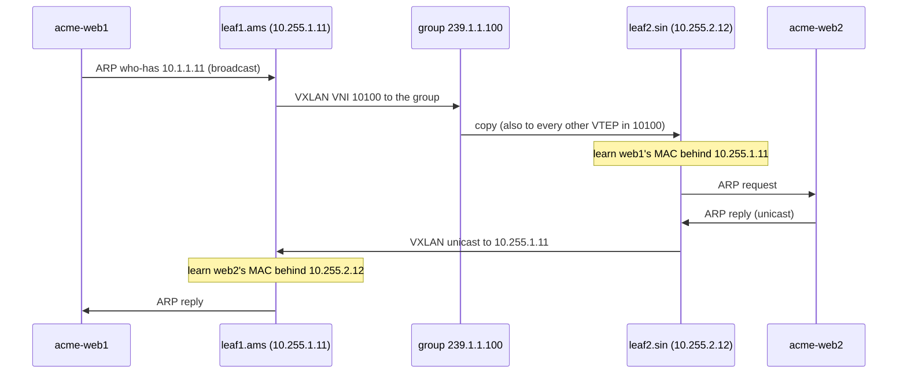

`acme-web1` in Amsterdam (`10.1.1.10`, behind `leaf1.ams`) and `acme-web2` in Singapore (`10.1.1.11`, behind `leaf2.sin`) sit in the same Acme subnet, `10.1.1.0/24`, and behave as if one switch connected them: `acme-web1` ARPs for `acme-web2` and sends it frames addressed to its MAC. Between them is a routed underlay: `leaf1.ams`, `spine1.ams`, about 10,500 km of fibre, `spine1.sin` and `leaf2.sin`, and every one of those devices routes on IP and knows nothing about Acme. [Why overlays](/learn/fabric-networking/overlays-vxlan-evpn/why-overlays) covers why fabrics are built this way: the tenant wants a layer-2 segment, the fabric wants a routed layer-3 core, and a tunnel gives each what it wants. This lesson is about the tunnel itself, the bytes on the wire.

VXLAN (Virtual eXtensible LAN, RFC 7348, first published as an Internet draft in 2011) is the tunnel almost every data center fabric uses. It puts the tenant's whole Ethernet frame inside a UDP packet addressed from one leaf to another. Interviewers ask you to draw that packet, and the strong answer names every header, its size, who reads it and who ignores it, and then explains the two consequences that bite in production: the 50 extra bytes that the underlay MTU (maximum transmission unit, the largest packet a link will carry) must absorb, and the outer UDP source port that keeps ECMP (equal-cost multipath, spreading flows over several equally good paths by hashing their headers) working.

## VTEPs: where the tunnel starts and ends

A **VTEP** (VXLAN tunnel endpoint) is the device that adds the VXLAN headers to a frame (encapsulation) or removes them (decapsulation). On Meridian every leaf is a VTEP, and the spines are not: they forward tunnelled packets as ordinary IP and never look inside.

VTEPs live in three places:

- **In the switch ASIC** (a hardware VTEP; the ASIC is the switch's fixed-function forwarding chip, [planes, ASICs and network operating systems](/learn/fabric-networking/from-zero/planes-asics-and-network-operating-systems)). Meridian's leaves do it in the forwarding chip at line rate. Bridging a frame into a tunnel arrived on merchant silicon around 2012–2013 (Broadcom's Trident II was the common example); routing a packet *and* encapsulating it in one pass through the chip came a generation later (around 2015, Trident II+ and its peers). Before that, routing between tenant subnets on a VTEP meant sending the packet through the pipeline twice (recirculation), which halves the throughput available to it. Vendors call single-pass support RIOT, routing in and out of tunnels.
- **In a hypervisor or a server's kernel** (a software VTEP): the Linux `vxlan` device, Open vSwitch, or a cloud provider's virtual switch. The tunnel then starts on the server and the leaf sees only UDP.
- **On a SmartNIC or DPU** (data processing unit, a NIC with its own processors), such as NVIDIA BlueField, which moves the software VTEP's work off the host CPU.

**The VTEP address is the leaf's loopback.** `leaf1.ams` encapsulates with outer source `10.255.1.11` and sends to `leaf2.sin`'s `10.255.2.12`. A loopback belongs to no single link, so it stays reachable through any surviving uplink, and it is the same address EVPN advertises as the BGP next hop for every host behind that leaf ([iBGP, loops and next hops](/learn/fabric-networking/bgp-fundamentals/ibgp-loops-and-next-hops)). The one exception is a pair of leaves running MLAG (multi-chassis link aggregation) for a dual-attached server: they share an extra anycast VTEP address so remote leaves see one endpoint. EVPN multihoming solves the same problem while each leaf keeps its own address ([EVPN multihoming](/learn/fabric-networking/overlays-vxlan-evpn/evpn-multihoming)).

A VTEP holds four tables. Two of them are filled by EVPN (Ethernet VPN, the BGP-based control plane that advertises which MAC addresses sit behind which VTEP; [EVPN, the control plane](/learn/fabric-networking/overlays-vxlan-evpn/evpn-the-control-plane)) and one by IS-IS, Meridian's underlay routing protocol ([IS-IS from zero](/learn/fabric-networking/underlay/is-is-from-zero)). Here is `leaf1.ams`'s view for Acme's segment:

| Table | Key → value | Entry for this example | Filled by |
|---|---|---|---|
| Port/VLAN → VNI map | (access port, VLAN) → VNI | (port to `acme-web1`, VLAN 100) → 10100 | Configuration, rendered from the source of truth |
| MAC table per VNI | MAC → local port or remote VTEP | `00:00:5e:00:53:0b` → VTEP `10.255.2.12` | Local learning for local hosts; EVPN type-2 routes (or flood-and-learn) for remote ones |
| Flood list per VNI | VNI → remote VTEPs | 10100 → `10.255.2.12`, plus every other leaf with the VNI | EVPN type-3 routes, or a multicast group |
| Underlay FIB (forwarding table) | VTEP /32 → spine next hops | `10.255.2.12/32` → `spine1.ams`, `spine2.ams` | IS-IS |

What a leaf shows (illustrative output, in the style of several network operating systems):

```text
leaf1.ams# show vxlan vni                              (illustrative output)
VNI     Type  VLAN  VRF    Local VTEP     Remote VTEPs
10100   L2    100   ACME   10.255.1.11    10.255.2.12
50001   L3    -     ACME   10.255.1.11    10.255.1.13 10.255.2.12

leaf1.ams# show mac address-table vlan 100
VLAN  MAC                Type     Port
100   00:00:5e:00:53:0a  dynamic  swp1
100   00:00:5e:00:53:0b  evpn     vtep 10.255.2.12 (VNI 10100)
```

**What a VTEP solves:** it turns "send this frame to that MAC" into "send this UDP packet to that leaf", which any IP network can carry. **How it breaks:** its tables disagree with reality (a remote MAC pointing at the wrong VTEP, a VTEP address the underlay cannot reach, a port mapped to the wrong VNI). **Signal:** per-VNI MAC counts and remote-VTEP lists against the expected set, and reachability of every remote VTEP address in the underlay FIB.

## The VNI: 24 bits of tenant identity

The **VNI** (VXLAN network identifier) is a 24-bit number in the VXLAN header that names the layer-2 segment a frame belongs to. 24 bits give 16,777,216 values, against 4,094 usable 802.1Q VLAN IDs ([switches, VLANs and loops](/learn/fabric-networking/from-zero/switches-vlans-and-loops)). That number is half of VXLAN's reason to exist: a multi-tenant data center runs out of VLANs long before it runs out of tenants.

The other half is a change of scope. **A VLAN ID now means something on one leaf only (even on one port); the VNI means the same thing across the whole fabric.** At ingress the leaf maps (port, VLAN) to a VNI and removes the 802.1Q tag; at egress the leaf maps the VNI back to whatever VLAN it uses locally. RFC 7348 says a VTEP should not carry the inner VLAN tag and a receiver should discard frames that still have one, unless configured otherwise. Meridian's mappings:

| Tenant segment | Leaf and port | Local VLAN | VNI | Kind |
|---|---|---|---|---|
| Acme `10.1.1.0/24` | `leaf1.ams`, port to `acme-web1` | 100 | 10100 | L2VNI: one bridged segment |
| Acme `10.1.1.0/24` | `leaf2.sin`, port to `acme-web2` | 100 | 10100 | same segment, other site |
| Acme `10.1.2.0/24` | `leaf3.ams`, port to `acme-db1` | 200 | 10101 | L2VNI |
| Globex `10.1.1.0/24` | `leaf2.ams`, port to `globex-app1` | 100 | 10200 | L2VNI, a different tenant on the same VLAN number |
| Acme routing | every leaf with an Acme VRF | none | 50001 | L3VNI: names the VRF for routed traffic |

Globex's VLAN 100 and Acme's VLAN 100 never meet, because they become 10200 and 10100 at the edge, and the spines carry both without knowing either exists. Matching numbers (VLAN 100 ↔ VNI 10100) are a human convention, not a rule; the leaf would carry VLAN 37 as 10100 just as happily. The L3VNI, which identifies a tenant's routing table (VRF, virtual routing and forwarding instance) rather than a segment, belongs to [VRFs and multi-tenancy](/learn/fabric-networking/overlays-vxlan-evpn/vrfs-and-multi-tenancy). With EVPN, the VNI travels in BGP too, in the label field of each route ([EVPN, the control plane](/learn/fabric-networking/overlays-vxlan-evpn/evpn-the-control-plane)), so both ends of a tunnel must agree on it.

In practice nobody runs 16 million VNIs on one switch: ASIC tables limit a leaf to a few thousand or tens of thousands of active VNIs, depending on the chip. The 24 bits matter fabric-wide, where every leaf needs only the VNIs of its own tenants.

**What the VNI solves:** tenant identity that fits millions of segments and does not depend on VLAN numbering at any one leaf. **How it breaks:** a template typo maps VLAN 100 to 10010 on one leaf, and its frames arrive at others with a VNI nobody else has, dropped silently. Worse, a typo that lands on *another tenant's* VNI bridges two tenants together. **Signal:** "unknown VNI" decapsulation drops; the per-VNI list of VTEPs (from EVPN type-3 routes) diffed against intent, which shows a leaf alone in a VNI or a leaf in a tenant's VNI it should not have.

## The header stack, byte by byte

Watch `leaf1.ams` build the packet, then the spines carry it.

```viz
{"type": "fabric", "scenario": "vxlan-encap", "title": "VXLAN from acme-web1 (Amsterdam) to acme-web2 (Singapore): 50 bytes added at leaf1.ams, outer TTL 64 to 62 across two spines, removed at leaf2.sin", "caption": "acme-web1 sends an ordinary 1,500-byte packet to acme-web2's MAC. leaf1.ams finds that MAC behind VTEP 10.255.2.12 (an EVPN type-2 route) and adds, from the inside out, VXLAN with VNI 10100, UDP from source port 58479 to 4789, outer IPv4 10.255.1.11 to 10.255.2.12 and outer Ethernet: 14 + 20 + 8 + 8 = 50 bytes. spine1.ams and spine1.sin route on the outer IPv4 only, rewrite the outer MACs and take the outer TTL from 64 to 62, with no MAC table or route for VNI 10100. leaf2.sin checks the address, port 4789 and VNI, strips the 50 bytes and bridges the untouched frame to acme-web2 (small example, two spines per site)."}
```

The finished packet on the first fabric link, `leaf1.ams` to `spine1.ams`, outermost header first:

| Offset (bytes) | Header | Size | Who reads it |
|---|---|---|---|
| 0–13 | Outer Ethernet | 14 | The next device on this link only |
| 14–33 | Outer IPv4 | 20 | Every underlay router: the only lookup key in the fabric |
| 34–41 | Outer UDP | 8 | ECMP hashes (source port); the egress VTEP (destination port) |
| 42–49 | VXLAN | 8 | Only the egress VTEP |
| 50–63 | Inner Ethernet | 14 | The egress VTEP's MAC lookup, then `acme-web2` |
| 64–1563 | Inner IPv4, TCP, data | 1,500 | `acme-web2` only |
| 1564–1567 | FCS (frame check sequence, the Ethernet CRC) | 4 | The next device on this link, recomputed at every hop |

### Outer Ethernet

| Field | Size | Value | What reads it |
|---|---|---|---|
| Destination MAC | 6 bytes | `00:00:5e:00:53:80`, `spine1.ams`'s port | `spine1.ams`, to accept the frame |
| Source MAC | 6 bytes | `00:00:5e:00:53:81`, `leaf1.ams`'s uplink | Nobody forwards on it; logs and captures |
| EtherType | 2 bytes | `0x0800` (IPv4); `0x86DD` with an IPv6 underlay | `spine1.ams`'s parser |

This header is the per-link label of [the packet walk](/learn/fabric-networking/from-zero/the-packet-walk), applied to the outer packet: rewritten by every router, never seen two links away.

### Outer IPv4

| Field | Size | Value | What reads it |
|---|---|---|---|
| Version, IHL | 4 + 4 bits | 4, 5 (`0x45`) | Every router |
| DSCP, ECN | 6 + 2 bits | DSCP usually copied from the inner packet (configurable; 0 here); ECN copied per RFC 6040 | Every router's queueing; ECN marks are copied back to the inner header at decapsulation (RFC 6040), which RoCE over VXLAN depends on ([lossless Ethernet](/learn/fabric-networking/ai-fabrics/lossless-ethernet-pfc-ecn-dcqcn)) |
| Total length | 16 bits | 1,550 (`06 0e`): 20 + 8 + 8 + 1,514 | Every router; the MTU check |
| Identification | 16 bits | 0 | Only fragment reassembly, which should never happen |
| Flags, fragment offset | 3 + 13 bits | DF (don't fragment) set (`40 00`) on many hardware VTEPs; the Linux `vxlan` driver leaves it clear by default | A router with a smaller next-hop MTU: drop, or fragment if DF is clear |
| TTL | 8 bits | 64 at `leaf1.ams` | Every router, decremented per hop |
| Protocol | 8 bits | 17 (UDP) | Parsers, ACLs, the ECMP hash |
| Header checksum | 16 bits | `0x1bcb` | Every router, patched per hop |
| Source | 32 bits | `10.255.1.11`, `leaf1.ams`'s VTEP | The egress VTEP (flood-and-learn learns from it), the hash |
| Destination | 32 bits | `10.255.2.12`, `leaf2.sin`'s VTEP | Every underlay router: the lookup key |

### Outer UDP

| Field | Size | Value | What reads it |
|---|---|---|---|
| Source port | 16 bits | 58479 (`e4 6f`), a hash of the inner flow | Every ECMP hash on the path; nothing else |
| Destination port | 16 bits | 4789 (`12 b5`), IANA's VXLAN port | The egress VTEP: "this is VXLAN" |
| Length | 16 bits | 1,530 (`05 fa`): 8 + 8 + 1,514 | The egress VTEP |
| Checksum | 16 bits | 0 (`00 00`) | Nobody: RFC 7348 says to send zero over IPv4 and to accept zero. With an IPv6 underlay it is normally computed, because IPv6 permits a zero UDP checksum only under the conditions of RFC 6935 and 6936 |

Port 4789 was assigned after the first implementations shipped, and the Linux kernel's `vxlan` driver (merged in 2012) still defaults to 8472 unless told otherwise; Flannel, a common Kubernetes overlay, uses 8472 too. Wireshark and tcpdump decode only 4789 as VXLAN by default (tcpdump prints 8472 as OTV, a Cisco tunnel with the same header layout), so a capture of a Linux VTEP on the default port shows bare UDP.

### VXLAN

| Field | Size | Value | What reads it |
|---|---|---|---|
| Flags | 8 bits | `0x08`: only the I bit ("VNI valid") set | Egress VTEP: no I bit, drop |
| Reserved | 24 bits | 0 | Ignored (the Group Based Policy extension carries a 16-bit policy group here) |
| VNI | 24 bits | 10100 = `00 27 74` | Egress VTEP: which segment |
| Reserved | 8 bits | 0 | Ignored |

The whole header is `08 00 00 00 00 27 74 00`. It has no length, no next-protocol field and no options, which made it trivial for 2012-era ASICs to parse. VXLAN-GPE (Generic Protocol Extension, UDP 4790) adds a next-protocol field, and GENEVE (Generic Network Virtualization Encapsulation, UDP 6081, RFC 8926) adds that plus typed variable-length options; see the trade-offs table.

### The inner frame

`acme-web1`'s frame as it left the server, minus two things: its 4-byte FCS (the outer FCS protects the whole packet, so the egress VTEP computes a fresh one when it sends the frame to `acme-web2`) and any 802.1Q tag. Destination MAC `00:00:5e:00:53:0b`, source `00:00:5e:00:53:0a`, EtherType IPv4, then the 1,500-byte IP packet with TTL 64. The two hosts share a subnet, so no router touches the inner packet and its TTL stays 64 end to end. Routed tenant traffic (`acme-web1` to `acme-db1`) has the inner header routed at the leaves instead ([VRFs and multi-tenancy](/learn/fabric-networking/overlays-vxlan-evpn/vrfs-and-multi-tenancy)).

### The packet in code

This builds the real bytes (checksums included), shows what a spine reads, and runs the egress VTEP's checks, including on a packet from a leaf whose template mapped VLAN 100 to VNI 10010 by mistake. The source-port hash is FNV-1a over the inner 5-tuple, a stand-in for the ASIC's own hash, chosen to match the visualisation.

```python
import socket
import struct

VXLAN_PORT = 4789


def mac(text):
    return bytes.fromhex(text.replace(":", ""))


def ip_checksum(header):
    total = sum(struct.unpack(f"!{len(header) // 2}H", header))
    while total >> 16:
        total = (total & 0xFFFF) + (total >> 16)
    return ~total & 0xFFFF


def ipv4(src, dst, proto, payload_len, ttl=64, ident=0, df=True):
    hdr = struct.pack("!BBHHHBBH4s4s", 0x45, 0, 20 + payload_len, ident,
                      0x4000 if df else 0, ttl, proto, 0,
                      socket.inet_aton(src), socket.inet_aton(dst))
    return hdr[:10] + struct.pack("!H", ip_checksum(hdr)) + hdr[12:]


def fnv1a(text):
    h = 2166136261
    for ch in text.encode():
        h = ((h ^ ch) * 16777619) & 0xFFFFFFFF
    return h


def entropy_port(src, dst, proto, sport, dport):
    """RFC 7348: hash the inner flow into the dynamic range 49152-65535."""
    return 49152 + fnv1a(f"{src}|{dst}|{proto}|{sport}|{dport}") % 16384


def encapsulate(inner_frame, vni, flow, vtep_src, vtep_dst, next_hop_mac, my_mac):
    vxlan = struct.pack("!B3xI", 0x08, vni << 8)           # flags, 24 reserved, VNI, 8 reserved
    udp = struct.pack("!HHHH", entropy_port(*flow), VXLAN_PORT,
                      8 + len(vxlan) + len(inner_frame), 0)  # checksum 0: allowed over IPv4
    outer_ip = ipv4(vtep_src, vtep_dst, 17, len(udp) + len(vxlan) + len(inner_frame))
    outer_eth = next_hop_mac + my_mac + b"\x08\x00"
    return outer_eth + outer_ip + udp + vxlan + inner_frame


def spine_view(pkt):
    """What a spine reads: the outer Ethernet and IPv4 headers, plus ports for the hash."""
    ttl = pkt[22]
    dst = socket.inet_ntoa(pkt[30:34])
    sport, dport = struct.unpack("!HH", pkt[34:38])
    return f"route on {dst}, ttl {ttl}, hash includes UDP {sport}->{dport}"


def decapsulate(pkt, my_vtep, vni_to_vlan):
    if socket.inet_ntoa(pkt[30:34]) != my_vtep:
        return "not my VTEP address: route it onward"
    if pkt[23] != 17 or struct.unpack("!H", pkt[36:38])[0] != VXLAN_PORT:
        return "not VXLAN: hand to the control plane"
    flags, vni_field = struct.unpack("!B3xI", pkt[42:50])
    vni = vni_field >> 8
    if not flags & 0x08:
        return "drop: I flag clear, VNI invalid"
    if vni not in vni_to_vlan:
        return f"drop: unknown VNI {vni}"
    inner = pkt[50:]
    return f"VNI {vni} -> VLAN {vni_to_vlan[vni]}, bridge to {inner[:6].hex(':')}", inner


# acme-web1 -> acme-web2: a 1,500-byte IPv4 packet (20 IP + 20 TCP + 1,460 data)
inner_ip = ipv4("10.1.1.10", "10.1.1.11", 6, 1480, ident=0x1c46)
inner_frame = mac("00:00:5e:00:53:0b") + mac("00:00:5e:00:53:0a") + b"\x08\x00" + inner_ip + bytes(1480)
flow = ("10.1.1.10", "10.1.1.11", 6, 40112, 443)
pkt = encapsulate(inner_frame, 10100, flow, "10.255.1.11", "10.255.2.12",
                  mac("00:00:5e:00:53:80"), mac("00:00:5e:00:53:81"))

for name, start, end in [("outer Ethernet", 0, 14), ("outer IPv4", 14, 34), ("outer UDP", 34, 42),
                         ("VXLAN", 42, 50), ("inner Ethernet", 50, 64), ("inner IPv4", 64, 84)]:
    print(f"{start:>3}-{end - 1:<3} {name:<15} {pkt[start:end].hex(' ')}")
print(f"inner frame {len(inner_frame)} B, outer IP packet {len(pkt) - 14} B, "
      f"frame {len(pkt)} B + 4 FCS = {len(pkt) + 4} B on the wire")
print(spine_view(pkt))
print(decapsulate(pkt, "10.255.2.12", {10100: 100})[0])
typo = encapsulate(inner_frame, 10010, flow, "10.255.1.11", "10.255.2.12",
                   mac("00:00:5e:00:53:80"), mac("00:00:5e:00:53:81"))  # template typo: VNI 10010
print(decapsulate(typo, "10.255.2.12", {10100: 100}))
for sport in (40112, 40113, 40114, 40115):
    print("inner source port", sport, "-> outer source port",
          entropy_port("10.1.1.10", "10.1.1.11", 6, sport, 443))
```

```text
  0-13  outer Ethernet  00 00 5e 00 53 80 00 00 5e 00 53 81 08 00
 14-33  outer IPv4      45 00 06 0e 00 00 40 00 40 11 1b cb 0a ff 01 0b 0a ff 02 0c
 34-41  outer UDP       e4 6f 12 b5 05 fa 00 00
 42-49  VXLAN           08 00 00 00 00 27 74 00
 50-63  inner Ethernet  00 00 5e 00 53 0b 00 00 5e 00 53 0a 08 00
 64-83  inner IPv4      45 00 05 dc 1c 46 40 00 40 06 02 c0 0a 01 01 0a 0a 01 01 0b
inner frame 1514 B, outer IP packet 1550 B, frame 1564 B + 4 FCS = 1568 B on the wire
route on 10.255.2.12, ttl 64, hash includes UDP 58479->4789
VNI 10100 -> VLAN 100, bridge to 00:00:5e:00:53:0b
drop: unknown VNI 10010
inner source port 40112 -> outer source port 58479
inner source port 40113 -> outer source port 55468
inner source port 40114 -> outer source port 55241
inner source port 40115 -> outer source port 56966
```

The lines that carry the design: `vni << 8` places 24 bits in the top of a 32-bit word whose last byte is reserved; `pkt[50:]` is the whole inner frame, which `decapsulate` hands on after reading only its destination MAC; `spine_view` never reads past byte 41. The typo case shows how silent a VNI mismatch is: the packet crossed the fabric correctly and was discarded at the last step, with nothing sent back.

### Hop by hop

The same packet on each link of the visualisation's path:

| Field | `leaf1.ams` → `spine1.ams` | `spine1.ams` → `spine1.sin` | `spine1.sin` → `leaf2.sin` | Who changed it |
|---|---|---|---|---|
| Outer destination MAC | `…:53:80` (`spine1.ams`) | `…:53:82` (`spine1.sin`) | `…:53:84` (`leaf2.sin`) | every router |
| Outer source MAC | `…:53:81` (`leaf1.ams`) | `…:53:83` (`spine1.ams`) | `…:53:85` (`spine1.sin`) | every router |
| Outer IPs | 10.255.1.11 → 10.255.2.12 | same | same | nobody |
| Outer TTL | 64 | 63 | 62 | every router |
| Outer checksum | `0x1bcb` | `0x1ccb` | `0x1dcb` | every router, because of the TTL |
| UDP ports | 58479 → 4789 | same | same | nobody |
| VNI | 10100 | same | same | nobody |
| Inner frame, inner TTL 64 | as sent | same | same | nobody |

The circuit adds about 52.5 ms one way (10,500 km at about 5 µs per km); the encapsulation adds nanoseconds. A capture on the first link (illustrative `tcpdump -e -n` output) prints both layers, because tcpdump decodes UDP 4789:

```text
00:00:5e:00:53:81 > 00:00:5e:00:53:80, ethertype IPv4 (0x0800), length 1564:
    10.255.1.11.58479 > 10.255.2.12.4789: VXLAN, flags [I] (0x08), vni 10100
00:00:5e:00:53:0a > 00:00:5e:00:53:0b, ethertype IPv4 (0x0800), length 1514:
    10.1.1.10.40112 > 10.1.1.11.443: Flags [P.], seq 1:1461, ack 1, length 1460
```

### What the egress VTEP checks

`leaf2.sin` decapsulates only when every check passes, in this order, and each failure has its own counter on a good platform: the outer destination is its own VTEP address (otherwise it routes the packet on, as a spine would); the protocol is UDP and the destination port is the configured VXLAN port (otherwise the packet goes to the CPU as traffic for the switch itself, often answered with ICMP port unreachable); the I flag is set; the VNI is mapped locally; and, where configured, the outer source is a known VTEP. Then it looks up the inner destination MAC in that VNI's table and sends the frame out of a local port, never back into the fabric.

## 50 bytes, and why the MTU must be engineered

Over IPv4 VXLAN adds 14 + 20 + 8 + 8 = **50 bytes**: outer Ethernet, outer IP, UDP, VXLAN. Inside the outer IP packet, which is what an IP MTU limits, the extra is 20 + 8 + 8 plus the 14-byte inner Ethernet header, now payload: also 50. Either way, a 1,500-byte tenant packet needs an underlay IP MTU of at least **1,550**. Variants:

| Encapsulation | Added inside the outer IP MTU | A 1,500-byte host needs | A 9,000-byte host needs |
|---|---|---|---|
| VXLAN, IPv4 underlay | 50 | 1,550 | 9,050 |
| VXLAN, IPv6 underlay | 70 (40-byte IPv6 header) | 1,570 | 9,070 |
| VXLAN with the inner 802.1Q tag kept (some designs carry customer tags) | 54 | 1,554 | 9,054 |
| GENEVE, IPv4, with 8 bytes of options | 58 | 1,558 | 9,058 |
| An 802.1Q tag on the *underlay* link | 0 inside the IP MTU, but 4 more bytes of frame | frame of 1,572 with FCS | frame of 9,072 with FCS |

Bandwidth is not the cost. A 1,500-byte packet occupies 1,538 bytes of wire time untunnelled (with preamble and inter-frame gap) and 1,588 tunnelled, 3.3% more; at a 9,000-byte host MTU it is 0.55%. The cost is that **every link on every path must carry the bigger packet**, and nothing will discover a link that does not.

### Why path-MTU discovery cannot help

For routed traffic, a too-big packet with DF set triggers an ICMP "fragmentation needed" back to the sender, who shrinks its packets ([transport as the network sees it](/learn/fabric-networking/from-zero/transport-as-the-network-sees-it)). Inside a VXLAN fabric that loop is broken in three places:

1. **The ICMP goes to the wrong host.** The spine that cannot forward the 1,550-byte outer packet sends ICMP to the outer source, `10.255.1.11`, which is `leaf1.ams`. `acme-web1` never hears about it.
2. **The VTEP is a bridge for this traffic.** A layer-2 device has no way to tell `acme-web1` its packet was too big: Ethernet has no "too big" message, and hardware VTEPs do not translate the spine's ICMP into one for the inner host.
3. **Fragmentation is ruled out.** RFC 7348 says VTEPs must not fragment, routers in between may, and the receiving VTEP may silently discard fragments, which hardware VTEPs do, since reassembly at line rate is not something a switch ASIC does.

So the overlay MTU is engineered: host MTU plus overhead must fit the smallest link, on every path ECMP can choose. Meridian runs hosts at 1,500 or 9,000 and every fabric link and circuit at an IP MTU of 9,216, leaving 166 bytes of headroom over a 9,000-byte host packet with an IPv4 underlay. Software VTEPs do the same sum the other way round: a Linux `vxlan` device created over a 1,500-byte NIC gets an MTU of 1,450, which is why Flannel pods often show 1,450.

A terminology trap makes this harder: vendors disagree on whether "MTU" counts the Ethernet header. On Junos the physical interface MTU includes it, so a default of 1,514 there is an IP MTU of 1,500; elsewhere the number configured is the IP MTU. Tooling should normalise every device's value to one definition before comparing.

### A failure traced: one link at 1,500

`spine3.ams` (full-size Amsterdam, four spines) has a line card replaced, and one of its new ports, the one facing `leaf5.ams`, comes up with the platform default IP MTU of 1,500. The adjacency comes up (unless IS-IS pads its hellos to the full MTU, which would catch it at once; [underlay failures in production](/learn/fabric-networking/underlay/underlay-failures-in-production)).

| Traffic between hosts behind `leaf1.ams` and `leaf5.ams` | Outer packet | Path | Result |
|---|---|---|---|
| ARP, TCP handshakes, pings, SSH keystrokes | under 200 bytes | any spine | works |
| A 1,500-byte flow hashed onto spines 1, 2 or 4 | 1,550 | 9,216 links | works |
| A 1,500-byte flow hashed onto `spine3.ams` | 1,550 | last hop 1,500 | outer packet dropped (DF set) or fragmented and discarded at `leaf5.ams` |

The user report is "about a quarter of connections between these racks hang once they send real data; ping is fine". A ping from `acme-web1` with DF and full size crosses one spine only, the one its flow hashes to, so it passes or fails by luck. The signals that do find it: "MTU exceeded" or fragmentation-needed counters on the spine's port facing `leaf5.ams`; ICMP type 3 code 4 messages arriving at `leaf1.ams`'s loopback from that spine; and full-size DF probes between the two VTEP addresses with many different UDP source ports, so that some cross each spine ([active measurement](/learn/fabric-networking/operating-fabrics/active-measurement)). The fix is the port's MTU; the lesson is to check MTU as a property of every link against the fabric's budget, not to test one path.

**What the MTU budget solves:** tenant packets of any size the tenant is allowed to send cross the fabric intact. **How it breaks:** one undersized link, circuit or replacement port drops only large packets, only on the paths hashed through it. **Signal:** per-link MTU against the budget, fragmentation-needed counters on underlay routers, DF probes between VTEP addresses at full size with varied source ports.

## The outer source port: entropy for ECMP

Every packet between `leaf1.ams` and `leaf2.sin` has the same outer source and destination IP, protocol 17 and destination port 4789. ECMP (equal-cost multipath) picks an uplink by hashing those header fields, so if the source port were fixed as well, every tenant flow between two leaves would hash to the same spine, however many thousand flows rode inside. [ECMP and hashing](/learn/fabric-networking/fabric-architecture/ecmp-and-hashing) traces the hash and the modulo; this section is what the VTEP contributes.

RFC 7348 recommends that the VTEP compute a hash of the inner headers and use it as the outer UDP source port, within the dynamic range 49152 to 65535 (16,384 values). Implementations choose their own range: the Linux driver, for example, defaults to the host's local port range (32768 to 60999), which changes nothing for ECMP as long as the port varies per flow. The code above shows it for four connections from `acme-web1` to `acme-web2` that differ only in their own source port:

| Inner flow (`10.1.1.10` → `10.1.1.11:443`) | Outer source port | Outer 5-tuple differs in |
|---|---|---|
| source port 40112 | 58479 | source port |
| 40113 | 55468 | source port |
| 40114 | 55241 | source port |
| 40115 | 56966 | source port |

Four inner flows become four outer flows, which the spines' hash spreads like any other traffic. Each packet of one inner flow always gets the same port, so it stays on one path and in order. Three details complete the picture:

- **The return direction picks its own port.** `leaf2.sin` hashes the reply's inner headers (source and destination swapped) and gets an unrelated port, so the two directions of one connection may cross different spines. A fabric does not mind; probes and traces must therefore be run in both directions.
- **What goes into the hash depends on the inner packet.** IP inner traffic contributes addresses and ports. Non-IP inner traffic contributes only MACs and EtherType, and an IP fragment after the first carries no ports, so a VTEP hashes every fragment of a datagram, the first included, on addresses alone; otherwise the first piece and the rest would take different outer ports and paths. Less input means fewer distinct outer ports.
- **The receiving host benefits too.** A server NIC spreads arriving packets over receive queues (RSS, receive-side scaling) by hashing the outer headers, so a software VTEP's varied source ports also spread its decapsulation work across CPU cores ([how Linux sends and receives packets](/learn/fabric-networking/from-zero/how-linux-sends-and-receives-packets)).

Entropy only spreads flows. One inner elephant flow is still one outer flow on one spine, and a few large flows can still collide, the problem AI fabrics solve differently ([AI fabric topologies](/learn/fabric-networking/ai-fabrics/ai-fabric-topologies)). RoCEv2, RDMA over UDP port 4791, uses its own source port the same way.

**What the source port solves:** tunnelled traffic between two VTEPs spreads over every equal-cost path. **How it breaks:** a software VTEP, NIC offload or gateway that writes a constant source port collapses all of a VTEP pair's traffic onto one member. **Signal:** per-member utilisation skewed only for tunnelled traffic, and very few distinct outer source ports per VTEP pair in sFlow samples (sFlow: switches export one packet header in every N packets to a collector).

## Flood-and-learn VXLAN, and why it was not enough

RFC 7348 defined the data plane and, for the control plane, essentially none: VTEPs learned the way a classic switch does ([switches, VLANs and loops](/learn/fabric-networking/from-zero/switches-vlans-and-loops)), with a tunnel standing in for a port.

1. **Each VNI maps to an underlay multicast group.** Meridian's design would put VNI 10100 on `239.1.1.100`; every VTEP with the VNI joins the group, and the underlay runs PIM (Protocol Independent Multicast) to build a tree to them ([BUM traffic](/learn/fabric-networking/overlays-vxlan-evpn/bum-traffic) covers PIM and its alternative).
2. **BUM traffic floods to the group.** BUM is broadcast, unknown unicast (a destination MAC not in the table) and multicast. One encapsulated copy goes to the group, and the tree delivers it to every VTEP in the VNI.
3. **Receivers learn from the data.** A VTEP that decapsulates a frame records *inner source MAC → outer source IP*: "this MAC lives behind that VTEP".
4. **Known unicast is tunnelled directly** to the learned VTEP.



It works, and it fails in ways that defined the next decade of fabric design. The sharpest is mobility. `acme-web2` is a virtual machine; it live-migrates from `leaf2.sin` to `leaf3.sin` (`10.255.2.13`) and, unusually, sends nothing announcing the move (hypervisors normally send a gratuitous ARP or RARP after a migration; some guest setups and misconfigurations do not). The model below has four VTEPs in VNI 10100 and a 300-second MAC aging time, the IEEE 802.1D default:

```python
AGING = 300.0            # seconds: a common default MAC aging time
BCAST = "ff:ff:ff:ff:ff:ff"
WEB1, WEB2 = "00:00:5e:00:53:0a", "00:00:5e:00:53:0b"
NAME = {WEB1: "web1", WEB2: "web2", BCAST: "all"}


class Vtep:
    def __init__(self, name, ip):
        self.name, self.ip, self.macs = name, ip, {}    # MAC -> (location, last seen)

    def lookup(self, mac, t):
        entry = self.macs.get(mac)
        return entry[0] if entry and t - entry[1] < AGING else None

    def learn(self, mac, location, t):
        self.macs[mac] = (location, t)


VTEPS = [Vtep("leaf1.ams", "10.255.1.11"), Vtep("leaf4.ams", "10.255.1.14"),
         Vtep("leaf2.sin", "10.255.2.12"), Vtep("leaf3.sin", "10.255.2.13")]
BY_NAME = {v.name: v for v in VTEPS}
BY_IP = {v.ip: v for v in VTEPS}
where = {WEB1: "leaf1.ams", WEB2: "leaf2.sin"}   # where each host really is


def send(t, src, dst):
    ingress = BY_NAME[where[src]]
    ingress.learn(src, "local", t)
    target = None if dst == BCAST else ingress.lookup(dst, t)
    if target is None:     # broadcast or unknown unicast: one copy to VNI 10100's group
        receivers, how = [v for v in VTEPS if v is not ingress], "flood to 239.1.1.100"
    else:
        receivers, how = [BY_IP[target]], f"unicast to {target}"
    reached = []
    for v in receivers:
        v.learn(src, ingress.ip, t)    # data-plane learning: inner source MAC -> outer source IP
        if dst == BCAST:               # egress floods out its local ports only
            reached += [f"{NAME[h]} at {v.name}" for h, at in where.items() if at == v.name]
            continue
        loc = v.lookup(dst, t)         # never sent back into the fabric (split horizon)
        if loc == "local" and where[dst] != v.name:
            reached.append(f"LOST: {v.name} still believes its own port")
        elif loc in ("local", None) and where[dst] == v.name:
            reached.append(f"{NAME[dst]} at {v.name}")
    result = ", ".join(reached) or "nobody"
    print(f"t={t:7.3f}  {NAME[src]} -> {NAME[dst]:<4} {ingress.name}: {how:<23} {result}")


send(0.000, WEB1, BCAST)   # ARP who-has 10.1.1.11
send(0.001, WEB2, WEB1)    # ARP reply
send(1.000, WEB1, WEB2)    # TCP data
where[WEB2] = "leaf3.sin"  # t=60: live migration, and the VM announces nothing
send(61.0, WEB1, WEB2)
send(90.0, WEB1, WEB2)
send(120.0, WEB2, WEB1)    # web2's application finally sends something
send(121.0, WEB1, WEB2)
for v in VTEPS:
    print(f"{v.name:<10}", {NAME[m]: loc for m, (loc, seen) in v.macs.items() if 121 - seen < AGING})
```

```text
t=  0.000  web1 -> all  leaf1.ams: flood to 239.1.1.100    web2 at leaf2.sin
t=  0.001  web2 -> web1 leaf2.sin: unicast to 10.255.1.11  web1 at leaf1.ams
t=  1.000  web1 -> web2 leaf1.ams: unicast to 10.255.2.12  web2 at leaf2.sin
t= 61.000  web1 -> web2 leaf1.ams: unicast to 10.255.2.12  LOST: leaf2.sin still believes its own port
t= 90.000  web1 -> web2 leaf1.ams: unicast to 10.255.2.12  LOST: leaf2.sin still believes its own port
t=120.000  web2 -> web1 leaf3.sin: unicast to 10.255.1.11  web1 at leaf1.ams
t=121.000  web1 -> web2 leaf1.ams: unicast to 10.255.2.13  web2 at leaf3.sin
leaf1.ams  {'web1': 'local', 'web2': '10.255.2.13'}
leaf4.ams  {'web1': '10.255.1.11'}
leaf2.sin  {'web1': '10.255.1.11', 'web2': 'local'}
leaf3.sin  {'web1': '10.255.1.11', 'web2': 'local'}
```

Trace it by hand. The ARP flood at t=0 teaches all three remote VTEPs where `acme-web1` is, which is why `leaf3.sin` can later send straight to `10.255.1.11`. After the move at t=60, `leaf1.ams` still believes `10.255.2.12`, and `leaf2.sin` still believes its own port: two stale entries, and traffic to `acme-web2` vanishes for 60 seconds until `acme-web2` happens to transmit. Had it stayed silent, the black hole would have lasted until `leaf1.ams`'s entry aged out, up to 300 seconds after `acme-web2`'s last frame, and the last table shows `leaf2.sin` still holding its wrong entry. Nobody in the data plane can know the host moved; only a frame from it can say so.

What flood-and-learn could not do, each the reason for a piece of EVPN:

| Limitation | Consequence | What EVPN does instead |
|---|---|---|
| Location is learned only from traffic | First packets flood; moves black-hole until the host speaks or entries age | Leaves advertise each local MAC in a BGP type-2 route; a move carries a higher MAC mobility sequence number ([EVPN, the control plane](/learn/fabric-networking/overlays-vxlan-evpn/evpn-the-control-plane)) |
| Needs underlay multicast | Every operator must run PIM and rendezvous points, which many fabric teams did not want; ASIC limits on groups force VNIs to share them, so VTEPs receive floods for VNIs they lack | Ingress replication to a VTEP list built from type-3 routes, or multicast where wanted ([BUM traffic](/learn/fabric-networking/overlays-vxlan-evpn/bum-traffic)) |
| Learns MACs, not IPs | Every ARP floods to every VTEP in the VNI; no binding of IP to MAC for routing | Type-2 routes carry MAC and IP, so leaves answer ARP locally (ARP suppression) and route at the first leaf |
| No authentication | Anything that can send UDP 4789 to a VTEP can inject frames into any VNI and point MAC entries at itself | Remote MACs are installed only from BGP routes, and many platforms can drop VXLAN from VTEPs not learned through BGP; filtering UDP 4789 at the fabric edge is still needed |
| One MAC, one VTEP | A server dual-attached to two leaves looks like a MAC flapping between VTEPs | Ethernet segments, aliasing and designated forwarders ([EVPN multihoming](/learn/fabric-networking/overlays-vxlan-evpn/evpn-multihoming)) |
| No routes for subnets | Routing between subnets happens at a central gateway, and traffic hairpins to it | Type-5 prefix routes and a distributed gateway on every leaf ([VRFs and multi-tenancy](/learn/fabric-networking/overlays-vxlan-evpn/vrfs-and-multi-tenancy)) |

Between RFC 7348 and EVPN's adoption (RFC 7432 in 2015, RFC 8365 for VXLAN in 2018) the gap was filled by static flood lists configured on every VTEP and by vendor controllers, such as VMware NSX's controllers programming software VTEPs and hardware switches managed over OVSDB. EVPN did not change a byte of the encapsulation; it replaced *how VTEPs fill their tables*. A Linux software VTEP shows both worlds in one table: `bridge fdb show dev vxlan100` lists learned MACs with `dst 10.255.2.12`, and entries for the all-zeros MAC `00:00:00:00:00:00`, one per remote VTEP, which are the flood list for ingress replication.

## Trade-offs: VXLAN and its neighbours

| | 802.1Q VLAN | QinQ (802.1ad) | VXLAN | GENEVE | MPLS label stack |
|---|---|---|---|---|---|
| Segment ID space | 12 bits, 4,094 | 2 × 12 bits | 24 bits, 16.7 M | 24 bits | 20-bit labels, stackable |
| Overhead | 4 bytes | 8 bytes | 50 bytes (IPv4) | 50 + options | 4 bytes per label |
| Core requirement | Layer 2 everywhere, with spanning tree | Layer 2 provider network | Any IP network | Any IP network | Label-switching routers ([MPLS and segment routing](/learn/fabric-networking/overlays-vxlan-evpn/mpls-and-segment-routing)) |
| ECMP entropy | Not applicable: bridged | Not applicable | Outer UDP source port | Outer UDP source port | Entropy label (RFC 6790), or deep parsing |
| Extensibility | None | None | None (reserved bits only) | Typed options, next-protocol field | Labels carry any service |
| Hardware support | Universal | Universal | Every data center ASIC since about 2012 | Software first (OVN, VMware NSX, AWS Gateway Load Balancer); growing in ASICs and DPUs | Carrier routers, many DC ASICs |
| Typical home | Server access ports | Metro Ethernet | Data center overlays | Cloud and hypervisor overlays | Carrier backbones |

NVGRE (RFC 7637), Microsoft's GRE-based rival with a 24-bit ID in the GRE key, lost mostly on entropy: GRE has no ports, so ECMP needed ASICs that parse the key. VXLAN won because it was the simplest thing a 2012 ASIC could parse that any IP network would carry and spread.

## Failure modes in production

| Failure | Symptom | Diagnosis | Fix |
|---|---|---|---|
| One underlay link or circuit below the MTU budget | Small packets fine; some large transfers hang, only on some flows | Per-link MTU against the budget; fragmentation-needed counters on underlay routers; full-size DF probes between VTEPs with varied source ports | Set the link's MTU; add the check to change validation |
| UDP port mismatch (a Linux VTEP on 8472, the leaves on 4789) | Software-VTEP hosts cannot reach hardware-VTEP hosts; both tunnel configs look correct | Capture on the leaf uplink shows UDP to 8472 arriving at the leaf's loopback; ICMP port-unreachable counters | Set the port explicitly on every software VTEP |
| VLAN-to-VNI typo on one leaf | That leaf's hosts reach nobody else in their subnet, or reach another tenant | Unknown-VNI decapsulation drops elsewhere; the per-VNI VTEP list shows the leaf alone in a VNI, or in someone else's | Re-render from the source of truth; diff mappings fabric-wide ([network automation](/learn/fabric-networking/operating-fabrics/network-automation-and-source-of-truth)) |
| Remote VTEP address unreachable in the underlay | MAC routes present, traffic to that leaf's hosts black-holed | The overlay entry's VTEP has no /32 in the underlay FIB (loopback not advertised, or IS-IS adjacency down) | Fix the underlay; alert on overlay next hops without underlay routes ([the BGP black hole](/learn/fabric-networking/bgp-fundamentals/the-bgp-black-hole)) |
| Constant outer source port | One spine's links hot with tunnelled traffic, others idle | Distinct outer source ports per VTEP pair from sFlow; per-member utilisation | Enable inner-flow hashing on the VTEP or NIC offload |
| Stale MAC after a move (flood-and-learn) | A migrated VM unreachable for seconds to minutes | MAC table on the ingress VTEP points at the old VTEP | EVPN with MAC mobility; ensure hypervisors announce moves |

## What the platform should show

A software engineer building tooling for a VXLAN fabric is building the view that separates "the tunnel" from "the network under it". Surface:

- **VTEP-to-VTEP health at full size.** Probes between every pair of VTEP addresses, in both directions, at the fabric's largest packet with DF set, using enough UDP source ports to cross every spine. A pair that passes small and fails large is an MTU fault; failing on one source-port subset names a spine.
- **MTU as a link property, normalised.** Every link's and circuit's IP MTU, converted to one definition, compared against "largest host MTU plus overhead". This check would have caught the replaced line card before any user noticed.
- **The VLAN-to-VNI map, fabric-wide, diffed against intent.** Which leaf carries which VNI on which ports, and which VNIs have exactly one VTEP (a typo) or a VTEP from the wrong tenant (a leak).
- **Decapsulation drops by reason.** Unknown VNI, wrong port, fragments, I flag clear: each points at a different team's mistake.
- **Overlay next hops versus the underlay.** Every remote VTEP named in the MAC and route tables, checked for a /32 in the underlay FIB.
- **Both layers of every sampled packet.** sFlow samples carry the first 128 bytes or so of each packet, which includes the outer headers and the inner ones, so a collector can attribute underlay load to tenants and VNIs, and count distinct outer source ports per VTEP pair.
- **Scope in tenant terms.** "Acme, VNI 10100, between `ams` and `sin`" is the sentence the on-call engineer and the account manager both need, and it is only possible if the tool decodes the VNI.

## Interviewer follow-ups

**"Why is VXLAN carried in UDP and not directly in IP, or in GRE?"** Model answer: for the source port. Every fabric hashes the 5-tuple for ECMP, and a UDP header lets the VTEP put the inner flow's entropy where every existing ASIC already looks, so tunnelled traffic spreads with no new hardware. UDP also crosses any IP network and middlebox, and NICs already know how to steer and checksum UDP. Common wrong answer: "UDP because it's faster than TCP" or "for reliability"; VXLAN adds no reliability, and the inner TCP provides whatever is needed.

**"Hosts on the same leaf can send 1,500-byte packets to each other; across leaves large transfers hang. Why, and why doesn't path-MTU discovery fix it?"** Model answer: across leaves the packet is 1,550 bytes in the underlay, and some link is below that. PMTUD cannot help because the spine's ICMP goes to the outer source, the leaf; the leaf is bridging and has no way to tell the host; and VTEPs do not fragment, so the fabric MTU has to be engineered with headroom. Common wrong answer: "PMTUD will shrink the packets" or "the leaf fragments them". Honest addition: "Which counter a given platform increments for an MTU drop I'd confirm with the network team; what I'd build is full-size DF probing between every VTEP pair and a per-link MTU audit."

**"How does the receiving leaf know which tenant a packet belongs to?"** Model answer: the VNI. Outer addresses only name leaves, and VLAN IDs are local to each leaf, so the egress VTEP maps the VNI to its own VLAN or bridge domain; Globex's VLAN 100 and Acme's VLAN 100 travel as different VNIs. Common wrong answer: "by the VLAN tag inside the packet"; the tag is stripped at ingress.

**"Do the spines need to support VXLAN?"** Model answer: no. They route UDP packets between loopbacks; they need the MTU, and an ECMP hash that includes UDP ports, which is the default on most platforms. They carry no MAC tables, VNIs or tenant routes, which is why spines can be simple and cheap. Common wrong answer: "yes, every switch must be a VTEP".

**"What did EVPN change about VXLAN?"** Model answer: nothing in the packet; everything in how the tables are filled. Flood-and-learn found hosts by flooding and learned from data, so moves black-holed until aging, ARP flooded everywhere, and underlay multicast was mandatory. EVPN advertises MAC and IP bindings in BGP, builds flood lists from routes, and adds mobility sequence numbers and multihoming. Common wrong answer: "EVPN is a new encapsulation" or "EVPN replaces VXLAN".

## What mid-level engineers get wrong

- **Counting 36 bytes of overhead** (IP, UDP, VXLAN) and forgetting that the inner Ethernet header becomes payload, which sizes the underlay MTU 14 bytes too small.
- **Testing MTU with one ping.** Under ECMP one ping tests one path; the faulty link carries only the flows hashed to it.
- **Treating VLAN IDs as fabric-wide.** Building a tool keyed on VLAN merges Acme and Globex the moment both use VLAN 100.
- **Assuming a spine sees tenant traffic.** Spine counters and captures show VTEP-to-VTEP UDP; attributing load to tenants requires decoding the VNI and inner headers.
- **Reading an Established EVPN session as proof the tunnel works.** The session says nothing about MTU, the UDP port or the VNI mapping.

## Senior signals

- You draw the stack with sizes and readers: outer Ethernet (per link), outer IP (every router), UDP 4789 with a hashed source port (ECMP and the egress VTEP), VXLAN with a 24-bit VNI (only the egress VTEP), the inner frame (only the far host).
- You derive 50 bytes two ways, know IPv6 makes it 70, and explain why PMTUD cannot rescue a bridged tunnel, so the MTU is engineered with headroom.
- You say "VLANs are local, VNIs are global", and check the mapping fabric-wide as data, not device by device.
- You know entropy spreads flows, not bytes, and that the reply picks its own port, so you probe in both directions with varied source ports.
- You separate the data plane from the control plane: flood-and-learn and EVPN carry identical packets; EVPN fixed learning, mobility, flooding and security.

## Check yourself

```quiz
- q: >-
    acme-web1 sends a 1,500-byte IP packet that leaf1.ams encapsulates in VXLAN over an IPv4 underlay. What is the smallest underlay IP MTU that carries it?
  options: ["1,550 bytes, because the 50 bytes include the inner Ethernet header", "1,536 bytes, because only IP, UDP and VXLAN headers are added", "1,568 bytes, because both the outer and inner FCS are counted", "1,500 bytes, because the outer header replaces the inner one"]
  answer: 0
  explanation: >-
    Inside the outer IP packet sit the outer IP header (20), UDP (8), VXLAN (8) and the whole inner frame, whose 14-byte Ethernet header is now payload: 1,500 + 50 = 1,550. Counting only 36 bytes forgets the inner Ethernet header. The outer header is added, not substituted. The inner FCS is not carried, and the outer FCS is not part of the IP MTU.
- q: >-
    spine1.ams receives a VXLAN packet from leaf1.ams. Which fields does it use to forward it?
  options: ["The VNI, to choose the tenant's routing table for the lookup", "The inner destination IP, looked up in the tenant's VRF", "The outer destination IP, plus the outer ports for the ECMP hash", "The inner destination MAC, looked up in its EVPN MAC table"]
  answer: 2
  explanation: >-
    A spine routes the outer packet like any UDP packet: a longest-prefix match on the destination VTEP address, with the outer 5-tuple hashed to choose among equal-cost links. It has no MAC table, VNI or tenant routes, which is why spines need no VXLAN or EVPN support. Only the egress VTEP reads the VNI and the inner frame.
- q: >-
    Why does a VTEP set the outer UDP source port from a hash of the inner headers?
  options: ["It identifies the tenant segment to the egress VTEP", "It gives ECMP distinct outer flows, one port per inner flow", "It is randomised per packet to balance load across links", "It lets the egress VTEP send replies back to the right flow"]
  answer: 1
  explanation: >-
    Between two VTEPs the outer addresses, protocol and destination port never change, so without a varying source port every tunnelled flow would hash to one link. Hashing the inner flow gives each inner flow its own stable outer port, so flows spread and each stays on one path in order. Randomising per packet would reorder TCP. The tenant is identified by the VNI, and replies get a port chosen by the other VTEP.
- q: >-
    In a four-spine site, about a quarter of large transfers between hosts behind two leaves hang, while pings and SSH logins work. What is the most likely cause?
  options: ["The VLAN-to-VNI mapping differs between the two leaves", "Path-MTU discovery is shrinking segments too slowly on some flows", "The VTEPs write one constant outer source port for every flow", "One underlay link on one spine has an IP MTU below 1,550"]
  answer: 3
  explanation: >-
    Small packets fit everywhere, and ECMP puts roughly a quarter of the outer flows on the spine with the undersized link, so only those flows fail once they send full-size packets. A wrong VNI mapping would break all traffic, small packets included. A constant source port would put every flow on one spine, so none or all would fail. PMTUD does not operate for bridged VXLAN traffic: the ICMP goes to the leaf, not the host.
- q: >-
    In flood-and-learn VXLAN, a VM moves from leaf2.sin to leaf3.sin and sends no announcement. Until when is traffic to it from leaf1.ams lost?
  options: ["Until the multicast group re-floods every frame for 300 seconds", "Until it sends a frame, or leaf1.ams's MAC entry ages out", "Until leaf2.sin forwards the frames on to the new VTEP", "Until BGP withdraws the old MAC route from leaf1.ams"]
  answer: 1
  explanation: >-
    Locations are learned only from traffic: leaf1.ams keeps tunnelling to 10.255.2.12, and leaf2.sin keeps sending out its own port, until a frame from the VM teaches the fabric its new VTEP or the entry ages out (300 seconds by default). An egress VTEP never sends a frame back into the fabric, and flood-and-learn has no BGP routes to withdraw; that is the gap EVPN's type-2 routes and mobility sequence numbers fill.
- q: >-
    Acme uses VLAN 100 on leaf1.ams and Globex uses VLAN 100 on leaf2.ams. How does the fabric keep them apart?
  options: ["Different VNIs, since a VLAN ID is local to its leaf", "Same VNI, isolated by different outer source ports", "Same VNI, isolated by the inner 802.1Q tag carried across", "Different VNIs, since a fabric allows each VLAN ID once"]
  answer: 0
  explanation: >-
    Each leaf maps (port, VLAN) to a VNI at ingress and strips the tag: Acme's VLAN 100 becomes 10100 and Globex's becomes 10200, and every egress leaf maps the VNI back to its own local VLAN. The inner tag is not carried by default, source ports carry flow entropy rather than tenant identity, and nothing stops many leaves using the same VLAN number for different tenants.
```
