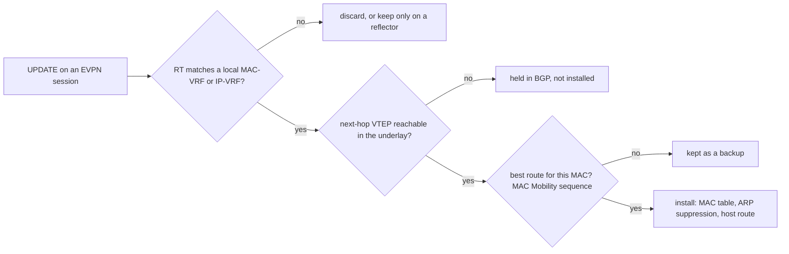

A VXLAN tunnel can carry a tenant's frame from one leaf to another, but someone has to tell the ingress leaf *which* leaf. Plain VXLAN answers the way an Ethernet switch does: flood the first frame to every leaf in the segment and learn the sender's location from whatever comes back. On a segment spread over 50 leaves and two continents, every unknown destination and every ARP request reaches all 49 other leaves, some copies crossing a 10,500 km circuit, and a host that moves stays pointed at its old leaf until it speaks or a five-minute timer expires.

EVPN (Ethernet VPN) replaces that guessing with a control plane. A leaf that learns a host on its own port tells every other leaf in a BGP route: this MAC, with this IP, lives behind my VTEP, in this segment. Remote leaves install the location before the first frame is sent, answer ARP on the host's behalf, and learn about a move from a sequence number rather than a timer. This lesson follows `acme-web1` through that process on Meridian.

Reminders: a **VTEP** (VXLAN tunnel endpoint) is the leaf function that wraps and unwraps tenant frames, addressed by the leaf's loopback (`leaf1.ams` is `10.255.1.11`); a **VNI** is the 24-bit segment number in the VXLAN header ([VXLAN encapsulation](/learn/fabric-networking/overlays-vxlan-evpn/vxlan-encapsulation)). Acme's VLAN 100 is VNI 10100 on `leaf1.ams`, `leaf3.ams`, `leaf4.ams`, `leaf1.sin` and `leaf2.sin`; `leaf2.ams` carries only Globex (VNI 10200). Leaves run iBGP in AS 65000 to their site's reflector pair ([route reflectors](/learn/fabric-networking/bgp-fundamentals/route-reflectors)), and reflectors of different sites peer.

## From flood-and-learn to a control plane

A classic switch learns from the data plane: the source MAC of each arriving frame, against the port ([switches, VLANs and loops](/learn/fabric-networking/from-zero/switches-vlans-and-loops)). Flood-and-learn VXLAN does the same across tunnels, learning "MAC X is behind VTEP 10.255.1.11" from a decapsulated frame's outer source address. So flooding is the only way to find anyone, a migrated host is found only when it speaks or its old entry ages out (commonly after 300 s), and learning happens in hardware, where nothing can filter or audit it.

EVPN moves learning into BGP. Learning on a leaf's own access ports stays in the data plane; learning *across* the fabric happens only through routes, and a remote leaf never learns a MAC from a decapsulated frame. MAC locations become routing information, with BGP's machinery: reliable transport, reflectors, policy, withdrawal, and a queryable table.

Some terms come with it. An **L2VNI** is the VNI of one layer-2 segment (10100); an **L3VNI** is a VNI that carries a tenant's *routed* traffic between leaves (50001 for Acme). A **MAC-VRF** is a leaf's per-segment MAC table, the EVPN version of a VLAN's forwarding table; on Meridian each L2VNI has one. An **EVI** (EVPN instance) is the segment as a whole, across every leaf that carries it. The tenant's IP routing table is an **IP-VRF**, here VRF ACME; [VRFs and multi-tenancy](/learn/fabric-networking/overlays-vxlan-evpn/vrfs-and-multi-tenancy) builds it.

**What it solves:** every leaf knows every host's location without flooding. **How it breaks:** a route sent but not imported, or imported but not installed, leaves a host unreachable while every BGP session is green. **Signal:** per-VNI route counts on each leaf compared with what the reflector holds.

## The address family: AFI 25, SAFI 70

EVPN is an **address family** of multiprotocol BGP, a kind of route a session carries once both ends announce it in their OPENs ([BGP sessions and the FSM](/learn/fabric-networking/bgp-fundamentals/bgp-sessions-and-the-fsm)). Its identifiers are AFI 25 (layer-2 VPN) and SAFI 70 (EVPN), defined in RFC 7432 (2015); RFC 8365 (2018) adapted it to VXLAN.

An EVPN route travels in an ordinary UPDATE inside MP_REACH_NLRI (attribute 14: AFI, SAFI, next hop, routes); withdrawals use MP_UNREACH_NLRI (attribute 15) ([updates, attributes and RIBs](/learn/fabric-networking/bgp-fundamentals/updates-attributes-and-ribs)). The next hop is the advertising leaf's VTEP address. Each route, the **NLRI** (network layer reachability information, BGP's word for "the thing advertised"), starts with a 1-byte type and a 1-byte length, so a receiver can skip unknown types.

Two conventions matter before the bytes:

- **Labels carry VNIs.** EVPN was written for MPLS, so its routes have 3-byte "MPLS label" fields; over VXLAN, RFC 8365 puts the 24-bit VNI in them. Read "label 1" as the L2VNI and "label 2" as the L3VNI.
- **Most of the meaning is in extended communities.** These are 8-byte tags attached to the route (RFC 4360), each with a type, a subtype and a value:

| Extended community | Type / subtype | Value on `acme-web1`'s route | What reads it |
|---|---|---|---|
| Route target | 0x00 / 0x02 | 65000:10100 and 65000:50001 | Every receiver: import or discard |
| Encapsulation | 0x03 / 0x0c | tunnel type 8, VXLAN | Receiver: which data plane reaches the next hop |
| Router's MAC | 0x06 / 0x03 | `00:00:5e:00:53:80` (`leaf1.ams`) | Receivers routing to this host: the inner destination MAC (RFC 9135) |
| MAC Mobility | 0x06 / 0x00 | absent on a first advertisement (counts as sequence 0) | MAC-VRF: which of several routes for one MAC is current |

## Five route types at a glance

| Type | Name | Says | Sent by | In depth |
|---|---|---|---|---|
| 1 | Ethernet auto-discovery | "I am attached to Ethernet segment E" (per segment and per EVI) | Multihomed leaves | [EVPN multihoming](/learn/fabric-networking/overlays-vxlan-evpn/evpn-multihoming) |
| 2 | MAC/IP advertisement | "MAC M, optionally with IP I, is behind me in VNI V" | Every leaf, per local host | Here |
| 3 | Inclusive multicast Ethernet tag (IMET) | "I carry VNI V; send its flooded traffic to me" | Every leaf, per VNI | Here, then [BUM traffic](/learn/fabric-networking/overlays-vxlan-evpn/bum-traffic) |
| 4 | Ethernet segment | "I share segment E", for electing who forwards floods to it | Multihomed leaves | [EVPN multihoming](/learn/fabric-networking/overlays-vxlan-evpn/evpn-multihoming) |
| 5 | IP prefix | "Prefix P is reachable through me in IP-VRF X" | Leaves and border gateways | Here (RFC 9136) |

A fabric whose servers attach to a single leaf, or to a vendor MLAG pair (two switches posing as one to the server) rather than EVPN multihoming, sends only types 2, 3 and 5; types 1 and 4 appear when an Ethernet segment identifier is non-zero. Later RFCs add types 6 to 11 for optimising multicast, which most VXLAN fabrics do not use.

## Traced: one MAC, learned once, known everywhere

`acme-web1` (`10.1.1.10`, MAC `00:00:5e:00:53:0a`) boots on port 1 of `leaf1.ams`. The visualisation below steps through the same run.

1. **Local learning.** `acme-web1` broadcasts an ARP request for its gateway `10.1.1.1` ([ARP and the default gateway](/learn/fabric-networking/from-zero/arp-and-the-default-gateway)). `leaf1.ams` learns two facts from that frame: the source MAC is on port 1 in VLAN 100 (VNI 10100), and the ARP sender fields bind `10.1.1.10` to it. Every Acme leaf owns the anycast gateway `10.1.1.1`, so `leaf1.ams` answers with the gateway MAC `00:00:5e:00:01:01`.
2. **Origination.** `leaf1.ams` builds one type-2 route: RD `10.255.1.11:10100`, MAC, IP, label 1 = 10100, label 2 = 50001, next hop `10.255.1.11`, route targets 65000:10100 and 65000:50001. It sends it to `rr1.ams` and `rr2.ams`.
3. **Reflection.** `rr1.ams` adds ORIGINATOR_ID `10.255.1.11` and CLUSTER_LIST `10.255.1.101` (loop protection) and reflects the route to its other clients and to `rr1.sin`. It installs nothing: a reflector has no VNIs and sits outside the data path.
4. **Import decision.** `leaf2.ams` imports only Globex's 65000:10200 and 65000:50002. Neither matches, so it discards the route. `leaf3.ams` and `leaf4.ams` import it.
5. **Across sites.** `rr1.sin` reflects it to its own clients with CLUSTER_LIST `10.255.2.101, 10.255.1.101`; NEXT_HOP is still `10.255.1.11`. That session crosses the Amsterdam–Singapore circuit: 10,500 km at about 5 µs per km is 52.5 ms one way.
6. **Installation.** `leaf2.sin` imports the route, resolves `10.255.1.11` through IS-IS, and writes three entries: the MAC behind VTEP `10.255.1.11` in VNI 10100, `10.1.1.10 → 00:00:5e:00:53:0a` for ARP suppression, and `10.1.1.10/32` in VRF ACME via L3VNI 50001.
7. **Suppression.** Later `acme-web2` (`10.1.1.11`) broadcasts "who has 10.1.1.10?". `leaf2.sin` answers on `acme-web1`'s behalf, and no copy leaves the leaf.

Within a site this takes milliseconds to tens of milliseconds, set by BGP processing and hardware programming. The remote site is one long-haul delay later, unless a minimum advertisement interval holds updates (data-center profiles use 0; RFC 4271 suggests 5 s for iBGP).

```viz
{"type": "fabric", "scenario": "evpn-mac-learning", "title": "EVPN: one MAC learned at leaf1.ams, reflected, filtered by route target, installed at leaf2.sin and answered by ARP suppression", "caption": "acme-web1's ARP for its gateway teaches leaf1.ams its MAC and IP. leaf1.ams sends one type-2 route (RD 10.255.1.11:10100, VNIs 10100 and 50001) to rr1.ams, which adds ORIGINATOR_ID and CLUSTER_LIST and reflects it. Globex-only leaf2.ams discards it for lack of a matching route target; rr1.sin reflects it to leaf2.sin, which installs the MAC behind VTEP 10.255.1.11 and later answers acme-web2's ARP for 10.1.1.10 itself, so nothing is flooded."}
```

## Type 2: the MAC/IP advertisement

Type 2 is the route that answers "where does this host live?". Its fields, as `leaf1.ams` sends them:

| Field | Size | Value for `acme-web1` | What reads it |
|---|---|---|---|
| Route type, length | 1 + 1 bytes | 2, 40 | Parser |
| Route distinguisher | 8 bytes | `10.255.1.11:10100` | BGP: makes the route unique (next sections) |
| Ethernet segment identifier (ESI) | 10 bytes | 0 (single-homed) | Multihoming: non-zero when the host is attached to two leaves |
| Ethernet tag ID | 4 bytes | 0 | 0 in the common one-VNI-per-VLAN service; the VNI in a "VLAN-aware bundle" |
| MAC address length, MAC | 1 + 6 bytes | 48, `00:00:5e:00:53:0a` | MAC-VRF: the bridging entry |
| IP address length, IP | 1 + 0, 4 or 16 bytes | 32, `10.1.1.10` | ARP/ND suppression table; host route in the IP-VRF |
| Label 1 | 3 bytes | 10100 | Ingress leaf bridging to this MAC: the VNI to write in the VXLAN header |
| Label 2 (optional) | 3 bytes | 50001 | Ingress leaf routing to this host: the L3VNI ([symmetric IRB](/learn/fabric-networking/overlays-vxlan-evpn/vrfs-and-multi-tenancy)) |

Many implementations send two type-2 routes per host, a MAC-only route (IP length 0) and a MAC/IP route, with different keys. The code builds type 2, 3 and 5 routes as the field tables lay them out and parses them back into the bracketed form FRRouting prints.

```python
import socket
import struct


def rd_type1(ip, number):
    # Route distinguisher type 1: 2-byte type, 4-byte IPv4 address, 2-byte number.
    if number > 0xFFFF:
        raise ValueError(f"RD number {number} does not fit in 16 bits")
    return struct.pack("!H4sH", 1, socket.inet_aton(ip), number)


def vni_label(vni):
    # EVPN over VXLAN reuses the 3-byte MPLS label field to carry the whole 24-bit VNI.
    return vni.to_bytes(3, "big")


def mac_bytes(mac):
    return bytes(int(octet, 16) for octet in mac.split(":"))


def nlri(route_type, body):
    return struct.pack("!BB", route_type, len(body)) + body


def type2(rd, mac, ip, l2vni, l3vni=None, esi=bytes(10), tag=0):
    body = rd + esi + struct.pack("!I", tag)
    body += struct.pack("!B", 48) + mac_bytes(mac)
    body += struct.pack("!B", 32) + socket.inet_aton(ip) if ip else struct.pack("!B", 0)
    body += vni_label(l2vni) + (vni_label(l3vni) if l3vni else b"")
    return nlri(2, body)


def type3(rd, originator, tag=0):
    body = rd + struct.pack("!IB", tag, 32) + socket.inet_aton(originator)
    return nlri(3, body)


def type5(rd, prefix, length, l3vni, gw_ip="0.0.0.0", esi=bytes(10), tag=0):
    body = rd + esi + struct.pack("!IB", tag, length)
    body += socket.inet_aton(prefix) + socket.inet_aton(gw_ip) + vni_label(l3vni)
    return nlri(5, body)


def parse(b):
    rtype, length = b[0], b[1]
    v = b[2:2 + length]
    rd = f"{socket.inet_ntoa(v[2:6])}:{struct.unpack('!H', v[6:8])[0]}"
    if rtype == 2:
        tag = struct.unpack("!I", v[18:22])[0]
        mac = ":".join(f"{x:02x}" for x in v[23:29])
        iplen = v[29]
        ip = socket.inet_ntoa(v[30:34]) if iplen == 32 else None
        i = 30 + iplen // 8
        labels = [int.from_bytes(v[j:j + 3], "big") for j in range(i, len(v), 3)]
        return f"[2]:[{tag}]:[48]:[{mac}]:[{iplen}]:[{ip or ''}] RD {rd} VNIs {labels}"
    if rtype == 3:
        tag = struct.unpack("!I", v[8:12])[0]
        return f"[3]:[{tag}]:[32]:[{socket.inet_ntoa(v[13:17])}] RD {rd}"
    if rtype == 5:
        tag, plen = struct.unpack("!IB", v[18:23])
        pfx, gw = socket.inet_ntoa(v[23:27]), socket.inet_ntoa(v[27:31])
        return f"[5]:[{tag}]:[{plen}]:[{pfx}] RD {rd} gw-ip {gw} L3VNI {int.from_bytes(v[31:34], 'big')}"
    return f"type {rtype}"


routes = {
    "type-2 acme-web1": type2(rd_type1("10.255.1.11", 10100), "00:00:5e:00:53:0a", "10.1.1.10", 10100, 50001),
    "type-2 MAC only": type2(rd_type1("10.255.1.11", 10100), "00:00:5e:00:53:0a", None, 10100),
    "type-3 leaf1.ams": type3(rd_type1("10.255.1.11", 10100), "10.255.1.11"),
    "type-5 10.1.2.0/24": type5(rd_type1("10.255.1.13", 50001), "10.1.2.0", 24, 50001),
}
for name, b in routes.items():
    print(f"{name:<19} {len(b):>2} bytes  {b.hex(' ')}")
    print(f"{'':<19} {parse(b)}")
try:
    rd_type1("10.255.1.11", 5000001)
except ValueError as e:
    print("RD for VNI 5000001:", e)
```

```text
type-2 acme-web1    42 bytes  02 28 00 01 0a ff 01 0b 27 74 00 00 00 00 00 00 00 00 00 00 00 00 00 00 30 00 00 5e 00 53 0a 20 0a 01 01 0a 00 27 74 00 c3 51
                    [2]:[0]:[48]:[00:00:5e:00:53:0a]:[32]:[10.1.1.10] RD 10.255.1.11:10100 VNIs [10100, 50001]
type-2 MAC only     35 bytes  02 21 00 01 0a ff 01 0b 27 74 00 00 00 00 00 00 00 00 00 00 00 00 00 00 30 00 00 5e 00 53 0a 00 00 27 74
                    [2]:[0]:[48]:[00:00:5e:00:53:0a]:[0]:[] RD 10.255.1.11:10100 VNIs [10100]
type-3 leaf1.ams    19 bytes  03 11 00 01 0a ff 01 0b 27 74 00 00 00 00 20 0a ff 01 0b
                    [3]:[0]:[32]:[10.255.1.11] RD 10.255.1.11:10100
type-5 10.1.2.0/24  36 bytes  05 22 00 01 0a ff 01 0d c3 51 00 00 00 00 00 00 00 00 00 00 00 00 00 00 18 0a 01 02 00 00 00 00 00 00 c3 51
                    [5]:[0]:[24]:[10.1.2.0] RD 10.255.1.13:50001 gw-ip 0.0.0.0 L3VNI 50001
RD for VNI 5000001: RD number 5000001 does not fit in 16 bits
```

Read the first line after the type (`02`) and length (`28`, 40): `00 01` RD type 1, `0a ff 01 0b` 10.255.1.11, `27 74` 10100; ten zero bytes of ESI and four of Ethernet tag; `30` MAC length 48 and the MAC; `20` IP length 32 and `0a 01 01 0a`; then `00 27 74` (10100) and `00 c3 51` (50001), the two VNIs in label fields. The last line is a design limit: a type-1 RD has 16 bits for its number, so "loopback:VNI" breaks above VNI 65,535, one reason implementations derive the RD from the router ID plus a locally assigned index.

### What a leaf does with a type-2 it receives

Getting the route is not the same as using it. A receiver runs a pipeline, and each step can stop it:



The install itself can fail too (a full hardware MAC table, a VNI configured but down). The BGP session stays Established through every one of these stops, so each needs its own signal.

**What type 2 solves:** remote MAC and IP learning without flooding. **How it breaks:** not imported (route target), not installed (next hop, hardware), or the wrong one installed (mobility). **Signal:** for one MAC, the reflector's routes against each leaf's MAC entry and next hop.

## Type 3: "send me this VNI's floods"

Some traffic must still be flooded: broadcasts, multicast, and unicast to a MAC nobody has advertised yet, together called **BUM** traffic. Type 3 tells every leaf which VTEPs want a copy.

| Field | Size | Value from `leaf1.ams` | What reads it |
|---|---|---|---|
| Route type, length | 1 + 1 bytes | 3, 17 | Parser |
| Route distinguisher | 8 bytes | `10.255.1.11:10100` | BGP uniqueness |
| Ethernet tag ID | 4 bytes | 0 | As in type 2 |
| Originating router's IP length, IP | 1 + 4 bytes | 32, `10.255.1.11` | Receiver: the VTEP to add to the flood list |
| PMSI tunnel attribute (path attribute 22) | 9 bytes | tunnel type 6 (ingress replication), label 10100, endpoint `10.255.1.11` | Receiver: how to deliver the copies, and in which VNI |
| Route target | extended community | 65000:10100 only | Import into the MAC-VRF; type 3 carries no L3 route target |

Each leaf sends one type-3 route per VNI it carries, so the count is leaves × VNIs: 16 leaves with 200 VNIs each make 3,200 routes. A receiver turns the imported ones into a **flood list** per VNI. In Meridian's VNI 10100, `leaf1.ams` imports four (from `leaf3.ams`, `leaf4.ams`, `leaf1.sin` and `leaf2.sin`), so a broadcast from `acme-web1` becomes four unicast VXLAN copies. Type 3 is the segment's membership signal: withdraw it and the leaf drops out of every other leaf's flood list. Replication cost and the multicast alternative (tunnel type 3 or 4 with a group address) are in [BUM traffic](/learn/fabric-networking/overlays-vxlan-evpn/bum-traffic).

**What type 3 solves:** each leaf knows exactly who must get a copy of a flood, with no multicast in the underlay. **How it breaks:** a leaf that has the VNI but sends no type 3 (some implementations advertise only when the VNI is up with at least one active port) never receives floods: hosts known through type 2 stay reachable, first contact to the others fails. **Signal:** flood-list length per VNI differing between leaves that carry the same VNI.

## Type 5: IP prefixes

Type 2 describes hosts. Type 5 (RFC 9136) describes prefixes, with no MAC at all:

| Field | Size | Value: `leaf3.ams` advertising `10.1.2.0/24` | What reads it |
|---|---|---|---|
| Route type, length | 1 + 1 bytes | 5, 34 | Parser |
| Route distinguisher | 8 bytes | `10.255.1.13:50001` | BGP uniqueness, per leaf and per VRF |
| ESI | 10 bytes | 0 | Overlay index when a prefix is behind a multihomed segment |
| Ethernet tag ID | 4 bytes | 0 | Unused here |
| IP prefix length, IP prefix | 1 + 4 bytes | 24, `10.1.2.0` | IP-VRF routing table |
| Gateway IP | 4 bytes | 0.0.0.0 | Overlay index when non-zero; 0 in the interface-less model |
| Label | 3 bytes | 50001 | The L3VNI to encapsulate in |
| Route target, Router's MAC | extended communities | 65000:50001; `leaf3.ams`'s router MAC | IP-VRF import; the inner destination MAC |

Most VXLAN fabrics use the **interface-less** model: gateway IP 0, and the receiver routes to the next-hop VTEP in the L3VNI, using the Router's MAC community as the inner destination MAC. A non-zero gateway IP is an **overlay index**: it names a next hop inside the tenant (a virtual firewall, say, or in RFC 9136's interface-ful models the advertising leaf's own gateway address on an extra segment), which the receiver must resolve recursively through a type-2 route for that address. If it cannot, the prefix is not installed even though the BGP route is valid.

Type 5 has three common jobs on Meridian:

- **Subnets with silent hosts.** A host that has never sent a frame has no type-2 route; with `10.1.2.0/24` advertised by `leaf3.ams`, a packet for silent `10.1.2.30` still reaches a leaf that can ARP for it.
- **External routes:** `gw1.ams` and `gw2.ams`, as border leaves, advertise `0.0.0.0/0` into VRF ACME.
- **Summaries between sites,** and **prefixes behind a host** such as a tenant's virtual router.

Host routes from type 2 and prefixes from type 5 meet in the same IP-VRF, and longest-prefix match ([the routing table](/learn/fabric-networking/from-zero/the-routing-table)) picks between them. On `leaf2.sin` (illustrative output):

```text
leaf2.sin# show ip route vrf ACME                      (illustrative output)
B>* 0.0.0.0/0      via 10.255.1.201, vlan4001 onlink (EVPN type-5, L3VNI 50001)
                   via 10.255.1.202, vlan4001 onlink
C>* 10.1.1.0/24    is directly connected, vlan100 (anycast gateway 10.1.1.1)
B>* 10.1.1.10/32   via 10.255.1.11, vlan4001 onlink (EVPN type-2, label 2 = 50001)
B>* 10.1.2.0/24    via 10.255.1.13, vlan4001 onlink (EVPN type-5)
B>* 10.1.2.20/32   via 10.255.1.13, vlan4001 onlink (EVPN type-2)
```

Two lines teach the most. `10.1.1.0/24` is connected on *every* Acme leaf, because the subnet is stretched, so the `/24` says nothing about which leaf holds `10.1.1.10`; the `/32` from type 2 does, and lets the leaf route straight to `10.255.1.11` over the L3VNI. A leaf without VLAN 100 would otherwise send the packet to whichever leaf advertised the subnet, possibly on the wrong continent, to be bridged onward. A packet to `10.1.2.20` matches both the `/32` and the `/24`; the `/32` wins, and if `acme-db1` goes silent and its type-2 is withdrawn, the `/24` still delivers it to `leaf3.ams`.

**What type 5 solves:** routing to prefixes that are not individual hosts, with fewer routes. **How it breaks:** a prefix announced by several leaves under one shared RD collapses to one path at the reflector (unless ADD-PATH, the extension that lets a speaker send several paths per key, is enabled); a gateway-IP overlay index that does not resolve leaves the prefix uninstalled. **Signal:** per-VRF prefix counts and the number of paths per prefix on the leaves, compared with the reflector.

## Types 1 and 4, in brief

Both exist for **multihoming**, a server attached to two leaves at once through one Ethernet segment, named by a 10-byte ESI. Type 4 lets the two leaves discover that they share a segment and elect a **designated forwarder**, the one that delivers floods to it, so the server does not get two copies. Type 1 comes in two forms. Sent per EVI, it lets a remote leaf send unicast to both leaves even for a MAC only one of them advertised ("aliasing"). Sent per segment, withdrawing it removes every MAC behind the segment in one message ("mass withdrawal") instead of one type-2 withdrawal per MAC. [EVPN multihoming](/learn/fabric-networking/overlays-vxlan-evpn/evpn-multihoming) works both through.

## Route distinguishers: making routes unique

BGP keeps one best path per destination key, and a reflector reflects only its best path ([route reflectors](/learn/fabric-networking/bgp-fundamentals/route-reflectors)). Tenants reuse addresses: `globex-app1` on `leaf2.ams` is `10.1.1.10`, the same IP as `acme-web1`. The **route distinguisher** (RD) is an 8-byte value prefixed to every EVPN route so that otherwise identical routes get different keys, and it means nothing beyond that.

| RD type | Layout (2-byte type + 6-byte value) | Example | Typical use |
|---|---|---|---|
| 0 | 2-byte AS : 4-byte number | 65000:10100 | Per-VRF RDs on 2-byte AS networks |
| 1 | 4-byte IPv4 address : 2-byte number | 10.255.1.11:10100 | Per-device RDs; the type RFC 7432 specifies for EVPN |
| 2 | 4-byte AS : 2-byte number | 4200000000:100 | 4-byte AS networks |

Meridian's rule, `<loopback>:<vni>`, makes every route unique per leaf and per segment, which matters even within one tenant. If the three Amsterdam leaves carrying VNI 10100 each advertise `10.1.1.0/24` as type 5, per-leaf RDs make three routes, all reflected, and receivers spread traffic over three next hops. With one shared RD the reflector sees one route with three paths and reflects only its best: the hidden-path problem. Copied *across tenants*, a shared RD destroys one tenant's route outright, the incident traced in [the overlay packet walk](/learn/fabric-networking/overlays-vxlan-evpn/the-overlay-packet-walk).

**What the RD solves:** identical tenant addresses and identical prefixes from different leaves stay distinct in BGP. **How it breaks:** a duplicated RD, usually from a copied template, makes the reflector choose between routes that should coexist, and paths disappear without an error. **Signal:** one RD originated by two next hops.

## Route targets: who imports what

The RD answers "is this the same route?"; the **route target** (RT) answers "who wants it?". An RT is an extended community: the exporter attaches one or more, and each MAC-VRF and IP-VRF imports every route carrying any RT on its import list. A leaf (not a reflector) discards a route nothing imports.

| Field | Size | Value | Meaning |
|---|---|---|---|
| Type, subtype | 1 + 1 bytes | 0x00, 0x02 | Two-byte-AS route target |
| Global administrator | 2 bytes | 65000 | Meridian's overlay AS |
| Local administrator | 4 bytes | 10100 or 50001 | The VNI |

A type-2 route carries two RTs because it serves two tables: 65000:10100 for the MAC-VRF of VNI 10100 (bridging) and 65000:50001 for VRF ACME (the host route). Type 3 carries only the L2 RT and type 5 only the L3 RT. `leaf2.sin` imports `acme-web1`'s route into both tables; `leaf2.ams` (Globex) imports it into neither, which is the isolation between tenants.

Three production details:

- **Auto-derivation.** Many implementations derive RTs as `AS:VNI`, every leaf deriving 65000:10100 in Meridian's iBGP overlay; RFC 8365 defines a more elaborate encoding, and vendors differ, so mixed-vendor fabrics often set RTs explicitly. Where every leaf has its own AS, auto-derived RTs differ per leaf (65101:10100, 65102:10100); FRRouting, for example, matches auto-derived imports on the VNI alone, but a hand-configured import RT is matched exactly and can silently stop imports.
- **Reflectors keep everything,** having no VRFs. A leaf discards what it does not import, and asks for the table again with ROUTE-REFRESH when a new VRF is added.
- **RT constraint** (RFC 4684) lets each leaf tell the reflector which RTs it imports, so `leaf2.ams` would not even be sent Acme's routes. It matters at hundreds of thousands of routes, and support for it in EVPN varies by implementation.

**What the RT solves:** distribution policy, which tenant's routes land in which table. **How it breaks:** a typo in one leaf's import RT leaves the session up, the routes on the reflector and nothing imported, so that leaf's hosts reach their local neighbours but nobody remote. **Signal:** zero imported routes in a VNI on a leaf while its peers hold hundreds, and the RT on the route (shown only in detailed output) against the leaf's import list.

## MAC mobility: who has the MAC now?

`acme-web1` is live-migrated to a server behind `leaf4.ams` and announces itself with a gratuitous ARP (an unsolicited ARP announcing its own binding; some hypervisors send RARP). Now two type-2 routes exist for one MAC, with RDs `10.255.1.11:10100` and `10.255.1.14:10100`. Different RDs make them different BGP routes that best-path selection never compares, so something else must say which is current.

RFC 7432 adds the **MAC Mobility extended community**: a 1-byte flags field (with a "sticky" bit), a reserved byte, and a 4-byte sequence number. The rules:

1. A first advertisement carries no community, which counts as sequence 0.
2. A leaf that learns a MAC locally while it holds a remote route for that MAC advertises it with **one more than the highest sequence it has seen**: `leaf4.ams` sends sequence 1.
3. Every receiver installs the route with the highest sequence. If two routes have the same sequence, the one from the lower VTEP address wins.
4. The old owner, on receiving a higher sequence for a MAC it learned locally, flushes its local entry and **withdraws its own route**.
5. A route with the sticky bit set (a static MAC, such as a gateway's) must not move. A sticky MAC seen elsewhere is an alarm, often spoofing.

The second run continues the first and shows rules 2 to 4. The remote site converges about one long-haul delay (about 53 ms) plus BGP processing after the gratuitous ARP, the same order as the tens to hundreds of milliseconds a live migration pauses its VM.

```viz
{"type": "fabric", "scenario": "evpn-mac-learning", "variant": "mac-move", "title": "MAC mobility: acme-web1 moves to leaf4.ams and sequence number 1 wins everywhere", "caption": "The first thirteen steps repeat the run above. After a live migration, leaf4.ams learns the MAC from a gratuitous ARP and advertises it under its own RD with MAC Mobility sequence 1; leaf2.sin, holding two routes, installs the higher sequence and points the MAC at 10.255.1.14; leaf1.ams withdraws its route; the last step gives the duplicate-MAC rule of 5 moves within 180 s."}
```

### Duplicate MACs

A MAC that keeps moving is rarely a VM on tour: usually two hosts share a MAC (a cloned VM), or a layer-2 loop reflects one host's frames back into the fabric. Each move bumps the sequence and every leaf reinstalls. RFC 7432's defence: a leaf that sees a MAC move **5 times within 180 seconds** alerts and stops advertising it. Implementations add their own defaults and a recovery timer.

The simulator models import by RT, the sequence rule, the old owner's withdrawal and duplicate detection. Part one is the visualisation's run plus an ARP miss; part two is a cloned VM talking from both `leaf1.ams` and `leaf4.ams`.

```python
import ipaddress
from dataclasses import dataclass

MAX_MOVES, WINDOW_S = 5, 180          # RFC 7432's suggested duplicate-MAC defaults
LOG = []


@dataclass(frozen=True)
class Type2:
    rd: str
    vni: int
    mac: str
    ip: str
    next_hop: str
    rts: frozenset
    seq: int = 0                       # MAC Mobility sequence; absent counts as 0


class Reflector:
    """Keeps every route whatever its RTs, and reflects it to every other client."""
    def __init__(self):
        self.clients, self.table = [], {}

    def update(self, t, route, sender):
        self.table[(route.rd, route.mac)] = route
        for leaf in self.clients:
            if leaf is not sender:
                leaf.receive(t, route)

    def withdraw(self, t, route, sender):
        self.table.pop((route.rd, route.mac), None)
        for leaf in self.clients:
            if leaf is not sender:
                leaf.receive_withdraw(route)


class Leaf:
    def __init__(self, name, vtep, rr, imports):
        self.name, self.vtep, self.rr, self.imports = name, vtep, rr, imports  # imports: {RT: VNI}
        self.remote = {}              # (vni, mac) -> {rd: Type2}, every imported route
        self.local = {}               # (vni, mac) -> the route this leaf advertises
        self.fdb, self.arp = {}, {}   # what forwarding uses: MAC table, ARP-suppression table
        self.moves, self.frozen = {}, set()
        rr.clients.append(self)

    def say(self, t, text):
        LOG.append(f"{t:>4}s {self.name:<10} {text}")

    def best_remote(self, key):
        routes = self.remote.get(key, {}).values()
        # Highest sequence wins; on a tie, the lower originating VTEP address.
        return max(routes, key=lambda r: (r.seq, -int(ipaddress.ip_address(r.next_hop))), default=None)

    def count_move(self, t, key):
        recent = [x for x in self.moves.get(key, []) if t - x < WINDOW_S] + [t]
        self.moves[key] = recent
        if len(recent) >= MAX_MOVES:
            self.frozen.add(key)
            self.say(t, f"DUPLICATE {key[1]}: {len(recent)} moves in {WINDOW_S}s, stop advertising it")

    def learn_local(self, t, vni, mac, ip, port):
        key = (vni, mac)
        if key in self.frozen:
            return self.say(t, f"{mac} seen on {port}: frozen as a duplicate, not advertised")
        if key in self.local:
            return                                 # already ours: a refresh, nothing to send
        rival = self.best_remote(key)
        if rival:
            self.count_move(t, key)                # local learn over a remote route = a move
            if key in self.frozen:
                return
        seq = rival.seq + 1 if rival else 0        # one higher than the route it replaces
        route = Type2(f"{self.vtep}:{vni}", vni, mac, ip, self.vtep, frozenset({f"65000:{vni}"}), seq)
        self.local[key] = route
        self.fdb[key], self.arp[(vni, ip)] = f"local {port}", mac
        self.say(t, f"learned {mac} on {port}: advertise type-2, sequence {seq}")
        self.rr.update(t, route, self)

    def receive(self, t, route):
        vni = next((self.imports[rt] for rt in route.rts if rt in self.imports), None)
        if vni is None:
            return self.say(t, f"{route.mac} with RT {', '.join(sorted(route.rts))}: no import match, discarded")
        key = (vni, route.mac)
        self.remote.setdefault(key, {})[route.rd] = route
        mine = self.local.get(key)
        if mine and route.seq > mine.seq:          # the MAC lives elsewhere now: give way
            self.say(t, f"sequence {route.seq} from {route.next_hop} beats mine ({mine.seq}): flush, withdraw")
            del self.local[key]
            self.count_move(t, key)
            self.rr.withdraw(t, mine, self)
        if key not in self.local:
            best = self.best_remote(key)
            self.fdb[key], self.arp[(vni, best.ip)] = f"VTEP {best.next_hop}", best.mac
            self.say(t, f"install {route.mac} -> VTEP {best.next_hop} (sequence {best.seq})")

    def receive_withdraw(self, route):
        for key, routes in self.remote.items():
            if key[1] == route.mac and routes.pop(route.rd, None) and key not in self.local:
                best = self.best_remote(key)
                self.fdb[key] = f"VTEP {best.next_hop}" if best else None

    def arp_request(self, t, vni, target_ip):
        mac = self.arp.get((vni, target_ip))
        self.say(t, f"ARP who-has {target_ip}: " + (f"answered locally with {mac}" if mac else "miss, flooded as BUM"))


rr = Reflector()
acme = {"65000:10100": 10100}
leaf1 = Leaf("leaf1.ams", "10.255.1.11", rr, acme)
leaf2 = Leaf("leaf2.ams", "10.255.1.12", rr, {"65000:10200": 10200})   # Globex only
leaf4 = Leaf("leaf4.ams", "10.255.1.14", rr, acme)
leaf2s = Leaf("leaf2.sin", "10.255.2.12", rr, acme)
WEB1 = "00:00:5e:00:53:0a"

leaf1.learn_local(0, 10100, WEB1, "10.1.1.10", "port 1")
leaf2s.arp_request(5, 10100, "10.1.1.10")
leaf2s.arp_request(6, 10100, "10.1.1.50")                    # a silent host: nobody advertised it
leaf4.learn_local(60, 10100, WEB1, "10.1.1.10", "port 3")    # acme-web1 live-migrated
print("\n".join(LOG))

LOG.clear()
# A cloned VM keeps the same MAC and boots behind leaf1.ams: both copies keep talking.
for i, t in enumerate(range(300, 345, 5)):
    leaf, port = (leaf1, "port 1") if i % 2 == 0 else (leaf4, "port 3")
    leaf.learn_local(t, 10100, WEB1, "10.1.1.10", port)
print("\n".join(line for line in LOG if "leaf2" not in line))
print("leaf2.sin forwards", WEB1, "to", leaf2s.fdb[(10100, WEB1)])
```

```text
   0s leaf1.ams  learned 00:00:5e:00:53:0a on port 1: advertise type-2, sequence 0
   0s leaf2.ams  00:00:5e:00:53:0a with RT 65000:10100: no import match, discarded
   0s leaf4.ams  install 00:00:5e:00:53:0a -> VTEP 10.255.1.11 (sequence 0)
   0s leaf2.sin  install 00:00:5e:00:53:0a -> VTEP 10.255.1.11 (sequence 0)
   5s leaf2.sin  ARP who-has 10.1.1.10: answered locally with 00:00:5e:00:53:0a
   6s leaf2.sin  ARP who-has 10.1.1.50: miss, flooded as BUM
  60s leaf4.ams  learned 00:00:5e:00:53:0a on port 3: advertise type-2, sequence 1
  60s leaf1.ams  sequence 1 from 10.255.1.14 beats mine (0): flush, withdraw
  60s leaf1.ams  install 00:00:5e:00:53:0a -> VTEP 10.255.1.14 (sequence 1)
  60s leaf2.ams  00:00:5e:00:53:0a with RT 65000:10100: no import match, discarded
  60s leaf2.sin  install 00:00:5e:00:53:0a -> VTEP 10.255.1.14 (sequence 1)
 300s leaf1.ams  learned 00:00:5e:00:53:0a on port 1: advertise type-2, sequence 2
 300s leaf4.ams  sequence 2 from 10.255.1.11 beats mine (1): flush, withdraw
 300s leaf4.ams  install 00:00:5e:00:53:0a -> VTEP 10.255.1.11 (sequence 2)
 305s leaf4.ams  learned 00:00:5e:00:53:0a on port 3: advertise type-2, sequence 3
 305s leaf1.ams  sequence 3 from 10.255.1.14 beats mine (2): flush, withdraw
 305s leaf1.ams  install 00:00:5e:00:53:0a -> VTEP 10.255.1.14 (sequence 3)
 310s leaf1.ams  learned 00:00:5e:00:53:0a on port 1: advertise type-2, sequence 4
 310s leaf4.ams  sequence 4 from 10.255.1.11 beats mine (3): flush, withdraw
 310s leaf4.ams  install 00:00:5e:00:53:0a -> VTEP 10.255.1.11 (sequence 4)
 315s leaf4.ams  learned 00:00:5e:00:53:0a on port 3: advertise type-2, sequence 5
 315s leaf1.ams  sequence 5 from 10.255.1.14 beats mine (4): flush, withdraw
 315s leaf1.ams  install 00:00:5e:00:53:0a -> VTEP 10.255.1.14 (sequence 5)
 320s leaf1.ams  DUPLICATE 00:00:5e:00:53:0a: 5 moves in 180s, stop advertising it
 330s leaf1.ams  00:00:5e:00:53:0a seen on port 1: frozen as a duplicate, not advertised
 340s leaf1.ams  00:00:5e:00:53:0a seen on port 1: frozen as a duplicate, not advertised
leaf2.sin forwards 00:00:5e:00:53:0a to VTEP 10.255.1.14
```

Trace the second part by hand. Each copy's frame makes its leaf advertise one higher than the other's route, and the other leaf flushes and withdraws: 2, 3, 4, 5. `leaf1.ams` counts a move each time it takes the MAC (300, 310 s) and each time it gives it up (305, 315 s); its move at 60 s has left the 180 s window. At 320 s the fifth move in the window freezes the MAC on `leaf1.ams`, and the fabric settles on `leaf4.ams`'s sequence-5 route. The clone behind `leaf1.ams` is now unreachable, which is the point: one wrong host is down instead of a churning segment, and the alert names the MAC.

**What MAC mobility solves:** a moved host is found in one route propagation instead of a timeout, and the fabric agrees on one location. **How it breaks:** duplicate MACs or loops turn it into churn, and duplicate detection then freezes a MAC that might belong to a real workload. **Signal:** MAC-move counters per MAC and per leaf, and duplicate-MAC alerts.

## ARP and ND suppression

Most broadcast traffic in a tenant segment is ARP. Each ARP request in VNI 10100 costs four VXLAN copies of 110 bytes (the 60-byte padded frame plus 50 bytes of outer headers); over 50 VTEPs it costs 49, and every host in the segment receives and discards each one. A boot storm of 1,000 VMs each resolving ten peers is 10,000 broadcasts, 490,000 packets and about 54 MB on the ingress uplinks, to learn bindings the fabric already knows.

**ARP suppression** uses the IP field of type-2 routes. Each leaf keeps per-VNI IP-to-MAC bindings, from its own hosts (ARP snooping, its gateway's ARP table) and from imported MAC/IP routes, and looks up each ARP request's target:

- **Hit:** the leaf replies itself with the remote host's MAC, as `leaf2.sin` does for `10.1.1.10`, and the request is never flooded.
- **Miss:** the request is flooded as BUM traffic to the flood list built from type 3, exactly as without suppression. RFC 9161 (2022) describes the operational details.

IPv6 does the same with Neighbor Discovery: a Neighbor Solicitation (ICMPv6 type 135, sent to the target's solicited-node multicast group) is answered with a Neighbor Advertisement (type 136) from a type-2 route whose IP length is 128. The reply must also set the R flag (whether the target is a router), which the leaf knows only if the advertising leaf sends it in an extra extended community, one reason ND suppression often arrives later than ARP suppression.

On a Linux network operating system the bridge answers in the kernel (the per-port `neigh_suppress` flag, since Linux 4.15). A switch ASIC usually traps ARP requests to the CPU, behind the control-plane policer that protects it ([planes, ASICs and NOSes](/learn/fabric-networking/from-zero/planes-asics-and-network-operating-systems)); in an ARP storm, dropped requests look to hosts like an unreachable neighbour.

**What suppression solves:** the bulk of BUM traffic disappears, and the fabric answers from bindings it learned once. **How it breaks:** bindings without IPs (no gateway interface or snooping in the VNI, so only MAC-only routes) give a hit rate of zero; a stale binding answers with the old MAC after a floating service address fails over to another host; the CPU policer drops replies in a storm. **Signal:** suppression hit and miss counters per VNI, the share of type-2 routes carrying an IP, and policer drops in the ARP class.

## Failure modes in production

| Failure | Symptom | Diagnosis | Fix |
|---|---|---|---|
| Import RT typo on one leaf | Its hosts reach each other but nothing remote; sessions Established | Reflector holds the routes; the leaf has zero imported in that VNI; RT on the routes differs from its import list | Correct the RT from the source of truth; validate RTs before deploy |
| Remote VTEP unreachable in the underlay | One leaf's hosts unreachable from everywhere; overlay black hole | Routes present but "not installed / next hop unresolved"; loopback missing from the IS-IS table | Fix the underlay ([underlay failures](/learn/fabric-networking/underlay/underlay-failures-in-production)) |
| Missing type-3 from a leaf | First contact to its hosts fails, established flows work | That VTEP absent from other leaves' flood lists for the VNI | Bring the VNI up or advertise it; alert on flood-list asymmetry |
| Duplicate MAC or layer-2 loop | One MAC flapping between leaves, reflector CPU high, then a frozen MAC | MAC Mobility sequence climbing fast; duplicate-MAC alert; on a loop, many MACs moving at once | Find the clone or the loop (often a server bridging two NICs); clear the freeze |
| Hardware MAC table full | New hosts unreachable, old ones fine; routes in BGP | Installed count below imported count; hardware table-full or install-failed counters | Narrow which VNIs each leaf carries, or use a larger table profile |
| Silent host aged out | Traffic to it flooded as unknown unicast, or dropped where that flooding is disabled, until it speaks | Its type-2 withdrawn after local MAC aging (300 s) while the hosts talking to it still hold ARP entries | Keep local aging at least the ARP timeout; type 5 for the subnet |
| Stale ARP-suppression binding | Clients reach the old host after a failover of a shared IP | Two type-2 routes for one IP with different MACs | Ensure the new owner sends a gratuitous ARP; check the platform's IP-move handling |

## Trade-offs: how remote MACs get learned

| | Flood-and-learn VXLAN | Static flood lists | BGP EVPN | Central controller |
|---|---|---|---|---|
| Remote MAC learning | Data plane, from decapsulated frames | Data plane | Control plane, type-2 routes | Controller pushes entries to VTEPs |
| Who gets flooded traffic | Multicast group per VNI | Configured VTEP list | Type-3 routes | Controller-computed lists |
| Host moves | On next frame, or aging (minutes) | Same as flood-and-learn | One update plus sequence number | Controller update |
| ARP handling | Flooded | Flooded | Suppressed from type-2 bindings | Often proxied by the controller |
| Multi-vendor | Yes | Yes | Yes, standard BGP | Usually one vendor's stack |
| Operating cost | Underlay multicast routing (PIM) | Every leaf edited when one is added | BGP and reflectors, which the fabric already runs | A controller cluster that can fail as one |

EVPN wins in most data centers because the fabric already runs BGP and its operators know how to debug it. Controllers survive where one vendor's virtualisation stack owns the hosts (VMware NSX, for example).

## Under the hood: EVPN on a Linux network operating system

On FRRouting-based systems (Cumulus Linux, SONiC and others), three components cooperate. The kernel's bridge learns local MACs in its forwarding database (FDB). `zebra`, FRRouting's interface to the kernel, sees each new entry through netlink and hands it to `bgpd`, which originates the type-2 route. In reverse, `zebra` writes imported routes into the kernel with an `extern_learn` flag (so the bridge does not age them out), and the switch's driver copies the kernel tables into the ASIC. On `leaf2.sin` (illustrative output):

```text
leaf2.sin$ bridge fdb show dev vxlan10100                 (illustrative output)
00:00:00:00:00:00 dst 10.255.1.11 self permanent           <- flood list, from type 3
00:00:00:00:00:00 dst 10.255.1.13 self permanent
00:00:00:00:00:00 dst 10.255.1.14 self permanent
00:00:00:00:00:00 dst 10.255.2.11 self permanent
00:00:5e:00:53:0a dst 10.255.1.11 self extern_learn         <- acme-web1, from type 2
leaf2.sin$ ip neigh show dev vlan100
10.1.1.10 lladdr 00:00:5e:00:53:0a extern_learn NOARP proto zebra
leaf2.sin# show bgp l2vpn evpn route type macip
Route Distinguisher: 10.255.1.11:10100
*>i[2]:[0]:[48]:[00:00:5e:00:53:0a]:[32]:[10.1.1.10]
                    10.255.1.11                   100      0 i
                    RT:65000:10100 RT:65000:50001 ET:8 Rmac:00:00:5e:00:53:80
```

The all-zero MAC entries are the flood list: the Linux VXLAN device sends a copy of every BUM frame to each `dst`. `ET:8` is the encapsulation community (VXLAN); the RTs appear only in this detailed view, which is why an RT typo hides from summary output. On a switch ASIC the same state lands in hardware tables of tens of thousands to a few hundred thousand MAC entries, depending on the chip and its table-sharing profile.

## What the platform should show

Tooling for an EVPN fabric answers "BGP is up, so why can't A reach B?". Surface:

- **Per leaf, per VNI: routes it should import (from the reflector), routes imported, entries installed.** Each gap names a stop in the receive pipeline: RT, next hop or hardware.
- **Flood-list symmetry:** every leaf carrying a VNI lists every other leaf carrying it.
- **MAC location history:** where a MAC lived, when it moved, its sequence number, duplicate-MAC events. A move rate rising across many MACs at once is a loop.
- **RD and RT lint at deploy time:** one RD from two next hops, an import RT that no route carries, and RTs that differ from the source of truth.
- **ARP suppression hit rate and BUM rate per VNI,** so "the fabric is flooding" becomes a number.
- **Data-plane proof beside route counts,** which are necessary but not sufficient: VTEP-to-VTEP probes ([active measurement](/learn/fabric-networking/operating-fabrics/active-measurement)).

Most of this is a join over state a collector already has ([telemetry and observability](/learn/fabric-networking/operating-fabrics/telemetry-and-observability)).

```python
from collections import Counter

# What a collector already has: the reflector's EVPN table (type, RD, key, next hop, RTs)
# and, per leaf, its VNIs, the VTEPs its underlay can reach, its flood lists and its MAC table.
rr_table = [
    (2, "10.255.1.11:10100", "00:00:5e:00:53:0a", "10.255.1.11", {"65000:10100", "65000:50001"}),
    (2, "10.255.1.13:10100", "00:00:5e:00:53:0c", "10.255.1.13", {"65000:10100", "65000:50001"}),
    (2, "10.255.1.12:10200", "00:00:5e:00:53:1a", "10.255.1.12", {"65000:10200", "65000:50002"}),
    (2, "10.255.1.14:10100", "00:00:5e:00:53:0d", "10.255.1.14", {"65000:10100", "65000:50001"}),
    (3, "10.255.1.11:10100", "10.255.1.11", "10.255.1.11", {"65000:10100"}),
    (3, "10.255.1.13:10100", "10.255.1.13", "10.255.1.13", {"65000:10100"}),
    (3, "10.255.1.14:10100", "10.255.1.14", "10.255.1.14", {"65000:10100"}),
    (3, "10.255.2.12:10100", "10.255.2.12", "10.255.2.12", {"65000:10100"}),
]
leaves = {
    "leaf2.sin": {"vtep": "10.255.2.12", "vnis": {10100},
                  "underlay": {"10.255.1.11", "10.255.1.13"},          # 10.255.1.14 missing
                  "flood": {10100: {"10.255.1.11", "10.255.1.13"}},
                  "macs": {"00:00:5e:00:53:0a": "10.255.1.11"}},       # 53:0c missing
    "leaf3.ams": {"vtep": "10.255.1.13", "vnis": {10100},
                  "underlay": {"10.255.1.11", "10.255.1.14", "10.255.2.12"},
                  "flood": {10100: {"10.255.1.11", "10.255.1.14"}},     # 10.255.2.12 missing
                  "macs": {"00:00:5e:00:53:0a": "10.255.1.11", "00:00:5e:00:53:0d": "10.255.1.14"}},
}
mac_moves_last_hour = Counter({"00:00:5e:00:53:0a": 1, "00:00:5e:00:53:2f": 212})


def audit(rr_table, leaves, moves):
    """Every route a leaf should have imported, checked against what it actually installed."""
    out = []
    for leaf, s in leaves.items():
        wanted = {f"65000:{vni}" for vni in s["vnis"]}
        for rtype, rd, key, nh, rts in rr_table:
            if nh == s["vtep"] or not rts & wanted:
                continue                                   # its own route, or not its tenant
            vni = int(rd.split(":")[1])
            if nh not in s["underlay"]:
                out.append(f"{leaf}: type-{rtype} {key} next hop {nh} unreachable in the underlay")
            elif rtype == 2 and s["macs"].get(key) != nh:
                out.append(f"{leaf}: type-2 {key} via {nh} imported but not in the MAC table")
            elif rtype == 3 and nh not in s["flood"].get(vni, set()):
                out.append(f"{leaf}: VTEP {nh} missing from the VNI {vni} flood list")
    out += [f"fabric: {mac} moved {n} times in an hour: a loop or a duplicate MAC"
            for mac, n in moves.most_common() if n >= 5]
    return out


print("\n".join(audit(rr_table, leaves, mac_moves_last_hour)))
```

```text
leaf2.sin: type-2 00:00:5e:00:53:0c via 10.255.1.13 imported but not in the MAC table
leaf2.sin: type-2 00:00:5e:00:53:0d next hop 10.255.1.14 unreachable in the underlay
leaf2.sin: type-3 10.255.1.14 next hop 10.255.1.14 unreachable in the underlay
leaf3.ams: VTEP 10.255.2.12 missing from the VNI 10100 flood list
fabric: 00:00:5e:00:53:2f moved 212 times in an hour: a loop or a duplicate MAC
```

Each line is a row of the failure table. Engineers want the line naming the leaf and the reason; managers want the count of affected tenants and its trend, from the same join.

## Interviewer follow-ups

**"How does a leaf in an EVPN fabric learn where a remote MAC lives?"** Model answer: the local leaf learns the MAC on its access port and the IP from ARP, then advertises a type-2 route with its VTEP as next hop and the VNI in label 1; reflectors pass it on, and receivers import by route target, resolve the next hop through the underlay and install it. No leaf learns a remote MAC from a decapsulated frame. Common wrong answer: "VXLAN floods the first packet and learns the reply" (flood-and-learn), or "the spines learn the MACs", when spines see only outer headers.

**"What is the difference between an RD and an RT?"** Model answer: the RD makes a route unique so BGP keeps routes that should coexist, with no policy meaning; the RT is the policy: exporters attach it, VRFs import by it. A duplicated RD hides paths or collapses tenants' routes; a wrong RT silently stops imports. Common wrong answer: "both identify the VRF", or "the RD decides which VRF imports a route".

**"A VM migrates. What stops the fabric pointing at the old leaf?"** Model answer: the new leaf advertises with a MAC Mobility sequence one higher than the route it replaces, every leaf installs the highest, and the old leaf withdraws; five moves in 180 s trigger duplicate detection. Common wrong answer: "the old entry ages out", which takes up to 300 s, or "BGP best path picks the newer route", when different RDs mean BGP never compares them.

**"ARP suppression is enabled, yet you still see ARP broadcasts crossing the fabric. Why?"** Model answer: misses are flooded by design (silent hosts, hosts known only from MAC-only routes), and many platforms still flood gratuitous ARPs. Measure hit and miss counters per VNI and the share of type-2 routes carrying an IP. Common wrong answer: "suppression is broken, turn it off".

**"When do you use type 5 rather than type 2?"** Model answer: type 2 for hosts in a stretched segment, which need the MAC for bridging and the `/32` because the subnet is connected everywhere; type 5 for prefixes: subnets (so silent hosts are reachable), default routes from border leaves, summaries, networks behind a tenant router. Common wrong answer: "type 5 replaces type 2 to save routes", which breaks bridging within the segment. An honest addition: "I'd defer to the network team on interface-less versus interface-ful type 5 on a given platform, but I'd measure prefix counts per VRF and alert on any type-5 route that is valid in BGP and absent from the VRF."

## What mid-level engineers get wrong

- **Treating "routes on the reflector" as "routes on the leaf".** Leaves import by RT and install only what resolves, so check the leaf's tables.
- **Copying RDs or RTs between devices.** A shared RD hides paths or merges tenants' routes; a copied RT can import one tenant's routes into another's VRF.
- **Expecting suppression to remove all flooding.** Misses, silent hosts and unknown unicast still need the type-3 flood lists, so BUM delivery must still work.

## Senior signals

- You say "learning across the fabric happens only in the control plane" and can name what each of types 2, 3 and 5 installs and where.
- You keep RD and RT apart in one sentence each: uniqueness versus import policy, with the failure each causes.
- You trace a received route through import, next-hop resolution, mobility selection and hardware install, knowing the session stays green through every failure on that path.
- You explain MAC mobility as a sequence-number protocol on top of BGP, needed because different RDs stop BGP from comparing the routes.
- You would build the reflector-versus-leaf join and the RD/RT lint before a dashboard of session states.

## Check yourself

```quiz
- q: >-
    leaf2.ams, which carries only Globex, receives acme-web1's type-2 route from rr1.ams and does not install it. Why?
  options: ["Its route targets 65000:10100 and 65000:50001 match no import list on leaf2.ams", "Its next hop 10.255.1.11 cannot be resolved through the Amsterdam underlay", "The reflector marked it with a CLUSTER_LIST that leaf2.ams rejects as a loop", "Its route distinguisher 10.255.1.11:10100 is not configured on leaf2.ams"]
  answer: 0
  explanation: >-
    Import is decided by route targets: leaf2.ams's MAC-VRF and VRF import only Globex's 65000:10200 and 65000:50002, so it discards the route. The RD only makes the route unique and is never matched against local configuration. The CLUSTER_LIST holds rr1.ams's cluster ID, not leaf2.ams's, so there is no loop, and 10.255.1.11 is reachable through IS-IS.
- q: >-
    After acme-web1 migrates, leaf2.sin holds two type-2 routes for 00:00:5e:00:53:0a: RD 10.255.1.11:10100 with no MAC Mobility community and RD 10.255.1.14:10100 with sequence 1. Which does it install, and why?
  options: ["Both, load-balanced, because different RDs make them equal-cost paths", "The one from 10.255.1.11, because a lower VTEP address breaks the tie", "The one from 10.255.1.11, because BGP prefers the older and more stable route", "The one from 10.255.1.14, because sequence 1 beats an absent community counting as 0"]
  answer: 3
  explanation: >-
    The route without a MAC Mobility community counts as sequence 0, and the highest sequence wins. The lower-address rule applies only when sequences are equal. BGP best path never compares the two because their RDs make them different routes, which is exactly why the sequence number exists. Load-balancing one MAC across two single-homed leaves would deliver half the frames to a leaf the host has left.
- q: >-
    On one VNI, ARP suppression is enabled on every leaf, yet its hit counter stays at zero while type-2 routes for all its hosts are present. What is the most likely cause?
  options: ["The type-2 routes are MAC-only, because the leaves learn no IP bindings in it", "The VTEPs are in different sites, so suppression answers only inside one site", "The type-3 routes for the VNI use ingress replication rather than multicast", "The route targets of the VNI are auto-derived instead of configured by hand"]
  answer: 0
  explanation: >-
    Suppression answers from IP-to-MAC bindings carried in MAC/IP routes. A leaf with no gateway interface or ARP snooping in that VNI learns only MACs and sends MAC-only routes, so there is nothing to answer from. The replication mode affects how misses are flooded, not hits; auto-derived RTs still import; and bindings are installed from routes regardless of site.
- q: >-
    leaf4.ams carries VNI 10100 but has stopped sending its type-3 route. What do you expect to see?
  options: ["All traffic to leaf4.ams's hosts stops, because the VTEP is withdrawn", "Other leaves stop sending it floods, so new ARP requests for its hosts fail", "Nothing, because type-2 routes already tell other leaves where its hosts are", "Duplicate frames at leaf4.ams's hosts, because floods arrive by two paths"]
  answer: 1
  explanation: >-
    Type 3 is how a leaf joins the flood list for a VNI. Without it, no other leaf sends it broadcasts or unknown unicast, so ARP requests for its hosts that miss suppression never arrive, while flows to hosts already known through type-2 routes keep working. The VTEP itself is still reachable, and duplicates are a multihoming problem, not this one.
- q: >-
    leaf2.sin has 10.1.2.0/24 from a type-5 route (next hop leaf3.ams) and 10.1.2.20/32 from a type-2 route (next hop leaf3.ams). Why advertise the /24 at all?
  options: ["So the /24 overrides the /32 when the two next hops disagree", "Because a /32 host route cannot be installed without a covering prefix", "Because type-2 routes carry no L3VNI, so routing needs the type-5", "So silent hosts in the subnet, which have no type-2 route, are still reachable"]
  answer: 3
  explanation: >-
    A host that has never sent a frame has no type-2 route; the /24 still brings packets for it to a leaf that has the subnet, which ARPs for it locally. Longest-prefix match picks the /32 whenever it exists, so the /24 never overrides it; host routes need no covering prefix; and symmetric-IRB type-2 routes carry the L3VNI in label 2.
- q: >-
    Two Amsterdam leaves advertise Acme's 10.1.1.0/24 as type 5 with the same RD, 65000:50001, instead of per-leaf RDs. What happens?
  options: ["Every leaf imports both routes and spreads traffic over the two next hops", "The routes are discarded because RDs must contain an IP address in EVPN", "The session to the reflector resets with an UPDATE error for the duplicate RD", "The reflector keeps one best path and reflects only that, so a path disappears"]
  answer: 3
  explanation: >-
    With one RD the two advertisements are the same route with two paths, and a reflector reflects only its best path, so receivers lose the second next hop without any error. Per-leaf RDs make them two routes, both reflected. A duplicate RD is not a protocol error, and although RFC 7432 asks for IP-based type-1 RDs, receivers do not discard routes over the RD's type.
```
