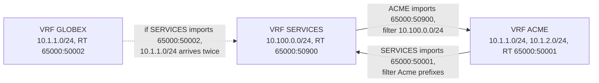

Meridian's Amsterdam fabric carries two customers who have never heard of each other and both chose `10.1.1.0/24`. Acme's `acme-web1` is `10.1.1.10` behind `leaf1.ams`; Globex's `globex-app1` is also `10.1.1.10`, behind `leaf2.ams`. Both use `10.1.1.1` as their default gateway, and every route crosses the same route reflectors in the same BGP autonomous system (AS 65000). Nothing may ever deliver an Acme packet to Globex, yet Acme must also route between its own two subnets, reach Meridian's shared DNS servers and reach the internet.

Five mechanisms do this, and interviews probe whether you keep them apart: a **VRF** gives each tenant its own routing table, a **route distinguisher** (RD) keeps identical prefixes apart inside BGP, a **route target** (RT) decides which VRF installs each route, a per-tenant **L3VNI** tells the receiving leaf which table to route in, and the **distributed anycast gateway** makes every leaf answer as `10.1.1.1`. Then come routing between subnets (asymmetric and symmetric IRB) and route leaking.

Two reminders. A VTEP (VXLAN tunnel endpoint) is a leaf that wraps a tenant's frame in an outer header addressed to another leaf's loopback; the VNI (VXLAN network identifier) is the 24-bit segment number in that header ([VXLAN encapsulation](/learn/fabric-networking/overlays-vxlan-evpn/vxlan-encapsulation)). EVPN is the BGP address family that tells leaves which tenant addresses sit behind which VTEP: type-2 routes for a MAC and IP, type 3 for flooding, type 5 for a prefix ([EVPN, the control plane](/learn/fabric-networking/overlays-vxlan-evpn/evpn-the-control-plane)).

## VRFs: one router, several routing tables

A VRF (virtual routing and forwarding instance) is a complete, separate routing table and forwarding table inside one device. Every layer-3 interface belongs to exactly one VRF, and a packet is looked up in the table of its incoming interface's VRF. The lookup key is therefore **(VRF, destination IP)**, so two routes for `10.1.1.10/32` coexist on one box as different keys.

Meridian's devices carry three kinds of VRF:

- **The default VRF** holds the underlay: every loopback in `10.255.0.0/16`, the `/31` fabric links, IS-IS. Tenant addresses never enter it.
- **One VRF per tenant**: `ACME` and `GLOBEX` on every leaf that has a port for that tenant, plus on the border gateways `gw1.ams` and `gw2.ams`, which carry each tenant to the internet.
- **A management VRF** for the out-of-band network `172.16.0.0/16`, so SSH and telemetry never depend on the fabric they observe.

Take `gw1.ams` (loopback `10.255.1.201`), which holds both tenant VRFs. Illustrative output from a Linux-based network operating system, where each VRF is a kernel routing table:

```text
gw1.ams$ ip route show vrf ACME                         (illustrative output)
default via 192.0.2.9 dev swp51.3001 proto bgp
10.1.1.10 nhid 71 via 10.255.1.11 dev vlan4001 proto bgp onlink
10.1.2.20 nhid 73 via 10.255.1.13 dev vlan4001 proto bgp onlink
gw1.ams$ ip route show vrf GLOBEX
default via 192.0.2.13 dev swp51.3002 proto bgp
10.1.1.10 nhid 72 via 10.255.1.12 dev vlan4002 proto bgp onlink
```

`10.1.1.10` appears twice with different next hops (`leaf1.ams` for Acme, `leaf2.ams` for Globex), and a packet arriving on sub-interface `swp51.3001` is looked up only in ACME. `vlan4001` is Acme's L3VNI, explained below.

Both tenants also use VLAN 100, which works because a VLAN ID is local to one switch. `leaf1.ams` maps its VLAN 100 to VNI 10100 (Acme), `leaf2.ams` to VNI 10200 (Globex): the VNI is the fabric-wide name of the segment, the VLAN tag a local wire format.

**What it solves:** overlapping addresses, and isolation by construction: an Acme packet can only match Acme routes. **How it breaks:** an interface left in the wrong VRF by a template error; a tool that pings `10.1.1.10` in the default VRF and declares the host down. **Signal:** per-VRF route counts and interface-to-VRF bindings diffed against the source of truth; every reachability test must name its VRF.

## Route distinguishers: making identical prefixes different

Inside a device, the VRF keeps the tables apart. Between devices, every tenant route travels in one BGP session from `leaf1.ams` to `rr1.ams`, and BGP keys routes by their NLRI (network layer reachability information, the announced prefix: [updates, attributes and RIBs](/learn/fabric-networking/bgp-fundamentals/updates-attributes-and-ribs)). If both leaves announced a bare `10.1.1.10/32`, the reflector would see two paths to one prefix, run [the best-path algorithm](/learn/fabric-networking/bgp-fundamentals/the-best-path-algorithm) and reflect only the winner. One tenant would vanish.

The RD fixes this by prepending 8 bytes to the prefix, so the NLRI becomes "RD plus prefix". The idea comes from BGP/MPLS IP VPNs (RFC 4364, the ancestor of EVPN, in [MPLS and segment routing](/learn/fabric-networking/overlays-vxlan-evpn/mpls-and-segment-routing)). An RD has a 2-byte type and a 6-byte value:

| RD type | Layout of the 6 value bytes | Example | Used for |
|---|---|---|---|
| 0 | 2-byte AS number : 4-byte number | `65000:50001` | Hand-assigned RDs |
| 1 | 4-byte IPv4 address : 2-byte number | `10.255.1.11:50001` | Auto-derived RDs, the common choice in EVPN |
| 2 | 4-byte AS number : 2-byte number | `4200000000:1` | Networks with 4-byte AS numbers |

Meridian derives every RD as `<loopback>:<vni>`, so each RD names one device and one VRF or segment: Acme's `10.1.1.10` arrives keyed by `10.255.1.11:10100` plus its MAC and IP, Globex's by `10.255.1.12:10200` plus its own, and the reflectors reflect both. (Type-2 routes carry the RD of the MAC-VRF, the per-segment table of an L2VNI; type-5 prefix routes carry the RD of the IP-VRF.) The scheme works because Meridian's VNIs are all below 65,536: a type-1 RD has 2 bytes for the number and a VNI has 24 bits, so implementations that auto-derive RDs usually use a local VLAN or VRF index instead.

### Why the RD is unique per device, not per tenant

Meridian's two border gateways both originate `0.0.0.0/0` into VRF ACME as a type-5 route. With per-device RDs these are two NLRIs, `10.255.1.201:50001:0.0.0.0/0` and `10.255.1.202:50001:0.0.0.0/0`, and `leaf3.ams` installs both next hops. Copy `gw1.ams`'s configuration to `gw2.ams` without changing the RD and both announce `10.255.1.201:50001:0.0.0.0/0`: the reflector reflects one path, and every leaf learns only `gw1.ams`. No alarm fires, but all Acme internet traffic crosses one gateway, and when `gw1.ams` fails, leaves wait for the reflector to withdraw and re-advertise instead of switching to a path they already hold. (BGP Add-Path, RFC 7911, also lets a reflector send several paths per NLRI; unique RDs are the standard EVPN fix.)

**What it solves:** uniqueness of overlapping prefixes inside one BGP system. **How it breaks:** a duplicated RD hides paths (lost multipath, slower failover) and, with the same prefix from two tenants, makes one tenant's route replace the other's. **Signal:** a static RD-uniqueness check over rendered configuration; at runtime, a prefix with fewer paths than originators.

The RD carries **no policy**: nothing reads it to decide where a route goes, and it is stripped when the route is installed in a VRF. That is the RT's job.

## Route targets: who imports what

A route target is a BGP extended community: an 8-byte tag attached to a route (2-byte type, 6-byte value; `65000:50001` is type `0x00`, subtype `0x02`, AS 65000, number 50001). Each VRF has two lists:

- **Export RTs**: tags attached to every route the VRF originates.
- **Import RTs**: a received route is installed in this VRF if it carries **any** of them.

Meridian sets RT `65000:<vni>`. VRF ACME exports and imports `65000:50001`; VRF GLOBEX exports and imports `65000:50002`. The import decision on a receiving leaf is a set intersection, done per route, per local VRF:

1. `leaf3.ams` receives a type-5 route `10.255.1.201:50001:0.0.0.0/0` with RT `65000:50001` from `rr1.ams`.
2. VRF ACME on `leaf3.ams` imports `{65000:50001}`. The intersection is non-empty: install `0.0.0.0/0` in ACME, next hop `10.255.1.201`.
3. VRF GLOBEX imports `{65000:50002}`. The intersection is empty: not installed in GLOBEX.
4. No local VRF imports it? The leaf drops the route. Reflectors keep every route, since they reflect for everyone; RT Constraint (RFC 4684) lets a leaf tell its reflectors which RTs it imports so they stop sending the rest.

| | Route distinguisher | Route target |
|---|---|---|
| What it is | 8 bytes prepended to the prefix, part of the NLRI | An extended community, an attribute of the route |
| Job | Make routes unique so BGP keeps them apart | Decide which VRFs install the route |
| Who reads it | BGP's table and best-path selection (uniqueness) | The importing device's VRF import check |
| Meridian's value | `<loopback>:<vni>`, unique per device and VRF | `65000:<vni>`, the same on every device for one VRF |
| How many per route | Exactly one | One or more |
| If two tenants share it | Paths hidden behind one best path | One tenant's routes installed in the other's VRF |

The two rules in one line: **RD unique, RT shared.**

### When RTs are auto-derived

Many implementations derive the RT from the local AS number and the VNI. In Meridian's iBGP overlay every device is in AS 65000, so every leaf derives `65000:50001`. In an eBGP fabric where each leaf has its own AS ([BGP as the underlay](/learn/fabric-networking/underlay/bgp-as-the-underlay)), `leaf1` would derive `65101:50001` and `leaf3` `65103:50001`, which do not match. Some implementations (FRRouting, for example) match auto-derived import RTs on the VNI part only; others need one explicit RT fabric-wide, and configuring a single manual import RT can switch the wildcard matching off: a common way for imports to stop silently after a migration.

### The duplicated RT

The worst RT mistake is quiet. An engineer builds Globex's VRF on a new leaf by copying Acme's, changing the name, the VNIs and the RD but not the import RT. GLOBEX now also imports `65000:50001`, so Acme's routes land in it while every session stays Established. The code below shows the resulting table; [the overlay packet walk](/learn/fabric-networking/overlays-vxlan-evpn/the-overlay-packet-walk) traces the incident and [incidents and what they teach](/learn/fabric-networking/operating-fabrics/incidents-and-what-they-teach) has the checklist.

## L2VNI and L3VNI

An **L2VNI** is a stretched layer-2 segment, one per tenant subnet: VNI 10100 is Acme's `10.1.1.0/24` on VLAN 100, VNI 10101 is Acme's `10.1.2.0/24` on VLAN 200, VNI 10200 is Globex's `10.1.1.0/24`. A frame between two hosts in one subnet travels in its L2VNI and is bridged at both ends (MAC lookup, no TTL change). Each L2VNI has a MAC table (the MAC-VRF) and flood lists built from type-3 routes ([BUM traffic](/learn/fabric-networking/overlays-vxlan-evpn/bum-traffic)).

An **L3VNI** is one per tenant VRF: 50001 for ACME, 50002 for GLOBEX. No host is ever attached to it, nothing is flooded in it, and it carries only packets that a leaf has already routed. Its job is a label: when `leaf3.ams` decapsulates a packet with VNI 50001, its VNI map says "route this in VRF ACME". Two tenants' packets to the same inner address arrive with different VNIs and land in different tables.

| | L2VNI | L3VNI |
|---|---|---|
| One per | Tenant subnet (bridge domain) | Tenant VRF |
| Meridian examples | 10100, 10101 (Acme), 10200 (Globex) | 50001 (Acme), 50002 (Globex) |
| Carries | Frames bridged within one subnet | Packets routed between subnets, across leaves |
| Inner destination MAC | The destination host's MAC | The egress leaf's router MAC |
| Flooding | Yes: broadcasts, unknown unicast, multicast | Never |
| Lookup at the egress VTEP | MAC table of that segment | Routing table of that VRF |
| Learned from | Type-2 (MAC and IP), type-3 (flood list) | Type-2 label 2, and type-5 |

### What a type-2 route carries for both

For symmetric routing to work, a host's type-2 route carries both VNIs. Here is the route `leaf3.ams` sends for `acme-db1`, field by field:

| Field | Size | Value in this example | What reads it |
|---|---|---|---|
| Route type | 1 byte | 2 (MAC/IP advertisement) | Every EVPN speaker |
| Route distinguisher | 8 bytes | `10.255.1.13:10101` | BGP, to keep the route unique |
| Ethernet segment identifier | 10 bytes | 0 (single-homed) | Multihoming ([EVPN multihoming](/learn/fabric-networking/overlays-vxlan-evpn/evpn-multihoming)) |
| Ethernet tag ID | 4 bytes | 0 | Rarely used in VXLAN fabrics |
| MAC length, MAC | 1 + 6 bytes | 48, `00:00:5e:00:53:14` | Leaves with VNI 10101, for bridging |
| IP length, IP | 1 + 4 bytes | 32, `10.1.2.20` | ARP suppression and the VRF host route |
| Label 1 | 3 bytes | 10101 (L2VNI) | Leaves bridging to it in VLAN 200 |
| Label 2 | 3 bytes | 50001 (L3VNI) | Leaves routing to it in VRF ACME |
| Route targets | 8 bytes each | `65000:10101`, `65000:50001` | Import into the MAC-VRF and into VRF ACME |
| Router MAC extended community | 8 bytes | `00:00:5e:00:53:81` (leaf3's) | The inner destination MAC for routed packets |
| Encapsulation extended community | 8 bytes | tunnel type 8 (VXLAN) | Receivers, to read the labels as VNIs |
| Next hop | 4 bytes | `10.255.1.13` | The outer destination IP, resolved through IS-IS |

The labels were MPLS label fields in the original EVPN specification (RFC 7432); VXLAN fabrics (RFC 8365) put a VNI there instead. A type-5 route (RFC 9136) for a whole subnet carries only the L3VNI and the router MAC, because there is no single MAC to bridge to.

**What it solves:** the receiving leaf learns the tenant from the packet itself. **How it breaks:** VRF ACME mapped to L3VNI 50001 on most leaves and 50010 on one, by a typing error. Fabrics treat a VNI as fabric-wide, and many platforms encapsulate routed traffic in their local L3VNI, so that leaf sends Acme's routed packets in VNI 50010, which no other leaf maps to a VRF: dropped. With RTs derived from the VNI, it and the rest of the fabric also stop importing each other's routes. Bridged traffic and every session stay up. **Signal:** unknown-VNI decapsulation drops on the receiving leaves, one leaf's VRF route count far below its peers', and a static check that the VNI-to-VRF map is identical everywhere.

## The distributed anycast gateway

Every leaf with a port in Acme's VLAN 100 owns the gateway `10.1.1.1` with the same MAC, `00:00:5e:00:01:01`. A host ARPs for its gateway ([ARP and the default gateway](/learn/fabric-networking/from-zero/arp-and-the-default-gateway)) and its own leaf answers, so routing happens at the first hop.

The older design ran a first-hop redundancy protocol (VRRP or HSRP) between two routers, one active at a time, so hosts on the standby's side crossed the network to reach the active one: a hairpin. An anycast gateway has no election and no standby. Its MAC comes from the block IANA reserves for VRRP virtual routers (`00:00:5e:00:01:xx`), which several vendors recommend because no physical NIC uses it.

The shared MAC matters most when a host moves. A virtual machine `acme-web1` migrates live from `leaf1.ams` to `leaf4.ams` and keeps its ARP cache entry `10.1.1.1` = `00:00:5e:00:01:01`. `leaf4.ams` owns that MAC too, so it routes the first packet after the move, and advertises the host's MAC in a type-2 route with a higher MAC mobility sequence number, so the old route is withdrawn ([EVPN, the control plane](/learn/fabric-networking/overlays-vxlan-evpn/evpn-the-control-plane)). With per-leaf gateway MACs, the host would keep sending to `leaf1.ams`'s MAC, bridged back across the fabric: a hairpin. A Linux ARP entry stays valid 15 to 45 seconds after its last confirmation (0.5 to 1.5 times `base_reachable_time`, 30 s by default), and TCP traffic that keeps getting answers keeps confirming it, so that hairpin can last as long as the connection.

Every leaf owning the same address has two operational consequences:

- **The anycast address cannot identify a leaf.** A DHCP relay that puts `10.1.1.1` in the request's gateway field gets a reply addressed to `10.1.1.1`, which the leaf nearest the DHCP server claims. Anycast fabrics relay from a unique per-leaf address and name the client's subnet in DHCP option 82 (the link-selection sub-option, RFC 3527).
- **Traceroute hops can look identical.** Both leaves of a routed path may answer from `10.1.1.1` or another shared address, so hop addresses alone do not say which leaf a packet crossed.

**How it breaks:** one leaf configured with a different gateway MAC or a missing gateway IP; hosts behind it work, until one moves. **Signal:** gateway IP and MAC compared across every leaf as a configuration invariant, and MAC-move counters spiking after migrations.

## Routing between subnets: asymmetric and symmetric IRB

IRB (integrated routing and bridging) means the leaf both bridges, within a subnet, and routes, between subnets. When `acme-web1` (`10.1.1.10`, VLAN 100 on `leaf1.ams`) opens a TCP connection to `acme-db1` (`10.1.2.20`, VLAN 200 on `leaf3.ams`), some leaf must route the packet. RFC 9135 describes two designs, which differ in the VNI that crosses the fabric, how often the packet is routed and how much state every leaf holds. The traces use a small Amsterdam example with two spines.

### Asymmetric IRB: route at the ingress, bridge at the egress

In asymmetric IRB, every leaf with Acme hosts carries **every** Acme subnet: both VLANs, both L2VNIs and both gateways, even if it has no local host in `10.1.2.0/24`. There is no L3VNI.

1. `acme-web1` sends its SYN to the anycast gateway MAC, TTL 64.
2. `leaf1.ams` routes it in VRF ACME. `10.1.2.0/24` is directly connected (leaf1 has a VLAN 200 gateway too), and leaf1's ARP table, filled from leaf3's type-2 route, maps `10.1.2.20` to `00:00:5e:00:53:14`. It rewrites the Ethernet header to run from the gateway MAC to acme-db1's own MAC and decrements the TTL to 63.
3. The frame is now in VLAN 200, so leaf1 bridges it: its MAC table puts `00:00:5e:00:53:14` behind VTEP `10.255.1.13`, and it encapsulates in the destination subnet's L2VNI, 10101.
4. `spine1.ams` routes on the outer header only.
5. `leaf3.ams` decapsulates, reads VNI 10101 (VLAN 200) and bridges the frame to acme-db1's port. No routing, no TTL change: acme-db1 sees TTL 63.

The reply is routed at `leaf3.ams` into VLAN 100 and travels in VNI 10100: each direction uses the destination's L2VNI, hence "asymmetric".

```viz
{"type": "fabric", "scenario": "symmetric-irb", "variant": "asymmetric", "title": "Asymmetric IRB: routed once at leaf1.ams, bridged across in the destination's L2VNI 10101", "caption": "acme-web1 (10.1.1.10, VLAN 100) to acme-db1 (10.1.2.20, VLAN 200) behind leaf3.ams. leaf1.ams holds a gateway on both subnets and acme-db1's MAC from its ARP table, so it routes straight into VLAN 200 and encapsulates in VNI 10101; leaf3.ams only bridges, and acme-db1 receives TTL 63. Watch the inner Ethernet header: it already carries acme-db1's MAC when it leaves leaf1.ams."}
```

### Symmetric IRB: route at both ends, cross in the L3VNI

In symmetric IRB, each leaf carries only the subnets of its local hosts plus one L3VNI per tenant VRF.

1. `acme-web1` sends the SYN to `00:00:5e:00:01:01`, TTL 64, checksum `0xe97d`.
2. `leaf1.ams` owns that MAC, so it routes. VLAN 100's gateway is in VRF ACME; the longest match there is the host route `10.1.2.20/32`, installed from leaf3's type-2 route: next hop VTEP `10.255.1.13`, label 2 = L3VNI 50001, router MAC `00:00:5e:00:53:81`.
3. leaf1 decrements the TTL to 63 (checksum `0xea7d`) and writes an inner Ethernet header from **its own router MAC** (`00:00:5e:00:53:80`) to **leaf3's router MAC**. No ARP for acme-db1 is needed anywhere on leaf1.
4. It encapsulates in **VNI 50001**, not 10101: outer UDP to port 4789 (source port 59695, a hash of the inner flow), outer IP `10.255.1.11` to `10.255.1.13`, a 110-byte packet to the underlay.
5. `spine1.ams` routes on the outer destination, outer TTL 64 to 63. It holds no Acme route.
6. `leaf3.ams` decapsulates and reads VNI 50001, which its VNI map ties to VRF ACME, not to a VLAN. The inner destination MAC is its own router MAC, so it routes again: `10.1.2.20` is a local host on VLAN 200.
7. It decrements the TTL to 62 (checksum `0xeb7d`) and writes the last header, from the VLAN 200 gateway MAC `00:00:5e:00:01:01` to acme-db1's MAC from its local ARP table.

```viz
{"type": "fabric", "scenario": "symmetric-irb", "title": "Symmetric IRB: routed at leaf1.ams, carried in L3VNI 50001, routed again at leaf3.ams", "caption": "The same SYN from acme-web1 (10.1.1.10) to acme-db1 (10.1.2.20). leaf1.ams finds the 10.1.2.20/32 host route from leaf3's type-2 route, rewrites the inner Ethernet to leaf3's router MAC and encapsulates in VNI 50001; spine1.ams forwards on the outer IP only; leaf3.ams maps VNI 50001 to VRF ACME, routes again and delivers with TTL 62. Watch the VNI and the inner MACs while the packet crosses the fabric."}
```

The reply does exactly the same in reverse, also in VNI 50001: symmetric.

### Where the difference shows: state per leaf

Both designs deliver the packet; what decides large fabrics is what every leaf must hold. Take Acme with 20 subnets over 16 leaves, each subnet on 4 leaves (5 local subnets per leaf), 48 hosts per subnet (12 per leaf): 960 hosts, 60 local to any one leaf.

| Per leaf | Asymmetric IRB | Symmetric IRB |
|---|---|---|
| L2VNIs and gateway interfaces provisioned | 20 (every Acme subnet) | 5 (local subnets) + 1 L3VNI |
| MAC entries | 960 (every Acme host) | 240 (hosts in the 5 local subnets) |
| ARP entries (IP to MAC bindings) | 960 | 240, for suppression and local delivery |
| Host routes in the VRF | none needed: every subnet is connected | about 900 `/32`s for remote hosts |
| Next-hop rewrite entries in the ASIC | about 960, one per destination MAC | 75 to 255 (see below) |
| Inner TTL at the destination | 63 (routed once) | 62 (routed twice) |
| VNI for request and reply | 10101 out, 10100 back | 50001 both ways |

Symmetric IRB does not shrink the routing table: remote host routes still appear (unless subnets are not stretched and type-5 subnet routes suffice). It removes per-host MAC and adjacency state for subnets the leaf does not serve. An adjacency (a rewrite entry naming the next hop's MAC) lives in a scarce ASIC table, and here the 720 hosts in subnets the leaf does not serve share 15 of them, one router MAC per remote leaf: 75 with the 60 local hosts, up to 180 more on platforms that reach remote hosts in a local subnet by bridging. A new subnet is a change on its 4 leaves, not all 16. That is why symmetric IRB is the usual choice in large EVPN fabrics.

| | Centralised gateway (routing on a pair of border or spine devices) | Asymmetric IRB | Symmetric IRB |
|---|---|---|---|
| Where routing happens | Two central devices | Ingress leaf | Ingress and egress leaves |
| Path for routed traffic between two leaves | Hairpins through the gateway pair | Direct | Direct |
| Per-leaf state | Small (bridging only) | Every subnet, every host of the tenant | Local subnets, one L3VNI, host routes |
| Adding a subnet | Change on the gateways | Change on every tenant leaf | Change on the leaves that serve it |
| Bottleneck | The gateway pair carries all routed traffic | Leaf MAC and ARP tables | Leaf host-route table, if subnets are stretched |
| Where it still fits | Small fabrics, firewall-enforced routing | Small tenants, legacy interop | Default for large EVPN fabrics |

## Route leaking: between VRFs and to the internet

Acme needs Meridian's shared DNS, NTP and monitoring servers, and both tenants need the internet. Route leaking is the deliberate installation of a route from one VRF into another; in EVPN it is the RT mechanism used on purpose: import another VRF's RT, with a filter.

### Shared services by RT import

Meridian runs a VRF SERVICES on `leaf16.ams` (loopback `10.255.1.26`) holding `10.100.0.0/24` with DNS at `10.100.0.53`, L3VNI 50900, RT `65000:50900`. To leak it:

- VRF ACME additionally imports `65000:50900`, filtered to `10.100.0.0/24` only.
- VRF SERVICES imports `65000:50001` (Acme), filtered to Acme's prefixes, so replies have a way back.

Now `leaf3.ams` holds `10.100.0.0/24` in VRF ACME with next hop `10.255.1.26` and label 50900. What the packet carries depends on the platform. One that encapsulates with the route's label (RFC 9135's model, marketed as "downstream VNI" or "asymmetric VNI") sends Acme's packet to `10.100.0.53` in VNI 50900, straight into VRF SERVICES at `leaf16.ams`. One that always uses its own L3VNI sends VNI 50001, which works only if `leaf16.ams` also holds VRF ACME; such platforms leak inside one device, a services or border leaf holding both VRFs that copies routes between them and re-advertises them with the receiving VRF's RT and L3VNI. Either way, two rules keep it safe: filter every import (without the `10.100.0.0/24` filter, anything SERVICES exports lands in ACME), and never re-export imported routes, or Globex, which also imports SERVICES' RT, would learn Acme's routes through it. Arrows show the direction routes travel.



### The overlap trap

Now give Globex the same service: SERVICES imports `65000:50002` too, and receives `10.1.1.10/32` from Acme (next hop `leaf1.ams`, label 50001) and `10.1.1.10/32` from Globex (next hop `leaf2.ams`, label 50002). The RDs differed, so BGP carried both, but a VRF table has no RD: in SERVICES they are two paths to one prefix. Best-path selection picks one, and the DNS server's answers to one tenant's `10.1.1.10` go to the other tenant's host. A table that serves several tenants cannot hold their overlapping addresses. The fixes are NAT in front of the shared service, one translated range per tenant; addresses unique across tenants for anything they share; or a firewall with one routed interface per tenant VRF, which also inspects the traffic.

### The code: RD collapse, imports and the two leaks

A model of the reflector and the import check on Meridian's routes. `reflect` keeps one path per (RD, prefix), a stand-in for best-path with a lowest-originator tie-break; `import_into` is the RT intersection with a per-RT prefix filter.

```python
import ipaddress
from dataclasses import dataclass


@dataclass(frozen=True)
class Route:
    rd: str          # route distinguisher: makes the NLRI unique, no policy
    prefix: str
    next_hop: str    # the originating VTEP's loopback
    vni: int         # label 2: the L3VNI the route advertises
    rts: frozenset   # route targets: the policy that decides who imports it


def rt(*vnis):
    return frozenset(f"65000:{v}" for v in vnis)


def reflect(routes):
    """A route reflector keeps one best path per (RD, prefix) and reflects only that."""
    best = {}
    for r in routes:
        key = (r.rd, r.prefix)
        nh = ipaddress.ip_address(r.next_hop)
        if key not in best or nh < ipaddress.ip_address(best[key].next_hop):
            best[key] = r            # stand-in tie-break: lowest originator wins
    return list(best.values())


def import_into(vrf, routes):
    """Install every route that carries an import RT, if the prefix passes that RT's filter."""
    table = {}
    for r in routes:
        if r.next_hop == vrf["self"]:
            continue                 # its own hosts are local entries, not BGP imports
        net = ipaddress.ip_network(r.prefix)
        for target, allowed in vrf["import"].items():
            if target in r.rts and any(net.subnet_of(ipaddress.ip_network(a)) for a in allowed):
                table.setdefault(r.prefix, []).append(r)
                break
    return table


def show(name, vrf, table):
    print(name)
    for prefix in sorted(table, key=ipaddress.ip_network):
        paths = table[prefix]
        hops = ", ".join(f"{p.next_hop} vni {p.vni}" for p in paths)
        if len({p.vni for p in paths}) > 1:
            hops += "   <- two tenants, one prefix"
        elif paths[0].vni not in vrf["lands_in"]:
            hops += "   <- lands in another tenant's VRF"
        print(f"  {prefix:<14} {hops}")


ANY = ["0.0.0.0/0"]
routes = [
    Route("10.255.1.11:10100", "10.1.1.10/32", "10.255.1.11", 50001, rt(10100, 50001)),   # acme-web1
    Route("10.255.1.13:10101", "10.1.2.20/32", "10.255.1.13", 50001, rt(10101, 50001)),   # acme-db1
    Route("10.255.1.12:10200", "10.1.1.10/32", "10.255.1.12", 50002, rt(10200, 50002)),   # globex-app1
    Route("10.255.1.26:50900", "10.100.0.0/24", "10.255.1.26", 50900, rt(50900)),         # shared services
    Route("10.255.1.201:50001", "0.0.0.0/0", "10.255.1.201", 50001, rt(50001)),           # gw1.ams default
    Route("10.255.1.202:50001", "0.0.0.0/0", "10.255.1.202", 50001, rt(50001)),           # gw2.ams default
    Route("10.255.1.201:50002", "0.0.0.0/0", "10.255.1.201", 50002, rt(50002)),           # Globex defaults
    Route("10.255.1.202:50002", "0.0.0.0/0", "10.255.1.202", 50002, rt(50002)),
]
acme = {"self": "10.255.1.13", "lands_in": {50001, 50900},
        "import": {"65000:50001": ANY, "65000:50900": ["10.100.0.0/24"]}}
show("leaf3.ams VRF ACME", acme, import_into(acme, reflect(routes)))

copied_rd = [Route("10.255.1.201:50001", r.prefix, r.next_hop, r.vni, r.rts)
             if r.rd == "10.255.1.202:50001" else r for r in routes]
show("leaf3.ams VRF ACME, gw2.ams configured with gw1's RD", acme, import_into(acme, reflect(copied_rd)))

services = {"self": "10.255.1.26", "lands_in": {50900, 50001, 50002},
            "import": {"65000:50900": ANY, "65000:50001": ["10.1.0.0/16"], "65000:50002": ["10.1.0.0/16"]}}
show("leaf16.ams VRF SERVICES", services, import_into(services, reflect(routes)))

globex = {"self": "10.255.1.12", "lands_in": {50002},
          "import": {"65000:50002": ANY, "65000:50001": ANY}}   # Acme's RT pasted in by mistake
show("leaf2.ams VRF GLOBEX, Acme's import RT pasted in", globex, import_into(globex, reflect(routes)))
```

```text
leaf3.ams VRF ACME
  0.0.0.0/0      10.255.1.201 vni 50001, 10.255.1.202 vni 50001
  10.1.1.10/32   10.255.1.11 vni 50001
  10.100.0.0/24  10.255.1.26 vni 50900
leaf3.ams VRF ACME, gw2.ams configured with gw1's RD
  0.0.0.0/0      10.255.1.201 vni 50001
  10.1.1.10/32   10.255.1.11 vni 50001
  10.100.0.0/24  10.255.1.26 vni 50900
leaf16.ams VRF SERVICES
  10.1.1.10/32   10.255.1.11 vni 50001, 10.255.1.12 vni 50002   <- two tenants, one prefix
  10.1.2.20/32   10.255.1.13 vni 50001
leaf2.ams VRF GLOBEX, Acme's import RT pasted in
  0.0.0.0/0      10.255.1.201 vni 50001, 10.255.1.202 vni 50001, 10.255.1.201 vni 50002, 10.255.1.202 vni 50002   <- two tenants, one prefix
  10.1.1.10/32   10.255.1.11 vni 50001   <- lands in another tenant's VRF
  10.1.2.20/32   10.255.1.13 vni 50001   <- lands in another tenant's VRF
```

The healthy ACME table has two default paths, an Acme host route and the filtered services prefix. With gw1's RD copied to gw2, the default has one path. SERVICES holds `10.1.1.10/32` from both tenants. In the mis-copied GLOBEX VRF, half the default paths lead to Acme and Acme's hosts appear as Globex destinations. (The model skips each VRF's own hosts; on a real `leaf2.ams`, whether the local `globex-app1` or the imported `10.1.1.10/32` wins depends on the platform, and every other Globex leaf holds both as two paths to one prefix.)

The `vni` field is where the damage happens. On a platform that encapsulates with the route's label, Globex packets on those paths arrive in VNI 50001 and are routed in VRF ACME: a real cross-tenant leak. On one that uses its local L3VNI, they arrive in VNI 50002 at Acme's leaves, which hold no Globex route to deliver them: a black hole for Globex. Either way, a wrong import is a data-plane failure, not a table oddity.

### To the internet: per-VRF handoff at the border

`gw1.ams` and `gw2.ams` connect Meridian (AS 64500) to ISP1 (AS 64501) and ISP2 (AS 64502) and announce `203.0.113.0/24` (public addresses and AS numbers here come from the documentation ranges of RFC 5737 and RFC 5398). Both tenants' private `10.1.1.0/24` must be translated before it reaches the internet anyway, and the translation is where the overlap is resolved. Meridian hands each tenant VRF off separately:

1. On each gateway, every tenant VRF has its own routed sub-interface (`swp51.3001` for ACME, `swp51.3002` for GLOBEX above) towards a NAT and firewall layer, with one BGP session per VRF.
2. The edge sends a default route into each VRF; the gateway originates it into EVPN as a type-5 route with that tenant's RT and L3VNI (`65000:50001`, VNI 50001 for Acme).
3. An Acme leaf sends internet-bound traffic in VNI 50001 to either gateway (two RDs, two paths, ECMP), which routes it in VRF ACME out of the ACME sub-interface.
4. The NAT translates Acme's sources to Acme's public pool, say `203.0.113.64/27`, and Globex's to `203.0.113.96/27`. Return traffic to `203.0.113.70` is in Acme's pool, so after translation it re-enters VRF ACME, never GLOBEX, though both inner destinations may be `10.1.1.10`.
5. Towards the edge, each VRF advertises only its tenant's summary, never host routes or another tenant's routes.

A shared INTERNET VRF, exporting a default to every tenant and importing every tenant's summary, needs fewer sessions at hundreds of tenants but is a shared table: the overlap trap again. [Traffic engineering with BGP](/learn/fabric-networking/bgp-in-the-real-world/traffic-engineering-with-bgp) covers choosing between the ISPs; [NAT, firewalls and cloud networking](/learn/networking/fundamentals/nat-firewalls-and-cloud-networking) has the NAT table mechanics.

| Leaking approach | Overlapping tenant addresses | Inspection | Scale | Typical failure |
|---|---|---|---|---|
| RT import with filters | Not into one shared table | None: the packet goes straight across | Cheap, per-VRF config | Unfiltered or transitive import leaks a tenant |
| Shared INTERNET or SERVICES VRF | Only with per-tenant NAT | Only if a firewall is in the path | Best at hundreds of tenants | Tenants reachable from one another through the shared table |
| Per-VRF handoff to firewall or NAT | Yes, resolved per VRF | Full, stateful | One session per VRF per border link | Default route not withdrawn when the uplink dies |
| Fusion router (all VRFs into one external table) | No | Needs ACLs to restore isolation | Simple at small scale | Isolation depends on ACLs being right |

**Conditional origination.** A gateway that loses both ISP sessions must withdraw its type-5 default. If it keeps advertising one (static, or originated unconditionally), leaves keep sending it half of every tenant's internet traffic: a black hole with every fabric session up.

## Under the hood

**In the kernel.** On Linux-based network operating systems (Cumulus Linux, SONiC), a VRF is a network device of type `vrf` bound to a routing table, using the l3mdev (layer-3 master device) framework, added in Linux 4.3 and 4.4 in 2015 and 2016. Interfaces enslaved to it look up in that table, and `ip vrf exec ACME ping 10.1.1.10` runs a process inside it. FRRouting runs a BGP instance per VRF and imports EVPN routes into each. The L3VNI is a VXLAN device on an internal VLAN (`vlan4001` above) whose interface sits in the VRF; its MAC is the router MAC that type-2 and type-5 routes advertise.

**In the ASIC.** The switching chip keys its routing lookup on VRF ID plus destination address, so two tenants' `10.1.1.10/32` occupy two entries of the same host table. The decapsulation stage maps the VNI to a VRF ID before the inner lookup ([planes, ASICs and network operating systems](/learn/fabric-networking/from-zero/planes-asics-and-network-operating-systems)). Merchant-silicon datasheets list VRF limits from hundreds to thousands depending on the chip, but the binding limits are usually the host-route, longest-prefix and adjacency tables that every VRF shares. A reflector such as `rr1.ams` holds every tenant's routes but no tenant VRFs, so it installs none of them, one reason reflectors sit out of the forwarding path ([route reflectors](/learn/fabric-networking/bgp-fundamentals/route-reflectors)).

**At scale.** Public-cloud VPCs let every customer pick `10.0.0.0/16`, and their hypervisors key every lookup on a virtual-network identifier as a VRF does, over their own overlays rather than EVPN. Service provider backbones run the same RD and RT machinery for enterprise VPNs over MPLS ([MPLS and segment routing](/learn/fabric-networking/overlays-vxlan-evpn/mpls-and-segment-routing)).

## Failure modes in production

| Failure | Symptom | Diagnosis | Fix |
|---|---|---|---|
| Import RT copied from another tenant | One tenant reaches, or receives traffic from, another; sessions all up | Per-VRF table holds routes whose label is another tenant's L3VNI; RT config diff | Correct the RT; audit every device built from the same template |
| Missing import RT | Route visible in the EVPN table, absent from the VRF; a remote subnet unreachable | Compare the route's RTs with the VRF's import list; check auto-derivation with per-leaf AS numbers | Set the RT explicitly fabric-wide |
| Duplicated RD | Lost ECMP to gateways or multihomed hosts; slow failover | A prefix with fewer paths than originators; RD uniqueness check | Derive RDs from the loopback |
| L3VNI mismatch | Routed traffic to and from one leaf dropped, bridged traffic fine | Unknown-VNI decap drops on the receiving leaves; VNI-to-VRF map differs | Make the map identical everywhere, from one source of truth |
| Anycast gateway inconsistent | Hosts on one leaf fail after a move, or hairpin | Gateway MAC or IP differs on one leaf | Treat gateway IP and MAC as a fabric-wide invariant |
| Overlapping prefixes in a shared VRF | A shared service answers the wrong tenant | Two paths to one prefix from different tenants' L3VNIs | Per-tenant NAT, unique shared ranges, or per-VRF firewall legs |
| Unconditional default at a border | Internet traffic black-holed after an ISP outage | Default still advertised by a gateway with no external sessions | Originate the default only while external routes exist |

## What the platform should show

Tooling must answer "can this tenant reach that one?" and "what changed?". Surface:

- **The tenant reachability graph, computed from configuration.** For every pair of VRFs on every device, does A's export RT intersect B's import RTs, through which filter? Diff it against the intended graph; an unexpected edge is a leak caught before a packet crosses it.
- **Label versus VRF.** For every installed tenant route, the VRF its L3VNI maps to. A route in GLOBEX whose label is 50001 is the copied-RT incident, found from state alone.
- **Invariants across devices.** RD uniqueness, identical RTs per tenant, one VNI-to-VRF map, one anycast gateway IP and MAC per subnet: static checks on rendered configuration before every push ([network automation and the source of truth](/learn/fabric-networking/operating-fabrics/network-automation-and-source-of-truth)).
- **In BGP but not in the VRF.** Routes received and valid but not installed, with the reason: no matching RT, filtered, next hop unresolved.
- **Per-VRF route counts and default-path counts** against baselines: VRF ACME should have two default paths; one means a gateway or an RD problem.
- **VRF-aware probes.** Synthetic tests sourced inside each tenant VRF on each leaf, including tests that must fail (Acme to Globex), so isolation is measured, not assumed ([active measurement](/learn/fabric-networking/operating-fabrics/active-measurement)).
- **Scale headroom per leaf:** MAC, ARP, host-route and adjacency tables against the ASIC's limits, shared by every VRF.

Engineers want the one wrong route; managers want to know whether any tenant can reach another. Both come from the same graph.

## Interviewer follow-ups

**"What is the difference between a route distinguisher and a route target?"** Model answer: the RD is part of the route's identity, 8 bytes prepended to the prefix so identical prefixes stay separate inside BGP; it carries no policy. The RT is an extended community that is pure policy: a VRF installs a route carrying one of its import RTs. RD unique per device and VRF, so reflectors keep every path; RT shared by a tenant's VRFs everywhere. Common wrong answer: "the RD identifies the VRF the route belongs to", which leads people to believe a unique RD prevents leaks.

**"Why do large EVPN fabrics use symmetric IRB?"** Model answer: asymmetric IRB makes every leaf carry every subnet of the tenant with every host's MAC, ARP and rewrite entry, and every new subnet touches every leaf. Symmetric IRB routes at both ends over one L3VNI per tenant, so a leaf holds its local subnets and one adjacency per remote leaf, at the cost of a second routing hop and an L3VNI to manage. Common wrong answer: "symmetric is faster"; both forward at line rate, and the difference is state and operations.

**"Acme and Globex both use 10.1.1.0/24. How does return traffic from the internet find the right one?"** Model answer: each tenant VRF is handed off separately at the border, with its own sub-interface, its own default route and its own NAT pool. Return traffic is addressed to a pool, the pool belongs to one VRF, and after translation the packet is routed only in that VRF. Common wrong answer: "BGP picks the right tenant using the RD", but the RD never leaves the fabric and internet packets carry no tenant identity.

**"A tenant says they can reach another tenant's server. Where do you look?"** Model answer: scope first, one leaf or every leaf with that tenant. Then the tenant's VRF table on an affected leaf: any route whose L3VNI belongs to another tenant, the RT import that let it in, and every device built from the same template. I would defer to the network team on the platform's exact leaking semantics, but I would build the RT reachability graph from configuration and alert on unexpected edges before deployment. Common wrong answer: packet captures on the spines, which see only outer headers.

## What mid-level engineers get wrong

- **Treating the RD as the isolation mechanism.** Isolation is the RT import list; a unique RD does nothing for a VRF that imports the wrong RT.
- **Reusing one RD on a redundant pair** of gateways, and losing multipath without an alarm.
- **Expecting the routed packet to cross the fabric in the destination subnet's VNI** under symmetric IRB. It crosses in the tenant's L3VNI, with router MACs as inner addresses.
- **Testing only what must work**, in the default VRF, and never what must fail.
- **Leaking every tenant into one shared VRF** without checking for overlapping addresses.

## Senior signals

- You say "RD unique, RT shared" and explain both halves: the RD keeps paths distinct through reflectors, the RT alone decides installation.
- You trace symmetric IRB with the right VNI (the L3VNI), the right inner MACs (router MACs) and the right TTL (two less), and say why it wins on state, not speed.
- You know a wrong import is a data-plane failure: depending on whether the platform encapsulates with the route's label or its own L3VNI, it leaks one tenant into another or black-holes it.
- You refuse a shared table for tenants with overlapping addresses and reach for per-VRF handoff and per-tenant NAT.
- You make isolation measurable: a reachability graph from RTs, label-versus-VRF checks on installed routes, and probes that are supposed to fail.

## Check yourself

```quiz
- q: >-
    A new Globex VRF on leaf5.ams was built by copying Acme's configuration. Its name, VNIs and RD were changed, but it still imports RT 65000:50001 alongside 65000:50002. What happens?
  options: ["The reflectors reject the session until the RTs match the RD", "BGP refuses the routes because the RD and RT disagree on the tenant", "GLOBEX installs Acme's routes and steers Globex traffic to Acme", "Nothing, because the unique RD keeps Acme's routes out of GLOBEX"]
  answer: 2
  explanation: >-
    Installation is decided only by the route target: any route carrying one of the VRF's import RTs is installed. Acme's routes carry 65000:50001, so GLOBEX on leaf5.ams installs them, pointing at Acme's leaves. Depending on the platform the packets are then routed in VRF ACME (a leak) or dropped (a black hole); either way Globex traffic follows Acme's routes. The RD only makes routes unique inside BGP and is never consulted for import, and BGP has no rule tying an RD to an RT.
- q: >-
    With symmetric IRB, acme-web1 (10.1.1.10, VLAN 100 on leaf1.ams) sends a packet to acme-db1 (10.1.2.20, VLAN 200 on leaf3.ams). Crossing the spine, what are the VNI and the inner destination MAC?
  options: ["VNI 50001 and leaf3.ams's router MAC address", "VNI 50001 and acme-db1's own MAC address", "VNI 10101 and acme-db1's own MAC address", "VNI 10100 and the anycast gateway MAC address"]
  answer: 0
  explanation: >-
    leaf1.ams routes the packet in VRF ACME and sends it in the tenant's L3VNI, 50001, addressed at layer 2 to the egress leaf's router MAC, learned from the Router MAC extended community. leaf3.ams then routes again and writes acme-db1's MAC itself. VNI 10101 with acme-db1's MAC is what asymmetric IRB would send, and the anycast gateway MAC is used only between a host and its own leaf.
- q: >-
    gw1.ams and gw2.ams both originate 0.0.0.0/0 into VRF ACME, but a copied configuration gave them the same RD. Every Acme leaf shows a single default path, via gw1.ams. Why?
  options: ["gw2.ams's route lacks the RT, so no Acme leaf imports it", "The leaves accept only one default route per VRF", "The reflector sees one NLRI and reflects only its best path", "Matching RDs make the leaves reject the gw2.ams route as a loop"]
  answer: 2
  explanation: >-
    The RD is part of the NLRI, so identical RDs turn two routes into two paths for one NLRI. A route reflector advertises only its best path per NLRI, so the leaves never hear of gw2.ams: no multipath, and a failover that waits for the reflector. Unique per-device RDs (or Add-Path) keep both. Loop detection uses ORIGINATOR_ID and CLUSTER_LIST, not the RD, and the RT was correct, since gw1's copy is imported.
- q: >-
    A virtual machine with gateway 10.1.1.1 migrates live from leaf1.ams to leaf4.ams in an anycast-gateway fabric. Why can it route through its new leaf immediately?
  options: ["Every leaf owns the same gateway MAC, so its ARP cache stays valid", "leaf4.ams sends it a gratuitous ARP with its own gateway MAC", "EVPN rewrites the VM's ARP cache through the type-2 route", "The VM's traffic hairpins to leaf1.ams until its ARP cache expires"]
  answer: 0
  explanation: >-
    The distributed anycast gateway uses the same gateway IP and MAC on every leaf, so the VM's cached entry for 10.1.1.1 is still correct after the move and leaf4.ams routes the first packet. The type-2 route with a higher MAC mobility sequence number updates the other leaves, not the VM. The hairpin is what happens when leaves use different gateway MACs.
- q: >-
    Meridian's VRF SERVICES imports Acme's and Globex's routes so that both can use the shared DNS server. Both tenants have a host at 10.1.1.10. What happens?
  options: ["DNS replies are flooded to both tenants in their own L2VNIs", "The second import is rejected because the two prefixes overlap", "SERVICES gets two paths to one prefix and answers the wrong tenant", "The RDs keep the two hosts apart inside the SERVICES table"]
  answer: 2
  explanation: >-
    BGP carried both routes because their RDs differ, but the RD is stripped when a route is installed in a VRF: in SERVICES there are two paths to 10.1.1.10/32, best-path picks one, and replies meant for one tenant are sent towards the other tenant's host. Nothing rejects overlapping imports automatically. The fixes are per-tenant NAT, unique shared ranges, or per-VRF firewall legs.
- q: >-
    A traceroute from acme-web1 to acme-db1 (different subnets, different leaves) shows how many routed hops before the destination, under symmetric and asymmetric IRB?
  options: ["Two in both cases: the spines are hidden and both leaves always route", "Four and three: both leaves and both spines are counted", "One and two: asymmetric IRB adds a hop at the egress leaf", "Two and one: symmetric routes at both leaves, asymmetric only at ingress"]
  answer: 3
  explanation: >-
    Symmetric IRB routes at leaf1.ams and again at leaf3.ams, so the inner TTL drops by two (64 to 62) and two leaf hops appear. Asymmetric IRB routes only at the ingress leaf and bridges at the egress, so acme-db1 sees TTL 63 and one hop. Spines forward on the outer header and decrement only the outer TTL, so they never appear.
```
