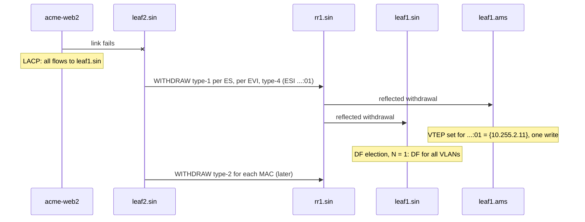

Acme's web server `acme-web2` in Singapore has two 25 Gb/s links, one to `leaf1.sin` and one to `leaf2.sin`, bundled on the server into one LACP bond, so it survives a leaf failing or being upgraded. Two independent leaves on one server raise four problems a single leaf never has. A broadcast from the fabric reaches both leaves, so the server could receive it twice. A broadcast from the server can come back to it through the other leaf. A remote leaf learns the server's MAC from whichever leaf saw it first and sends everything there, idling the other link. And when one link fails, every remote leaf must quickly stop using that leaf for every MAC behind the bond.

MLAG answers all four with a cable between the two leaves and a vendor protocol over it ([switches, VLANs and loops](/learn/fabric-networking/from-zero/switches-vlans-and-loops)). **EVPN multihoming** answers them with BGP: two new EVPN route types, one field in an existing one, an election, and a forwarding rule. It is defined in RFC 7432 (EVPN, 2015) and adapted to VXLAN by RFC 8365 (2018); [redundancy and failure domains](/learn/fabric-networking/fabric-architecture/redundancy-and-failure-domains) previewed the comparison. This lesson assumes the EVPN route types from [EVPN, the control plane](/learn/fabric-networking/overlays-vxlan-evpn/evpn-the-control-plane) (type 2 carries a MAC, type 3 announces a VTEP's membership of a VNI) and ingress replication from [BUM traffic](/learn/fabric-networking/overlays-vxlan-evpn/bum-traffic).

The cast, a small example without spines drawn:

| Device | Role | Address |
|---|---|---|
| `acme-web2` | Server, MAC `00:00:5e:00:53:0b`, IP 10.1.1.11, Acme VLAN 100 (VNI 10100) | LACP bond `bond0` over two links |
| `leaf1.sin` | Segment member | VTEP and loopback 10.255.2.11 |
| `leaf2.sin` | Segment member | VTEP and loopback 10.255.2.12 |
| `rr1.sin` | Route reflector for Singapore's leaves | 10.255.2.101 |
| `leaf1.ams` | Remote leaf, `acme-web1` (10.1.1.10) behind it | VTEP 10.255.1.11 |

## The ethernet segment and its identifier

An **ethernet segment** (ES) is the set of links that connect one device (a server, a hypervisor, a customer's switch) to two or more leaves. A **multihomed** device has one; a **single-homed** device, on one leaf, does not need one. The **ethernet segment identifier** (ESI) is the segment's 10-byte name, and the whole design hangs on one rule: every leaf on the segment configures the same ESI on its port towards the device, and no other segment anywhere in the fabric uses it. An ESI of all zeros means "single-homed"; all ones is reserved.

The first byte is a type saying how the other nine were built:

| Type | Nine bytes built from | Typical use |
|---|---|---|
| 0 | Any value the operator chooses | Explicit, allocated from a source of truth |
| 1 | The device's LACP system MAC (6) + port key (2) + 0 | Leaves derive it from what the server's LACP says |
| 2 | The root bridge MAC and priority of the device's spanning tree | A customer switch running STP |
| 3 | A MAC address (6) + a local discriminator (3) | Leaves configure a shared "system MAC" plus a number per bond |
| 4 | A router ID (4) + a local discriminator (4) + 0 | Router-ID based |
| 5 | An AS number (4) + a local discriminator (4) + 0 | AS based |

Meridian uses type 3. Both Singapore leaves are configured with the same segment system MAC, `00:00:5e:00:53:7e`, and give `acme-web2`'s bond the local discriminator 1:

| Field | Size | Value | What reads it |
|---|---|---|---|
| ESI type | 1 byte | `03` | Every receiver: how to interpret the rest |
| System MAC | 6 bytes | `00:00:5e:00:53:7e` | Segment members; also becomes the ES-Import route target |
| Local discriminator | 3 bytes | `00:00:01` | Distinguishes this bond from the pair's other bonds |
| Whole ESI | 10 bytes | `03:00:00:5e:00:53:7e:00:00:01` | Carried in type-1, type-2 and type-4 routes |

The server never sees the ESI. It sees LACP (the link aggregation control protocol, which decides which links join a bond), and both leaves must send LACP messages with the same system ID, here `00:00:5e:00:53:7e`, or the server concludes its links go to two partners, puts them in different aggregators and carries traffic on one. So two things must match across the pair: the ESI, which the fabric reads, and the LACP system ID, which the server reads. Type-3 designs derive both from one configured MAC.

Segments run in one of two redundancy modes, signalled in a flag on the type-1 route below:

| Mode | Known unicast | Flooded traffic towards the device | When it is used |
|---|---|---|---|
| All-active | Every member forwards; the device hashes across links | Only the designated forwarder | Servers and switches that bond with LACP; the common case |
| Single-active | Only the elected forwarder, per VLAN | Only the elected forwarder | Devices that cannot bond: active-standby NIC teaming, a customer switch running its own spanning tree |

The rest of this lesson is all-active unless it says otherwise.

**What the ESI solves:** two independent leaves can say, in BGP, "this port and that port lead to the same device". **How it breaks:** a typo makes two segments out of one, and a copy-pasted value makes one segment out of two unrelated servers. **Signal:** the ESI configured on each member, compared against the LACP partner each member actually sees.

## Type-4 routes: finding the other members

First each leaf must learn who else is on the segment. When the bond port comes up, each leaf advertises an **ethernet segment route**, EVPN route type 4. Its NLRI (the network layer reachability information, the "what is being announced" part of a BGP UPDATE, in [updates, attributes and RIBs](/learn/fabric-networking/bgp-fundamentals/updates-attributes-and-ribs)) is short:

| Field | Size | Value from `leaf1.sin` | What reads it |
|---|---|---|---|
| Route type, length | 1 + 1 bytes | 4, 23 | EVPN parser |
| Route distinguisher | 8 bytes | 10.255.2.11:0 (the leaf's own, not a VNI's) | BGP: keeps the two members' routes distinct |
| ESI | 10 bytes | `03:00:00:5e:00:53:7e:00:00:01` | Other members: "same segment as mine?" |
| IP address length | 1 byte | 32 (bits) | Parser |
| Originating router's IP | 4 bytes | 10.255.2.11 | DF election: the list of members is a list of these |
| ES-Import route target (extended community) | 8 bytes | `00:00:5e:00:53:7e` | Import filter on every leaf |

The **ES-Import route target** is the trick. A normal route target (`65000:10100` at Meridian) decides which leaves import a route by VNI ([VRFs and multi-tenancy](/learn/fabric-networking/overlays-vxlan-evpn/vrfs-and-multi-tenancy)). For ESI types 1, 2 and 3, RFC 7432 derives it from the ESI itself, the six bytes after the type byte, so every leaf with a port on the segment automatically imports routes carrying it and every other leaf discards them. (Strictly, every leaf with a segment whose ESI begins with those six bytes imports them: at Meridian, where each pair has its own system MAC, that is the pair.) `leaf1.ams` drops both, so a missing type-4 route on a non-member is normal.

The reflectors must pass type-4 routes on although they sit on no segment. A reflector normally keeps every route whatever its target, but RT constraint (RFC 4684, where clients tell the reflector which route targets they want) or a policy written for `65000:<vni>` targets can drop them ([route reflectors](/learn/fabric-networking/bgp-fundamentals/route-reflectors)).

```text
leaf1.sin# show evpn es                              (illustrative output)
Type: L local, R remote, N non-DF
ESI                            Type  ES-IF   VTEPs
03:00:00:5e:00:53:7e:00:00:01  LR    bond1   10.255.2.12
leaf2.sin# show evpn es
03:00:00:5e:00:53:7e:00:00:01  LRN   bond1   10.255.2.11
```

"LR" says the segment is local and has a remote member; the N on `leaf2.sin` says it lost the election that comes next.

**What type-4 solves:** each member discovers the others without a peer link, through the same reflectors as everything else. **How it breaks:** a member never receives its peer's type-4 route (a reflector policy, a missing address family on one session) and concludes it is alone. **Signal:** each member's list of peers for each local segment, which must name every other member.

## Designated forwarder election

Ingress replication sends every broadcast, unknown-unicast or multicast (BUM) frame in VNI 10100 to every VTEP that announced the VNI with a type-3 route ([BUM traffic](/learn/fabric-networking/overlays-vxlan-evpn/bum-traffic)). Both Singapore leaves receive every ARP request `acme-web1` broadcasts; if both delivered it, `acme-web2` would see each twice, harmless for ARP but wrong for multicast or a cluster heartbeat. So for each segment and VLAN the members elect one **designated forwarder** (DF), the only member allowed to send BUM traffic from the fabric down to the segment; the others drop their copy.

RFC 7432's default procedure, called service carving, runs independently on every member and needs no message exchange beyond the type-4 routes:

1. When the segment's port comes up, advertise the type-4 route and start the **DF timer**, 3 seconds by default, to collect the other members' routes. Until it fires, forward no BUM traffic to the segment.
2. Build the list of members' originating IP addresses, including your own, and sort it as unsigned numbers, lowest first. Number the positions 0 to N − 1.
3. For each VLAN V on the segment, the DF is the member at position **V mod N**. Every member computes the same list, so they agree without negotiating.

Traced for `acme-web2`'s segment: the list is 10.255.2.11 (position 0), 10.255.2.12 (position 1), so N = 2. VLAN 100 mod 2 = 0, and `leaf1.sin` is DF for VLAN 100. A VXLAN fabric may feed the VNI into the election instead of the VLAN (VXLAN EVPN carries the VNI where MPLS EVPN carried the VLAN); 10100 mod 2 is also 0.

The DF governs one direction of one kind of traffic, BUM from the fabric towards the segment. A known-unicast frame for `acme-web2` arriving at `leaf2.sin` goes down `leaf2.sin`'s link, DF or not.

### Where modulo goes wrong

The default has three problems, all shown by the code below.

- **Imbalance.** Operators number VLANs in round tens and hundreds, and with two members every even VLAN lands on position 0. `acme-web2`'s bond also carries Acme's VLAN 200, and `leaf1.sin` is DF for both; with VLANs 100, 200, … 1000 it would carry every flood for the segment.
- **Reshuffling.** When a member leaves, N changes and V mod N moves most VLANs, not only the departed member's: the flaw of hash-mod-N in a cache tier ([consistent hashing and request routing](/learn/networking/network-algorithms/consistent-hashing-and-routing)). Every DF change is a moment when a VLAN may have no forwarder or two.
- **Disagreement on the input.** VLAN 200 maps to VNI 10101, which is odd. If `leaf1.sin` computes from the VLAN (200 mod 2 = 0, itself) and `leaf2.sin` from the VNI (10101 mod 2 = 1, itself), both are DF; the other way round, neither is. Mixed vendors or software releases can disagree in exactly this way.

RFC 8584 (2019) added a framework for other algorithms. **Highest random weight** (HRW, or rendezvous hashing) scores every member with a hash of the VLAN, the ESI and the member's address; the highest score wins, so a member's departure moves only the VLANs it held. RFC 8584 also defines **AC-influenced DF**: a member whose attachment circuit (its port and VLAN towards the device) is down for that VLAN takes itself out of the election for it, instead of winning a VLAN it cannot deliver. Later work adds a preference-based election, an operator-set number per member with the highest winning, and some implementations default to it with one DF per segment rather than per VLAN. Members advertise their algorithm in a DF Election extended community on the type-4 route and fall back to modulo if they disagree.

```python
import ipaddress
import struct
import zlib


def esi_type3(system_mac, discriminator):
    """ESI type 3: 1 type byte, a 6-byte system MAC, a 3-byte local discriminator."""
    mac = bytes.fromhex(system_mac.replace(":", ""))
    return bytes([3]) + mac + discriminator.to_bytes(3, "big")


def fmt(esi):
    return ":".join(f"{b:02x}" for b in esi)


def es_import_rt(esi):
    # RFC 7432: the high-order 6 bytes of the 9-byte ESI value, so members import it automatically.
    return ":".join(f"{b:02x}" for b in esi[1:7])


def df_modulo(service, vteps):
    """RFC 7432 default ("service carving"): order members by address, DF = ordinal service mod N."""
    ordered = sorted(vteps, key=lambda v: int(ipaddress.ip_address(v)))
    return ordered[service % len(ordered)]


def df_hrw(service, esi, vteps):
    """Highest random weight, in the shape of RFC 8584: score each member, highest wins."""
    digest = zlib.crc32(struct.pack("!I", service) + esi) % 2**31

    def weight(v):
        s = int(ipaddress.ip_address(v))
        return (1103515245 * ((1103515245 * s + 12345) ^ digest) + 12345) % 2**31

    # Ties (vanishingly rare) go to the lower address.
    return max(vteps, key=lambda v: (weight(v), -int(ipaddress.ip_address(v))))


NAMES = {"10.255.2.11": "leaf1.sin", "10.255.2.12": "leaf2.sin", "10.255.2.13": "leaf3.sin"}
esi = esi_type3("00:00:5e:00:53:7e", 1)
pair = ["10.255.2.12", "10.255.2.11"]          # order of arrival does not matter
print("ESI", fmt(esi), "ES-Import RT", es_import_rt(esi))

print("\nacme-web2's bond carries Acme VLAN 100 (VNI 10100) and VLAN 200 (VNI 10101):")
for vlan, vni in [(100, 10100), (200, 10101)]:
    print(f"  VLAN {vlan}: mod by VLAN -> {NAMES[df_modulo(vlan, pair)]:9}  "
          f"mod by VNI {vni} -> {NAMES[df_modulo(vni, pair)]:9}  "
          f"HRW -> {NAMES[df_hrw(vlan, esi, pair)]}")

print("\nA three-leaf segment carrying VLANs 100-111 loses leaf3.sin:")
trio = ["10.255.2.11", "10.255.2.12", "10.255.2.13"]
for name, elect in [("modulo", lambda v, m: df_modulo(v, m)), ("HRW", lambda v, m: df_hrw(v, esi, m))]:
    before = {v: elect(v, trio) for v in range(100, 112)}
    after = {v: elect(v, trio[:2]) for v in range(100, 112)}
    orphaned = sum(1 for v in before if before[v] == "10.255.2.13")
    moved = sum(1 for v in before if before[v] != after[v])
    load = {NAMES[x]: list(before.values()).count(x) for x in trio}
    print(f"  {name:6} DFs per leaf before {load}; VLANs whose DF changed: {moved} "
          f"(only {orphaned} had to)")

print("\nTen VLANs 100, 200, ... 1000 on the two-leaf segment (every one even):")
for name, elect in [("modulo", lambda v: df_modulo(v, pair)), ("HRW", lambda v: df_hrw(v, esi, pair))]:
    picks = [NAMES[elect(v)] for v in range(100, 1001, 100)]
    print(f"  {name:6} leaf1.sin DF for {picks.count('leaf1.sin')}, leaf2.sin for {picks.count('leaf2.sin')}")
share = [df_hrw(v, esi, trio) for v in range(100, 1100)]
print("  HRW over 1,000 VLANs on three leaves:", [share.count(x) for x in trio])
```

```text
ESI 03:00:00:5e:00:53:7e:00:00:01 ES-Import RT 00:00:5e:00:53:7e

acme-web2's bond carries Acme VLAN 100 (VNI 10100) and VLAN 200 (VNI 10101):
  VLAN 100: mod by VLAN -> leaf1.sin  mod by VNI 10100 -> leaf1.sin  HRW -> leaf1.sin
  VLAN 200: mod by VLAN -> leaf1.sin  mod by VNI 10101 -> leaf2.sin  HRW -> leaf1.sin

A three-leaf segment carrying VLANs 100-111 loses leaf3.sin:
  modulo DFs per leaf before {'leaf1.sin': 4, 'leaf2.sin': 4, 'leaf3.sin': 4}; VLANs whose DF changed: 8 (only 4 had to)
  HRW    DFs per leaf before {'leaf1.sin': 6, 'leaf2.sin': 1, 'leaf3.sin': 5}; VLANs whose DF changed: 5 (only 5 had to)

Ten VLANs 100, 200, ... 1000 on the two-leaf segment (every one even):
  modulo leaf1.sin DF for 10, leaf2.sin for 0
  HRW    leaf1.sin DF for 7, leaf2.sin for 3
  HRW over 1,000 VLANs on three leaves: [344, 333, 323]
```

Trace the modulo reshuffle by hand. VLAN 100 is 100 mod 3 = 1 (`leaf2.sin`) before and 100 mod 2 = 0 (`leaf1.sin`) after: it moved although its DF never left. VLAN 101 was on `leaf3.sin` (101 mod 3 = 2) and had to move. Over the twelve VLANs, eight change DF where four had to. HRW moves exactly the five that `leaf3.sin` held. Its weakness is the split, 6, 1 and 5 over twelve VLANs: a hash balances only in expectation, evening out over many services (344, 333, 323 over a thousand). The CRC input layout here is illustrative; the RFC fixes the exact bytes, which is what lets two vendors agree.

**What DF election solves:** exactly one copy of each flooded frame reaches the device. **How it breaks:** two members believe they are DF (duplicates), or none does (floods black-holed: ARP requests never reach the server, so new conversations fail while established ones work). **Signal:** the DF per segment and VLAN as each member reports it; exactly one member must claim each.

## Type-1 routes and aliasing

The server's bond hashes each flow onto one link, and many bonds hash on MAC addresses alone (the Linux bonding default combines source and destination MAC), so all of `acme-web2`'s routed traffic, addressed to the one gateway MAC, leaves on one link. Its first frame goes to `leaf2.sin`, which learns `00:00:5e:00:53:0b` and advertises a type-2 route; `leaf1.sin` may never see a frame from that MAC. Every remote leaf would send all of `acme-web2`'s traffic to 10.255.2.12, and the link to `leaf1.sin` would idle. **Aliasing** is the fix: remote leaves send to every member that can reach the segment, whichever one learned the MAC.

It needs two additions, both scoped to an **EVI** (EVPN instance), one tenant layer-2 domain: in a VLAN-based VXLAN fabric, one VNI. First, the type-2 route carries the segment's ESI instead of zeros, so it says "this MAC is on segment …:01", not only "behind 10.255.2.12". Second, each member advertises **Ethernet auto-discovery routes**, EVPN route type 1, saying which segments it reaches. The NLRI:

| Field | Size | What it holds |
|---|---|---|
| Route type, length | 1 + 1 bytes | 1, 25 |
| Route distinguisher | 8 bytes | The member's RD for the VNI (per EVI) or its own (per ES) |
| ESI | 10 bytes | The segment |
| Ethernet tag ID | 4 bytes | 0 (per EVI, VLAN-based service) or 0xFFFFFFFF, "MAX-ET" (per ES) |
| MPLS label | 3 bytes | Per EVI: the VNI (RFC 8365 reuses the field); per ES: 0 |

A type-1 route comes in two flavours, and each member sends both:

| | Per ES (one per segment) | Per EVI (one per segment and VNI) |
|---|---|---|
| Ethernet tag | 0xFFFFFFFF | 0 |
| Route targets | Every VNI on the segment: `65000:10100`, `65000:10101` | That VNI's: `65000:10100` |
| Extra community | ESI label: the all-active or single-active flag (plus the split-horizon label in MPLS) | None needed |
| Remote leaves use it for | Mass withdrawal, the redundancy mode, which VTEPs share which segment | Aliasing, and the backup path in single-active mode |

RFC 7432 makes the per-ES route a precondition: a member counts for aliasing only if the remote leaf holds both its per-ES and its per-EVI route for the segment. What `leaf1.ams` holds for VNI 10100:

| Route | From | Says |
|---|---|---|
| Type 2, MAC `00:00:5e:00:53:0b`, ESI …:01 | `leaf2.sin` | This MAC sits on segment …:01 |
| Type 1 per ES, ESI …:01, all-active | `leaf1.sin`, `leaf2.sin` | Both reach …:01, all-active |
| Type 1 per EVI, ESI …:01, VNI 10100 | `leaf1.sin`, `leaf2.sin` | Both reach …:01 in VNI 10100 |
| **Installed** | | MAC `00:00:5e:00:53:0b` → {10.255.2.11, 10.255.2.12}, hashed per flow |

The remote leaf hashes each flow onto a VTEP as for any ECMP group ([ECMP and hashing](/learn/fabric-networking/fabric-architecture/ecmp-and-hashing)), and the underlay spreads each tunnel over the spines: two layers of ECMP. The [overlay packet walk](/learn/fabric-networking/overlays-vxlan-evpn/the-overlay-packet-walk) follows one flow that hashed to 10.255.2.12.

**Peer synchronisation.** The reflector also sends `leaf2.sin`'s type-2 route to `leaf1.sin`, which sees its own ESI in it and installs the MAC on its local bond port; otherwise a frame aliased to `leaf1.sin` for a MAC it had never seen would be flooded. MAC-plus-IP routes sync the same way, so both leaves' anycast gateways ([VRFs and multi-tenancy](/learn/fabric-networking/overlays-vxlan-evpn/vrfs-and-multi-tenancy)) hold `acme-web2`'s ARP entry even though only one saw its ARP reply.

**Single-active segments** use the per-EVI routes differently: the remote leaf sends unicast only to the DF that advertised the MAC, and keeps the other member as a precomputed **backup path**, switched to the moment the DF's per-ES route is withdrawn.

The model below is `leaf1.ams`'s view, with a real forwarding table's indirection (MAC → segment → VTEPs) and a count of hardware writes for the next section.

```python
import zlib

ESI = "03:00:00:5e:00:53:7e:00:00:01"
V1, V2 = "10.255.2.11", "10.255.2.12"          # leaf1.sin, leaf2.sin


class RemoteLeaf:
    """What leaf1.ams keeps for VNI 10100: MACs point at a segment, the segment at its VTEPs."""

    def __init__(self, indirect=True):
        self.indirect = indirect
        self.macs = {}            # MAC -> (ESI or None, VTEP that advertised the type-2)
        self.per_es = {}          # ESI -> VTEPs with a per-ES type-1 route
        self.per_evi = {}         # ESI -> VTEPs with a per-EVI type-1 route for this VNI
        self.fib = {}             # what the hardware holds: MAC -> VTEPs, or "es:<ESI>" -> VTEPs
        self.writes = 0           # hardware table writes, the cost that matters

    def vteps_for(self, esi, origin):
        # RFC 7432: alias to a VTEP only if it advertised both the per-ES and the per-EVI route.
        both = self.per_es.get(esi, set()) & self.per_evi.get(esi, set())
        return sorted(both) if both else [origin]

    def program(self):
        new = {}
        for mac, (esi, origin) in self.macs.items():
            if esi and self.indirect:
                new["es:" + esi] = self.vteps_for(esi, origin)
                new[mac] = "es:" + esi                  # the MAC points at the group
            else:
                new[mac] = self.vteps_for(esi, origin) if esi else [origin]
        self.writes += sum(1 for k in new if self.fib.get(k) != new[k])
        self.writes += sum(1 for k in self.fib if k not in new)
        self.fib = new

    def route(self, kind, esi, vtep, mac=None, withdraw=False):
        table = {"per-es": self.per_es, "per-evi": self.per_evi}.get(kind)
        if kind == "type-2":
            if withdraw:
                self.macs.pop(mac, None)
            else:
                self.macs[mac] = (esi, vtep)
        elif withdraw:
            table.get(esi, set()).discard(vtep)
        else:
            table.setdefault(esi, set()).add(vtep)
        self.program()

    def forward(self, mac, flow):
        entry = self.fib[mac]
        vteps = self.fib[entry] if isinstance(entry, str) else entry
        return vteps[zlib.crc32(flow.encode()) % len(vteps)]   # per-flow hash over the set


leaf = RemoteLeaf()
for vtep in (V1, V2):
    leaf.route("per-es", ESI, vtep)
    leaf.route("per-evi", ESI, vtep)
leaf.route("type-2", ESI, V2, mac="00:00:5e:00:53:0b")   # only leaf2.sin learned it
flows = [f"10.1.1.10:{port}->10.1.1.11:443" for port in range(40000, 40008)]
picks = [leaf.forward("00:00:5e:00:53:0b", f) for f in flows]
print("aliasing:", leaf.fib["es:" + ESI], "flows per VTEP:", {v: picks.count(v) for v in (V1, V2)})

# 500 MACs on the segment (a hypervisor's VMs), all learned by leaf2.sin.
for design in (True, False):
    leaf = RemoteLeaf(indirect=design)
    for vtep in (V1, V2):
        leaf.route("per-es", ESI, vtep)
        leaf.route("per-evi", ESI, vtep)
    for i in range(500):
        leaf.route("type-2", ESI, V2, mac=f"02:00:00:00:{i // 256:02x}:{i % 256:02x}")
    leaf.writes = 0
    leaf.route("per-es", ESI, V2, withdraw=True)           # leaf2.sin's link to the server fails
    first = leaf.writes
    print(f"indirect={design!s:5}  writes for the one per-ES withdrawal: {first:3}   "
          f"VTEPs now {leaf.vteps_for(ESI, V2)}")

# Without type-1 routes (a filter at the reflector dropped them) there is no aliasing.
leaf = RemoteLeaf()
leaf.route("type-2", ESI, V2, mac="00:00:5e:00:53:0b")
print("no type-1:", sorted({leaf.forward("00:00:5e:00:53:0b", f) for f in flows}))
```

```text
aliasing: ['10.255.2.11', '10.255.2.12'] flows per VTEP: {'10.255.2.11': 4, '10.255.2.12': 4}
indirect=True   writes for the one per-ES withdrawal:   1   VTEPs now ['10.255.2.11']
indirect=False  writes for the one per-ES withdrawal: 500   VTEPs now ['10.255.2.11']
no type-1: ['10.255.2.12']
```

`vteps_for` is the aliasing rule: the intersection of the two route sets, or the type-2's own next hop when it is empty. The last line is the failure: type-1 routes filtered, the MAC reachable, every session up, every flow on one link.

**What aliasing solves:** remote traffic uses every member link, not only the one that learned the MAC. **How it breaks:** type-1 routes missing at remote leaves (filtered, not advertised, or ignored) quietly halve the server's inbound capacity. **Signal:** per remote leaf, the number of VTEPs installed for each multihomed MAC, and per member, inbound traffic on its bond port; one member near zero is the symptom.

## Split horizon: not sending a frame back where it came from

BUM from the server raises the reverse problem. `acme-web2`'s bond hashes an ARP request to `leaf2.sin`, which floods it to its local ports and to every VTEP in VNI 10100, `leaf1.sin` included. By the DF rule alone, `leaf1.sin`, DF for VLAN 100, would send it down to `acme-web2`: the server receives its own frame, and a hypervisor's bridge or a customer switch relearns its own hosts' MACs on the uplink, black-holing traffic to them. The rule that stops it is **split horizon**: a frame that came from a segment never goes back into that segment.

MPLS-based EVPN uses a label: each member advertises an **ESI label** in its per-ES type-1 route, the ingress member pushes the peer's label onto BUM frames from the segment, and the peer, seeing it, does not forward to that segment. VXLAN has no room for a second label: its 8-byte header carries one 24-bit VNI and flags ([VXLAN encapsulation](/learn/fabric-networking/overlays-vxlan-evpn/vxlan-encapsulation)). RFC 8365 therefore uses **local bias**, two rules keyed on the outer source IP:

1. A leaf receiving BUM from a local segment port floods it to **all** its other local ports, including other multihomed segments where it is *not* DF, and sends one copy to each remote VTEP.
2. A leaf receiving BUM from the fabric looks at the outer source IP, the sending VTEP. To any segment it shares with that VTEP it sends nothing, DF or not, because rule 1 already delivered it there. To every other segment it applies the DF rule.

A leaf learns which segments a VTEP shares with it from that VTEP's per-ES type-1 routes, whose next hop is the VTEP address. To see why rule 1 says "DF or not", add a hypervisor, `acme-hv1`, on segment …:02 on both leaves in VLAN 100, with `leaf1.sin` DF for both segments.

| BUM frame | `leaf2.sin` (non-DF) | `leaf1.sin` (DF) | Copies at `acme-web2` | Copies at `acme-hv1` |
|---|---|---|---|---|
| From `acme-web1`, via the fabric (outer source 10.255.1.11) | Shares nothing with 10.255.1.11; non-DF: drops for both segments | Shares nothing; DF: sends to both | 1 | 1 |
| From `acme-web2`, hashed to `leaf2.sin` | Rule 1: floods to `acme-hv1`'s port although non-DF; sends to remote VTEPs | Outer source 10.255.2.12 shares …:01 and …:02: sends to neither | 0 (its own frame) | 1 |
| From `acme-web2`, without local bias | Floods to remote VTEPs; non-DF, so not to …:02 | DF: sends to …:01 and …:02 | 1 (echoed back) | 1 |
| From `acme-web2`, local bias, but `leaf1.sin` missed `leaf2.sin`'s per-ES route | As row 2 | Thinks 10.255.2.12 shares nothing: DF, sends to both | 1 (echoed back) | 2 (duplicate) |

Row 2 is the design working. Row 4 is why the per-ES route matters beyond aliasing: local bias is only as good as each leaf's knowledge of who shares what. Because the outer source IP must identify one leaf, EVPN multihoming cannot hide the pair behind a shared anycast VTEP the way MLAG designs do.

**What split horizon solves:** a frame from a segment never returns into it, and every other segment still gets one copy. **How it breaks:** stale or missing per-ES routes at a member, or a VTEP sourcing VXLAN from an address its routes do not carry. **Signal:** hosts receiving their own broadcasts (a Linux bridge logs "received packet ... with own address as source address"), and MAC moves on multihomed ports.

## Mass withdrawal

The link between `acme-web2` and `leaf2.sin` dies. The server's LACP removes that member within milliseconds of losing light (a one-way cut usually downs both ends, as Ethernet at 10 Gb/s and above signals faults to the far end; a fault that leaves the link up takes fast LACP 3 s) and sends everything to `leaf1.sin`. The fabric's side is harder: every remote leaf has an entry for every MAC on the segment pointing partly at 10.255.2.12, and a hypervisor with 500 virtual machines is 500 MACs. Withdrawing 500 type-2 routes costs every remote leaf 500 route changes and 500 hardware writes, tens of milliseconds to seconds depending on the ASIC and the network operating system, and until an entry is rewritten, traffic hashed to 10.255.2.12 reaches a leaf with no link to deliver it on.

**Mass withdrawal** replaces 500 with one: `leaf2.sin` withdraws its **per-ES type-1 route**, every remote leaf removes 10.255.2.12 from the segment's VTEP set, and every MAC pointing at that set moves at once. The model above counts one hardware write with the MAC → segment → VTEPs indirection, 500 without. Type-2 withdrawals and `leaf1.sin`'s own re-advertisements follow, but forwarding no longer waits for them.

| Time | Event | Effect |
|---|---|---|
| 0 | Link `acme-web2`–`leaf2.sin` fails | Frames in flight on it are lost |
| ~1–10 ms | Both ends detect loss of light | Server's bond uses one link; `leaf2.sin` marks …:01 down |
| ms | `leaf2.sin` withdraws per-ES type-1, per-EVI type-1 and type-4 for …:01 | The three withdrawals can share one UPDATE |
| ms to tens of ms | `rr1.sin`, `rr2.sin` reflect it, also to `rr1.ams`, `rr2.ams` and their clients | Depends on reflector load and inter-site distance (about 53 ms one way Singapore–Amsterdam over 10,500 km of fibre) |
| on receipt | `leaf1.ams` rewrites one VTEP set | Every MAC on …:01 now resolves to 10.255.2.11 only |
| on receipt | `leaf1.sin` reruns DF election with N = 1 | DF for every VLAN on …:01 |
| later | Type-2 withdrawals and re-advertisements arrive | Bookkeeping; forwarding already moved |

Traffic reaching `leaf2.sin` in the gap is lost, unless the implementation redirects it over VXLAN to the surviving member, as some do.



### When the whole leaf dies, nothing is withdrawn

A leaf that loses power sends no withdrawal. Remote leaves find out through the underlay: `leaf2.sin`'s loopback 10.255.2.12 disappears from IS-IS when its spines see the links go dark, and BGP's next-hop tracking marks every route with that next hop unusable, type-1 and type-2 alike ([BGP next hops](/learn/fabric-networking/bgp-fundamentals/ibgp-loops-and-next-hops), [convergence and BFD](/learn/fabric-networking/underlay/convergence-and-bfd)). That works only if the underlay carries each loopback as its own /32: a covering aggregate or default route would keep resolving 10.255.2.12, and remote leaves would wait for the reflectors' hold timer (9 s with the 3 s keepalive many data-centre profiles use, 90 s or more with common defaults). The leaf-failure path depends on IGP convergence, the link-failure path on BGP.

### Core isolation and coming back too early

Two failures turn redundancy against the server. In **core isolation**, a leaf loses every uplink (a bad line card, a maintenance mistake) while its server links stay up, and the server's LACP keeps hashing half its outbound flows into a leaf that reaches nothing. The fix is uplink tracking: a member with no fabric connectivity takes its segment ports down (FRRouting-based systems put the bond in a protocol-down state; Junos names the feature core isolation) or signals LACP out-of-sync, and the server moves everything to the other member.

The mirror image happens at boot: ports come up in seconds, EVPN routes far later, and a server hashing into the leaf meanwhile finds empty tables. Implementations hold segment ports down for a **startup delay** after boot (180 s by default in FRRouting), then advertise the type-4 route, wait the DF timer, and forward. Hence upgrading a pair one member at a time, with traffic verified in between ([safe change and maintenance](/learn/fabric-networking/operating-fabrics/safe-change-and-maintenance)).

**What mass withdrawal solves:** failover time independent of the number of MACs behind the segment. **How it breaks:** hardware without the indirection rewrites every MAC anyway; a dead leaf cannot send it; an isolated leaf never sends it, because its segment looks fine. **Signal:** time from link-down to the per-ES withdrawal arriving at a remote leaf, and the VTEP count per segment at remote leaves before and after.

## The whole sequence on Meridian

```viz
{"type": "fabric", "scenario": "evpn-multihoming", "title": "EVPN multihoming end to end: type-4 discovery, DF election, aliasing, local bias, then a link failure and one mass withdrawal", "caption": "acme-web2 is bonded to leaf1.sin and leaf2.sin with ESI 03:00:00:5e:00:53:7e:00:00:01. The leaves find each other with type-4 routes and elect leaf1.sin DF (VLAN 100 mod 2 = 0); both send type-1 routes per ES and per EVI. leaf2.sin learns the MAC, leaf1.sin installs it from the synced type-2, and leaf1.ams aliases it over both VTEPs. A broadcast from the fabric is delivered once by the DF; one from acme-web2 is not sent back by leaf1.sin (local bias). The link to leaf2.sin fails, one per-ES withdrawal removes 10.255.2.12 for every MAC on the segment, and the run closes with a comparison against MLAG."}
```

## EVPN multihoming against MLAG

MLAG (multi-chassis link aggregation) makes two leaves act as one switch through a peer link, a synchronisation protocol over it, and a keepalive on a separate path ([switches, VLANs and loops](/learn/fabric-networking/from-zero/switches-vlans-and-loops) has the mechanism and its split-brain failure). In a VXLAN fabric the pair also shares an **anycast VTEP**, a second loopback address configured on both leaves, from which both encapsulate and to which remote leaves tunnel. The control plane then looks different:

- Type-2 routes for dual-homed hosts carry ESI 0 and the anycast address as next hop, and no type-1 or type-4 routes exist: a fabric with only types 2, 3 and 5 is an MLAG fabric, not a broken multihoming one.
- Remote leaves see one VTEP, and the underlay's ECMP spreads traffic over both leaves because both advertise the anycast address into IS-IS. No aliasing is needed.
- No DF election: a flood tunnelled to the anycast address reaches one leaf of the pair, whichever the underlay's ECMP picks, and the MLAG rule that frames arriving over the peer link never leave on dual-attached ports stops the second copy.
- When one server link fails, the anycast address is still reachable at both leaves, so about half the server's inbound traffic still lands on the leaf that lost the link and crosses the peer link. Nothing in BGP changes; the failure is invisible outside the pair.
- Single-attached ("orphan") hosts are also advertised behind the anycast address, so half their traffic crosses the peer link in normal operation.

| | MLAG with an anycast VTEP | EVPN multihoming, all-active | EVPN multihoming, single-active | Single-homed, redundancy in the application |
|---|---|---|---|---|
| Inter-leaf links | Peer link, sized for failover and orphans | None | None | None |
| Members per device | Exactly 2 | 2 or more | 2 or more | 1 |
| Link failover, as remote leaves see it | Nothing changes; the peer link carries the difference | One per-ES withdrawal | Switch to the precomputed backup path | Host or job retries elsewhere |
| Extra BGP state | None | Type-4 and per-ES type-1 per segment; per-EVI type-1 per segment and VNI | Same | None |
| Worst failure | Split brain | DF disagreement, ESI errors | DF disagreement | A leaf failure takes its hosts offline |
| Vendor mixing within a pair | No | In principle; test interop (DF algorithm, VLAN or VNI) | Same | Not applicable |
| Visible in the control plane | Barely | Fully | Fully | Fully |

The extra BGP state is modest. If `leaf1.sin` and `leaf2.sin` serve 24 dual-homed servers, each bond carrying 4 VNIs, each leaf advertises 24 type-4, 24 per-ES and 96 per-EVI routes: 288 for the pair, the type-1 routes imported by every remote leaf carrying those VNIs. Hundreds of segments add thousands, small beside the type-2 table but worth counting in reflector capacity.

The last column is a real design. Meridian's San Jose GPU cluster ([AI fabric topologies](/learn/fabric-networking/ai-fabrics/ai-fabric-topologies)) single-homes every 400 Gb/s NIC to its rail's leaf: the job spreads traffic over eight rails and survives a lost rail by slowing down. Multihoming is for devices whose availability depends on one address staying reachable, such as front-end and storage servers. Many fabrics run both MLAG, where a platform's multihoming support is immature, and multihoming in newer pods.

## Failure modes in production

| Failure | Symptom | Diagnosis | Fix |
|---|---|---|---|
| ESI typo on one member | Bond up on both links; duplicate broadcasts; the server's MAC moving between two ESIs until duplicate-address detection flags it (FRRouting's default: 5 moves in 180 s; freezing the entry is optional) | Members report different ESIs for ports facing the same LACP partner; each is alone in its "segment" and DF | Render the ESI from the source of truth, keyed by server |
| LACP system ID differs between members | Server bond with one link in a second aggregator; half bandwidth; no redundancy; all links "up" | `/proc/net/bonding` on the server shows two partner MACs; member ports not collecting and distributing | Same system MAC on both members |
| Type-4 lost (reflector policy, RT constraint, a family missing) | Two DFs for every VLAN on the segment: duplicate ARP, duplicate multicast | Each member's segment peer list is empty | Reflectors must keep and reflect ES-Import routes |
| Members disagree on DF input or algorithm | Duplicates or black-holed floods on some VLANs only, often the odd VNIs | DF claims per VLAN from both members; software versions differ | Same algorithm and release on both; HRW or preference DF advertised explicitly |
| Type-1 routes missing at remote leaves | One member's link carries all inbound traffic; no outage | Remote leaves show one VTEP per multihomed MAC | Fix the filter or the advertisement |
| Duplicate ESI on two unrelated segments | Traffic for server A aliased to the leaf that only connects server B: intermittent loss for one flow in two | Same ESI on ports facing different LACP partners | Uniqueness check at deployment time, as for route distinguishers and targets |
| Core isolation | Half the server's outbound flows black-holed; leaf's server ports up | Leaf with zero BGP sessions or uplinks but segment ports up | Uplink tracking bringing segment ports down |
| Ports up before routes on reboot | Loss for minutes after a leaf boots | Segment ports up while BGP still loading | Startup delay, verified after every upgrade |

The duplicate ESI is the copied-template failure of [the overlay packet walk](/learn/fabric-networking/overlays-vxlan-evpn/the-overlay-packet-walk)'s leaked route target: valid configuration, every session up. The fix that matters is that no human types an ESI.

## Under the hood: how a leaf programs it

On Cumulus Linux, which runs FRRouting, `bgpd` receives the EVPN routes, `zebra` programs the Linux kernel, and a switch daemon copies the kernel's tables into the ASIC (SONiC uses FRRouting too, with its own path to the ASIC). Since Linux 5.8 a VXLAN forwarding entry can point at a **next-hop group** instead of one remote address, and FRRouting builds a group per remote segment holding its member VTEPs; MACs learned with an ESI point at the group, so a per-ES withdrawal edits one object. Switch ASICs offer the same indirection (an ECMP or layer-2 next-hop group), which turns one BGP message into one hardware write, the `indirect=True` line in the model.

The DF and split-horizon rules are per-port filters in the forwarding pipeline: "drop BUM from the tunnel unless DF for this VLAN" and "drop BUM from the tunnel whose outer source is in this segment's peer set". A stale peer list stays invisible until a broadcast is duplicated.

## What the platform should show

Multihoming fails with every session up, so the useful view is per segment, assembled from all members:

- **Membership from both sides:** per server, the ESI each member configured and the LACP partner it sees, grouped by partner so a typo shows as one server with two ESIs; and each member's type-4 peer list, which must be complete.
- **The DF per segment and VLAN as each member reports it:** exactly one claim; zero or two is red.
- **Aliasing at remote leaves:** the VTEP count per segment at a sample of remote leaves, against the members whose link is up.
- **Redundancy state:** "2 of 2" or "1 of 2" per segment, 1 of 2 being an alert with an owner although the server is served ([redundancy and failure domains](/learn/fabric-networking/fabric-architecture/redundancy-and-failure-domains)).
- **Isolation:** a member with segment ports up and no fabric connectivity.
- **Failover timing:** link-down to the per-ES withdrawal arriving at remote leaves, measured during maintenance; and bond health from the host where available, the only side that sees both links.

The audit is a few dozen lines once the members' state is collected ([telemetry and observability](/learn/fabric-networking/operating-fabrics/telemetry-and-observability)):

```python
def audit(segments, remote_view):
    """One line per problem, from state every member leaf already exposes."""
    out = []
    for server, members in segments.items():
        up = [m for m in members.values() if m["link_up"]]
        esis = {m["esi"] for m in members.values()}
        if len(esis) > 1:
            out.append(f"RED    {server}: members disagree on the ESI {sorted(esis)}; "
                       "two segments, two DFs, MAC moves")
            continue
        esi = esis.pop()
        for name, m in members.items():
            if m["link_up"] and m["bgp_sessions_up"] == 0:
                out.append(f"RED    {server}: {name} has its bond link up but no BGP sessions "
                           "(core isolated): the server is hashing into a dead leaf")
            missing = set(members) - {name} - set(m["es_peers"])
            if m["link_up"] and missing:
                out.append(f"RED    {server}: {name} has no type-4 from {sorted(missing)}; "
                           "it elects itself DF alone")
        vlans = sorted({v for m in up for v in m["df_for"]} | {v for m in up for v in m["vlans"]})
        for vlan in vlans:
            claims = [n for n, m in members.items() if m["link_up"] and vlan in m["df_for"]]
            if len(claims) != 1:
                what = "duplicate floods" if claims else "floods black-holed"
                out.append(f"RED    {server}: VLAN {vlan} has {len(claims)} DFs ({what})")
        aliased = remote_view.get(esi, set())
        expected = {m["vtep"] for m in up}
        if expected - aliased:
            out.append(f"YELLOW {server}: remote leaves alias over {sorted(aliased)} only, "
                       f"missing {sorted(expected - aliased)}")
        if len(up) < len(members):
            out.append(f"YELLOW {server}: {len(up)} of {len(members)} links up; still served, "
                       "redundancy lost")
    return out or ["all segments healthy"]


A, B = "leaf1.sin", "leaf2.sin"
segments = {
    "acme-web2": {
        A: {"esi": "03:..:7e:00:00:01", "vtep": "10.255.2.11", "link_up": True, "bgp_sessions_up": 2,
            "es_peers": [B], "vlans": [100, 200], "df_for": [100, 200]},
        B: {"esi": "03:..:7e:00:00:01", "vtep": "10.255.2.12", "link_up": True, "bgp_sessions_up": 2,
            "es_peers": [A], "vlans": [100, 200], "df_for": [200]},       # computed from the VNI
    },
    "acme-hv1": {
        A: {"esi": "03:..:7e:00:00:02", "vtep": "10.255.2.11", "link_up": True, "bgp_sessions_up": 2,
            "es_peers": [B], "vlans": [100], "df_for": [100]},
        B: {"esi": "03:..:7e:00:00:02", "vtep": "10.255.2.12", "link_up": False, "bgp_sessions_up": 2,
            "es_peers": [A], "vlans": [100], "df_for": []},
    },
    "acme-hv2": {
        A: {"esi": "03:..:7e:00:00:04", "vtep": "10.255.2.11", "link_up": True, "bgp_sessions_up": 2,
            "es_peers": [B], "vlans": [100], "df_for": [100]},
        B: {"esi": "03:..:7e:00:00:04", "vtep": "10.255.2.12", "link_up": True, "bgp_sessions_up": 0,
            "es_peers": [A], "vlans": [100], "df_for": []},              # both uplinks down
    },
    "globex-app2": {
        A: {"esi": "03:..:7e:00:00:03", "vtep": "10.255.2.11", "link_up": True, "bgp_sessions_up": 2,
            "es_peers": [B], "vlans": [100], "df_for": [100]},
        B: {"esi": "03:..:7e:00:00:30", "vtep": "10.255.2.12", "link_up": True, "bgp_sessions_up": 2,
            "es_peers": [], "vlans": [100], "df_for": [100]},             # a typo in the ESI
    },
}
remote_view = {"03:..:7e:00:00:01": {"10.255.2.11", "10.255.2.12"}, "03:..:7e:00:00:02": {"10.255.2.11"},
               "03:..:7e:00:00:04": {"10.255.2.11"}}
print("\n".join(audit(segments, remote_view)))
```

```text
RED    acme-web2: VLAN 200 has 2 DFs (duplicate floods)
YELLOW acme-hv1: 1 of 2 links up; still served, redundancy lost
RED    acme-hv2: leaf2.sin has its bond link up but no BGP sessions (core isolated): the server is hashing into a dead leaf
YELLOW acme-hv2: remote leaves alias over ['10.255.2.11'] only, missing ['10.255.2.12']
RED    globex-app2: members disagree on the ESI ['03:..:7e:00:00:03', '03:..:7e:00:00:30']; two segments, two DFs, MAC moves
```

The first line is the VLAN-or-VNI disagreement from the DF code. Engineers get the reason; managers get a colour per segment and a count of servers on one leg.

## Interviewer follow-ups

**"Does the designated forwarder carry all the traffic for the segment?"** Model answer: no. In all-active mode the DF governs only BUM traffic from the fabric towards the segment, per VLAN. Known unicast goes to whichever member a remote leaf's hash picks, and the server's traffic up whichever link its bond picks. Common wrong answer: "the DF is the active leaf and the other is standby", which describes single-active mode, or MLAG roles.

**"A leaf in a multihomed pair loses power. How do remote leaves stop sending to it?"** Model answer: not by a BGP withdrawal, which a dead leaf cannot send. Its loopback disappears from the underlay, and next-hop tracking invalidates every route whose next hop is that VTEP, so convergence is IS-IS speed plus BGP's reaction. A link failure on a live leaf takes the other path, the per-ES withdrawal, and a reboot depends on the startup delay; I would test all three. Common wrong answer: "the reflectors' hold timer expires", which is the slow fallback when the loopback is hidden behind an aggregate.

**"A team reports duplicate broadcasts on dual-homed servers in one pod only. Where do you look?"** Model answer: scope first. Every segment on the pair points at discovery: type-4 routes not reaching the members, so each is DF; check reflector policy and RT constraint. Some VLANs only points at the election: different algorithms or inputs, often a software version difference, visible on odd VNIs. One server points at its ESI. I'd defer to the network team on the platform's DF options, but the audit that compares DF claims across members is the tool I'd build. Common wrong answer: "a spanning-tree loop", which would melt the VLAN rather than duplicate each frame once.

**"MLAG or EVPN multihoming for a new fabric?"** Model answer: multihoming removes the peer link, split brain and the two-member limit and makes failures visible fabric-wide; it costs extra routes, a DF election to get right, and maturity that varies by platform. I would decide on the platform's support for the features we need together, and on whether our tooling can watch segments. Common wrong answer: either one as universal.

## What mid-level engineers get wrong

- **Calling the non-DF the standby.** It forwards known unicast in both directions; only flooded traffic from the fabric is the DF's job. Treating it as idle halves the capacity plan.
- **Matching the ESI and forgetting LACP.** A matching ESI with mismatched system IDs gives the fabric a healthy segment and the server a half-working bond.
- **Testing failover by unplugging a cable only.** Link failure, leaf power loss, core isolation and the reboot each take a different path through the protocol, and every failure in the table above happens with all sessions Established.

## Senior signals

- You map the four problems a second leaf creates (duplicate floods, echoes, one-sided learning, slow failover) to DF election, split horizon, aliasing and mass withdrawal.
- You know modulo DF election's imbalance on round VLAN numbers and reshuffle when N changes, and HRW as the fix.
- You explain local bias by the outer source IP, why it rules out an anycast VTEP, and why MLAG's anycast VTEP needs no aliasing.
- You separate link failure (per-ES withdrawal) from leaf failure (underlay and next-hop tracking), and test core isolation and the startup delay too.
- You monitor segments as objects assembled from every member, because the failures leave every session up.

## Check yourself

```quiz
- q: >-
    leaf1.sin is the designated forwarder for VLAN 100 on acme-web2's all-active segment, and leaf2.sin is not. Which traffic does that difference govern?
  options: ["Flooded (BUM) traffic arriving from the fabric towards acme-web2", "Routed traffic through the anycast gateway on VLAN 100", "All unicast towards acme-web2, which only the DF may deliver", "Every frame acme-web2 sends, which only the DF may accept"]
  answer: 0
  explanation: >-
    In all-active mode the DF only decides who delivers flooded (BUM) traffic arriving from the fabric into the segment, per VLAN, so the server gets one copy. Known unicast is delivered by whichever member a remote leaf's hash picks, and the server's own frames are accepted on whichever link its bond uses. Single-active mode is where the DF also carries unicast.
- q: >-
    leaf1.ams holds a type-2 route for acme-web2's MAC from leaf2.sin only, with ESI 03:00:00:5e:00:53:7e:00:00:01. It also holds per-ES and per-EVI type-1 routes for that ESI from both leaf1.sin and leaf2.sin. Where does it send acme-web2's traffic?
  options: ["Flooded to both VTEPs until leaf1.sin learns the MAC too", "To 10.255.2.12 only, the VTEP that advertised the MAC", "Hashed per flow over 10.255.2.11 and 10.255.2.12", "To 10.255.2.11 only, the lower address and so the DF"]
  answer: 2
  explanation: >-
    This is aliasing: the ESI in the type-2 route says the MAC is on the segment, and the type-1 routes say both leaves reach that segment in this VNI, so the MAC is installed behind both VTEPs and flows are hashed across them. Being DF is irrelevant to unicast, and nothing is flooded because the MAC is known.
- q: >-
    A hypervisor with 500 virtual machines is dual-homed to two leaves. The link to one leaf fails. What lets remote leaves move all 500 MACs to the surviving leaf at once?
  options: ["The leaf that lost the link withdrawing its per-ES type-1 route", "The leaf that lost the link withdrawing its 500 type-2 routes", "The surviving leaf re-advertising all 500 MACs with a higher sequence number", "The reflectors' hold timer expiring for that leaf's session"]
  answer: 0
  explanation: >-
    Remote leaves resolve every MAC on the segment through the segment's set of VTEPs, so withdrawing the one per-ES type-1 route removes that leaf for all of them, ideally with one hardware write. Type-2 withdrawals and re-advertisements follow but are no longer on the critical path. The leaf is alive, so its BGP sessions and hold timers are unaffected.
- q: >-
    Why does EVPN over VXLAN implement split horizon with local bias rather than with an ESI label, as MPLS-based EVPN does?
  options: ["VXLAN encrypts its payload, so labels cannot be read by the egress leaf", "VXLAN fabrics use MLAG anycast VTEPs that make labels redundant", "VXLAN carries one 24-bit VNI and has no room for a second label", "VXLAN's UDP header already marks frames that came from a segment"]
  answer: 2
  explanation: >-
    The VXLAN header has one identifier and no label stack, so the receiving leaf uses the outer source IP instead: it never forwards a flooded frame to a segment it shares with the sending VTEP, and the sending leaf delivers to its own local segments itself. That is why local bias needs a unique VTEP address per leaf, which rules out the anycast VTEP of MLAG designs. VXLAN is not encrypted, and the UDP header carries only ports.
- q: >-
    Every dual-homed server on one leaf pair receives two copies of each broadcast, on every VLAN. Which cause fits best?
  options: ["The type-1 routes never reached remote leaves, so aliasing is off", "One member computes the DF from the VNI and the other from the VLAN", "A spanning-tree loop formed between the two leaves of the pair", "Neither member gets the other's type-4 route, so each elects itself"]
  answer: 3
  explanation: >-
    Without the peer's type-4 route, each member believes it is alone on every segment and becomes DF for every VLAN, so both deliver every flood. A VLAN-or-VNI disagreement affects only the services where the two inputs give different answers, such as odd VNIs. Missing type-1 routes break load sharing, not flooding, and a layer-2 loop multiplies frames without limit rather than doubling them.
- q: >-
    leaf2.sin loses power. It was a member of 40 multihomed segments. How do remote leaves stop sending traffic to 10.255.2.12?
  options: ["The underlay loses 10.255.2.12; next-hop tracking voids its routes", "Each remote leaf's MAC aging timer expires for every affected MAC", "leaf2.sin sends per-ES withdrawals for all 40 segments as it fails", "The surviving member withdraws leaf2.sin's routes on its behalf"]
  answer: 0
  explanation: >-
    A powered-off leaf sends nothing. Its spines see the links go dark, IS-IS withdraws its loopback, and BGP's next-hop tracking on every remote leaf marks all routes with that next hop unusable, type-1 and type-2 alike. No leaf withdraws another's routes, and waiting for MAC aging would take minutes.
```
