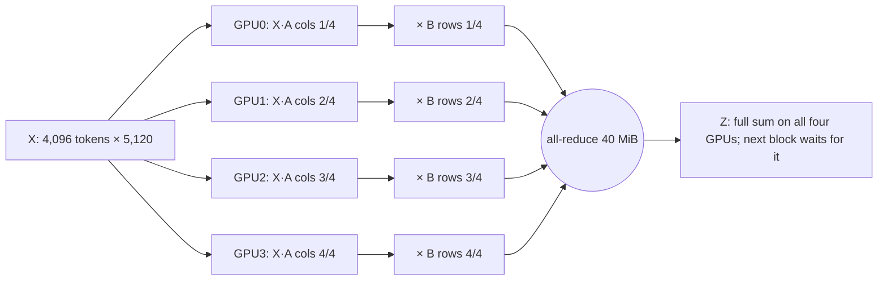

A 13-billion-parameter language model needs about 200 GB of memory to train, and an H100 GPU holds 80 GB. Even if it fitted, one GPU sustaining 400 TFLOP/s would need about six years to train it on a trillion tokens. So the work is split across hundreds or thousands of GPUs, and there are four ways to split it: copy the model and give each copy different data, split every matrix, split the stack of layers into stages, or (for mixture-of-experts models) put different experts on different GPUs. Each split makes GPUs exchange different bytes at different moments, through a different collective operation.

The layout decides how many bytes each GPU sends per step, whether they block computation or hide behind it, and whether they cross NVLink inside a server or the fabric between servers. The same 16-GPU job can move 160 MiB or nearly 19 GiB per GPU per step through the network, depending only on where its ranks land. This lesson works those numbers out for one model on Meridian's San Jose cluster, building on [why AI traffic is different](/learn/fabric-networking/ai-fabrics/why-ai-traffic-is-different): a step is compute followed by a synchronous exchange, so the slowest transfer sets every GPU's pace.

## The model, the cluster and the vocabulary

A **model** is a stack of matrices of numbers, its **parameters** (or weights). Training repeats a **step**: a **forward pass** pushes a batch of examples through the layers and measures the error, a **backward pass** computes the **gradient** (how much each parameter should change, one number per parameter), and the **optimizer** (Adam, almost always) updates the parameters. The backward pass costs about twice the forward. A **batch** is split into **microbatches** that are processed one after another, their gradients added up, before one update per step. Numbers are stored in **bf16**, a 2-byte floating-point format. [Training LLMs](/learn/ai-and-llms/how-llms-work/training-llms) covers the training side.

The running model is a GPT-style transformer ([the transformer](/learn/ai-and-llms/how-llms-work/the-transformer)) with these sizes:

| Property | Value | What it decides |
|---|---|---|
| Hidden size $h$ | 5,120 | Width of every activation; bytes per token = $2h$ = 10 KiB |
| Layers $L$ | 40 | How many collectives per pass |
| Attention heads | 40 | How finely attention can be split (40 is divisible by 2, 4, 8) |
| Parameters | $12h^2L$ = 12.6 billion | Attention has $4h^2$ per layer, the MLP $8h^2$; embeddings ignored |
| Sequence length | 4,096 tokens | One microbatch is one sequence of 4,096 tokens |
| Microbatches per step | 8 | How often pipeline stages hand off |

Training memory is about **16 bytes per parameter**: 2 for bf16 weights, 2 for bf16 gradients, 12 for Adam's fp32 master copy of the weights and its two moment estimates (the accounting from the ZeRO paper, worked in [what a model is](/learn/ai-and-llms/ml-foundations/what-a-model-is)). For 12.6 billion parameters that is 201 GB before activations, two and a half H100s' worth.

The cluster is Meridian's `sjc` back end: 128 servers (`srv001.sjc` to `srv128.sjc`), each with 8 H100-class GPUs. Inside a server the GPUs connect through **NVSwitch** chips over **NVLink**, NVIDIA's GPU-to-GPU link: about 900 GB/s per GPU in total, 450 GB/s each way. Each GPU also has its own 400 Gb/s NIC (network interface card, ConnectX-7 class) speaking RoCEv2, RDMA over Converged Ethernet: remote direct memory access, in which the NIC writes straight into another server's GPU memory without either operating system copying the data ([RDMA from zero](/learn/fabric-networking/ai-fabrics/rdma-from-zero)). That is 50 GB/s each way, **one ninth of NVLink**. NIC $k$ of every server sits on **rail** $k+1$, its own set of leaves ([AI fabric topologies](/learn/fabric-networking/ai-fabrics/ai-fabric-topologies)): with 128-port 400G switches, rail 1 is `rail1-leaf1.sjc` for `srv001`–`srv064` and `rail1-leaf2.sjc` for `srv065`–`srv128`, and 8 spines, `ai-spine1.sjc` to `ai-spine8.sjc`, join the 16 leaves.

Each GPU in a job is a **rank**, numbered 0 to N−1. Ranks exchange data through **collectives**, operations every member of a group joins, run by NCCL (NVIDIA Collective Communications Library) over NVLink inside a server or RDMA between servers, and derived in [collectives and NCCL](/learn/fabric-networking/ai-fabrics/collectives-and-nccl):

| Collective | Before | After | Bytes each GPU sends (ring, n GPUs, buffer S) |
|---|---|---|---|
| All-reduce | Each GPU has its own S bytes | Every GPU has the element-wise sum | $2(n-1)/n \cdot S$ |
| Reduce-scatter | Each has S bytes | Each has the sum of one $1/n$ slice | $(n-1)/n \cdot S$ |
| All-gather | Each has one $S/n$ slice | Every GPU has all S bytes | $(n-1)/n \cdot S$ |
| All-to-all | Each has $n$ different pieces, one per destination | Each has the piece every other GPU addressed to it | $(n-1)/n \cdot S$, to $n-1$ different peers |
| Send/receive | One GPU has S bytes | Its peer has them | $S$, point to point |

The factor to remember: an all-reduce sends almost **twice the buffer** per GPU, whatever the group size.

## Data parallelism: copy the model, split the batch

**What it does.** Every GPU (or group of GPUs) holds a full copy of the model, a **replica**, and processes different microbatches. After the backward pass the replicas hold different gradients, so before anyone updates they **all-reduce the gradients**, and every replica applies the same average and stays identical.

**What it sends, how much, when.** One gradient all-reduce per step, $2(n-1)/n$ times the gradient size per GPU. A 1-billion-parameter model has 2 GB of bf16 gradients, so with 8 replicas each GPU sends $2 \times 7/8 \times 2$ GB = 3.5 GB per step, 70 ms at 50 GB/s. The volume follows model size, not batch size: all 8 microbatches' gradients are accumulated locally and reduced once.

The timing is what makes DP tolerable. Gradients are ready layer by layer during the backward pass, last layer first, so PyTorch's DistributedDataParallel groups them into **buckets** (25 MB by default) and starts an all-reduce as each bucket fills while the backward pass carries on. With gradient accumulation only the last microbatch's backward pass can hide the exchange; whatever is still in flight when it ends adds to step time.

**Sharded data parallelism.** Plain DP needs all 16 bytes per parameter on every GPU, 201 GB here, so it cannot train this model; ZeRO (DeepSpeed) and FSDP (PyTorch's Fully Sharded Data Parallel) shard that state over the DP group. ZeRO stage 1 shards the optimizer state, stage 2 the gradients as well, and both replace the all-reduce with a reduce-scatter (each GPU gets the summed gradients for its slice) plus an all-gather of the updated weights: the same $2(n-1)/n$ bytes, in two halves. ZeRO stage 3 and FSDP's full sharding also shard the weights, so each layer's weights are all-gathered before its forward pass and again before its backward pass: $3(n-1)/n$ times the parameter bytes, **1.5× plain DP**, and the all-gathers sit in front of computation, where they must be prefetched to hide.

**What DP solves:** throughput, near-linear in replicas for the same per-GPU work. **How it breaks:** the exchange is fixed by model size while, at a fixed global batch, each replica's compute shrinks as replicas are added, so communication's share of the step grows with scale; and every replica synchronises on it, so one slow link stalls all of them. **Signal:** a burst of gigabytes per GPU at the end of every step on every NIC in the job at once, and exposed communication time that grows as the job scales out.

## Tensor parallelism: split every matrix

**What it does.** Tensor parallelism (TP), as introduced by Megatron-LM, splits each layer's matrix multiplications across a group of GPUs, so the group behaves like one GPU with more memory and more arithmetic. Every GPU in the group works on the same tokens at the same moment.

The trick is the order of the split. A transformer's MLP block computes $Z = \mathrm{act}(XA)\,B$, where $X$ is the input (tokens × $h$), $A$ expands to $4h$ columns and $B$ contracts back to $h$. Split $A$ **by columns**: each GPU computes its own columns of $XA$, and because the activation function works element by element, it can apply it locally, with no communication. Split $B$ **by rows** to match: each GPU multiplies its slice of the hidden activations by its rows of $B$ and gets a full-size $Z$ that is only a **partial sum**. One all-reduce adds the partial sums. Attention splits the same way, by heads: 40 heads become 10 per GPU in a TP group of 4, and the output projection is split by rows, ending in a second all-reduce.

The arithmetic, traced on numbers small enough to check by hand (one token, hidden size 2, TP of 2, ReLU as the activation):

```python
def matmul(x, w):
    return [[sum(a * b for a, b in zip(row, col)) for col in zip(*w)] for row in x]


def relu(m):
    return [[max(0, v) for v in row] for row in m]


def add(p, q):
    return [[a + b for a, b in zip(r, s)] for r, s in zip(p, q)]


X = [[1, 2]]                          # one token, hidden size 2
A = [[1, -1, 2, 0],                   # first MLP matrix, 2 x 4 (the "4h" expansion)
     [0, 1, -1, 3]]
B = [[1, 0], [2, 1], [0, 1], [1, -2]]  # second MLP matrix, 4 x 2

full = matmul(relu(matmul(X, A)), B)

# Two-way tensor parallelism: GPU 0 gets columns 0-1 of A and rows 0-1 of B; GPU 1 the rest.
A0, A1 = [r[:2] for r in A], [r[2:] for r in A]
B0, B1 = B[:2], B[2:]
partial0 = matmul(relu(matmul(X, A0)), B0)   # computed on GPU 0 with no communication
partial1 = matmul(relu(matmul(X, A1)), B1)   # computed on GPU 1 with no communication
print("full result     ", full)
print("GPU 0 partial   ", partial0)
print("GPU 1 partial   ", partial1)
print("all-reduce (sum)", add(partial0, partial1))
```

```text
full result      [[9, -11]]
GPU 0 partial    [[3, 1]]
GPU 1 partial    [[6, -12]]
all-reduce (sum) [[9, -11]]
```

$XA = [1, 1, 0, 6]$. GPU 0 holds the first two values and multiplies $[1, 1]$ by its two rows of $B$, giving $[3, 1]$; GPU 1 multiplies $[0, 6]$ by its rows, giving $[6, -12]$. Neither result means anything alone; their sum is the answer. Splitting $A$ by rows instead would leave partial sums *before* the activation, and since ReLU of a sum is not the sum of ReLUs, that layout would need a collective in the middle of the block too.

**What it sends, how much, when.** The all-reduced tensor is a full activation: tokens × $h$ × 2 bytes = 4,096 × 5,120 × 2 = **40 MiB** per microbatch. There are two per layer in the forward pass and two in the backward pass (the gradient flowing back into each block must be summed across the group too). In a TP group of 4, each GPU sends $2 \times 3/4 \times 40$ MiB = 60 MiB per all-reduce. A pipeline stage of 20 layers makes 80 all-reduces per microbatch, **4,800 MiB per GPU per microbatch**, 37.5 GiB per step of 8 microbatches. That is more than ten times the DP gradient traffic of the same GPU, and it happens in the middle of every layer.



**Sequence parallelism** (Megatron's extension) splits the parts of a layer TP leaves duplicated, such as normalisation, along the token dimension, turning each all-reduce into a reduce-scatter plus an all-gather: the same bytes, less activation memory.

**What TP solves:** a layer too big for one GPU's memory, and lower time per token, which nothing else gives. **How it breaks:** dozens of blocking collectives per microbatch, so any slowness in the group's links adds directly to compute time. **Signal:** the GPUs of a TP group exchange data continuously through the step; NVLink throughput counters (from DCGM, NVIDIA's GPU telemetry agent, or `nvidia-smi nvlink`) are busy all the time, while NIC counters stay quiet if the group is inside one server.

## Why tensor parallelism stays inside a server

Four properties of TP traffic, each one sufficient, put it on NVLink:

1. **Volume.** 4,800 MiB per GPU per microbatch is 5.0 GB. At NVLink's 450 GB/s each way that is 11 ms. Split the group two and two over two servers and half the ring's hops cross the network; NCCL spreads them over both NICs on each side, so each NIC carries 2.5 GB, 50 ms (101 ms if every hop crosses, one GPU per server).
2. **It blocks.** Layer 2 cannot start until layer 1's sums arrive. DP's all-reduce overlaps the backward pass; TP's mostly cannot (newer Megatron versions overlap pieces of it with the neighbouring matrix multiply, which hides much less on a link nine times slower).
3. **Count.** 640 all-reduces per step, each a ring of 6 sub-steps: a few microseconds of extra latency per network hop becomes milliseconds of waiting. In inference, where each decoded token's all-reduce is kilobytes, latency is the whole cost.
4. **Compute per microbatch is small.** Each GPU in example A below computes a microbatch in about 97 ms. 11 ms of TP over NVLink is an 11% tax; 50 to 101 ms through NICs adds half to all of the compute time.

So the rule: **TP degree ≤ GPUs in the scale-up domain**, which is 8 on an HGX H100 server (NVIDIA's 8-GPU baseboard with its NVSwitches). Divisibility caps it as well (heads and the $4h$ dimension must split evenly, so 2, 4 and 8 are the usual values). The domain is what NVLink reaches, not the chassis: NVIDIA's NVL72 rack joins 72 GPUs over NVLink at 1.8 TB/s per GPU in total, and TP or expert groups can then span the rack, which is the subject of [scale-up with NVLink and NVSwitch](/learn/fabric-networking/ai-fabrics/scale-up-nvlink-and-nvswitch).

Larger TP is not free inside the server either. At TP 8 each GPU holds half as many parameters as at TP 4, so its compute halves, but its all-reduce factor rises from 1.5 to 1.75: in example C below the TP traffic is 27% of compute instead of 11%. The usual heuristic is the smallest TP degree that fits the model in memory, never beyond the server, with pipeline stages for the rest.

## Pipeline parallelism: split the layers

**What it does.** Pipeline parallelism (PP) cuts the stack of layers into **stages**: on Meridian, stage 0 runs layers 1 to 20 and stage 1 runs layers 21 to 40. A microbatch's activations leave stage 0 after layer 20 and enter stage 1; in the backward pass the gradient of those activations travels the other way.

**What it sends, how much, when.** Point-to-point sends between neighbouring stages, one per microbatch per direction, carrying one activation tensor: 40 MiB here. When a stage is itself TP 4, Megatron's scatter-gather optimisation sends only each GPU's quarter, 10 MiB, from GPU $k$ of one stage to GPU $k$ of the next, and the receiving TP group rebuilds the full tensor with an all-gather over NVLink. Per step, each GPU sends 8 × 10 MiB = 80 MiB and receives 80 MiB. At 400 Gb/s one handoff takes 0.21 ms.

That makes PP the cheapest traffic of the four and the most sensitive to delay, because a stage idles until its input arrives. Even with instant handoffs a pipeline has a **bubble**: stage 1 waits for stage 0's first microbatch, and stage 0 idles while stage 1 drains. The common schedule, **1F1B** (one forward, one backward), traced for 2 stages and 4 microbatches with forward and backward drawn as one slot each:

```text
slot      1    2    3    4    5    6    7    8    9    10
stage 0   F1   F2   .    B1   F3   B2   F4   B3   .    B4
stage 1   .    F1   B1   F2   B2   F3   B3   F4   B4   .
network   >    >    <    .    <>   .    <>   .    <    .
```

In the network row, `>` is activations to stage 1 and `<` is gradients back to stage 0. Stage 1's F1 in slot 2 needs stage 0's F1 and its activations (the arrow). Stage 0 waits in slot 3 because 1F1B caps the microbatches in flight at the number of stages: F3 must wait for B1's gradient. Each stage is idle for 2 of 10 slots; in general the idle fraction is

$$\text{bubble} = \frac{p - 1}{m + p - 1}$$

for $p$ stages and $m$ microbatches: 1/5 = 20% here, 1/9 = 11% with Meridian's 8 microbatches, 3% with 32. More microbatches shrink the bubble but need a bigger batch per step. **Interleaved** schedules give each GPU several non-adjacent chunks of layers (virtual stages), which divides the bubble by the number of chunks $v$ and multiplies the PP traffic by $v$: a deliberate trade of network bytes for idle time.

**What PP solves:** models too big for one scale-up domain, with the least traffic of any split. **How it breaks:** a slow handoff or an uneven split (one stage with more layers or a heavier embedding) stalls every stage behind it, and the bubble is paid every step. **Signal:** small, regular, rail-aligned bursts between the same pairs of servers, and per-stage idle time; an imbalanced stage shows as the same stages idling every step.

## Expert parallelism: all-to-all for mixture-of-experts

A **mixture-of-experts** (MoE) model replaces each layer's MLP with many MLPs, the **experts**, and a small **router** that sends each token to its top $k$ experts. Mixtral 8x7B has 8 experts per layer and sends each token to 2; DeepSeek-V3 has 256 routed experts and activates 8. Parameters grow with the number of experts, while compute per token grows only with $k$.

**What it does.** Expert parallelism (EP) puts different experts on different GPUs. Each GPU computes attention for its own tokens, then every token travels to the GPUs holding its experts and back.

**What it sends, how much, when.** Two **all-to-alls** per MoE layer in the forward pass, **dispatch** (tokens to experts) and **combine** (results back), and two more in the backward pass. Take the running model with 8 experts per layer, top 2, and 4,096 tokens per GPU entering each layer. Dispatch moves 4,096 × 2 copies × 5,120 × 2 bytes = 80 MiB per GPU, of which $(n-1)/n$ leaves the GPU if routing is uniform. With EP 8 inside one server, that is 70 MiB per all-to-all, 280 MiB per layer, **10.9 GiB per GPU per microbatch** over 40 layers, about 26 ms of NVLink time. EP cannot exceed the expert count, so for EP 64 give the model 64 experts (still top 2, so the same bytes per token), one per GPU over 8 servers: 56 of every 64 copies now leave the server, 10.9 GiB per microbatch through each NIC, **235 ms at 400 Gb/s**, more than twice a dense GPU's compute per microbatch in example A.

Three properties make all-to-all the hardest pattern a fabric carries:

- **Every GPU talks to every GPU.** EP 64 is 64 × 63 = 4,032 simultaneous flows per all-to-all, most of them crossing rails, so they need a spine or an NVLink hop first.
- **The routing is data-dependent.** If a popular expert gets three times its share of tokens, its GPU receives three times the bytes: an incast (many senders converging on one port) at one NIC, and the whole layer waits for it. Frameworks cap tokens per expert with a **capacity factor** (1.25 is typical), dropping or rerouting the overflow, and train with a load-balancing loss term.
- **It sits on the critical path,** twice per layer each way, like TP.

Models designed with the network in mind respond directly. DeepSeek-V3's report describes **node-limited routing**: each token may go to experts on at most 4 servers, crosses InfiniBand once per server, and is forwarded to the right GPUs over NVLink, so cross-server bytes scale with 4 rather than with the 8 experts selected.

**What EP solves:** model capacity without matching compute. **How it breaks:** all-to-all incast and imbalance turn a few hot experts into stragglers. **Signal:** per-layer all-to-all time with a long tail, uneven bytes received per NIC within one job, and ECN marks or pause frames on the NIC-facing ports of the hot GPUs ([when lossless goes wrong](/learn/fabric-networking/ai-fabrics/when-lossless-goes-wrong)).

## One step on 16 GPUs, worked

Now combine three of them. The job trains the 13B model on `srv001.sjc` and `srv002.sjc`, 16 GPUs, as **TP 4 × PP 2 × DP 2** = 16. Megatron-LM's default rank order puts TP innermost, then DP, then PP outermost, and launchers number ranks server by server (ranks 0 to 7 on the first server). The groups follow:

| Dimension | Groups | Talks over |
|---|---|---|
| TP | GPU0–3 and GPU4–7 of each server | NVLink |
| DP | GPU $k$ with GPU $k+4$ of the same server | NVLink |
| PP | stage 0 = `srv001` (layers 1–20), stage 1 = `srv002` (layers 21–40); GPU $k$ to GPU $k$ | network, rail $k+1$ |

Each GPU holds 12.6 / (4 × 2) = 1.57 billion parameters, 25 GB of training state, which fits in 80 GB with room for activations. A step, in order:

1. **Stage 0, forward.** Each of `srv001`'s two TP groups all-reduces 40 MiB twice per layer, 60 MiB sent per GPU each time, over NVLink.
2. **Handoff.** After layer 20, each `srv001` GPU sends its 10 MiB quarter of the activations to the same-index GPU on `srv002` through its own NIC and rail leaf: one switch, 0.21 ms.
3. **Stage 1, forward.** `srv002`'s GPUs all-gather the full 40 MiB over NVLink and run layers 21 to 40; `srv001` has already started microbatch 2.
4. **Backward.** Gradients of the activations return over the same rails, 10 MiB per GPU per microbatch.
5. **End of step.** Each GPU all-reduces its 2.93 GiB (3.15 GB) of bf16 gradients with its DP twin on the same server: 7 ms over NVLink.

```viz
{"type": "fabric", "scenario": "parallelism-traffic", "title": "One training step of a 13B model on 16 GPUs: TP and DP over NVLink, only the pipeline handoff on the rails", "caption": "srv001 and srv002 train a 12.6B-parameter GPT as TP 4 × PP 2 × DP 2. TP all-reduces (60 MiB per GPU, four per layer, 37.5 GiB per step) and the DP all-reduce between GPU k and GPU k+4 (2.9 GiB) stay on NVLink; the rails carry only the 10 MiB pipeline handoffs, 80 MiB each way per GPU per step. The last frames show what the network would carry if DP crossed servers (2.9 GiB, 63 ms) or each TP group were split two and two (18.8 GiB through each NIC, 0.4 s)."}
```

Per GPU per step: 40.7 GiB over NVLink (TP, DP and the pipeline all-gathers) against 160 MiB through the NIC (80 MiB out, 80 MiB in), so **99.6% of the bytes never leave the server**, yet a slow handoff still stalls the pipeline. Placed differently, the network's share changes: with a whole replica per server, the 2.9 GiB DP all-reduce crosses the rails, 63 ms at 400 Gb/s, partly hidden behind the last backward pass; with each TP group split two and two, about 19 GiB per NIC of blocking all-reduce adds roughly 0.4 s to an 870 ms step.

## Scaling to 1,024 GPUs: a traffic calculator

The rules fit in a calculator a platform team would keep next to its dashboards. It assumes uniform MoE routing, ring collectives, ideal link rates and no overlap, so treat its times as the floor each transfer needs, not the step time.

```python
GiB = 2**30
NVLINK, NIC = 450e9, 50e9      # bytes/s each way per GPU: H100 NVLink 4, a 400 Gb/s NIC
GPU_FLOPS = 400e12             # sustained bf16 FLOP/s, about 40% of an H100's ~989 TFLOP/s dense peak
GPUS_PER_SERVER = 8


def ring(n):
    """Bytes each GPU sends in a ring all-reduce, as a multiple of the buffer (lesson 07-03)."""
    return 2 * (n - 1) / n


def dense_step(h, layers, seq, micro, tp, pp, dp, tp_link=NVLINK, dp_link=NIC):
    """Bytes and seconds per GPU per step for a GPT trained with TP x PP x DP (Megatron style, bf16)."""
    params = 12 * h * h * layers                 # 4h^2 attention + 8h^2 MLP per layer; embeddings ignored
    act = seq * h * 2                            # one microbatch's activations: tokens x hidden x 2 bytes
    mine = params / (tp * pp)                    # parameters held by one GPU
    tp_b = micro * (layers // pp) * 4 * ring(tp) * act   # 2 all-reduces forward + 2 backward per layer
    pp_b = micro * 2 * act / tp if pp > 1 else 0         # in + out: activations one way, their gradients back, 1/tp each
    dp_b = ring(dp) * mine * 2 if dp > 1 else 0          # bf16 gradients, once per step
    compute = micro * 6 * mine * seq / GPU_FLOPS         # 6 FLOPs per parameter per token
    return {"state_gb": mine * 16 / 1e9, "compute_ms": compute * 1e3,
            "step_ms": compute * (micro + pp - 1) / micro * 1e3,   # 1F1B: m + p - 1 slots
            "TP": (tp_b, tp_b / tp_link), "PP": (pp_b, pp_b / 2 / NIC), "DP": (dp_b, dp_b / dp_link)}


def moe_all_to_all(h, moe_layers, tokens, top_k, ep):
    """Bytes per GPU per microbatch for expert parallelism, assuming uniform routing.
    Four all-to-alls per MoE layer: dispatch and combine, forward and backward."""
    per_a2a = tokens * top_k * h * 2                       # token copies x hidden x 2 bytes
    off_gpu = per_a2a * (ep - 1) / ep
    off_server = per_a2a * max(0, ep - GPUS_PER_SERVER) / ep
    return 4 * moe_layers * off_gpu, 4 * moe_layers * off_server


def show(name, r):
    print(f"{name}\n  state {r['state_gb']:.1f} GB/GPU, compute {r['compute_ms']:.0f} ms,"
          f" step {r['step_ms']:.0f} ms with the pipeline bubble")
    for k in ("TP", "PP", "DP"):
        b, t = r[k]
        print(f"  {k}: {b / GiB:6.2f} GiB per GPU per step, {t * 1e3:6.1f} ms on its link")


GPT13 = dict(h=5120, layers=40, seq=4096, micro=8)
show("A. 16 GPUs: TP4 PP2 DP2, DP twins in one server", dense_step(**GPT13, tp=4, pp=2, dp=2, dp_link=NVLINK))
show("B. 16 GPUs: each TP4 group split 2 + 2 over two servers",
     dense_step(**GPT13, tp=4, pp=2, dp=2, tp_link=2 * NIC, dp_link=NVLINK))
show("C. 1,024 GPUs: TP8 PP2 DP64", dense_step(**GPT13, tp=8, pp=2, dp=64))
for ep in (8, 64):                                       # one expert per GPU: 8 or 64 experts per layer
    gpu, server = moe_all_to_all(h=5120, moe_layers=40, tokens=4096, top_k=2, ep=ep)
    print(f"D. MoE, EP{ep}: {gpu / GiB:4.1f} GiB leave each GPU per microbatch, {server / GiB:4.1f} GiB of it"
          f" through the NIC: {(gpu - server) / NVLINK * 1e3:.0f} ms on NVLink, {server / NIC * 1e3:.0f} ms on the NIC")
```

```text
A. 16 GPUs: TP4 PP2 DP2, DP twins in one server
  state 25.2 GB/GPU, compute 773 ms, step 870 ms with the pipeline bubble
  TP:  37.50 GiB per GPU per step,   89.5 ms on its link
  PP:   0.16 GiB per GPU per step,    1.7 ms on its link
  DP:   2.93 GiB per GPU per step,    7.0 ms on its link
B. 16 GPUs: each TP4 group split 2 + 2 over two servers
  state 25.2 GB/GPU, compute 773 ms, step 870 ms with the pipeline bubble
  TP:  37.50 GiB per GPU per step,  402.7 ms on its link
  PP:   0.16 GiB per GPU per step,    1.7 ms on its link
  DP:   2.93 GiB per GPU per step,    7.0 ms on its link
C. 1,024 GPUs: TP8 PP2 DP64
  state 12.6 GB/GPU, compute 387 ms, step 435 ms with the pipeline bubble
  TP:  43.75 GiB per GPU per step,  104.4 ms on its link
  PP:   0.08 GiB per GPU per step,    0.8 ms on its link
  DP:   2.88 GiB per GPU per step,   61.9 ms on its link
D. MoE, EP8: 10.9 GiB leave each GPU per microbatch,  0.0 GiB of it through the NIC: 26 ms on NVLink, 0 ms on the NIC
D. MoE, EP64: 12.3 GiB leave each GPU per microbatch, 10.9 GiB of it through the NIC: 3 ms on NVLink, 235 ms on the NIC
```

The non-obvious lines: `act / tp` is the scatter-gather optimisation, PP counts bytes in and out but times one direction because the link is full duplex, `tp_link=2 * NIC` in B is the 2 + 2 split (half the ring's hops cross servers, spread over two NICs per side), `layers // pp` is because each GPU runs only its stage's layers, and `ring(dp) * mine * 2` uses the GPU's own parameter slice, because DP reduces each TP-and-PP shard separately. Compute uses the $6N$ FLOPs per token rule and ignores attention's sequence-length term, which adds about 13% at 4,096 tokens.

Layout C is a realistic full-cluster job (TP 8 fills each server, two stages, 64 replicas, 2.1 million tokens per step), and its network story is the reverse: each GPU sends **2.9 GiB (3.1 GB) of gradients through its NIC** at the end of every step, all 1,024 NICs at once, the elephant flows the back end is built for. The 62 ms floor (about 70 ms at the 85–90% of line rate NCCL reaches in practice) overlaps only the last microbatch's backward pass, about 32 ms, so roughly 30 ms of a 435 ms step, 7%, is exposed. Bigger DP groups barely change the bytes per GPU, since $2(n-1)/n$ approaches 2, but put more links in each ring, any one of which can stall all 1,024 GPUs.

## Placement and rack-awareness

The bytes per GPU are fixed by the layout; *which links carry them* is fixed by placement, the mapping from ranks to physical GPUs. Three layers decide it:

1. **The framework's rank order** decides which ranks form each group. Megatron-LM's default is TP innermost, then context parallelism (a long sequence split across GPUs) and expert groups, then DP, then PP outermost, so consecutive ranks share a TP group.
2. **The launcher** numbers ranks server by server (rank = server index × 8 + local GPU), so TP lands on NVLink provided its degree divides 8.
3. **The scheduler** decides which servers the job gets, in what order. Rack- or topology-awareness lives here: the topology plugins of Slurm (a batch scheduler widely used on GPU clusters) and topology-aware Kubernetes schedulers take a map of server → leaf → spine and allocate contiguous blocks, so neighbours in rank are neighbours in the fabric.

Trace layout C on Meridian with a topology-aware scheduler that hands over `srv001` to `srv128` in order:

| Group | Members | Path between members |
|---|---|---|
| TP (8) | all GPUs of one server | NVLink only |
| DP (64), TP rank $k$ | GPU $k$ of `srv001`–`srv064` (stage 0) | Rail $k+1$, all on `rail{k+1}-leaf1.sjc`: one switch, no spine |
| PP pair | GPU $k$ of `srv`$n$ and of `srv`$n+64$ | Rail $k+1$, `leaf1` to `leaf2` through a spine: three switches |

Stage 0 is `srv001`–`srv064`, exactly one leaf per rail, so the DP rings never touch a spine and only the light PP handoffs cross the spines. Now let a scheduler that ignores topology hand over the same 128 servers shuffled. Each DP group has members on both leaves of its rail, so about half of its ring hops, each carrying 2.9 GiB a step, cross the spines, hashed over 8 of them by ECMP (equal-cost multipath, which picks an uplink by hashing each flow's headers, as in [ECMP and hashing](/learn/fabric-networking/fabric-architecture/ecmp-and-hashing)). RDMA traffic is a few huge flows, one per queue pair, so collisions are likely, and two elephants on one 400G uplink get 200G each, which paces the whole ring. Same bytes, different step time, varying with hash luck.

The rule generalises: the heaviest communicator gets the fastest, least-shared links. TP and EP stay inside the scale-up domain, DP within a leaf or pod, and PP crosses the spines if anything must. GPU $k$ talks to GPU $k$, which rail-optimised cabling rewards ([AI fabric topologies](/learn/fabric-networking/ai-fabrics/ai-fabric-topologies) covers PXN, which moves cross-rail traffic onto NVLink first), and each GPU uses the NIC on its own PCIe switch ([tuning and benchmarking RDMA](/learn/fabric-networking/ai-fabrics/tuning-and-benchmarking-rdma)).

Placement also sets the failure domain. Layout C's stage 0 depends on all eight `leaf1` switches; one leaf reboot cuts one GPU off in each of 64 servers, the DP ring through it stops, and the job restarts from its last checkpoint. Concentrating traffic concentrates risk.

"Rack-aware" is a loose name on a rail-optimised back end: a rail leaf serves 64 servers in many racks, so the locality unit is the leaf, while the rack matters for power and, on NVL72, is the NVLink domain itself. **What placement solves:** heavy groups on the fewest, least-shared switches. **How it breaks:** topology-blind allocation spreads DP rings across leaves; a misconfigured launcher splits a TP group. **Signal:** the rank → leaf map, the share of collective bytes crossing spines, and step time varying run to run on one layout.

## Failure modes in production

| Failure | Symptom | Diagnosis | Fix |
|---|---|---|---|
| TP group split across servers (TP degree above GPUs per node, or ranks per node misconfigured) | Step time up by half or more; NICs busy through the whole step, not only at the end | NIC throughput during compute phases; rank-to-host map shows TP peers on different servers | TP ≤ GPUs per scale-up domain; fix the launcher's ranks per node |
| Topology-blind placement | Step time higher and noisier than the same layout on a contiguous block | Job's DP groups span leaves; spine uplink utilisation and ECN marks rise with the job | Topology-aware allocation, host ordering by leaf; adaptive routing helps but does not remove the extra hops |
| MoE expert imbalance | Per-layer all-to-all time with a long tail; one or two NICs receive far more than the rest | Per-expert token counts from the framework; per-NIC receive bytes; egress queue depth on those leaf ports | Capacity factor, load-balancing loss, node-limited routing; the network cannot fix skewed routing |
| Pipeline stage imbalance or a slow handoff link | The same stages idle every step; bubble larger than $(p-1)/(m+p-1)$ | Per-stage compute and idle times; link speed and errors on the PP pairs' rail ports | Rebalance layers between stages; replace the degraded link |
| DP all-reduce not overlapped | Exposed communication at the end of each step far above the floor | Profiler timeline: all-reduce starting only after backward ends | Gradient bucketing, overlap flags; more microbatches per step |

## Trade-offs

| | Data (plain / sharded) | Tensor | Pipeline | Expert |
|---|---|---|---|---|
| What is split | The batch (plus state, if sharded) | Every matrix in every layer | The stack of layers | The experts of MoE layers |
| Collective | All-reduce (or reduce-scatter + all-gather) | All-reduce, 4 per layer per microbatch | Send/receive between neighbours | All-to-all, 4 per MoE layer per microbatch |
| Bytes per GPU (13B example) | 2.9 GiB per step (×1.5 if fully sharded) | 37.5 GiB per step | 80 MiB each way per step | 10.9 GiB per microbatch (EP 8) |
| On the critical path | Mostly overlapped with backward | Yes, every layer | Yes, between stages, but small | Yes, every MoE layer |
| Link it needs | Scale-out fabric, the sizing driver | Scale-up (NVLink) only | Anything, latency matters | Scale-up, or a fabric built for all-to-all |
| Memory per GPU | Full copy plain; about $1/n$ of the state sharded | 1/TP of weights, most activations | 1/PP of weights | 1/EP of the experts |
| Cost it adds | Synchronisation on every link at once | Collective count and latency | Bubble $(p-1)/(m+p-1)$ | Incast and data-dependent imbalance |

## Under the hood: communicators, streams and buckets

Each parallel group is a separate **NCCL communicator**: one per TP group, one per DP group, one per PP pair, plus EP and context groups when used. Each detects which peers share an NVSwitch and which sit on other servers and builds its rings accordingly ([collectives and NCCL](/learn/fabric-networking/ai-fabrics/collectives-and-nccl)), so one GPU runs several communicators whose traffic interleaves. On H100 systems NCCL can also use NVLink SHARP, in which the NVSwitch does the reduction and each GPU sends about the buffer once, so the ring figures here are an upper bound for in-server traffic. Collectives run on CUDA streams (independent queues of GPU work) separate from compute, which is how DP's buckets overlap the backward pass: an autograd hook marks each gradient ready and queues a bucket's all-reduce once it is full. Per-communicator traffic is visible from the host (NCCL's debug logging and profiler plugins); the switch sees only RDMA queue pairs between NIC addresses ([RDMA from zero](/learn/fabric-networking/ai-fabrics/rdma-from-zero)).

## What the platform should show

The network team sees ports and queues; the AI team sees step time. The tooling joins them:

- **The job's layout and placement, as data.** TP, PP, DP and EP sizes from the job's metadata, and the map rank → GPU → NIC → leaf port → spine. Without it, no counter can be attributed to a job.
- **Expected versus observed bytes per link class.** The calculator predicts NVLink and NIC bytes per GPU per step; NIC counters far above it during compute phases mean a TP or EP group crosses servers.
- **Topology span per communicator:** the leaves and spines each DP ring touches and the share of its bytes crossing spines. DP groups spanning two leaves when one would do is a placement bug, flaggable before the job runs.
- **Step-time decomposition:** compute, exposed communication per dimension, and pipeline bubble, per step, so a regression lands on the right team.
- **Imbalance:** bytes received per NIC within one job (MoE skew), idle time per pipeline stage, and the slowest rank of each collective.
- **Blast radius:** for every leaf, spine and optic, the jobs and ranks behind it, so a maintenance or a flapping link is priced in GPUs, not ports ([AI fabric topologies](/learn/fabric-networking/ai-fabrics/ai-fabric-topologies) covers failure handling).

## Interviewer follow-ups

**"Why does tensor parallelism stay inside a server?"** Model answer: volume (4,800 MiB per GPU per microbatch for a 13B model at TP 4), blocking (each layer waits for its all-reduce), count (80 collectives per microbatch, so latency adds up) and bandwidth (450 GB/s each way on NVLink against 50 GB/s for a 400G NIC: 11 ms against 50 to 101 ms per microbatch, next to about 97 ms of compute). The boundary is the NVLink domain, so NVL72 moves it to the rack. Common wrong answer: "because the GPUs share memory"; they do not, they exchange partial sums.

**"What does a 1,024-GPU training job put on the back-end fabric, and when?"** Model answer: it depends on the layout. For TP 8 × PP 2 × DP 64, TP stays on NVLink, PP is small same-rail handoffs per microbatch, and the DP all-reduce, about 2.9 GiB per GPU, hits every NIC at the end of every step, partly overlapped with the last backward pass. That burst sizes the fabric. Common wrong answer: "steady traffic proportional to the batch size"; DP volume follows model size and arrives in synchronised bursts.

**"How does a mixture-of-experts model change the network?"** Model answer: it adds all-to-alls (dispatch and combine, twice per MoE layer each way), every GPU sending to every other, tokens × top-k × hidden × 2 bytes, data-dependent, incast-prone at hot experts and crossing rails. Designs answer with EP inside the scale-up domain, capacity factors and node-limited routing. Common wrong answer: "MoE is cheaper, so less traffic"; against a dense model of the same size, compute per token drops while every MoE layer adds two blocking exchanges, so communication per unit of compute rises.

**"A job was rescheduled on the same number of GPUs and its step time went up 15%. Where do you look?"** Model answer: scope first, this job or every job. Then compare placements: do its DP groups now span leaves, does any TP group cross servers, does a port on its path run at reduced speed or with errors? Then the hosts: NIC-to-GPU affinity and congestion counters. Common wrong answer: blaming average fabric utilisation, which looks normal while one ring is pinned to a collided uplink. The honest part: "I'd defer to the ML team on the framework flags, but I'd bring the before-and-after placement and the per-rail counters."

## What mid-level engineers get wrong

- **Sizing the fabric from average utilisation.** DP traffic is one synchronised burst per step; the average hides the 60 ms in which every NIC is saturated.
- **Treating placement as a scheduling detail.** Shuffled servers send the same bytes over more spines, with step times that vary with ECMP luck.
- **Reading NIC counters without the layout.** Busy NICs during compute mean TP or EP crossing servers; quiet NICs during compute are normal for TP-inside-server jobs.

## Senior signals

- You name, for each parallelism, the collective, the bytes per GPU and the moment it happens, and you can compute them from hidden size, layers, tokens and group size.
- You explain TP's place on NVLink by volume, blocking, collective count and the 9:1 bandwidth ratio, and say the boundary is the scale-up domain, not the chassis.
- You know DP volume follows model size, not batch size, and partly hides behind the backward pass; FSDP costs 1.5× that.
- You treat MoE all-to-all as the hardest pattern: every-to-every, data-dependent, incast-prone.
- You ask for the rank-to-port map before reading a counter, and you check that the heaviest communicator sits on the fewest switches.

## Check yourself

```quiz
- q: >-
    A 13B model is trained with TP 4 inside each server. Per GPU per microbatch, the TP all-reduces move about 5 GB. Why is moving the TP group across two servers so much worse than moving the DP all-reduce across servers?
  options: ["TP all-reduces use a different protocol that RoCE NICs cannot accelerate in hardware", "DP traffic is compressed by NCCL before sending, while TP traffic cannot be", "TP traffic is sent as many tiny packets that the fabric's switches must reassemble", "TP traffic blocks every layer, while DP's all-reduce mostly overlaps the backward pass"]
  answer: 3
  explanation: >-
    TP sends more bytes and, above all, sits on the critical path: the next layer cannot start until its sums arrive, 80 times per microbatch here, so the NIC's ninth of NVLink bandwidth adds directly to compute time. DP's gradients are reduced bucket by bucket during the backward pass, so much of its time hides. Both run as NCCL collectives over the same RDMA transport, and neither is compressed by default.
- q: >-
    In the 16-GPU job (TP 4 × PP 2 × DP 2, stage 0 on srv001, stage 1 on srv002), what crosses the network?
  options: ["Every TP all-reduce, because the two servers share one TP group per stage", "Pipeline handoffs and the DP all-reduce, since both span the two servers", "The DP gradient all-reduce of about 2.9 GiB per GPU, once per step", "Only pipeline handoffs, 10 MiB per GPU per microbatch in each direction"]
  answer: 3
  explanation: >-
    With TP innermost and DP next, each TP group and each DP pair sits inside one server, so their traffic stays on NVLink. Only the pipeline boundary between srv001 and srv002 crosses the rails: each GPU sends its quarter of the 40 MiB activations, 80 MiB out and 80 MiB in per step. The DP pair would cross the network only if each server held a whole replica.
- q: >-
    A pipeline has 4 stages and runs 12 microbatches per step with the 1F1B schedule. Roughly what fraction of each stage's time is bubble?
  options: ["About 20%, from (p − 1) / (m + p − 1)", "About 33%, the ratio of stages to microbatches", "About 25%, one stage's share of the pipeline", "About 8%, one slot for every microbatch"]
  answer: 0
  explanation: >-
    The bubble is (p − 1) / (m + p − 1) = 3 / 15 = 20%: the pipeline needs p − 1 extra slots to fill and drain around the m microbatches. Dividing stages by microbatches or taking one stage's share gives the wrong denominator. More microbatches or interleaved stages shrink it, the latter at the cost of more pipeline traffic.
- q: >-
    A mixture-of-experts job with EP 64 across 8 servers shows per-layer all-to-all times with a long tail, and two NICs receive about three times the bytes of the others. What is the most likely cause?
  options: ["Hot experts receiving far more tokens than average, an incast", "A pipeline bubble that grows because microbatches are too few", "ECMP hashing placing the all-to-all flows on too few spines", "Gradient buckets that are too small for the DP all-reduce"]
  answer: 0
  explanation: >-
    All-to-all volume is data-dependent: the router sends each token to its top-k experts, and popular experts' GPUs receive more. Uneven receive bytes per NIC within one job point at routing skew, which capacity factors and load-balancing losses address. ECMP collisions would slow particular uplinks, not concentrate received bytes on particular NICs, and bubbles and buckets concern pipeline and data parallelism.
- q: >-
    The same TP 8 × PP 2 × DP 64 job runs on all 128 servers, once with servers in leaf order and once in shuffled order. What changes?
  options: ["The bytes each GPU sends per step, which rise with the number of switches crossed", "The TP traffic, which moves from NVLink onto the rails in the shuffled order", "How many DP ring hops cross the spines, and so ECMP collisions and step-time variance", "Nothing on the network, because NCCL rebuilds its rings to match any server order"]
  answer: 2
  explanation: >-
    The layout fixes the bytes; placement decides which links carry them. In leaf order each DP ring sits on one leaf per rail, so it never touches a spine. Shuffled, about half of each ring's hops cross spines, where elephant flows hash onto uplinks and can collide. TP stays inside each server either way, and NCCL orders its rings within the servers it was given; it cannot move ranks to other leaves.
```
