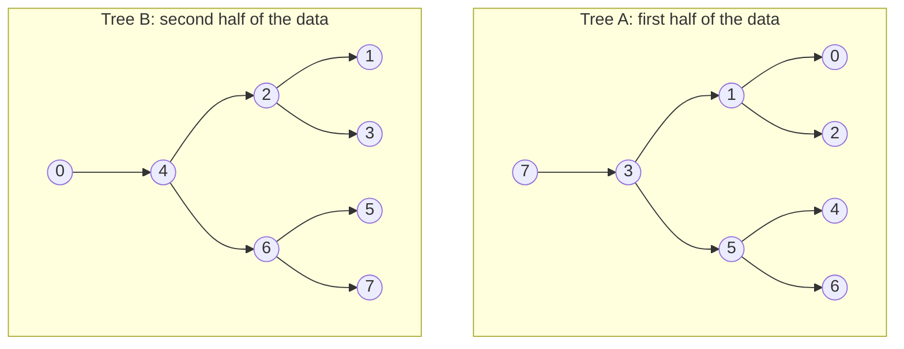

After every backward pass, each of the 1,024 GPUs in Meridian's San Jose cluster holds 2 GB of gradients that differ from every other GPU's, and none may update its weights until all of them hold the sum. If every GPU sent its 2 GB to every other, each would push about 2 TB onto a 400 Gb/s link: 40 seconds per step. A good all-reduce sends under 4 GB per GPU and, with NVLink carrying the hops inside each server, keeps each NIC busy for about 10 ms. The difference is an algorithm, and NCCL decides which one to run and how to lay it over the machine without asking you.

Interviewers ask why a ring sends $2(n-1)/n$ times the data, why nccl-tests reports a "bus bandwidth" larger than size over time, and why small messages go by tree. Each answer becomes something on the wire: a number of flows, who talks to whom, a burst shape, a counter.

Reminders from [why AI traffic is different](/learn/fabric-networking/ai-fabrics/why-ai-traffic-is-different): a **collective** is an operation every GPU in a group must join; each participant is a **rank**, numbered 0 to $n-1$; **NCCL** (NVIDIA Collective Communications Library, "nickel") implements collectives on NVIDIA GPUs, and AMD's RCCL is a close port. The San Jose cluster has 128 servers (`srv001.sjc` to `srv128.sjc`) of eight GPUs, NVLink inside each, and one 400 Gb/s RoCEv2 NIC per GPU on a rail-optimised back end, where GPU $k$ of every server plugs into rail $k+1$'s leaves (GPU0 on rail 1).

## Four collectives, defined by what each rank holds

Define a collective by its contract: what each rank holds before and after. Take four ranks holding the numbers 1, 2, 3 and 4 (in reality each holds a vector of millions of elements, and the operation applies element by element).

| Collective | Before (per rank) | After (per rank) | With 1, 2, 3, 4 | Where training uses it |
|---|---|---|---|---|
| **All-reduce** | a vector of size $S$ | the element-wise sum (or max, min, product) of all ranks' vectors | every rank holds 10 | Data parallelism: summing gradients every step |
| **Reduce-scatter** | a vector of size $S$ | one $S/n$ shard of the sum, a different shard on each rank | rank $r$ holds shard $r$ of the sum | Sharded data parallelism (FSDP, ZeRO): each rank keeps only its shard of the gradients |
| **All-gather** | one shard of size $S/n$ | all $n$ shards, concatenated in rank order | every rank holds [1, 2, 3, 4] | FSDP and ZeRO: collecting a layer's full parameters before using it |
| **Broadcast** | the root has $S$; the others have nothing | everyone holds the root's vector | every rank holds rank 0's value, 1 | Start of a job: copying initial weights from rank 0 |
| Reduce | a vector of size $S$ | the sum, on one root rank only | rank 0 holds 10 | Rare in training; metrics to one place |
| All-to-all | $n$ blocks, one addressed to each rank | the block every other rank addressed to you | a transpose | Expert parallelism (mixture-of-experts routing) |

Two identities matter. First, **all-reduce = reduce-scatter followed by all-gather**: once each rank owns one fully summed shard, gathering the shards gives everyone the whole sum. The ring algorithm is built directly on this. Second, the reduction is floating-point addition, which is not associative: $(a + b) + c$ and $a + (b + c)$ can differ in the last bit. A ring and a tree add in different orders, so switching algorithms (or the number of ranks) changes results bitwise, though not meaningfully. Teams that need bit-for-bit reproducible runs pin the algorithm, the protocol and the channel count, all three of which change the order.

Which collectives a job runs, and how big they are, depends on how the model is split, which [parallelism: TP, PP and DP](/learn/fabric-networking/ai-fabrics/parallelism-tp-pp-dp) works through for a concrete model. This lesson is about how each collective is executed.

## The obvious ways to all-reduce, and what they cost

Set the example: four ranks, GPU0 of `srv001` to `srv004`, all on `rail1-leaf1.sjc`, each with a 400 MB gradient vector and a 400 Gb/s NIC, which moves 50 GB/s in each direction at once.

**Everyone sends to everyone.** Each rank sends $(n-1)S = 1{,}200$ MB, 24 ms at 50 GB/s, growing linearly with $n$: at 128 ranks, 50.8 GB each, about a second.

**A central summer** (the "parameter server" of early distributed training). Rank 0 receives $(n-1)S$, sums, and sends $(n-1)S$ back, so one NIC bounds the job: at least 24 ms with four ranks, with the same linear growth. It is also the worst case of **incast**, many senders converging on one port at once.

Both overload some links while others idle. The aim is equal load on every link and a per-rank load that does not grow with $n$.

## Ring all-reduce, step by step

Arrange the ranks in a logical ring, 0 → 1 → 2 → 3 → 0; physically every hop runs NIC to `rail1-leaf1.sjc` to NIC. Cut each vector into $n = 4$ chunks of 100 MB. Every step, each rank sends one chunk to its right-hand neighbour and receives one from its left, so every NIC sends and receives at full rate at once.

Follow one sample element per chunk, chosen so the digits show who has contributed: rank $r$'s element of chunk $c$ is $(c+1) \times 10^r$. Rank 0 holds 1, 2, 3, 4; rank 1 holds 10, 20, 30, 40; and so on. Every rank must end with 1111, 2222, 3333, 4444.

**Phase 1, reduce-scatter** ($n - 1 = 3$ steps). In step $k$ (counting from 0, so the table's step 1 is $k = 0$), rank $r$ sends chunk $(r - k) \bmod n$ to rank $r+1$, which **adds** it to its own copy.

| Step | Transfers (chunk: value sent → result at the receiver) |
|---|---|
| 1 | 0→1 chunk 0: 1 → 10+1 = **11**; 1→2 chunk 1: 20 → 200+20 = 220; 2→3 chunk 2: 300 → 3300; 3→0 chunk 3: 4000 → 4004 |
| 2 | 1→2 chunk 0: 11 → 100+11 = **111**; 2→3 chunk 1: 220 → 2220; 3→0 chunk 2: 3300 → 3303; 0→1 chunk 3: 4004 → 4044 |
| 3 | 2→3 chunk 0: 111 → 1000+111 = **1111**; 3→0 chunk 1: 2220 → 2222; 0→1 chunk 2: 3303 → 3333; 1→2 chunk 3: 4044 → 4444 |

Follow chunk 0 in bold: each step it moves one place round the ring and picks up one more rank's contribution, so after $n - 1$ steps it has visited every rank. After the third step the four ranks hold:

| | chunk 0 | chunk 1 | chunk 2 | chunk 3 |
|---|---|---|---|---|
| rank 0 | 1 | **2222** | 3303 | 4004 |
| rank 1 | 11 | 20 | **3333** | 4044 |
| rank 2 | 111 | 220 | 300 | **4444** |
| rank 3 | **1111** | 2220 | 3300 | 4000 |

Each rank owns one complete chunk, rank $r$ owning chunk $(r+1) \bmod n$; the rest is partial sums it no longer needs. That is a reduce-scatter. (NCCL's public `ncclReduceScatter` leaves shard $r$ on rank $r$ by starting one position earlier; the byte count is the same.)

**Phase 2, all-gather** ($n - 1 = 3$ more steps). Each rank sends its complete chunk to the right, and the receiver **overwrites** instead of adding: in step 1 rank 3 sends chunk 0 = 1111 to rank 0, rank 0 sends chunk 1 = 2222 to rank 1, and so on. After three steps every rank holds 1111, 2222, 3333, 4444.

Six steps, one 100 MB chunk per rank per step: 600 MB per rank, 1.5 times the vector. At 50 GB/s each step takes 2 ms and the all-reduce 12 ms, half the time of either obvious method, with every link equally loaded.

```viz
{"type": "fabric", "scenario": "ring-allreduce", "title": "Ring all-reduce on four GPUs: three reduce-scatter steps, three all-gather steps, 600 MB per rank", "caption": "GPU0 of srv001 to srv004 on rail1-leaf1.sjc, each with 400 MB in four 100 MB chunks; the table follows one sample element per chunk, (c+1)·10^r, so the digits show who has contributed. Reduce-scatter adds as chunks move round the dashed ring until each rank owns one complete chunk; all-gather overwrites until every rank holds 1111, 2222, 3333, 4444. Each step takes 2 ms at 400 Gb/s, 12 ms in all. The closing frames compare the naive methods (1,200 MB per rank, at least 24 ms), plot 2(n−1)/n for 2 to 16 ranks, and derive algorithm bandwidth (33.3 GB/s) and bus bandwidth (50 GB/s)."}
```

Real NCCL does not wait for a whole chunk before forwarding it: it pipelines small slices, so rank 2 adds the first slice of chunk 0 while rank 1 still receives the last. That overlaps the steps without changing the bytes per rank.

**What the ring solves:** equal load on every link and a per-rank byte count that stays under $2S$ however many ranks join. **How it breaks:** every step waits for the slowest hop, so one bad link or slow NIC sets the pace for all. **What signal shows it:** nccl-tests bus bandwidth below the link rate on the full server set but normal on pairs, and one port in the job's set with a lower speed, errors or pauses.

## The 2(n−1)/n math, worked

Generalise to $n$ ranks and a vector of $S$ bytes, in $n$ chunks of $S/n$:

- Reduce-scatter: $n - 1$ steps, each rank sending $S/n$ per step, so $(n-1)S/n$ per rank.
- All-gather: the same again.
- All-reduce: $2(n-1)S/n$ per rank, in $2(n-1)$ steps.

With a per-rank link bandwidth $B$ and a fixed cost $\alpha$ per step (the fabric's latency plus NCCL's synchronisation), the time is the standard alpha-beta model:

$$T_{\text{ring}} = 2(n-1)\,\alpha + \frac{2(n-1)}{n} \cdot \frac{S}{B}$$

| Ranks $n$ | $2(n-1)/n$ | Bytes per rank for $S$ = 2 GB | Bandwidth term at 50 GB/s | Steps |
|---|---|---|---|---|
| 2 | 1.0 | 2.0 GB | 40 ms | 2 |
| 4 | 1.5 | 3.0 GB | 60 ms | 6 |
| 8 | 1.75 | 3.5 GB | 70 ms | 14 |
| 128 | 1.984 | 3.97 GB | 79.4 ms | 254 |
| 1,024 | 1.998 | 4.0 GB | 79.9 ms | 2,046 |

**The bandwidth cost per rank is bounded by $2S$.** Going from 8 ranks to 1,024 adds 14% more bytes per rank, not 128 times more, which is why data parallelism scales at all. The ring is also bandwidth-optimal when only GPUs do arithmetic: to own a complete shard a rank must receive the other $n - 1$ contributions to it, $(n-1)S/n$ bytes, and to end with the whole result it must receive the $n-1$ shards it does not own, another $(n-1)S/n$. The only way past the bound is to let the network add.

**The step count grows linearly.** 2,046 steps at 5 µs each is 10 ms of pure latency whatever the message size: tolerable for a 2 GB gradient, dominant for the megabyte-scale all-reduces of small gradient buckets or the kilobyte ones of inference. That is the case for trees.

### What the formula does not tell you

- **The ring runs at the pace of its slowest hop.** The next step forwards what the last delivered, so one NIC that negotiated 200 Gb/s instead of 400 halves the whole collective's bandwidth, the straggler effect traced in [why AI traffic is different](/learn/fabric-networking/ai-fabrics/why-ai-traffic-is-different).
- **Every link is busy in both directions.** A rank receives as much as it sends, so an uplink oversubscribed in either direction slows the ring.

### Rings across 8-GPU servers

A real job's ring runs through all 1,024 GPUs, ordered so that seven of every eight hops stay inside a server on NVLink (about 450 GB/s each way per GPU, [scale-up: NVLink and NVSwitch](/learn/fabric-networking/ai-fabrics/scale-up-nvlink-and-nvswitch)) and one leaves through a NIC. NCCL builds several rings at once, at least one per NIC, each leaving the server on a different rail.

Work it for the 2 GB gradient. Across 8 rings each carries $S/8$ = 250 MB, so each hop of a ring carries $2 \times 1023/1024 \times 250$ MB ≈ 500 MB. Each NIC is the network hop of one ring: 500 MB, 10 ms at 50 GB/s. The NVLink hops carry the other seven rings, 3.5 GB per GPU at 450 GB/s, 7.8 ms, so the network is still the bottleneck. A ring with every hop on the network would make each NIC send 4 GB: 80 ms. The hierarchy buys a factor of 8, the number of NICs per server, provided the fabric keeps each ring's network hop on its rail ([AI fabric topologies](/learn/fabric-networking/ai-fabrics/ai-fabric-topologies)).

## Broadcast, all-gather and reduce-scatter on their own

**All-gather and reduce-scatter** are each one phase of the ring: $n - 1$ steps, $(n-1)S/n$ bytes per rank, half an all-reduce. Sharded training (FSDP, ZeRO stage 3) runs them instead of all-reduce: it all-gathers each layer's parameters before the forward pass and again before the backward pass, and reduce-scatters the gradients, so it moves about $3(n-1)S/n$ per rank per step against data parallelism's $2(n-1)S/n$. It pays 1.5 times the bytes so that no GPU ever stores the whole model.

**Broadcast** has no arithmetic and one source, so the cost is getting the root's $S$ bytes to everyone without the root sending $n - 1$ copies. NCCL runs it down a chain (the ring with one link unused) and pipelines it. Take rank 0 broadcasting 400 MB to ranks 1 to 3, cut into 100 slices of 4 MB, each taking 0.08 ms at 50 GB/s:

1. 0 to 0.08 ms: rank 0 sends slice 1 to rank 1.
2. 0.08 to 0.16 ms: rank 0 sends slice 2; rank 1 forwards slice 1 to rank 2.
3. 0.16 to 0.24 ms: rank 0 sends slice 3, rank 1 slice 2, rank 2 slice 1 to rank 3. Every link of the chain is now busy.
4. Rank 0 finishes its 100th slice at 8 ms; it reaches rank 3 two slice-times later, at 8.16 ms.

The time is $(\text{slices} + n - 2)$ slice-times, close to $S/B$ for any $n$, and every link carries $S$ once. Sending the whole vector hop by hop, or having the root send three copies, takes 24 ms. Smaller slices shorten the fill but pay the per-slice overhead more often: the latency-bandwidth trade again.

## Trees: trading bandwidth for fewer steps

A tree all-reduce reduces up a tree and broadcasts back down: each parent adds its children's vectors to its own and sends the sum up, and the root sends the total down the same edges, both phases pipelined in slices. The depth is $\lceil \log_2 n \rceil$, so there are about $2\log_2 n$ steps: 14 for 128 ranks instead of the ring's 254.

A single binary tree has a bandwidth problem: an interior rank with two children sends $S$ up and $2S$ down, $3S$ in all, while the leaves (half the ranks) send only $S$. NCCL's answer, added in NCCL 2.4 (2019), is the **double binary tree**: two trees over the same ranks, each carrying half the data, built so every rank is a leaf in one and interior in the other. For eight ranks (in NCCL the tree nodes are servers; inside a server the GPUs form a chain):



In tree A the odd ranks are interior; tree B shifts every rank by one, so the roles swap. Rank 3, interior in A, sends $S/2$ up and $2 \times S/2$ down, $1.5S$; in B it is a leaf and sends $S/2$. Total $2S$ per rank, within a factor $n/(n-1)$ of the ring, in $2\log_2 n$ steps instead of $2(n-1)$.

In practice NCCL's trees reach somewhat less bandwidth than its rings (uneven work between phases, pipeline bubbles at root and leaves). The model below charges trees 15% for that and every step a fixed 5 µs; both are illustrative assumptions standing in for the factors NCCL's tuner holds per platform, but the shape of the result is not.

```python
import math

ALPHA_US = 5.0    # fixed cost per step: fabric latency plus NCCL's sync (an assumption)
LINK_GBS = 50.0   # one 400 Gb/s NIC per rank = 50 GB/s
TREE_EFF = 0.85   # tree bandwidth relative to ring (an assumption; NCCL's tuner has its own)


def ring_us(size, n):
    steps = 2 * (n - 1)                       # n-1 reduce-scatter + n-1 all-gather
    sent = 2 * (n - 1) / n * size             # bytes each rank sends
    return steps * ALPHA_US + sent / (LINK_GBS * 1e3)   # 1 GB/s = 1,000 bytes per us


def tree_us(size, n):
    steps = 2 * math.ceil(math.log2(n))       # up the tree, then back down
    sent = 2 * size                           # double binary tree: about 2S per rank
    return steps * ALPHA_US + sent / (LINK_GBS * 1e3 * TREE_EFF)


def crossover(n):
    lo, hi = 1, 10**13                        # bisect for the size where ring catches up
    while hi - lo > 1:
        mid = (lo + hi) // 2
        if ring_us(mid, n) < tree_us(mid, n):
            hi = mid
        else:
            lo = mid
    return hi


for n in (16, 128):
    print(f"n = {n}: ring overtakes tree at {crossover(n) / 1e6:,.1f} MB")
    for size in (64e3, 1e6, 25e6, 250e6, 2e9):
        r, t = ring_us(size, n), tree_us(size, n)
        print(f"  {size / 1e6:>9,.3f} MB   ring {r:>8,.0f} us   tree {t:>8,.0f} us"
              f"   -> {'ring' if r < t else 'tree'}")
```

```text
n = 16: ring overtakes tree at 11.5 MB
      0.064 MB   ring      152 us   tree       43 us   -> tree
      1.000 MB   ring      188 us   tree       87 us   -> tree
     25.000 MB   ring    1,088 us   tree    1,216 us   -> ring
    250.000 MB   ring    9,525 us   tree   11,805 us   -> ring
  2,000.000 MB   ring   75,150 us   tree   94,158 us   -> ring
n = 128: ring overtakes tree at 162.8 MB
      0.064 MB   ring    1,273 us   tree       73 us   -> tree
      1.000 MB   ring    1,310 us   tree      117 us   -> tree
     25.000 MB   ring    2,262 us   tree    1,246 us   -> tree
    250.000 MB   ring   11,192 us   tree   11,835 us   -> ring
  2,000.000 MB   ring   80,645 us   tree   94,188 us   -> ring
```

Small messages are latency-bound and trees win, by 3.5 times at 64 KB on 16 ranks and 17 times on 128. Large messages are bandwidth-bound and rings win. The crossover grows with the rank count, because the ring's latency term is linear and the tree's logarithmic: 11.5 MB at 16 ranks, 163 MB at 128. In this model a 25 MB PyTorch gradient bucket (DistributedDataParallel's default) goes by ring in a 16-node job and by tree in a 128-node job. NCCL's tuner makes that decision on every call with its own per-platform constants, which is why a hard-coded choice is wrong somewhere.

**What the tree solves:** logarithmic latency for small messages at scale, at nearly the ring's bandwidth. **How it breaks:** interior ranks receive from two children at once, and a tree laid across servers in an order the fabric does not suit sends its fan-in over spines. **What signal shows it:** small-message all-reduce latency that grows faster than $\log_2 n$ as jobs grow, and two-to-one bursts at the ports of interior servers.

### Letting the network add

The $2S$ floor assumes only GPUs add. If a switch sums, each rank sends $S$ once and receives the reduced $S$ once: half the bytes. **SHARP** (Scalable Hierarchical Aggregation and Reduction Protocol) does it in NVIDIA's InfiniBand switches, used through NCCL's CollNet algorithms ([InfiniBand and RoCE](/learn/fabric-networking/ai-fabrics/infiniband-and-roce)); **NVLink SHARP**, NCCL's NVLS algorithm, does it in the NVSwitch of Hopper-or-later systems. Both put reduction state in the network, so a failing switch stalls collectives rather than only dropping packets, and a switch's reduction resources are finite, so jobs compete for them; the signal is NCCL's log showing a fallback to ring or tree, and step time jumping with it.

## Algorithm bandwidth and bus bandwidth

nccl-tests, NVIDIA's NCCL benchmark suite, prints two bandwidths per message size, and confusing them is the commonest misreading ([tuning and benchmarking RDMA](/learn/fabric-networking/ai-fabrics/tuning-and-benchmarking-rdma) covers running it).

**Algorithm bandwidth** (`algbw`) is size over time, $S/t$: what the application experiences. Four-rank ring: 400 MB in 12 ms is 33.3 GB/s.

**Bus bandwidth** (`busbw`) multiplies it by the collective's factor, $2(n-1)/n$ for all-reduce: $33.3 \times 1.5 = 50$ GB/s, the rate each rank's link actually ran at, so the number to compare with the hardware. Algorithm bandwidth falls as $n$ grows even on a perfect fabric, because each rank moves nearly $2S$ for an $S$-byte answer; bus bandwidth stays at the link rate. Healthy 4-rank and 128-rank runs with one GPU per server both show busbw near 50 GB/s and very different algbw.

| Collective | nccl-tests size $S$ means | busbw = algbw × | Why |
|---|---|---|---|
| All-reduce | each rank's vector | $2(n-1)/n$ | reduce-scatter plus all-gather |
| Reduce-scatter | each rank's input (the whole vector) | $(n-1)/n$ | each rank receives $n-1$ shards of $S/n$ |
| All-gather | each rank's output (the whole vector) | $(n-1)/n$ | the same, without arithmetic |
| All-to-all | each rank's total send buffer | $(n-1)/n$ | the block to itself never crosses a link |
| Broadcast, reduce | the vector | 1 | pipelined, each link carries $S$ once |

Illustrative output for the four ranks, one GPU per server:

```text
#                                                 out-of-place                    in-place
#       size     count   type  redop  root    time   algbw   busbw #wrong    time   algbw   busbw #wrong
#        (B)  (elements)                       (us)  (GB/s)  (GB/s)          (us)  (GB/s)  (GB/s)
   419430400  104857600  float   sum    -1   13500   31.07   46.60      0   13480   31.11   46.67      0
```

46.6 GB/s against a 50 GB/s NIC is 93%, healthy: the Ethernet, IP, UDP and RoCE headers, preamble and gap around a 4,096-byte RDMA payload take about 2% of the wire, and NCCL's synchronisation a little more. On full 8-GPU servers seven of every eight ring hops are on NVLink, so the yardstick changes: the worked 2 GB all-reduce over 1,024 ranks, if it finished in its 10 ms of NIC time, would report $2 \times 1023/1024 \times 2\text{ GB}/10\text{ ms} \approx 400$ GB/s, the server's eight NICs together. Compare with the slowest resource in the path, and know which one that is first.

Two cautions. A healthy nccl-tests run, one collective in isolation, does not prove a job's overlapped, multi-communicator traffic is healthy. And small-message bus bandwidth is low on any fabric, because the time is latency; compare small-message latency across runs instead.

## Under the hood: NCCL from communicator to wire

NCCL runs the same workflow for every job. Each stage decides something about the network, and each has a characteristic failure.

```mermaid
flowchart LR
  A["Framework: groups of ranks"] --> B["Unique ID shared out of band"]
  B --> C["ncclCommInitRank: bootstrap over TCP"]
  C --> D["Topology detection: PCIe, NVLink, NICs"]
  D --> E["Graph search: rings, trees, channels"]
  E --> F["Connect: P2P, SHM or NET per hop"]
  F --> G["Each call: tuner picks algorithm and protocol"]
  G --> H["GPU kernel plus CPU proxy drive the NICs"]
```



### 1. The communicator and the bootstrap

A **communicator** is NCCL's object for one group of ranks; a job usually has several (data-parallel and tensor-parallel groups, for example). Rank 0 calls `ncclGetUniqueId`, which returns an opaque handle holding a TCP address on its host; the framework distributes it (PyTorch through its key-value store at `MASTER_ADDR:MASTER_PORT`), and every rank calls `ncclCommInitRank(comm, nranks, id, rank)`, connects, and exchanges addresses and hardware descriptions over plain TCP.

That **bootstrap** runs on an ordinary IP interface, normally the front-end network, which NCCL picks itself unless `NCCL_SOCKET_IFNAME` says otherwise. Initialisation at thousands of ranks can take tens of seconds, and a rank that picks an interface the others cannot reach (a container bridge, a management port) hangs the whole group at start-up. Recent versions defer connection setup until an algorithm is first used and can split communicators (`ncclCommSplit`) to shorten start-up.

### 2. Topology detection

Each rank builds a graph of its own server from what the operating system exposes: the PCIe tree from `/sys`, NVLink from NVIDIA's management library (NVML), the RDMA NICs and their speeds from the verbs library. It classifies every GPU-to-NIC path by distance:

| Path type | Meaning | Consequence |
|---|---|---|
| NVL | Connected by NVLink | GPU-to-GPU at NVLink speed |
| PIX | Under the same PCIe switch | Best case for GPU and NIC: GPUDirect RDMA at full rate |
| PXB | Through several PCIe switches, not the CPU | Usually fine for GPUDirect |
| PHB | Through the CPU's PCIe host bridge | Traffic crosses the CPU's root complex; often slower |
| SYS | Across the link between CPU sockets | Usually too slow for GPUDirect; NCCL stages through host memory |

**GPUDirect RDMA** lets the NIC read and write GPU memory directly over PCIe, bypassing host memory ([RDMA from zero](/learn/fabric-networking/ai-fabrics/rdma-from-zero)); NCCL uses it only when the path is close enough (`NCCL_NET_GDR_LEVEL`). Inside a virtual machine the PCIe tree is often flattened, so cloud providers ship a topology file (`NCCL_TOPO_FILE`), and `NCCL_TOPO_DUMP_FILE` writes out what NCCL believed, the first thing to diff when one host misbehaves. NCCL sees nothing past the NIC: no leaves, spines or rails, so the fabric's design has to match the rank order NCCL will choose.

### 3. Graph search: rings and trees through the machine

NCCL then searches for rings and trees that maximise bandwidth: inside each server an order through the GPUs over NVLink, entering and leaving through NICs, then the servers chained in rank order. In a rail-optimised fabric the search keeps each ring's network hop on one rail, so GPU0 of `srv001` reaches GPU0 of `srv002` through `rail1-leaf1.sjc` alone. When data sits on a GPU whose NIC is on the wrong rail, NCCL's PXN feature first moves it over NVLink to the GPU on the right rail ([AI fabric topologies](/learn/fabric-networking/ai-fabrics/ai-fabric-topologies)).

### 4. Algorithm and protocol, chosen per call

Each call names an operation, data type, count, communicator and CUDA stream (a queue of GPU work). The tuner estimates each (algorithm, protocol) pair with a latency-plus-bandwidth model like the one above and picks the fastest. The algorithms are ring, tree, CollNet and NVLS where the hardware allows, and, from NCCL 2.23, PAT (parallel aggregated trees) for all-gather and reduce-scatter with one GPU per server. The **protocol** is how a receiver learns data has arrived:

| Protocol | Mechanism | Payload efficiency | Latency | Used for |
|---|---|---|---|---|
| Simple | Large buffers, then a memory fence and a flag the receiver polls | ≈100% | Highest: microseconds of synchronisation per chunk | Large messages |
| LL (low latency) | Every 8-byte store carries 4 bytes of data and a 4-byte flag; the receiver polls each one | 50% | Lowest | Small messages |
| LL128 | 128-byte lines with 120 bytes of data and an 8-byte flag | 93.75% | Low | Medium to large, only on platforms where NCCL knows 128-byte stores arrive whole (NVLink-connected GPUs NCCL has validated) |

The flag beside every piece of data means LL never needs a fence, at the cost of half the bandwidth: irrelevant for 64 KB, ruinous for 2 GB. `NCCL_ALGO` and `NCCL_PROTO` force a choice; NVIDIA's guidance is to use them for benchmarking, not production, where tuner plugins are the supported lever. A successful return means the work is queued on the stream, not finished.

### 5. Channels

NCCL splits each collective across **channels**: ring or tree instances with their own buffers and connections, each run by one CUDA thread block on one streaming multiprocessor (SM, one of the GPU's independent processors, each holding many arithmetic cores; an H100 SXM has 132). One thread block cannot drive several NICs and NVLinks at full rate, so NCCL runs several, each on a different ring offset and, between servers, a different NIC. More channels add bandwidth headroom but take SMs from the model while communication overlaps compute (`NCCL_MIN_NCHANNELS`, `NCCL_MAX_NCHANNELS`).

For the fabric, channels are flows. Each channel's connection to the next server is its own RDMA queue pair, and a RoCEv2 NIC usually derives the UDP source port from the queue pair, so channels times `NCCL_IB_QPS_PER_CONNECTION` is the number of distinct 5-tuples the ECMP hash sees ([ECMP and hashing](/learn/fabric-networking/fabric-architecture/ecmp-and-hashing)): the entropy lever a software engineer meets most. **What channels solve:** enough parallel engines and flows to fill every NIC and NVLink. **How they break:** too few leave links idle and let flows collide on spine uplinks; too many take SMs from the model. **What signal shows it:** the channel count in NCCL's log, per-uplink skew during collectives, and compute kernels slowing while communication overlaps them.

### 6. Transports and the proxy

For each hop NCCL picks a **transport**: P2P (GPU to GPU over NVLink or PCIe inside a server), SHM (through host memory) or NET (another server, through the built-in InfiniBand verbs transport that also drives RoCE, TCP sockets as a fallback, or a plugin such as AWS's for EFA). For NET, a CPU **proxy thread** per GPU posts RDMA writes to the NIC's queue pairs and polls completions while the GPU kernel fills and drains buffers. `NCCL_IB_TC` sets the traffic-class byte whose top six bits are the DSCP that puts packets in the switch's lossless queue ([lossless Ethernet](/learn/fabric-networking/ai-fabrics/lossless-ethernet-pfc-ecn-dcqcn)), and `NCCL_IB_GID_INDEX` picks the NIC address entry (GID, the RDMA address), which decides whether packets leave as routable RoCEv2; recent NCCL versions pick a RoCEv2 entry themselves when it is unset, and a stale explicit value overrides that.

### What NCCL_DEBUG shows

`NCCL_DEBUG=INFO` makes every rank log these decisions. Illustrative lines from rank 0 of a 1,024-rank job, with the prefix shortened to host and GPU (real lines also carry process and thread IDs); ranks number server by server, so `srv128`'s GPU7 is rank 1023 and `srv002`'s GPU0 is rank 8:

```text
srv001:0 NCCL INFO Bootstrap : Using eth0:<front-end address>
srv001:0 NCCL INFO NET/IB : Using [0]mlx5_0:1/RoCE [1]mlx5_1:1/RoCE ... [7]mlx5_7:1/RoCE
srv001:0 NCCL INFO comm 0x55d0 rank 0 nranks 1024 cudaDev 0 nvmlDev 0 busId 18000 - Init START
srv001:0 NCCL INFO Channel 00/16 :    0   1   2   3   4   5   6   7   8   9  10 ...
srv001:0 NCCL INFO Trees [0] 1/512/-1->0->-1 [1] 1/-1/-1->0->8
srv001:0 NCCL INFO Channel 00/0 : 1023[7] -> 0[0] [receive] via NET/IB/0/GDRDMA
srv001:0 NCCL INFO Channel 00/0 : 0[0] -> 1[1] via P2P/CUMEM
srv001:0 NCCL INFO Connected all rings
srv001:0 NCCL INFO Connected all trees
srv001:0 NCCL INFO comm 0x55d0 rank 0 nranks 1024 cudaDev 0 nvmlDev 0 busId 18000 - Init COMPLETE
```

Top down: the bootstrap interface; eight RoCE NICs; 16 channels, channel 0's ring running 0, 1, 2 and on; the tree neighbours as children->rank->parent (root of tree 0 above GPU1 and rank 512, `srv065`'s GPU0; a leaf under rank 8 in tree 1); and each hop's transport, here the ring's network hop into rank 0 from rank 1023, arriving on NIC 0 with GPUDirect RDMA (`GDRDMA`), and the hop to GPU1 over NVLink (`P2P`). The alarming lines are `via NET/Socket` (TCP over the front end: RDMA is not working), `via NET/IB/n` without `GDRDMA` (staged through host memory), and `via SHM` between GPUs that have NVLink.

## How a collective looks to the fabric

During the four-rank ring the switches see one flow per queue pair, each at line rate for 12 ms, all starting within microseconds, then silence until the next bucket; every hop stays on `rail1-leaf1.sjc`. In the full job a ring sends only to neighbours, so its network hops on rail 1 stay on `rail1-leaf1.sjc` between `srv001` and `srv064` and on `rail1-leaf2.sjc` between `srv065` and `srv128`, and cross an `ai-spine` twice per lap: from `srv064` to `srv065`, and from `srv128` back to `srv001`. A tree adds two-to-one fan-in at every interior rank's port, small incasts a ring never creates. Reduce-scatter and all-gather look identical on the wire.

For monitoring that means **few low-entropy elephants**, so ECMP collisions persist for the job's lifetime and change at restart with new queue pairs, and **synchronised** bursts that averages hide.

## Failure modes in production

| Failure | Symptom | Diagnosis | Fix |
|---|---|---|---|
| RDMA silently not used | Collectives an order of magnitude or more slower than expected (the back end has many times the front end's bandwidth); front-end links busy during training | `NCCL_DEBUG=INFO` shows `via NET/Socket`; the RDMA plugin or library failed to load, or no NIC passed NCCL's filters (`NCCL_IB_HCA`) | Fix the driver, library or container mounts; alert on the log line |
| No GPUDirect RDMA on some hosts | busbw falls on the rings through those hosts, by an amount that depends on host memory bandwidth and PCIe layout; host memory traffic and CPU rise | Topology dump shows the GPU-to-NIC path as PHB or SYS; PCIe Access Control Services (ACS) on bare metal forcing peer-to-peer traffic through the root complex; the peer-memory kernel module not loaded | Disable ACS where safe, load the module, or move the NIC to the GPU's PCIe switch |
| Bootstrap on the wrong interface | Job hangs in initialisation, or works on some hosts and not others | Init START without Init COMPLETE; bootstrap line names a container bridge or management port | Set `NCCL_SOCKET_IFNAME` to the front-end interface in the job template |
| One degraded hop | Every rank slows equally; nccl-tests busbw on the full set far below the per-server result | Run nccl-tests on halves of the server set to bisect; one port at a lower speed or with rising errors | Drain the server or replace the cable or optic ([why AI traffic is different](/learn/fabric-networking/ai-fabrics/why-ai-traffic-is-different)) |
| ECMP collision on cross-spine hops | Same job, same nodes, tens of percent slower after a restart | Per-uplink utilisation skew during collectives; more QPs or channels change it | More QPs per connection, rail alignment, or adaptive routing ([AI fabric topologies](/learn/fabric-networking/ai-fabrics/ai-fabric-topologies)) |
| RoCE in the wrong traffic class | Fine at low load, collapses under contention, with retransmits | Packets carry the wrong DSCP, so they land in a lossy queue; drop counters on the default class. (A GID index that selects RoCEv1 fails outright across routed leaves, since v1 has no IP header.) | Set `NCCL_IB_TC` and `NCCL_IB_GID_INDEX` to the fabric's design ([lossless Ethernet](/learn/fabric-networking/ai-fabrics/lossless-ethernet-pfc-ecn-dcqcn)) |
| Mismatched collectives | Job hangs mid-run; the framework's watchdog kills it after a timeout of minutes | One rank skipped or reordered a collective (a code path taken on one rank only); the others wait forever | A software bug, not the network: per-rank collective sequence numbers (PyTorch's flight recorder) show the odd one out |
| Forced algorithm left in production | Small-message latency many times worse in large jobs (17 times at 64 KB on 128 ranks in the model above) | `NCCL_ALGO=Ring` in the environment from a benchmark | Remove it; benchmark with it, never ship with it |

## Trade-offs: how to combine data across ranks

| | Everyone to everyone | Central summer | Ring | Double binary tree | In-network (SHARP, NVLS) |
|---|---|---|---|---|---|
| Bytes sent per rank, all-reduce | $(n-1)S$ | $S$ (root: $(n-1)S$) | $2(n-1)S/n$ | ≈ $2S$ | $S$ |
| Steps (latency) | 1, but huge | 2, but serialised at the root | $2(n-1)$ | ≈ $2\log_2 n$ | about 2 |
| Link load | Uneven, quadratic total | One link saturated | Every link equal | Nearly equal; 2:1 fan-in at interior ranks | Equal, half the bytes |
| Best for | Nothing at scale | Nothing at scale | Large messages | Small messages, many ranks | Both, where the hardware exists |
| Needs | Nothing | Nothing | A good ring order matching the fabric | Tree layout across servers | SHARP-capable switches or NVSwitch, plus management software |
| Breaks how | Incast everywhere | The root's NIC | Slowest hop bounds all | Interior ranks run hotter | Switch resources run out; a switch fault stalls reductions |

## What the platform should show

The AI team asks "is it the network?"; the network team sees links averaging 19%. Tooling has to join the views:

- **Collective performance against a baseline**: nccl-tests busbw by collective and size on the job's nodes at acceptance, and collective durations from the framework during the run. Lower large-message busbw points at bandwidth (a slow hop, a collision); higher small-message latency at latency (a long path, a forced algorithm, starved proxy threads).
- **NCCL's decisions, parsed**: transport per hop, channel count, NICs, bootstrap interface, init time. They are fleet-wide invariants, so a host that differs is the suspect.
- **The rank-to-port map**: rank, server, GPU, NIC, leaf port and rail, so "rank 133 is slow" becomes "`srv017` GPU5, its port on `rail6-leaf1.sjc`". Without it the two teams describe one problem in two vocabularies.
- **Sub-second per-port rates, compared across the job's ports**: the port that differs (lower speed, errors, pause frames, one ECMP uplink at 100% beside idle siblings) matters more than the busiest.
- **Host RDMA counters beside switch counters**: retransmits, congestion notifications, out-of-sequence packets per NIC ([when lossless goes wrong](/learn/fabric-networking/ai-fabrics/when-lossless-goes-wrong)). A collective can be slow with clean switch counters.

The NCCL log check takes a few lines, run on every job's start-up output:

```python
import re
from collections import Counter

LOG = """\
srv001:0 NCCL INFO NET/IB : Using [0]mlx5_0:1/RoCE [1]mlx5_1:1/RoCE [2]mlx5_2:1/RoCE [3]mlx5_3:1/RoCE
srv001:0 NCCL INFO Channel 00/0 : 1023[7] -> 0[0] [receive] via NET/IB/0/GDRDMA
srv001:0 NCCL INFO Channel 00/0 : 0[0] -> 1[1] via P2P/CUMEM
srv017:5 NCCL INFO NET/IB : Using [0]mlx5_0:1/RoCE [1]mlx5_1:1/RoCE [2]mlx5_2:1/RoCE [3]mlx5_3:1/RoCE
srv017:5 NCCL INFO Channel 05/0 : 133[5] -> 134[6] via P2P/CUMEM
srv017:5 NCCL INFO Channel 05/0 : 133[5] -> 141[5] [send] via NET/IB/5
srv042:3 NCCL INFO NET/Socket : Using [0]eth0:<front-end address>
srv042:3 NCCL INFO Channel 03/0 : 331[3] -> 339[3] [send] via NET/Socket/0
"""

CONN = re.compile(r"^(\S+) NCCL INFO Channel (\d+)/\d+ : (\d+)\[\d\] -> (\d+)\[\d\]"
                  r"(?: \[(send|receive)\])? via (\S+)")


def audit(log):
    findings = Counter()
    for line in log.splitlines():
        m = CONN.match(line)
        if not m:
            continue
        host, chan, src, dst, _, via = m.groups()
        if via.startswith("NET/Socket"):
            findings[(host, "RDMA not in use: TCP sockets on the front-end network")] += 1
        elif via.startswith("NET/IB") and not via.endswith("GDRDMA"):
            findings[(host, "no GPUDirect RDMA: data staged through host memory")] += 1
        elif via.startswith("SHM"):
            findings[(host, "intra-server hop through host memory, not NVLink")] += 1
    return findings


for (host, problem), count in sorted(audit(LOG).items()):
    print(f"{host:<10} {count} connection(s): {problem}")
```

```text
srv017:5   1 connection(s): no GPUDirect RDMA: data staged through host memory
srv042:3   1 connection(s): RDMA not in use: TCP sockets on the front-end network
```

Rank numbers map to hardware as (server number − 1) × 8 + GPU, so rank 133 is `srv017` GPU5 and rank 331 is `srv042` GPU3. Both findings would pass every switch dashboard, and both slow the channels that use those NICs; since a collective finishes only when its last channel does, the whole job runs at their pace.

## Exercises

```exercise
id: ring-allreduce
title: Simulate a ring all-reduce and count the bytes
prompt: |
  Implement NCCL's ring all-reduce on `vectors`, a list of n equal-length
  lists of integers, one per rank, and count what each rank sends.

  Chunks: with vector length L, chunk c (0 <= c < n) covers indices
  c*L//n up to but not including (c+1)*L//n (integer division). Chunks may
  be uneven, or empty when L < n.

  Reduce-scatter: for step k = 0 .. n-2, every rank r sends chunk
  (r - k) mod n to rank (r + 1) mod n, which ADDS it element by element to
  its own copy of that chunk.
  All-gather: for step k = 0 .. n-2, every rank r sends chunk
  (r + 1 - k) mod n to rank (r + 1) mod n, which OVERWRITES its copy.
  Within a step all sends happen at once (the chunk a rank receives is
  never the one it sends, so you may process ranks in order).

  Return {"result": the n final vectors, "elements_sent": a list with the
  number of elements each rank sent, "steps": the number of steps}.
  With four ranks [[1,2,3,4],[10,20,30,40],[100,200,300,400],
  [1000,2000,3000,4000]] every rank ends with [1111,2222,3333,4444],
  having sent 6 elements in 6 steps: 2(n-1)/n of its vector.
languages: [python, javascript]
entry: ring_allreduce
starter:
  python: |
    def ring_allreduce(vectors):
        n = len(vectors)
        # your code here
        return {"result": vectors, "elements_sent": [0] * n, "steps": 0}
  javascript: |
    function ring_allreduce(vectors) {
      const n = vectors.length;
      // your code here
      return { result: vectors, elements_sent: new Array(n).fill(0), steps: 0 };
    }
tests:
  - args: [[[1, 2, 3, 4], [10, 20, 30, 40], [100, 200, 300, 400], [1000, 2000, 3000, 4000]]]
    expected: {"result": [[1111, 2222, 3333, 4444], [1111, 2222, 3333, 4444], [1111, 2222, 3333, 4444], [1111, 2222, 3333, 4444]], "elements_sent": [6, 6, 6, 6], "steps": 6}
    label: four ranks, the lesson's example
  - args: [[[1, 2], [3, 4]]]
    expected: {"result": [[4, 6], [4, 6]], "elements_sent": [2, 2], "steps": 2}
    label: two ranks
  - args: [[[5, 6, 7]]]
    expected: {"result": [[5, 6, 7]], "elements_sent": [0], "steps": 0}
    label: one rank sends nothing
  - args: [[[1, 1, 1, 1], [2, 2, 2, 2], [3, 3, 3, 3]]]
    expected: {"result": [[6, 6, 6, 6], [6, 6, 6, 6], [6, 6, 6, 6]], "elements_sent": [5, 5, 6], "steps": 4}
    label: uneven chunks
  - args: [[[1, 2], [3, 4], [5, 6], [7, 8]]]
    expected: {"result": [[16, 20], [16, 20], [16, 20], [16, 20]], "elements_sent": [3, 3, 3, 3], "steps": 6}
    label: fewer elements than ranks, some chunks empty
  - args: [[[0, 1, 2, 3, 4, 5, 6, 7, 8, 9], [10, 11, 12, 13, 14, 15, 16, 17, 18, 19], [20, 21, 22, 23, 24, 25, 26, 27, 28, 29], [30, 31, 32, 33, 34, 35, 36, 37, 38, 39], [40, 41, 42, 43, 44, 45, 46, 47, 48, 49]]]
    expected: {"result": [[100, 105, 110, 115, 120, 125, 130, 135, 140, 145], [100, 105, 110, 115, 120, 125, 130, 135, 140, 145], [100, 105, 110, 115, 120, 125, 130, 135, 140, 145], [100, 105, 110, 115, 120, 125, 130, 135, 140, 145], [100, 105, 110, 115, 120, 125, 130, 135, 140, 145]], "elements_sent": [16, 16, 16, 16, 16], "steps": 8}
    hidden: true
  - args: [[[1, -1, 0, 2, 5], [-3, 4, 4, 0, 0], [2, 2, -4, 1, -5]]]
    expected: {"result": [[0, 5, 0, 3, 0], [0, 5, 0, 3, 0], [0, 5, 0, 3, 0]], "elements_sent": [6, 7, 7], "steps": 4}
    hidden: true
hints:
  - "Copy the input first, precompute each chunk's (start, end), and write one transfer(phase, k) helper used by both phases."
  - "Use ((a % n) + n) % n in JavaScript, where % keeps the sign of a negative operand."
  - "A rank sends every chunk except one in each phase, so it sends 2L minus the sizes of the two chunks it skips; uneven chunks make ranks differ."
```

```exercise
id: bus-bandwidth
title: Compute algorithm and bus bandwidth like nccl-tests
prompt: |
  Given a collective `op`, the number of ranks `n`, the operation's size in
  bytes (nccl-tests' convention) and the measured time in microseconds,
  return {"algbw": ..., "busbw": ...} in GB/s (10^9 bytes per second), each
  rounded to 2 decimal places.

  algbw = size_bytes / time. busbw = algbw times the collective's factor,
  computed from the unrounded algbw:
  - "allreduce": 2(n-1)/n
  - "reducescatter", "allgather", "alltoall": (n-1)/n
  - "broadcast", "reduce": 1

  Example: allreduce over 4 ranks of 419,430,400 bytes in 13,500 us gives
  algbw 31.07 and busbw 46.6.
languages: [python, javascript]
entry: bus_bandwidth
starter:
  python: |
    def bus_bandwidth(op, n, size_bytes, time_us):
        # your code here
        return {"algbw": 0, "busbw": 0}
  javascript: |
    function bus_bandwidth(op, n, size_bytes, time_us) {
      // your code here
      return { algbw: 0, busbw: 0 };
    }
tests:
  - args: ["allreduce", 4, 419430400, 13500]
    expected: {"algbw": 31.07, "busbw": 46.6}
  - args: ["allgather", 8, 1073741824, 25000]
    expected: {"algbw": 42.95, "busbw": 37.58}
  - args: ["broadcast", 16, 268435456, 6000]
    expected: {"algbw": 44.74, "busbw": 44.74}
  - args: ["allreduce", 1, 1048576, 20]
    expected: {"algbw": 52.43, "busbw": 0}
    label: a single rank moves nothing over any link
  - args: ["reducescatter", 1024, 2147483648, 50000]
    expected: {"algbw": 42.95, "busbw": 42.91}
  - args: ["alltoall", 8, 536870912, 20000]
    expected: {"algbw": 26.84, "busbw": 23.49}
    hidden: true
  - args: ["allreduce", 1024, 2147483648, 11000]
    expected: {"algbw": 195.23, "busbw": 390.07}
    label: 8-GPU servers, so busbw approaches eight NICs' worth
    hidden: true
hints:
  - "Bytes per microsecond divided by 1,000 is GB/s."
  - "Apply the factor before rounding: rounding algbw first can change busbw's last digit."
```

## Interviewer follow-ups

**"Derive the cost of a ring all-reduce."** Model answer: $n$ chunks; reduce-scatter takes $n-1$ steps of $S/n$ per rank, leaving each rank one summed chunk; all-gather takes $n-1$ more. So $T = 2(n-1)\alpha + 2(n-1)S/(nB)$: the bandwidth term is bounded by $2S/B$, the latency term grows linearly. Common wrong answer: "$n \times S$ per GPU", a ring that forwards whole vectors without reducing.

**"If the ring is bandwidth-optimal, why does NCCL use trees?"** Model answer: optimal on bandwidth, not latency. At 128 servers a ring has 254 steps; a double binary tree about 14, still moving about $2S$ per rank because each rank is interior in only one tree. Below a crossover size that grows with $n$, steps dominate and the tuner picks the tree. Common wrong answer: "trees use less bandwidth"; they use slightly more.

**"nccl-tests on new servers shows all-reduce busbw of 23 GB/s with 400 Gb/s NICs. What do you check?"** Model answer: scope first, all servers or some. Then NCCL's log for `NET/Socket` and missing `GDRDMA`, the topology dump's GPU-to-NIC paths, NIC speed and errors, and whether RoCE is in the lossless class; bisect the server set for one slow host. Common wrong answer: comparing algbw with the link rate, or blaming switches before reading the host side. Honest addition: "I'd defer to the network team on buffer and ECN settings, but I'd bring per-port rates during the test and the rank-to-port map."

**"Why report bus bandwidth instead of algorithm bandwidth?"** Model answer: algbw falls with $n$ on a perfect fabric, since each rank moves nearly $2S$ for $S$ of result; the $2(n-1)/n$ factor gives the per-link rate, comparable with hardware and across job sizes. Common wrong answer: "busbw is the aggregate over all GPUs".

## What mid-level engineers get wrong

- **Comparing algorithm bandwidth with the NIC's speed.** A healthy 8-rank all-reduce shows algbw near 29 GB/s on a 50 GB/s NIC, and a network ticket wastes a day.
- **Treating NCCL as fabric-aware.** It sees PCIe and NVLink, nothing past the NIC; if rank order and cabling disagree, rings cross spines silently.
- **Shipping a benchmark's `NCCL_ALGO` or `NCCL_PROTO`.** The choice that won at 1 GB loses at 1 MB.
- **Missing the TCP fallback.** NCCL runs, slowly, over sockets when RDMA fails, and nothing errors.

## Senior signals

- You define collectives by what each rank holds before and after, and know all-reduce is reduce-scatter plus all-gather, which is also how sharded training splits it.
- You derive $2(n-1)S/n$ and $2(n-1)$ steps on a whiteboard, and say why only in-network reduction beats the $2S$ bound.
- You pick ring or tree by message size and rank count, and expect the crossover to move as the job grows.
- You read nccl-tests by bus bandwidth, compared with the slowest resource in the path: one NIC with one GPU per server, the server's NICs together with full servers.
- You know what NCCL decided (bootstrap interface, transports, GPUDirect, channels) and check it in the log before blaming the fabric.
- You translate channels and queue pairs into flows and entropy, and ranks into switch ports, so the AI team and the network team can talk about the same problem.

## Check yourself

```quiz
- q: >-
    A ring all-reduce over 8 ranks reduces a 1 GB vector. How many bytes does each rank send, and in how many steps?
  options: ["1 GB in 7 steps", "1.75 GB in 14 steps", "8 GB in 8 steps", "2 GB in 3 steps"]
  answer: 1
  explanation: >-
    Reduce-scatter and all-gather each take n − 1 = 7 steps of S/n = 125 MB, so 14 steps and 2 × 7/8 × 1 GB = 1.75 GB per rank. 8 GB is everyone sending to everyone. 1 GB in 7 steps is only one phase (a reduce-scatter or an all-gather moves 7/8 GB, not 1 GB). Three steps of about 2 GB describes a tree's depth, not a ring.
- q: >-
    nccl-tests reports, for a 64-rank all-reduce on 400 Gb/s NICs with one GPU per server, algbw 24.6 GB/s and busbw 48.4 GB/s. How healthy is the fabric?
  options: ["Unknown until algbw reaches the NIC's link rate", "Unhealthy: busbw should be 64 times the algbw", "Healthy: busbw is about 97% of the 50 GB/s link", "Unhealthy: algbw is under half of the 50 GB/s link"]
  answer: 2
  explanation: >-
    Bus bandwidth is algbw × 2(n − 1)/n, the rate each link actually carried, so it is the number to compare with the 50 GB/s NIC; 48.4 is close to line rate after header overhead. Algorithm bandwidth can never approach the link rate for an all-reduce, because each rank must move nearly 2S bytes to produce S. The factor is about 2, not n.
- q: >-
    In a 128-server job, NCCL runs a 1 MB all-reduce with a tree and a 2 GB all-reduce with a ring. Why?
  options: ["Rings cannot split a 1 MB message into n chunks across 128 ranks", "Trees send fewer bytes per rank, which only matters for small messages", "Trees take about 2·log2(n) steps, so they win when latency dominates", "Trees need SHARP switches, which only accept small messages"]
  answer: 2
  explanation: >-
    A ring takes 2(n − 1) = 254 steps, each with a fixed latency, which dominates a 1 MB message; a double binary tree takes about 14 and still sends roughly 2S per rank, slightly more than the ring, so the ring wins once bandwidth dominates. Rings split any size into smaller slices. Trees run on any fabric; SHARP is the separate in-network algorithm.
- q: >-
    One host's NCCL log shows its network connections as "via NET/IB/3" while every other host shows "via NET/IB/3/GDRDMA". What is the most likely effect and cause?
  options: ["No effect, since both lines show the same InfiniBand verbs transport", "A wrong traffic class on that host, which puts its packets in a lossy queue", "Lower bandwidth on its rings, from a GPU-to-NIC path NCCL judged too far for GPUDirect", "RDMA disabled entirely on that host, so it falls back to TCP sockets"]
  answer: 2
  explanation: >-
    Without GDRDMA the NIC cannot read GPU memory directly, so NCCL copies through host memory, costing bandwidth and CPU on every ring that passes through the host; the topology dump typically shows a PHB or SYS path, ACS, or a missing peer-memory module. A TCP fallback would show NET/Socket. The traffic class is not visible in this line.
- q: >-
    A training job on the same 64 servers runs 30% slower after a restart, with no hardware change. nccl-tests between pairs of servers is normal. Which explanation fits best?
  options: ["The restart flushed the switches' MAC tables, which slows forwarding", "New queue pairs gave new UDP source ports that collide on spine uplinks", "Bus bandwidth always drops on long-running jobs as buffers fill up", "NCCL now chose a tree, which uses less bandwidth than a ring"]
  answer: 1
  explanation: >-
    Each restart creates new queue pairs, and RoCEv2 NICs derive the UDP source port, the only varying hash field, from them, so cross-spine flows hash afresh and a few elephants can now share an uplink; pairwise tests do not reproduce the full job's flow set. MAC tables do not affect routed RoCE throughput like this, and the tuner's choice depends on size and topology, which did not change.
- q: >-
    Why can SHARP or NVLS all-reduce use about half the network bytes per rank that a ring needs?
  options: ["They send over NVLink instead of the network, which carries headers for free", "They skip the all-gather and leave each rank holding only a shard of the sum", "They compress gradients to bf16 before sending, halving every transfer", "The switch adds the vectors, so each rank sends S once and gets the sum back"]
  answer: 3
  explanation: >-
    The ring's 2(n − 1)S/n bound holds only when endpoints do all the arithmetic: a rank must receive others' contributions and then the others' results. With reduction in the switch, each rank sends its vector once and receives the reduced vector once. The result is still a full all-reduce, not a reduce-scatter, and compression is a separate technique the collective itself does not apply.
```
