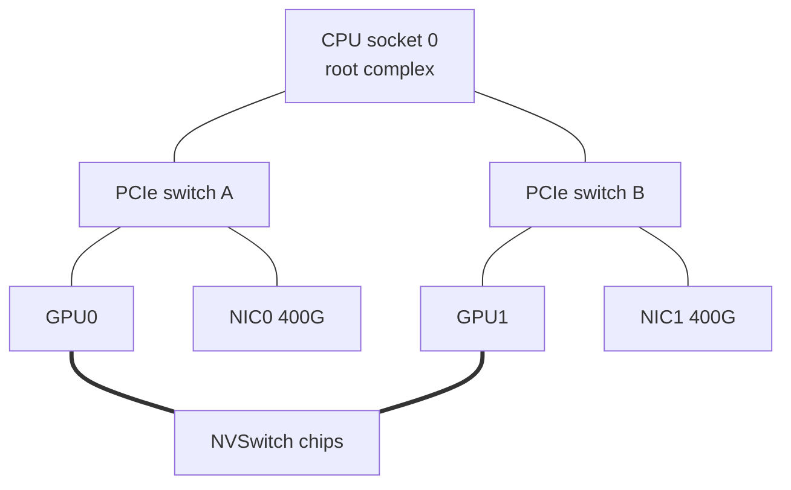

GPU0 in one of Meridian's San Jose training servers can copy 1 GiB into GPU1, in the same chassis, in about 2.4 ms. The same 1 GiB to GPU0 of the next server takes about 21.5 ms, nine times longer, on an idle network with every setting right. The gap is not a tuning problem: it comes from two interconnects built for two jobs. **Scale-up** is a memory fabric that joins a few GPUs so tightly they behave almost like one large GPU; **scale-out** is the NIC and switched network that reaches every GPU in the cluster at a fraction of the rate.

Where the line falls decides which parallelism runs where, how many bytes the network carries, and why one NIC in the wrong slot slows a 1,024-GPU job. [Why AI traffic is different](/learn/fabric-networking/ai-fabrics/why-ai-traffic-is-different) explains why one slow transfer stalls the whole training step; [parallelism](/learn/fabric-networking/ai-fabrics/parallelism-tp-pp-dp) works out which bytes each strategy sends.

## The bandwidth ladder inside one GPU server

Meridian's `sjc` cluster has 128 servers, each with eight H100-class GPUs and one 400 Gb/s ConnectX-7 NIC per GPU (a NIC, network interface card, connects a machine to the network). Every GPU sees four paths for data, and the first habit is reading their units: network links are quoted in **gigabits** per second (Gb/s), memory and buses in **gigabytes** per second (GB/s). A 400 Gb/s NIC moves 50 GB/s.

| Path | What it connects | Bandwidth each way | 1 GiB takes | Source of the number |
|---|---|---|---|---|
| HBM3 | The GPU to its own memory (high-bandwidth memory, DRAM stacked beside the GPU die) | about 3,350 GB/s | 0.3 ms | H100 SXM datasheet |
| NVLink 4 | GPU to GPU inside the server, through NVSwitch | 450 GB/s (900 GB/s counting both directions) | 2.4 ms | 18 links × 25 GB/s |
| PCIe Gen5 x16 | GPU or NIC to the CPU and to each other | about 63 GB/s raw, 50–55 GB/s achieved | 17 ms | 32 GT/s × 16 lanes, 128b/130b encoding |
| 400 Gb/s NIC | The server to the network | 50 GB/s | 21.5 ms | line rate |

Bandwidth falls about sevenfold from HBM to NVLink and sevenfold again from NVLink to PCIe, and the NIC sits a little below PCIe. Every design choice below comes down to which rung a byte rides on. The script reproduces the "1 GiB takes" column and adds the rung that bites in production: a PCIe slot that trained at a lower speed.

```python
GiB, MiB, KiB = 2**30, 2**20, 2**10

# Bandwidth each way, in GB/s (10^9 bytes per second), for one H100-class GPU.
LADDER = [
    ("HBM3, the GPU's own memory", 3350),
    ("NVLink 4, 18 links", 450),
    ("PCIe Gen5 x16", 32 * 16 * 128 / 130 / 8),
    ("400 Gb/s NIC", 400 / 8),
    ("PCIe Gen4 x8 (a downtrained slot)", 16 * 8 * 128 / 130 / 8),
]
print(f"{'path':<36}{'GB/s':>7}{'1 GiB takes':>14}")
for name, gbs in LADDER:
    print(f"{name:<36}{gbs:>7.1f}{GiB / (gbs * 1e9) * 1e3:>11.1f} ms")


def effective(size, alpha_us, gbs):
    """Alpha-beta model: a fixed cost per transfer plus bytes over bandwidth."""
    seconds = alpha_us * 1e-6 + size / (gbs * 1e9)
    return size / seconds / 1e9


print(f"\n{'message':>9}{'NVLink':>9}{'network':>9}   (GB/s; alpha 1 us and 3 us, assumed)")
for size in [4 * KiB, 64 * KiB, 1 * MiB, 16 * MiB, 256 * MiB]:
    label = f"{size // MiB} MiB" if size >= MiB else f"{size // KiB} KiB"
    print(f"{label:>9}{effective(size, 1, 450):>9.1f}{effective(size, 3, 50):>9.1f}")
print(f"half bandwidth at alpha x B: NVLink {1e-6 * 450e9 / 1e3:.0f} KB, network {3e-6 * 50e9 / 1e3:.0f} KB")
```

```text
path                                   GB/s   1 GiB takes
HBM3, the GPU's own memory           3350.0        0.3 ms
NVLink 4, 18 links                    450.0        2.4 ms
PCIe Gen5 x16                          63.0       17.0 ms
400 Gb/s NIC                           50.0       21.5 ms
PCIe Gen4 x8 (a downtrained slot)      15.8       68.2 ms

  message   NVLink  network   (GB/s; alpha 1 us and 3 us, assumed)
    4 KiB      4.1      1.3
   64 KiB     57.2     15.2
    1 MiB    314.9     43.7
   16 MiB    438.2     49.6
  256 MiB    449.2     50.0
half bandwidth at alpha x B: NVLink 450 KB, network 150 KB
```

The second half is the **alpha-beta model**: a transfer costs a fixed start-up time α (software, doorbells, the first packet's latency) plus its size divided by bandwidth β. The α values, 1 µs for NVLink and 3 µs for the network, are assumed orders of magnitude for idle hardware; real values depend on the library, message pattern and queueing. A message reaches half of a link's peak at size α × β, so the faster link needs *bigger* messages to pay off: 450 KB for NVLink against 150 KB for the network. At 4 KiB both links are latency-bound, which is why NCCL (NVIDIA's collective communications library, [collectives and NCCL](/learn/fabric-networking/ai-fabrics/collectives-and-nccl)) switches algorithms and protocols for small messages.

## PCIe: the bus every device shares

**PCIe** (PCI Express) is how a CPU talks to its devices: GPUs, NICs, NVMe drives. It is a set of point-to-point serial **lanes**, each a wire pair per direction; a slot bundles 1, 4, 8 or 16 (x16, "by sixteen"). Data travels in **TLPs** (transaction layer packets): a memory read or write with a 12- or 16-byte header, plus a sequence number and a link CRC (cyclic redundancy check) so a corrupted TLP is retransmitted on that link, carrying at most the negotiated maximum payload, commonly 256 bytes. That overhead, 20 to 30 bytes per 256-byte TLP plus acknowledgement and flow-control packets, is why a Gen5 x16 slot rated at 63 GB/s delivers 50 to 55 GB/s in a host-to-GPU copy, depending on platform and payload size.

| Generation | Specification year | Per lane | Encoding | x16, each way |
|---|---|---|---|---|
| PCIe 3.0 | 2010 | 8 GT/s | 128b/130b | 15.8 GB/s |
| PCIe 4.0 | 2017 | 16 GT/s | 128b/130b | 31.5 GB/s |
| PCIe 5.0 | 2019 | 32 GT/s | 128b/130b | 63 GB/s |
| PCIe 6.0 | 2022 | 64 GT/s (PAM4 signalling) | 256-byte flits with FEC | about 121 GB/s |

(GT/s, gigatransfers per second, is one lane's raw bit rate before encoding overhead; 128b/130b means 2 of every 130 bits are framing.)

PCIe is a **tree**. The CPU's **root complex** owns a few root ports; **PCIe switches** fan one upstream x16 link out to several devices. Each device exposes **BARs** (base address registers): windows of its memory mapped into the system's physical address space, so a write to an address in GPU0's BAR lands in GPU0. Two devices under one switch exchange TLPs directly, the switch routing by address, without touching the CPU: the **peer-to-peer** path GPUDirect uses below. Between sockets, traffic crosses the inter-socket link (Intel UPI, AMD Infinity Fabric).



The diagram is part of an HGX-style board, the eight-GPU baseboard most H100 servers use: each GPU shares a PCIe switch with its own NIC (the exact pairing varies by model), and the thick lines are NVLink, which bypasses PCIe.

Why PCIe cannot be the GPU interconnect:

- **Bandwidth.** 63 GB/s is under 2% of HBM's 3,350 GB/s and a seventh of NVLink 4. **Tensor parallelism** (splitting each layer's matrices across GPUs) exchanges partial results at every layer, and at PCIe speed the GPUs would wait more than they compute.
- **Lanes.** A server CPU socket provides on the order of 80 to 128 lanes. Eight GPUs and eight NICs at x16 want 256, more than two sockets offer; switches fan lanes out, but every device behind one switch shares its upstream link.
- **Distance.** Many platforms run peer-to-peer across sockets slowly or not at all, so those copies stage through CPU memory.
- **No coherence.** PCIe does not keep caches coherent between devices (CXL, Compute Express Link, adds that). NVIDIA's Grace CPUs reach their GPUs over **NVLink-C2C** instead, a coherent link of 450 GB/s each way.

**What PCIe solves:** a standard, hot-pluggable way to attach any device to any CPU. **How it breaks:** a slot trains below its capability (a marginal riser, a dirty connector), or a device sits under the wrong switch or socket, and that GPU's network bandwidth falls. **Signal:** `lspci -vv` reporting `LnkSta` below `LnkCap`; for the extreme case, XID 79 ("GPU has fallen off the bus") in the kernel log. XIDs are the numbered error codes NVIDIA's GPU driver writes there. Illustrative output for the downtrained slot in the table above:

```text
$ sudo lspci -vv -s 3b:00.0 | grep -E 'LnkCap|LnkSta'      (illustrative)
        LnkCap: Port #0, Speed 32GT/s, Width x16, ASPM not supported
        LnkSta: Speed 16GT/s (downgraded), Width x8 (downgraded)
```

## NVLink: a memory link between GPUs

**NVLink** is NVIDIA's GPU-to-GPU interconnect, and its defining property is **memory semantics**. A GPU's cores issue ordinary loads, stores and atomics to an address that lives in another GPU's HBM, and NVLink carries them as small request and response packets. There is no NIC, no queue pair, no IP header and no operating system on the path: the GPUs share one virtual address space. A network has **message semantics**: software hands a buffer to a NIC, which packetises it, and the far side learns of it through a completion ([RDMA from zero](/learn/fabric-networking/ai-fabrics/rdma-from-zero) traces that path).

Physically, an NVLink is a bundle of serial lanes using the same SerDes (serialiser/deserialiser) technology as an Ethernet port. In NVLink 4 a link is two lanes per direction at 100 Gb/s each, 25 GB/s each way; an H100 has 18 links, 450 GB/s each way. Reliability is per link, not end to end: every flit (flow-control unit, the link's smallest transfer) carries a CRC, a corrupted flit is replayed by the sender, and credits stop a sender before the receiver's buffer overflows, so the link is lossless by construction, as InfiniBand's links are ([InfiniBand and RoCE](/learn/fabric-networking/ai-fabrics/infiniband-and-roce)).

| Generation | GPU (year) | Links per GPU | Total per GPU, both directions | Topology it enabled |
|---|---|---|---|---|
| NVLink 1 | P100 (2016) | 4 | 160 GB/s | 8-GPU hybrid cube mesh (DGX-1) |
| NVLink 2 | V100 (2017) | 6 | 300 GB/s | Cube mesh; first NVSwitch (DGX-2, 16 GPUs) |
| NVLink 3 | A100 (2020) | 12 | 600 GB/s | 8 GPUs, 6 NVSwitches |
| NVLink 4 | H100 (2022) | 18 | 900 GB/s | 8 GPUs, 4 NVSwitches |
| NVLink 5 | B200 / GB200 (2024) | 18 | 1,800 GB/s | 72 GPUs in one rack (NVL72) |

DGX is NVIDIA's own server line. Marketing figures add both directions; compare like with like: H100's NVLink is 450 GB/s each way against the NIC's 50 GB/s each way, a ratio of 9, not 18.

**What NVLink solves:** GPUs exchanging activations and gradients at a rate close to their own memory. **How it breaks:** a link degrades (connector, cable cartridge, switch port) and the GPU loses a share of its bandwidth; a link that fails outright raises XID 74 and usually takes the GPU out of the job. **Signal:** `nvidia-smi nvlink -s` (link state), `nvidia-smi nvlink -e` (CRC, replay and recovery counters) and the same fields in DCGM (NVIDIA's Data Center GPU Manager, the GPU telemetry agent). Rising replays on one link are NVLink's version of CRC errors on an Ethernet port ([optics, cabling and the physical layer](/learn/fabric-networking/fabric-architecture/optics-cabling-and-the-physical-layer)).

## NVSwitch: from a mesh to a crossbar

With NVLink 1 and 2 the GPUs were wired directly. Eight GPUs with four or six links cannot each reach all seven others at full width, so DGX-1 used a "hybrid cube mesh": some pairs had direct links, others had none, and their traffic went over PCIe or was relayed by software through a third GPU. That is the full-mesh problem of [Clos and leaf-spine](/learn/fabric-networking/fabric-architecture/clos-and-leaf-spine): links per node grow with node count, so direct wiring stops at a handful of nodes.

**NVSwitch** is the network engineer's answer: put a switch in the middle. Each GPU spreads its links across several NVSwitch chips and each chip connects to every GPU, a non-blocking crossbar. On an HGX H100 board, four third-generation NVSwitch chips with 64 NVLink 4 ports each take each GPU's 18 links in groups of 5, 4, 4 and 5. GPU0 to GPU5 is sprayed over all 18 links and four chips, so every pair gets 450 GB/s, all eight GPUs at once; `nvidia-smi topo -m` shows `NV18` between every pair.

Three details matter to someone building tooling:

- **The NVLink fabric has a control plane.** On HGX systems a host service, NVIDIA Fabric Manager, programs the NVSwitch routing tables and which GPUs may talk. If it is not running, CUDA (NVIDIA's GPU programming platform) fails to initialise with error 802, "system not yet initialized", while the machine looks healthy to every network check.
- **The switch can compute.** Third-generation NVSwitch supports in-network reduction (NVLink SHARP, which NCCL calls NVLS): a GPU loads from a multicast address and the switch returns the sum of that address across all the GPUs, and one store to a multicast address is replicated to every GPU, so an all-reduce inside the server moves fewer bytes per GPU ([collectives and NCCL](/learn/fabric-networking/ai-fabrics/collectives-and-nccl) has the arithmetic).
- **It is a fabric without IP.** No routing protocol, no ECMP hash, no packet loss in normal operation; failures surface as GPU errors and NVLink counters, not as an interface down that network monitoring polls.

**What NVSwitch solves:** every GPU reaching every other at full bandwidth, simultaneously. **How it breaks:** a switch chip fails and every GPU loses the 4 or 5 of its 18 links that went into it, about a quarter of its bandwidth; or Fabric Manager is down or mismatched with the driver and the GPUs cannot initialise. **Signal:** `NV18` dropping to `NV14` or `NV13` in the topology matrix, Fabric Manager's service state and log, NCCL's intra-node bus bandwidth below baseline.

## The NVL72 rack-scale domain

GB200 NVL72 takes the switch out of the server and makes the **rack** the scale-up domain. One rack holds 18 compute trays, each with two GB200 superchips (one Grace CPU and two Blackwell GPUs each), so 72 GPUs, plus 9 NVLink switch trays of two switch chips each. Every GPU has 18 NVLink 5 links of 50 GB/s each way, one to each of the 18 switch chips. Any GPU reaches any of the other 71 at 900 GB/s each way (1.8 TB/s total); the rack's aggregate is 72 × 1.8 ≈ 130 TB/s.

The design follows from reach: at 200 Gb/s per lane, passive copper works for a metre or two, so the 72 GPUs and 18 switch chips are packed into one rack and joined by roughly 5,000 copper cables in cartridges at the rear: no optics, saving the power and cost of thousands of transceivers. The price is density, on the order of 120 kW per rack, which forces liquid cooling.

What 72 changes:

- **Tensor and expert parallelism can span 72 GPUs** instead of 8. **Expert parallelism** places different "expert" sub-networks of a mixture-of-experts model on different GPUs, and its all-to-all (every GPU sending a distinct slice to every other) now stays on NVLink, which makes NVL72 racks popular for serving very large models as well as training them.
- **The failure domain grows with it.** A failed switch tray removes 2 of each GPU's 18 links across the rack; a failed GPU leaves 71, and a job sized in exact multiples of 72 must tolerate that or wait, so operators keep spares or schedule smaller jobs.
- **The scale-out network does not go away.** Each GPU still has its own NIC in NVIDIA's reference design (400 Gb/s ConnectX-7 on GB200, 800 Gb/s ConnectX-8 on GB300), because training runs span tens of thousands of GPUs and an NVLink domain stops at the rack.

**What NVL72 solves:** tensor and expert parallelism beyond eight GPUs at NVLink rates. **How it breaks:** a switch tray, cable cartridge or GPU fails and the usable domain shrinks for every job in the rack; a cooling or power fault takes 72 GPUs out at once. **Signal:** NVLink link state per GPU and per switch tray, the rack's healthy-GPU count against the job layout, and the rack's coolant and power telemetry.

## Scale-up versus scale-out

- **Scale-up domain:** the set of GPUs joined by a memory-semantic interconnect (NVLink and NVSwitch here), where one GPU can load from and store to another's memory at close to local bandwidth. Eight GPUs on HGX H100, 72 on NVL72.
- **Scale-out network:** the NICs, switches and transport that connect scale-up domains: RDMA (remote direct memory access, a NIC writing straight into a remote machine's memory) over InfiniBand or over RoCEv2, RDMA over Converged Ethernet version 2. It reaches every GPU in the cluster at a ninth of the per-GPU bandwidth or less.

The visualisation moves the same 1 GiB both ways from GPU0 of `srv001`; the network side crosses `rail1-leaf1.sjc`, the leaf every server's NIC0 is cabled to (rails are explained below).

```viz
{"type": "fabric", "scenario": "scale-up-vs-out", "title": "1 GiB from GPU0: 2.4 ms over NVLink to GPU1, 21.5 ms through the NIC and rail leaf to the next server", "caption": "srv001's GPU0 copies 1 GiB to GPU1 through the NVSwitch at 450 GB/s each way, then sends the same 1 GiB to srv002's GPU0: a GPUDirect read through the PCIe switch, 262,144 RoCEv2 packets from the 400 Gb/s NIC, rail1-leaf1.sjc forwarding on the destination IP, and a GPUDirect write into the far GPU. A table compares bandwidth, time, latency, devices on the path and reach; an alpha-beta chart shows effective bandwidth by message size; the last frames cover the path without GPUDirect and what NVL72 changes."}
```

| | Scale-up (NVLink and NVSwitch) | Scale-out (NIC and fabric) |
|---|---|---|
| Semantics | Loads, stores, atomics on peer memory | Messages: RDMA WRITE, READ, SEND |
| Bandwidth per GPU, each way | 450 GB/s (H100), 900 GB/s (GB200) | 50 GB/s (400G), 100 GB/s (800G) |
| Small-message latency | around 1 µs including software | a few µs idle; tens to hundreds when queues build |
| Reach | 8 GPUs (HGX), 72 (NVL72) | the whole cluster, tens of thousands of GPUs |
| Medium | copper traces and cables, under 2 m | copper inside the rack, optics beyond |
| Loss and congestion | lossless links, credits, no shared congestion | needs lossless Ethernet or InfiniBand plus congestion control |
| Who operates it | GPU and server team (driver, Fabric Manager) | network team |
| Failure looks like | XID errors, NVLink counters | link down, CRC errors, ECN marks, pause frames |

The last two rows are the organisational point: a training step crosses both fabrics, with different owners and telemetry, and runs as slow as the slower one.

## GPUDirect: P2P and RDMA

**GPUDirect** is NVIDIA's family of features that move data to and from GPU memory without staging it in CPU memory.

### GPUDirect P2P

**GPUDirect P2P** (peer-to-peer, since CUDA 4.0 in 2011) lets one GPU read or write another GPU's memory directly. After a program enables peer access, `cudaMemcpyPeer` or a kernel dereferencing a peer pointer moves data GPU to GPU, over NVLink when present, otherwise as PCIe peer-to-peer TLPs through a shared switch. Without P2P, a copy goes GPU0 → CPU memory → GPU1: two PCIe crossings and a copy in DRAM. The usual reason P2P silently fails on PCIe is **ACS** (Access Control Services), a switch feature that forces peer traffic up to the root complex so the IOMMU (the unit that translates and checks device addresses) can inspect it. Virtualised hosts enable it for isolation; on bare-metal GPU servers NCCL's documentation recommends disabling it, because redirected P2P traffic crawls or hangs.

### GPUDirect RDMA

**GPUDirect RDMA** (since CUDA 5.0 and the Kepler generation, 2012) lets a *third-party* PCIe device, the NIC, DMA (direct memory access: a device reading or writing memory without the CPU) straight into GPU memory. The GPU driver exposes the buffer through its BAR, and the RDMA driver registers it with the NIC as it would host memory, producing the keys a remote peer needs ([RDMA from zero](/learn/fabric-networking/ai-fabrics/rdma-from-zero)). On Linux this takes the `nvidia-peermem` kernel module (formerly `nv_peer_mem`) or, on newer drivers and kernels, dma-buf.

Traced for one 1 MiB message from GPU0 on `srv001` to GPU0 on `srv002`, with GPUDirect RDMA:

1. NCCL's proxy thread on the CPU posts an RDMA WRITE work request to NIC0, pointing at a registered GPU buffer. NCCL uses the variant "with immediate data", which carries 4 extra bytes and notifies the receiver. Only a descriptor of a few dozen bytes touches the CPU.
2. NIC0 issues PCIe read requests to GPU0's BAR. They turn around at the shared PCIe switch and never reach the CPU.
3. NIC0 packetises the data into 256 RoCEv2 packets of 4,096 bytes and sends them to `rail1-leaf1.sjc`.
4. `srv002`'s NIC0 checks sequence numbers and the memory key, then writes the payload through its PCIe switch into GPU0's memory.
5. `srv002`'s NIC acknowledges and `srv001`'s NIC posts a send completion. Because the write carried immediate data, `srv002`'s NIC also posts a receive completion, which is how NCCL there learns the data has arrived; a plain RDMA WRITE is silent at the receiver.

Without GPUDirect RDMA, step 2 becomes a copy from GPU0 into a pinned host buffer (up through the switch into DRAM), then a NIC read of that buffer (back down through the same switch), and the receiver does the mirror image. Each byte crosses the switch's upstream link twice and DRAM twice per side. NCCL pipelines the staging so the NIC stays busy, but an upstream link shared by two GPU-NIC pairs becomes the bottleneck, and CPU memory bandwidth goes to shuffling gradients. NCCL uses GPUDirect RDMA only when GPU and NIC are close in the PCIe tree: `NCCL_NET_GDR_LEVEL` defaults to PXB, joined through PCIe switches without crossing the CPU.

**What GPUDirect RDMA solves:** the NIC feeding at line rate with no CPU memory in the path. **How it breaks:** the peer-memory module is missing, or the NIC sits too far from its GPU in the PCIe tree, and NCCL stages through host memory without failing. **Signal:** NCCL channel lines without `/GDRDMA`, and host memory bandwidth climbing during collectives.

**GPUDirect Storage** does the same for NVMe drives and the separate storage network ([AI fabric topologies](/learn/fabric-networking/ai-fabrics/ai-fabric-topologies)).

## Under the hood: how NCCL reads the server

At start-up NCCL reads the PCIe tree from `/sys` and the NVLink map from NVIDIA's management library, and classifies every GPU-GPU and GPU-NIC pair by path. Inside a server it prefers NVLink, then PCIe P2P, then shared host memory; between servers, RDMA with GPUDirect, then RDMA via host memory, then TCP sockets. `nvidia-smi topo -m` prints the same classification. Illustrative output for half a server, with faults planted:

```text
$ nvidia-smi topo -m          (illustrative, 4 of 8 GPUs, trimmed)
        GPU0  GPU1  GPU2  GPU3  NIC0  NIC1  NIC2  NIC3
GPU0     X    NV18  NV14  NV18  PIX   NODE  SYS   SYS
GPU1    NV18   X    NV14  NV18  NODE  PIX   SYS   SYS
GPU2    NV14  NV14   X    NV14  SYS   SYS   NODE  NODE
GPU3    NV18  NV18  NV14   X    SYS   SYS   NODE  PIX

Legend:  X = self   NV# = bonded set of # NVLinks
         PIX  = at most one PCIe switch          PXB = several PCIe switches, no host bridge
         PHB  = through a PCIe host bridge (CPU)  NODE = across host bridges within one NUMA node
         SYS  = across the inter-socket link (SMP interconnect)
```

GPU2 has `NV14` to every peer: it lost 4 of its 18 links, the group into one NVSwitch chip. Its nearest NIC is `NODE`, not `PIX` (a NUMA node is one CPU socket with its local memory): after a repair, NIC2 went back into a slot off the CPU's root port instead of GPU2's PCIe switch, so NCCL will not use GPUDirect RDMA for that pair. Either fault makes GPU2 the slowest **rank** (one process of the job, here one GPU) in every collective. NCCL's log confirms the second (illustrative, `NCCL_DEBUG=INFO`; HCA, host channel adapter, is InfiniBand's word for an RDMA NIC):

```text
srv017:  NCCL INFO GPU Direct RDMA Disabled for GPU 2 / HCA 2 (distance 7 > 5)
srv017:  NCCL INFO Channel 02/0 : 18[2] -> 26[2] [send] via NET/IB/2
srv018:  NCCL INFO Channel 02/0 : 26[2] -> 34[2] [send] via NET/IB/2/GDRDMA
```

The healthy server's line ends in `/GDRDMA`; the faulty one's does not. The distances are NCCL's internal path classes, renumbered between releases, so alert on the message, not the digits.

## What changes in the network when the scale-up domain grows

The network carries whatever does not fit inside the scale-up domain. Placement puts the chattiest traffic, tensor parallelism and expert all-to-all, on NVLink, and leaves data parallelism (a gradient all-reduce once per step) and pipeline parallelism (activations handed between stages) to the network. A bigger domain changes the network's job in five ways.

### 1. Fewer bytes per GPU cross the network

Model a multi-server all-reduce hierarchically: reduce-scatter inside each domain so every GPU holds a 1/k share of the summed gradients (k is the domain size), all-reduce each share across the m domains over the NICs, then all-gather inside the domain. Each GPU puts $2\frac{m-1}{m}\cdot\frac{S}{k}$ bytes on the network for an S-byte gradient, so per-GPU network load falls in proportion to domain size. NCCL's flat rings reach about the same per-NIC bytes with one ring per NIC, since each ring crosses a server over NVLink and leaves it once; its NVLS and CollNet algorithms build the hierarchy explicitly ([collectives and NCCL](/learn/fabric-networking/ai-fabrics/collectives-and-nccl) derives the $2\frac{n-1}{n}$ factor). The model compares domain sizes for one all-reduce of 10 GB of bf16 gradients (a 5-billion-parameter model, pure data parallelism) on about 1,000 GPUs.

```python
def hierarchical_allreduce(grad_gb, gpus, k, up_gbs, out_gbs, slowest_out_gbs=None):
    """Seconds per phase for an all-reduce done in three steps:
    reduce-scatter inside each scale-up domain of k GPUs, an all-reduce of each
    1/k shard across the m domains (over the NICs), then all-gather inside."""
    m = gpus // k
    shard = grad_gb / k
    inside = (k - 1) / k * grad_gb / up_gbs if k > 1 else 0.0      # each of the two inside steps
    net_bytes = 2 * (m - 1) / m * shard                           # GB each GPU puts on the network
    out = min(out_gbs, slowest_out_gbs or out_gbs)                 # a ring runs at its slowest link
    return inside, net_bytes / out, inside, net_bytes


GRAD = 10.0  # GB of bf16 gradients: a 5-billion-parameter model, pure data parallelism
CONFIGS = [
    ("no scale-up: every GPU on the network", 1024, 1, 0, 50, None),
    ("HGX H100: 8 per NVLink domain", 1024, 8, 450, 50, None),
    ("same, one NIC downtrained to Gen4 x8", 1024, 8, 450, 50, 15.75),
    ("NVL72, 400 Gb/s NIC per GPU", 1008, 72, 900, 50, None),
    ("NVL72, 800 Gb/s NIC per GPU", 1008, 72, 900, 100, None),
]
print(f"{'configuration':<40}{'inside':>8}{'network':>9}{'total':>8}{'GB/GPU on net':>15}{'GB whole job':>14}")
for name, n, k, up, out, slow in CONFIGS:
    rs, net, ag, b = hierarchical_allreduce(GRAD, n, k, up, out, slow)
    job = b * n
    print(f"{name:<40}{(rs + ag) * 1e3:>6.1f}ms{net * 1e3:>7.1f}ms{(rs + net + ag) * 1e3:>6.1f}ms{b:>15.2f}{job:>14,.0f}")
```

```text
configuration                             inside  network   total  GB/GPU on net  GB whole job
no scale-up: every GPU on the network      0.0ms  399.6ms 399.6ms          19.98        20,460
HGX H100: 8 per NVLink domain             38.9ms   49.6ms  88.5ms           2.48         2,540
same, one NIC downtrained to Gen4 x8      38.9ms  157.5ms 196.4ms           2.48         2,540
NVL72, 400 Gb/s NIC per GPU               21.9ms    5.2ms  27.1ms           0.26           260
NVL72, 800 Gb/s NIC per GPU               21.9ms    2.6ms  24.5ms           0.26           260
```

Trace the HGX row by hand: k = 8, m = 128. Inside, each GPU sends 7/8 × 10 GB = 8.75 GB at 450 GB/s, 19.4 ms, twice. Its share is 1.25 GB, and the cross-server ring moves 2 × 127/128 × 1.25 = 2.48 GB per GPU at 50 GB/s, 49.6 ms. Going from 8 to 72 cuts each GPU's network bytes about 9.6×, and the job's from 2,540 GB to 260 GB per all-reduce; on NVL72 the network phase is no longer the largest part.

The edge case is the third row. One NIC behind a slot downtrained to Gen4 x8 moves 15.75 GB/s, and a ring advances at its slowest link, so 1,023 healthy GPUs wait: the network phase triples and the all-reduce goes from 88.5 to 196.4 ms, with nothing wrong on any switch. The model ignores α, NVLS and overlap with compute, so read the ratios, not the absolute times.

### 2. The traffic mix shifts toward data and pipeline parallelism

With tensor and expert parallelism inside the domain, the network carries bursty gradient all-reduces once per step (or, with FSDP, Fully Sharded Data Parallel, all-gathers and reduce-scatters of sharded weights) plus pipeline handoffs. These largely overlap with computation, unlike tensor-parallel traffic on every layer's critical path, so the network's demands shift from latency toward sustained bandwidth and fairness across the burst ([why AI traffic is different](/learn/fabric-networking/ai-fabrics/why-ai-traffic-is-different)).

### 3. NVLink becomes part of the network path

In a rail-optimised fabric, NIC k of every server connects to rail k's leaves, so GPU k talks to GPU k elsewhere in one switch hop ([AI fabric topologies](/learn/fabric-networking/ai-fabrics/ai-fabric-topologies) designs this). When GPU k must reach a differently numbered GPU on another server (the all-to-all case), NCCL's **PXN** (PCIe × NVLink, NCCL 2.12 and later) first moves the data over NVLink to the local GPU on the destination's rail, whose NIC sends it. The scale-up fabric does routing work for the scale-out fabric.

```viz
{"type": "fabric", "scenario": "rail-optimized", "title": "Rails and PXN: NVLink moves cross-rail data onto the right rail before it reaches the network", "caption": "Two San Jose servers, eight GPUs each (numbered 1 to 8 in the drawing), NIC k cabled to rail k's leaf, sized for 1,024 GPUs as 16 leaves and 8 spines. GPU3 to GPU3 crosses one leaf; GPU7 to GPU8 sent directly climbs leaf, spine and leaf; with PXN it copies over NVLink to GPU8 first and crosses one leaf on rail 8. The last frames compare the paths and show one failed NIC link stopping the job."}
```

### 4. The unit of placement and failure becomes the rack

With 8-GPU servers the scheduler places tensor-parallel groups per server. With NVL72 a job's layout is built from racks, and one GPU or switch-tray fault changes how many usable 72-GPU domains exist. The network team's inventory must model which NICs belong to which NVLink domain, and which job runs there.

### 5. Two fabrics, one incident

When step time regresses, the cause may be an NVLink replay storm, a downtrained slot, a missing `nvidia-peermem` or a congested spine, and the person paged is often the network on-call. Correlating GPU-side and fabric telemetry per job is the platform's job.

Others draw the same line: UALink (an open memory-semantic scale-up specification, 2025, for up to 1,024 accelerators), Ethernet-based scale-up, AMD's Infinity Fabric across eight MI300-series GPUs, and Google's TPU pods, thousands of chips in a torus rewired by optical circuit switches.

## Trade-offs: ways to connect GPUs

| | PCIe peer-to-peer | NVLink + NVSwitch (HGX, 8) | NVL72 (rack, 72) | Scale-out RoCE or InfiniBand |
|---|---|---|---|---|
| Per-GPU bandwidth each way | 31.5–63 GB/s, shared upstream | 450 GB/s | 900 GB/s | 50–100 GB/s |
| Reach | one PCIe tree, best under one switch | one server | one rack | the cluster |
| Cost and power | lowest, already present | moderate, in the baseboard | high: copper spine, about 120 kW, liquid cooling | per NIC, optic and switch port |
| Failure blast radius | one device | one server | one rack's domain | one NIC link can stop the job |
| Fits | small inference, consumer cards | tensor parallel up to 8, most H100 training | tensor and expert parallel to 72 | data and pipeline parallel, all beyond the domain |
| Operated by | server team | server team, Fabric Manager | server and rack teams, switch trays | network team |

## Failure modes in production

| Failure | Symptom | Diagnosis | Fix |
|---|---|---|---|
| GPUDirect RDMA not active (module not loaded, driver mismatch) | Every node's inter-node bus bandwidth well below baseline; CPU memory bandwidth high during collectives | NCCL log lines lack `/GDRDMA`; `lsmod` shows no `nvidia-peermem` | Load the module or enable dma-buf; gate node admission on it |
| PCIe ACS redirecting peer traffic | Intra-node bandwidth on PCIe paths collapses, or NCCL hangs at start-up | `lspci -vvv` shows ACS enabled on switch ports; NCCL's troubleshooting guide names this | Disable ACS on bare metal (BIOS or `setpci`); in virtualised hosts, enable ATS (Address Translation Services) where supported |
| PCIe slot downtrained | One rank's network bandwidth capped (15.75 GB/s at Gen4 x8); the whole job slows | `LnkSta` below `LnkCap`; per-node nccl-tests isolate the server | Reseat or replace the riser or card; recheck after every repair |
| NIC under the wrong switch or socket | GPU's nearest NIC is `NODE` or `SYS`; GDR disabled for that pair | `nvidia-smi topo -m`; NCCL "GPU Direct RDMA Disabled ... distance" line | Move the card to the slot that shares the GPU's switch |
| NVLink links degraded | `NV18` drops to `NV14` for one GPU; intra-node all-reduce bandwidth down about a quarter | `nvidia-smi nvlink -s/-e`, XID 74, replay counters rising | Drain the node, replace the board, tray or cable cartridge |
| Fabric Manager down | CUDA error 802 on an NVSwitch system; jobs fail at start | Service status and log; driver and Fabric Manager versions must match | Restart or align versions; monitor the service like a routing daemon |
| Tensor-parallel group spread across servers | Step time several times expected; heavy per-layer traffic on the rails | Rank-to-host map; traffic on the network at layer frequency, not step frequency | Fix rank ordering or the launcher's placement |

## What the platform should show

A platform for an AI cluster must see inside the server, because half these faults look like network slowness from outside:

- **The scale-up topology as data:** per server, NVLink counts and GPU-NIC PCIe paths from `nvidia-smi topo -m`, diffed against the expected matrix for that model, as rendered configuration is diffed against intent ([network automation](/learn/fabric-networking/operating-fabrics/network-automation-and-source-of-truth)).
- **PCIe link speed and width per GPU and NIC,** any downgrade an alert, checked at boot and after every repair.
- **GPUDirect state per GPU-NIC pair,** from NCCL's logs or a start-up probe.
- **NVLink health beside port health:** replay and CRC counters per link, XID events and Fabric Manager status on the same timeline as switch counters.
- **Bytes per fabric per job:** NVLink and PCIe throughput (DCGM exports both) next to NIC throughput, which exposes a tensor-parallel group on the wrong fabric.
- **The domain map:** which NICs, leaves and rails serve which NVLink domain and job, so a failed optic reads as "job X loses rank 2 of rack 9" for the manager, with the port name for the engineer.

The topology check is a few lines over the matrix above:

```python
TOPO = """\
        GPU0  GPU1  GPU2  GPU3  NIC0  NIC1  NIC2  NIC3
GPU0     X    NV18  NV14  NV18  PIX   NODE  SYS   SYS
GPU1    NV18   X    NV14  NV18  NODE  PIX   SYS   SYS
GPU2    NV14  NV14   X    NV14  SYS   SYS   NODE  NODE
GPU3    NV18  NV18  NV14   X    SYS   SYS   NODE  PIX
"""
# Closest first: same PCIe switch, several switches, host bridge, same socket, across sockets.
RANK = {"PIX": 0, "PXB": 1, "PHB": 2, "NODE": 3, "SYS": 4}
GDR_OK = {"PIX", "PXB"}   # where NCCL uses GPUDirect RDMA by default


def check(topo, nvlinks_expected=18):
    lines = topo.splitlines()
    cols = lines[0].split()
    findings = []
    for line in lines[1:]:
        row, *cells = line.split()
        links = dict(zip(cols, cells))
        for peer, path in links.items():
            if peer.startswith("GPU") and row < peer and path.startswith("NV") and int(path[2:]) < nvlinks_expected:
                findings.append(f"{row}-{peer}: {path}, {nvlinks_expected - int(path[2:])} NVLinks missing")
        nics = {p: v for p, v in links.items() if p.startswith("NIC")}
        best = min(nics, key=lambda p: RANK[nics[p]])
        if nics[best] not in GDR_OK:
            findings.append(f"{row}: nearest NIC is {best} via {nics[best]}, no GPUDirect RDMA path")
    return findings


for finding in check(TOPO):
    print(finding)
```

```text
GPU0-GPU2: NV14, 4 NVLinks missing
GPU1-GPU2: NV14, 4 NVLinks missing
GPU2-GPU3: NV14, 4 NVLinks missing
GPU2: nearest NIC is NIC2 via NODE, no GPUDirect RDMA path
```

`row < peer` reports each pair once; the GPU common to every NVLink finding is the one to drain. `RANK` is nvidia-smi's distance ordering, and `GDR_OK` mirrors NCCL's default PXB threshold. Tuning a node from here to line rate, including perftest and nccl-tests, is [tuning and benchmarking RDMA](/learn/fabric-networking/ai-fabrics/tuning-and-benchmarking-rdma).

## Interviewer follow-ups

**"Why not make the network as fast as NVLink and drop the distinction?"** Model answer: 450 GB/s each way per GPU is 3.6 Tb/s, nine 400G NICs per GPU, each with its optics, switch ports and power. NVLink is cheap per bit because it is short-reach copper with link-level reliability and no transport; a cluster-wide network needs optics, a routable transport and congestion control. Reach sets the boundary, and it moves outward each generation (8 to 72 GPUs) rather than disappearing. Common wrong answer: "Ethernet is older technology".

**"One node in a 1,024-GPU job is slow. What do you check before blaming the network?"** Model answer: confirm with per-node nccl-tests (NVIDIA's collective benchmarks) that one server is the outlier, then work inside it: `nvidia-smi topo -m` against the expected matrix, `LnkSta` for every GPU and NIC, `GDRDMA` on each NCCL channel, NVLink counters and XIDs; then its NIC ports and optics. The BIOS and ACS details I would confirm with the server team; what I would build is a node-admission check that runs all of this before a node joins the pool. Common wrong answer: "check the spine utilisation".

**"What does moving from HGX H100 to NVL72 change for the network team?"** Model answer: tensor and expert traffic leave the network; at the same GPU count each GPU sends about 9× fewer bytes per gradient all-reduce, while the per-GPU NIC stays (400 or 800 Gb/s). The traffic is mostly data and pipeline parallelism, the placement and failure unit is the rack, and NVLink health joins every "the network is slow" investigation. Common wrong answer: "NVL72 removes the need for a back-end network".

**"Is the NVLink domain a network?"** Model answer: structurally yes: ports, links, switch chips, routing tables programmed by a controller (Fabric Manager or the switch trays' software), link errors and replays. Operationally it lacks what network tooling assumes (IP, a routing protocol, ECMP, drops), and failures appear as GPU XID events. I would model it as a fabric in inventory and telemetry and leave its configuration to the GPU platform team. Common wrong answer: "no, it is a bus".

## What mid-level engineers get wrong

- **Mixing units.** Comparing "400 G" with "450 GB/s" as if close (400 Gb/s is 50 GB/s), or NVLink's two-way total with the NIC's one-way rate, which doubles the real 9× gap to 18×.
- **Assuming peer-to-peer always works on PCIe.** ACS, IOMMU settings and cross-socket placement disable or cripple it silently.
- **Treating GPUDirect RDMA as a transport.** It only decides where the NIC reads and writes; RDMA can run perfectly while the host stages every byte.
- **Assuming a bigger scale-up domain retires the network.** It shrinks bytes per GPU and moves the bottleneck; the cluster still spans many domains.

## Senior signals

- You quote the ladder in one direction and one unit (HBM 3,350, NVLink 450, PCIe 63, NIC 50 GB/s) and reason from ratios.
- You define scale-up by semantics (loads and stores on peer memory) and scale-out by messages over NICs, and place each parallelism strategy accordingly.
- You read `nvidia-smi topo -m` and NCCL's `GDRDMA` lines as fluently as a BGP summary, and know a `NODE` in the NIC column is a slow rank.
- You compute what a larger domain does: per-GPU network bytes fall by k, and the slowest NIC or PCIe slot still sets the step.
- You join NVLink and PCIe health to fabric telemetry per job, with ownership kept clear.

## Check yourself

```quiz
- q: >-
    An H100 GPU has 900 GB/s of NVLink bandwidth and one 400 Gb/s NIC. How much more bandwidth does it have to a GPU in its own server than to a GPU in another server, comparing like with like?
  options: ["About 18 times, 900 GB/s against 50 GB/s each way", "About the same once RDMA removes the kernel overhead", "About 9 times, 450 GB/s each way against 50 GB/s", "About 2.25 times, since 900 GB/s against 400 Gb/s"]
  answer: 2
  explanation: >-
    The 900 GB/s figure adds both directions; each way is 450 GB/s. A 400 Gb/s NIC moves 50 GB/s each way, since a byte is 8 bits. 450 / 50 = 9. Dividing 900 by 50 compares a two-way total with a one-way rate and doubles the gap; comparing 900 with 400 mixes bytes and bits. RDMA removes host software overhead but cannot raise the NIC's line rate.
- q: >-
    NCCL's log on one server shows "GPU Direct RDMA Disabled for GPU 2 / HCA 2 (distance 7 > 5)", and nvidia-smi topo -m shows NODE between GPU2 and NIC2. What is the most likely cause?
  options: ["NIC2 sits in a slot outside GPU2's PCIe switch", "NIC2's switch port has PFC disabled for the RoCE priority", "The nvidia-peermem module was never loaded on this node", "GPU2 has lost four of its eighteen NVLink connections"]
  answer: 0
  explanation: >-
    NODE means the path between GPU2 and NIC2 crosses PCIe host bridges within one CPU socket instead of staying under one PCIe switch, so NCCL's distance check refuses GPUDirect RDMA for that pair and stages through host memory. A missing nvidia-peermem module would disable GDR on every pair on the node, not one, and would not change the topology matrix. NVLink loss shows as NV14 in GPU-GPU cells, and PFC is a switch setting unrelated to the host's PCIe tree.
- q: >-
    A gradient all-reduce runs hierarchically: reduce-scatter inside each NVLink domain, all-reduce across domains over the NICs, all-gather inside. Moving from 8-GPU domains to 72-GPU domains, with about the same number of GPUs and the same NIC per GPU, what happens to the bytes each GPU sends on the network?
  options: ["They fall about ninefold, as each GPU only sends a 1/k shard", "They stay the same, because every GPU still needs every gradient", "They rise, because larger domains send larger messages to the network", "They fall to zero, because NVLink now carries the whole all-reduce"]
  answer: 0
  explanation: >-
    After the reduce-scatter each GPU holds 1/k of the summed gradient and only that shard crosses the network, so per-GPU network bytes are 2(m-1)/m x S/k: about 2.48 GB at k = 8 and 0.26 GB at k = 72 for a 10 GB gradient. Every GPU does end with every gradient, but the all-gather inside the domain delivers most of it over NVLink. The network still carries the cross-domain step, since about 1,000 GPUs span many racks.
- q: >-
    One server's NIC sits in a PCIe slot that trained at Gen4 x8 instead of Gen5 x16. Every switch in the fabric is healthy. What happens to a 1,024-GPU data-parallel job?
  options: ["Only that server's eight GPUs slow down; the rest continue", "Nothing changes, because 15.75 GB/s exceeds what RDMA needs", "The fabric reroutes that NIC's flows over other spines to compensate", "Every rank waits, because the ring runs at its slowest link"]
  answer: 3
  explanation: >-
    A Gen4 x8 slot carries about 15.75 GB/s, under a third of the NIC's 50 GB/s, and a synchronous collective cannot complete until its slowest member finishes, so every GPU in the job waits on that one rank. In the lesson's model the all-reduce goes from 88.5 to 196.4 ms. The fabric cannot help: the bottleneck is inside the host, before the packets reach a switch, and the counter that shows it is LnkSta in lspci, not anything on a switch.
- q: >-
    Which property most distinguishes a scale-up interconnect such as NVLink from a scale-out network such as RoCEv2?
  options: ["It uses UDP port 4791 inside a lossless traffic class", "GPUs load and store directly into peer memory over it", "It runs over optics so it can reach across the data center", "It relies on ECMP hashing to spread flows over its switches"]
  answer: 1
  explanation: >-
    NVLink carries memory operations: a GPU's cores read and write another GPU's HBM in one shared address space, with no NIC, queue pair or IP header. RoCEv2 is the scale-out transport that uses UDP 4791, needs lossless Ethernet or congestion control, and spreads flows with ECMP. NVLink is short-reach copper, not optics, which is why its domain stops at the rack.
```
