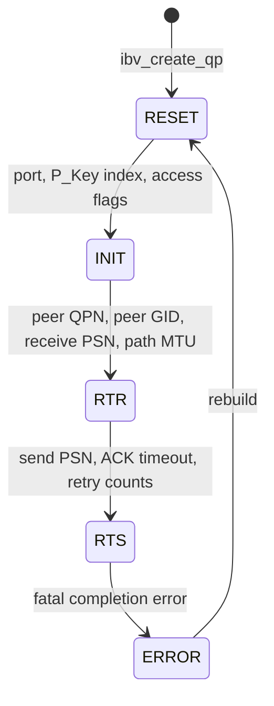
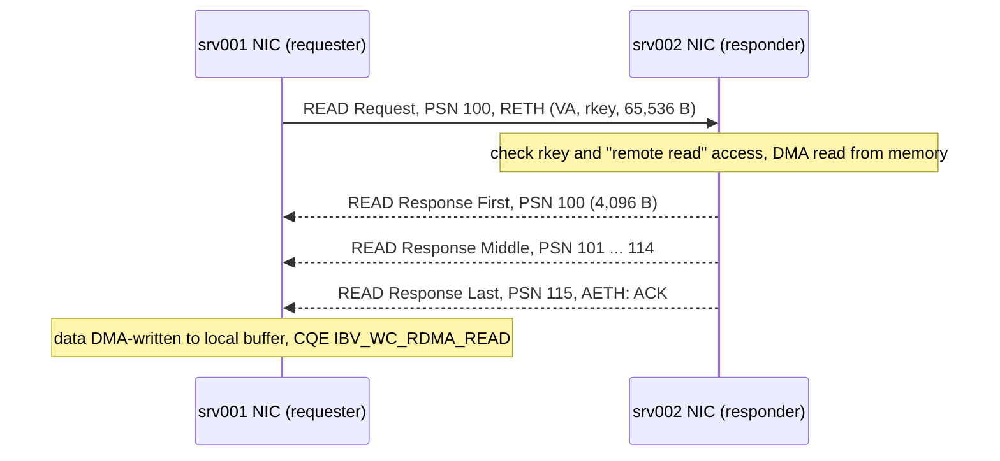

Every training step on Meridian's San Jose cluster ends with each of its 1,024 GPUs exchanging gradients with the others, and the step waits for the last byte ([why AI traffic is different](/learn/fabric-networking/ai-fabrics/why-ai-traffic-is-different)). Each GPU has its own 400 Gb/s NIC (network interface card), which can move 50 GB/s each way. Feeding eight per server through the kernel's TCP stack would cost many CPU cores per NIC, a copy of every byte through host memory and microseconds of software per message, while the GPUs wait.

RDMA, remote direct memory access, takes DMA (a device such as a NIC reading and writing host memory itself, without the CPU moving the bytes) across the network. The application hands its NIC a description of the transfer ("these bytes of my memory into that address on that server"), and the two NICs move the data, run the transport, check permissions and report completion, with no system call, copy or interrupt on either side. Here it runs on RoCEv2 (RDMA over Converged Ethernet, version 2: RDMA packets inside ordinary UDP/IP); [InfiniBand and RoCE](/learn/fabric-networking/ai-fabrics/infiniband-and-roce) covers the networks RDMA runs on.

## Why the kernel path is too slow for AI

[How Linux sends and receives packets](/learn/fabric-networking/from-zero/how-linux-sends-and-receives-packets) traces the kernel path in detail. Moving one buffer with a TCP socket costs, per transfer:

1. **A system call on each side.** `send()` and `recv()` switch the CPU into the kernel and back: on the order of 100 ns to 1 µs each, depending on the CPU and security mitigations ([I/O and system calls](/learn/systems/operating-systems/io-and-syscalls)).
2. **A copy on each side.** The sending kernel copies the bytes into its own socket buffers (so the app can reuse its buffer and TCP can retransmit); the receiving kernel copies them out at `recv()`.
3. **Interrupts and protocol work.** The receiving NIC interrupts a CPU, which runs NAPI polling (the kernel's interrupt-then-poll receive loop), IP, TCP sequence checks and ACK generation, all in software.

| Quantity | Value | How it is derived |
|---|---|---|
| Line rate | 50 GB/s each way | 400 Gb/s ÷ 8 |
| Packets per second, 1,500-byte MTU | about 32.5 million | 1,538 bytes per frame on the wire, with preamble and inter-frame gap |
| Time per packet, 1,500-byte MTU | about 31 ns, about 92 cycles at 3 GHz | less than one DRAM cache miss (around 80–100 ns) |
| Packets per second, 4 KiB RDMA payload | about 11.9 million | 4,158- to 4,174-byte frames (traced below) plus 20 bytes of preamble and gap |
| Host memory traffic to receive at line rate with one copy | about 150 GB/s | NIC writes 50 GB/s, the copy reads 50 and writes 50 |
| Same with zero copy | 50 GB/s | the NIC writes once, into the final buffer |
| Wire time of a 1 MiB message | about 21 µs | 1,048,576 × 8 ÷ 400 Gb/s |

Offloads such as TSO and GRO (segmenting and merging in the NIC and driver, so the stack handles 64 KB chunks) cut the per-packet cost, yet one tuned core still moves only a few tens of Gb/s of TCP, so eight 400 Gb/s NICs would need on the order of a hundred cores. Memory hurts as much: a CPU socket with eight channels of DDR5-4800 has about 300 GB/s of theoretical bandwidth, which copying for two NICs would consume. And gradients start in GPU memory, so the kernel path adds a GPU-to-host copy before `send()` and a host-to-GPU copy after `recv()`.

Latency is the second problem. A small-message round trip through two kernel stacks is typically 10 to 30 µs on tuned servers (less with busy polling); RDMA does it in about 2 µs through one switch ([tuning and benchmarking RDMA](/learn/fabric-networking/ai-fabrics/tuning-and-benchmarking-rdma) measures it). Tensor- and expert-parallel traffic puts many small and medium messages on the critical path ([parallelism](/learn/fabric-networking/ai-fabrics/parallelism-tp-pp-dp)), and 10 µs of software on a message whose wire time is 21 µs wastes a third of the link.

- **What RDMA solves:** CPU cost per byte, copies through host memory, and software latency per message.
- **How the kernel path breaks under AI load:** cores saturate below line rate, copies eat memory bandwidth, tail latency follows CPU scheduling.
- **Signal:** `mpstat` shows softirq (the kernel's deferred packet processing) and system time pegged on the NIC's cores while the NIC runs below line rate.

## Kernel bypass and zero copy

**Kernel bypass** means the application talks to the NIC directly on the data path. **Zero copy** means the NIC reads from and writes to the application's own buffers, so no CPU copies the bytes. RDMA does both by splitting every operation into two paths.

- **The control path goes through the kernel, once.** Opening the device, registering memory and creating queue pairs are system calls into the RDMA driver (on Linux, through `/dev/infiniband/uverbs0`), which checks permissions, pins memory and programs the NIC, taking microseconds to milliseconds at setup.
- **The data path stays in user space.** At setup the driver maps into the application's address space the queues (ordinary memory the NIC reads and writes by DMA) and a page of NIC registers, the **doorbell** (on NVIDIA ConnectX, part of a "user access region"). Posting work is writing a descriptor (one or a few 64-byte blocks) into a queue plus one doorbell write; learning it finished is reading the next completion entry in memory. Neither is a system call.

The kernel stays the security boundary, deciding at setup which memory and queues an application may use, but gives up visibility: RDMA bytes pass through no socket, so `ss` and an ordinary `tcpdump` see nothing ([what the platform should show](#what-the-platform-should-show)). The transport moves into the NIC too (sequence numbers, acknowledgements, retransmission, segmentation, per queue pair), which is why the receiving CPU does nothing and why RDMA wants a network that rarely drops: its recovery is far simpler than TCP's, as the trace below shows.

**GPUDirect RDMA** extends zero copy to GPU memory: the NIC reads and writes registered GPU memory directly across PCIe, so gradients never touch host memory. It is fastest when NIC and GPU share a PCIe switch ([scale-up, NVLink and NVSwitch](/learn/fabric-networking/ai-fabrics/scale-up-nvlink-and-nvswitch)).

## Verbs: the API

**Verbs** are the RDMA programming interface, named in the InfiniBand specification as abstract actions ("post send", "poll completion queue") and implemented on Linux by `libibverbs` (rdma-core). The same verbs drive InfiniBand, RoCE and iWARP NICs, and NCCL (NVIDIA's collective library, [collectives and NCCL](/learn/fabric-networking/ai-fabrics/collectives-and-nccl)), MPI (the HPC message-passing standard) and NVMe over Fabrics (remote block storage) sit on top. You will rarely write verbs, but every RDMA error, counter and tuning knob is named after these objects.

| Verb (libibverbs) | Object it creates or uses | Path | What it does |
|---|---|---|---|
| `ibv_open_device` | device context | control, kernel | Opens the NIC; maps the doorbell page |
| `ibv_alloc_pd` | protection domain (PD) | control | A container: queue pairs and memory regions only work together inside one PD |
| `ibv_reg_mr` | memory region (MR) | control, slow | Pins a buffer and returns its lkey and rkey |
| `ibv_create_cq` | completion queue (CQ) | control | Where finished work is reported |
| `ibv_create_qp` | queue pair (QP) | control | A send queue and a receive queue, bound to CQs |
| `ibv_modify_qp` | QP state | control | Walks the QP through RESET, INIT, RTR, RTS |
| `ibv_post_send` | work request on the send queue | **data, user space** | SEND, RDMA WRITE, RDMA READ, atomic |
| `ibv_post_recv` | work request on the receive queue | **data, user space** | Offers a buffer for an incoming SEND |
| `ibv_poll_cq` | completion queue entry | **data, user space** | Reads finished work |

A **work request** (WR) describes one operation: an opcode, an ID the application chooses (`wr_id`), a list of local buffers as scatter/gather elements (each an address, a length and an lkey), and for one-sided operations the remote address and rkey. The driver turns it into a **work queue element** (WQE) in the queue the NIC reads. Small payloads (up to a few hundred bytes, depending on the NIC) can be copied into the WQE itself (`IBV_SEND_INLINE`), sparing the NIC a DMA read: the one place RDMA deliberately copies, because a CPU copy of 64 bytes is cheaper than a PCIe round trip.

## Queue pairs

A **queue pair** is RDMA's endpoint, the equivalent of a socket: a **send queue** (work for the NIC) and a **receive queue** (buffers for incoming SENDs), each tied to a completion queue. The NIC knows a QP by its 24-bit **QP number**, which every RDMA packet carries as a TCP segment carries a port. Unlike a socket's, a QP's state lives in the NIC: its PSNs (packet sequence numbers, 24-bit counters), its peer, its timers. QP 0 and QP 1 are reserved for management.

### The QP state machine

A new QP cannot send or receive. Software steps it through states with `ibv_modify_qp`, supplying different attributes at each step:



| State | Means | Attributes set on entry |
|---|---|---|
| RESET | Exists, does nothing | none |
| INIT | Bound to a port; can have receives posted | physical port, P_Key index (which partition key, a 16-bit isolation tag, the QP carries), which remote operations it allows |
| RTR (ready to receive) | Accepts packets from one known peer | destination QP number, the peer's GID (its address; for RoCEv2, an IP address), the PSN to expect, path MTU, the number of incoming READs it will serve in parallel, the RNR timer |
| RTS (ready to send) | Fully working | the first send PSN, the ACK timeout, the retry count, the RNR retry count, the number of outgoing READs it may have in flight |
| ERROR | Broken; every outstanding and new WR completes with a flush error | entered on a fatal error, or set by software |

The specification also defines SQD (send queue drained) and SQE (send queue error), which applications rarely meet.

Each side needs the other's QP number, GID and starting PSN before RTR, and RDMA has no handshake to learn them, so applications exchange them **out of band**: over an ordinary TCP connection (as `perftest` and NCCL's bootstrap do) or through the RDMA connection manager (`librdmacm`), which runs a socket-like connect and accept over QP 1. A QP that fails to reach RTR, or reaches RTS but never gets a reply, usually got a wrong value here: the wrong GID index (RoCEv1 instead of RoCEv2, or an IPv6 link-local GID instead of the IPv4 one), a path MTU larger than the network carries, or mismatched PSNs.

### RC, UC and UD

The **transport type** is fixed when the QP is created.

- **RC, reliable connected.** One QP talks to exactly one remote QP. The NICs acknowledge, retransmit, deliver in order and drop duplicates, and every operation is allowed, including atomics (8-byte compare-and-swap and fetch-and-add on remote memory). The NIC segments messages of up to 2 GiB into MTU-sized packets. NCCL and nearly all AI traffic use RC.
- **UC, unreliable connected.** One QP to one QP, no acknowledgements: a lost packet silently discards its whole message. No READ or atomics: both need a response from the far side, and UC has no way to detect or recover a lost one. Rarely used.
- **UD, unreliable datagram.** One QP talks to any number of peers; each send names its destination with an **address handle** and a Q_Key (a 32-bit value the receiver checks). Each message is one packet and lands behind 40 bytes reserved for the global route header (GRH), which says who sent it. The InfiniBand subnet manager and the connection manager use UD.

| | RC | UC | UD |
|---|---|---|---|
| Peers per QP | 1 | 1 | any |
| Reliable, in order | yes, in NIC hardware | no | no |
| Operations | SEND, WRITE, READ, atomics | SEND, WRITE | SEND only |
| Largest message | 2 GiB | 2 GiB | one MTU (4 KiB) |
| QPs for N peers | N per process (more with several channels) | N | 1 |
| Typical use | NCCL, MPI, storage | niche | management, discovery, custom datagram transports |

- **What RC solves:** reliable, ordered delivery with zero CPU per byte.
- **How it breaks at scale:** one QP per peer per channel. In a 1,024-GPU all-to-all, as expert parallelism needs, each process has over a thousand peers, so each NIC holds thousands of QPs. A packet is processed only once its QP's context (a few hundred bytes) is in the NIC's on-chip cache; past that working set, every miss is a fetch from host memory over PCIe and throughput falls.
- **Signal:** throughput that drops as the number of peers rises with message size held constant; NIC counters for context cache misses or PCIe back-pressure (names vary by vendor and generation).

The industry's answers are connection-sharing transports: XRC (extended reliable connected, sharing receive resources), NVIDIA's DCT (dynamically connected transport, which attaches a connection to a peer only while there is work), AWS's SRD (scalable reliable datagram, reliable but unordered, behind its Elastic Fabric Adapter NICs), and the Ultra Ethernet transport, which [InfiniBand and RoCE](/learn/fabric-networking/ai-fabrics/infiniband-and-roce) compares.

## Memory registration and keys

The NIC moves data by DMA, using physical (bus) addresses. The application knows only virtual addresses, and the kernel may move or swap a virtual page at any moment ([virtual memory](/learn/systems/operating-systems/virtual-memory)). **Memory registration** fixes this. `ibv_reg_mr(pd, addr, length, access)`:

1. **Pins the pages**, so the kernel will not move, swap or reclaim them while the NIC may touch them. Pinned memory counts against the process's locked-memory limit (`ulimit -l`, `RLIMIT_MEMLOCK`).
2. **Builds a translation table in the NIC** (on ConnectX, the memory translation table): for each page, virtual address to physical address. A 1 GiB buffer in 4 KiB pages is 262,144 entries; with 2 MiB huge pages it is 512.
3. **Records the access rights**: local write, remote write, remote read, remote atomic (local read is always allowed).
4. **Returns two 32-bit keys.** The **lkey** names the region in the local application's own work requests. The **rkey** is a capability for remote NICs: a packet that presents this rkey, an address and a length inside the region gets the access the flags allow.

| Region | Server | Address | Length | Key used | Access |
|---|---|---|---|---|---|
| Source buffer | `srv001` | `0x7f1c40000000` | 1 MiB | lkey `0x0004d2e1` | local read |
| Destination buffer | `srv002` | `0x7f3a2c000000` | 1 MiB | rkey `0x00a1b2c3` | remote write |

`srv002` sends the address, length and rkey to `srv001` out of band with the QP details; from then on `srv001`'s NIC can write into that buffer with no action by `srv002`'s CPU. On every one-sided request the responding NIC checks that the rkey exists, belongs to the same protection domain as the QP, allows the operation, and covers the address range.

**Costs and failure modes:**

- **Registration is slow.** The cost grows with the number of pages; registering gigabytes of 4 KiB pages takes on the order of tens to hundreds of milliseconds, comparable to copying the same bytes once, so it pays only for buffers that are reused. Libraries register once and reuse: NCCL registers its communication buffers at startup, MPI keeps a registration cache.
- **Pinned memory is unavailable to everyone else**, and capped by `RLIMIT_MEMLOCK` (a classic container failure, below).
- **Wrong access flags.** A region registered without remote write fails every WRITE into it with `IBV_WC_REM_ACCESS_ERR` on the *sender's* CQ, and breaks the sender's QP.
- **An rkey is a bearer token.** Anyone who reaches the QP with the right QP number, PSN and rkey can write into that memory, so RDMA networks are isolated (a dedicated back-end fabric, InfiniBand partitions, per-tenant VRFs (separate routing tables) on RoCE), and applications that must revoke access use **memory windows**, rkeys invalidated without re-registering. On-demand paging (ODP) avoids pinning by letting the NIC take page faults, at a latency cost on first touch.
- **Signal:** `ibv_reg_mr` failing with ENOMEM (the locked-memory limit), job start-up dominated by registration time, and `IBV_WC_REM_ACCESS_ERR` on senders when a region or rkey is wrong.

## One-sided and two-sided operations

### RDMA WRITE: one-sided push

The requester names local memory (lkey) and remote memory (address and rkey); the responding NIC places the data and acknowledges. The remote **application is not told**: no completion appears on its side and its CPU never runs. That is the strength (zero work for the receiver) and the problem: how does the receiver learn the data arrived? Three common answers:

- **WRITE with immediate data.** The last packet carries 4 extra bytes; it consumes a posted receive on the remote side and generates a completion there with the immediate value. NCCL's InfiniBand and RoCE transport moves bulk data with WRITEs and signals with a write carrying immediate data.
- **WRITE, then SEND on the same QP.** RC delivers in order on a QP, so when the SEND's completion appears, the earlier WRITE's data has been placed.
- **Polling a flag in memory.** The receiver spins on a flag the sender writes after the data. The specification does not order the bytes within one WRITE, so polling the payload's last byte is unportable.

### RDMA READ: one-sided pull

The requester sends a READ request carrying the remote address, rkey and length, and no data. The responding NIC reads its memory by DMA and returns READ response packets; the responses double as acknowledgements. A 64 KiB read at a 4,096-byte MTU:



The request consumes one PSN per response packet (PSN 100 to 115 here), so the next request starts at 116. READ costs a round trip before the first byte moves, and the responder keeps state for each READ it serves, so both sides cap the number in flight (`max_rd_atomic`, `max_dest_rd_atomic`, typically up to 16). READ is a pull: whoever wants the data decides when it arrives, which helps against incast (many senders bursting into one receiver at once). NVMe over Fabrics targets pull a host's write data with READ and push read data with WRITE, so the storage target sets the pace.

### SEND and RECV: two-sided

A SEND carries data but no address. The receiving application must have **posted a receive** in advance with `ibv_post_recv`; the SEND lands in the oldest posted buffer of that QP and both sides get a completion. Matching is by position in the queue, never by tag, so every posted buffer must fit the largest possible message (a larger SEND fails with a length error and breaks the QP).

A SEND that finds no receive posted on an RC QP gets an **RNR NAK** (receiver not ready). The sender waits the RNR timer the responder advertised (10 µs to about 655 ms) and retries, up to `rnr_retry` times (7 means forever): RNR is RDMA's full receive window. On UD the packet is dropped and counted. **Shared receive queues** (SRQ) let many QPs draw from one buffer pool.

| | SEND/RECV | RDMA WRITE | RDMA READ |
|---|---|---|---|
| Receiver's CPU involved | posts receives, gets a completion | no (unless with immediate) | no |
| Needs the remote address and rkey | no | yes | yes |
| Round trips before data moves | 0 | 0 | 1 |
| Who chooses where data lands | the receiver, by posting buffers | the sender, inside the region the receiver exposed | the requester |
| Back-pressure | RNR NAK when no buffer is posted | none: the sender writes when it likes | outstanding-read limit |
| Typical use | control messages, small RPCs, notifications | bulk data (NCCL), log replication | storage targets, pulling remote state |

## Completion queues

A **completion queue** is a ring of completion queue entries (CQEs) in application memory that the NIC writes by DMA. Each CQE carries the `wr_id` of the work request, a status, the opcode, the byte count for receives, the immediate data if any, and for UD the sender's QP number.

**Polling or events.** `ibv_poll_cq` reads the next CQE from memory in tens of nanoseconds, at the price of a spinning core; or the application arms the CQ (`ibv_req_notify_cq`) and sleeps until the NIC interrupts, saving the core and adding several microseconds. NCCL's proxy thread polls.

**Signaled and unsignaled work.** Completions cost PCIe writes and polling, so a streaming sender often requests a completion on one WR in 64. Send-queue slots free only when a later signaled completion is reaped, so a sender that never signals fills its queue and stalls.

**Sizing.** The NIC must never find the CQ full. A CQ shared by 512 QPs, each with up to 128 outstanding signaled WRs, needs room for 65,536 entries. An overrun is a fatal asynchronous error that moves every QP on that CQ to ERROR.

**Errors.** A failed operation's CQE carries the reason and the QP moves to ERROR; every WR still queued or posted later completes with `IBV_WC_WR_FLUSH_ERR`, so the first non-flush error is the one that matters. The statuses operators see most:

| Status | Meaning | Usual cause |
|---|---|---|
| `IBV_WC_SUCCESS` | Done | |
| `IBV_WC_RETRY_EXC_ERR` | No ACK after the retry count was exhausted | Peer gone, link down, sustained loss, wrong path MTU |
| `IBV_WC_RNR_RETRY_EXC_ERR` | Too many RNR NAKs | Receiver not posting buffers |
| `IBV_WC_REM_ACCESS_ERR` | Responder refused the rkey, flags or range | Stale or wrong rkey, missing access flag, overrun of the region |
| `IBV_WC_LOC_PROT_ERR` | Local lkey invalid for the buffer | Buffer outside its registered region, deregistered memory |
| `IBV_WC_WR_FLUSH_ERR` | QP already in ERROR | Some earlier error; look for it |

- **What CQs solve:** learning that work finished with no interrupt and no system call.
- **How they break:** an overrun kills every QP on the CQ; never signaling fills the send queue; a flood of flush errors buries the first error.
- **Signal:** an `IBV_EVENT_CQ_ERR` asynchronous event, `ibv_post_send` refusing work because the queue is full, error CQEs counted by status.

## One RDMA WRITE, traced end to end

Meridian's San Jose cluster has 128 servers, `srv001` to `srv128`, each with eight GPUs and one 400 Gb/s ConnectX-7-class NIC per GPU; NIC k of every server connects to rail k's leaf ([AI fabric topologies](/learn/fabric-networking/ai-fabrics/ai-fabric-topologies)). The app on `srv001` moves 1 MiB into a buffer on `srv002` through each server's NIC 0 (beside GPU0, on rail 1; illustrative back-end addresses `10.3.1.1` and `10.3.1.3`, both on `rail1-leaf1.sjc`). The visualisation runs the same transfer first with TCP, then with RDMA.

```viz
{"type": "fabric", "scenario": "rdma-write", "title": "Moving 1 MiB from srv001 to srv002: a TCP socket, then one RDMA WRITE", "caption": "The TCP half: send() and a kernel copy on srv001, NIC DMA and an interrupt, the full TCP/IP stack on srv002, recv() and a second copy. The RDMA half: both buffers registered (lkey, rkey), RC queue pairs in RTS, a work request and a doorbell with no system call, 256 RoCEv2 packets (WRITE First with RETH, Middle, Last with AckReq) routed by rail1-leaf1.sjc on their IP header, srv002's NIC checking QP, PSN and rkey before writing, the ACK, and a completion polled from srv001's CQ. The closing table counts system calls, copies and interrupts on each path."}
```

**Setup, once.** The buffers are registered as in the table above. Each side creates an RC QP (`0x000112` on `srv001`, `0x0001a7` on `srv002`) and a CQ, the apps swap GIDs, QP numbers, starting PSNs (`0x004e20`), address and rkey over TCP, and both QPs go to INIT, RTR (path MTU 4,096) and RTS.

**The data path:**

1. **Post.** `srv001`'s app writes a work request (`IBV_WR_RDMA_WRITE`, local buffer and lkey, remote address and rkey, signaled, `wr_id` 7) into the send queue and writes the doorbell: well under a microsecond of CPU.
2. **Build.** The NIC reads the WQE, then the 1 MiB by DMA, and segments it: 1,048,576 ÷ 4,096 = 256 packets, PSN `0x004e20` to `0x004f1f`.
3. **First packet on the wire.** Field by field:

| Header | Size | Field | Value | Who reads it |
|---|---|---|---|---|
| Ethernet | 14 B | destination, source MAC | `00:00:5e:00:53:81` (leaf), `00:00:5e:00:53:80` (NIC) | this link only |
| | | EtherType | `0x0800` (IPv4) | |
| IPv4 | 20 B | source, destination | `10.3.1.1` → `10.3.1.3` | the leaf, for routing |
| | | DSCP / ECN | 26 (lossless class) / `10` (ECN-capable) | the leaf's queueing; ECN marking ([lossless Ethernet](/learn/fabric-networking/ai-fabrics/lossless-ethernet-pfc-ecn-dcqcn)) |
| | | TTL, protocol, total length | 64, 17 (UDP), 4,156 | the leaf |
| UDP | 8 B | source port | 50593 | ECMP hashes in larger fabrics: the entropy for this QP |
| | | destination port | 4791 (RoCEv2) | the receiving NIC |
| BTH (base transport header) | 12 B | opcode | `0x06` RDMA WRITE First | receiving NIC only |
| | | P_Key | `0xffff` (default partition) | receiving NIC |
| | | destination QP | `0x0001a7` | receiving NIC: which QP |
| | | AckReq bit, PSN | 0, `0x004e20` | receiving NIC: order and duplicates |
| RETH (RDMA extended transport header) | 16 B | virtual address, rkey, DMA length | `0x7f3a2c000000`, `0x00a1b2c3`, 1,048,576 | receiving NIC: where to write, with what right |
| Payload | 4,096 B | | bytes 0–4,095 of the buffer | written into `srv002`'s memory |
| ICRC (invariant CRC) | 4 B | | covers the fields no router changes | receiving NIC, end to end |
| Ethernet FCS | 4 B | | per link | each receiver |

The frame is 4,174 bytes, so the back end must carry jumbo frames (Meridian's switches run a 9,216-byte MTU). Everything after UDP is InfiniBand's transport, unchanged; RoCEv2 replaced only InfiniBand's link and network headers (LRH and GRH) with Ethernet, IP and UDP so ordinary switches can route it. The ICRC masks the fields that change in flight (TTL, DSCP, ECN, the IP and UDP checksums) and checks the rest end to end.

4. **The leaf routes it on IP.** `rail1-leaf1.sjc` decrements the TTL to 63, rewrites both MACs (`00:00:5e:00:53:82` to `00:00:5e:00:53:83`), and puts it in the lossless queue (priority 3) that DSCP 26 maps to. The BTH and RETH mean nothing to it.
5. **The responder checks, then writes.** `srv002`'s NIC finds QP `0x0001a7` in RTS, sees the expected PSN, validates the rkey for remote write over the whole 1 MiB range, and DMA-writes the 4,096 bytes into the buffer. It remembers the address for the rest of the message, which is why only the first packet carries a RETH.
6. **Packets 2 to 255** are WRITE Middle (`0x07`), no RETH, PSN rising by one. **Packet 256** is WRITE Last (`0x08`) with AckReq set.
7. **ACK.** `srv002`'s NIC sends an Acknowledge (opcode `0x11`) for PSN `0x004f1f`, with an ACK extended transport header (AETH) saying "ACK, message sequence number 1". The ACK is cumulative. (Real NICs also acknowledge inside long messages so the sender can free its window sooner, at a rate that depends on the NIC.)
8. **Completion.** `srv001`'s NIC writes a CQE (`wr_id` 7, `IBV_WC_SUCCESS`, `IBV_WC_RDMA_WRITE`) into the app's CQ; the app sees it on its next poll and may reuse the buffer.

`srv002`'s CPU ran nothing, and its app was never told. On the wire this takes about 21 µs at 400 Gb/s; the software cost on `srv001` was one WQE, one doorbell and one poll.

### When a packet is lost

The responder accepts only the next expected PSN. A higher PSN reveals a gap: the responder sends one **NAK (sequence error)** naming the PSN it expects and discards everything until it arrives, and the requester resends **everything from that PSN on**: go-back-N, not selective repeat. If nothing comes back (the last packet or the ACK was lost), the requester waits the **local ACK timeout**, 4.096 µs × 2^`timeout`, then resends from the oldest unacknowledged PSN, up to `retry_cnt` times (at most 7) before failing with `IBV_WC_RETRY_EXC_ERR`. With `timeout` 14 that is 67 ms per attempt. NCCL's `NCCL_IB_TIMEOUT` defaults to about 20 in recent releases (it has changed between versions), 4.3 s per attempt, so with 7 retries a dead peer fails a job only after about half a minute; NICs may also round the timeout up to their own minimum.

The model below implements a responder and requester of one RC QP: PSN checks, rkey checks, NAKs, go-back-N, the retry timer and RNR. It sends 16 KiB (4 packets) in each case.

```python
from collections import deque

MTU = 4096                 # path MTU for the RDMA payload, as set at RTR
PSN_MASK = 0xFFFFFF        # PSNs are 24 bits and wrap
RNR_RETRY = 3              # how many RNR NAKs the requester tolerates


class Responder:
    """The receiving NIC of a reliable-connected QP. No CPU and no kernel run here."""

    def __init__(self, start_psn):
        self.expected = start_psn      # the next PSN this QP will accept
        self.regions = {}              # rkey -> [base, length, access, memory]
        self.recv_queue = deque()      # receive buffers the app posted, used in order
        self.pending_recv = []         # buffers the app will post a little later
        self.cq = []                   # completions the receiving app can poll
        self.nak_sent = False
        self.cursor = None             # [region, offset] of the WRITE in progress

    def reg_mr(self, rkey, base, length, access):
        self.regions[rkey] = [base, length, access, bytearray(length)]

    def tick(self):                    # time passes: the app posts its late receives
        self.recv_queue.extend(self.pending_recv)
        self.pending_recv.clear()

    def receive(self, pkt):
        op, psn = pkt["op"], pkt["psn"]
        if psn != self.expected:
            if (psn - self.expected) & PSN_MASK > PSN_MASK // 2:   # behind us: a duplicate
                return {"op": "ACK", "psn": (self.expected - 1) & PSN_MASK}
            if self.nak_sent:                                      # a gap, already reported
                return None
            self.nak_sent = True
            return {"op": "NAK", "why": "sequence error", "psn": self.expected}
        self.nak_sent = False
        if op.startswith("WRITE"):
            if "reth" in pkt:          # First or Only: check the rkey once per message
                va, rkey, length = pkt["reth"]
                r = self.regions.get(rkey)
                if r is None or "remote_write" not in r[2] or not (
                        r[0] <= va and va + length <= r[0] + r[1]):
                    return {"op": "NAK", "why": "remote access error", "psn": psn}
                self.cursor = [r, va - r[0]]
            region, off = self.cursor
            region[3][off:off + len(pkt["data"])] = pkt["data"]     # the DMA write
            self.cursor[1] += len(pkt["data"])
        elif op == "SEND Only":
            if not self.recv_queue:
                return {"op": "RNR NAK", "psn": psn}               # receiver not ready
            buf = self.recv_queue.popleft()
            self.cq.append((buf, "IBV_WC_RECV", len(pkt["data"])))
        self.expected = (psn + 1) & PSN_MASK
        if pkt["ackreq"]:
            return {"op": "ACK", "psn": psn}
        return None


class Requester:
    """The sending NIC: segments a work request into packets and runs the reliability."""

    def __init__(self, start_psn, peer, drop=()):
        self.psn, self.peer = start_psn, peer
        self.drop = set(drop)          # transmissions the wire loses (1-based)
        self.sent, self.cq, self.state = 0, [], "RTS"

    def post_send(self, wr_id, op, data, remote=None):
        if self.state != "RTS":                    # an errored QP flushes every new WR
            self.cq.append((wr_id, "IBV_WC_WR_FLUSH_ERR"))
            return
        chunks = [data[i:i + MTU] for i in range(0, len(data), MTU)]
        first, n = self.psn, len(chunks)
        pkts = []
        for i, chunk in enumerate(chunks):
            pos = "Only" if n == 1 else "First" if i == 0 else "Last" if i == n - 1 else "Middle"
            pkt = {"op": f"{op} {pos}", "psn": (first + i) & PSN_MASK,
                   "data": chunk, "ackreq": i == n - 1}
            if op == "WRITE" and i == 0:
                pkt["reth"] = (remote[0], remote[1], len(data))    # VA, rkey, length
            pkts.append(pkt)
        start, rnr = 0, 0
        while True:
            replies = []
            for pkt in pkts[start:]:
                self.sent += 1
                if self.sent in self.drop:
                    print(f"    wire drops PSN {pkt['psn']:#08x}")
                    continue
                reply = self.peer.receive(pkt)
                if reply:
                    replies.append(reply)
            nak = next((r for r in replies if r["op"] != "ACK"), None)
            if nak is None and replies and replies[-1]["psn"] == pkts[-1]["psn"]:
                self.psn = (first + n) & PSN_MASK
                self.cq.append((wr_id, "IBV_WC_SUCCESS"))
                return
            if nak is None:
                print("    no ACK: retry timer expires, resend from the oldest unacked PSN")
            elif nak["op"] == "RNR NAK":
                rnr += 1
                if rnr > RNR_RETRY:
                    self.state = "ERROR"
                    self.cq.append((wr_id, "IBV_WC_RNR_RETRY_EXC_ERR"))
                    return
                print(f"    RNR NAK: wait min_rnr_timer, then resend PSN {nak['psn']:#08x}")
                self.peer.tick()
                start = (nak["psn"] - first) & PSN_MASK
            elif nak["why"] == "sequence error":
                start = (nak["psn"] - first) & PSN_MASK
                print(f"    NAK sequence error: go back to PSN {nak['psn']:#08x}, "
                      f"resend {n - start} packets")
            else:                                  # remote access error: fatal
                self.state = "ERROR"
                self.cq.append((wr_id, "IBV_WC_REM_ACCESS_ERR"))
                return


def run(title, op, size, drop=(), rkey=0x00A1B2C3, late_recv=False):
    resp = Responder(0x004E20)
    resp.reg_mr(0x00A1B2C3, 0x7F3A2C000000, 1 << 20, {"remote_write"})
    if op == "SEND":
        (resp.pending_recv if late_recv else resp.recv_queue).append("recv buffer 0")
    req = Requester(0x004E20, resp, drop)
    print(title)
    req.post_send(7, op, bytes(size), remote=(0x7F3A2C000000, rkey))
    print(f"    {req.sent} packets sent, {-(-size // MTU)} needed; "
          f"sender CQ {req.cq}; receiver CQ {resp.cq}")
    return req


run("1. WRITE 16 KiB, clean", "WRITE", 16384)
run("2. WRITE 16 KiB, second packet lost", "WRITE", 16384, drop={2})
run("3. WRITE 16 KiB, last packet lost", "WRITE", 16384, drop={4})
run("4. SEND 2 KiB before the receiver posted a buffer", "SEND", 2048, late_recv=True)
req = run("5. WRITE 16 KiB with a stale rkey", "WRITE", 16384, rkey=0x00A1B2C4)
req.post_send(8, "WRITE", bytes(4096), remote=(0x7F3A2C000000, 0x00A1B2C3))
print(f"    next work request on the same QP: {req.cq[-1]}")
```

```text
1. WRITE 16 KiB, clean
    4 packets sent, 4 needed; sender CQ [(7, 'IBV_WC_SUCCESS')]; receiver CQ []
2. WRITE 16 KiB, second packet lost
    wire drops PSN 0x004e21
    NAK sequence error: go back to PSN 0x004e21, resend 3 packets
    7 packets sent, 4 needed; sender CQ [(7, 'IBV_WC_SUCCESS')]; receiver CQ []
3. WRITE 16 KiB, last packet lost
    wire drops PSN 0x004e23
    no ACK: retry timer expires, resend from the oldest unacked PSN
    8 packets sent, 4 needed; sender CQ [(7, 'IBV_WC_SUCCESS')]; receiver CQ []
4. SEND 2 KiB before the receiver posted a buffer
    RNR NAK: wait min_rnr_timer, then resend PSN 0x004e20
    2 packets sent, 1 needed; sender CQ [(7, 'IBV_WC_SUCCESS')]; receiver CQ [('recv buffer 0', 'IBV_WC_RECV', 2048)]
5. WRITE 16 KiB with a stale rkey
    4 packets sent, 4 needed; sender CQ [(7, 'IBV_WC_REM_ACCESS_ERR')]; receiver CQ []
    next work request on the same QP: (8, 'IBV_WC_WR_FLUSH_ERR')
```

Read the cases against the mechanism:

- **Case 1:** the WRITE leaves nothing on the receiver's CQ. The data is in memory and the remote app does not know.
- **Case 2:** one loss in the middle cost three retransmissions: PSNs `0x004e22` and `0x004e23` arrived intact and were discarded. In the 1 MiB write a loss at packet 10 resends 247 packets, and at 0.1% loss a 256-packet message loses at least one packet 23% of the time (1 − 0.999²⁵⁶), each loss resending half the message on average: goodput collapses far faster than with TCP's selective acknowledgements. That arithmetic is why RoCE fabrics avoid drops ([lossless Ethernet](/learn/fabric-networking/ai-fabrics/lossless-ethernet-pfc-ecn-dcqcn)); newer NICs add more selective recovery, in vendor-specific ways.
- **Case 3:** a lost tail is worse. No later packet reveals the gap, so recovery waits the full ACK timeout (milliseconds to seconds) and resends all four packets, while every GPU in the collective waits.
- **Case 4:** RNR is flow control, not an error, until the retries run out.
- **Case 5:** the access error is fatal and the next work request is flushed unsent. Recovery means rebuilding the QP, which for NCCL usually means the job fails.

The model leaves out what makes the real thing fast: many messages in flight, a window of outstanding PSNs and coalesced ACKs.

## Failure modes in production

**Transport retry exceeded after a link flap.** *Symptom:* a job dies with `IBV_WC_RETRY_EXC_ERR` (NCCL logs "transport retry counter exceeded") seconds after a fabric event. *Diagnosis:* the error's timestamp minus the retry budget (timeout × attempts) lands on a leaf port flap, and the NIC's timeout counters rose. *Fix:* repair the fabric fault, the root cause; a larger `NCCL_IB_TIMEOUT` survives short flaps at the price of slower failure detection, and checkpoints bound the loss.

**Silent performance loss from drops.** *Symptom:* nccl-tests bus bandwidth well below expectation, no errors. *Diagnosis:* the NIC's `out_of_sequence` and `packet_seq_err` counters (ConnectX names, under `/sys/class/infiniband/<dev>/ports/1/hw_counters/`) rise, meaning go-back-N retransmissions, and a switch counts drops on the lossless queue. *Fix:* find the drops: a wrong PFC priority, a DSCP mapped to a lossy queue, a dirty optic ([when lossless goes wrong](/learn/fabric-networking/ai-fabrics/when-lossless-goes-wrong)).

**QPs that connect but carry nothing.** *Symptom:* a new server's collectives hang at start-up while `ping` across the back end works. *Diagnosis:* the job chose the wrong GID index (`show_gids` lists RoCEv1 and RoCEv2 GIDs per address; index 3 is the IPv4 RoCEv2 GID on many ConnectX setups, not all), or the path MTU exceeds the switch MTU, so large packets drop while small pings pass. *Fix:* pin the GID index (`NCCL_IB_GID_INDEX`) and keep host and switch MTUs consistent.

**Registration failures in containers.** *Symptom:* every job on a new Kubernetes node pool fails at start-up with "failed to register memory". *Diagnosis:* `ulimit -l` in the pod is the small default. *Fix:* raise `RLIMIT_MEMLOCK` in the container runtime.

**RNR storms.** *Symptom:* latency spikes on SEND-based traffic, RNR counters rising. *Diagnosis:* receivers post buffers more slowly than senders send. *Fix:* deeper receive queues, an SRQ, or bulk data moved to WRITE.

## Trade-offs: ways to move bytes between servers

| | Kernel TCP | TCP with zero-copy (`MSG_ZEROCOPY`, io_uring) | DPDK (user-space packet I/O) | RDMA RC | RDMA UD |
|---|---|---|---|---|---|
| CPU per byte | 2 copies + stack | stack, fewer copies | no kernel, but the app runs its own stack | none | none, but the app does reliability |
| Small-message latency | 10–30 µs round trip | similar | a few µs | about 2 µs round trip | about 2 µs |
| Who runs the transport | kernel | kernel | your code | NIC | NIC (unreliable) + your code |
| Tolerance of loss | high (SACK, many recovery modes) | high | whatever you build | low (go-back-N) | the app's problem |
| Visibility | `ss`, `tcpdump`, `nstat` | same | none in the kernel | NIC counters only | NIC counters only |
| Scale in peers | millions of sockets | same | any | limited by QP context cache | one QP for all peers |

## What the platform should show

RDMA is invisible to the usual host tools, so the platform collects from the NIC and joins it to the fabric:

- **Per-NIC RDMA counters, scraped like interface counters**: bytes and packets, sequence errors, local ACK timeouts, RNR NAKs, discards, CNPs sent and received (the congestion notifications of [lossless Ethernet](/learn/fabric-networking/ai-fabrics/lossless-ethernet-pfc-ecn-dcqcn)).
- **Error completions by status, first error first.** Count `RETRY_EXC_ERR`, `REM_ACCESS_ERR` and `RNR_RETRY_EXC_ERR` per job and NIC; suppress the flush errors that follow.
- **Host and fabric on one timeline.** A retry-exceeded at 14:02:07 beside a leaf port flap at 14:02:01 is the whole diagnosis; on separate dashboards it is two teams arguing.
- **Configuration consistency per server**: GID index in use, host MTU against switch MTU, DSCP and priority mapping, locked-memory limit, NIC firmware version. Drift here explains most "one bad node" incidents.
- **QP counts per NIC.** A rising count with falling throughput is the context cache running out.
- **Placement**: which PCIe switch and NUMA node (the CPU socket whose memory is local) each NIC and GPU sit on, because GPUDirect across sockets is slower and looks like a network problem.

## Interviewer follow-ups

**"Why can't we use TCP for GPU-to-GPU traffic?"** Model answer: at small scale we can. At 400 Gb/s per NIC the kernel path costs about 150 GB/s of memory traffic per receiving NIC, several cores per NIC and 10 µs or more per message; RDMA runs the transport in the NIC, copies nothing and, with GPUDirect, never touches host memory. Common wrong answer: "the three-way handshake is too slow", which happens once per connection.

**"What does 'one-sided' mean, and what does the remote side still have to do?"** Model answer: the remote CPU takes no part in the transfer; its NIC checks the rkey and places the data. Beforehand the remote side registered the memory, connected the QP and sent the address and rkey, and it learns of arrival separately (write with immediate, a following SEND, a flag). Common wrong answer: "the remote side does nothing at all".

**"A job fails with 'transport retry counter exceeded'. Where do you look?"** Model answer: scope first: one job or many, one server or one rail. The NIC got no ACK through all its retries, so the peer or path was gone for about timeout × retry count; I would line the error up with link, switch and NIC events and read both NICs' timeout counters. Retry behaviour per NIC generation I'd confirm with the network team; what I'd build is the timeline joining job errors to fabric events. Common wrong answer: "increase the retry count", which hides the fault.

**"Why does RoCE need a lossless network when TCP does fine with drops?"** Model answer: RC recovery is go-back-N in hardware, so one drop resends everything after it and a tail drop waits out a timeout of milliseconds to seconds; at 0.1% loss a 1 MiB message loses a packet 23% of the time. Hence PFC, ECN and DCQCN, or NICs with better recovery. Common wrong answer: "RDMA has no retransmission": RC retransmits, expensively.

**"How many QPs does a 1,024-GPU all-to-all need, and why does it matter?"** Model answer: with RC, one per peer per channel, so thousands per NIC; past the NIC's context cache each miss is a PCIe fetch and throughput falls, which is why DCT, SRD and the Ultra Ethernet transport exist. Common wrong answer: "one QP per NIC, like one socket per server".

## What mid-level engineers get wrong

- **Treating RDMA as "faster TCP".** It has no streams, no kernel visibility and much weaker loss recovery, so the network design must change with it.
- **Counting every error completion.** After the first error everything flushes, so a dashboard that sums them shows a thousand failures for one fault.
- **Assuming a WRITE notifies the receiver.** It does not, unless it carries immediate data or is followed by a SEND.
- **Debugging RDMA with ordinary `tcpdump`.** The kernel stack never sees the packets; mirror the switch port or use the NIC's own capture mode.

## Senior signals

- You split RDMA into a slow control path through the kernel (registration, QP setup) and a fast data path in user space (WQE, doorbell, CQ poll), and quantify what the kernel path would cost at 400 Gb/s: 31 ns per packet, 150 GB/s of memory traffic per receiving NIC.
- You treat an rkey as a capability for remote memory, protected by network isolation, partitions and memory windows.
- You trace an RDMA WRITE through BTH, RETH, PSNs, ACK and CQE, and know a switch only routes the UDP packet.
- You explain go-back-N and the ACK timeout, with the arithmetic, as why RoCE wants a lossless fabric, and treat RC's QP-per-peer cost as a scaling limit with named alternatives.
- You build tooling that joins NIC counters and first-error completions to fabric events, because RDMA is invisible to the host's usual tools.

## Check yourself

```quiz
- q: >-
    srv001 completes an RDMA WRITE of 1 MiB into a buffer on srv002, and its CQE says IBV_WC_SUCCESS. What does srv002's application know at that moment?
  options: ["Nothing: no completion appears on its side", "It got a CQE saying 1 MiB arrived", "It was interrupted when the first packet arrived", "Its recv() call returned with the 1 MiB"]
  answer: 0
  explanation: >-
    A plain RDMA WRITE is one-sided: the responding NIC checks the rkey and places the data in memory, and no completion, interrupt or system call happens on srv002. To notify the receiver the sender uses a WRITE with immediate data, which consumes a posted receive and creates a CQE there, or follows the WRITE with a SEND on the same QP. There is no recv() for a WRITE.
- q: >-
    An RC QP sends a 256-packet RDMA WRITE and the packet with the 10th PSN is dropped. What does classic RC recovery do?
  options: ["The leaf retransmits the packet from its lossless queue buffer", "The responder discards the message and the app reposts the work request", "The responder NAKs and the requester resends the 247 packets from the 10th", "The responder NAKs and the requester resends the 10th packet only"]
  answer: 2
  explanation: >-
    The responder accepts only the expected PSN, so on seeing PSN 11 it sends one sequence-error NAK naming PSN 10 and discards everything after it until PSN 10 arrives. The requester goes back to PSN 10 and resends 10 through 256, 247 packets. That go-back-N cost is why RoCE fabrics avoid drops. Selective resend exists on some newer NICs but is not the classic behaviour, and switches never retransmit.
- q: >-
    Every training job on a new Kubernetes node pool fails at start-up with a memory registration error, while the same image works elsewhere. What is the most likely cause?
  options: ["The QPs use RoCEv1 GIDs, which the leaves cannot route", "The rkey was sent to the peer over the wrong network", "The pod's locked-memory limit is too small to pin buffers", "The NIC's QP context cache is too small for the job"]
  answer: 2
  explanation: >-
    Registration pins pages, which counts against RLIMIT_MEMLOCK; a container with the small default limit fails ibv_reg_mr as soon as it registers a real buffer. A wrong GID index fails later, when QPs try to reach RTR or exchange traffic, and a context cache problem shows as low throughput, not an initialisation error. Sending the rkey is not part of registration.
- q: >-
    Why does a UD queue pair scale better than RC for a service that talks to thousands of peers, and what does it give up?
  options: ["One QP reaches any peer, but it gives up the use of the doorbell", "One QP reaches any peer; it loses reliability and large messages", "It shares one rkey for all peers, but gives up remote writes", "It caches more QP context, but it gives up GPUDirect RDMA"]
  answer: 1
  explanation: >-
    A UD QP names its destination per send with an address handle, so one QP serves every peer and the NIC holds one context instead of thousands. The price is that UD offers only SEND, each message fits in one packet (at most the 4,096-byte MTU), and there are no acknowledgements or ordering, so the application must provide reliability. UD still uses the doorbell and the same data path, and rkeys are not involved because UD has no RDMA WRITE or READ.
- q: >-
    A dashboard shows 12,000 IBV_WC_WR_FLUSH_ERR completions and one IBV_WC_REM_ACCESS_ERR on a QP in the same second. What happened?
  options: ["The responder ran out of posted receives and refused 12,000 SENDs", "One write used a bad rkey; the QP entered ERROR and flushed the rest", "The completion queue overflowed and the NIC rewrote the statuses", "12,000 work requests failed independently because of congestion"]
  answer: 1
  explanation: >-
    A remote access error is fatal: the QP moves to ERROR and every outstanding and later work request completes with a flush error without being sent. The one non-flush error is the root cause, here a stale or wrong rkey, a missing remote-write flag or an address outside the region. Running out of receives produces RNR NAKs and retry-exceeded errors, not flushes, and congestion does not produce error completions.
- q: >-
    Which work on an RDMA data path goes through the kernel?
  options: ["Posting each work request, which needs a system call", "Polling each completion, which the kernel copies out", "Ringing the doorbell, which the kernel validates per write", "None of it: only setup such as registration and QP creation"]
  answer: 3
  explanation: >-
    At setup the kernel driver pins memory, programs translations and maps the queues and a doorbell page into the application's address space. After that, posting a work request is a write to memory plus a doorbell write, and polling is a memory read, all in user space. The kernel remains the security boundary because it decided, at setup, which queues and memory the application may use.
```
