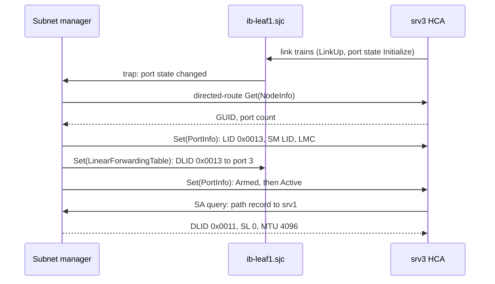

RDMA moves a GPU's gradients straight from one server's memory into another's, with the NIC running the transport and no kernel in the path. That transport assumes the network almost never loses a packet, so its recovery is crude: a loss usually makes the sender resend everything from the gap. Three answers supply such a network. **InfiniBand** builds a new network in which a link cannot drop a packet for lack of buffer. **RoCE** (RDMA over Converged Ethernet, pronounced "rocky") puts InfiniBand's transport on Ethernet and makes the Ethernet behave. **iWARP** runs RDMA over TCP and accepts loss.

Meridian's San Jose training cluster (1,024 GPUs, one 400 Gb/s ConnectX-7 class NIC per GPU) runs RoCEv2. "Why not InfiniBand?" is an early interview question about it, and "Ethernet is cheaper" is half an answer. The full one knows what InfiniBand does that Ethernet does not, what RoCE had to rebuild, and which signals show each failing.

A reminder from [RDMA from zero](/learn/fabric-networking/ai-fabrics/rdma-from-zero): applications post work to a **queue pair** (QP, send and receive queues owned by the NIC); a reliable connected (RC) QP numbers packets with a 24-bit **packet sequence number** (PSN) that the receiving NIC acknowledges; an RDMA WRITE lands in registered remote memory without the remote CPU. This lesson is the network underneath.

## InfiniBand: a network designed around the transport

The InfiniBand Trade Association (IBTA, formed in 1999, first specification in 2000) specified InfiniBand as one stack, physical to transport layer, designed together. The specification is published by the IBTA, but since the early 2010s almost every switch and adapter has come from one vendor, Mellanox, which NVIDIA bought in 2020. The vocabulary:

| InfiniBand term | Meaning | Nearest Ethernet/IP idea |
|---|---|---|
| HCA (host channel adapter) | The NIC, which runs the transport in hardware | An RDMA NIC |
| Subnet | Switches and adapters under one subnet manager, forwarding on LIDs | A layer-2 domain, but routed by a controller |
| LID (local identifier) | 16-bit address the subnet manager assigns to each port | A MAC address, assigned rather than burned in |
| GID (global identifier) | 128-bit address, used between subnets | An IPv6 address |
| VL (virtual lane) | One of up to 15 separately buffered data lanes on every link, plus VL15 for management | A priority queue with its own buffer |
| SL (service level) | 4-bit class in the packet, mapped to a VL at each hop | DSCP or 802.1p priority |

Link speeds are counted per lane and sold as 4-lane ports: EDR is 100 Gb/s per port, HDR 200, NDR 400 and XDR 800. A Quantum-2 NDR switch has 64 ports of 400 Gb/s.

### The subnet manager: a centralised control plane

In an Ethernet fabric every switch runs IS-IS or BGP and computes its own table ([IS-IS from zero](/learn/fabric-networking/underlay/is-is-from-zero)). InfiniBand switches compute nothing. One **subnet manager** (SM), a program on a switch or server (the open-source OpenSM, or NVIDIA's UFM, Unified Fabric Manager), discovers the topology, assigns every address, computes every route and writes every switch's forwarding table. A new port comes up like this when `srv3` joins a hypothetical InfiniBand build of the San Jose cluster:

1. **The link trains.** The cable comes up electrically and both ends report physical state `LinkUp`, but the logical port state is `Initialize`: it may carry only management packets on VL15.
2. **The SM finds it**, from the switch's trap or its periodic sweep (every 10 s by default in OpenSM), and sends **subnet management packets** (SMPs, 256-byte datagrams to queue pair 0) by **directed route**: the packet lists the output port to take at each hop, so it reaches a port with no address yet. `srv3` answers `Get(NodeInfo)` with its 64-bit GUID (globally unique ID, set at the factory).
3. **The SM assigns an address.** `Set(PortInfo)` gives the port its base LID (`0x0013` here), the LID of the SM itself and an LMC (LID mask control: with LMC 2 a port answers to 4 consecutive LIDs, giving the SM 4 paths to steer).
4. **The SM computes routes.** A routing engine (min-hop, up/down, fat-tree, DFSSSP and others) picks an output port at every switch for every destination LID, written in blocks of 64 entries with `Set(LinearForwardingTable)`.
5. **The SM sets the classes.** It programs each port's SL-to-VL table and VL arbitration weights.
6. **The port goes live.** The SM moves it to `Armed`, then `Active`. Only now may it send data.
7. **Applications ask for paths.** A process asks the SM's **subnet administration** (SA) service for a path record to a peer, getting back the destination LID, SL, MTU (maximum transmission unit, the largest packet the path carries) and rate to use.



What that looks like on the host, before and after the SM has done its work (illustrative `ibstat` output, trimmed; MT4129 is the ConnectX-7 device ID):

```text
CA 'mlx5_0'                          CA 'mlx5_0'
    CA type: MT4129                      CA type: MT4129
    Port 1:                              Port 1:
        State: Initializing                  State: Active
        Physical state: LinkUp               Physical state: LinkUp
        Rate: 400                            Rate: 400
        Base lid: 0                          Base lid: 19
        SM lid: 0                            SM lid: 1
        Link layer: InfiniBand               Link layer: InfiniBand
```

`Base lid: 19` is `0x0013`. The left-hand state is the most common InfiniBand ticket: a physically healthy link with no SM to bring it up.

**What the SM solves:** one program sees the whole fabric, so routes can be globally balanced and deadlock-free and addresses never collide. **How it breaks:** with no SM, Active ports keep forwarding, but nothing new comes up and failures are not routed around; sweeps of tens of thousands of ports delay every change; thousands of processes querying the SA at job start can overload it. **Signal:** ports in `Initialize` with `LinkUp`; `sminfo` naming the master; SM logs of sweeps and handovers. Production fabrics run a standby SM (a priority from 0 to 15 decides the master) and alert when it disappears.

### LIDs and forwarding: a flat table, no TTL

The **local route header** (LRH) carries the destination LID, and a switch's linear forwarding table is an array indexed by it: entry `0x0013` holds an output port. No longest-prefix match, ARP or MAC learning: the SM wrote every entry. Unicast LIDs run from `0x0001` to `0xBFFF`, so one subnet holds at most 49,151 of them, one per adapter port and one per switch (fewer endpoints with LMC above 0). Beyond that you need several subnets joined by InfiniBand routers using the 40-byte **global route header** (GRH) and GIDs, which few deployments run.

The LRH has **no hop limit**. An IP packet in a loop dies when its TTL runs out ([the packet walk](/learn/fabric-networking/from-zero/the-packet-walk)); an InfiniBand packet relies on the SM never computing a loop. The safety net is the switch's head-of-queue lifetime: a packet that has waited too long at the head of an output queue is discarded and counted in `PortXmitDiscards`. That also breaks the credit deadlocks described below.

One InfiniBand data packet from the middle of a long RDMA WRITE, `srv1` to `srv3`:

| Header | Size | Value in this example | What reads it |
|---|---|---|---|
| LRH: VL, LVer, SL, LNH | 2 bytes | VL 0, SL 0, next header BTH (no GRH) | Each switch: VL picks the buffer |
| LRH: DLID | 2 bytes | `0x0013` (srv3) | Each switch: index into the forwarding table |
| LRH: reserved, PktLen | 5 bits + 11 bits | 1,030 (4-byte words, LRH to ICRC) | Each switch, the receiver |
| LRH: SLID | 2 bytes | `0x0011` (srv1) | The receiver, for replies |
| BTH: opcode | 1 byte | `0x07`, RC RDMA WRITE Middle | srv3's HCA only |
| BTH: flags, P_Key | 3 bytes | P_Key `0xffff` (default partition) | srv3's HCA: partition check, InfiniBand's VLAN-like isolation |
| BTH: FECN, BECN, destination QP | 4 bytes | QP `0x00004a` | srv3's HCA; switches set FECN under congestion |
| BTH: AckReq, PSN | 4 bytes | 1004 | srv3's HCA: ordering and acknowledgement |
| Payload | 4,096 bytes | data | Written into srv3's registered memory |
| ICRC (invariant CRC) | 4 bytes | CRC over fields that never change in flight | srv3's HCA, end to end |
| VCRC (variant CRC) | 2 bytes | CRC over the whole packet | Every link, recomputed per hop |

The BTH (base transport header) is the part to remember: the same 12 bytes reappear unchanged inside RoCE. The first packet of a WRITE also carries a 16-byte RETH (RDMA extended transport header: remote virtual address, R_Key, length).

### Credit-based flow control: lossless by construction

An Ethernet switch whose buffer is full drops the next packet. An InfiniBand link cannot reach that point, because a sender may transmit only into buffer the receiver has already promised it. The promise travels in **flow control packets** (FCPs), 6-byte link-level messages sent per virtual lane, and is counted in 64-byte **blocks**:

- The sender keeps **FCTBS**, the total blocks it has sent on this VL, a 12-bit counter that wraps at 4,096.
- The receiver keeps **ABR**, the adjusted blocks received, and advertises **FCCL**, the credit limit: `FCCL = (ABR + free buffer blocks) mod 4096`, never more than 2,048 blocks ahead of ABR.
- Before each packet of `n` blocks the sender tests `(FCCL − (FCTBS + n)) mod 4096 ≤ 2048`. Sending is allowed if the test passes; otherwise it waits.

Both counters are running totals rather than "you have 65 more", which makes the scheme self-healing. If an FCP is lost, the next carries the same absolute limit. If a packet is corrupted and discarded at the receiver, the sender's own FCPs carry its FCTBS and the receiver resets ABR to match, so the lost blocks do not leak credit forever. The modulo test with a 2,048 window keeps working when the counters wrap.

Walk it on numbers. `srv1` writes to `srv3` through `ib-leaf1.sjc` while `srv2`'s traffic keeps `srv3`'s link busy. Each packet is 8 + 12 + 4,096 + 4 + 2 = 4,122 bytes, which is 65 blocks. The switch's VL 0 buffer for `srv1`'s port is 256 blocks (16 KB, far smaller than a real port's, to keep the numbers readable):

| Step | FCCL | FCTBS before | Test: (FCCL − (FCTBS + 65)) mod 4096 | Result | Buffer used after |
|---|---|---|---|---|---|
| Initial FCP | 256 | 0 | | | 0 |
| Packet 1 | 256 | 0 | 191 | send | 65 |
| Packet 2 | 256 | 65 | 126 | send | 130 |
| Packet 3 | 256 | 130 | 61 | send | 195 |
| Packet 4 | 256 | 195 | 4,092 (that is, −4) | wait | 195 |
| Switch forwards packet 1; FCP = 195 + 126 | 321 | 195 | 61 | send packet 4 | 195 |

```viz
{"type": "fabric", "scenario": "ib-credit-flow", "title": "InfiniBand credits: three packets fit, the fourth waits until an FCP raises the limit", "caption": "A hypothetical InfiniBand build of the San Jose cluster. srv1 sends 65-block RDMA WRITE packets to srv3 through ib-leaf1.sjc while srv2 keeps srv3's link busy. With a 256-block VL 0 buffer the test gives 191, 126 and 61 for packets 1 to 3, and 4,092 for packet 4, which waits without being dropped. The switch forwards packet 1 and its FCP raises FCCL from 256 to 321; packet 4 goes; srv1's FCP lets the switch resynchronise ABR to 260. The last frames show credit against cable length at 400 Gb/s and FECN/BECN congestion control."}
```

The same rules in code, with a lossy link for comparison. One tick is one packet time; the switch forwards towards `srv3` at full rate or at half rate:

```python
BLOCK, MOD = 64, 4096          # credits are 64-byte blocks; counters are 12-bit


def blocks(nbytes):
    return -(-nbytes // BLOCK)  # round up


def may_send(fccl, fctbs, need):
    """The IBA rule: send only if (FCCL - (FCTBS + need)) mod 4096 <= 2048."""
    return (fccl - (fctbs + need)) % MOD <= MOD // 2


class Port:
    """The receiving end of one virtual lane: a buffer and two counters."""
    def __init__(self, buffer_blocks, abr=0):
        self.size, self.used, self.abr, self.drops = buffer_blocks, 0, abr, 0

    def fccl(self):             # what the next flow control packet advertises
        return (self.abr + self.size - self.used) % MOD

    def receive(self, n):
        self.abr = (self.abr + n) % MOD
        if self.used + n > self.size:
            self.drops += 1     # no room: the packet is lost
        else:
            self.used += n


def run(packets, drain_every, credits=True, buffer_blocks=256, fcp_delay=1, start=0):
    """One packet time per tick. The far side forwards one packet every
    `drain_every` ticks; credit updates reach the sender `fcp_delay` ticks late."""
    pkt = blocks(8 + 12 + 4096 + 4 + 2)      # LRH + BTH + payload + ICRC + VCRC
    rx = Port(buffer_blocks, abr=start)       # counters may start anywhere
    fctbs, sent, waited, peak = start, 0, 0, 0
    seen = [rx.fccl()] * fcp_delay            # FCPs in flight back to the sender
    for tick in range(10_000):
        if sent == packets:
            break
        if tick % drain_every == 0 and rx.used:
            rx.used -= pkt                    # one packet leaves towards srv3
        fccl = seen.pop(0)                    # the sender acts on an old FCCL
        if not credits or may_send(fccl, fctbs, pkt):
            rx.receive(pkt)
            fctbs, sent = (fctbs + pkt) % MOD, sent + 1
        else:
            waited += 1                       # PortXmitWait counts this time
        seen.append(rx.fccl())
        peak = max(peak, rx.used)
    return f"{tick} ticks, waited {waited}, peak {peak} blocks, dropped {rx.drops}"


print("packet =", blocks(4122), "blocks of 64 B")
print("receiver keeps up:  ", run(20, drain_every=1))
print("half-rate drain:    ", run(20, drain_every=2))
print("counters wrap:      ", run(20, drain_every=2, start=4000))
print("no credits (lossy): ", run(20, drain_every=2, credits=False))

# Credit needed to keep a link at 400 Gb/s: everything in flight for one round trip.
for metres in (3, 30, 100, 2_000, 10_000):
    rtt_ns = 2 * metres * 5                   # about 5 ns per metre of fibre, each way
    need = 50 * rtt_ns                        # 400 Gb/s = 50 bytes per ns
    capped = min(400, 16_384 * 8 / rtt_ns)    # what 16 KB of credit allows
    print(f"{metres:>6,} m: rtt {rtt_ns:>7,} ns, credit for line rate {need:>9,} B, "
          f"16 KB gives {capped:3.0f} Gb/s")
```

```text
packet = 65 blocks of 64 B
receiver keeps up:   20 ticks, waited 0, peak 65 blocks, dropped 0
half-rate drain:     36 ticks, waited 16, peak 195 blocks, dropped 0
counters wrap:       36 ticks, waited 16, peak 195 blocks, dropped 0
no credits (lossy):  20 ticks, waited 0, peak 195 blocks, dropped 8
     3 m: rtt      30 ns, credit for line rate     1,500 B, 16 KB gives 400 Gb/s
    30 m: rtt     300 ns, credit for line rate    15,000 B, 16 KB gives 400 Gb/s
   100 m: rtt   1,000 ns, credit for line rate    50,000 B, 16 KB gives 131 Gb/s
 2,000 m: rtt  20,000 ns, credit for line rate 1,000,000 B, 16 KB gives   7 Gb/s
10,000 m: rtt 100,000 ns, credit for line rate 5,000,000 B, 16 KB gives   1 Gb/s
```

`may_send` is the whole sender: it needs nothing beyond the last FCCL. With credits and a half-rate drain the sender waits 16 ticks and the switch never holds more than 195 blocks; without them, 8 of 20 packets are dropped. Starting the counters at 4,000 changes nothing, which is what the modulo test is for. The last table is the price: credit returns only after a round trip, so a receiver needs a round trip of buffer per VL, which is why InfiniBand across kilometres needs range extenders with megabytes of buffer.

VL15 (management) has no flow control: SMPs may be dropped and the SM retries, so a congested data lane never blocks the control plane. PFC (priority flow control, an Ethernet pause frame that stops one traffic class on one link), which RoCE uses, works the other way round: the sender transmits until the receiver's queue crosses a threshold, then a pause goes back, with headroom for bytes already in flight ([lossless Ethernet: PFC, ECN and DCQCN](/learn/fabric-networking/ai-fabrics/lossless-ethernet-pfc-ecn-dcqcn)). Credits are proactive; pause is reactive.

**What credits solve:** no buffer-overflow drops on any link, with no threshold or headroom to tune. **How they break:** too little buffer for the cable's round trip caps the link below line rate; and a link with no credit stops everything on that VL, so congestion at one destination spreads upstream to senders that never addressed it. **Signal:** `PortXmitWait` (ticks spent with data ready and no credit) rising on the ports feeding a hot spot; `PortXmitDiscards` when head-of-queue lifetimes expire.

### What credits do not solve

Lossless is not congestion-free. While `srv3`'s port is busy, `srv1` has no credit for *anything* on VL 0 through that switch port, including packets for other servers. Left alone this backs up hop by hop into a tree of stalled links, the congestion spreading PFC causes on Ethernet ([when lossless goes wrong](/learn/fabric-networking/ai-fabrics/when-lossless-goes-wrong)). InfiniBand answers in three layers:

- **Virtual lanes** separate classes, so storage on one VL keeps its credit while training traffic on another stalls.
- **End-to-end congestion control.** A congested switch sets the FECN (forward explicit congestion notification) bit in passing packets' BTH; the receiving HCA returns BECN (backward) to the source, which lowers that flow's rate and raises it again on a timer. RoCE's ECN marks and CNPs are the same idea moved into IP.
- **Adaptive routing.** Switches can pick among several output ports per packet by queue depth, and the receiving HCA tolerates reordering ([AI fabric topologies](/learn/fabric-networking/ai-fabrics/ai-fabric-topologies)).

Credits can also deadlock when routes form a cycle of links each waiting for the next. Fat-tree and up/down routing engines produce cycle-free routes in a leaf-spine (Clos) fabric, torus engines assign VLs to break cycles, and the head-of-queue lifetime is the last resort.

One more feature is a reason clusters still choose InfiniBand: **SHARP** (Scalable Hierarchical Aggregation and Reduction Protocol), in which NVIDIA's Quantum switches perform the reduction step of an all-reduce in the network, so each GPU sends its data once and receives the sum, roughly halving the traffic of the ring algorithm in [collectives and NCCL](/learn/fabric-networking/ai-fabrics/collectives-and-nccl).

## RoCE: InfiniBand's transport on Ethernet

By 2010 data centers ran Ethernet, and a second network only for RDMA was a hard sell. The IBTA kept InfiniBand's transport (the BTH and everything the NIC does with it, so applications written to verbs, the RDMA programming interface, run unchanged) and replaced the layers underneath with Ethernet.

### RoCEv1: Ethernet only

RoCEv1 (2010) puts the GRH and BTH straight into an Ethernet frame with its own EtherType, `0x8915`:

| Header | Size | Value | What reads it |
|---|---|---|---|
| Ethernet: destination MAC, source MAC | 12 bytes | the peer NIC's MAC, own MAC | Every switch in the VLAN |
| EtherType | 2 bytes | `0x8915` (RoCE) | Switches forward on MAC; the NIC dispatches to RDMA |
| GRH | 40 bytes | source and destination GIDs (derived from each NIC's MAC or IP address) | The receiving NIC |
| BTH, payload, ICRC | 12 + n + 4 bytes | as in InfiniBand | The receiving NIC |
| FCS | 4 bytes | CRC-32 | Every link |

No IP header means no router can forward it. RoCEv1 works only inside one layer-2 domain, a single VLAN, which in a routed leaf-spine fabric is often a single rack ([Clos and leaf-spine](/learn/fabric-networking/fabric-architecture/clos-and-leaf-spine)). It also gets nothing from ECMP (equal-cost multipath: a switch hashes a packet's IP addresses and ports to pick one of several equal paths), because this frame has neither.

### RoCEv2: IP and UDP 4791

RoCEv2 (2014) inserts real IPv4 or IPv6 and UDP headers between Ethernet and the BTH. Here is a frame from Meridian's actual San Jose fabric: GPU 1 of `srv1` (`srv001`; NIC `10.200.1.1` in the illustrative plan `10.200.<rail>.<server>`) writing to GPU 1 of `srv3` (`10.200.1.3`), both on rail 1 (the leaves every server's NIC 1 connects to), through `rail1-leaf1.sjc`. Two IP fields matter: **DSCP** (differentiated services code point, 6 bits naming the packet's traffic class) and **ECN** (explicit congestion notification, 2 bits a congested switch sets instead of dropping):

| Header | Size | Value in this example | What reads it |
|---|---|---|---|
| Ethernet | 14 bytes | dst: rail1-leaf1's port MAC; src `00:00:5e:00:53:41`; EtherType `0x0800` | This link only; rewritten at every router |
| IPv4: DSCP / ECN | 1 byte | DSCP 26 (mapped to lossless priority 3), ECN `10` (ECT(0): "this sender understands ECN") | Every switch: DSCP picks the queue; a congested queue sets ECN to `11` |
| IPv4: the other 19 bytes | 19 bytes | TTL 64, protocol 17 (UDP), 10.200.1.1 → 10.200.1.3 | Every router: longest-prefix match, TTL decrement |
| UDP: source port | 2 bytes | 53,211, derived by the NIC from the QP | The ECMP hash: different QPs take different paths |
| UDP: destination port | 2 bytes | 4791 (IANA-assigned to RoCEv2) | The receiving NIC: "this is RDMA" |
| UDP: length, checksum | 4 bytes | checksum 0 (allowed in IPv4; the ICRC protects the data) | |
| BTH | 12 bytes | opcode `0x07`, QP `0x00004a`, PSN 1004 | The receiving NIC only |
| Payload | 4,096 bytes | data | Written into GPU memory |
| ICRC | 4 bytes | CRC with TTL, DSCP, ECN and the IP checksum masked out | The receiving NIC, end to end |
| FCS | 4 bytes | CRC-32 | Every link |

Each choice fixes something. IP makes the packet routable across rails and spines. UDP adds no reliability (that is still the BTH's PSNs and acknowledgements), but its source port gives each QP its own flow identity for ECMP ([ECMP and hashing](/learn/fabric-networking/fabric-architecture/ecmp-and-hashing)), the same trick VXLAN plays with its outer source port ([VXLAN encapsulation](/learn/fabric-networking/overlays-vxlan-evpn/vxlan-encapsulation)). The ICRC masks the fields routers may change, so TTL decrements and ECN marks do not break the end-to-end check. And the ECN bits gave RoCEv2 a congestion signal: a receiving NIC that sees `11` sends the sender a **CNP** (congestion notification packet, a RoCEv2 packet with BTH opcode `0x81`), and the sender slows down.

A capture tool must recognise all of this. The code below builds and classifies a real frame:

```python
import socket
import struct


def bth(opcode, dest_qp, psn, pkey=0xFFFF, ack_req=False):
    # 12 bytes: opcode, flags (SE, M, pad, TVer), P_Key, reserved, dest QP (24 bits),
    # AckReq bit + reserved, PSN (24 bits)
    return struct.pack("!BBHII", opcode, 0, pkey, dest_qp & 0xFFFFFF,
                       (ack_req << 31) | (psn & 0xFFFFFF))


def ipv4(src, dst, payload_len, dscp=26, ecn=0b10, ttl=64):
    tos = dscp << 2 | ecn                    # DSCP in the top 6 bits, ECN in the low 2
    hdr = struct.pack("!BBHHHBBH4s4s", 0x45, tos, 20 + payload_len, 0, 0x4000, ttl, 17, 0,
                      socket.inet_aton(src), socket.inet_aton(dst))
    s = sum(struct.unpack("!10H", hdr))
    while s >> 16:
        s = (s & 0xFFFF) + (s >> 16)
    return hdr[:10] + struct.pack("!H", ~s & 0xFFFF) + hdr[12:]


def rocev2(src, dst, sport, dest_qp, psn, payload):
    ib = bth(0x07, dest_qp, psn) + payload + b"\0" * 4          # BTH, data, ICRC placeholder
    udp = struct.pack("!HHHH", sport, 4791, 8 + len(ib), 0)       # checksum 0 is allowed
    eth = bytes.fromhex("00005e005390" "00005e005341") + struct.pack("!H", 0x0800)
    return eth + ipv4(src, dst, len(udp) + len(ib)) + udp + ib   # NIC appends the 4-byte FCS


def classify(frame):
    """What a capture tool should say about one Ethernet frame."""
    ethertype = struct.unpack("!H", frame[12:14])[0]
    if ethertype == 0x8915:
        return "RoCEv1: GRH + BTH straight on Ethernet, cannot cross a router"
    if ethertype != 0x0800:
        return f"not RoCE (EtherType 0x{ethertype:04x})"
    ihl = (frame[14] & 0x0F) * 4
    dscp, ecn = frame[15] >> 2, frame[15] & 0b11
    if frame[23] != 17:
        return "IPv4, not UDP: not RoCE (iWARP would be TCP)"
    udp = 14 + ihl
    sport, dport = struct.unpack("!HH", frame[udp:udp + 4])
    if dport != 4791:
        return f"UDP to port {dport}: not RoCEv2"
    opcode, _, _, qp, psn = struct.unpack("!BBHII", frame[udp + 8:udp + 20])
    kind = "CNP" if opcode == 0x81 else f"opcode 0x{opcode:02x}"
    return (f"RoCEv2 {kind}, src port {sport} (ECMP entropy), dest QP 0x{qp & 0xFFFFFF:06x}, "
            f"PSN {psn & 0xFFFFFF}, DSCP {dscp}, ECN {ecn:02b}")


frame = rocev2("10.200.1.1", "10.200.1.3", 53_211, 0x00004A, 1004, bytes(4096))
print(len(frame) + 4, "bytes on the wire with FCS")
print(classify(frame))
print(classify(frame[:12] + b"\x89\x15" + frame[14:]))

# Header and trailer bytes per 4,096-byte payload packet, plus Ethernet's 20 bytes
# of preamble and inter-frame gap where the link is Ethernet.
OVERHEAD = {
    "InfiniBand (LRH, BTH, ICRC, VCRC)": 8 + 12 + 4 + 2,
    "RoCEv1 (Eth, GRH, BTH, ICRC, FCS) + 20": 14 + 40 + 12 + 4 + 4 + 20,
    "RoCEv2 over IPv4 + 20": 14 + 20 + 8 + 12 + 4 + 4 + 20,
    "RoCEv2 over IPv6 + 20": 14 + 40 + 8 + 12 + 4 + 4 + 20,
    "iWARP (TCP+timestamps, MPA, DDP/RDMAP) + 20": 14 + 20 + 32 + 2 + 14 + 4 + 4 + 20,
}
for name, extra in OVERHEAD.items():
    print(f"{name:<45} {extra:>4} B  efficiency {4096 / (4096 + extra):.2%}")
```

```text
4158 bytes on the wire with FCS
RoCEv2 opcode 0x07, src port 53211 (ECMP entropy), dest QP 0x00004a, PSN 1004, DSCP 26, ECN 10
RoCEv1: GRH + BTH straight on Ethernet, cannot cross a router
InfiniBand (LRH, BTH, ICRC, VCRC)               26 B  efficiency 99.37%
RoCEv1 (Eth, GRH, BTH, ICRC, FCS) + 20          94 B  efficiency 97.76%
RoCEv2 over IPv4 + 20                           82 B  efficiency 98.04%
RoCEv2 over IPv6 + 20                          102 B  efficiency 97.57%
iWARP (TCP+timestamps, MPA, DDP/RDMAP) + 20    110 B  efficiency 97.38%
```

`tos = dscp << 2 | ecn` is where the class and the congestion signal share one byte; `frame[23]` is the protocol byte at offset 9 of the IP header. At a 4,096-byte RDMA MTU every option carries data at 97 to 99% of the link, so header overhead is not why anyone picks one. RDMA MTUs are 256, 512, 1,024, 2,048 or 4,096 bytes; a RoCE NIC uses the largest that fits the Ethernet MTU, so a 1,500-byte fabric runs RoCE at 1,024 and Meridian's 9,216-byte fabric at 4,096.

### GIDs on Ethernet: the index that picks the version

RoCE kept InfiniBand's addressing model, so a RoCE NIC still has a GID table, and each entry pairs an address with a RoCE version. A ConnectX NIC with one IPv4 address typically shows four entries (illustrative `show_gids` output):

```text
DEV     PORT INDEX  GID                                      IPv4         VER  DEV
mlx5_0  1    0      fe80:0000:0000:0000:0200:5eff:fe00:5341               v1   eth2
mlx5_0  1    1      fe80:0000:0000:0000:0200:5eff:fe00:5341               v2   eth2
mlx5_0  1    2      0000:0000:0000:0000:0000:ffff:0ac8:0101  10.200.1.1   v1   eth2
mlx5_0  1    3      0000:0000:0000:0000:0000:ffff:0ac8:0101  10.200.1.1   v2   eth2
```

`0ac8:0101` is 10.200.1.1 written as an IPv4-mapped IPv6 address. An application or library picks the entry by index: `NCCL_IB_GID_INDEX` for NCCL (NVIDIA's collective communication library), or `-x` for the perftest benchmarks. Index 3 sends RoCEv2 over IPv4; index 2 sends RoCEv1 from the same NIC, which works inside one VLAN and vanishes at the first router. Recent NCCL versions choose a RoCEv2 entry automatically, but job scripts carrying an old hard-coded index are common.

### What RoCE does not bring with it

RoCE kept the transport and dropped InfiniBand's link layer, credits included, and Ethernet drops when a queue overflows. With go-back-N recovery, which RoCE NICs have long used ([reliable delivery algorithms](/learn/networking/network-algorithms/reliable-delivery-algorithms)), the receiver answers the first packet after a gap with a NAK (negative acknowledgement), and the sender rewinds to the missing PSN and resends everything after it: at 400 Gb/s with hundreds of kilobytes in flight, a round trip and a burst of duplicates. If the lost packet was a message's last, nothing triggers the NAK, and the sender stalls until its retransmission timer fires: 4.096 µs × 2^timeout, with the exponent set per QP, commonly tens of milliseconds or more. So RoCE fabrics rebuild losslessness from Ethernet parts, PFC plus ECN and DCQCN (the rate control the NIC runs when told of congestion), traced in [lossless Ethernet](/learn/fabric-networking/ai-fabrics/lossless-ethernet-pfc-ecn-dcqcn). Newer NICs add selective retransmission and can run "lossy RoCE" with ECN alone, which works while drops stay rare.

**What RoCEv2 solves:** RDMA over the same routed Ethernet fabric, switches, optics and tooling as everything else. **How it breaks:** a hop that does not classify DSCP 26 into the lossless queue drops RDMA under load; a RoCEv1 GID silently limits a job to one VLAN; an MTU smaller than the RoCE MTU drops every full-size packet. **Signal:** on the NICs, `out_of_sequence` (a receiver saw a gap), `packet_seq_err` (a sender was NAKed for one), `local_ack_timeout_err` (a sender's timer fired); on switches, drops on the RoCE queue and pause counters on the wrong priority.

## iWARP: RDMA over TCP

iWARP (the IETF's RFCs 5040 to 5044, 2007) took the opposite position: keep the network lossy and put RDMA on top of TCP, which already recovers from loss and controls congestion ([TCP deep dive](/learn/networking/fundamentals/tcp-deep-dive)). Its stack is RDMAP (the RDMA operations), DDP (direct data placement: each segment says where in remote memory its bytes go, so they can be placed even when segments arrive out of order), MPA (a framing layer that marks message boundaries inside TCP's byte stream and adds a CRC32c) and then ordinary TCP/IP. The NIC runs the whole stack, TCP included, in hardware.

That is why it lost the AI back end. A NIC terminating TCP holds full TCP state (sequence numbers, windows, timers, retransmission buffers) per connection, and a large training job opens thousands of QPs per NIC. TCP's congestion control was tuned for many independent internet flows, not a few huge transfers that start at the same instant ([why AI traffic is different](/learn/fabric-networking/ai-fabrics/why-ai-traffic-is-different)). And NVIDIA's NICs and NCCL support InfiniBand and RoCE, not iWARP. It survives in some Intel and Chelsio adapters and in storage such as SMB Direct (Windows file sharing over RDMA), where running over any Ethernet untuned is worth more than the last few microseconds.

**What iWARP solves:** RDMA on an ordinary lossy, routed network. **How it breaks:** the NIC's TCP state runs out with many connections, and a loss costs a TCP retransmission and a congestion-window cut. **Signal:** TCP retransmission and connection-table counters on the adapter, not switch pause counters.

## Why Ethernet is winning AI back ends

For years the largest training clusters ran InfiniBand: lossless and balanced with no work by the operator, and sold by NVIDIA as part of a complete system. Since about 2023 the trend in new hyperscale back ends has been Ethernet with RoCEv2. Meta described two 24,576-GPU clusters in 2024, one on RoCE and one on InfiniBand, and reported that, once tuned, both ran its largest training jobs without network bottlenecks; xAI's 100,000-GPU Colossus cluster runs NVIDIA's own Spectrum-X Ethernet. The reasons, in the order an operator weighs them:

1. **Supply.** InfiniBand effectively comes from one vendor. Ethernet AI switches are built on Broadcom, NVIDIA, Cisco and Marvell silicon and sold by many system vendors, which keeps prices and lead times competitive.
2. **One network, one team.** Meridian already runs Ethernet fabrics with IS-IS or BGP, automation, telemetry and on-call engineers who know them. An InfiniBand back end needs its own control plane (the SM), tools (`ibdiagnet`, UFM), skills and failure catalogue: for the platform team, a second data model.
3. **Scale and reach.** A routed IP fabric has no 49,151-LID ceiling and crosses buildings and sites with the same protocols; multi-subnet InfiniBand is rare.
4. **Ethernet copied the advantages.** Per-packet adaptive routing with reordering at the NIC, and telemetry-driven congestion control, ship on platforms such as Spectrum-X with BlueField SuperNICs ([AI fabric topologies](/learn/fabric-networking/ai-fabrics/ai-fabric-topologies)); Ultra Ethernet is standardising the rest.

The honest qualifier: InfiniBand does out of the box what RoCE must be tuned to do. It is lossless, routed without deadlocks, adaptively balanced and supports in-network reduction, and its switch latency is low (vendors quote on the order of 100 to 200 ns per hop, against several hundred nanoseconds for many large Ethernet switch chips; both depend on chip and features). When a collective step takes milliseconds, those nanoseconds matter far less than behaviour under congestion. Turnkey clusters built from vendor reference designs often still ship with InfiniBand.

## Ultra Ethernet's direction

The Ultra Ethernet Consortium (UEC) was formed in 2023 under the Linux Foundation by AMD, Arista, Broadcom, Cisco, Eviden, HPE, Intel, Meta and Microsoft, and published its 1.0 specification in June 2025. Its premise: RoCE's problems come from a transport designed for a lossless, single-path network, and forcing Ethernet into that shape (PFC, careful buffer tuning, low-entropy ECMP) is the wrong way round. Ultra Ethernet Transport (UET) runs over IP, normally inside UDP like RoCEv2, but assumes less:

- **Multipath by default.** The sender varies an entropy value (in a header field ECMP hashes) per packet, spraying one message over every path, and the receiver places packets in any order, removing the ECMP collisions of [why AI traffic is different](/learn/fabric-networking/ai-fabrics/why-ai-traffic-is-different).
- **Delivery modes per operation:** reliable ordered, reliable unordered, reliable unordered for idempotent operations, and unreliable. Bulk RDMA needs no ordering, so it does not pay for it.
- **Selective retransmission.** A drop costs one packet, not everything after it, so the fabric need not be lossless. **Packet trimming** lets a congested switch forward only the header instead of dropping silently, so the receiver asks for a resend within a round trip.
- **Congestion control designed in:** a sender-based algorithm using ECN and delay, and an optional receiver-granted credit mode, InfiniBand's credits moved end to end.
- **Connection state created on demand** rather than one QP per peer, and optional link-level retry and credit-based flow control between neighbours.

The API is libfabric (the OpenFabrics Interfaces library common in HPC) rather than verbs. Treat UEC as the direction, not the incumbent: products advertising UEC features began appearing around the specification's release, while the deployed base is RoCEv2 and InfiniBand. UEC puts InfiniBand's ideas (credits, adaptive routing, congestion control in the NIC) on an IP network that tolerates loss instead of forbidding it.

**What UET solves:** ECMP collisions and the fragility of a fabric that must never drop. **How it breaks:** it is young, so interoperability between NIC and switch vendors and tooling are the risks; spraying also spreads one bad link's damage over every flow. **Signal:** per-path loss, trim and retransmission counts from the NIC, which per-flow ECMP telemetry cannot show.

## Trade-offs

| | InfiniBand | RoCEv2 | iWARP | Ultra Ethernet (UET) |
|---|---|---|---|---|
| Transport | IB BTH in the HCA | IB BTH in the NIC, over UDP 4791 | RDMAP/DDP/MPA over TCP, in the NIC | UET over IP (normally in UDP), in the NIC |
| Loss on the link | Prevented by credits | Prevented by PFC, or tolerated with ECN and selective retransmit | Tolerated: TCP recovers | Tolerated: selective retransmit, trimming |
| Control plane | Central subnet manager | Distributed IP routing (BGP, IS-IS) | Distributed IP routing | Distributed IP routing |
| Multipath | SM-computed paths, LMC, adaptive routing | ECMP per QP; spraying on newer platforms | ECMP per TCP connection | Per-packet spraying by design |
| Congestion control | FECN/BECN in the HCA | ECN, CNP, DCQCN | TCP's | ECN and delay, optional receiver credits |
| Scale unit | 49,151 LIDs per subnet | Any IP fabric | Any IP fabric | Any IP fabric |
| Vendors | Effectively one | Many switches, several NICs | Few NICs | Growing |
| Operations | Separate tools and skills | The data center's tools, plus lossless tuning | The data center's tools | The data center's tools; young |
| Where you meet it | HPC, turnkey AI clusters | Most new hyperscale AI back ends | Storage, Windows SMB Direct | New builds, from about 2025 |

## Failure modes in production

**A fabric with no subnet manager.** *Symptom:* after maintenance, rebooted servers' ports stay `Initializing` while running servers are fine. *Diagnosis:* `ibstat` shows `LinkUp` with base LID 0 and SM LID 0; `sminfo` times out; the SM host was rebooted and the standby had been disabled months earlier. *Fix:* start the SM; alert on "standby missing", not only "master down".

**RoCE traffic in a lossy queue.** *Symptom:* a job's all-reduce bus bandwidth halves after a NIC firmware update, and only under load. *Diagnosis:* the update reset the NIC's DSCP marking, so RDMA leaves as DSCP 0 and lands in the default queue, which has no PFC. Switch counters show tail drops on queue 0 and zero pause frames on priority 3; NIC counters show `out_of_sequence` on the receivers and `packet_seq_err` on the senders climbing in step. *Fix:* restore the marking; compare each NIC's QoS settings with intent continuously.

**A job that works in one VLAN and hangs across leaves.** *Symptom:* a two-server test passes on servers sharing a VLAN; the same job across leaves hangs and fails with retry-exceeded errors. *Diagnosis:* a capture shows EtherType `0x8915`: the job script pins a GID index that selects RoCEv1. *Fix:* use the RoCEv2 index or let NCCL choose; collect each GID's RoCE version as inventory.

**A marginal InfiniBand link.** *Symptom:* some jobs are slow, always involving the same leaf. *Diagnosis:* `perfquery` on one port shows `SymbolErrorCounter` and `PortRcvErrors` rising: corrupted packets fail the VCRC and are discarded, and the RC transport resends from the gap after a NAK (or a timeout), stretching every collective that crosses the link. *Fix:* replace the cable or optic; meanwhile disable the port so the SM routes around it ([optics, cabling and the physical layer](/learn/fabric-networking/fabric-architecture/optics-cabling-and-the-physical-layer)).

## Under the hood: one transport, two link layers

A ConnectX NIC is both an InfiniBand HCA and a RoCE NIC: each port runs one link layer, which `ibv_devinfo` reports as `link_layer: InfiniBand` or `Ethernet`. Above it the same driver (`mlx5`), library (`rdma-core`) and verbs API run either way, and the transport engine builds the same BTH. What changes is what goes underneath (LRH and VCRC, or Ethernet, IP and UDP) and where path information comes from: on InfiniBand the SA supplies destination LID, SL and MTU; on RoCE the kernel's routing and neighbour tables supply the next hop's MAC, and the GID entry the version and source address. NCCL's "IB" transport serves both, which is why RoCE job scripts are full of `NCCL_IB_*` settings. Tuning either to line rate is covered in [tuning and benchmarking RDMA](/learn/fabric-networking/ai-fabrics/tuning-and-benchmarking-rdma).

## What the platform should show

A platform serving an AI cluster, whichever fabric it runs, should surface:

- **Transport facts per NIC as inventory:** link layer, RoCE version and GID index, RDMA MTU, DSCP marking, firmware, each checked against intent.
- **Control-plane health for InfiniBand:** master and standby SM, last sweep time and duration, and every port in `Initialize` or `Armed` with `LinkUp`.
- **Time without permission to send, on both fabrics:** `PortXmitWait` as a fraction of time on InfiniBand, PFC pause time per priority on RoCE. They measure the same thing, so normalising them lets one dashboard compare both.
- **Host and switch halves together:** NIC counters (`np_cnp_sent`, `rp_cnp_handled`, `out_of_sequence`, `packet_seq_err`, `local_ack_timeout_err`) beside switch queue counters (ECN marks, drops per queue) on the same path; "the network is slow" often shows only on the host side ([telemetry and observability](/learn/fabric-networking/operating-fabrics/telemetry-and-observability)).
- **Class conformance:** sampled RoCE packets (UDP 4791) by DSCP and by switch queue, so "RDMA in the lossy queue" is an alert, not a postmortem finding.
- **Per-link errors as link properties:** symbol errors and VCRC discards on InfiniBand, CRC errors on Ethernet, attributed to one cable and both its ends.
- **The job view:** which GPUs, NICs and links a job uses, so a slow step maps to the one misbehaving link in its path.

## Interviewer follow-ups

**"Why does RoCEv2 put the InfiniBand transport inside UDP rather than straight on IP?"** Model answer: IP makes it routable; UDP adds 8 bytes and no behaviour but gives the packet ports, which switches hash for ECMP, so the NIC varies the source port per QP while 4791 identifies RoCE. Reliability stays in the BTH. Common wrong answer: "UDP is faster than TCP", which misses that neither UDP nor TCP provides RoCE's transport.

**"What happens to an InfiniBand fabric when the subnet manager dies?"** Model answer: forwarding continues on the switches' existing tables; nothing new comes up, failures are not routed around, and path queries fail, so new jobs may not start. A standby SM takes over if one is running. Common wrong answer: "the whole fabric goes down", or "nothing happens, like losing a route reflector".

**"InfiniBand works better out of the box. Why build AI back ends on Ethernet?"** Model answer: many suppliers, one operational model with the rest of the data center, IP scale without subnet limits, and Ethernet platforms that now spray adaptively. The cost is tuning PFC, ECN and DCQCN well. Common wrong answer: "Ethernet is faster" (link speeds are the same) or "less header overhead" (within 2%).

**"How would you prove RoCE traffic is in the right traffic class?"** Model answer: sample UDP 4791 packets at switches and check their DSCP and queue; compare per-queue drop and pause counters (drops in the default queue during a job are the giveaway); diff each NIC's marking against intent. An honest addition: "I'd defer to the network team on the buffer thresholds per queue, but I'd build the conformance check and alert on any RoCE packet outside the lossless class."

## What mid-level engineers get wrong

- **"InfiniBand is proprietary and has no IP."** It is a published IBTA standard (in practice from one vendor) with GID addressing, and it carries IP as IPoIB (IP over InfiniBand).
- **Treating RoCE as plug-and-play RDMA.** It keeps InfiniBand's transport but not its lossless link; without PFC or ECN configured end to end it collapses under incast (many senders to one receiver at once).
- **Hard-coding a GID index.** A wrong index sends RoCEv1, which works in a lab VLAN and fails at the first router.
- **Reading a quiet InfiniBand port as healthy.** Zero errors and zero discards say nothing about congestion on a lossless link; a port that spent half its time in `PortXmitWait` is the bottleneck.

## Senior signals

- You describe InfiniBand by its two design choices, a central subnet manager and credit-based links, and what each costs: an SM to keep alive and buffer proportional to a round trip. You can run the credit test by hand and say why running totals make lost FCPs harmless.
- You explain RoCEv2's headers by what each fixes: IP for routing, the UDP source port for ECMP, 4791 for identification, ECN for congestion, a masked ICRC so routers may touch TTL and ECN.
- You know RoCE inherited a transport that assumes no loss, which is why PFC, ECN and DCQCN exist, and that UEC relaxes that assumption.
- You answer "why Ethernet?" with supply, operations and scale, and concede what InfiniBand does better untuned.
- You build one data model across both fabrics: time without credit or pause, host counters beside switch counters, per-link errors, and transport facts as inventory.

## Check yourself

```quiz
- q: >-
    An InfiniBand sender on VL 0 has FCTBS = 260 and the last FCCL it received is 321. Its next packet needs 65 blocks. What does it do?
  options: ["Sends it and lets the switch drop it if its buffer is full", "Waits, because (321 − 325) mod 4096 is 4,092, above 2,048", "Waits for a PFC resume frame from the switch before sending", "Sends it, because 321 is larger than 260 and credit remains"]
  answer: 1
  explanation: >-
    The test is (FCCL − (FCTBS + n)) mod 4096 ≤ 2048. Here 321 − 325 is −4, which is 4,092 modulo 4,096, so only 61 blocks of credit remain and the packet needs 65: it waits for an FCP with a higher limit. Comparing FCCL with FCTBS alone ignores the packet's own size. InfiniBand links do not drop for lack of buffer and use credits, not PFC.
- q: >-
    Why does RoCEv2 carry the InfiniBand transport inside UDP rather than directly in IP?
  options: ["UDP's checksum replaces the transport's own reliability checks", "UDP retransmits lost RDMA packets more quickly than IP does", "UDP ports give ECMP per-QP entropy and mark it as RoCE", "UDP is faster than TCP, so RDMA runs at a lower latency"]
  answer: 2
  explanation: >-
    IP makes the packet routable, and UDP adds ports at a cost of 8 bytes: the NIC varies the source port per queue pair so switches hash different QPs onto different paths, and destination port 4791 tells the receiver it is RoCE. UDP provides no reliability and the checksum is usually zero; ordering, acknowledgement and retransmission remain in the BTH, handled by the NIC. TCP is not involved.
- q: >-
    The only subnet manager of an InfiniBand fabric crashes. What happens next?
  options: ["Nothing visible, because switches compute their own routes", "Switches elect a new manager among themselves within seconds", "Active ports keep forwarding; new or rebooted ports never go Active", "Every port drops to Initialize and all traffic stops at once"]
  answer: 2
  explanation: >-
    The SM writes the forwarding tables and brings ports to Active, but it is not in the packet path, so existing ports keep forwarding on the tables they hold. Without it, a rebooted server's port stays in Initialize, failures are not routed around, and path queries go unanswered. Switches never compute routes in InfiniBand, and failover happens only if a standby SM is already running.
- q: >-
    A RoCE test between two servers in the same VLAN passes. The same job between servers on different leaves hangs with retry-exceeded errors, and a capture shows EtherType 0x8915. What is wrong?
  options: ["The job uses a RoCEv1 GID, whose frames cannot be routed", "The leaves lack PFC, so every cross-leaf packet is dropped", "The RDMA MTU is too large for the uplinks between the leaves", "The UDP source port is fixed, so ECMP sends nothing across"]
  answer: 0
  explanation: >-
    EtherType 0x8915 is RoCEv1: GRH and BTH directly on Ethernet with no IP header, so it is forwarded only within one layer-2 domain and dropped at the first router. The job selected a v1 entry in the GID table; the fix is the RoCEv2 index. Missing PFC causes drops under load, not a total failure; an MTU problem or a fixed source port would still show IPv4 and UDP 4791 in the capture.
- q: >-
    InfiniBand links cannot drop a packet for lack of buffer. Which statement about congestion on such a fabric is correct?
  options: ["Congestion cannot occur, because senders wait for credit", "Congestion is handled only by the subnet manager re-routing", "Credit stalls spread upstream, so it still needs congestion control", "Congestion only appears on links that carry IP over InfiniBand"]
  answer: 2
  explanation: >-
    A port with no credit stops everything queued behind it on that virtual lane, including traffic for other destinations, so a hot spot spreads backwards hop by hop. InfiniBand therefore adds virtual lanes, FECN/BECN end-to-end congestion control and adaptive routing. Waiting for credit prevents drops, not queueing, and the SM is not involved at packet timescales.
- q: >-
    At a 4,096-byte RDMA MTU, how much does header overhead differ between InfiniBand, RoCEv2 and iWARP, and what follows?
  options: ["About 10%, which explains why InfiniBand is still preferred", "None at all, because every option uses identical framing", "Under 2%, so the choice rests on loss, control plane and operations", "About 25%, because TCP doubles iWARP's per-packet headers"]
  answer: 2
  explanation: >-
    InfiniBand adds 26 bytes per packet, RoCEv2 over IPv4 82 with preamble and gap, iWARP about 110: efficiency from about 97.4% to 99.4%. The decision is made on how each handles loss and congestion, how it is controlled and operated, and who supplies it. The framings differ, so the overhead is not identical, only small.
```
