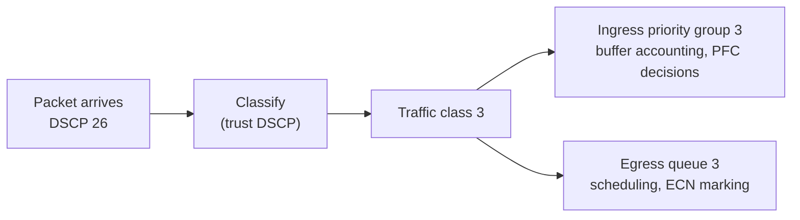

Ethernet drops packets when a queue overflows, and TCP copes: it notices, slows down and resends. RoCEv2, the RDMA transport between Meridian's 1,024 San Jose GPUs, copes badly. One lost packet makes the sender resend everything after it, and a lost last packet can stall a queue pair for a second, nearly three training steps. So AI back-end fabrics run part of Ethernet **lossless**: the switch must never drop that traffic, even under incast, when many senders hit one port at once ([why AI traffic is different](/learn/fabric-networking/ai-fabrics/why-ai-traffic-is-different)).

Two mechanisms do this together. **PFC** (priority flow control) is the emergency brake: a filling switch tells its upstream neighbour to stop sending one class of traffic, for microseconds, on one link. **ECN** (explicit congestion notification) **with DCQCN** (the congestion control RoCE NICs run) is the throttle: a congested switch marks packets instead of dropping them, the receiving NIC reports the marks, and the sender's NIC lowers its rate before the brake is needed. This lesson builds both on `rail1-leaf1.sjc`, a rail leaf of the San Jose back end.

## Why RoCE wants no drops: go-back-N recovery

A reminder from [RDMA from zero](/learn/fabric-networking/ai-fabrics/rdma-from-zero): an RDMA connection is a **queue pair** (QP), and the reliable-connected (RC) type that NCCL (NVIDIA's collective communication library) uses delivers in order. The transport runs in NIC hardware. Every packet carries a 24-bit **packet sequence number** (PSN) in its InfiniBand base transport header (BTH), and the receiving NIC accepts only the next PSN it expects on that QP.

Trace one loss. `srv1`'s rail-1 NIC writes 1 MB to `srv3`'s, which is 256 packets of 4,096 bytes with PSNs 7000 to 7255. At 400 Gb/s a 4,158-byte frame takes 0.083 µs to send, so in a round trip of about 5 µs (through the leaf and back, NIC processing at both ends and the fibre; it depends on queueing) the sender has about 60 packets in flight. The congested leaf drops PSN 7100.

1. `srv3` receives 7101 while expecting 7100. It sends one **NAK** (negative acknowledgement, "PSN sequence error, expected 7100") and counts `out_of_sequence`.
2. It **discards** 7101, 7102 and onwards, though intact: there is no reorder buffer.
3. About 5 µs later the NAK reaches `srv1`, which has sent up to about 7160 by then. It counts `packet_seq_err`, rewinds to 7100 and resends 7100 to 7160 before continuing.

One drop cost about 61 packets (250 KB) of resends plus a round trip; TCP with selective acknowledgements would resend one packet. If each loss wastes $W$ packets, goodput is about $1/(1 + pW)$ for loss rate $p$. With $W = 60$, that is 99.4% at $p = 10^{-4}$, 94% at $10^{-3}$ and 62% at $10^{-2}$. Selective repeat would hold 99% even at $10^{-2}$ ([reliable delivery](/learn/networking/network-algorithms/reliable-delivery-algorithms) traces Go-Back-N against Selective Repeat).

**The tail loss is worse.** If PSN 7255, the last packet, is dropped, no later packet arrives to expose the gap, so no NAK is sent. `srv1` waits for its ACK timeout, which ConnectX NICs compute as 4.096 µs × 2^exponent. NCCL sets the exponent with `NCCL_IB_TIMEOUT`; the default has been 18 to 20 depending on the version, which is about 1.1 s to 4.3 s. Suppose a training step moves 100,000 RDMA messages across the job (an assumption that depends on model size, NCCL's chunking and GPU count). At a loss rate of $10^{-5}$, the chance that some message loses its last packet is $1 - (1 - 10^{-5})^{100000} \approx 63\%$: two steps in three wait a second or more, against a step of about 370 ms.

Why not selective repeat? The NIC holds state for thousands of QPs; a reorder buffer per QP costs NIC memory, and go-back-N needs one counter. Early NICs restarted the whole message (go-back-0). Research such as IRN (Mittal and others, SIGCOMM 2018) showed modest NIC changes make RDMA tolerate loss, and newer NICs and the Ultra Ethernet transport ([InfiniBand and RoCE](/learn/fabric-networking/ai-fabrics/infiniband-and-roce)) add selective retransmission. Most RoCE fabrics running today still assume no drops, and this lesson does too.

- **Solves:** a cheap, fast reliable transport in hardware.
- **Breaks:** any drop costs a window of resends, and a tail drop costs a timeout.
- **Signal:** `out_of_sequence` on receivers, `packet_seq_err` and `local_ack_timeout_err` on senders, and job steps with a long tail.

## A RoCE packet's QoS fields

The switch protects only traffic it recognises. A **traffic class** (TC) is the switch's internal label, 0 to 7, for how a packet is treated; a **priority** is the same 0 to 7 number as PFC sees it; a **queue** is one of a port's eight egress queues. On Meridian all three line up (priority 3 is TC 3 is queue 3), by configuration choice, not by law.

The NIC marks each packet, and the switch **trusts** the marking: it maps the value to a traffic class instead of rewriting it. Two markings exist. **PCP** (priority code point) is a 3-bit field in the 802.1Q VLAN tag ([switches, VLANs and loops](/learn/fabric-networking/from-zero/switches-vlans-and-loops)). **DSCP** (differentiated services code point) is the top 6 bits of the IPv4 header's second byte. Meridian's back end is routed at every hop over untagged links, so there is no PCP to read; it trusts DSCP, which travels end to end.

One RDMA WRITE packet from `srv1`'s NIC (`10.200.1.1`) to `srv3`'s (`10.200.1.3`), as `rail1-leaf1.sjc` reads it:

| Field | Size | Value here | What reads it |
|---|---|---|---|
| IPv4 DSCP | 6 bits | 26 (AF31) | Every switch: DSCP 26 → priority 3, the lossless class |
| IPv4 ECN | 2 bits | `10`, ECT(0) | Every switch: "this sender reacts to marks"; a congested queue rewrites it to `11` |
| The whole byte (old "ToS") | 8 bits | `0x6A` = 106 = 26 × 4 + 2 | What you configure on hosts: `NCCL_IB_TC=106`, a NIC default ToS |
| UDP source port | 16 bits | one value per QP | The ECMP hash ([ECMP and hashing](/learn/fabric-networking/fabric-architecture/ecmp-and-hashing)) |
| UDP destination port | 16 bits | 4791 | Receiving NIC: "this is RoCEv2" |
| BTH opcode | 8 bits | `0x07`, RC RDMA WRITE Middle | Receiving NIC; a CNP is `0x81` |
| BTH destination QP | 24 bits | `0x00011c` | Receiving NIC; in a CNP it names the QP to slow down |
| BTH PSN | 24 bits | 7001 | Receiving NIC: the go-back-N check |
| ICRC | 4 bytes | CRC over the transport | Receiving NIC; it masks out TTL, DSCP, ECN and the checksums |

The last row explains a design choice. The ICRC (invariant CRC) is the transport's end-to-end check, and it skips exactly the fields switches may change. So a switch can mark ECN, or re-mark DSCP at a trust boundary, without corrupting the RDMA payload's integrity check.

There is no universal RoCE DSCP. 26 with priority 3 is NVIDIA's default, and DSCP 24 (CS3) is also common. Whatever the choice, every NIC and every switch must agree. Meridian's map, as `rail1-leaf1.sjc` applies it:

| DSCP | Priority, queue | Treatment | Scheduling |
|---|---|---|---|
| 26 | 3 | Lossless: PFC on, ECN marking on | Weighted round robin, about 50% under contention |
| 48 (CS6) | 6 | Lossy, for CNPs | Strict priority: always served first |
| anything else | 0 | Lossy: may be dropped | Weighted round robin, about 50% |



Every packet is charged twice: against the **ingress priority group** (PG), the port it arrived on plus its priority, where PFC decides because it must pause the port the bytes came from; and against the **egress queue** it waits in, where the scheduler and ECN act ([planes, ASICs and network operating systems](/learn/fabric-networking/from-zero/planes-asics-and-network-operating-systems) covers the shared buffer). Weighted round robin shares by weight only under contention: with queue 0 idle, queue 3 can use the whole link.

- **Solves:** the lossless treatment applies only to RoCE, so ordinary traffic stays lossy and cannot trigger pauses.
- **Breaks:** a host marking DSCP 24 into a fabric that maps 26 puts RoCE in lossy queue 0, where it can be dropped, with no error anywhere.
- **Signal:** per-priority byte counters. RoCE bytes counted on priority 0, or zero bytes on priority 3 during a job, mean the marking and the map disagree.

## PFC: pausing one priority on one link

The original Ethernet PAUSE (IEEE 802.3x, [links, frames and Ethernet](/learn/fabric-networking/from-zero/links-frames-and-ethernet)) stops a whole link. **Priority flow control** (IEEE 802.1Qbb) stops only the priorities you choose: lossless RoCE on priority 3 pauses while lossy priority 0 keeps flowing. The frame is a 64-byte, link-local MAC control frame that the neighbour consumes and never forwards.

| Field | Size | Value (pausing priority 3) | What reads it |
|---|---|---|---|
| Destination MAC | 6 bytes | `01:80:c2:00:00:01` | Reserved address; no switch forwards it |
| Source MAC | 6 bytes | the sending switch port | Nobody, in practice |
| EtherType | 2 bytes | `0x8808`, MAC control | The neighbour's MAC layer |
| Opcode | 2 bytes | `0x0101`, PFC (`0x0001` is plain PAUSE) | The neighbour's MAC layer |
| Class-enable vector | 2 bytes | `0x0008`: bit 3 only | Which priorities' timers below are valid |
| time[0] to time[7] | 8 × 2 bytes | time[3] = 65,535; others 0 | How long to pause each enabled priority |
| Padding, FCS | 26 + 4 bytes | zeros, CRC | Pads the frame to 64 bytes |

Time is counted in **quanta** of 512 bit times. At 400 Gb/s one quantum is 1.28 ns, so the maximum, 65,535, is 83.9 µs. At 100 Gb/s the same value is 335.5 µs. A switch does not wait for expiry: it sends a large value (XOFF), refreshes it while needed, and sends time 0, meaning resume (XON), when done.

Two thresholds on each ingress PG drive it: cross **XOFF** and the switch pauses that port; fall below **XON**, set lower to avoid flapping, and it resumes. Watch it on a 2:1 incast: `srv1` and `srv2` both write to `srv3` at 400 Gb/s through `rail1-leaf1.sjc`, with 50 m of fibre per host link and a small fixed XOFF of 100 KB. Real switches derive XOFF from the free shared buffer.

```viz
{"type": "fabric", "scenario": "pfc-pause", "title": "PFC on priority 3: XOFF at 100 KB, headroom catches 0.6 µs of bytes, XON at 80 KB, nothing dropped", "caption": "srv1 and srv2 both write to srv3 through rail1-leaf1.sjc at 400 Gb/s. Each sender's priority-3 share of the buffer (PG3) reaches XOFF at 4 µs. The PFC frame is decoded field by field, the bytes still in flight push PG3 to 115 KB inside the headroom, XON goes out at 6 µs, and the cycle repeats every 4 µs with each sender averaging 200 Gb/s. Watch the PG3 chart and the buffer table."}
```

The same run as a table. The egress queue holds both senders' bytes; each PG holds one sender's half.

| Time | Event | Each PG3 | Egress queue to `srv3` |
|---|---|---|---|
| 0 µs | Both send at 400 Gb/s into one 400 Gb/s port | 0 | grows 50 KB per µs |
| 2 µs | | 50 KB | 100 KB |
| 4.0 µs | PG3 reaches XOFF; PAUSE (time[3] = 65,535) to `srv1` and `srv2` | 100 KB | 200 KB |
| 4.6 µs | Bytes in flight have landed; senders silent | 115 KB (peak) | 230 KB |
| 6.0 µs | PG3 drains to XON; resume (time[3] = 0) | 80 KB | 160 KB |
| 6.6 µs | Senders' bytes arrive again | 65 KB (trough) | 130 KB |
| 8.0 µs | XOFF again: the cycle is 4 µs | 100 KB | 200 KB |

Each NIC transmits half the time and averages 200 Gb/s, `srv3`'s port never idles, and nothing is dropped. On ConnectX NICs the pauses show up as rising `rx_prio3_pause` and `rx_prio3_pause_duration`. The NIC's MAC consumes the frame in hardware, so it never appears in a host capture: counters are the only evidence.

Three properties decide everything that goes wrong with PFC:

- **It is per priority, not per flow.** While `srv1` is paused it cannot send priority-3 traffic to anyone, including an idle receiver on another leaf.
- **It is hop by hop.** It relieves one link. A switch whose own buffer fills from being paused pauses its upstream neighbours in turn, which is congestion spreading ([when lossless goes wrong](/learn/fabric-networking/ai-fabrics/when-lossless-goes-wrong) covers that, plus storms, deadlock and the watchdog).
- **Both ends must agree.** DCBX (Data Center Bridging Exchange, an extension of LLDP, the link-layer discovery protocol) lets neighbours advertise which priorities have PFC on. It carries configuration only and makes nothing lossless.

In the three lines used throughout:

- **Solves:** no drops on one class under any burst, decided within a microsecond on the congested link.
- **Breaks:** victim flows and spreading, and an end without PFC on that priority ignores the PAUSE, so its traffic is dropped.
- **Signal:** PFC frames sent (`tx_prio3_pause`) and received per port and priority, and above all pause *duration*, the fraction of time a port spends paused.

## Headroom: the bytes already on their way

When PG3 crosses XOFF at 4.0 µs, `srv1` does not stop at once. The PAUSE travels up 50 m of fibre (5 ns per metre: 0.25 µs), the bytes already on the fibre keep arriving (0.25 µs), the NIC takes about 0.1 µs to react, and each end may be mid-frame. **Headroom** is buffer reserved above XOFF, per lossless PG, to absorb all of that:

$$\text{headroom} \approx \text{rate} \times (2 \times \text{cable delay} + \text{reaction time}) + 2 \times \text{MTU}$$

For the viz link: 50,000 bytes per µs × 0.6 µs = 30 KB, plus two 9,216-byte frames, gives 48.4 KB. The viz reserves 50 KB and the peak reached 115 KB of the 150 KB that XOFF plus headroom allows.

```python
NS_PER_M = 5.0          # light in fibre: about 5 ns per metre (2/3 of c)


def headroom_bytes(cable_m, gbps, mtu=9216, react_us=0.1):
    """Bytes that still arrive on one priority after the switch decides to pause."""
    bytes_per_us = gbps * 1e9 / 8 / 1e6
    one_way_us = cable_m * NS_PER_M / 1000
    # PAUSE travels up the cable, bytes already on the cable keep coming,
    # and the sender's NIC takes react_us to stop its queue.
    in_flight = bytes_per_us * (2 * one_way_us + react_us)
    # Plus one frame the switch was already sending when it decided (the PAUSE
    # waits behind it) and one the NIC had started (it cannot stop mid-frame).
    return in_flight + 2 * mtu


def fmt(b):
    for unit, size in (("GB", 1e9), ("MB", 1e6), ("KB", 1e3)):
        if b >= size:
            return f"{b / size:,.1f} {unit}"
    return f"{b:,.0f} B"


links = [("3 m copper (DAC), in-rack", 3, 400), ("50 m fibre, in-row", 50, 400),
         ("100 m fibre (a common default)", 100, 400), ("100 m fibre at 800G", 100, 800),
         ("2 km, another building", 2_000, 400), ("10,500 km, ams to sin", 10_500_000, 400)]
for name, metres, gbps in links:
    print(f"{name:32} {gbps}G  headroom per port per priority: {fmt(headroom_bytes(metres, gbps))}")

ports, buffer = 64, 64e6
per_priority = ports * headroom_bytes(100, 400)
print(f"\n64 ports x 100 m at 400G: {fmt(per_priority)} of a {fmt(buffer)} buffer "
      f"per lossless priority ({per_priority / buffer:.0%}); "
      f"eight lossless priorities would need {8 * per_priority / buffer:.0%}")
```

```text
3 m copper (DAC), in-rack        400G  headroom per port per priority: 24.9 KB
50 m fibre, in-row               400G  headroom per port per priority: 48.4 KB
100 m fibre (a common default)   400G  headroom per port per priority: 73.4 KB
100 m fibre at 800G              800G  headroom per port per priority: 128.4 KB
2 km, another building           400G  headroom per port per priority: 1.0 MB
10,500 km, ams to sin            400G  headroom per port per priority: 5.3 GB

64 ports x 100 m at 400G: 4.7 MB of a 64.0 MB buffer per lossless priority (7%); eight lossless priorities would need 59%
```

Three design rules follow:

- **Fabrics run one or two lossless priorities, never eight.** Each reserves headroom on every port, used or not, out of the buffer that absorbs everyone's bursts. The 64 MB is illustrative (current switch chips carry tens to a little over 100 MB), and the in-flight part of headroom doubles with each speed generation.
- **Lossless stops at the building.** At 2 km one port needs a megabyte; between Meridian's sites, 5 GB, more than any switch has. AI back ends stay in one data hall and long-haul circuits stay lossy.
- **The cable length must be right.** NOSes compute headroom from a configured cable length, and the shipped default is a guess (100 m is a common one). A 200 m run left at a 100 m default has too little headroom, and the "lossless" class drops under exactly the burst it was built for.

## ECN marking thresholds: WRED that marks instead of dropping

PFC fires only when a buffer is nearly full, and hits whole priorities; better that senders slow while the queue is short. **ECN** (explicit congestion notification, RFC 3168) lets switches say so without dropping anything. Its two bits in the IP header have four codepoints:

| ECN bits | Name | Meaning |
|---|---|---|
| `00` | Not-ECT | Sender does not understand ECN: a congested switch may not mark it, so it drops it early or leaves it queued |
| `10` | ECT(0) | ECN-capable transport; RoCE NICs send this |
| `01` | ECT(1) | Also ECN-capable; now used by L4S (RFC 9331) |
| `11` | CE | Congestion experienced: set by a switch, never by a sender |

The switch decides *when* to mark with the curve that RED (random early detection) and its weighted variant WRED use for early dropping, with "mark" in place of "drop". Each egress queue has three numbers:

- below **Kmin**, never mark;
- between Kmin and Kmax, mark with probability rising linearly from 0 to **Pmax**;
- above **Kmax**, mark every packet.

$$P(q) = P_{max} \cdot \frac{q - K_{min}}{K_{max} - K_{min}} \quad \text{for } K_{min} < q < K_{max}$$

Data center switches compare against the *instantaneous* queue depth (a WRED weight of 0), not the smoothed average that internet routers use, because a microsecond burst is the event that matters. Many ASICs mark as a packet joins the queue, so the mark still waits behind everything ahead of it (marking on dequeue avoids that wait). That delay is part of the control loop.

The DCQCN paper (Zhu and others, SIGCOMM 2015) used Kmin 5 KB, Kmax 200 KB and Pmax 1% on 40 Gb/s links. With those values a 100 KB queue marks $1\% \times 95/195 \approx 0.49\%$ of packets, and a 250 KB queue marks all of them. Production values are larger and set per platform and link speed: NOS RoCE profiles ship a Kmin in the low hundreds of kilobytes and a Kmax around a megabyte or more (Cumulus Linux's, for example, about 150 KB and 1.5 MB).

The thresholds form a ladder, and the order is the design:

| Rung | Typical position | What happens there |
|---|---|---|
| ECN Kmin | lowest | DCQCN starts slowing senders, gently |
| ECN Kmax | above Kmin | every packet marked: strongest feedback |
| PFC XOFF | above the ECN band, on the ingress PG | the brake: pause the upstream port |
| XOFF + headroom | top of the lossless allocation | in-flight bytes absorbed |
| Drop | only if headroom was miscalculated | the failure the whole design exists to avoid |

The rungs count different things: Kmin and Kmax watch an egress queue, XOFF watches each ingress PG feeding it. In an $N$-to-1 incast a queue of depth $Q$ is spread over $N$ PGs of about $Q/N$ each, so the queue enters the marking band long before one PG reaches XOFF. If Kmin sits above the point where XOFF fires, PFC fires first, every time: the fabric works by pausing, which leads to spreading and head-of-line blocking.

- **Solves:** an early, per-packet congestion signal with no loss.
- **Breaks:** thresholds too low under-use links, because senders slow for queues that would have drained by themselves. Too high, and queues grow deep and PFC does the work. RoCE sent Not-ECT is never marked, so DCQCN never slows it; depending on the platform's WRED profile it is dropped early or left to PFC.
- **Signal:** ECN-marked packets per egress queue, read beside queue depth. Marks of zero during congestion mean ECN is not in effect for that class.

## CNPs: the receiver tells the sender

The marked packet travels away from the sender, so something must carry the mark back. In TCP the receiver echoes it in the ECE flag of its ACKs ([congestion control](/learn/networking/fundamentals/congestion-control)). RoCE has no per-packet ACK stream to piggyback on: the responder coalesces its acknowledgements, and unreliable datagram (UD) traffic gets none. So the receiving NIC sends a dedicated **congestion notification packet** (CNP).

| Field | Value in `srv3`'s CNP to `srv1` | Why |
|---|---|---|
| IPv4 source, destination | `10.200.1.3` → `10.200.1.1` | Back to the sender of the marked packet |
| DSCP | 48 → priority 6, strict | It must overtake the congested data, not queue behind it |
| UDP destination port | 4791 | It is RoCEv2 like any other packet; the port alone does not identify a CNP |
| BTH opcode | `0x81` (CNP) | This is what identifies it |
| BTH destination QP | `srv1`'s QP | The rate limiter that should slow down |
| BTH PSN | 0 | CNPs are not sequenced or acknowledged |
| Payload | 16 reserved bytes of zeros | Nothing else to say |

Three design decisions are packed into that table.

**The receiver sends it, not the switch.** IEEE's earlier QCN (802.1Qau) had switches send feedback at layer 2, which cannot cross a router, and a switch does not know QPs. In DCQCN the switch only flips two bits, which every IP router can do, and the NIC, which knows the QP, does the rest. The cost is feedback delay: half a round trip plus the marked packet's queueing time.

**CNPs are rate limited.** A receiver seeing a stream of marked packets sends at most one CNP per QP per interval (50 µs in the DCQCN paper; a NIC tunable). Feedback is a binary "you are congested" event, not a count of marks.

**CNPs travel in a strict-priority, lossy queue.** Behind the queue it reports, a CNP would arrive too late; and a lost CNP costs one late signal, while paused CNPs could stall the loop.

- **Solves:** feedback that names the right sender's QP across a routed fabric.
- **Breaks:** CNPs mapped to a congested or lossy-and-full queue arrive late or not at all, so senders cut late and queues run deep.
- **Signal:** `np_cnp_sent` at the receiver against `rp_cnp_handled` at the sender. If the network loses CNPs, the sent count exceeds the handled count.

## DCQCN: rate reduction and recovery, traced

**DCQCN** (Data Center Quantized Congestion Notification) is the congestion control RoCE NICs run per QP. It names three roles: the switch is the **congestion point** that marks, the receiving NIC is the **notification point** that sends CNPs, and the sending NIC is the **reaction point** that sets its own rate with a hardware rate limiter. It is rate-based, and a new QP starts at line rate: there is no slow start.

The reaction point keeps three numbers: the current rate $R_C$, a target rate $R_T$ it will recover towards, and $\alpha$, its estimate of how congested the path is, starting at 1.

**On a CNP**, cut:

$$R_T \leftarrow R_C, \qquad R_C \leftarrow R_C\,(1 - \alpha/2), \qquad \alpha \leftarrow (1-g)\,\alpha + g$$

With $\alpha = 1$ the cut halves the rate, and the update keeps $\alpha$ at 1. Repeated CNPs mean repeated halving.

**Every $K$ µs without a CNP**, decay $\alpha \leftarrow (1-g)\,\alpha$. With the paper's $g = 1/256$, $\alpha$ falls only slowly: after 10 ms of quiet it is about 0.49, so the next cut takes 25% off instead of 50%.

**Increase events** come from a timer (every $T$ µs) or a byte counter (every $B$ bytes sent), both reset by a CNP. The first $F$ events are **fast recovery**, $R_C \leftarrow (R_T + R_C)/2$, closing half the gap to the pre-cut rate each time. Then comes **additive increase**: raise $R_T$ by $R_{AI}$ and move halfway to it. A third phase, hyper increase with a larger step, applies once both the timer and the byte counter have passed $F$.

Now the same 2:1 incast on `rail1-leaf1.sjc`, controlled by DCQCN with the paper's parameters on 400 Gb/s links: Kmin 5 KB, Kmax 200 KB, Pmax 1%, one CNP per QP per 50 µs, $g = 1/256$, $K = T = 55$ µs, $B$ = 10 MB, $F = 5$ and $R_{AI}$ = 40 Mb/s.

```viz
{"type": "fabric", "scenario": "ecn-dcqcn", "title": "DCQCN on a 2:1 incast: marks above Kmax, CNPs, two rate halvings, then fast recovery", "caption": "srv2 joins srv1 at 20 µs. The queue to srv3 passes Kmax at 24 µs, the first CE-marked packet reaches srv3 at 28 µs, both senders cut to 200 Gb/s at 29 µs and to 100 Gb/s at 79 µs, and the queue empties at 97 µs. Five fast-recovery steps climb 150, 175, 187.5, 193.75 and 196.875 Gb/s, then additive increase reaches 198.46 Gb/s at 409 µs. Watch the rate chart and the reaction-point table."}
```

| Time | What happens | Each sender's $R_C$ | Queue to `srv3` |
|---|---|---|---|
| 0–20 µs | `srv1` alone at 400 Gb/s; ECN field `10` | 400 | 0 |
| 20 µs | `srv2` joins at line rate: 800 offered to a 400 port | 400 | +50 KB per µs |
| 20.1 µs | Queue passes Kmin; at most 1% marked, and each flow sends about 47 packets before Kmax: under one mark expected, none in this run | 400 | 5 KB |
| 24 µs | Queue passes Kmax: every packet marked CE as it joins | 400 | 200 KB |
| 28 µs | The first marked packet, 4 µs behind 200 KB, reaches `srv3`; CNPs to both QPs | 400 | 400 KB |
| 29 µs | CNPs arrive: cut 1, $R_T = 400$, $R_C = 400 \times (1 - 1/2)$ | 200 | 450 KB, flat |
| 29–78 µs | 400 in, 400 out: a standing queue adding 9 µs to every packet, all marked; `srv3` may not send another CNP yet | 200 | 450 KB |
| 78–79 µs | 50 µs have passed: CNPs again; cut 2, $R_T = 200$ | 100 | 450 KB, now −25 KB per µs |
| 97 µs | Queue empty; the last marks arrived before the next CNP was allowed | 100 | 0 |
| 134 µs | 55 µs without a CNP: fast recovery 1, (200 + 100) / 2 | 150 | 0 |
| 189, 244, 299, 354 µs | Fast recovery 2 to 5 | 175, 187.5, 193.75, 196.875 | 0 |
| 409 µs | Additive increase: $R_T$ = 200.04, $R_C$ = (200.04 + 196.875) / 2 | 198.46 | 0 |

The first cut fixed the *rate* but not the *queue*: the 450 KB built during the 9 µs of feedback delay stayed. The second cut drained it and overshot, leaving `srv3`'s port half idle from 79 µs and back to 98% only at 354 µs: cut hard, climb slowly is DCQCN's characteristic sawtooth. The byte counter barely mattered (6.9 MB sent since the cut, short of 10 MB), so at these speeds the timer drives recovery. From 409 µs the senders creep up until their total passes 400 Gb/s, a mark produces a CNP, and the cycle repeats with the queue mostly near empty.

No PAUSE was sent: each sender's 225 KB share stays below the XOFF that a switch with tens of megabytes free computes (the PFC example's fixed 100 KB would have fired). ECN acted; PFC stayed in reserve.

### The loop in code

This simulation reproduces the trace in 0.1 µs steps. The senders are symmetric, so one reaction point stands for both; a FIFO delivers each packet after its queueing delay; CNPs are limited to one per 50 µs and take 1 µs to arrive.

```python
from collections import deque

LINE = 400.0                      # Gb/s, every NIC and link
BPU = LINE * 1e9 / 8 / 1e6        # 50,000 bytes per microsecond at 400 Gb/s
FRAME = 4158                      # bytes in one RoCEv2 frame with 4 KB of payload
DT = 0.1                          # simulation step, microseconds
KMIN, KMAX, PMAX = 5_000, 200_000, 0.01        # switch marking (bytes, bytes, prob)
CNP_GAP, FEEDBACK = 50.0, 1.0                   # NP: one CNP per QP per 50 us; CNP trip
G, TIMER, F, R_AI = 1 / 256, 55.0, 5, 0.04      # RP: alpha gain, timers, steps, Gb/s


def mark_probability(q):
    if q <= KMIN:
        return 0.0
    if q >= KMAX:
        return 1.0
    return PMAX * (q - KMIN) / (KMAX - KMIN)     # the WRED ramp


class ReactionPoint:                             # the DCQCN state in a sender NIC
    def __init__(self):
        self.rc = self.rt = LINE                 # current and target rate
        self.alpha, self.steps, self.next_timer = 1.0, 0, None

    def on_cnp(self, t):
        self.rt = self.rc                        # remember where we were
        self.rc *= 1 - self.alpha / 2            # cut by alpha/2
        self.alpha = (1 - G) * self.alpha + G    # congestion is ongoing: alpha up
        self.steps, self.next_timer = 0, t + TIMER

    def on_timer(self, t):
        self.alpha *= 1 - G                      # no CNP for a while: alpha decays
        self.steps += 1
        if self.steps > F:                       # fast recovery done: probe upward
            self.rt += R_AI
        self.rc = (self.rt + self.rc) / 2        # move halfway back to the target
        self.next_timer = t + TIMER


def run(end_us=420.0, second_sender_at=20.0):
    rp = ReactionPoint()          # srv1 and srv2 are symmetric: one state, two senders
    q, credit, in_flight = 0.0, 0.0, deque()     # queue bytes, mark credit, FIFO
    last_cnp, cnp_due, log = -1e9, None, []
    for i in range(round(end_us / DT) + 1):
        t = i * DT
        if cnp_due is not None and t >= cnp_due - 1e-9:      # 1. sender reacts
            rp.on_cnp(t)
            cnp_due = None
            log.append((t, f"cut: Rc {rp.rc:g}, Rt {rp.rt:g}, alpha {rp.alpha:.4f}", q))
        elif rp.next_timer is not None and t >= rp.next_timer - 1e-9:
            rp.on_timer(t)
            log.append((t, f"timer {rp.steps}: Rc {rp.rc:g}, Rt {rp.rt:g}", q))
        senders = 2 if t >= second_sender_at else 1
        arriving = senders * rp.rc * 1e9 / 8 / 1e6 * DT     # 2. switch enqueues
        p = mark_probability(q)                  # marked at enqueue, by queue depth
        credit += p * arriving / FRAME           # expected marks, made deterministic
        marked = p >= 1 or credit >= 1
        credit -= int(credit)
        in_flight.append((t + q / BPU, marked))  # it reaches srv3 after the queue
        was_busy = q > 0
        q = max(0.0, q + arriving - BPU * DT)
        if was_busy and q == 0:
            log.append((t + DT, "queue empty", q))
        seen_mark = False                        # 3. receiver NIC checks arrivals
        while in_flight and in_flight[0][0] <= t + 1e-9:
            seen_mark |= in_flight.popleft()[1]
        if seen_mark and t - last_cnp >= CNP_GAP - 1e-9:
            last_cnp, cnp_due = t, t + FEEDBACK  # one CNP to each sender's QP
            log.append((t, "CNPs sent by srv3", q))
    return log


for t, what, q in run():
    print(f"t = {t:5.1f} us  queue {q / 1000:5.1f} KB  {what}")
```

```text
t =  28.0 us  queue 405.0 KB  CNPs sent by srv3
t =  29.0 us  queue 450.0 KB  cut: Rc 200, Rt 400, alpha 1.0000
t =  78.0 us  queue 450.0 KB  CNPs sent by srv3
t =  79.0 us  queue 450.0 KB  cut: Rc 100, Rt 200, alpha 1.0000
t =  97.0 us  queue   0.0 KB  queue empty
t = 134.0 us  queue   0.0 KB  timer 1: Rc 150, Rt 200
t = 189.0 us  queue   0.0 KB  timer 2: Rc 175, Rt 200
t = 244.0 us  queue   0.0 KB  timer 3: Rc 187.5, Rt 200
t = 299.0 us  queue   0.0 KB  timer 4: Rc 193.75, Rt 200
t = 354.0 us  queue   0.0 KB  timer 5: Rc 196.875, Rt 200
t = 409.0 us  queue   0.0 KB  timer 6: Rc 198.457, Rt 200.04
```

The non-obvious lines: `in_flight.append((t + q / BPU, marked))` is marking at enqueue, seen only after the queue ahead drains, which is why the first CNP goes out at 28 µs, not 24. The `credit` accumulator turns the 1% ramp into its expected number of marks so the run is deterministic; a real switch draws a random number. In `on_timer`, fast recovery and additive increase differ only in whether `rt` moved first. Try `KMAX = 100_000`: a 250 KB standing queue instead of 450. Try `CNP_GAP = 10.0`: the second cut lands at 39 µs, but the queue still holds packets marked earlier, so a third CNP cuts both senders to 50 Gb/s at 49 µs. Faster feedback over-corrects unless the marking is tuned with it.

## PFC, ECN and the alternatives

| Approach | Drops on the RDMA class | Reaction | Side effects | Distance | Operational burden |
|---|---|---|---|---|---|
| PFC only | None if headroom is right | Sub-µs, per link | Pauses whole priorities: victim flows, spreading, deadlock risk | One building | Headroom per port and cable |
| ECN + DCQCN only ("lossy RoCE") | Some, under bursts faster than the loop | One round trip plus queueing, per QP | Each drop costs go-back-N; needs NICs that retransmit fast | Any | Thresholds and NIC tunables |
| **PFC + ECN + DCQCN** (the common RoCE design) | None | ECN first, PFC as backstop | PFC still possible under incast | One building | Both sets, kept in the ladder order |
| InfiniBand credits ([InfiniBand and RoCE](/learn/fabric-networking/ai-fabrics/infiniband-and-roce)) | None, by construction | Credits per virtual lane | Congestion still spreads; separate fabric and tooling | Credit loop limits link length | Subnet manager, single vendor |
| Loss-tolerant transports (selective retransmit plus spraying: Ultra Ethernet, AWS's SRD) | Tolerated | Per packet | Need new NICs; reordering handled at the receiver | Any | Newer, less field history |

PFC answers "is this buffer about to overflow?" for one link, now; ECN answers "is this flow too fast?" end to end, within a round trip. DCQCN is too slow for an incast's first microseconds, and PFC alone handles sustained congestion by pausing everyone, so each needs the other.

## Under the hood: where each piece lives

- **In the switch ASIC.** Buffer accounting keeps per-ingress-PG and per-egress-queue byte counters over one shared memory, with **dynamic thresholds**: a PG's XOFF is a fraction (often called alpha) of the currently free buffer, so XOFF falls as the whole switch fills. Marking is checked against the queue's WRED profile, at enqueue on many ASICs. The MAC, not the CPU, generates and consumes PFC frames, which is why they act within a microsecond.
- **In the NIC.** DCQCN runs in NIC hardware and firmware, with a rate limiter per QP (or per flow group, depending on the NIC; do not assume perfect per-QP isolation). ConnectX exposes the reaction-point and notification-point parameters under `/sys/class/net/<interface>/ecn/roce_rp` and `roce_np`, including the CNP's DSCP and priority.
- **Across an overlay.** Where RoCE crosses a VXLAN fabric, the ingress VTEP copies ECN to the outer header. The spines mark the outer header, and the egress VTEP must copy CE back to the inner header at decapsulation (RFC 6040; [VXLAN encapsulation](/learn/fabric-networking/overlays-vxlan-evpn/vxlan-encapsulation)). A platform that skips it hides every underlay mark from the receiving NIC, so no CNPs follow. Meridian's back end is plain routed IP, so this matters only where RoCE crosses an overlay.

A healthy, busy incast, as illustrative output trimmed from `ethtool -S` and the RDMA hardware counters on the hosts, and from two ports of `rail1-leaf1.sjc`:

```text
srv3 (notification point)                srv1 (reaction point)
  rx_prio3_bytes          9,412,880,112    tx_prio3_pause            0
  np_ecn_marked_roce_packets     18,204    rx_prio3_pause          212
  np_cnp_sent                     1,910    rx_prio3_pause_duration 148   (us)
  out_of_sequence                     0    rp_cnp_handled          956
                                           packet_seq_err            0
                                           local_ack_timeout_err     0
                                         srv2 (reaction point)
                                           rp_cnp_handled          952

rail1-leaf1.sjc swp3 (egress to srv3)    rail1-leaf1.sjc swp1 (ingress from srv1)
  queue 3 ecn_marked             18,240    pg3 tx_pause (to srv1)  212
  queue 3 watermark              612 KB    pg3 no_buffer_discards    0
```

Marks on the queue to `srv3` roughly equal marks `srv3` saw, about ten per CNP because of the rate limit. The 1,910 CNPs sent roughly equal the 956 + 952 handled by the two senders. PAUSE frames leave on the *sender's* port (`swp1`), matching `srv1`'s `rx_prio3_pause`, and are rare and short; sequence errors and discards are zero. Every later diagnosis compares against this picture.

## Failure modes in production

**DSCP and the switch map disagree.** *Symptom:* a new cluster's jobs run at a fraction of expected bus bandwidth, with long-tailed steps. *Diagnosis:* RoCE bytes on priority 0 and none on priority 3; queue 0 discards; `out_of_sequence` and `packet_seq_err` climbing; `rx_prio3_pause` at zero. A host image set the traffic class to 96 (DSCP 24) while the fabric maps 26. *Fix:* one marking in the source of truth, rendered to the NIC settings (`NCCL_IB_TC`, the NIC default) and the switch maps, plus a test flow that confirms bytes land on priority 3.

**ECN is not engaging, so PFC does all the work.** *Symptom:* pause counters climb steadily during every job, step time jitters, and later a pause storm spreads across the fabric. *Diagnosis:* zero ECN marks on the switch, zero `np_ecn_marked_roce_packets` and `rp_cnp_handled` on hosts, while watermarks show queues filling. The usual causes are ECN not enabled on traffic class 3, a Kmin set above where XOFF fires, or NICs sending Not-ECT. A variant has switch marks but zero `np_ecn_marked_roce_packets`: a VXLAN hop is not copying CE back to the inner header. *Fix:* enable marking on the lossless class and move Kmin below XOFF; a common tuning step lowers Kmin by 20–30% at a time while pause duration keeps rising.

**Headroom too small for the link.** *Symptom:* drops on the "lossless" class, only on some ports and only under bursts. *Diagnosis:* PG3 ingress discards on ports that sent PAUSE frames moments before; they turn out to be the longest runs, or links upgraded from 400G to 800G without recomputing. *Fix:* set each port's real cable length from the cabling database and recompute (100 m at 800G needs 75% more than at 400G).

**CNPs are not prioritised.** *Symptom:* deeper queues and more PFC than the marking rate suggests, worst under heavy incast. *Diagnosis:* `np_cnp_sent` at receivers exceeds `rp_cnp_handled` at senders (CNPs lost), or packet captures on a mirror port show CNPs in queue 0 behind data. DSCP 48 was never mapped to the strict queue, or the NICs send CNPs with a different DSCP than the switch expects. *Fix:* map the CNP DSCP to a strict-priority, lossy queue on every hop, and check the NIC's CNP DSCP matches.

## What the platform should show

The network team's dashboards and the AI team's job metrics see the same loop from two ends; the platform joins them.

- **Both halves of the loop side by side.** ECN marks per egress queue next to `np_ecn_marked_roce_packets` and `np_cnp_sent` on the receivers behind it and `rp_cnp_handled` on the senders. Marks with no CNPs, or CNPs sent and not handled, localise the break.
- **Pause duration, beside pause counts.** Per port and priority, sent and received, as the fraction of time paused. One pause per microsecond burst is healthy; 30% of a second paused is a fabric problem.
- **The threshold ladder as a configuration check.** For every switch, read Kmin, Kmax, XOFF behaviour, headroom and the configured cable length. Flag Kmin above XOFF, headroom below the formula for the real cable length, and a DSCP map that differs from the NIC marking in the source of truth.
- **Buffer watermarks per PG and queue.** Microsecond events vanish in 30-second averages; peak since last read survives.
- **Transport health from the hosts.** `out_of_sequence`, `packet_seq_err` and `local_ack_timeout_err` per NIC. Zero switch discards beside NIC timeouts means a lossless-class leak, often a wrong map.
- **Job correlation.** Overlay all of the above on NCCL bus bandwidth and step time per job, so "the AI team sees latency we don't" becomes a chart that shows which half saw it ([telemetry and observability](/learn/fabric-networking/operating-fabrics/telemetry-and-observability), [tuning and benchmarking RDMA](/learn/fabric-networking/ai-fabrics/tuning-and-benchmarking-rdma)).

## Interviewer follow-ups

**"PFC already prevents loss. Why does a RoCE fabric need ECN too?"** Model answer: PFC is a hop-by-hop pause of a whole priority. It never tells the flow causing congestion to slow down, pauses innocent flows, and can spread into storms or deadlock. ECN with DCQCN slows the specific QPs causing congestion, end to end, before the queue reaches XOFF, so PFC becomes a rare backstop. Common wrong answer: "ECN is for TCP; RoCE uses PFC."

**"Where do you set ECN thresholds relative to PFC, and what happens if you get it wrong?"** Model answer: Kmin below XOFF, so marking starts first, with Kmax and Pmax chosen so that feedback is strong before the PG fills. Too low wastes bandwidth on transient queues. Too high, or above XOFF, means PFC handles every burst. Exact values depend on the ASIC's buffer and the link speed. I would defer to the network team on the numbers, but I would build the check that reads them from every device and flags any switch where the order is wrong. Common wrong answer: a single number with no mention of the ordering.

**"Switches show zero drops, but a training job is slow. What do you look at?"** Model answer: scope first, one job or all, one rail or all. Then the host half: `out_of_sequence`, `packet_seq_err` and `local_ack_timeout_err` for loss the switches did not count (traffic in the wrong class, say), plus CNP rates and pause duration on the NICs. Then pause duration and watermarks on the job's switch ports: zero drops with heavy pausing is still a slow fabric. Common wrong answer: "no drops, so it's not the network."

## What mid-level engineers get wrong

- **Thinking PFC is per flow, or aimed at the receiver.** It pauses one priority on one link, upstream towards the ports the bytes came from, for everyone using it.
- **Enabling PFC on many priorities "to be safe".** Each one reserves headroom on every port and gives up burst buffer for everyone else.
- **Calling a fabric with no drops healthy.** Long pauses and standing queues slow jobs without dropping a packet.
- **Treating the DSCP value as cosmetic.** It is the only thing that puts RoCE in the lossless class. A mismatch silently makes RoCE lossy.

## Senior signals

- You explain lossless Ethernet as a ladder: ECN marks first, DCQCN slows the QP, PFC pauses as a backstop, headroom absorbs the in-flight bytes, and a drop means the ladder was misbuilt.
- You quantify headroom (rate × (2 × cable delay + reaction) + two MTUs), and you know why it caps lossless priorities at one or two and confines lossless to a building.
- You trace go-back-N with PSNs, and you name the tail-loss timeout as the real cost, beyond the resent window.
- You describe DCQCN by its three roles and its state ($R_C$, $R_T$, $\alpha$), and you can say why the first cut fixes the rate but not the queue.
- You localise with both halves: switch marks against NIC CNPs, CNPs sent against handled, pause duration against step time.

## Check yourself

```quiz
- q: >-
    rail1-leaf1.sjc's priority-3 buffer for traffic arriving from srv1 crosses XOFF because srv1 and srv2 are both sending to srv3. Where does the PFC PAUSE frame go, and what does it stop?
  options: ["To srv1, stopping only its queue pair that sends to srv3", "To srv1, stopping all of its priority-3 traffic to any receiver", "To every port on the switch, stopping all priorities briefly", "To srv3, telling it to stop accepting priority-3 traffic"]
  answer: 1
  explanation: >-
    PFC acts on the ingress priority group, so the PAUSE goes upstream out of the port the bytes arrived on, to srv1. It names a priority, not a flow or destination, so srv1 cannot send any priority-3 traffic to anyone while paused, even to an idle receiver. Stopping only the QP that sends to srv3 is what DCQCN's per-QP rate control does, end to end. PFC never pauses the receiver, and it leaves other priorities on the same link flowing.
- q: >-
    A 400 Gb/s lossless port's headroom was computed for the NOS's default 100 m cable, but the actual run is 300 m. What happens under a heavy burst?
  options: ["Some priority-3 packets are dropped after the PAUSE is sent", "Nothing; headroom only matters for links of several kilometres", "PFC fires earlier, because XOFF scales with the cable length", "The NIC detects the length and lengthens its PAUSE timer"]
  answer: 0
  explanation: >-
    Headroom must absorb the bytes still arriving after the decision to pause: the PAUSE's trip up the cable, the bytes already on it, the NIC's reaction and frames in progress. 200 m of extra fibre adds 2 µs of round trip, about 100 KB at 400 Gb/s, that the reservation does not cover, so the lossless class overflows exactly when it is needed. XOFF does not move with the cable, and nothing adapts on its own.
- q: >-
    In the DCQCN trace, both senders cut to 200 Gb/s at 29 µs, so together they send exactly the 400 Gb/s the port drains. Why does the queue stay at 450 KB until the second cut?
  options: ["The first cut balanced the rates but did not remove the backlog", "PFC is holding the queue full until it sends an XON frame", "The switch keeps marked packets queued until their CNPs return", "The receiver NIC stopped draining while it generated the CNPs"]
  answer: 0
  explanation: >-
    The 450 KB built up during the feedback delay: the marked packet waited 4 µs in the queue, then the CNP took another microsecond. With input equal to output a queue neither grows nor shrinks, so only a second cut below the drain rate, allowed once the 50 µs CNP interval passed, could empty it. No PAUSE was sent in this run, and marking never holds packets back.
- q: >-
    A RoCE cluster's switches report zero ECN-marked packets during jobs, while PFC pause counters on the same ports rise steadily. Which explanation fits?
  options: ["Pauses are expected to rise before the first ECN mark is ever set", "ECN is working, and marks are only counted on the receiving NIC", "The CNP queue is strict priority, so it hides the ECN marks", "ECN Kmin is above the dynamic PFC XOFF, or ECN is off for the class"]
  answer: 3
  explanation: >-
    In a correct design ECN marking starts below PFC XOFF, so marks appear before pauses. Rising pauses with zero switch marks means marking never engages: thresholds above XOFF, ECN disabled on the lossless traffic class, or traffic sent Not-ECT. Switches count their own marks, and the CNP queue's scheduling has nothing to do with whether data packets are marked.
- q: >-
    Why does RoCEv2 carry its congestion signal back to the sender in a separate CNP rather than in the ACKs, as TCP does with ECE?
  options: ["RoCE has no per-packet ACK stream to piggyback, so the NIC sends a CNP", "CNPs are encrypted, and RoCE ACKs cannot carry protected fields", "A CNP is lossless on priority 3, so it is guaranteed to arrive", "Switches drop ACKs carrying ECN bits on the lossless priority"]
  answer: 0
  explanation: >-
    RC acknowledgements are coalesced and generated by the transport, not one per data packet, so there is no steady reverse stream to piggyback on; the receiving NIC generates a dedicated, rate-limited CNP naming the sender's QP. CNPs go in a strict-priority lossy queue, not the lossless class, so arrival is not guaranteed, only fast. Nothing in RoCE is encrypted by default.
```
