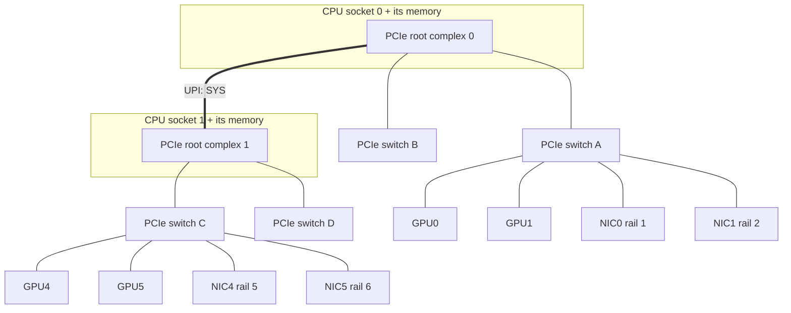

Sixteen new servers arrive for Meridian's San Jose training cluster, `srv113` to `srv128`, each with eight GPUs and eight 400 Gb/s network cards. Every link light is green and `ping` works between every pair. They are not ready. A server can pass all of that and still deliver half its bandwidth: a card in a slot wired with half its lanes, a packet size left at the factory default, a card that cannot reach GPU memory directly. In a synchronous training job the slowest server sets the pace for every GPU ([why AI traffic is different](/learn/fabric-networking/ai-fabrics/why-ai-traffic-is-different)), so one bad server slows the whole job.

The method works bottom up: compute the number you should see, measure one layer at a time with a tool that tests only that layer, and let the size of the shortfall name the layer: first for one server, then for the batch.

A few terms first. A **NIC** (network interface card) is the server's network adapter; Meridian's back end uses ConnectX-7-class NICs at 400 Gb/s, one per GPU. **RDMA** (remote direct memory access) lets one NIC write into another machine's memory without either kernel touching the data, using **queue pairs** (QPs): a send queue and a receive queue the application fills with work requests and the NIC executes ([RDMA from zero](/learn/fabric-networking/ai-fabrics/rdma-from-zero)). **RoCEv2** carries RDMA inside UDP/IP packets (UDP port 4791), so an ordinary routed Ethernet fabric can carry it ([InfiniBand and RoCE](/learn/fabric-networking/ai-fabrics/infiniband-and-roce)).

## The number you are aiming at

"400 Gb/s", the **line rate**, counts every bit on the wire, headers and framing included, while `ib_write_bw` reports payload. One middle packet of a large RDMA WRITE, as it leaves the NIC:

| Field | Size | Value in this example | What reads it |
|---|---|---|---|
| Preamble and start delimiter | 8 bytes | fixed pattern | The receiving PHY (the port's physical-layer circuitry), to lock onto the signal |
| Ethernet header | 14 bytes | NIC MAC to rail-leaf MAC, EtherType 0x0800 | Each switch hop (rewritten at every router) |
| IPv4 header | 20 bytes | 10.3.1.225 → 10.3.1.223, DSCP 26, ECN-capable | Switches: routing, the lossless queue, ECN marking |
| UDP header | 8 bytes | source port from the QP, destination 4791 | ECMP hash (the source port is the entropy); the far NIC |
| InfiniBand base transport header (BTH) | 12 bytes | opcode RDMA WRITE Middle, destination QP, PSN | The receiving NIC only |
| Payload | up to the RoCE MTU | 4,096 bytes | The receiving NIC's DMA (direct memory access) engine, into the target buffer |
| Invariant CRC (ICRC) | 4 bytes | CRC over the payload, the transport headers and the IP/UDP fields no hop changes | The receiving NIC |
| Ethernet FCS | 4 bytes | CRC-32 of the frame | Every hop's receiving port |
| Inter-packet gap | 12 bytes | idle | Nobody; required spacing |

**DSCP** (differentiated services code point) is the 6-bit class field switches map to a queue; 26 is the usual value for RoCE's lossless class. **ECN-capable** means the two ECN (explicit congestion notification) bits let a congested switch mark the packet instead of dropping it. The BTH's **PSN** (packet sequence number) lets the receiving NIC spot a missing packet. The first packet of each message also carries a 16-byte RETH (RDMA extended transport header: remote address and key), negligible for large messages. That leaves 82 bytes of overhead for every 4,096 bytes of payload, so payload is 4,096 / 4,178 = 98.0% of the wire. On a 400 Gb/s link that is **392 Gb/s, the ceiling for a perfect `ib_write_bw`**. The **RoCE MTU** (maximum transmission unit: the largest payload one RDMA packet carries) decides that fraction, and it has only five possible values, 256 to 4,096 bytes, inherited from InfiniBand:

| RoCE MTU | Wire bytes per packet | Payload share | Ceiling at 400 Gb/s | Packets per second at that rate |
|---|---|---|---|---|
| 1,024 | 1,106 | 92.6% | 370 Gb/s | 45.2 million |
| 2,048 | 2,130 | 96.2% | 385 Gb/s | 23.5 million |
| 4,096 | 4,178 | 98.0% | 392 Gb/s | 12.0 million |

The 22 Gb/s gap between the first and last rows is the commonest fresh-install shortfall (MTU, below), and at 1,024 bytes the NIC and every switch handle almost four times the packets for the same data.

## perftest: one pair, one verb at a time

**perftest** is the standard RDMA micro-benchmark suite. Each tool exercises one RDMA operation (a **verb**) between two machines: `ib_write_bw` and `ib_write_lat` for one-sided WRITE, `ib_read_*` for READ, `ib_send_*` for two-sided SEND and RECEIVE, `ib_atomic_*` for remote atomics. You start the server side, then the identical command on the client with the server's address; the two swap QP numbers, memory keys and addresses over TCP (port 18515), then RDMA starts. With no GPU or collective library involved, it answers one question: what can this NIC, host and path do?

### `ib_write_bw`: bandwidth

The examples test `srv113`'s NIC 0 (back-end address `10.3.1.225`, illustrative like all back-end addresses here) against NIC 0 of `srv112` (`10.3.1.223`), an existing server already proven good. Both hang off `rail1-leaf2.sjc`, so the path crosses one switch.

```bash
# on srv112 (server side), then on srv113 (client side)
ib_write_bw -d mlx5_0 -x 3 -q 4 --report_gbits
ib_write_bw -d mlx5_0 -x 3 -q 4 --report_gbits 10.3.1.223
```

`-d mlx5_0` picks the NIC. `-x 3` picks the GID index: a GID is one of the NIC's own addresses, listed by `show_gids`, and RoCEv2 over IPv4 needs the entry holding the interface's IPv4 address in RoCEv2 mode, often index 3. `-q 4` runs four QPs. `--report_gbits` reports Gb/s; without it the "MB/sec" column counts 2^20-byte units in common versions, a classic "missing" 5%. Illustrative output after tuning (the default 5,000 messages of 64 KiB per QP), trimmed:

```text
                    RDMA_Write BW Test
 Dual-port       : OFF          Device         : mlx5_0
 Number of qps   : 4            Transport type : IB
 Connection type : RC           Using SRQ      : OFF
 TX depth        : 128
 CQ Moderation   : 100
 Mtu             : 4096[B]
 Link type       : Ethernet
 GID index       : 3
 rdma_cm QPs     : OFF
 Data ex. method : Ethernet
---------------------------------------------------------------------------------------
 #bytes     #iterations    BW peak[Gb/sec]    BW average[Gb/sec]   MsgRate[Mpps]
 65536      5000           390.12             389.70               0.743294
```

Read the header first: it records what was measured. `Transport type : IB` is normal on Ethernet: RoCE keeps InfiniBand's transport. `RC` is a reliable connection, acknowledged and retransmitted by the NICs. `Mtu : 4096[B]` is the RoCE MTU both ends negotiated; at 1024 the result cannot exceed 370. `TX depth` is the work requests outstanding per QP, and `CQ Moderation : 100` means one completion per 100 of them, so polling costs less. Quote `BW average`; a wide gap to peak means an unsteady run. `MsgRate` cross-checks it: 0.743 million × 65,536 bytes × 8 = 389.7 Gb/s, 99.4% of 392: done.

Three flags change what you measure. `-a` sweeps message sizes from 2 bytes to 8 MiB. `-b` sends both ways, catching a host that manages 390 one way but not 780 both ways. `--use_cuda=0` puts the buffers in GPU 0's memory, the GPUDirect test below.

**Why several QPs.** One QP is one RoCE flow: one UDP source port, so one ECMP path ([ECMP and hashing](/learn/fabric-networking/fabric-architecture/ecmp-and-hashing)), and one ordered stream of work for the NIC. Depending on NIC generation and firmware, a single QP may fall short at 400 Gb/s; four to eight remove that variable and spread over several spines. One QP at 300 and four at 390 means per-flow processing; four at 300 means look lower down.

### `ib_send_lat`: latency

```bash
ib_send_lat -d mlx5_0 -x 3 -n 100000 10.3.1.223
```

The latency tools play ping-pong and report half of each round trip. `ib_send_lat` uses two-sided SEND (each side needs a posted receive); `ib_write_lat` uses WRITE and polls memory for the change. The default 2-byte message measures fixed costs: the doorbell across PCIe (the single write to a NIC register that tells it work is waiting), the NIC's DMA fetches, the switch, the far NIC's DMA into memory. Illustrative output, `srv113` to `srv112`, before and after the host tuning below:

```text
 #bytes #iterations  t_min[usec]  t_max[usec]  t_typical[usec]  t_avg[usec]  t_stdev[usec]  99% percentile[usec]  99.9% percentile[usec]
 2      100000       1.84         41.27        1.96             2.31         1.62           3.10                  38.55
 2      100000       1.83         4.12         1.94             1.97         0.08           2.21                  3.48
```

Quote `t_typical` for the fixed cost and the 99.9th percentile for the tail. On a tuned host with a ConnectX-class NIC, 1 to 2 µs through one switch is normal; switch chips differ by hundreds of nanoseconds. The first row has a fine typical value and a tail 20 times higher: something on the host sometimes takes the benchmark's CPU, a signature an idle network rarely produces. After pinning, the tail is within twice typical. Latency also exposes what bandwidth hides: a process on the wrong socket adds to every message's latency while barely moving a 64 KiB bandwidth test.

```viz
{"type": "fabric", "scenario": "rdma-write", "title": "What ib_write_bw exercises: a TCP send against one 1 MiB RDMA WRITE", "caption": "srv001 to srv002 through the rail-1 leaf. The TCP path copies every byte twice and needs system calls and interrupts on both CPUs. The RDMA path registers memory and sets up a queue pair once, then a doorbell starts a WRITE that the NIC cuts into 256 RoCEv2 packets of 4,096 bytes, with RETH on the first, PSNs rising and one cumulative ACK, and a completion the app polls without the kernel."}
```

Once the QP exists, the data path runs entirely in the two NICs. The host's influence narrows to the PCIe path, the memory the data lands in and the polling core: the next five sections.

## MTU: three numbers that must agree

An MTU problem on a RoCE fabric involves three different values, and a fresh install usually has at least one wrong:

1. **The host interface MTU**, the Linux `netdev` MTU of the NIC's Ethernet interface. Factory default: 1,500 bytes.
2. **The RoCE active MTU**, which the driver derives from it: the largest of 256, 512, 1,024, 2,048 or 4,096 that fits inside the interface MTU with room for the RoCE headers. A 1,500-byte interface gives 1,024. Anything from about 4,200 bytes up gives 4,096, the maximum. `ibv_devinfo` shows it as `active_mtu`.
3. **Every switch port on the path**, which must carry the largest frame: 4,174 bytes for a first packet with RETH (14 Ethernet + 20 IP + 8 UDP + 12 BTH + 16 RETH + 4,096 + 4 ICRC + 4 FCS), four more with a VLAN tag. Meridian runs its back-end switch ports at 9,216 and its hosts at 9,000.

**What MTU solves:** fewer, larger packets, so less header overhead (370 versus 392) and a quarter of the per-packet work for the NIC and every switch. **How it breaks:** a host at 1,500 silently negotiates 1,024 and caps every test at 370 Gb/s. Worse, a host at 9,000 behind one switch port left at 1,500 sends 4 KB packets that the port drops. RoCEv2 packets cannot be fragmented, and no ICMP "too big" adjusts the RDMA stack the way path MTU discovery adjusts TCP ([transport as the network sees it](/learn/fabric-networking/from-zero/transport-as-the-network-sees-it)). Small messages fit in small packets and pass; large writes retransmit until the QP fails with a retry-exceeded error. **Signal:** `active_mtu` below 4,096 in `ibv_devinfo` or `Mtu : 1024[B]` in perftest; for the dropped case, `ping -M do -s 8972` (a 9,000-byte packet, don't fragment) failing, latency tests passing while bandwidth tests hang, and `local_ack_timeout_err` rising on the NIC.

```text
srv113$ ibv_devinfo -d mlx5_0          (illustrative output, trimmed)
hca_id: mlx5_0
        transport:          InfiniBand (0)
        fw_ver:             28.39.1002
        port:   1
                state:          PORT_ACTIVE (4)
                max_mtu:        4096 (5)
                active_mtu:     1024 (3)
                link_layer:     Ethernet
```

## PCIe: the link nobody draws

Network diagrams stop at the NIC, but the data crosses one more link. **PCIe** (PCI Express) joins the NIC to the CPU, memory and GPU: a point-to-point serial link of 1 to 16 **lanes**, each at its generation's transfer rate, with 128b/130b line encoding on Gen3 to Gen5 (Gen6 moves to fixed-size FLITs with forward error correction). Data travels in **TLPs** (transaction layer packets), each carrying at most the **max payload size** (MPS, typically 256 bytes) plus about 24 bytes of header, sequence number, link CRC and framing. A NIC fetching data issues read requests of at most **MaxReadReq** bytes (often 512 by default) and gets the answers back in MPS-sized completions.

| Link | Raw rate each way | Payload rate at MPS 256 | Against a 400 Gb/s NIC |
|---|---|---|---|
| Gen4 x16 | 252 Gb/s | 230 Gb/s | Caps the NIC at about 57% |
| Gen5 x8 | 252 Gb/s | 230 Gb/s | Same: half the lanes at twice the speed |
| Gen5 x16 | 504 Gb/s | 461 Gb/s | About 18% headroom over 392 |

A ConnectX-7 needs Gen5 x16 for 400 Gb/s, with thin headroom. Raising MaxReadReq to 4,096 means fewer, larger reads; reported gains on large transfers range from a few percent to the low tens, and the change must touch only its own bits of the device control register (the widely copied one-line `setpci` overwrites the whole register). Width and speed are negotiated at boot: a card not fully seated, a riser wired for eight lanes or a BIOS slot pinned to an older generation trains the link down without an error. Linux reports the result:

```text
srv113$ sudo lspci -vv -s 0000:1a:00.0 | grep -E 'LnkCap|LnkSta'     (illustrative)
        LnkCap: Port #0, Speed 32GT/s, Width x16, ASPM not supported
        LnkSta: Speed 32GT/s, Width x8 (downgraded)
```

`LnkCap` is what the card can do, `LnkSta` what it got. **What a full link solves:** the NIC moves data to and from memory faster than the wire. **How it breaks:** link training settles lower, silently. **Signal:** "(downgraded)" in `LnkSta`, and an `ib_write_bw` result that sits at about 220 to 230 Gb/s whatever else you change. No network counter will show it.

PCIe is also how the NIC reaches GPU memory. Meridian's servers follow a common layout for 8-GPU baseboards (NVIDIA calls its reference design HGX): each PCIe switch carries two GPUs and their two NICs, two switches per CPU socket, so GPU 0's traffic to NIC 0 stays inside one switch.

```viz
{"type": "fabric", "scenario": "scale-up-vs-out", "title": "1 GiB two ways: over NVLink inside srv001, and through the PCIe switch and NIC to srv002", "caption": "GPU0 to GPU1 through the NVSwitch takes about 2.4 ms at 450 GB/s each way. GPU0 to srv002's GPU0 goes through the shared PCIe switch (Gen5 x16, about 63 GB/s each way), the 400 Gb/s NIC and the rail-1 leaf, with GPUDirect RDMA at both ends, and takes about 21.5 ms at 50 GB/s. Then effective bandwidth against message size, what changes without GPUDirect RDMA or with a NIC under the wrong switch, and NVL72."}
```

Its last frames are the bring-up point: without GPUDirect, every byte detours through host memory, and a NIC under another switch or socket forces a similar detour through the CPU. [Scale-up, NVLink and NVSwitch](/learn/fabric-networking/ai-fabrics/scale-up-nvlink-and-nvswitch) covers the hardware.

## NUMA and placement: which socket, which switch

A two-socket server is two computers in one box. Each CPU socket has its own memory and its own PCIe root complex (the CPU's built-in PCIe controller), joined by an inter-socket link (Intel UPI, AMD Infinity Fabric). That is **NUMA**, non-uniform memory access: your own socket's memory and devices are faster to reach. Remote memory adds tens of nanoseconds to over a hundred per access, depending on the platform, and every transfer across the link competes with everything else crossing it.

Each NIC belongs to one socket, and a host-memory perftest should use that socket's memory and cores. Linux says where the NIC is; `numactl` places the process:

```bash
cat /sys/class/infiniband/mlx5_0/device/numa_node          # prints 0
numactl --cpunodebind=0 --membind=0 ib_write_bw -d mlx5_0 -x 3 -q 4 --report_gbits 10.3.1.223
```

For GPU traffic what matters is each GPU's distance to its NIC, which `nvidia-smi topo -m` prints as a matrix (illustrative, part of a Meridian server):

```text
        GPU0   GPU1   GPU4   NIC0   NIC1   NIC4   CPU Affinity   NUMA Affinity
GPU0     X     NV18   NV18   PIX    PIX    SYS    0-55           0
GPU1    NV18    X     NV18   PIX    PIX    SYS    0-55           0
GPU4    NV18   NV18    X     SYS    SYS    PIX    56-111         1
NIC0    PIX    PIX    SYS     X     PIX    SYS
```

| Code | Path between the two devices | Fit for GPUDirect RDMA |
|---|---|---|
| `NV#` | NVLink, # links bonded | GPU to GPU only; NICs do not use it |
| `PIX` | At most one PCIe switch | Best: the intended pairing |
| `PXB` | Several PCIe switches, not through the CPU | Good |
| `PHB` | Through the CPU's PCIe host bridge | Marginal; traffic crosses the root complex, and NCCL's default threshold (`PXB`) stages through host memory instead |
| `NODE` | Between host bridges on the same socket | Poor; staged through host memory by default |
| `SYS` | Across the inter-socket link | Avoid; NCCL usually stages through host memory instead |



GPU0 to NIC0 is `PIX`, one switch; GPU0 to NIC4 is `SYS`, up through switch A, across sockets, down through C. Rail optimisation ([AI fabric topologies](/learn/fabric-networking/ai-fabrics/ai-fabric-topologies)) assumes each GPU uses the NIC on its own switch. **What placement solves:** every byte takes the shortest PCIe path and no transfer competes for the inter-socket link. **How it breaks:** a container runtime, job script or device renumbering pairs a GPU with a distant NIC. **Signal:** a `SYS` or `NODE` GPU-to-NIC pairing, or NCCL logs naming a NIC that is not the GPU's `PIX` neighbour.

## IRQ affinity and the CPU under a kernel-bypass NIC

An **IRQ** (interrupt request) is how a device tells a CPU core that something happened. A modern NIC has dozens of interrupt vectors (MSI-X, message-signalled interrupts: the device raises one by writing to a memory address the CPU watches), one per queue, and **IRQ affinity** decides which cores each may interrupt (`/proc/irq/<n>/smp_affinity_list`). The kernel receive path that follows an interrupt is traced in [how Linux sends and receives packets](/learn/fabric-networking/from-zero/how-linux-sends-and-receives-packets).

RDMA makes this subtler than "pin your IRQs". perftest and NCCL **poll** their completion queues by default (a thread spins on memory the NIC writes), so a polled RDMA data path raises no interrupts at all. Affinity still matters in three places:

- **Interrupts landing on the polling core.** `irqbalance`, the daemon that spreads interrupts across cores, may put the NIC's Ethernet queues, a disk or a timer on the core where NCCL's proxy thread or `ib_send_lat` spins. Each interrupt steals microseconds: the 41 µs `t_max` above. Run the benchmark and the job's network threads on chosen cores of the NIC's socket and keep other interrupts off them.
- **Interrupts on the wrong socket.** Kernel traffic (storage over TCP, the front end, NCCL's bootstrap, any fallback to its socket transport) should be handled near the NIC that raised it, or every packet crosses the inter-socket link.
- **Event-mode completions.** An application that sleeps until a completion interrupt (perftest's `-e`) wakes wherever that vector's affinity says.

Vendor scripts (`set_irq_affinity_cpulist.sh`, `mlnx_tune` on NVIDIA's stack) apply a policy. A tuned host also sets the CPU governor to `performance` and limits deep idle states (C-states), because a core waking from deep sleep adds microseconds to the next message. **What it solves:** steady latency, no cross-socket packet handling. **How it breaks:** a package update re-enables `irqbalance` and interrupts return to the polling cores. **Signal:** a latency tail far above `t_typical` with bandwidth fine, `/proc/interrupts` counting NIC vectors on cores outside the NIC's socket, run-to-run variance that tracks CPU load.

## GPUDirect RDMA checks

**GPUDirect RDMA** lets the NIC read and write GPU memory directly across PCIe, with no copy through host memory. It needs four things, each failing in its own way.

1. **A kernel path to map GPU memory for the NIC:** the `nvidia-peermem` module (in the NVIDIA driver since the R470 series), or DMA-BUF, a generic Linux mechanism for sharing device memory, on recent kernels with NVIDIA's open kernel modules. Without either, registering GPU memory fails, so `ib_write_bw --use_cuda=0` exits with a registration error rather than running slowly.
2. **A short PCIe path:** `PIX` or `PXB` in `nvidia-smi topo -m`. NCCL turns GPUDirect RDMA off when the pair is too far apart (`NCCL_NET_GDR_LEVEL` moves the threshold) and stages through host memory: the job still runs, slower, with a copy through host memory at each end.
3. **Peer-to-peer traffic allowed to stay in the switch.** PCIe **ACS** (access control services), an isolation feature for virtual machines, forces device-to-device traffic up to the root complex for checking. On a bare-metal training server it sends every GPU-to-NIC transfer through the CPU, and a BIOS update that re-enables it is a classic "worked last week" cause. `lspci -vvv` shows the controls on each switch port's `ACSCtl:` line; `+` flags there (for example `SrcValid+ ReqRedir+ CmpltRedir+`) mean it is on, and the redirect bits are the ones that send peer traffic up to the CPU.
4. **NCCL actually using it.** With `NCCL_DEBUG=INFO`, NCCL logs each channel's transport. Illustrative lines:

```text
NCCL INFO NET/IB : Using [0]mlx5_0:1/RoCE [1]mlx5_1:1/RoCE [2]mlx5_2:1/RoCE ... [7]mlx5_7:1/RoCE
NCCL INFO Channel 00/0 : 0[0] -> 8[0] [send] via NET/IB/0/GDRDMA
NCCL INFO Channel 01/0 : 0[0] -> 8[0] [send] via NET/IB/0
```

`GDRDMA` means that channel uses GPUDirect RDMA; a channel without it goes through host memory. `NET/Socket` instead of `NET/IB` means NCCL found no usable RDMA device and runs collectives over TCP: correct results, a fraction of the bandwidth. **What it solves:** one PCIe crossing per byte instead of two plus a copy. **How it breaks:** silently, since every fallback still gives correct results. **Signal:** a failed check above, or `--use_cuda` well below host memory.

Measure it by changing one variable: `ib_write_bw --use_cuda=0`, GPU 0's memory on `srv113` to GPU 0 on `srv112`. Healthy, it matches host memory within a few percent. On `srv113` it gave 261 Gb/s against 390: `nvidia-peermem` loaded, topology `PIX`, but `ReqRedir+` on the switch ports' `ACSCtl` lines after a BIOS update. With ACS off, 388.

## nccl-tests and bus bandwidth

perftest proves a pair of NICs, but a training job runs **collectives**: operations in which every GPU in a group (each a **rank**) contributes data and receives a result, through **NCCL**, NVIDIA's collective communication library. The workhorse is **all-reduce**, which leaves every rank holding the element-wise sum of everyone's gradients ([collectives and NCCL](/learn/fabric-networking/ai-fabrics/collectives-and-nccl) has the algorithms). **nccl-tests** is the matching benchmark suite (`all_reduce_perf`, `all_gather_perf`, `alltoall_perf` and others), launched with one process per GPU by MPI or Slurm (the job launchers HPC clusters use to start a program on many servers at once).

```bash
mpirun -np 16 -N 8 ./all_reduce_perf -b 8 -e 8G -f 2 -g 1
```

That is 16 ranks, eight on each of two servers, sweeping sizes from 8 bytes to 8 GiB, doubling each step. Each row reports a time and two bandwidths:

- **Algorithm bandwidth** (`algbw`) is size over time: 1 GiB all-reduced in 5.59 ms is 192 GB/s. It cannot be compared across group sizes, because all-reduce moves more bytes per rank as the group grows, so algbw falls with more ranks even on a perfect network.
- **Bus bandwidth** (`busbw`) is algbw times a factor that turns it into the rate each rank's links ran at. In ring all-reduce every rank sends 2(n−1)/n times the data, so the factor is 2(n−1)/n: 1.875 for 16 ranks, 1.98 for 128. All-gather and reduce-scatter use (n−1)/n, broadcast 1. This is the number to compare with hardware, whatever the rank count.

```viz
{"type": "fabric", "scenario": "ring-allreduce", "title": "Ring all-reduce on four ranks, ending in nccl-tests' algorithm and bus bandwidth", "caption": "Four GPUs on the rail-1 leaf all-reduce a 400 MB vector in four 100 MB chunks: three reduce-scatter steps, three all-gather steps, 600 MB sent per rank in 12 ms at 400 Gb/s. The last frames compare the alternatives, show 2(n-1)/n barely growing with n, and divide it out: algorithm bandwidth 33.3 GB/s, bus bandwidth 50 GB/s, the NIC's own rate."}
```

**The ceiling.** In the animation each rank has one 50 GB/s NIC, so the ceiling is 50 GB/s. With eight GPUs per server, NCCL builds rings that cross NVLink inside each server and leave it through every NIC, its channels spread over all eight rails. Each rank sends on every channel at once, mostly over NVLink, and only the server-boundary hops use NICs, so bus bandwidth is bounded by the server's total NIC bandwidth: 8 × 50 = **400 GB/s for a Meridian server**, while NVLink (450 GB/s each way per GPU) is faster. A result of 360 GB/s means the eight NICs together ran at 90%, not one NIC at 360. Healthy runs typically land at 85 to 95% of the ceiling at large sizes; the exact figure depends on the NCCL version, channels, protocol and whether in-network reduction (SHARP) is used, so keep a baseline per hardware generation.

Illustrative output from `srv113` and `srv112`, six of the 31 sizes, out-of-place columns only:

```text
#       size         count      type   redop    root     time   algbw   busbw #wrong
#        (B)    (elements)                               (us)  (GB/s)  (GB/s)
           8             2     float     sum      -1     31.0    0.00    0.00      0
     1048576        262144     float     sum      -1     36.4   28.78   53.97      0
    16777216       4194304     float     sum      -1    117.9  142.30  266.82      0
   268435456      67108864     float     sum      -1   1421.4  188.86  354.10      0
  1073741824     268435456     float     sum      -1   5592.5  192.00  359.99      0
  8589934592    2147483648     float     sum      -1  44523.1  192.93  361.75      0
# Avg bus bandwidth    : 128.3
```

Read it in bands. **Small messages** (up to tens of KB) are latency-bound: judge them by `time`, about 31 µs here, the cost of a tiny all-reduce. **Large messages** (hundreds of MB up) give the bandwidth plateau, 362 GB/s, 90% of 400. The summary line averages every size, mixing latency into bandwidth, so compare plateaus instead. `#wrong` counts elements whose result differed from the expected value and must be 0. Anything else is silent data corruption from a GPU, NIC, memory or driver fault, and outranks any performance finding.

Meridian's acceptance tooling checks every nccl-tests output: refuse wrong results, recompute bus bandwidth from the raw time, report the plateau against the ceiling.

```python
FACTOR = {  # bus bandwidth = algorithm bandwidth x this, for n ranks
    "all_reduce": lambda n: 2 * (n - 1) / n,
    "all_gather": lambda n: (n - 1) / n,
    "reduce_scatter": lambda n: (n - 1) / n,
    "broadcast": lambda n: 1.0,
}

TWO_NODES = """
           8            2  float  sum  -1       31.0    0.00    0.00  0
       65536        16384  float  sum  -1       31.3    2.09    3.92  0
     1048576       262144  float  sum  -1       36.4   28.78   53.97  0
    16777216      4194304  float  sum  -1      117.9  142.30  266.82  0
   268435456     67108864  float  sum  -1     1421.4  188.86  354.10  0
  1073741824    268435456  float  sum  -1     5592.5  192.00  359.99  0
  8589934592   2147483648  float  sum  -1    44523.1  192.93  361.75  0
"""

BATCH = """
           8            2  float  sum  -1       58.0    0.00    0.00  0
     1048576       262144  float  sum  -1       65.0   16.13   32.01  0
   268435456     67108864  float  sum  -1     1848.5  145.22  288.17  0
  1073741824    268435456  float  sum  -1     7220.0  148.72  295.11  0
  8589934592   2147483648  float  sum  -1    57354.3  149.77  297.20  0
"""


def parse(text):
    rows = []
    for line in text.strip().splitlines():
        if line.startswith("#"):
            continue
        size, _count, _type, _op, _root, time_us, algbw, busbw, wrong = line.split()[:9]
        rows.append({"size": int(size), "us": float(time_us), "algbw": float(algbw),
                     "busbw": float(busbw), "wrong": int(wrong)})
    return rows


def check(text, collective, ranks, ceiling_gbs):
    rows = parse(text)
    if any(r["wrong"] for r in rows):
        return "WRONG RESULTS: stop, this is a hardware or driver fault, not a performance one"
    factor = FACTOR[collective](ranks)
    for r in rows:                                   # recompute busbw from the raw time
        algbw = r["size"] / (r["us"] * 1e-6) / 1e9   # nccl-tests uses GB = 1e9 bytes
        assert abs(algbw * factor - r["busbw"]) < 0.05 * max(r["busbw"], 1), r
    peak = max(r["busbw"] for r in rows)
    knee = next(r["size"] for r in rows if r["busbw"] >= 0.9 * peak)
    small = rows[0]["us"]
    return (f"{ranks} ranks: peak busbw {peak:.0f} GB/s = {peak / ceiling_gbs:.0%} of {ceiling_gbs} GB/s; "
            f"90% of peak from {knee / 2**20:.0f} MiB; smallest message {small:.0f} us")


# Two servers, 16 GPUs: the ceiling is each server's 8 NICs x 50 GB/s.
print(check(TWO_NODES, "all_reduce", 16, ceiling_gbs=400))
# The sixteen new servers together, 128 GPUs.
print(check(BATCH, "all_reduce", 128, ceiling_gbs=400))
# The same two servers with a corrupted result at 1 GiB.
print(check(TWO_NODES.replace("359.99  0", "359.99  3"), "all_reduce", 16, ceiling_gbs=400))
```

```text
16 ranks: peak busbw 362 GB/s = 90% of 400 GB/s; 90% of peak from 256 MiB; smallest message 31 us
128 ranks: peak busbw 297 GB/s = 74% of 400 GB/s; 90% of peak from 256 MiB; smallest message 58 us
WRONG RESULTS: stop, this is a hardware or driver fault, not a performance one
```

The `assert` earns its keep: a stored bus bandwidth that does not equal size over time times 2(n−1)/n came from a different rank count or collective than the label claims, which is how a single-server NVLink number ends up in a multi-server report. The second line, the new batch at 74%, is solved at the end of this lesson.

## Reading results: one server from 222 to 390 Gb/s

Compute each layer's ceiling, measure, and find which ceiling the result sits on. Within 5% of a ceiling, that layer is the bottleneck. Well below every ceiling, the limit is something the model leaves out: per-QP processing, NUMA, the GPU path, the host CPU.

```python
WIRE_OVERHEAD = 8 + 14 + 20 + 8 + 12 + 4 + 4 + 12   # preamble, Eth, IPv4, UDP, BTH, ICRC, FCS, gap
PCIE_GTS = {3: 8, 4: 16, 5: 32}                       # transfers per second per lane, in GT/s
TLP_OVERHEAD = 24                                     # header, sequence, LCRC, framing per packet


def link_ceiling(gbps, roce_mtu):
    """Payload Gb/s left after every RoCEv2 packet's headers and Ethernet framing."""
    return gbps * roce_mtu / (roce_mtu + WIRE_OVERHEAD)


def pcie_ceiling(gen, width, max_payload=256):
    """Payload Gb/s one direction of a PCIe link can carry (128b/130b encoding, Gen 3+)."""
    raw = PCIE_GTS[gen] * width * 128 / 130          # Gb/s on the lanes
    return raw * max_payload / (max_payload + TLP_OVERHEAD)


def diagnose(server, measured, link_gbps=400, roce_mtu=4096, gen=5, width=16):
    limits = {
        f"the link at RoCE MTU {roce_mtu}": link_ceiling(link_gbps, roce_mtu),
        f"PCIe Gen{gen} x{width}": pcie_ceiling(gen, width),
    }
    name, ceiling = min(limits.items(), key=lambda kv: kv[1])
    ratio = measured / ceiling
    if ratio >= 0.95:
        verdict = "at the ceiling, so this layer is the bottleneck"
    else:
        verdict = f"{ratio:.0%} of it: the limit is elsewhere (QPs, NUMA, GPU path)"
    print(f"{server:<20} {measured:5.1f} Gb/s, ceiling {ceiling:5.1f} from {name}: {verdict}")


print(f"RoCE MTU 1024: {link_ceiling(400, 1024):.1f}  2048: {link_ceiling(400, 2048):.1f}  "
      f"4096: {link_ceiling(400, 4096):.1f} Gb/s of payload on a 400 Gb/s link")
print(f"PCIe Gen4 x16: {pcie_ceiling(4, 16):.0f}  Gen5 x8: {pcie_ceiling(5, 8):.0f}  "
      f"Gen5 x16: {pcie_ceiling(5, 16):.0f} Gb/s of payload each way")
print()
diagnose("srv113 as delivered", 221.6, gen=5, width=8, roce_mtu=1024)
diagnose("srv113 reseated", 368.4, roce_mtu=1024)
diagnose("srv113 MTU 9000", 389.7)
diagnose("srv113 GPU memory", 261.3)
```

```text
RoCE MTU 1024: 370.3  2048: 384.6  4096: 392.1 Gb/s of payload on a 400 Gb/s link
PCIe Gen4 x16: 230  Gen5 x8: 230  Gen5 x16: 461 Gb/s of payload each way

srv113 as delivered  221.6 Gb/s, ceiling 230.5 from PCIe Gen5 x8: at the ceiling, so this layer is the bottleneck
srv113 reseated      368.4 Gb/s, ceiling 370.3 from the link at RoCE MTU 1024: at the ceiling, so this layer is the bottleneck
srv113 MTU 9000      389.7 Gb/s, ceiling 392.1 from the link at RoCE MTU 4096: at the ceiling, so this layer is the bottleneck
srv113 GPU memory    261.3 Gb/s, ceiling 392.1 from the link at RoCE MTU 4096: 67% of it: the limit is elsewhere (QPs, NUMA, GPU path)
```

The model leaves out PCIe flow-control traffic, read-request overhead and the NIC's own limits, so its ceilings are a few percent optimistic. The whole bring-up of `srv113`'s NIC 0 against `srv112`, one change per step:

| Step | Test | Result | Which ceiling it sits on | Finding | Change |
|---|---|---|---|---|---|
| 1 | `ibv_devinfo`, `lspci` | PORT_ACTIVE, `active_mtu 1024`, `LnkSta x8 (downgraded)` | n/a | Two faults visible before any traffic | Note both; test to confirm |
| 2 | `ib_write_bw -q 4`, host memory | 221.6 Gb/s | PCIe Gen5 x8, 230 | The NIC trained at eight lanes | Reseat the card in its riser |
| 3 | Same | 368.4 Gb/s | Link at RoCE MTU 1,024, 370 | Interface MTU still 1,500 | Interface MTU 9,000; `active_mtu` now 4,096 |
| 4 | Same | 389.7 Gb/s | Link at RoCE MTU 4,096, 392 | Host-memory path complete | None |
| 5 | `-b` (both directions) | 778 Gb/s | Twice the link ceiling | PCIe has room both ways | None |
| 6 | `--use_cuda=0` | 261.3 Gb/s | None: 67% of the link | GPU path is the limit; `topo -m` says `PIX`; ACS on | Disable ACS on the PCIe switch ports |
| 7 | Same | 388 Gb/s | Link, 392 | GPUDirect RDMA healthy | None |
| 8 | `ib_send_lat` | typical 1.96 µs, 99.9% 38.6 µs | n/a | Tail from interrupts on the polling core | Stop `irqbalance`, pin IRQs and the test to socket 0 |
| 9 | Same | typical 1.94 µs, 99.9% 3.5 µs | n/a | Host latency clean | Repeat for NICs 1 to 7 |

Two habits make this work. **Change one thing per step**, or a combined improvement hides which change mattered. **Keep a known-good reference** at the other end: a slow pair could be either end or the path, and a peer already proven against others through the same leaf rules out the far end and most of the path.

## From one pair to the fabric

Every server can pass alone while the batch fails together, as the 128-rank run at 297 GB/s showed: a short pair test misses faults that need sustained load, paths it never crosses and congestion one pair never triggers.

**Find the bad path.** A synchronous all-reduce runs at the speed of its slowest ring hop, so one bad link among the batch's 128 drags the whole result down. Bisect: nccl-tests on halves of the batch, then quarters; the half that stays low holds the fault. Or test pairs: `ib_write_bw` between every pair on the same rail (NIC k to NIC k), including peers on the rail's other leaf so spine paths are covered, several QPs each, and long enough to load the links (`-D 60`; the default 5,000 messages per QP last tens of milliseconds). In the new batch, after about 20 seconds every pair involving `srv121`'s NIC 4 (`10.3.5.241` on `rail5-leaf2.sjc`) fell to about 250 Gb/s while every other pair held 389. The leaf port facing that NIC showed FEC (forward error correction) corrections climbing as the optic warmed, then CRC errors once FEC could no longer repair every frame, and the NICs receiving from `srv121` counted `out_of_sequence` packets: an optic failing under load while the link stays up, the gray failure of [optics, cabling and the physical layer](/learn/fabric-networking/fabric-architecture/optics-cabling-and-the-physical-layer). Each packet dropped for a bad CRC costs a go-back-N resend: the receiver discards everything after the gap and the sender repeats it all from the missing PSN. With the optic replaced, the 128-rank all-reduce reached 358 GB/s, 89%. It is the probe-matrix idea of [active measurement](/learn/fabric-networking/operating-fabrics/active-measurement). Large GPU operators work the same way: nccl-tests bus bandwidth is the figure GPU clouds commonly quote for a cluster's network, and such health checks run between jobs, not only at delivery.

**Prove the congestion controls.** One sender into one receiver at line rate never fills a switch queue, so also run an incast: two or more senders into one receiver. ECN marks on the switch and CNPs (congestion notification packets) at the NICs should appear first and the senders slow; PFC (priority flow control) pauses, the backstop, should be rare ([lossless Ethernet](/learn/fabric-networking/ai-fabrics/lossless-ethernet-pfc-ecn-dcqcn)). On ConnectX NICs the host half is in `/sys/class/infiniband/mlx5_0/ports/1/hw_counters/` (`np_ecn_marked_roce_packets`, `np_cnp_sent`, `rp_cnp_handled`, `out_of_sequence`, `local_ack_timeout_err`) and `ethtool -S` (`rx_prio3_pause`, `tx_prio3_pause`). Pauses without CNPs means ECN is not configured or not reaching the hosts ([when lossless goes wrong](/learn/fabric-networking/ai-fabrics/when-lossless-goes-wrong)). Compare counter deltas across each test, never totals.

**Burn in.** Loop the full-batch nccl-tests for hours: optics that fail only when hot and links that flap hourly show up only with time. The last gate is a real job's step time against proven servers.

## Failure modes in production

| Failure | Symptom | Diagnosis | Fix |
|---|---|---|---|
| PCIe link trained down | `ib_write_bw` stuck at about 220 to 230 Gb/s on a 400 Gb/s NIC whatever you tune | `LnkSta` shows x8 or a lower speed, "(downgraded)" | Reseat card or riser; check slot wiring and BIOS link-speed settings |
| Host MTU left at 1,500 | Every test about 5% short, around 368 Gb/s | `active_mtu 1024` in `ibv_devinfo`, `Mtu : 1024[B]` in perftest | Interface MTU 9,000 (anything above about 4,200 gives 4,096) |
| One switch port with a small MTU | Small messages and latency tests work; large writes hang or error with retry exceeded | `ping -M do -s 8972` fails; `local_ack_timeout_err` rises; the port's MTU is below the frame size | Fix the port; diff MTU intent against every port on the path |
| Wrong GID index | Tests work between two servers on one switch segment but fail or hang through a routed hop; or traffic lands in the wrong class | `show_gids`: the chosen index is RoCEv1 or link-local IPv6, not RoCEv2 with the IPv4 address | Use the RoCEv2 IPv4 GID (`-x`, `NCCL_IB_GID_INDEX` on NCCL versions that do not detect it) |
| GPUDirect RDMA silently off | Host-memory perftest at line rate; nccl-tests far below the ceiling | NCCL log lines without `GDRDMA`; `nvidia-peermem` missing; `topo -m` shows `SYS`; ACS enabled | Load the module or enable DMA-BUF; fix GPU-to-NIC pairing; disable ACS on bare metal |
| NCCL fell back to TCP | Correct results, bus bandwidth a small fraction of the ceiling | `NET/Socket` in the NCCL log instead of `NET/IB` | Fix the RDMA device visibility (container device mounts, `NCCL_IB_HCA`) |
| Interrupts on the polling core | Bandwidth fine, latency tail 10 to 20 times typical, jittery step times | `/proc/interrupts` per core; `irqbalance` running; process not pinned | Pin IRQs and network threads to the NIC's socket, governor `performance` |
| One gray link in the batch | Whole-batch bus bandwidth 20 to 30% low; every server passes a short test alone | Pair matrix or bisection isolates one NIC; FEC and CRC errors on its leaf port | Replace the optic or cable; re-test the pair, then the batch |

## Trade-offs: which test proves what

| Test | Layers it exercises | What it hides | Time to run | What a pass proves |
|---|---|---|---|---|
| `ibv_devinfo`, `lspci`, `topo -m` | Configuration only | Everything dynamic | Seconds | The link, PCIe and placement were negotiated as intended |
| `ib_write_bw` host memory | NIC, PCIe to host memory, cable, one switch path | GPU path, collectives, congestion, most of the fabric | Seconds per pair | This NIC and path can carry line rate |
| `ib_send_lat` | Fixed costs on both hosts and the switch | Bandwidth effects, congestion | Seconds | The host does not add jitter |
| `ib_write_bw --use_cuda` | Adds the GPU-to-NIC PCIe path | Collectives, NCCL configuration | Seconds | GPUDirect RDMA works on this pair |
| All-pairs perftest matrix | Every link and every rail on the tested paths | Congestion between flows | Minutes to hours (n² pairs, run in parallel rounds) | No single bad link or NIC |
| Incast test with counters | Switch buffers, ECN, CNPs, PFC | Real traffic pattern | Minutes | Congestion control acts before PFC |
| nccl-tests | NCCL topology, channels, every NIC at once, the fabric under collective load | Model-specific traffic, compute overlap | Minutes | The cluster delivers the collective bandwidth a job will see |
| Training job step time | Everything | Which layer is at fault | Hours | It is ready, but cannot tell you why if it is not |

Narrow, fast tests localise; broad, slow tests convince. Run them in that order, and when a broad one fails, come back up the table. Timing benchmarks honestly (warm-up, variance, what a mean hides) is in [benchmarking pitfalls](/learn/systems/performance-engineering/benchmarking-pitfalls).

## What the platform should show

Tooling turns this procedure into a gate every server passes before the scheduler may place a job on it. Surface:

- **Per-NIC bring-up state against intent:** PCIe capability and status, `active_mtu`, firmware and driver versions, GID index, GPU-to-NIC topology code, ACS, `nvidia-peermem`: checks that catch most faults before any traffic.
- **Results as ratios to computed ceilings.** "221.6 Gb/s, 96% of the PCIe Gen5 x8 ceiling" says what to fix; "221.6" does not.
- **Bus bandwidth plateaus with a baseline** per hardware generation, never the "Avg bus bandwidth" line, stored with rank count, NCCL version and size.
- **A pair matrix as a heat map** per rail: one bad NIC is a cross, a bad spine a block ([telemetry and observability](/learn/fabric-networking/operating-fabrics/telemetry-and-observability)).
- **Host and switch counters on one timeline:** CNPs, out-of-sequence and retry timeouts from NICs beside ECN marks, pauses and FEC/CRC errors on the switch ports they face. "The step got slower" often shows on the host side first ([the troubleshooting method](/learn/fabric-networking/operating-fabrics/the-troubleshooting-method)).
- **`#wrong` as a page, not a metric.** Any nonzero value quarantines the server.
- **Drift after acceptance:** re-run the cheap checks after every firmware, BIOS, kernel or driver change, because ACS, MTU and IRQ settings are exactly what updates reset.

## Interviewer follow-ups

**"`ib_write_bw` shows 225 Gb/s on a 400 Gb/s NIC. Where do you look?"** Model answer: 225 sits just under the roughly 230 Gb/s payload ceiling of PCIe Gen4 x16 or Gen5 x8, so first `lspci -vv` for a downgraded link, then MTU, QP count and NUMA. I compute each layer's ceiling and see which one the number sits on. Common wrong answer: "the network is congested", for a single pair that no switch counter explains.

**"perftest reaches line rate between every pair, but nccl-tests is at half the expected bus bandwidth. What is different?"** Model answer: host-memory perftest skips the GPU-to-NIC path, NCCL's choice of NICs and transport, and all eight rails loaded at once. I check the NCCL log for `GDRDMA` on every channel and `NET/IB` rather than `NET/Socket`, the topology and ACS, then `ib_write_bw --use_cuda` to isolate the GPU path, then the full pair matrix for a link the sampled pairs missed. Common wrong answer: forcing NCCL algorithms first, which is for experiments and rarely fixes a cluster.

**"What is bus bandwidth, and why does nccl-tests report it?"** Model answer: algorithm bandwidth is size over time; bus bandwidth multiplies by the collective's traffic factor, 2(n−1)/n for all-reduce, giving the rate the links ran. It stays comparable across rank counts and maps onto ceilings: 50 GB/s with one GPU and NIC per server, 400 GB/s with eight. Common wrong answer: "it is the PCIe bus", or comparing algorithm bandwidth between 16-rank and 128-rank runs.

**"How would you accept a new batch of 16 servers into a production cluster?"** Model answer: configuration checks (PCIe, MTU, firmware, topology, GPUDirect prerequisites); per-NIC perftest against a known-good peer for bandwidth, both directions, GPU memory and latency; an all-pairs matrix per rail; an incast test reading ECN, CNP and pause counters; nccl-tests at batch scale against a baseline; burn-in; a real job's step time. Every result as a ratio to its ceiling, re-run after any firmware change. Honest addition: "I'd defer to the network team on ECN thresholds and switch buffer settings, but I'd build the harness and the counters that prove they work."

## What mid-level engineers get wrong

- **Quoting perftest's MB/sec as megabytes, or nccl-tests' average line as bandwidth.** One under-reports by about 5%, the other mixes in latency-bound sizes, and both send people chasing missing bandwidth.
- **Testing only host memory,** which leaves untested the GPU path training actually uses.
- **Changing several settings at once,** so nobody knows which change mattered or which to apply to the other fifteen servers.
- **Accepting servers one by one.** All can pass alone while one bad optic slows the batch by a quarter.
- **Trusting settings to stay set.** Firmware, BIOS and package updates re-enable ACS and `irqbalance` and reset MTU.

## Senior signals

- You start from computed ceilings (392 Gb/s for 4 KB RoCE packets at 400 Gb/s, 230 for a halved PCIe link, 400 GB/s bus bandwidth for eight 400G NICs) and judge every result as a ratio to one.
- You change one layer at a time against a known-good peer, from configuration to host memory, GPU memory, latency, pairs, incast and collectives.
- You know a polled RDMA path takes no interrupts and still pin IRQs, because the tail comes from interrupts landing on the polling core.
- You read nccl-tests by plateau and `#wrong`, and know multi-server bus bandwidth is bounded by the server's total NIC bandwidth.
- You check GPUDirect in four places (module, PCIe distance, ACS, `GDRDMA` in the log), because each fails without an error.
- You build acceptance as a gate that re-runs after every change and joins host and switch counters, so "the network is slow" becomes a named NIC, link or setting.

## Check yourself

```quiz
- q: >-
    A new server's 400 Gb/s RoCE NIC gives 368 Gb/s in ib_write_bw with large messages, steadily, whatever QP count you use. PCIe shows Gen5 x16. What is the most likely cause?
  options: ["The host MTU is 1,500, so RoCE negotiated a 1,024-byte MTU", "The switch is congested and marking ECN on the test traffic", "A single queue pair cannot process more than 368 Gb/s on any NIC", "The NIC sits on the other CPU socket from the test process"]
  answer: 0
  explanation: >-
    368 sits right at the 370 Gb/s payload ceiling for 1,024-byte RoCE packets, the MTU the driver derives from a 1,500-byte interface. A QP limit would change with the QP count, which it does not here. A pair test at line rate does not build a queue that ECN would mark. NUMA misplacement mostly shows as latency and variance, not a steady result pinned at an MTU ceiling. Check active_mtu in ibv_devinfo or the Mtu line in perftest's header.
- q: >-
    nccl-tests all-reduce on 16 GPUs reports algbw 192 GB/s and busbw 360 GB/s for a 1 GiB message. Why is bus bandwidth the number to compare with the hardware?
  options: ["It is algbw averaged across all message sizes in the sweep", "It counts PCIe traffic, which the NIC limit does not include", "It excludes NVLink traffic so only network bytes are counted", "It scales algbw by 2(n-1)/n, the bytes each rank really sends"]
  answer: 3
  explanation: >-
    In ring all-reduce every rank sends 2(n-1)/n times the data, so bus bandwidth, algbw times that factor (1.875 for 16 ranks), is the rate the links actually ran and stays comparable as the rank count changes. It has nothing to do with the PCIe bus despite the name. The averaged figure is the separate summary line, which mixes latency-bound sizes in. Bus bandwidth does not exclude NVLink; it is a per-rank rate across all of a rank's links.
- q: >-
    ib_write_bw reaches 390 Gb/s from host memory between two servers, but only 260 Gb/s with --use_cuda=0. nvidia-peermem is loaded and nvidia-smi topo -m shows PIX between GPU0 and NIC0. What should you check next?
  options: ["The RoCE MTU, since GPU buffers need larger packets", "The ECN thresholds on the rail leaf for the GPU traffic class", "Whether irqbalance is moving the NIC's completion interrupts", "Whether ACS is enabled on the PCIe switch ports"]
  answer: 3
  explanation: >-
    Only the GPU path changed between the two tests, and the module and topology are fine. ACS forces peer-to-peer traffic through the CPU's root complex even when GPU and NIC share a switch, a common result of BIOS or firmware updates. The MTU and the switch are the same in both tests, so they cannot explain the difference. Polled RDMA does not depend on completion interrupts for bandwidth.
- q: >-
    ib_send_lat shows t_typical 1.9 µs but a 99.9th percentile of 38 µs on an otherwise idle pair, while bandwidth tests are at line rate. What is the most likely cause?
  options: ["Packet loss on the link triggering go-back-N retransmissions", "PFC pause frames from the leaf delaying a fraction of the messages", "A downgraded PCIe link adding latency to every transfer", "Interrupts or other work landing on the core that runs the polling loop"]
  answer: 3
  explanation: >-
    A clean typical value with a rare, large tail on an idle pair is the host's signature: the polling thread is sometimes preempted by interrupts, other processes or a waking CPU core. A downgraded PCIe link would cap bandwidth, which is at line rate here. An idle ping-pong does not fill queues, so PFC should not fire. Loss would also show in bandwidth and in retransmission counters.
- q: >-
    Each of 16 new servers passes a short perftest against a reference server, but nccl-tests across all 16 gives 74% of the expected bus bandwidth. What is the best next step?
  options: ["Repeat each server's perftest against the reference with more QPs", "Bisect the batch or run an all-pairs perftest matrix per rail", "Lower the ECN marking threshold on every rail leaf at once", "Raise the NCCL channel count until bus bandwidth recovers"]
  answer: 1
  explanation: >-
    A synchronous collective runs at its slowest hop, so one bad NIC or link that the short reference tests never stressed or crossed drags the whole result down. Bisection with nccl-tests, or a pairwise matrix run long enough to load each link, finds which server or link it is. Repeating the same short pair tests covers the same ground again. Tuning NCCL or switch thresholds before localising changes many things at once and can hide the fault.
- q: >-
    A RoCE path's hosts run MTU 9,000, but one switch port on it was left at 1,500. What do you observe?
  options: ["All traffic is fragmented at that port and runs about 10% slower", "The switch sends ICMP too-big and the NICs lower their RoCE MTU", "Small messages work, while large writes retry until the QP errors", "PFC pauses the traffic class until the hosts adjust their MTU"]
  answer: 2
  explanation: >-
    Small messages fit in small packets and pass, so latency tests succeed. Full-MTU RoCE packets are dropped at the port: they cannot be fragmented, and no ICMP feedback adjusts the RDMA MTU the way path MTU discovery does for TCP. The sender retransmits until its retry count is exhausted. PFC pauses for buffer pressure, not size, and does not change MTU.
```
