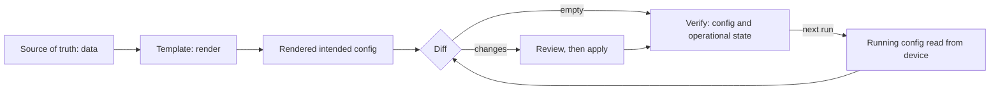

Acme retires its staging environment on Tuesday. Someone deletes the staging segment, VLAN 300 carried as VXLAN network identifier (VNI) 10102, from the system that describes Meridian's network, and that night's automation run reports success on every leaf. Three months later VNI 10102 is handed to a different tenant, and port `swp5` on `leaf1.ams`, still configured for the old segment, puts an unknown server straight into the new tenant's network. Nothing failed. The automation did exactly what it was built to do: it pushed what the intent said, and the intent said nothing about VLAN 300 any more.

This lesson is about the systems network organisations hire software engineers to build: the source of truth that says what the network should be, the loop that turns it into device configuration, the diff that shows where reality differs, and the semantics that decide whether a removal ever reaches the device. It leans on a leaf and its uplinks ([Clos and leaf-spine](/learn/fabric-networking/fabric-architecture/clos-and-leaf-spine)), IS-IS metrics ([IS-IS from zero](/learn/fabric-networking/underlay/is-is-from-zero)) and EVPN segments ([EVPN, the control plane](/learn/fabric-networking/overlays-vxlan-evpn/evpn-the-control-plane)).

## Why automate: the numbers behind it

Three facts drive every network automation programme.

**Changes cause most outages, and people make the changes.** Google's *Site Reliability Engineering* book (2016) attributes roughly 70% of outages to changes in a live system. Google's own study of its network failures ("Evolve or Die", SIGCOMM 2016) found that most failure events began while a management operation, a configuration change, an upgrade or a drain, was in progress. Industry surveys of data-centre outages, such as the Uptime Institute's annual analyses, keep ranking human error (a procedure not followed, or a wrong one) among the leading causes. Hardware fails too, but fabrics are built with redundancy to absorb hardware failures; a wrong change applies to every redundant copy at once.

**Hands do not scale.** Meridian is small: a full-size site has 24 devices (4 spines, 16 leaves, 2 route reflectors, 2 border gateways), so three sites plus the San Jose GPU cluster's switches come to over a hundred. Large operators run tens of thousands. A leaf's configuration is typically several hundred to a few thousand lines. Suppose an engineer typing by hand makes a mistake on 1 change in 200 (an assumption for the arithmetic; real rates depend on the change and the person). Adding Acme's new segment to all 16 Amsterdam leaves then goes wrong somewhere with probability $1 - 0.995^{16} \approx 7.7\%$; across 100 devices it is $1 - 0.995^{100} \approx 39\%$. Automation does not make engineers better typists. It makes the error rate a property of one reviewed template rather than of every keystroke on every device.

**Consistency is a feature.** Sixteen leaves configured by hand become sixteen slightly different leaves ("snowflakes"), and every difference is a question during an incident: is the MTU on `leaf7.ams` different on purpose? With a source of truth, a difference between devices exists only if the data says so.

- **What it solves:** typing errors, inconsistency, slow rollout, and the "who changed this?" question.
- **How it breaks:** automation is an amplifier. A wrong intent or a template bug reaches every device in one run. Facebook's engineering write-up of its October 2021 outage describes a command, issued during routine maintenance to assess backbone capacity, that disconnected every backbone link; an audit tool meant to stop such commands had a bug and let it through. The tooling was the blast radius.
- **What signal shows it:** incidents that started within an hour of a change, the size of each push, and the share of devices changed per run. Batching so that one mistake reaches a few devices first is the subject of [safe change and maintenance](/learn/fabric-networking/operating-fabrics/safe-change-and-maintenance).

## The intent loop

Intent-based automation separates *what the network should be* from *how a device is told*. It is the same idea as infrastructure as code with Terraform or a Kubernetes controller ([containers and infrastructure as code](/learn/senior-craft/software-craft/containers-and-infrastructure-as-code)): declare the desired state, compute the difference from the actual state, act on the difference, check. Six stages:



1. **Source of truth (SoT):** a database or a Git repository holding the network as data: devices, roles, interfaces, cables, addresses, tenants and their segments.
2. **Templates:** code that turns that data into the configuration one device needs.
3. **Rendered config:** the output, the *intended* configuration for that device.
4. **Diff against running:** read what the device is actually running, through its API, and compare.
5. **Apply:** push the change to the device as a transaction.
6. **Verify:** read the configuration back (the diff must now be empty) and check operational state (sessions up, routes present, neighbours as cabled).

The loop then runs again, on a schedule or on every change, and the second run of an unchanged intent must do nothing. That last property, idempotency, has its own section.

### The source of truth: data, not configuration text

The SoT stores facts, not device commands. For `leaf1.ams` it records:

| Object | Value for `leaf1.ams` | Who owns it |
|---|---|---|
| Device | role leaf, site `ams` (site 1), index 11 | Network design |
| Loopback | `10.255.1.11/32`, also its VTEP (VXLAN tunnel endpoint) address | IP address management |
| Fabric links | `swp51` → `spine1.ams`, `swp52` → `spine2.ams`, MTU 9216, IS-IS metric 10 | Network design, cabling |
| Segment Acme | VLAN 100 = L2VNI 10100 on port `swp1` | Tenant provisioning |
| Segment Acme staging | VLAN 300 = L2VNI 10102 on port `swp5` | Tenant provisioning |
| Management | out-of-band address `172.16.1.11` | Operations |

Values that follow from other values are **derived in the template, never stored**. The IS-IS system ID (the 6-byte router name IS-IS uses) comes from the loopback: pad each octet of `10.255.1.11` to three digits and regroup, `0102.5500.1011`. The EVPN route distinguisher, which makes each leaf's routes unique, is `<loopback>:<vni>`, so `10.255.1.11:10100`; the route target that decides which leaves import a route is `65000:<vni>`. Storing them separately would let them disagree with the loopback.

The SoT is also where uniqueness is enforced, because a duplicate is only visible across every device at once. Two leaves with the same loopback, or two tenants on the same VNI, are each valid on the device where they are typed and invalid across the network; the duplicated route target case study in [incidents and what they teach](/learn/fabric-networking/operating-fabrics/incidents-and-what-they-teach) shows what one does to tenant isolation. Real SoTs are products such as NetBox, Infrahub or an in-house service, or YAML files in Git with a schema and CI checks; the choice matters less than having exactly one per fact.

- **Solves:** one place to answer "what should this be?", and a place to validate across devices.
- **Breaks:** two systems claiming the same fact (an IP address manager and a spreadsheet); a SoT that lags reality, so the loop "fixes" correct devices back to stale intent; partial data, such as a query that times out and returns a device with no segments.
- **Signal:** validation failures at commit time in the SoT, the count of facts with more than one writer, and a large deletion count in the next diff, which usually means bad data rather than a large change.

### Templates and the rendered configuration

A template is a function from data to configuration text or to a structured tree. The usual tool is Jinja2 rendering one file per device role and operating system, or plain code that builds a structured model which a small per-platform layer serialises. Two rules make templates safe:

- **Rendering is pure.** No device access, no clock, no randomness: the same data always gives byte-identical output. That makes it testable with golden files (the expected output for a reference device, checked in), and lets a reviewer see a template change's effect on the whole fleet before anything is pushed: re-render every device and diff old render against new.
- **Templates describe what exists.** A loop over `leaf1.ams`'s segments emits lines for each segment present. When the staging segment is deleted from the data, its lines are absent from the render. Nothing in the output says "VLAN 300 used to be here". That is the root of the deletion problem.

The trace from data to rendered lines for `leaf1.ams`, in the vendor-neutral form the rest of this lesson uses (illustrative; a real render is in each operating system's own syntax or data model):

| Data | Rendered setting |
|---|---|
| device name | `hostname` = `leaf1.ams` |
| loopback 10.255.1.11 | `lo` = `10.255.1.11/32`; IS-IS NET `49.0001.0102.5500.1011.00` (area 49.0001 plus the system ID) |
| fabric link swp51 | `swp51` mtu 9216, isis metric 10 |
| fabric link swp52 | `swp52` mtu 9216, isis metric 10 |
| segment Acme | `vlan 100` = vni 10100; RD `10.255.1.11:10100`, RT `65000:10100`; `swp1` access vlan 100 |
| segment Acme staging | `vlan 300` = vni 10102; RD `10.255.1.11:10102`, RT `65000:10102`; `swp5` access vlan 300 |

### Reading the running configuration and diffing

The automation reads the device's running configuration over the out-of-band management network (a separate network that reaches every device's management port, `172.16.0.0/16` at Meridian, described in [planes, ASICs and network operating systems](/learn/fabric-networking/from-zero/planes-asics-and-network-operating-systems)). It uses an API where one exists: NETCONF over SSH on TCP port 830 (RFC 6242), gNMI over gRPC (port 9339 is IANA's assignment, though many deployments use others), NVUE's REST API on Cumulus Linux (port 8765 by default), or the CLI scraped over SSH where nothing better exists. [Configuration APIs](/learn/fabric-networking/operating-fabrics/configuration-apis) covers each transport.

A diff of two text files (what `diff` or Python's `difflib` produce) is the wrong tool for configuration, for three reasons:

- **Hierarchy.** `isis metric 10` means nothing without the interface it sits under. A text diff showing a moved line is useless; a diff of `interface/swp52/isis-metric: 1000 → 10` is a decision a person can approve.
- **Order that does and does not matter.** Interfaces may come back in any order; access-list entries must not be reordered, because the first match wins. Structured diffs compare unordered sections as maps and ordered ones as sequences.
- **Noise.** Devices print a "last changed" timestamp, omit values equal to the default (MTU 1500 is often not shown), abbreviate interface names, and store secrets hashed or re-encrypted, so a rendered plaintext password never matches. Each must be **normalised** before comparison, or every run reports drift that is not real.

So production tools parse both sides into a tree (or read the device's structured model, YANG over NETCONF or gNMI, or NVUE's JSON) and diff trees: for each path, *set* if the intended value is missing or different, *delete* if the device has a path the intent does not. The rest of this lesson uses flat paths such as `interface/swp52/isis-metric` for that tree.

### Apply and verify

Apply sends the change as a transaction where the platform supports one: stage it in a candidate, validate, commit, ideally with a confirmed commit that rolls back by itself if the automation loses contact (traced in [configuration APIs](/learn/fabric-networking/operating-fabrics/configuration-apis)). Verify has two levels, and only the second says the network works:

1. **Config read-back.** Re-read and re-diff. The diff must be empty. A non-empty diff after a "successful" push means the device rejected or reinterpreted part of it, or the push mode left things behind (next section).
2. **Operational checks.** The BGP sessions the intent defines are Established with the expected prefix counts, IS-IS adjacencies are up on every fabric link, LLDP neighbours (the Link Layer Discovery Protocol, IEEE 802.1AB: each switch announces its name and port out of every port, so its neighbour learns who is at the other end of the cable) match the cabling in the SoT, and probes between leaves pass. Correct configuration can still black-hole traffic.

## One night on `leaf1.ams`, traced

Here is the whole loop on one switch, matching the visualisation below (a small example: `leaf1.ams` with two uplinks).

| Step | Source of truth | Rendered | Running on `leaf1.ams` | Diff |
|---|---|---|---|---|
| 1. Normal night | 2 segments | 8 lines | the same 8 lines | empty |
| 2. Incident yesterday | unchanged | 8 lines | `swp52` metric 1000 (manual) | 1 change: drift |
| 3. Triage | unchanged | 8 lines | unchanged | owner approves revert |
| 4. Acme staging retired | 1 segment | 6 lines | 8 lines, metric 1000 | 1 change, 2 deletions |
| 5. Merge push of 6 lines | 1 segment | 6 lines | metric 10, `vlan 300` and `swp5` remain | 2 deletions left |
| 6. Replace push of 6 lines | 1 segment | 6 lines | 6 lines | empty |
| 7. Rerun an hour later | 1 segment | 6 lines | 6 lines | empty, nothing pushed |

Step 2 is **drift**: during an incident an engineer raised `swp52`'s IS-IS metric to 1000 by hand. An IS-IS metric is the cost a router assigns to its own end of a link; with spine1 at 10 and spine2 at 1000, `leaf1.ams` sends everything through `spine1.ams`, keeping its traffic off an optic that was throwing errors ([optics, cabling and the physical layer](/learn/fabric-networking/fabric-architecture/optics-cabling-and-the-physical-layer)). Metrics are one-directional, so traffic from `spine2.ams` down to `leaf1.ams` kept using the link unless the spine's end was raised too: a second manual change on a second device, which a fleet-wide drift sweep also finds. The optic was replaced in the morning, so the override is stale. Step 4 is the deletion from the opening: the render loses two lines. Step 5 is where it goes wrong.

```viz
{"type": "fabric", "scenario": "intent-drift", "title": "The intent loop on leaf1.ams: drift found, a merge push leaves deleted lines behind, replace removes them", "caption": "The source of truth holds data; the automation server at 172.16.0.20 renders eight lines and diffs them against leaf1.ams's running config over the out-of-band network. A manual IS-IS metric of 1000 on swp52 appears as drift and is approved for revert. Acme staging (VLAN 300, VNI 10102 on swp5) is deleted, so the render shrinks to six lines. A merge push fixes the metric but leaves vlan 300 and swp5 on the device; a replace push removes them, and a rerun finds an empty diff and pushes nothing."}
```

After the merge push in step 5 the automation reports success, the metric is back to 10, and `leaf1.ams` still has VLAN 300 mapped to VNI 10102 on `swp5`. It keeps advertising an EVPN type-3 route for VNI 10102 with route target `65000:10102` (type-3 routes tell other leaves "send me broadcast traffic for this VNI", as [BUM traffic](/learn/fabric-networking/overlays-vxlan-evpn/bum-traffic) explains), so every other leaf still configured with VNI 10102 (under merge pushes, all of them) keeps replicating that segment's broadcasts to it. When VNI 10102 is reused, `swp5` joins the new tenant's segment.

## Merge versus replace

Every configuration interface offers two ways to apply a payload, under different names.

- **Merge:** for every setting the payload names, add it or overwrite it. Leave everything else on the device alone. A payload can never remove anything by omission.
- **Replace:** the payload is the complete desired content of the target, the whole configuration or one subtree. The device computes the difference itself and deletes whatever the payload does not contain.

| Platform | Merge | Replace | Explicit delete |
|---|---|---|---|
| NETCONF (RFC 6241) | `edit-config` with `default-operation` merge, which is the default | `operation="replace"` on a subtree, or `default-operation` replace for all of it | `operation="delete"` (an error if absent) or `remove` (no error) |
| gNMI | `update` in a SetRequest | `replace` at a path | `delete` paths; one SetRequest applies deletes, then replaces, then updates, as one transaction |
| Cumulus Linux NVUE | `nv config patch` into a pending revision | `nv config replace` with a full file | `nv unset` |
| SONiC | JSON Patch (RFC 6902) with `config apply-patch` | `config replace`, or `config reload`, which reloads the whole database and restarts services | `remove` operations in a patch |
| Junos | `load merge` | `load override` (whole) or `load replace` (marked stanzas) | `delete` statements |
| Arista EOS | configuration added in a config session | `configure replace` | negated (`no`) commands |

The Ansible network resource modules expose the same choice as states `merged`, `replaced` (replace the listed resources) and `overridden` (replace every resource of that type, deleting unlisted ones).

### Why deletions are the hard part

Adding and changing are easy: the rendered intent names the new value and a merge sets it. Deletion is hard for five separate reasons.

1. **Absence is not a statement.** The render lacks VLAN 300, but a missing line could mean "deleted on purpose", "never modelled by this tool" or "the SoT query returned partial data". Only a diff against running state turns an absence into an action, and only an ownership rule tells you whether the action is allowed.
2. **Merge is the default almost everywhere.** It is the safe default for the device vendor, because it never destroys what the payload did not mention. NVUE patches, NETCONF's default operation and gNMI updates all merge, so a pipeline that renders and pushes without diffing never deletes anything.
3. **Ownership.** A device's configuration has many writers: the fabric automation, a tenant-provisioning tool, a security team's access lists, the device's own defaults. A whole-configuration replace deletes everyone else's work, so Meridian's tool replaces only the sections it fully models (interfaces, IS-IS, VLANs, EVPN) and merges or leaves the rest. The [operating BGP safely](/learn/fabric-networking/bgp-in-the-real-world/operating-bgp-safely) lesson traces the opposite failure: an edited prefix list that replaced the entry it was meant to add to, silently withdrawing an announcement.
4. **Dependency order.** A port references a VLAN, the VLAN a VNI, the VNI an EVPN instance with its RD and RT. Creation starts from the referenced object (VNI, VLAN, port); deletion runs the other way (port, VLAN, VNI). Some operating systems reject deleting something still referenced ("VLAN in use"), others cascade. A replace lets the device order the steps; explicit deletes make the tool responsible.
5. **Deletions change forwarding at once.** Removing a BGP neighbour, a route, an access-list entry or a VNI takes effect immediately, and a wrong deletion is usually worse than a wrong addition. Rogers' report to the Canadian regulator on its July 2022 nationwide outage traced it to a staged core upgrade in which a removed routing filter let routes flood its core routers until they failed.

Leftovers are not cosmetic. A stale access-list entry still permits what it permitted. A stale BGP neighbour keeps trying to connect and can come up if someone reuses the address. A stale static route keeps attracting traffic after its network moved. A stale VNI binding is the opening's tenant leak.

### Getting a deletion onto the device

| Approach | How deletions happen | Risk to others' config | Who orders dependent deletes | Review readability | Fits when |
|---|---|---|---|---|---|
| Merge the full render | They do not | None | Nobody | Good, but hides leftovers | Never alone; only with a separate delete step |
| Explicit deletes from the diff | The tool computes them from intended vs running | Low, if scoped to owned sections | The tool | Best: each delete is a reviewed line | Platforms with weak replace support, or shared sections |
| Scoped replace | The device computes them inside the replaced subtree | Low inside the scope, high if the scope is wrong | The device | Good, if the tool shows the device's own diff first | Sections the SoT models completely |
| Full replace | The device deletes everything not rendered | High: unmodelled config is wiped | The device | Poor: huge diffs on first use | Greenfield devices whose whole config is rendered |

A useful SoT pattern on top of any of these is a **tombstone**: instead of deleting the staging segment's record, mark it `decommissioning`. The template renders explicit removals for it, the run that removes it from every leaf is visible and reviewable, and only then is the record dropped.

## Drift detection

**Drift** is any difference between running and intended configuration that the SoT did not cause. A difference the SoT did cause, a change merged an hour ago and not yet pushed, is a **pending change**, and a tool that shows both in one colour trains people to ignore it. Real drift comes from **manual changes**, usually in an incident like `swp52`'s metric, well-intended and then stale; **partial pushes**, a run that timed out after three of five devices or a commit the device partly rejected; **the device itself**, an upgrade that changes a default or adds lines; and **other tools** writing the same section.

Detection is the diff, run continuously. Reading and diffing one device takes on the order of a second or two (it depends on configuration size and the API), so even a 10,000-device fleet with 50 parallel workers at 2 seconds each is $10{,}000 \times 2 / 50 = 400$ seconds, under seven minutes. Sweeps miss changes between runs, so tools also re-diff a device when it reports a commit: a syslog "configuration changed" message, a NETCONF `netconf-config-change` notification (RFC 6470), or a gNMI subscription to configuration paths ([telemetry and observability](/learn/fabric-networking/operating-fabrics/telemetry-and-observability)).

Detection is the easy half. **Triage** decides what each drift means, and a person makes the call, because the tool cannot know which side is right:

| Classification | Example | Action |
|---|---|---|
| Misconfiguration | a typo'd MTU of 9126 on a fabric link | revert to intent |
| Stale override | `swp52`'s metric after the optic was fixed | revert, with the owner's approval |
| Live exception | the metric while the optic is still bad | record it in the SoT as an exception with an owner and an expiry, so the diff stops reporting it until then |
| Intent lagging reality | a cable moved to a new port, the SoT not updated | fix the SoT, not the device |
| Noise | a reordered section, a default value printed | fix normalisation, so it never appears again |

The last row matters most for adoption: a report of 4,000 noisy lines is ignored, and the 3 real ones inside it with it. Track **config debt** (known, accepted, expiring exceptions) separately from misconfiguration, and age every open drift: a 3-hour-old override during an incident is normal, a 90-day-old one is the next incident.

- **Solves:** devices quietly diverging from what everyone believes they run.
- **Breaks:** noise drowns signal; auto-revert undoes an emergency fix mid-incident (which is why reverts need a human or an exception mechanism); detection only on a nightly timer misses a change made and reverted in between.
- **Signal:** drift count and age per device and per section, the share of devices in sync, and drift opened within an hour of an incident.

## Idempotency

An operation is idempotent when doing it twice has the same effect as doing it once, $f(f(x)) = f(x)$. For the intent loop it means that a rerun with unchanged intent changes nothing, and pushing the same payload twice leaves the device as one push did. It matters in two places.

- **Retries and partial failures.** A push times out. Did it land? If the operation is idempotent, the safe answer is "re-diff and push whatever is left", and rerunning after a half-finished run takes every device to intent from wherever it ended up. The same reasoning applies to API calls in distributed systems ([idempotency and retries](/learn/system-design/building-blocks/idempotency-and-retries)).
- **Continuous reconciliation.** A loop that runs every few minutes is only safe if a converged device produces an empty diff and an empty push. Then every non-empty diff means something: drift or a pending change, never noise.

Declarative "set this path to this value" operations are idempotent. Imperative ones often are not:

- **Appends.** An access-list entry added without a sequence number is appended, and on platforms that do not reject exact duplicates a second run adds a second copy. Render ordered lists with explicit sequence numbers and diff them as ordered sequences.
- **Create.** NETCONF's `create` fails if the object exists, so a retry errors after a push that actually landed.
- **Actions that are not configuration:** clearing counters, resetting a BGP session, reloading. Each run repeats the effect; keep them out of the loop, behind explicit procedures.
- **Renders that are not stable:** a timestamp in a comment, a set iterated in hash order (Python randomises string hashes per process, so a set of VLAN names can come out in a different order each run), a generated password. Every run then produces a non-empty diff.

The test is worth automating: render, push, read back, render again, and assert both the diff and the second push are empty.

## The loop in code

A complete model of the loop for `leaf1.ams`: a SoT record, a pure render with derived values, a diff scoped to owned sections, and a device that applies merge and replace as real platforms do. It renders the RD and RT per VNI too, so the staging deletion is four paths rather than the visualisation's two lines.

```python
"""The intent loop for one leaf: render from data, diff against running, push, verify."""
import copy

SOT = {  # the source of truth: data about leaf1.ams, no configuration text
    "name": "leaf1.ams", "site": 1, "index": 11,
    "fabric_links": [("swp51", "spine1.ams"), ("swp52", "spine2.ams")],
    "segments": [
        {"tenant": "Acme", "vlan": 100, "vni": 10100, "port": "swp1"},
        {"tenant": "Acme staging", "vlan": 300, "vni": 10102, "port": "swp5"},
    ],
}
MANAGED = ("hostname", "interface", "isis", "vlan", "evpn")   # sections this tool owns


def system_id(ip):                       # 10.255.1.11 -> 0102.5500.1011
    digits = "".join(f"{int(o):03d}" for o in ip.split("."))
    return ".".join(digits[i:i + 4] for i in range(0, 12, 4))


def render(dev):
    """Pure function: the same data always gives the same flat {path: value} tree."""
    lo = f"10.255.{dev['site']}.{dev['index']}"
    cfg = {"hostname": dev["name"], "interface/lo/address": f"{lo}/32",
           "isis/net": f"49.0001.{system_id(lo)}.00"}
    for port, peer in dev["fabric_links"]:
        cfg[f"interface/{port}/description"] = f"to {peer}"
        cfg[f"interface/{port}/mtu"] = 9216
        cfg[f"interface/{port}/isis-metric"] = 10
    for seg in dev["segments"]:
        cfg[f"vlan/{seg['vlan']}/vni"] = seg["vni"]
        cfg[f"evpn/vni/{seg['vni']}/rd"] = f"{lo}:{seg['vni']}"      # derived, not stored
        cfg[f"evpn/vni/{seg['vni']}/rt"] = f"65000:{seg['vni']}"
        cfg[f"interface/{seg['port']}/access-vlan"] = seg["vlan"]
    return cfg


def owned(path):                         # segment boundary: "interface/swp5" is not "interface/swp52"
    return any(path == m or path.startswith(m + "/") for m in MANAGED)


def diff(intended, running):
    sets = {p: v for p, v in intended.items() if running.get(p) != v}
    deletes = {p: v for p, v in running.items() if p not in intended and owned(p)}
    return sets, deletes


def push(running, payload, mode):
    """What the device does with a payload: merge keeps the rest, replace drops it."""
    if mode == "merge":
        return {**running, **payload}
    kept = {p: v for p, v in running.items() if not owned(p)}   # replace, scoped to MANAGED
    return {**kept, **payload}


def report(label, intended, running):
    sets, deletes = diff(intended, running)
    print(f"{label}: {len(sets)} to set, {len(deletes)} to delete")
    for p, v in sorted(sets.items()):
        print(f"   ~ {p:30} {running.get(p)} -> {v}")
    for p, v in sorted(deletes.items()):
        print(f"   - {p:30} {v}")


running = render(SOT)                                   # the device starts in sync ...
running["snmp/community"] = "netops-ro"                 # ... plus a section another team owns
running["interface/swp52/isis-metric"] = 1000           # yesterday's manual override: drift
report("night 1", render(SOT), running)

sot = copy.deepcopy(SOT)
sot["segments"] = [s for s in sot["segments"] if s["tenant"] != "Acme staging"]
intended = render(sot)                                  # the staging segment vanishes
report("staging deleted", intended, running)

after_merge = push(running, intended, "merge")
report("after merge", intended, after_merge)

after_replace = push(running, intended, "replace")
report("after replace", intended, after_replace)
print("   snmp/community survived:", after_replace.get("snmp/community"))
report("rerun", render(sot), after_replace)             # idempotent: nothing to push
```

```text
night 1: 1 to set, 0 to delete
   ~ interface/swp52/isis-metric    1000 -> 10
staging deleted: 1 to set, 4 to delete
   ~ interface/swp52/isis-metric    1000 -> 10
   - evpn/vni/10102/rd              10.255.1.11:10102
   - evpn/vni/10102/rt              65000:10102
   - interface/swp5/access-vlan     300
   - vlan/300/vni                   10102
after merge: 0 to set, 4 to delete
   - evpn/vni/10102/rd              10.255.1.11:10102
   - evpn/vni/10102/rt              65000:10102
   - interface/swp5/access-vlan     300
   - vlan/300/vni                   10102
after replace: 0 to set, 0 to delete
   snmp/community survived: netops-ro
rerun: 0 to set, 0 to delete
```

Four lines carry the design. `owned()` checks prefixes on `/` boundaries, so owning `interface/swp5` never claims `interface/swp52`. `diff()` proposes deletions only inside owned sections, so `snmp/community` is never touched. `push(..., "merge")` is a dictionary update, which cannot remove a key: the deletion problem in one line. The replace keeps unowned paths, the scoped replace from the trade-offs table; with `MANAGED` covering everything it becomes a full replace and the SNMP community disappears.

## Under the hood: how a device takes a configuration

Most modern network operating systems separate the configuration being edited from the one that runs. Junos, IOS XR, Arista EOS configuration sessions and NETCONF devices with the `:candidate` capability stage edits in a **candidate**; `commit` makes it running in one step, and a failed commit changes nothing. Cumulus Linux's NVUE builds a pending **revision** from a patch or replace and keeps the previous one for rollback. SONiC keeps configuration in CONFIG_DB, a Redis database the daemons subscribe to; its generic configuration updater applies JSON patches with checkpoints, while `config reload` rewrites the whole database and restarts services, which interrupts forwarding. Older devices have no transaction: each CLI line takes effect as typed, so a push that dies halfway leaves a half-applied change. [Configuration APIs](/learn/fabric-networking/operating-fabrics/configuration-apis) traces each of these.

What matters here is who computes the deletions. On a replace into a candidate, the device works out what to remove and in which order. Without one, the tool must compute the deletions, order them by dependency and send them as separate commands, and its own diff is the only record of what should happen.

## Failure modes in production

**Deleted intent left on the device.** *Symptom:* a tenant segment, BGP neighbour or access-list entry that the SoT dropped months ago is still configured; found during an audit or, worse, when the identifier is reused. *Diagnosis:* the diff against running shows deletions that every run reported but never applied; the push mode is merge. *Fix:* push owned sections as replace, or apply the diff's deletions explicitly, and alert when the post-push diff is not empty.

**A replace that deleted someone else's configuration.** *Symptom:* after a routine push, a security team's access list or a monitoring configuration is gone. *Diagnosis:* the replace scope covered a section the SoT does not fully model; the pre-push diff showed the deletions, but nobody reads a 300-line diff. *Fix:* declare ownership per section, replace only owned sections, and require explicit approval for any push whose deletions fall outside the owned set.

**An empty intent pushed as replace.** *Symptom:* a device loses every VLAN or every BGP session at once. *Diagnosis:* the SoT returned a partial record (a timeout, a filter bug, a half-finished migration) and the tool rendered a configuration with nothing in it; replace did the rest. *Fix:* a circuit breaker on diff size. Refuse any push that deletes more than a threshold (for example 10% of owned lines, or any BGP neighbour without a linked change) until a person approves.

**A template bug reaching the fleet.** *Symptom:* a whole role changes at once, for example every leaf's MTU drops after a template edit. *Diagnosis:* the fleet-wide re-render diff showed the change on every device; nobody had a golden-file test for that value. *Fix:* golden files per role, the fleet re-render diff in code review, and staged rollout through canaries ([safe change and maintenance](/learn/fabric-networking/operating-fabrics/safe-change-and-maintenance)).

## What the platform should show

The software engineer's job is to make intent versus reality visible before anyone asks. Surface:

- **The diff, first.** For every device, intended versus running, as structured paths with old and new values, split into *drift* and *pending change*. It is the most useful single view in network automation.
- **Deletions as a separate, louder class.** Count them, show them first, and flag any that fall outside owned sections or exceed a size threshold.
- **The post-push diff.** "Push succeeded" is meaningless without "and the diff is now empty". A non-empty post-push diff is an alert.
- **Drift age and owner.** Exceptions with an expiry and a name; anything past expiry turns red.
- **Operational verification beside config verification:** sessions, adjacencies, LLDP neighbours against intended cabling, probe results.
- **Change correlation.** Every push recorded with who, what, when and the diff applied, so an incident timeline can ask "what changed in the last hour?" ([the troubleshooting method](/learn/fabric-networking/operating-fabrics/the-troubleshooting-method)).
- **Two views of the same data.** The engineer wants "this device, these 3 lines, approve or adopt"; a manager wants "97% of the fleet in sync, 12 exceptions, 2 past expiry". Same diff, two aggregations.

## Interviewer follow-ups

**"Your source of truth and the device disagree. Which one wins?"** Model answer: neither silently. The disagreement is an event, classified as drift, pending change or noise, and a person decides whether to revert the device or update the SoT, because an emergency override may be correct and the SoT may be stale. I would build continuous diffs, exceptions with an owner and an expiry, and auto-revert only where the team has agreed the SoT is always right. Common wrong answer: "the source of truth always wins, so we overwrite the device", which reverts an engineer's fix in the middle of an incident.

**"You removed a VLAN from the source of truth and it is still on the switch. Why?"** Model answer: the push merged. A merge sets what the payload names and never removes what it omits, and the render cannot name something that no longer exists. Fix it with a diff against running that produces explicit deletions in dependency order, or a replace scoped to the section we own. Common wrong answer: "the push must have failed", when it succeeded exactly as designed.

**"Why not replace the whole configuration every time? It's simpler."** Model answer: it is simpler only if the SoT models every line on the device. Defaults, other teams' sections and platform-generated configuration get deleted, and a partial SoT read becomes an outage. I would replace the subtrees we fully own, merge or leave the rest, and put a size limit on deletions. Whether a platform's replace is disruptive (some restart services) I would confirm with the network team per operating system. Common wrong answer: "replace is always safer because it is declarative".

**"How do you know your automation is idempotent?"** Model answer: run the loop twice; the second diff and push must be empty. When they are not, the usual causes are unstable renders, appends without sequence numbers, `create` instead of merge, and normalisation gaps. Common wrong answer: "the tool is declarative, so it's idempotent by definition".

## What mid-level engineers get wrong

- **Assuming "push succeeded" means "device matches intent".** Under merge, deletions never arrive and the success is real. Always re-diff after a push.
- **Diffing configuration as text.** Ordering and defaults produce noise, hierarchy is lost, and the report is ignored.
- **Replacing sections the tool does not own.** Another team's work disappears on a routine run.
- **Prefix ownership checks without a boundary.** `startswith("interface/swp5")` claims `swp52`, and the tool deletes configuration on a port it never managed.

## Exercise: a drift report

Write the diff at the heart of the loop. Practise the same idea at scale in [config drift](/practice/config-drift).

```exercise
id: drift-report
title: Diff intended against running, scoped to owned sections
prompt: |
  Configurations are flat objects mapping a path (segments joined by "/",
  such as "interface/swp52/isis-metric") to a value (a string or an integer).
  Given the `intended` config rendered from the source of truth, the `running`
  config read from the device, and `managed`, the list of path prefixes this
  tool owns, return the changes that bring the device to intent:

  - ["set", path, intended_value] for every intended path that is missing from
    running or has a different value. Compare values strictly: 9216 and "9216"
    differ (normalising is a separate stage). Sets apply to any path.
  - ["delete", path, running_value] for every running path that is not in
    intended AND is owned. A prefix owns a path if the path equals the prefix
    or starts with the prefix followed by "/": "interface/swp5" owns
    "interface/swp5/access-vlan" but not "interface/swp52/mtu".

  Return all deletes first, then all sets; within each group, sort by path
  using plain string comparison (code-point order, as Python's sorted and
  JavaScript's default sort do). An in-sync device returns [].

  For leaf1.ams after Acme staging is retired (metric 1000 on swp52, vlan 300
  and swp5 left over, managed ["hostname", "interface", "vlan"]) the answer is
  [["delete", "interface/swp5/access-vlan", 300], ["delete", "vlan/300/vni", 10102],
  ["set", "interface/swp52/isis-metric", 10]].
languages: [python, javascript]
entry: drift_report
starter:
  python: |
    def drift_report(intended, running, managed):
        changes = []
        # TODO: deletes (owned paths only), then sets, each sorted by path
        return changes
  javascript: |
    function drift_report(intended, running, managed) {
      const changes = [];
      // TODO: deletes (owned paths only), then sets, each sorted by path
      return changes;
    }
tests:
  - args: [{"hostname": "leaf1.ams", "interface/lo/address": "10.255.1.11/32", "interface/swp51/mtu": 9216, "interface/swp51/isis-metric": 10, "interface/swp52/mtu": 9216, "interface/swp52/isis-metric": 10, "vlan/100/vni": 10100, "interface/swp1/access-vlan": 100}, {"hostname": "leaf1.ams", "interface/lo/address": "10.255.1.11/32", "interface/swp51/mtu": 9216, "interface/swp51/isis-metric": 10, "interface/swp52/mtu": 9216, "interface/swp52/isis-metric": 1000, "vlan/100/vni": 10100, "interface/swp1/access-vlan": 100, "vlan/300/vni": 10102, "interface/swp5/access-vlan": 300}, ["hostname", "interface", "vlan"]]
    expected: [["delete", "interface/swp5/access-vlan", 300], ["delete", "vlan/300/vni", 10102], ["set", "interface/swp52/isis-metric", 10]]
    label: leaf1.ams after the staging segment is deleted
  - args: [{"hostname": "leaf1.ams", "interface/lo/address": "10.255.1.11/32", "interface/swp51/mtu": 9216, "interface/swp51/isis-metric": 10, "interface/swp52/mtu": 9216, "interface/swp52/isis-metric": 10, "vlan/100/vni": 10100, "interface/swp1/access-vlan": 100}, {"hostname": "leaf1.ams", "interface/lo/address": "10.255.1.11/32", "interface/swp51/mtu": 9216, "interface/swp51/isis-metric": 10, "interface/swp52/mtu": 9216, "interface/swp52/isis-metric": 10, "vlan/100/vni": 10100, "interface/swp1/access-vlan": 100}, ["hostname", "interface", "vlan"]]
    expected: []
    label: "in sync: an empty diff"
  - args: [{"hostname": "leaf1.ams", "interface/lo/address": "10.255.1.11/32", "interface/swp51/mtu": 9216, "interface/swp51/isis-metric": 10, "interface/swp52/mtu": 9216, "interface/swp52/isis-metric": 10, "vlan/100/vni": 10100, "interface/swp1/access-vlan": 100}, {"hostname": "leaf1.ams", "interface/lo/address": "10.255.1.11/32", "interface/swp51/mtu": 9216, "interface/swp51/isis-metric": 10, "interface/swp52/mtu": 9216, "interface/swp52/isis-metric": 10, "vlan/100/vni": 10100, "interface/swp1/access-vlan": 100, "snmp/community": "netops-ro", "interface/swp9/description": "temp"}, ["interface", "vlan"]]
    expected: [["delete", "interface/swp9/description", "temp"]]
    label: another team's section is left alone
  - args: [{"interface/swp52/isis-metric": 10, "interface/swp5/mtu": 9216}, {"interface/swp52/isis-metric": 1000, "interface/swp52/description": "to spine2.ams", "interface/swp5/mtu": 9216, "interface/swp5/access-vlan": 300}, ["interface/swp5"]]
    expected: [["delete", "interface/swp5/access-vlan", 300], ["set", "interface/swp52/isis-metric", 10]]
    label: swp5 does not own swp52
  - args: [{"hostname": "leaf2.ams", "interface/lo/address": "10.255.1.12/32", "vlan/100/vni": 10100}, {}, ["hostname", "interface", "vlan"]]
    expected: [["set", "hostname", "leaf2.ams"], ["set", "interface/lo/address", "10.255.1.12/32"], ["set", "vlan/100/vni", 10100]]
    label: "a fresh device: everything is a set"
  - args: [{}, {"vlan/100/vni": 10100, "vlan/300/vni": 10102, "hostname": "leaf1.ams"}, ["vlan"]]
    expected: [["delete", "vlan/100/vni", 10100], ["delete", "vlan/300/vni", 10102]]
    label: an empty intent deletes everything it owns
    hidden: true
  - args: [{"hostname": "leaf1.ams", "interface/swp51/mtu": 9216}, {"hostname": "leaf1-old", "interface/swp51/mtu": "9216", "ntp/server": "172.16.0.5"}, ["hostname"]]
    expected: [["set", "hostname", "leaf1.ams"], ["set", "interface/swp51/mtu", 9216]]
    label: strict comparison and a prefix equal to the path
    hidden: true
hints:
  - "A path is owned when it equals a managed prefix or starts with that prefix plus \"/\"; a bare startswith makes swp5 own swp52."
  - "Check membership with `in` (Python) or hasOwnProperty (JavaScript) rather than comparing a missing value to undefined."
  - "Build the delete list and the set list separately, sort each by path, then concatenate."
```

The hidden empty-intent test is the empty-intent failure mode in miniature: a correct diff of nothing deletes everything it owns, which is why the push needs a size limit in front of it, not a different diff.

## Senior signals

- You describe automation as a loop (source of truth, render, diff against running, apply, verify) and say that its value is the diff, not the push.
- You know merge is the default nearly everywhere and cannot express a deletion, and you choose per section between explicit deletes and a scoped replace, based on who owns the section.
- You treat a disagreement between SoT and device as an event to triage (drift, pending change, noise, exception), not an instruction to overwrite.
- You put a limit on deletions per push, because an empty or partial intent rendered as replace is an outage.
- You verify twice: an empty post-push diff, then operational state, because correct configuration can still drop traffic.
- You prove idempotency by running the loop twice, and keep imperative actions out of it.

## Check yourself

```quiz
- q: >-
    The source of truth no longer contains Acme's staging segment (VLAN 300, VNI 10102). The automation renders leaf1.ams's config and pushes it in merge mode; the push reports success. What is on the device afterwards?
  options: ["The push is rejected, since VLAN 300 conflicts with the render", "VLAN 300 is removed, since the render no longer contains it", "VLAN 300 is disabled but kept, since merge marks absent lines inactive", "VLAN 300 is still configured, since merge only sets named paths"]
  answer: 3
  explanation: >-
    A merge adds or overwrites every setting the payload names and leaves everything else alone, and a render can only name what exists. VLAN 300 is not named, so it stays, and the device keeps advertising its EVPN type-3 route. Removing it needs an explicit delete computed from a diff against running, or a replace of the section. Nothing conflicts and nothing is marked inactive; the push succeeded exactly as designed.
- q: >-
    A tool decides which running paths it may delete by checking whether the path starts with a managed prefix. It manages "interface/swp5". Which running path would it wrongly treat as its own?
  options: ["interface/swp5/access-vlan, since swp5 is managed", "interface/swp51/mtu, since swp51 sorts before swp52", "vlan/300/vni, since swp5 references VLAN 300", "interface/swp52/mtu, since the string starts with swp5"]
  answer: 3
  explanation: >-
    "interface/swp52/mtu" begins with the characters "interface/swp5", so a bare prefix test claims it. Ownership must be checked on segment boundaries: the path equals the prefix or starts with the prefix plus "/". interface/swp5/access-vlan is genuinely owned. The VLAN path does not start with the prefix at all, and swp51 does not either; sort order is irrelevant.
- q: >-
    The nightly diff shows swp52's IS-IS metric at 1000 on the device and 10 in the source of truth. An engineer set it during an incident. What should the platform do?
  options: ["Ignore it, since IS-IS metrics are operational state, not config", "Revert it automatically, since the source of truth always wins", "Raise it as drift for the owner to revert or record as an exception", "Update the source of truth to 1000, since the device reflects reality"]
  answer: 2
  explanation: >-
    Either side can be right: the override may still be needed (the optic still failing) or be stale (the optic replaced). A person decides, and the platform records the decision: revert, or an exception with an owner and an expiry so the diff stops reporting it until then. Automatic revert can undo an emergency fix mid-incident, and blindly adopting the device value turns every manual change into intent. The metric is configuration, not operational state.
- q: >-
    A source-of-truth query times out and returns leaf1.ams with no segments. The automation renders and pushes the VLAN and EVPN sections in replace mode. What happens, and what guard prevents it?
  options: ["Only new VLANs are blocked; the existing ones are kept until a merge", "Every VLAN on the leaf is deleted; a limit on deletions per push stops it", "The device rejects the replace; empty sections are invalid in every NOS", "Nothing changes; replace mode skips sections whose payload is empty"]
  answer: 1
  explanation: >-
    Replace makes the payload the complete content of the section, so an empty section means delete everything in it, and every tenant on the leaf loses connectivity. The diff is correct given its input; the fix is a circuit breaker in front of the push that refuses deletions above a threshold without human approval. Devices do not treat empty payloads specially, and replace does not fall back to merge.
- q: >-
    How do you show that an automation run is idempotent?
  options: ["Run it once and check that the push reported no errors", "Run it twice and confirm the second diff and push are both empty", "Compare the rendered configs of two devices with the same role", "Use only declarative tools, which are idempotent by definition"]
  answer: 1
  explanation: >-
    Idempotency means a second run with unchanged intent changes nothing, so the test is to run, read back, render again and confirm the diff and the push are empty. A declarative tool can still be non-idempotent through unstable renders (timestamps, unordered iteration), appends without sequence numbers or normalisation gaps. A clean first push says nothing about the second, and comparing two devices tests consistency, not idempotency.
```
