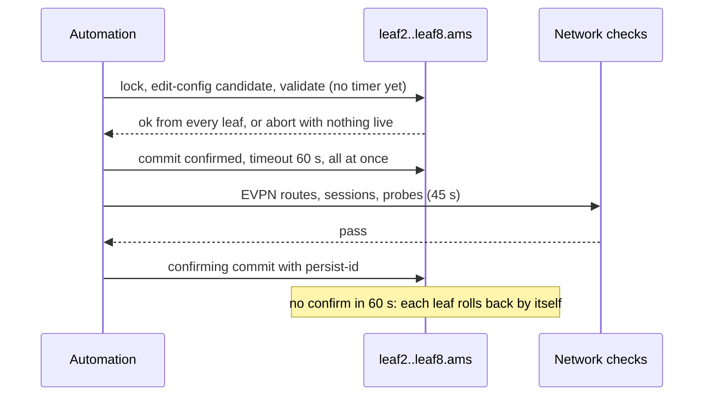

The automation server at Meridian has to tighten one access list on 24 devices in Amsterdam. Over SSH, with a script typing CLI lines, that is 24 small gambles: line 7 of 12 may fail after lines 1 to 6 took effect, the next software release may print the output the script parses differently, an engineer may be editing the same list at the same moment, and if the new list blocks the server's own address, the script loses the device with no way back in. None of those risks comes from the change; they come from the interface.

A configuration API removes them by making a change *data* that follows a schema, applied as a *transaction* that succeeds or fails whole, with a *lock* against concurrent editors and, at its best, a *timer* that undoes the change unless the tool confirms it still has control. The sections below take YANG (the schema language), NETCONF, gNMI with OpenConfig, NVUE and SONiC in turn, then ask what "transactional" means when no device can commit for another. [Network automation and the source of truth](/learn/fabric-networking/operating-fabrics/network-automation-and-source-of-truth) covers what the tool sends (intent, diff, merge versus replace); this lesson covers how it gets there.

## What a CLI cannot give a program

A **CLI** (command-line interface) is designed for a person: you type a line, the device applies it at once and prints text meant for eyes. "CLI scraping" is a program pretending to be that person: open SSH, wait for a prompt, send a line, read until the next prompt, and pull values out of the text with regular expressions (Netmiko automates the waiting; TextFSM keeps the regexes in templates). It works on every device ever built, which is why it never quite goes away. What it costs:

- **No structure.** A regex that read `Input errors: 0` silently returns nothing when the next release prints `input errors 0`, and the tool reports "no errors" because it found none.
- **No transaction.** Each line takes effect as it is accepted. If a push of 12 lines fails at line 7, lines 1 to 6 are live in a state nobody reviewed.
- **No structured errors.** Failure is free text such as `% Invalid input detected`, different on every vendor; missing it means continuing on a broken base.
- **No concurrency control.** An engineer at the console and a script can interleave edits to the same object.
- **Hidden interaction.** Pagination (`--More--`) and confirmation prompts must each be handled, or the session hangs.

Arista's eAPI (CLI commands as JSON-RPC over HTTPS) and `| json` on `show` commands fix parsing, not transactions: plain commands still apply one at a time. A transaction needs the platform's own staging feature on top, such as EOS configuration sessions, which build a change aside, commit it as a unit and can take a commit timer.

**What an API solves:** structured data, a schema, all-or-nothing changes, locks and machine-readable errors. **How scraping breaks:** half-applied pushes and silent parse failures after an upgrade. **Signal:** a device whose running configuration matches neither the old nor the new intent after a failed run, and parsers returning empty results right after a software upgrade.

## YANG: the schema that turns configuration into data

The modern device APIs were shaped by an operators' workshop in 2002 (RFC 3535), which asked for exactly what the CLI lacked: configuration separated from state, transactions, and text formats tools can diff. **YANG** is the schema half: a language describing the tree of configuration and state a device holds (RFC 6020 in 2010, YANG 1.1 in RFC 7950 in 2016). It is to configuration what a database schema is to rows. The building blocks:

| YANG statement | What it declares | In the MGMT-IN example |
|---|---|---|
| `container` | A node that groups children | `acls`, `interfaces` |
| `list` with `key` | A keyed collection: entries are addressed by the key, which must be unique | ACL entries keyed by `seq` |
| `leaf` with a `type` | One typed value: built-in (`uint32`, `string`, `enumeration`) or derived (`inet:ipv4-prefix`) | `src` of type ipv4-prefix, `action` an enumeration of permit or deny |
| `type leafref` | A value that must equal an existing leaf elsewhere in the tree, a foreign key | an interface's `acl-in` must name an ACL that exists |
| `must`, `when`, `mandatory` | Constraints: `must` and `when` are XPath expressions; `mandatory` says a leaf must be present | an interface's ACL must contain at least one permit |
| `config false` | Operational state the device reports, not something you set | counters, the applied revision |
| `augment`, `deviation` | One module adds nodes to another; a vendor declares where it departs from a standard model | a vendor adding a leaf to an OpenConfig ACL; a device declaring a leaf "not supported" |

The same tree is encoded as XML for NETCONF and as JSON for gNMI and RESTCONF (RFC 7951). Models come in three families: **IETF** models from the standards body, vendor-neutral **OpenConfig** models written by large operators (below), and **native** models each vendor publishes for its full feature set.

A device that knows the schema can check a candidate before applying it. The code does what a YANG-driven validator does with the opening's MGMT-IN change (types, key uniqueness, leafref, a `must` constraint), then a check the schema cannot express.

```python
import ipaddress

ACTIONS = {"permit", "deny"}  # YANG: type enumeration


def validate(cfg):
    """What a YANG-driven <validate> checks: types, keys, references, constraints."""
    errors = []
    for name, entries in cfg["acls"].items():
        seqs = [e["seq"] for e in entries]
        if len(seqs) != len(set(seqs)):                      # list key must be unique
            errors.append(f"acl {name}: duplicate key seq")
        for e in entries:
            try:
                ipaddress.ip_network(e["src"])               # type inet:ipv4-prefix
            except ValueError:
                errors.append(f"acl {name} seq {e['seq']}: '{e['src']}' is not an ipv4-prefix")
            if e["action"] not in ACTIONS:
                errors.append(f"acl {name} seq {e['seq']}: bad enum '{e['action']}'")
    for ifname, intf in cfg["interfaces"].items():
        ref = intf.get("acl-in")
        if ref is not None and ref not in cfg["acls"]:        # leafref to an existing acl
            errors.append(f"interface {ifname}: acl-in '{ref}' does not exist")
        elif ref and not any(e["action"] == "permit" for e in cfg["acls"].get(ref, [])):
            errors.append(f"interface {ifname}: must-constraint, acl-in needs a permit")
    return errors or ["ok"]


def admits(cfg, ifname, addr):
    """Intent, not schema: would this interface's inbound ACL let `addr` in?"""
    for e in sorted(cfg["acls"][cfg["interfaces"][ifname]["acl-in"]], key=lambda e: e["seq"]):
        if ipaddress.ip_address(addr) in ipaddress.ip_network(e["src"]):
            return e["action"] == "permit"
    return False                                              # implicit deny at the end


def candidate(src="172.16.0.2/32", ref="MGMT-IN"):
    return {
        "acls": {"MGMT-IN": [{"seq": 10, "src": src, "action": "permit"},
                             {"seq": 20, "src": "172.16.10.0/24", "action": "permit"}]},
        "interfaces": {"eth0": {"ipv4": "172.16.1.11/16", "acl-in": ref}},
    }


print("typo /32:     ", validate(candidate()))
print("prefix /33:   ", validate(candidate(src="172.16.0.20/33")))
print("wrong acl ref:", validate(candidate(ref="MGMT-IM")))
c = candidate()
print("intent check:  automation 172.16.0.20 admitted?", admits(c, "eth0", "172.16.0.20"),
      "| jump host 172.16.10.5 admitted?", admits(c, "eth0", "172.16.10.5"))
```

```text
typo /32:      ['ok']
prefix /33:    ["acl MGMT-IN seq 10: '172.16.0.20/33' is not an ipv4-prefix"]
wrong acl ref: ["interface eth0: acl-in 'MGMT-IM' does not exist"]
intent check:  automation 172.16.0.20 admitted? False | jump host 172.16.10.5 admitted? True
```

The first line is the lesson. The intended entry was `172.16.0.20/32`, the automation server's own address; the input had a typo, `172.16.0.2/32`. That is a perfectly typed prefix, so validation passes, and the configuration would lock the automation out of `leaf1.ams` (management address `172.16.1.11`). **Validation proves a configuration is well formed, never that it is what you meant.** The last line, a semantic check the tool runs itself, catches it.

**What YANG solves:** one machine-readable definition of what a valid configuration is, so tools and devices agree before anything is applied. **How it breaks:** the device implements a different revision of the model, or declares a deviation, and a leaf the tool sets is rejected or ignored. **Signal:** `rpc-error` replies naming an unknown element, or a leaf that reads back with a value different from the one written.

## NETCONF: configuration as transactions

**NETCONF** (RFC 6241, 2011, revising RFC 4741 from 2006) is a remote procedure call protocol built from that list of demands. It runs as an SSH subsystem on **TCP port 830** (RFC 6242), carries XML, and grew out of Juniper's XML API for Junos, which is why its candidate-and-commit model matches Junos so closely; Nokia, Cisco IOS XR and many others implement it too.

### The session

1. The client opens SSH to port 830 and requests the `netconf` subsystem.
2. Both sides send a `<hello>` listing **capabilities**, URIs naming optional features (`:candidate`, `:validate`, `:confirmed-commit`, `:rollback-on-error`) plus the YANG modules supported (listed in the hello itself for YANG 1.0, or in a separate YANG library the client reads, RFC 8525, for YANG 1.1). The server assigns a **session-id**. A server without `:candidate` rejects `target candidate`, so check first.
3. Each `<rpc message-id="101">` is answered by an `<rpc-reply message-id="101">` holding `<ok/>`, data, or an `<rpc-error>` with a machine-readable `error-tag` (`lock-denied`, `in-use`, `invalid-value`) and the path of the offending element.
4. Framing: NETCONF 1.0 ended each message with `]]>]]>`, which breaks if that string appears in data; 1.1 sends length-prefixed chunks.

### Datastores

A **datastore** is a complete copy of the configuration tree held by the device.

| Datastore | What it is | Who writes it |
|---|---|---|
| running | The configuration in force now | `commit` from candidate, or `edit-config` directly where `:writable-running` is offered |
| candidate | A scratch copy: edits accumulate, nothing on the device changes | `edit-config`; `discard-changes` resets it to running |
| startup | What the device loads at boot | `copy-config` from running, where `:startup` exists; otherwise running is persistent |
| intended, operational | NMDA (RFC 8342, 2018): the configuration after templates and inheritance are expanded, and what the device actually runs, including state | The device; read with `get-data` |

The split between candidate and running is the transaction: a change of any size is built in the candidate, checked, and applied in one step.

### The operations

| Operation | What it does |
|---|---|
| `get-config` / `get` | Read a datastore; `get` adds operational state. A **subtree** or XPath **filter** limits the reply |
| `edit-config` | Change a target datastore. `default-operation` merge (the default), replace or none, and an `operation` attribute per element: merge, replace, create, delete, remove. Merge versus replace semantics are in [the source of truth lesson](/learn/fabric-networking/operating-fabrics/network-automation-and-source-of-truth) |
| `lock` / `unlock` | Exclusive write access to one datastore for this session |
| `validate` | Run the YANG checks on a datastore without applying it |
| `commit` | Make the candidate the running configuration, atomically |
| `commit` with `confirmed` | Commit, but roll back unless confirmed within `confirm-timeout` seconds |
| `cancel-commit` | Roll back a pending confirmed commit now (NETCONF 1.1) |
| `discard-changes` | Throw the candidate away |
| `close-session` / `kill-session` | End this session, or force another one closed, releasing its locks |

An `edit-config` into the candidate for the MGMT-IN change looks like this (illustrative and simplified: the model's namespace and names are invented for the example):

```text
<rpc message-id="102" xmlns="urn:ietf:params:xml:ns:netconf:base:1.0">
  <edit-config>
    <target><candidate/></target>
    <config>
      <acls xmlns="urn:example:acl">
        <acl>
          <name>MGMT-IN</name>
          <entries xmlns:nc="urn:ietf:params:xml:ns:netconf:base:1.0" nc:operation="replace">
            <entry><seq>10</seq><src>172.16.0.20/32</src><action>permit</action></entry>
            <entry><seq>20</seq><src>172.16.10.0/24</src><action>permit</action></entry>
          </entries>
        </acl>
      </acls>
    </config>
  </edit-config>
</rpc>
```

`nc:operation="replace"` on `entries` makes this list the complete new contents, so the old `172.16.0.0/24` entry is removed; everything outside `entries` is merged and left alone.

### Locks

`lock` on the candidate gives one session exclusive write access. Another session's `lock` or `edit-config` fails with `lock-denied` or `in-use`, and the error carries the holder's session-id. On Junos the lock also stops CLI users from committing while it is held. Three rules matter. A lock **dies with its session**, so a crashed tool cannot leave a device locked forever. A lock on a candidate holding someone else's uncommitted edits is refused, because you would commit their work. And a *hung* session whose TCP connection is alive keeps its lock indefinitely: `kill-session` it once you know the holder is dead.

### Commit and confirmed commit

A plain `commit` is atomic: every change in the candidate applies or none does. If a daemon rejects part (a BGP policy naming a missing prefix list, say), running is untouched.

Atomic is not safe. A change can be valid, commit cleanly and still cut the tool off, as the typo does. **Confirmed commit** inverts the default: the commit is a trial, undone unless confirmed.

1. `commit` with `<confirmed/>` and a `confirm-timeout` (RFC 6241's default is 600 s; Junos's `commit confirmed` defaults to 10 minutes). Running becomes the new revision; the device keeps the old one as a rollback point and starts a timer.
2. The tool verifies: can it still reach the device, do routing sessions and traffic look right?
3. A second, plain `commit` within the timeout is the **confirming commit**: the timer stops and the change is permanent.
4. If the timer expires, the device restores the old configuration by itself. Without the `persist` option, the session ending before confirmation also triggers the rollback at once. With `persist` (a token string), the pending commit survives the session, and any new session presenting the token as `persist-id` can confirm or cancel it, which is what a tool that may reconnect needs.

Here is the opening's typo, traced on `leaf1.ams` with a 120-second timeout and persist token `chg-4711`.

```viz
{"type": "fabric", "scenario": "netconf-commit", "title": "Confirmed commit undoing a lockout: a MGMT-IN typo, the session lost, rollback to r41 at 120 s", "caption": "The automation server (172.16.0.20) opens NETCONF to leaf1.ams on port 830, locks the candidate, edits MGMT-IN with the typo 172.16.0.2/32, validates (ok, the prefix is well formed) and commits confirmed with a 120 s timeout and persist token. Its next RPC and a reconnect are both dropped by the new access list; at 120 s leaf1.ams rolls back to r41 by itself, a new session reads r41, and the last frame shows the pre-commit check that would have caught the typo."}
```

The simulator models the same device: datastores, a lock bound to a session, the access list guarding port 830 itself, and the confirm timer. It runs the correct change, the typo with `persist`, and the typo without.

```python
import ipaddress


class Leaf:
    """A NETCONF server's datastores, lock and confirmed-commit timer (RFC 6241)."""

    def __init__(self, acl):
        self.running, self.candidate = {"MGMT-IN": acl}, {"MGMT-IN": acl}
        self.rev, self.lock, self.pending, self.log = 41, None, None, []

    def admits(self, src):                       # MGMT-IN guards port 830 itself
        return any(ipaddress.ip_address(src) in ipaddress.ip_network(p) for p in self.running["MGMT-IN"])

    def rpc(self, t, sid, src, op, **kw):
        self.tick(t)
        if not self.admits(src):
            return self.note(t, f"{op:<16} from {src}: dropped by MGMT-IN, no reply")
        if op == "lock":
            if self.lock not in (None, sid):
                return self.note(t, f"lock             -> rpc-error lock-denied, held by session {self.lock}")
            self.lock = sid
        elif op == "edit-config":
            if self.lock not in (None, sid):
                return self.note(t, "edit-config      -> rpc-error in-use")
            self.candidate = {**self.candidate, **kw["change"]}
        elif op == "commit" and kw.get("confirmed"):
            self.pending = {"deadline": t + kw["timeout"], "rollback": (self.rev, self.running),
                            "persist": kw.get("persist"), "session": sid}
            self.rev, self.running = self.rev + 1, self.candidate
        elif op == "commit" and self.pending:     # the confirming commit
            if self.pending["persist"] and kw.get("persist_id") != self.pending["persist"]:
                return self.note(t, "commit           -> rpc-error invalid-value (persist-id)")
            self.pending = None
        elif op == "get-config":
            return self.note(t, f"get-config       -> running r{self.rev} {self.running['MGMT-IN']}")
        label = "commit confirmed" if kw.get("confirmed") else op
        return self.note(t, f"{label:<16} -> ok, running r{self.rev}")

    def session_end(self, t, sid):
        self.tick(t)
        if self.lock == sid:
            self.lock = None                      # locks die with their session
        if self.pending and self.pending["session"] == sid and not self.pending["persist"]:
            self.rollback(t, "session ended before confirm")  # no persist: roll back now
        else:
            self.note(t, f"session {sid} ended, lock released")

    def tick(self, t):
        if self.pending and t >= self.pending["deadline"]:
            self.rollback(self.pending["deadline"], "confirm-timeout expired")

    def rollback(self, t, why):
        self.rev, self.running = self.pending["rollback"]
        self.candidate, self.pending = self.running, None
        self.note(t, f"ROLLBACK to r{self.rev}: {why}")

    def note(self, t, text):
        self.log.append(f"{t:7.1f}  {text}")


AUTO, OLD = "172.16.0.20", ["172.16.0.0/24", "172.16.10.0/24"]


def change(new, persist):
    leaf = Leaf(OLD)
    leaf.rpc(0.1, 42, AUTO, "lock")
    leaf.rpc(0.2, 42, AUTO, "edit-config", change={"MGMT-IN": new})
    leaf.rpc(0.4, 42, AUTO, "commit", confirmed=True, timeout=120, persist=persist)
    leaf.rpc(3.4, 42, AUTO, "get-config")                            # verify
    if leaf.admits(AUTO):
        leaf.rpc(11.4, 42, AUTO, "commit", persist_id=persist)       # confirm
        leaf.rpc(11.5, 42, AUTO, "unlock")
    else:
        leaf.session_end(33.4, 42)                     # leaf1's SSH keepalives unanswered for 30 s
        leaf.rpc(60.4, 43, AUTO, "lock")                              # reconnect attempt
        leaf.rpc(150.0, 43, AUTO, "get-config")
    print("\n".join(leaf.log) + "\n")


change(["172.16.0.20/32", "172.16.10.0/24"], persist="chg-4711")      # correct edit
change(["172.16.0.2/32", "172.16.10.0/24"], persist="chg-4711")       # the typo, with persist
change(["172.16.0.2/32", "172.16.10.0/24"], persist=None)             # the typo, no persist
```

```text
    0.1  lock             -> ok, running r41
    0.2  edit-config      -> ok, running r41
    0.4  commit confirmed -> ok, running r42
    3.4  get-config       -> running r42 ['172.16.0.20/32', '172.16.10.0/24']
   11.4  commit           -> ok, running r42
   11.5  unlock           -> ok, running r42

    0.1  lock             -> ok, running r41
    0.2  edit-config      -> ok, running r41
    0.4  commit confirmed -> ok, running r42
    3.4  get-config       from 172.16.0.20: dropped by MGMT-IN, no reply
   33.4  session 42 ended, lock released
   60.4  lock             from 172.16.0.20: dropped by MGMT-IN, no reply
  120.4  ROLLBACK to r41: confirm-timeout expired
  150.0  get-config       -> running r41 ['172.16.0.0/24', '172.16.10.0/24']

    0.1  lock             -> ok, running r41
    0.2  edit-config      -> ok, running r41
    0.4  commit confirmed -> ok, running r42
    3.4  get-config       from 172.16.0.20: dropped by MGMT-IN, no reply
   33.4  ROLLBACK to r41: session ended before confirm
   60.4  lock             -> ok, running r41
  150.0  get-config       -> running r41 ['172.16.0.0/24', '172.16.10.0/24']
```

Read the second run row by row. The commit at 0.4 s makes r42 live with a deadline of 120.4 s. The verifying `get-config` at 3.4 s is dropped, because r42 no longer admits `172.16.0.20`. At 33.4 s `leaf1.ams` declares the session dead and releases the lock; the persisted commit survives. The device decides that moment, since the tool's own close is dropped too: it learns the session is gone only when its SSH keepalives go unanswered (30 s here; with only Linux's default TCP keepalive, which starts after two hours, it would not notice before the timer). The reconnect at 60.4 s is dropped, and at 120.4 s the timer restores r41. The third run shows the trade-off of `persist`: without it the rollback comes 87 s sooner, if the device notices the dead session, but a tool whose session merely dropped loses a good change it could have confirmed from a new session. Either way the timer is the backstop.

Confirmed commit does **not** limit the damage: r42 was in force for 120 s, and a change that broke traffic instead of access would have broken it for that long. It also catches only what the verification tests. Size the timeout as verification time plus margin, not "as long as possible".

The happy path is the same two-commit shape the multi-device section repeats on every device:

```viz
{"type": "fabric", "scenario": "netconf-commit", "variant": "confirm", "title": "The happy path: commit confirmed, verify, then the confirming commit with persist-id", "caption": "The same change with the correct entry 172.16.0.20/32: lock, edit the candidate, validate, commit confirmed (120 s), a verification get that succeeds, a confirming commit with persist-id chg-4711 at 109 s left that cancels the rollback timer, then unlock and close-session."}
```

**What confirmed commit solves:** a change that cuts the tool off from the device undoes itself, with nobody at a console. **How it breaks:** the timeout is shorter than commit plus verification, so good changes roll back; or verification does not test what the change could break, so bad changes are confirmed. **Signal:** the device log line "commit confirmed timed out, rolled back", which a platform must alert on: a change the tool may have recorded as done has failed.

## gNMI and OpenConfig

**gNMI** (gRPC Network Management Interface) came out of the OpenConfig operator group in the mid-2010s: the biggest operators wanted one protocol for configuration *and* streaming state on a modern RPC stack. It runs over **gRPC**, HTTP/2 carrying Protocol Buffers messages ([gRPC and protobuf](/learn/networking/application-protocols/grpc-and-protobuf)), with TLS and usually mutual certificates. IANA assigned TCP port 9339; many platforms default to their own (Arista EOS 6030, Nokia SR Linux 57400). It has four RPCs.

| RPC | What it does |
|---|---|
| `Capabilities` | Lists supported models (name, organisation, version) and encodings (`JSON_IETF`, `JSON`, `PROTO`, `ASCII`) |
| `Get` | Returns a snapshot of paths, filtered by type: `CONFIG`, `STATE`, `OPERATIONAL` or `ALL` |
| `Set` | Applies a list of deletes, replaces and updates as one transaction |
| `Subscribe` | Streams updates for paths: once, on poll, or continuously |

### Paths

gNMI addresses everything with a **path**, a list of elements with keys in brackets, like an XPath without the expressions. The access-list entry from the opening, in OpenConfig's ACL model:

```text
/acl/acl-sets/acl-set[name=MGMT-IN][type=ACL_IPV4]/acl-entries/acl-entry[sequence-id=10]/ipv4/config/source-address
```

`acl-set` has a two-part key, name and type, because an IPv4 and an IPv6 list may share a name. A request carries a common **prefix** plus relative paths, and an **origin** naming the model tree (`openconfig`, a vendor's native tree, or `cli` on some platforms).

### Set: one transaction, fixed order

A `SetRequest` holds three lists. The device applies **all deletes, then all replaces, then all updates**, and the specification makes the whole request a transaction: if any operation fails, none takes effect. `update` merges; `replace` makes the value the entire content at that path, deleting whatever below it the value omits; `delete` removes the subtree. The code models those semantics on a tree holding two access lists.

```python
import copy
import json

KNOWN = {"name", "type", "entries", "seq", "src", "action", "acl-sets"}  # leaves the schema has


def walk(tree, path, create=False):
    """Follow '/acl/acl-sets/MGMT-IN' to the parent dict and the last element."""
    *parents, last = path.strip("/").split("/")
    for p in parents:
        if p not in tree:
            if not create:
                raise KeyError(f"path {path}: '{p}' not found")
            tree[p] = {}
        tree = tree[p]
    return tree, last


def merge(dst, src):
    for k, v in src.items():
        if isinstance(v, dict) and isinstance(dst.get(k), dict):
            merge(dst[k], v)
        else:
            dst[k] = copy.deepcopy(v)


def check(value):
    if isinstance(value, dict):
        for k, v in value.items():
            if k not in KNOWN and not (k.isupper() or k.isdigit()):  # list keys: ACL names, seq numbers
                raise ValueError(f"unknown leaf '{k}'")
            check(v)


def gnmi_set(device, delete=(), replace=(), update=()):
    """One SetRequest: deletes, then replaces, then updates, all or nothing."""
    work = copy.deepcopy(device)                               # apply to a copy, swap at the end
    try:
        for path in delete:
            parent, last = walk(work, path)
            parent.pop(last, None)
        for path, value in replace:
            check(value)
            parent, last = walk(work, path, create=True)
            parent[last] = copy.deepcopy(value)                # siblings below `path` are gone
        for path, value in update:
            check(value)
            parent, last = walk(work, path, create=True)
            if isinstance(value, dict) and isinstance(parent.get(last), dict):
                merge(parent[last], value)                     # keeps what the value omits
            else:
                parent[last] = copy.deepcopy(value)
    except (KeyError, ValueError) as err:
        return device, f"rejected, nothing changed: {err}"
    return work, "ok"


def acls(dev):
    return {n: [e["src"] for e in a["entries"].values()] for n, a in dev["acl"]["acl-sets"].items()}


leaf = {"acl": {"acl-sets": {
    "MGMT-IN": {"type": "ipv4", "entries": {"10": {"src": "172.16.0.0/24", "action": "permit"},
                                            "20": {"src": "172.16.10.0/24", "action": "permit"}}},
    "SNMP-IN": {"type": "ipv4", "entries": {"10": {"src": "172.16.0.30/32", "action": "permit"}}}}}}

tight = {"type": "ipv4", "entries": {"10": {"src": "172.16.0.20/32", "action": "permit"},
                                     "20": {"src": "172.16.10.0/24", "action": "permit"}}}
cases = {
    "replace MGMT-IN":       dict(replace=[("/acl/acl-sets/MGMT-IN", tight)]),
    "update MGMT-IN seq 10": dict(update=[("/acl/acl-sets/MGMT-IN/entries/10",
                                           {"src": "172.16.0.20/32"})]),
    "replace at acl-sets":   dict(replace=[("/acl/acl-sets", {"MGMT-IN": tight})]),
    "one bad leaf":          dict(update=[("/acl/acl-sets/MGMT-IN", tight),
                                          ("/acl/acl-sets/SNMP-IN", {"descr": "monitoring"})]),
}
for name, req in cases.items():
    after, status = gnmi_set(leaf, **req)
    print(f"{name:<22} {status}\n{'':<22} {json.dumps(acls(after))}")
```

```text
replace MGMT-IN        ok
                       {"MGMT-IN": ["172.16.0.20/32", "172.16.10.0/24"], "SNMP-IN": ["172.16.0.30/32"]}
update MGMT-IN seq 10  ok
                       {"MGMT-IN": ["172.16.0.20/32", "172.16.10.0/24"], "SNMP-IN": ["172.16.0.30/32"]}
replace at acl-sets    ok
                       {"MGMT-IN": ["172.16.0.20/32", "172.16.10.0/24"]}
one bad leaf           rejected, nothing changed: unknown leaf 'descr'
                       {"MGMT-IN": ["172.16.0.0/24", "172.16.10.0/24"], "SNMP-IN": ["172.16.0.30/32"]}
```

The first two requests reach the same result two ways: a replace of the whole list, and an update of one entry's source that keeps its `action`. The third is the classic gNMI accident: the value is right, the path one level too high, so the replace deletes every sibling the value does not name and the monitoring system's `SNMP-IN` list disappears. The fourth shows the transaction: a valid MGMT-IN update travels with an invalid leaf, and neither half applies.

Base gNMI has no candidate and no confirmed commit: on most implementations a successful `Set` goes straight to running. A commit-confirmed extension now exists in the specification, but support varies by platform and release, so a tool that needs the safety net must check for it or provide its own guard, such as an out-of-band path that can always reach the device.

### Subscribe

`Subscribe` is why many operators adopted gNMI. A `SubscribeRequest` names paths and a mode: `ONCE`, `POLL` (on each client poll) or `STREAM`. Each streamed path has its own mode: `SAMPLE` every `sample_interval` (in nanoseconds), `ON_CHANGE` (only when the value changes, ideal for configuration and session state) or `TARGET_DEFINED`. The device first sends the current value of everything, then a `sync_response` meaning "initial state complete", then updates, each a `Notification` with a nanosecond timestamp and path-value pairs.

An `ON_CHANGE` subscription to the configuration tree turns drift detection from a nightly poll into an event: an engineer's manual edit on `leaf1.ams` reaches the automation within seconds (how fast depends on the platform's implementation). Telemetry use, dial-in versus dial-out and collector placement belong to [telemetry and observability](/learn/fabric-networking/operating-fabrics/telemetry-and-observability).

### OpenConfig models

**OpenConfig** models are vendor-neutral YANG modules written by operators. Their signature is the **config/state split**: every configurable node has a `config` container (what you asked for) and a sibling `state` container (what the device runs, plus counters). After a `Set` of `.../config/mtu` to 9216, `.../state/mtu` tells you whether it was applied: the cheapest verification a tool has.

Coverage is partial: interfaces, BGP, IS-IS and ACLs are well modelled, newer or vendor-specific features (some EVPN details, platform QoS) often are not, so production tools mix `openconfig` and native origins on one device. Vendors publish **deviations** where they skip a leaf or restrict its values, and an unsupported leaf may be accepted and silently ignored. Read the deviations and read back state.

**What gNMI solves:** one protocol, one path syntax and one encoding for configuration and streaming state across vendors. **How it breaks:** a replace at too broad a path deletes siblings; a `Set` reports success for a leaf the device ignores; without the confirmed-commit extension, a lockout needs out-of-band recovery. **Signal:** `config` and `state` values that disagree after a `Set`, and objects that vanish from read-backs after a replace.

## NVUE: one object tree, revisions and REST

On Cumulus Linux 5.x, NVIDIA's network operating system for its Spectrum switches, configuration goes through **NVUE**. There is no NETCONF. The whole configuration is one object tree (interfaces, bridge, EVPN, router, system), readable and writable as JSON or YAML, through the `nv` CLI or a REST API over HTTPS (port 8765, listening only on localhost by default, so remote automation needs it enabled).

The transaction unit is a **revision**:

| Revision | What it holds |
|---|---|
| applied | The configuration in force (the equivalent of running) |
| startup | What loads at boot; `save` copies applied here (newer releases can save on every apply) |
| a numbered pending revision | A change being built: patches accumulate until it is applied or detached |
| operational | What the system actually reports, for reading state |

The REST flow for the MGMT-IN change, illustrative and simplified (exact paths and fields vary by release):

```text
POST  /nvue_v1/revision                         -> {"7": {"state": "pending"}}
PATCH /nvue_v1/acl?rev=7          (JSON body)   -> merged into revision 7
GET   /nvue_v1/?rev=7  vs  GET /nvue_v1/?rev=applied   -> the tool diffs, or asks NVUE for the diff
PATCH /nvue_v1/revision/7   {"state": "apply"}  -> verifying, ready, reloading, applied
GET   /nvue_v1/revision/7                       -> {"state": "applied"}  (or apply_fail with reasons)
```

Mapped onto NETCONF: the pending revision is the candidate, the patch is `edit-config`, apply is `commit`, and save is `copy-config` to startup. Four differences change how the tool is written:

1. **A patch merges.** Removing a block from the payload does not remove it from the device; deletion needs an explicit `unset` (on the REST API, a DELETE of the path in the revision), sent into the same revision as the sets so one apply carries the whole change. NVUE's replace instead loads a complete file as the pending revision, so whatever the file lacks is removed.
2. **Apply is asynchronous.** The tool polls the revision's state. Apply reloads the services whose configuration changed, so know which changes restart a routing daemon and drop BGP sessions.
3. **There is no lock RPC.** Two pending revisions can coexist, so the tool must serialise changes per device itself.
4. **YAML values bite.** NVUE expects the strings `on` and `off`; unquoted, YAML parses them as booleans.

Recent releases also offer an apply that rolls back unless confirmed within a time limit; check the release before a tool relies on it.

**What NVUE solves:** the whole configuration as one tree with a staged, diffable revision and an atomic apply. **How it breaks:** merge semantics leave deleted configuration behind; concurrent revisions race; an apply reloads a daemon. **Signal:** a diff between the source of truth and `rev=applied` that never shrinks after a run, and an apply state stuck before "applied".

## SONiC: configuration is a Redis database

SONiC, the open-source network operating system, runs each function in its own container and connects them through **Redis** databases, as [planes, ASICs and network operating systems](/learn/fabric-networking/from-zero/planes-asics-and-network-operating-systems) traces for a route. Configuration enters the same pipeline from the top:

| Database (index) | Holds | Written by | Read by |
|---|---|---|---|
| CONFIG_DB (4) | The configuration, table by table: `PORT`, `VLAN`, `VLAN_MEMBER`, `ACL_RULE`, `BGP_NEIGHBOR` | The `config` CLI, `config load` / `replace` / `apply-patch`, gNMI or REST management services | The manager daemons (`vlanmgrd`, `intfmgrd`, `vxlanmgrd`, `bgpcfgd`) |
| APPL_DB (0) | What the applications want programmed: VLANs, routes, neighbours | Manager daemons; `fpmsyncd` for routes | `orchagent` |
| ASIC_DB (1) | The same objects as SAI calls (the switch abstraction interface) | `orchagent` | `syncd`, which programs the chip |
| STATE_DB (6) | What actually came up: port operational status, VLAN state, transceiver data | Daemons, after they act | Anyone checking that a change took |
| COUNTERS_DB (2) | Per-port and per-queue counters | `syncd`, polling the chip | Telemetry |

CONFIG_DB keys join their parts with `|` (`VLAN|Vlan300`), APPL_DB keys with `:` (`VLAN_TABLE:Vlan300`). Adding Acme's staging segment (VLAN 300, VNI 10102) to `leaf1.ams`, read back stage by stage (illustrative output):

```text
leaf1.ams$ redis-cli -n 4 HGETALL 'VLAN|Vlan300'                      # CONFIG_DB: what was asked
1) "vlanid"
2) "300"
leaf1.ams$ redis-cli -n 4 HGETALL 'VXLAN_TUNNEL_MAP|vtep|map_10102_Vlan300'
1) "vlan"
2) "Vlan300"
3) "vni"
4) "10102"
leaf1.ams$ redis-cli -n 0 EXISTS 'VLAN_TABLE:Vlan300'                 # APPL_DB: manager acted
(integer) 1
leaf1.ams$ redis-cli -n 6 HGET 'VLAN_TABLE|Vlan300' state             # STATE_DB: it came up
"ok"
```

That pipeline is **asynchronous**: a write to CONFIG_DB returns as soon as Redis stores it, long before the chip is programmed. "Config accepted" and "config in force" are different events, and only STATE_DB shows the second.

There are several ways to change CONFIG_DB, and they differ exactly where it hurts:

| Method | What it does | Deletes? | Validation | Disruption |
|---|---|---|---|---|
| `config` CLI commands | One change per command, written to CONFIG_DB | One object per command | Per command | Only the object touched |
| `config load <file>` | Merges a JSON file into CONFIG_DB | No: keys absent from the file stay | Little | Only what changed |
| `config reload <file>` | Flushes CONFIG_DB, loads the file, restarts services | Yes, everything | At load | The switch stops forwarding while services restart |
| `config apply-patch` | Applies an RFC 6902 JSON Patch through the Generic Config Updater | `remove` operations | Against SONiC's YANG models, with dependency ordering | Only what changed |
| `config replace <file>` | Computes the patch from running to the full file, then applies it the same way | Yes, whatever the file lacks | Same; `--dry-run` shows the patch first (slow on large configs) | Only what changed |
| `config checkpoint` / `rollback` | Saves a named copy of CONFIG_DB; restores it by the same patch mechanism | As needed | Same | Only what changed |
| `config save` | Writes CONFIG_DB to `/etc/sonic/config_db.json` | n/a | n/a | None; without it a reboot loses every change |

The Generic Config Updater, added to SONiC in the early 2020s, is what gives SONiC transaction-like behaviour: checkpoint, replace with a computed diff validated against the models, and rollback to the checkpoint when the tool decides the change failed; no timer does it for you. A write straight into Redis with `redis-cli` works too, and skips all of it, the configuration equivalent of editing a database row under the application's feet.

**What SONiC's design solves:** configuration and every stage of its effect are readable in one place, so a tool can verify all the way to the chip. **How it breaks:** `config load` never deletes; `config reload` restarts forwarding; changes not saved vanish at the next reboot; direct Redis writes skip validation. **Signal:** CONFIG_DB entries with no matching APPL_DB or STATE_DB entry, and a running CONFIG_DB that differs from `config_db.json` on disk.

## Transactional change across many devices

Every interface above gives a transaction on **one** device. `leaf1.ams` cannot commit `leaf2.ams`'s candidate, and between the first and last commit the network runs a mixture of old and new configuration, with routing protocols reacting to it. Since "atomic across the fabric" is not on offer, the orchestration must make every intermediate state safe.

The shape that works borrows from two-phase commit ([distributed transactions](/learn/system-design/distributed-systems/distributed-transactions)). **Prepare** every device: lock, edit the candidate, validate, with nothing live and no timer running; one refusal aborts with nothing changed. Then **commit confirmed** a batch, **verify** the network, not only each device, and **confirm**. The confirm timer is each participant's default decision: a device that never hears the confirm aborts on its own. That avoids two-phase commit's worst case, participants blocked "in doubt" behind a dead coordinator, at a new price: a late confirm is lost, and that device alone rolls back.



Timing is where it fails. Suppose the change is the staging segment on all 16 `ams` leaves, in batches of 1 (a canary), 7 and 8, with a 60 s confirm-timeout and a 45 s network check per batch. Three leaves carry large configurations and take 6 s to prepare and commit instead of 2 s. The orchestrator below compares committing one by one, where each leaf's timer starts as it commits, with preparing in parallel and committing together.

```python
LEAVES = [f"leaf{n}.ams" for n in range(1, 17)]
# Seconds to lock, edit, validate and commit one leaf; leaf5-7 carry large configs.
PREP = {name: 6.0 if name in ("leaf5.ams", "leaf6.ams", "leaf7.ams") else 2.0 for name in LEAVES}
VERIFY, TIMEOUT, RPC = 45.0, 60.0, 0.2   # network-wide check, confirm-timeout, one RPC
BATCHES = [LEAVES[:1], LEAVES[1:8], LEAVES[8:]]   # canary, then 7, then 8


def run(plan, fail=()):
    t, state, deadline, report = 0.0, {n: "r41" for n in LEAVES}, {}, []
    for i, batch in enumerate(BATCHES, 1):
        if plan == "one by one":                 # each leaf's timer starts as it commits
            for n in batch:
                t += PREP[n]
                state[n], deadline[n] = "pending", t + TIMEOUT
        else:                                    # prepare all in parallel, no timer yet,
            t += max(PREP[n] for n in batch)     # then commit confirmed together
            for n in batch:
                state[n], deadline[n] = "pending", t + RPC + TIMEOUT
            t += RPC
        t += VERIFY                              # EVPN routes, probes, counters
        if any(n in fail for n in batch):
            for n in batch:
                state[n] = "r41"                 # cancel-commit: roll back now
            report.append(f"batch {i}: verify FAILED at {t:5.1f}s, cancel-commit, halt")
            break
        for n in batch:                          # the confirming commits
            t += RPC if plan == "one by one" else 0
            state[n] = "r42" if t < deadline[n] else "r41"
        t += 0 if plan == "one by one" else RPC
        lost = [n.split(".")[0] for n in batch if state[n] == "r41"]
        report.append(f"batch {i}: confirmed at {t:5.1f}s, timer expired first on: {', '.join(lost) or 'none'}")
    done = sum(s == "r42" for s in state.values())
    print(f"{plan}{' (leaf12 fails verify)' if fail else ''}: {done} of 16 on r42")
    print("  " + "\n  ".join(report))


run("one by one")
run("prepare, then commit together")
run("prepare, then commit together", fail={"leaf12.ams"})
```

```text
one by one: 13 of 16 on r42
  batch 1: confirmed at  47.2s, timer expired first on: none
  batch 2: confirmed at 119.6s, timer expired first on: leaf2, leaf3, leaf4
  batch 3: confirmed at 182.2s, timer expired first on: none
prepare, then commit together: 16 of 16 on r42
  batch 1: confirmed at  47.4s, timer expired first on: none
  batch 2: confirmed at  98.8s, timer expired first on: none
  batch 3: confirmed at 146.2s, timer expired first on: none
prepare, then commit together (leaf12 fails verify): 8 of 16 on r42
  batch 1: confirmed at  47.4s, timer expired first on: none
  batch 2: confirmed at  98.8s, timer expired first on: none
  batch 3: verify FAILED at 146.0s, cancel-commit, halt
```

Trace batch 2 of the first plan by hand. It starts at 47.2 s. `leaf2.ams` commits at 49.2 s (deadline 109.2), `leaf3` at 51.2, `leaf4` at 53.2, the slow leaves at 59.2, 65.2 and 71.2, `leaf8` at 73.2. Verification ends at 118.2 s and the confirms go out 0.2 s apart from 118.4 s: too late for `leaf2` to `leaf4`, whose timers expired at 109 to 113 s; `leaf5` (deadline 119.2) makes it by 0.2 s. Three leaves rolled back while the batch "passed", and a tool that ignores each confirm's reply records 16 of 16. Preparing in parallel starts every timer within one RPC, giving every leaf the same 15 s margin. The third run is the honest failure: batch 3 is cancelled, the first eight leaves keep the new revision, and the network is deliberately mixed, a valid end state only if the change was designed for it.

Four rules follow:

- **Design every intermediate state to be safe.** Order changes make-before-break: to move Acme to a new route target, add the new import on every leaf, then switch the export, then remove the old import; each step is safe whichever leaves have it. A change whose halves sit on two devices (a BGP authentication key on both ends of a session) drops the session between the two commits, so change one reflector's sessions while the other reflector carries the routes. [Safe change and maintenance](/learn/fabric-networking/operating-fabrics/safe-change-and-maintenance) covers batching and blast radius; [operating BGP safely](/learn/fabric-networking/bgp-in-the-real-world/operating-bgp-safely) the BGP-specific orders.
- **Size the timeout from measurements:** slowest commit plus verification plus margin, per platform.
- **Read back, never assume.** After the confirm, read the revision from every device; a confirm sent to a device that already rolled back returns an error or, worse on some platforms, commits whatever the candidate now holds.
- **Avoid deadlock between tools.** Two orchestrators locking overlapping devices in different orders can each hold half and wait forever, the classic lock-ordering deadlock. Lock in a global order (sorted device names), or take one change lock per device in the automation system before touching the device's own lock.

Re-runs must be idempotent: after a halt, running the same change again should touch only the devices that still differ, which falls out of diffing intent against running first ([the source of truth lesson](/learn/fabric-networking/operating-fabrics/network-automation-and-source-of-truth)).

## Trade-offs: the interfaces side by side

| | CLI scraping | NETCONF | gNMI | NVUE REST | SONiC (GCU) |
|---|---|---|---|---|---|
| Transport | SSH, port 22 | SSH subsystem, port 830 | gRPC over HTTP/2 and TLS, port 9339 or vendor default | HTTPS, port 8765 | SSH to the CLI, or gNMI/REST management services |
| Data | Free text | XML against YANG | Protobuf or JSON against YANG (OpenConfig or native) | JSON or YAML object tree | JSON tables in Redis, validated with YANG |
| Transaction | None: each line applies | Whole candidate, atomic commit | One SetRequest | One revision | One patch or replace |
| Staging and diff | None | Candidate; diff by reading both | None in the base spec | Pending revision, diffable | `--dry-run` patch |
| Lock | None | `lock`, dies with the session | None | None | None |
| Undo if the tool is cut off | None | Confirmed commit, persist | Extension, support varies | In recent releases | Checkpoint and rollback, triggered by the tool |
| Delete semantics | Negated commands | `operation` delete, remove, replace | `delete`, `replace` | Explicit `unset`, or replace | `remove` in a patch, or replace |
| Streams state | No | Notifications (RFC 5277), rarely used | Subscribe, its strongest suit | REST polling; recent releases add streaming telemetry | Redis subscriptions on the box; gNMI where built in |

Shops with Junos and IOS XR lean on NETCONF for configuration because confirmed commit is mature there; OpenConfig-centred shops use gNMI for both, accepting weaker change safety for one protocol. RESTCONF (RFC 8040), NETCONF's datastores over HTTP, fills the same role where an HTTP stack is preferred ([API styles](/learn/networking/application-protocols/api-styles)).

## Under the hood: what "commit" does inside the box

On a Junos-style device the candidate is a database file. `commit` first runs a **commit check**: schema validation, then the daemons owning parts of the change (routing, interfaces, firewall) check their sections. Only if all pass is the configuration activated, and each daemon reads its section and acts. Commit time grows with configuration size and daemon count, from a second or two on a small leaf to tens of seconds on a large edge router (it varies by platform and release), which is why the orchestrator measured it. SONiC has no central commit: each manager daemon subscribes to its CONFIG_DB tables and acts when a key changes, so the Generic Config Updater controls order only by sequencing its writes. NVUE's apply renders the tree into the underlying files (FRRouting's configuration, interface files) and reloads the affected services. In every design, "ok" means the control software accepted the change; forwarding follows a moment later.

## Failure modes in production

| Failure | Symptom | Diagnosis | Fix |
|---|---|---|---|
| Self-lockout | Automation loses a device right after a commit; reconnects time out | The last change touched a management ACL, the management VRF or AAA | Confirmed commit with persist; a pre-commit check that the candidate still admits the tool and the jump hosts |
| Half-applied CLI push | Device matches neither old nor new intent | Run log shows an error at line N; running config has lines 1 to N−1 | Move to a transactional API; until then, diff and finish or revert explicitly |
| Stale lock | Every change to one device fails with `lock-denied` | The error's session-id points at a hung session of a dead job | `kill-session` once the holder is confirmed dead; jobs release locks in a `finally` block |
| Replace at too broad a path | Another team's ACL, user or SNMP setting vanishes after a run | Diff before and after shows deletions outside the change's scope | Replace only the narrowest owned subtree; show the device-computed diff before commit |
| Accepted but not in force | API "ok", traffic unchanged | OpenConfig `state` differs from `config`; SONiC CONFIG_DB entry without STATE_DB entry | Verify on state, not on the reply; alert on config/state disagreement |
| Confirm timer expires on good changes | Random devices roll back during large batches | Device logs show "confirmed commit timed out"; commit times exceed the margin | Prepare in parallel, commit together, size timeouts from measured commit times |
| Lost on reboot | A change disappears after a power event | Running differs from startup (`config_db.json`, NVUE startup) | Save as part of the change and alert on unsaved differences |
| Model deviation ignored | A leaf is set every run and never sticks | Read-back differs; the vendor's deviation module marks it not supported | Read deviations at onboarding; use the native model for that leaf |

## What the platform should show

The on-call engineer needs to know whether a change is half done; the manager, whether to step in. Surface:

- **Per change, per device: the revision before, the revision after, and how it got there** (API, commit ID, persist token). "leaf3.ams: r41 → r42, NETCONF, confirmed at 11.4 s" is an audit trail; "succeeded" is not.
- **Pending confirmed commits with time remaining,** across the fleet. A pending commit with nobody holding the token is a rollback about to happen.
- **Automatic rollbacks as alerts,** parsed from device logs or notifications, joined to the change that caused them.
- **Locks held, by whom and for how long,** so a stale lock is diagnosed in one look.
- **Accepted versus in force:** OpenConfig `config` against `state`, SONiC CONFIG_DB against STATE_DB, NVUE revision state. A gap that lasts more than a few seconds is a failed change.
- **Running versus startup,** so unsaved changes are visible before a reboot finds them.
- **Fleet state of a multi-device change:** devices on the old revision, the new one, or pending, so a halted batch shows as one deliberate mixed state.
- **Model coverage per device:** which paths go through OpenConfig, which through native models, and which deviations apply.

## Interviewer follow-ups

**"What does confirmed commit protect you from, and what not?"** Model answer: against a change that destroys the tool's ability to confirm it, such as a lockout. It does not limit damage during the timeout, and it catches only what the verification tests: a change that breaks BGP but keeps management access is confirmed unless the check looks at BGP. Common wrong answer: "it rolls back any bad change". Honest addition: "I'd defer to the network team on the right timeout for each platform, but I'd measure commit times and set the timeout from them."

**"How do you push one change to 500 devices atomically?"** Model answer: you cannot; each device commits alone, and the network runs mixed states in between. So make every intermediate state safe, prepare everything before any timer starts, commit confirmed in batches after a canary, verify network-wide, confirm, read back every device, and make re-runs idempotent. Common wrong answer: "lock all 500, then commit them all at once", which is still 500 independent commits, any of which can fail or land late, with 500 locks held meanwhile.

**"gNMI Set returned OK. Is the change live?"** Model answer: the device accepted the transaction into its configuration tree. Whether it is in force shows in state: the OpenConfig `state` leaf matching `config`, or on SONiC the STATE_DB entry; some leaves are accepted and ignored because of deviations. An `ON_CHANGE` subscription on the state path is the clean way to wait. Common wrong answer: "yes, Set is synchronous".

**"NETCONF or gNMI for a new platform?"** Model answer: it depends on the devices. NETCONF gives candidate, lock and confirmed commit, mature on Junos and IOS XR; gNMI gives one protocol for configuration and streaming across vendors, with weaker change safety in its base form. A common split is gNMI for telemetry and each platform's strongest transactional interface for configuration, behind one internal abstraction. Common wrong answer: "gNMI replaces NETCONF", which loses confirmed commit where only NETCONF offers it.

## What mid-level engineers get wrong

- **Treating `validate` as a safety check.** It proves the configuration is well formed. The typo that locks you out validates perfectly.
- **Replacing at the highest path that contains the change.** Everything else under that path that the payload omits is deleted.
- **Committing devices one by one inside a confirm window.** Early devices' timers expire while later ones commit, and good changes roll back on some devices only.
- **Reporting success from the API reply.** The reply means accepted, not in force.
- **Forgetting to save.** On SONiC, and on NVUE without automatic saving, an applied change that was never saved disappears at the next reboot.

## Senior signals

- You distinguish well formed (YANG validation), atomic (commit) and safe (confirmed commit plus verification) and know a change can be the first two and not the third.
- You design changes so that the safe outcome needs no action: confirmed commit with persist, and a timeout sized from measured commit and verification times.
- You read back state (OpenConfig `state`, STATE_DB, revision state) instead of trusting an API reply, and alert when accepted and in force disagree.
- You choose the replace scope deliberately and know which payload operations delete on each platform.
- You treat a multi-device change as a sequence of safe intermediate states, not a transaction, and prepare everything before any timer starts.

## Check yourself

```quiz
- q: >-
    The automation commits a new management ACL to leaf1.ams with commit confirmed, a 120 s timeout and a persist token. The ACL has a typo that blocks the automation's own address. What happens if nobody intervenes?
  options: ["The change stays until an engineer removes it from the console, as with a plain commit", "The device rolls back the instant the automation's NETCONF session times out", "The commit is refused, because validate rejects an ACL that blocks its own client", "The device rolls back to the previous revision when the 120 s timeout expires"]
  answer: 3
  explanation: >-
    With persist, the pending confirmed commit survives the session, so the rollback comes from the timer, at 120 s. Without persist it would roll back as soon as the session ended. Validation cannot catch the typo: 172.16.0.2/32 is a well-formed prefix, and YANG checks form, not intent. A plain commit, not a confirmed one, is what would leave the change in place.
- q: >-
    A gNMI SetRequest contains a replace at /acl/acl-sets whose value holds only the new MGMT-IN list. The device also had an SNMP-IN list. What is the result?
  options: ["SNMP-IN is kept until a separate delete for its path is sent in another request", "SNMP-IN is deleted, because replace makes the value the whole content at that path", "The request is rejected, since a replace may not remove an existing list", "MGMT-IN is replaced and SNMP-IN is kept, since the value does not mention it"]
  answer: 1
  explanation: >-
    Replace means the value is the complete new content at the path, so every sibling the value omits is deleted. Keeping unmentioned siblings is update's behaviour, a merge. Nothing in gNMI forbids the deletion. The fix is to replace at the narrowest path that holds the change, /acl/acl-sets/acl-set[name=MGMT-IN].
- q: >-
    An orchestrator commits 7 leaves one after another with commit confirmed (60 s timeout), runs a 45 s network check, then confirms them in order. Some commits take 6 s. Afterwards three of the first leaves are on the old revision. Why?
  options: ["The network check failed on those leaves, so the orchestrator rolled them back on purpose", "Their confirming commits were rejected because the network check held a lock on them", "Commit confirmed only allows one pending commit per site, so earlier ones were cancelled", "Their timers started at their own commits and expired before the confirms reached them"]
  answer: 3
  explanation: >-
    Each device's timer starts when that device commits. The first leaves committed tens of seconds before the last, so by the end of the check their 60 s windows had closed and they rolled back by themselves. Pending commits are per device, and verification does not take locks. Preparing all candidates first and committing them together starts every timer within one round trip.
- q: >-
    On a SONiC leaf, a tool writes VLAN 300 into CONFIG_DB and gets success. Which check best shows the VLAN is actually in force?
  options: ["Running config save and confirming config_db.json contains the VLAN", "Reading the VLAN key back from CONFIG_DB and comparing every field", "Reading the VLAN's state in STATE_DB, which daemons write after acting", "Confirming the Redis write returned OK and the CONFIG_DB key count grew"]
  answer: 2
  explanation: >-
    CONFIG_DB is what was asked for; the manager daemons, orchagent and syncd act on it asynchronously, and STATE_DB records what actually came up. Reading CONFIG_DB back or saving it to disk only proves the request was stored, which the successful write already told you.
- q: >-
    Two automation jobs each need NETCONF locks on leaf1.ams and leaf2.ams. Job A locks leaf1 then leaf2; job B locks leaf2 then leaf1; each retries a denied lock until it succeeds. Sometimes both wait forever. What is the simplest fix?
  options: ["Add a random delay before each retry of a denied lock", "Skip locking and rely on the commit being atomic on each device", "Use commit confirmed so that stuck locks expire with the timer", "Take the locks in one global order, such as sorted device names"]
  answer: 3
  explanation: >-
    Each job holds one lock and waits for the other's: a lock-ordering deadlock. If every job locks devices in the same order, the second job waits at its first lock instead of holding half. A random delay between retries does not help, because each job keeps holding its first lock while it waits. The confirm timer governs a pending commit, not a lock. Dropping locks lets an engineer's or another job's edits mix into your candidate.
- q: >-
    A tool patches its rendered YAML, which no longer contains VLAN 300, into an NVUE revision and applies it. The device still has VLAN 300 afterwards. Why?
  options: ["The revision was applied but not saved, so the old startup VLANs came back", "The apply is asynchronous and the deletion takes several minutes to appear", "NVUE refuses to delete VLANs that still have member ports configured", "A patch into an NVUE revision merges, so removal needs an explicit unset"]
  answer: 3
  explanation: >-
    An NVUE patch adds and overwrites what it names and leaves everything else alone, so absence never deletes. The tool must send an unset for the path, usually as a separate patch into the same revision. Apply is asynchronous but completes in seconds, and saving affects what loads at boot, not the applied revision.
```
