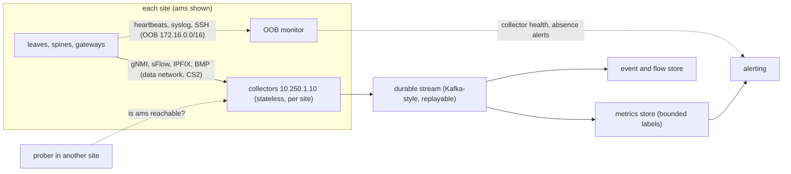

At 10:00:05 a Globex batch job saturates the uplinks of `leaf2.ams`. For the next half minute the dashboard shows that leaf at 38% utilisation, green. The switch's telemetry rides the same congested uplinks as the job, is dropped with the job's packets, and the dashboard keeps drawing the last value it received. The device stopped reporting at the moment it had the most important thing to say, and a platform that cannot tell "no news" from "good news" draws a healthy leaf.

Network telemetry is the data a network sends about itself: counters, state, packet samples, flow records, log messages. The engineer building the platform decides poll or push, which counters, sampled or exact, how many time series the store can afford, and where collectors sit so that their own failure is visible. Each mechanism is worked on Meridian, this track's reference fabric.

## Four kinds of telemetry data

| Kind | Example | Answers | Cannot answer |
|---|---|---|---|
| Counters and state | Interface octets, queue drops, BGP session state | How much, how often, is it up | Which flow, which packet |
| Packet samples | sFlow: 1 packet in 20,000 with its headers | Who is sending the traffic, estimated | Exact totals, flows of a few packets |
| Flow records | IPFIX: one record per 5-tuple per minute | Who talked to whom, how many bytes | Per-packet timing, microbursts |
| Events | Syslog, SNMP traps, gNMI on-change updates | What changed, and when | Load on the link |

A **5-tuple** is the source and destination IP address, the source and destination port, and the protocol, which together identify a flow ([transport as the network sees it](/learn/fabric-networking/from-zero/transport-as-the-network-sees-it)). The general theory of metrics, logs and traces is in [observability](/learn/system-design/building-blocks/observability); what is specific here is that the data comes from forwarding chips, over the network being measured.

## SNMP polling: how it works and where it runs out

**SNMP**, the Simple Network Management Protocol (1988; v2c in 1996; v3 from 1998, a full standard in 2002), is a request-response protocol over UDP. A **manager** (the poller) sends requests to an **agent** on the device at UDP port 161, and the agent can send unsolicited **traps** to port 162. Every value has an **OID** (object identifier), a dotted path in a global tree, and the device's **MIB** (management information base) lists the OIDs it supports. The inbound byte counter of interface 51 is `ifHCInOctets.51`, OID `1.3.6.1.2.1.31.1.1.1.6.51`. The final `51` is the **ifIndex**, the agent's number for the interface, which some platforms renumber after a reboot unless ifIndex persistence is on. v2c authenticates with a clear-text "community string"; v3 adds users and encryption.

One poll of `leaf2.ams` (loopback `10.255.1.12`, management address `172.16.1.12` on Meridian's out-of-band network) traced:

1. The poller sends a GetBulkRequest for the first rows of the interface table's octet, error and discard columns.
2. The agent, a process on the switch's CPU, asks the chip's software development kit (SDK) for each counter and replies with a few dozen values, as many as fit one UDP datagram.
3. The poller asks again from the last OID it received. Ten counters on 64 ports are 640 values: about 15 to 25 round trips.
4. Five minutes later, the next poll. Rate = Δcounter × 8 / Δtime between two polls.

What a poller sees (illustrative output, abbreviated):

```text
$ snmpbulkget -v3 -l authPriv ... 172.16.1.12 IF-MIB::ifHCInOctets IF-MIB::ifHCOutOctets
IF-MIB::ifHCInOctets.51 = Counter64: 1874220917455
IF-MIB::ifHCInOctets.52 = Counter64: 1869907714226
IF-MIB::ifHCOutOctets.51 = Counter64: 1904331822190
IF-MIB::ifHCOutOctets.52 = Counter64: 1899210004118
```

The model breaks down in four ways at fabric scale:

- **Averages hide bursts.** At 400 Gb/s a 100-microsecond burst is 5 MB, enough to overflow a port's share of buffer, and invisible in a five-minute mean. ([Links, frames and Ethernet](/learn/fabric-networking/from-zero/links-frames-and-ethernet) works the 32-bit counter wrap and the reset spike, which also catch pollers out.)
- **The timestamp is the poller's.** The poller divides by its own send times, not the moment the agent read the counter. With 2 s of jitter a 300 s poll is off by under 1%, a 10 s poll by up to 20%: faster SNMP is noisier SNMP.
- **Every poller costs the device CPU.** Three tools walking the same tables make the agent do the work three times; a large chassis can take tens of seconds per walk.
- **Traps are fire-and-forget.** A linkDown trap on UDP is lost silently, most often when the network is in trouble.

**What SNMP solves:** universal, vendor-neutral counters that 30 years of tools understand. **How it breaks:** coarse averages, poller-side timing, CPU load growing with every poller, lost traps. **Signal:** two tools disagreeing on the same port's rate, poll durations approaching the poll interval, agent CPU climbing.

## Streaming telemetry and gNMI

Streaming inverts the model: the device sends data on a schedule or on change, stamped with its own clock. The dominant protocol is **gNMI** (gRPC Network Management Interface, from the OpenConfig operator group), carried by gRPC, Google's remote procedure call framework, over HTTP/2, TLS and TCP; IANA assigned it port 9339, though vendor defaults vary. [Configuration APIs](/learn/fabric-networking/operating-fabrics/configuration-apis) covers its Capabilities, Get and Set RPCs and the OpenConfig models behind the paths; Subscribe is the telemetry RPC.

A Subscribe request names paths, such as `/interfaces/interface[name=swp51]/state/counters`, and a **mode** for the whole subscription:

- **STREAM**: a long-lived stream. Each path in it has its own submode:
  - **SAMPLE**: send every `sample_interval` (given in nanoseconds), for counters. `suppress_redundant` skips unchanged values, and `heartbeat_interval` forces a send at least that often, so silence can still be told apart from "unchanged".
  - **ON_CHANGE**: send only when the value changes, for state such as interface oper-status (whether the link is actually up), BGP session state or a MAC address moving.
  - **TARGET_DEFINED**: the device picks, usually on-change for state and sampled for counters.
- **ONCE**: send everything once, then close.
- **POLL**: send whenever the client asks on the open stream.

After the first complete set of values the device sends `sync_response: true`: the collector's view is complete, and later updates are changes. Each update is a **Notification**:

| Field | Size | Value in `leaf2.ams`'s update | What reads it |
|---|---|---|---|
| timestamp | int64, nanoseconds since 1970 (a protobuf varint: 9 bytes on the wire for today's dates) | 1793440800000000000 (10:00:00.000 UTC on 31 October 2026) | Collector: the time of the reading, from the device's own clock |
| prefix | variable (a path) | `/interfaces/interface[name=swp51]/state/counters` | Collector: shared by every update in the message, so each path is sent once |
| update[].path | variable | `out-octets` | Collector: which leaf of the model |
| update[].val | variable (typed value) | uint64 1904331822190 | Collector: the value |
| delete[] | variable | empty | Collector: paths that no longer exist, such as a removed interface |

The same update as the open-source client `gnmic` prints it (illustrative output):

```json
{
  "source": "leaf2.ams:9339",
  "subscription-name": "fabric-counters",
  "timestamp": 1793440800000000000,
  "time": "2026-10-31T10:00:00Z",
  "prefix": "interfaces/interface[name=swp51]/state/counters",
  "updates": [{"Path": "out-octets", "values": {"out-octets": "1904331822190"}}]
}
```

### Dial-in and dial-out

In **dial-in** the collector is the client: it opens TCP to the device's port 9339 and sends Subscribe. In **dial-out** the device connects to the collector and streams. The gNMI specification defines dial-in; dial-out exists as vendor features (Cisco's model-driven telemetry dial-out, Arista's TerminAttr streaming to CloudVision, SONiC's dial-out client) and as OpenConfig's gRPC tunnel, where the device opens the connection and the collector runs ordinary gNMI over it.

| Axis | Dial-in (collector connects) | Dial-out (device connects) |
|---|---|---|
| Where subscriptions live | In the collector, so you change them centrally, without device config | In each device's configuration, so every change is a config push |
| Firewalls and NAT | Collector must reach every device's port | Devices reach one address, which is easier across NAT and between security zones |
| Collector failover | Another collector re-dials, and needs a way to divide up devices | Devices point at a load-balanced or anycast address, and a reconnect lands on a healthy one |
| Who notices a broken session | The collector, which can alert on its own failed dial | The device, which only retries, so the collector must alert on absence |
| Typical use | Most gNMI deployments, gnmic, Telegraf | Large carriers, vendor controllers, devices behind NAT |

Meridian uses dial-in from a collector at each site, `10.250.1.10` behind `leaf4.ams` in Amsterdam, so subscriptions are code in one repository.

### Under the hood: from ASIC register to Notification

The counters live in the switching chip (the ASIC, application-specific integrated circuit), which increments them at line rate for free ([planes, ASICs and network operating systems](/learn/fabric-networking/from-zero/planes-asics-and-network-operating-systems)). The expensive part is the CPU reading them through the vendor SDK over PCIe. SONiC (the open-source network operating system) shows the layering: its `syncd` process polls ASIC counters into a Redis database, `COUNTERS_DB`, on per-group intervals set with `counterpoll` (port counters about every second by default, queues and watermarks more slowly), and its telemetry server answers gNMI from that database. A 100 ms SAMPLE over a 1 s internal poll therefore yields ten copies of each reading. Cumulus Linux, Arista EOS and Junos have the same shape: hardware counter, periodic CPU read, cache, gRPC server, with the timestamp normally that of the cached read.

**What streaming solves:** device timestamps, sub-second resolution, one read fanned out to many consumers, state changes as events. **How it breaks:** subscriptions too fast for the CPU, an in-band stream that stalls with the congestion it should report, and TCP head-of-line blocking delaying newer samples behind a lost segment. **Signal:** per-device sample rate and lag (device timestamp against receive time), gRPC reconnects, device CPU per subscription.

## Dead or congested: when the stream stops

Back to the opening, drawn as the small example with two spines, so `leaf2.ams` has two 400 Gb/s uplinks (800 Gb/s; full-size Amsterdam has four). Meridian's collector streams `leaf2.ams`'s counters every 10 s over the data network, marked DSCP 0, best effort. (DSCP, the differentiated services code point, is the 6-bit IP header field switches use to pick a queue.) A separate monitor reaches every device's management port over the out-of-band (OOB) network.

```viz
{"type": "fabric", "scenario": "telemetry-blind", "title": "leaf2.ams goes silent during a batch job: an absence alert, an OOB ping and the spines' counters prove it is alive and congested", "caption": "The collector 10.250.1.10 streams leaf2.ams's counters every 10 s over the data network. At 10:00:05 a Globex job offers about 1.1 Tb/s to 800 Gb/s of uplink, and the best-effort telemetry is tail-dropped with it. At 10:00:30 three missed samples raise an absence alert. The gNMI keepalive cannot separate dead from congested, but the OOB ping to 172.16.1.12 answers in 0.6 ms, and both spines report their adjacencies up and 399 of 400 Gb/s arriving: alive, telemetry blind. The stream resumes at 10:04:10, the missing samples are recorded as a gap, and a follow-up change marks telemetry CS2 into a protected queue. The chart shows the link as leaf2 reports it (a gap) and as spine1 reports it (saturated)."}
```

The trace, signal by signal:

| Time | Signal | What it says | Can it separate dead from congested? |
|---|---|---|---|
| 10:00:05 | Job saturates the uplinks; telemetry tail-dropped | Nothing yet: no value is wrong, values are missing | |
| 10:00:30 | Three samples missed: absence alert | Something stopped | No |
| 10:00:30 | gRPC keepalive (an HTTP/2 PING) unanswered | The data path to the collector is not working | No: it uses the same path |
| 10:00:31 | OOB ping to `172.16.1.12`: 0.6 ms | Powered, OS running, CPU answering | Yes: a dead device does not answer |
| 10:00:33 | Spines: links up, IS-IS adjacency Up, 399 Gb/s from leaf2 per port | Forwarding, and the uplinks are full | Yes: the neighbours' telemetry still flows |
| 10:00:35 | Verdict | Alive, telemetry blind, uplinks saturated | |

Three design rules follow.

**Alert on absence.** Missing data crosses no threshold, so the collector must know how often each device should report and treat missed samples as an event.

**Keep the heartbeat off the data path.** The OOB ping is independent of the job because the management network shares no links with the fabric; the neighbours are a second independent witness. IS-IS hellos survive because switches send routing-protocol packets in a network-control queue ahead of user traffic; telemetry at DSCP 0 gets no such priority. The durable fix marks it CS2 (DSCP 16, the class RFC 4594 sets aside for operations and management) with a guaranteed queue share.

**Record a gap as a gap.** Zeros for 10:00:10 to 10:04:00 would draw an idle link in the busiest four minutes of the day. A cumulative counter still yields the *average* across the gap (389 Gb/s over those 250 s, computed below), not the shape inside it.

The same silence from a dead device looks different on every independent signal:

```viz
{"type": "fabric", "scenario": "telemetry-blind", "variant": "dead", "title": "The same silence when leaf2.ams loses power: the OOB ping times out and the spines lose the links, so the verdict is dead", "caption": "At 10:00:05 leaf2.ams loses power and its gNMI stream stops. The absence alert fires at 10:00:30 as before, and the gNMI keepalive again cannot discriminate. This time three OOB echoes to 172.16.1.12 time out while the rest of the management switch answers, and spine1.ams and spine2.ams report loss of signal, IS-IS adjacencies down and LLDP no longer listing leaf2. The platform pages on-call and ties the alert to the servers behind leaf2; an OOB reply with adjacencies down would have meant alive but cut off from the fabric."}
```

**What the heartbeat design solves:** silence becomes a classified state (streaming, blind but alive, cut off, dead) instead of a stale graph. **How it breaks:** an OOB network that shares fate with the fabric, or neighbour checks that read the silent device's own data. **Signal:** for every silent device, two independent answers: the OOB reply and the neighbours' view.

## sFlow: sampling packets in hardware

Counters say how much traffic; whose traffic needs packet headers, and no switch can export every header at 400 Gb/s. **sFlow** (version 5, published by sflow.org in 2004; RFC 3176 documents version 4) samples in the ASIC: after each sample the chip picks a random skip count with mean N, then copies the first 128 bytes (the default) of the packet it lands on to the CPU. The agent sends samples in UDP datagrams to port 6343, with **counter samples**, each interface's counters every 20 to 30 s. The switch keeps no per-flow state, so sFlow is cheap enough for every port.

Each datagram describes itself. A sample from `spine1.ams`'s port facing `leaf2.ams` (the fields that matter; sub-agent ID, record counts, input and output ports and record headers are left out):

| Field | Size | Value in this sample | What reads it |
|---|---|---|---|
| Version | 4 bytes | 5 | Collector parser |
| Agent address | 4 + 4 bytes | IPv4, 10.255.1.1 (`spine1.ams`) | Collector: which switch |
| Datagram sequence number | 4 bytes | 88,213 | Collector: a jump means datagrams lost on UDP |
| Uptime | 4 bytes | milliseconds since the agent started | Collector: a drop means the agent restarted |
| Source ID | 4 bytes | ifIndex of `swp2`, the port to `leaf2.ams` | Collector: which port sampled it |
| Sampling rate | 4 bytes | 20,000 | Collector: the scale factor |
| Sample pool | 4 bytes | packets seen on the port so far | Collector: checks the effective rate |
| Drops | 4 bytes | 0 | Collector: samples the agent's CPU could not keep up with |
| Frame length | 4 bytes | 1,568 | Collector: bytes to scale up |
| Header bytes | 128 bytes | outer Ethernet, IP, UDP, VXLAN, inner Ethernet, IP, TCP | Collector: decodes the flow |

The 128 bytes reach inside the tunnel. Tenant traffic crosses the spines in VXLAN ([VXLAN encapsulation](/learn/fabric-networking/overlays-vxlan-evpn/vxlan-encapsulation)): outer Ethernet (14 bytes), outer IPv4 (20), UDP (8) and VXLAN (8) add 50 bytes, and the inner Ethernet, IPv4 and TCP headers (14 + 20 + 20) end at byte 104, so the collector sees the tenant's 5-tuple and the VNI (VXLAN network identifier, the 24-bit segment number). The VNI is not optional: Acme's `acme-web1` and Globex's `globex-app1` are both `10.1.1.10`, and only VNI 10100 against 10200 tells them apart. Keying flows on the inner IP alone merges two customers.

### How accurate is a sample?

The estimate for a flow is samples × N × frame length. sflow.org gives the 95% error bound as 196 × √(1/c) percent, where c is the number of samples in the class being estimated: 10,000 samples give ±2%, 100 give ±20%. The code below samples one minute on that 400G port at about 40% load, with hardware-style random skips.

```python
import bisect
import math
import random

N = 20_000  # sampling rate: 1 packet in N
# One minute on spine1.ams's 400G port facing leaf2.ams, about 40% loaded.
# (name, packets in the minute, frame bytes)
flows = [
    ("globex-app1 -> backup (tcp/873)", 50_000_000, 9_000),
    ("globex-app1 -> globex-db (tcp/5432)", 120_000_000, 1_500),
    ("globex replication (tcp/9092)", 25_000_000, 4_000),
]
flows += [(f"small flow {i}", 400_000, 1_200) for i in range(1, 1_001)]
flows += [("probe 10.250.12.10 -> 10.250.14.10 (udp/862)", 60, 128)]

total_pkts = sum(p for _, p, _ in flows)
total_bytes = sum(p * b for _, p, b in flows)
ends = []  # cumulative packet index where each flow ends
acc = 0
for _, pkts, _ in flows:
    acc += pkts
    ends.append(acc)

# Hardware-style sampling: after each sample, skip a random count with mean N.
rng = random.Random(7)
samples = [0] * len(flows)
pos = rng.randint(1, 2 * N - 1)
while pos <= total_pkts:
    samples[bisect.bisect_left(ends, pos)] += 1
    pos += rng.randint(1, 2 * N - 1)

print(f"{total_pkts:,} packets, {total_bytes / 1e12:.2f} TB in 60 s = {total_bytes * 8 / 60 / 1e9:.0f} Gb/s; "
      f"{sum(samples):,} samples ({sum(samples) / 60:.0f}/s)")
print(f"{'flow':<45}{'true GB':>9}{'est GB':>9}{'err':>8}{'samples':>9}{'±95%':>7}")
for i in [0, 1, 2, 3, len(flows) - 1]:
    name, pkts, size = flows[i]
    true, c = pkts * size, samples[i]
    est = c * N * size  # bytes estimate: samples x N x frame length
    bound = f"{196 * math.sqrt(1 / c):.1f}%" if c else "n/a"
    err = f"{(est - true) / true * 100:+.1f}%"
    print(f"{name:<45}{true / 1e9:>9.1f}{est / 1e9:>9.1f}{err:>8}{c:>9}{bound:>7}")
small = range(3, len(flows) - 1)
seen = sum(1 for i in small if samples[i])
print(f"small flows seen at least once: {seen} of {len(small)}; "
      f"their total estimated {sum(samples[i] for i in small) * N * 1_200 / 1e9:.0f} GB "
      f"vs true {sum(flows[i][1] * 1_200 for i in small) / 1e9:.0f} GB")
```

```text
595,000,060 packets, 1.21 TB in 60 s = 161 Gb/s; 29,696 samples (495/s)
flow                                           true GB   est GB     err  samples   ±95%
globex-app1 -> backup (tcp/873)                  450.0    461.7   +2.6%     2565   3.9%
globex-app1 -> globex-db (tcp/5432)              180.0    181.5   +0.8%     6050   2.5%
globex replication (tcp/9092)                    100.0     99.7   -0.3%     1246   5.6%
small flow 1                                       0.5      0.4  -15.0%       17  47.5%
probe 10.250.12.10 -> 10.250.14.10 (udp/862)       0.0      0.0 -100.0%        0    n/a
small flows seen at least once: 1000 of 1000; their total estimated 476 GB vs true 480 GB
```

Four lessons are in that output:

- **Big flows and aggregates are accurate.** Every large flow is within its bound, and the 1,000 small flows *together* are within 1%.
- **sFlow samples packets, not bytes.** The backup flow carries the most bytes but, in 9,000-byte jumbo frames, gets fewer samples than the database flow, so a wider error bar.
- **One small flow is a guess.** With 17 samples the bound is ±48%: fine for ranking, not for billing.
- **Short flows vanish.** The 60-packet probe has a 0.3% chance of one sample. Only probes ([active measurement](/learn/fabric-networking/operating-fabrics/active-measurement)) or flow records prove a connection crossed a link.

Choosing N is a budget decision. Vendor defaults scale N with link speed (on the order of 1 in 10,000 at 10 Gb/s, proportionally higher on faster links) to bound the sample rate; Meridian's 1 in 20,000 on 400G ports is finer and costs about 500 samples a second per busy port. The ceiling is the switch CPU: when samples outrun the agent the Drops field rises, and estimates undercount unless the collector corrects with the sample pool. Ranking top talkers from the samples is the [top-k flows](/practice/top-k-flows) problem; at very high flow counts a [count-min sketch](/learn/advanced-data-structures/probabilistic-structures/count-min-sketch-and-hyperloglog) bounds its memory.

**What sFlow solves:** who is using the link, with headers that reach into tunnels, at negligible device cost. **How it breaks:** small flows missed, error bars ignored, CPU-limited sample drops, a collector that ignores the VNI. **Signal:** the Drops field, sequence gaps, and estimated port bytes against the port's counter samples (they should agree within the bound).

## IPFIX and NetFlow: flow records from a cache

**IPFIX** (IP Flow Information Export, RFC 7011, 2013) standardises Cisco's NetFlow version 9 (RFC 3954). Instead of raw samples, an exporter keeps a **flow cache** keyed on fields such as the 5-tuple, DSCP and ingress interface, adds each packet (or sampled packet) to its entry, and exports a summary record when the flow "ends":

- **Inactive timeout:** no packet for, say, 15 s. Short flows such as a DNS query leave this way.
- **Active timeout:** a long flow is exported every, say, 60 s, so a 3-hour transfer is not reported only at the end. Cisco's long-standing defaults were 30 minutes active and 15 s inactive; most operators set active to 60 s.
- **TCP FIN or RST,** and cache pressure: a full cache evicts early or drops new flows.

Records are template-based: the exporter first sends a template ("records in set 256 contain these fields, in this order, of these sizes"), then data records that are only values, to port 4739 over UDP, TCP or SCTP.

A record from `gw1.ams`, Meridian's border gateway, for an internet client downloading from a Meridian server (`198.51.100.0/24` and `203.0.113.0/24` are ranges reserved for documentation, RFC 5737):

| Field (information element, ID) | Size | Value | What reads it |
|---|---|---|---|
| sourceIPv4Address (8) | 4 bytes | 203.0.113.10 | Collector: who sent |
| destinationIPv4Address (12) | 4 bytes | 198.51.100.7 | Collector: who received |
| sourceTransportPort (7) | 2 bytes | 443 | Collector: service |
| destinationTransportPort (11) | 2 bytes | 51514 | Collector: client side |
| protocolIdentifier (4) | 1 byte | 6 (TCP) | Collector |
| octetDeltaCount (1) | 8 bytes | 7,500,000,000 | Collector: bytes since the last export of this flow |
| packetDeltaCount (2) | 8 bytes | 5,000,000 | Collector |
| flowStartMilliseconds (152) | 8 bytes | 10:00:00.000 | Collector: when this record's interval began |
| flowEndMilliseconds (153) | 8 bytes | 10:00:59.998 | Collector |
| ingressInterface (10), egressInterface (14) | 4 + 4 bytes | the internal port, the ISP1 port | Collector: which circuit |
| tcpControlBits (6) | 2 bytes | ACK, PSH | Collector: a FIN here means the flow ended |

That download lasts 150 s at 1 Gb/s with a 60 s active timeout, so it produces three records: at 10:01:00 (7.5 GB), at 10:02:00 (7.5 GB) and at 10:02:30 when the FIN arrives (3.75 GB). The collector spreads each delta over the record's own start and end times; charting it at export time draws 60-second humps. The cache's aging rules are the [flow table with TTL](/practice/flow-table-ttl) problem.

Data-center switch ASICs mostly implement sFlow, because a per-flow cache at hundreds of millions of packets a second needs memory most chips lack (some lines, such as Cisco's Nexus 9000, do keep a hardware flow table and export NetFlow). Edge routers like `gw1.ams` commonly export IPFIX or sampled NetFlow for peering analysis, capacity planning and DDoS detection.

**What IPFIX solves:** per-conversation accounting with exact (or sampled-and-scaled) byte counts. **How it breaks:** a restarted collector cannot decode UDP data records until the exporter resends its templates, a full cache drops flows, and long active timeouts make data late. **Signal:** undecodable records, the exporter's cache-full counters, and flow totals per interface against interface counters.

## Syslog and events

Counters say how much; events say what changed. **Syslog**, the oldest event channel, has a modern format in RFC 5424 (RFC 3164 documents the older BSD style many devices still send), over UDP 514, TCP, or TLS on 6514 (RFC 5425). Each message starts with a priority, PRI = facility × 8 + severity, severity running from 0 (emergency) through 3 (error), 4 (warning) and 5 (notice) to 7 (debug). Network devices conventionally log as facility local7 (23), so `<187>` is local7.error (184 + 3).

When `leaf2.ams` lost power in the second run above, `spine1.ams` logged (illustrative):

```text
<187>1 2026-10-31T10:00:05.003Z spine1.ams kernel - - - swp2: link down (loss of signal)
<189>1 2026-10-31T10:00:05.004Z spine1.ams isisd 1874 ADJCHANGE - adjacency to leaf2.ams on swp2 Up -> Down (interface down)
<189>1 2026-10-31T10:00:05.006Z spine2.ams isisd 1902 ADJCHANGE - adjacency to leaf2.ams on swp2 Up -> Down (interface down)
```

The fields: PRI and version, timestamp, host, application, process ID, message ID, structured data (`-` when empty), free text. The free text is the problem: every vendor and release words it differently, so each platform needs a tested parser, and a release that rewords a message silently breaks an alert. Syslog over UDP is also lost exactly when links fail, and devices rate-limit their own logging in storms.

Structured events are the alternative where supported: gNMI ON_CHANGE for oper-status, adjacency and session state; SNMP traps or the acknowledged *informs* of v2c and v3; and for BGP, the BGP Monitoring Protocol (BMP, RFC 7854), which streams every session change and route ([convergence and scale](/learn/fabric-networking/bgp-in-the-real-world/convergence-and-scale)). Keep syslog for what no model records: a process crash, a failed login, a hardware fault.

Events need correct clocks, and the clock is itself worth watching: the IS-IS purge storm in [underlay failures in production](/learn/fabric-networking/underlay/underlay-failures-in-production) showed as a device's system time jumping by years, then the link-state database count collapsing across the flooding domain, both visible within seconds.

**What events solve:** the "when" and "what" that counters smear over an interval. **How it breaks:** free text that drifts between releases, UDP loss, rate limiting, and clocks that disagree. **Signal:** messages per device per minute against a baseline (silence is suspicious too), parse failures per platform, and NTP offset per device.

## The counters that matter

A switch exposes thousands of values. These are the ones that answer questions:

| Layer | Counters | Answers |
|---|---|---|
| Physical | Receive and transmit optical power per lane, laser bias, temperature; FEC corrected and uncorrected codewords | Is a link degrading before it fails? Corrected FEC climbing for days is the early warning of a gray failure ([optics and the physical layer](/learn/fabric-networking/fabric-architecture/optics-cabling-and-the-physical-layer)) |
| Interface | In and out octets and packets; in errors (FCS, the frame checksum); in and out discards; oper-status and last-change time | Load, corruption, and flaps |
| Queue | Per-queue transmitted bytes, drops, buffer watermark (peak occupancy since last read), ECN-marked packets | Congestion and microbursts, which averages hide |
| Lossless (RoCE) | PFC pause frames sent and received per priority, pause duration, PFC watchdog events | Whether back-pressure is spreading ([lossless Ethernet](/learn/fabric-networking/ai-fabrics/lossless-ethernet-pfc-ecn-dcqcn), [when lossless goes wrong](/learn/fabric-networking/ai-fabrics/when-lossless-goes-wrong)) |
| Forwarding | No-route drops, ACL drops, TTL-expired drops, FIB and TCAM utilisation, ARP and MAC table size | Drops caused by the switch's own tables, and tables near their limits |
| Control plane | BGP state and prefixes per family, IS-IS adjacencies and database size, CPU, memory, control-plane policing drops | Is the network's brain healthy? |
| Host | TCP retransmits per host; NIC RoCE counters such as `np_cnp_sent`, `rp_cnp_handled`, `out_of_sequence` | The half of congestion that switch counters do not show ([how Linux sends and receives packets](/learn/fabric-networking/from-zero/how-linux-sends-and-receives-packets)) |

Three rules turn counters into answers:

1. **Counters are cumulative, so compute rates on the device's timestamps.** Discard a step where the counter went backwards (a reboot or a clear), and never interpolate across a gap.
2. **Compare both ends of every link.** Packets out of `leaf2.ams swp51` minus packets into `spine1.ams swp2` is the link's loss. If the far end's FCS errors match it, the link corrupts frames; if nothing matches, something drops silently. The link inventory in the source of truth ([network automation](/learn/fabric-networking/operating-fabrics/network-automation-and-source-of-truth)) provides the join.
3. **Prefer watermarks and drop counts to utilisation.** A watermark holds the highest occupancy reached since it was last read and cleared, so a 10 s watermark catches a 50 µs burst a 10 s average never shows.

**What the counter set solves:** load, loss, corruption, congestion and table pressure, each with a number per port. **How it breaks:** rates computed across resets or gaps, one end of a link read without the other, averages where peaks were needed. **Signal:** the two ends of a link disagreeing, watermarks near the buffer limit while utilisation looks moderate, and FEC corrected counts trending up.

## Per-drop reasons and in-band telemetry

A drop counter says how many packets died, not which ones or why. Two families of features close that gap.

**Per-drop reasons.** NVIDIA's What Just Happened (WJH), on Spectrum switches under Cumulus Linux and SONiC, has the ASIC copy each dropped packet's headers to the CPU (rate-limited) with a reason code, a timestamp and the port. Reasons fall into groups: layer 1 (link down, FEC errors), layer 2 (VLAN filter, source MAC equals destination MAC), router (blackhole route, unresolved next hop, TTL too small, MTU exceeded), tunnel, ACL, and buffer (tail drop, WRED). In Linux the same idea is exposed as `devlink trap` (from kernel 5.4, first implemented for Spectrum), Broadcom chips offer Mirror-on-Drop, and sFlow has an extension for dropped-packet notifications. An illustrative WJH view on `leaf1.ams`:

```text
#  Time          Port   Reason                 Severity  Src IP      Dst IP      Proto  Ports
1  10:12:41.118  swp1   Blackhole route        Error     10.1.1.10   10.1.9.40   tcp    51514 -> 5432
2  10:12:41.902  swp51  Tail drop (queue 3)    Notice    10.1.1.10   10.1.2.20   tcp    51800 -> 5432
3  10:12:43.004  swp1   TTL value is too small Warning   10.1.1.10   10.1.2.20   udp    33434 -> 33435
```

Line 1 is a configuration bug: `acme-web1` sends to a subnet its VRF black-holes, named without a packet capture. Line 2 is congestion on a named queue. Line 3 is a harmless traceroute probe, so drop telemetry needs filtering before it pages anyone. Two costs: a drop storm is reported as a rate-limited sample of itself, and exported headers carry tenant addresses, needing the access controls of packet captures.

**In-band telemetry** writes measurements into the packets themselves. With **INT** (In-band Network Telemetry, a P4.org specification), each switch on the path appends metadata to selected packets (switch ID, ports, hop latency, queue occupancy), and the last hop strips it and reports to a collector. **IOAM** (In-situ OAM, RFC 9197, 2022) is the IETF equivalent, and "postcard" variants report per hop instead of growing the packet. It answers what nothing else here can: *this* packet waited 41 µs in queue 3 at `spine2.ams`. The cost is bytes and silicon: INT's embedded mode (version 2.1) adds a 4-byte shim and a 12-byte header plus 4 bytes per field per hop, so four fields over three hops is 64 bytes that must fit under the MTU; with uneven ASIC support it is usually enabled for selected flows.

**What drop reasons and INT solve:** "which packet, where, why", the step after a counter says "something". **How they break:** rate-limited reporting during the storms you care about, partial ASIC support across a mixed fleet, MTU headroom. **Signal:** drops per reason per device over time, split into "configuration" (blackhole, ACL, VLAN filter) and "capacity" (tail drop, WRED), because they go to different teams.

## Cardinality and storage costs

A time-series database stores one **series** per unique combination of metric name and labels (`queue_drops{device="rail1-leaf1.sjc", port="swp7", queue="3"}`). Bytes per sample are cheap after compression; the number of series is what costs, because each live series needs index memory and each new series costs a write to the index. That count is the **cardinality**. Meridian's San Jose GPU back end has 16 rail leaves and 8 spines with 128 ports of 400 Gb/s each ([AI fabric topologies](/learn/fabric-networking/ai-fabrics/ai-fabric-topologies)), plus 1,024 NIC ports:

```python
# Series and storage for Meridian's San Jose GPU back end (16 rail leaves, 8 spines,
# 128 x 400G ports each) plus its 1,024 NIC ports.
SWITCH_PORTS = 24 * 128
NIC_PORTS = 1_024
PER_SWITCH_PORT = {
    "interface counters (octets, packets, errors, discards, in/out)": 10,
    "per-queue tx bytes, drops, ECN marks, watermark (8 queues)": 8 * 4,
    "PFC pause frames sent and received (8 priorities)": 8 * 2,
    "FEC corrected and uncorrected codewords": 2,
    "optic rx/tx power and bias per lane (4 lanes), temperature": 4 * 3 + 1,
}
PER_NIC_PORT = 20  # CNPs, ECN-marked packets, out-of-sequence, retransmits, pauses...
BYTES_PER_SAMPLE = 1.5  # compressed, Prometheus-style (its docs say 1-2 bytes)
DAY = 86_400


def series():
    return SWITCH_PORTS * sum(PER_SWITCH_PORT.values()) + NIC_PORTS * PER_NIC_PORT


def storage(n_series, interval_s, days):
    samples = n_series * DAY / interval_s * days
    return samples, samples * BYTES_PER_SAMPLE


base = series()
print(f"per switch port: {sum(PER_SWITCH_PORT.values())} series; total {base:,} series")
for interval in (60, 10, 1):
    per_day, b = storage(base, interval, 1)
    _, b13 = storage(base, interval, 395)
    print(f"  every {interval:>2} s: {per_day / 1e9:6.2f} billion samples/day, "
          f"{b / 1e9:6.1f} GB/day, {b13 / 1e12:5.1f} TB for 13 months")

# The label that explodes it: one series per RDMA queue pair (QP), per counter.
QPS_PER_NIC, QP_COUNTERS, JOBS_PER_DAY = 400, 5, 6
qp_series = NIC_PORTS * QPS_PER_NIC * QP_COUNTERS
print(f"add a qp label: +{qp_series:,} live series, "
      f"+{qp_series * JOBS_PER_DAY:,} new series a day (QP numbers change every job)")
print(f"  index memory at ~4 KB per live series: {qp_series * 4 / 1e6:.1f} GB "
      f"vs {base * 4 / 1e6:.1f} GB for everything else")

WIRE_BYTES = 100  # per value with path, timestamp and framing: an assumption
for interval in (10, 1):
    mbps = base / interval * WIRE_BYTES * 8 / 1e6
    print(f"on the wire every {interval:>2} s: {base / interval:,.0f} values/s, about {mbps:,.0f} Mb/s")
```

```text
per switch port: 73 series; total 244,736 series
  every 60 s:   0.35 billion samples/day,    0.5 GB/day,   0.2 TB for 13 months
  every 10 s:   2.11 billion samples/day,    3.2 GB/day,   1.3 TB for 13 months
  every  1 s:  21.15 billion samples/day,   31.7 GB/day,  12.5 TB for 13 months
add a qp label: +2,048,000 live series, +12,288,000 new series a day (QP numbers change every job)
  index memory at ~4 KB per live series: 8.2 GB vs 1.0 GB for everything else
on the wire every 10 s: 24,474 values/s, about 20 Mb/s
on the wire every  1 s: 244,736 values/s, about 196 Mb/s
```

The 4 KB per series and 100 bytes per value are assumptions that vary with the store, label sizes and encoding (gNMI's JSON is several times larger than protobuf); the shape does not. Going from 10 s to 1 s multiplies storage by ten and is affordable. One unbounded label, the RDMA queue pair (QP, the NIC's per-connection state, [RDMA from zero](/learn/fabric-networking/ai-fabrics/rdma-from-zero)), multiplies the index by about nine, and because QP numbers are new every job the store churns twelve million series a day. Per-flow labels have no bound at all.

The rules a platform team adopts:

- **Bounded labels only in the metrics store:** device, port, queue, priority, tenant, site. Per-flow, per-QP or per-client data goes to an event or columnar store (ClickHouse-style), or is aggregated into top-k first.
- **Downsample with the right aggregate.** Counters keep the last value per window, so rates stay correct; gauges such as watermarks or optical power keep max (and min), because an average of peaks is not a peak.
- **Retention by resolution:** 1 s for days, 1 min for months, 1 h for the 13 months capacity planning wants.

**What a series budget solves:** a store that stays fast as the fleet grows. **How it breaks:** one unbounded label, usually added for a single investigation. **Signal:** live series per metric and new series per hour, alerted on before index memory runs out. [Design a metrics and logging platform](/learn/system-design/case-studies/metrics-and-logging-platform) works through the store side at scale.

## Where collectors live

The out-of-band network exists to reach devices whatever the data plane is doing ([planes, ASICs and NOSes](/learn/fabric-networking/from-zero/planes-asics-and-network-operating-systems)). Its links are commonly 1 Gb/s, already carrying SSH, configuration pushes, images, NTP and syslog. The back end's counters alone need about 200 Mb/s at 1 s; sFlow from 3,072 ports at 100 samples a second each, about 200 bytes per sample, adds about 500 Mb/s; BMP sends millions of routes on every reconnect. That does not fit a network sized for reachability, so Meridian splits the traffic:



- **Volume on the data network**, marked CS2 into a protected queue, to a collector in each site, so a long-haul circuit outage does not blind the whole platform.
- **Heartbeats on the OOB network:** the OOB monitor pings every management address, and collectors report their own health over it.
- **A durable stream between collectors and stores,** so a slow store causes lag, not loss, and data can be replayed.
- **Watch the watchers from outside.** If the Amsterdam collector loses its path to the central store, nothing from Amsterdam arrives and nothing alerts. A prober in Singapore and an alert on "no data from site ams for 2 minutes" make "blind at ams" a state of its own.

**What the split solves:** volume where there is bandwidth, liveness where there is independence. **How it breaks:** an OOB network quietly routed over the fabric, collectors sharing power with what they watch, a central store whose outage looks like a quiet network. **Signal:** ingest rate per site and collector, collector heartbeats over OOB, and the age of the newest sample from each site.

## Trade-offs: choosing the source

| Source | Answers | Resolution | Device cost | Transport and loss | Volume |
|---|---|---|---|---|---|
| SNMP polling | Counters, state | Minutes in practice | CPU per poller per walk | UDP, poller-timed | Low |
| gNMI streaming | Counters, state, changes | 1–10 s, on-change for state | One read fanned out, CPU per subscription | TCP and TLS, device-timed | Medium to high |
| sFlow | Who is sending, estimated, with headers | Statistical, continuous | ASIC samples, CPU per sample | UDP, sequence-numbered | Medium, set by N |
| IPFIX / NetFlow | Per-flow bytes, exact or sampled | Per active timeout (60 s) | Flow cache memory | UDP (templates) or TCP/SCTP | Grows with flow count |
| Syslog | Discrete events, free text | Per event | Low, until a storm | UDP or TLS, rate-limited | Spiky |
| WJH / drop reasons | Which packet died, why | Per drop, sampled | ASIC copy, rate-limited | Device agent | Spiky |
| INT / IOAM | Per-hop latency and queue for a packet | Per packet | Header bytes, ASIC support | In the packet, then exported | High if enabled broadly |

The usual production mix: gNMI for counters and state (SNMP for platforms that cannot stream), sFlow on fabric switches, IPFIX at the edge, syslog and BMP for events, drop reasons where the ASIC supports them, and INT selectively.

## Failure modes in production

| Failure | Symptom | Diagnosis | Fix |
|---|---|---|---|
| Stale dashboard | A device stays green through an outage; its last value never changes | Sample age per device; no absence alerting | Alert on missed samples; show "no data" as its own colour |
| Telemetry in the congested queue | Telemetry stops exactly during peak load | Gaps line up with high utilisation reported by neighbours | Mark telemetry CS2 into a protected queue; neighbour-side views |
| Counter reset read as traffic | An exabyte spike after a reboot or clear | Counter went backwards; uptime reset | Discard steps that go backwards; 64-bit counters |
| sFlow undercount | Port bytes estimated from samples run 20% under counters | Drops field non-zero; agent CPU high | Raise N, or have the collector scale with the sample pool |
| IPFIX templates lost | After a collector restart, minutes with no decodable flows | Records received but undecodable | Shorter template refresh; TCP or SCTP transport |
| Cardinality explosion | Metrics store memory climbing, queries timing out after a new label | Series count by metric; new-series rate | Remove unbounded labels; send flows to a columnar store |
| Subscription overload | Device CPU high, control-plane flaps after adding telemetry | CPU per gNMI subscription; sample interval below the internal poll | Fewer, slower subscriptions; on-change for state |
| Collector blind | A whole site goes quiet and nothing alerts | All devices at one site stop at once | Absence alerts per site; probe each site's collector from another site |

## What the platform should show

The job is answers an on-call engineer trusts in seconds and a manager reads at a glance:

- **Telemetry health as a state per device:** streaming, blind but alive, cut off, dead, or "collector blind" for a whole site, each from signals independent of the silent device, with sample age (device timestamp against receive time) so lag shows before it becomes a gap.
- **Gaps drawn as gaps**, with the average across the gap available but marked.
- **Both ends of every link side by side:** sent against received, FCS errors, FEC trend, optical power.
- **Drops by reason**, split into configuration and capacity, per tenant where the VNI is known.
- **Peaks, not averages:** watermarks, pause durations and ECN marks.
- **Estimates with error bars:** an sFlow top-talker list says how many samples each entry rests on.
- **Cardinality and ingest per source** as operational metrics of the platform itself.

The core classifier computes rates from cumulative counters (gaps and resets handled) and turns four independent signals into the states above:

```python
INTERVAL = 10           # seconds between SAMPLE updates
MISSED = 3              # missed samples before the absence alert
WRAP = 2 ** 64


def rates(samples, interval=INTERVAL):
    """Counter samples (device timestamp s, octets) -> (t, Gb/s, kind) per step."""
    out = []
    for (t0, c0), (t1, c1) in zip(samples, samples[1:]):
        dt, dc = t1 - t0, c1 - c0
        if dc < 0:
            if c0 > WRAP * 0.9:                    # near the top: a genuine 64-bit wrap
                dc += WRAP
            else:
                out.append((t1, None, "reset"))    # went backwards: reboot or clear
                continue
        gbps = round(dc * 8 / dt / 1e9, 1)
        # A cumulative counter still gives the average across a gap; the shape is lost.
        out.append((t1, gbps, "ok" if dt <= 1.5 * interval else f"average over {dt} s gap"))
    return out


def verdict(now, last_sample, oob_reply, neighbours, site_silent=False):
    """One device's telemetry state from independent signals."""
    if now - last_sample < MISSED * INTERVAL:
        return "streaming"
    if site_silent:
        return "collector blind: whole site silent; check collector and its path from another site"
    up = [n for n in neighbours if n["adjacency"] == "Up"]
    hot = [n["name"] for n in up if n["rx_from_device_pct"] > 95]
    if not oob_reply and not up:
        return "DEAD: no OOB reply and every neighbour lost it; page on-call"
    if oob_reply and not up:
        return "ALIVE but cut off from the fabric: OOB answers, adjacencies down"
    if not oob_reply:
        return "forwarding, management lost: neighbours see it, OOB does not answer"
    if hot:
        return f"ALIVE, telemetry blind: uplinks saturated (seen by {', '.join(hot)})"
    return "ALIVE, telemetry blind: check the telemetry agent and the path to the collector"


# leaf2.ams swp51 out-octets as received: 38% load, the job at 99.8% from 10:00:05 to
# 10:04:05, then 40%; nothing arrives between 10:00:00 and 10:04:10.
G = 1e9 / 8                                         # bytes per second at 1 Gb/s
c0 = 1_904_331_822_190
c1 = c0 + int((152 * 5 + 399 * 240 + 160 * 5) * G)
leaf2 = [(0, c0), (250, c1), (260, c1 + int(160 * 10 * G))]
leaf9 = [(0, 9_120_004_771_000), (10, 9_120_504_771_000), (20, 4_114_222)]   # rebooted
print("leaf2 swp51:", rates(leaf2))
print("leaf9 swp51:", rates(leaf9))

spines = [{"name": s, "adjacency": "Up", "rx_from_device_pct": 99.8} for s in ("spine1.ams", "spine2.ams")]
lost = [dict(n, adjacency="Down", rx_from_device_pct=0) for n in spines]
cases = {
    "leaf2.ams, batch job": dict(last_sample=0, oob_reply=True, neighbours=spines),
    "leaf2.ams, power loss": dict(last_sample=0, oob_reply=False, neighbours=lost),
    "leaf5.ams, uplinks shut": dict(last_sample=0, oob_reply=True, neighbours=lost),
    "leaf7.ams, agent crashed": dict(last_sample=0, oob_reply=True,
                                     neighbours=[dict(n, rx_from_device_pct=31) for n in spines]),
    "spine3.sin, site cut off": dict(last_sample=0, oob_reply=False, neighbours=[], site_silent=True),
    "leaf1.ams": dict(last_sample=30, oob_reply=True, neighbours=spines),
}
for name, signals in cases.items():
    print(f"{name:<26} {verdict(now=35, **signals)}")
```

```text
leaf2 swp51: [(250, 389.3, 'average over 250 s gap'), (260, 160.0, 'ok')]
leaf9 swp51: [(10, 0.4, 'ok'), (20, None, 'reset')]
leaf2.ams, batch job       ALIVE, telemetry blind: uplinks saturated (seen by spine1.ams, spine2.ams)
leaf2.ams, power loss      DEAD: no OOB reply and every neighbour lost it; page on-call
leaf5.ams, uplinks shut    ALIVE but cut off from the fabric: OOB answers, adjacencies down
leaf7.ams, agent crashed   ALIVE, telemetry blind: check the telemetry agent and the path to the collector
spine3.sin, site cut off   collector blind: whole site silent; check collector and its path from another site
leaf1.ams                  streaming
```

The site check comes first on purpose: when every device at a site goes quiet in the same second, the cause is almost never every device at once. The [troubleshooting method](/learn/fabric-networking/operating-fabrics/the-troubleshooting-method) builds on these states, and [designing network software](/learn/fabric-networking/the-network-interview/designing-network-software) turns them into a full visibility-platform design.

## Interviewer follow-ups

**"Telemetry from a device stops. How do you tell dead from congested?"** Model answer: an absence alert starts triage; the gNMI keepalive cannot decide, because it shares the data path. The OOB ping says whether the box is alive; the neighbours' telemetry (link state, adjacency, receive load) says whether it forwards and how hard. Prevention: a protected queue for telemetry. Common wrong answer: pinging the device's loopback over the same congested fabric.

**"Why move from SNMP to gNMI? Polling every 10 s works."** Model answer: device timestamps (poller jitter makes fast SNMP noisy), one read fanned out to many consumers, on-change events for state, and structured models instead of per-vendor MIBs. Keep SNMP for platforms that cannot stream, and say gNMI is not free: subscriptions cost device CPU, and sampling faster than the NOS's internal counter poll returns copies. Common wrong answer: "gNMI is real time"; it is periodic sampling with better timestamps.

**"A device is silently dropping packets. What shows it?"** Model answer: discards, errors, per-queue, ACL and no-route drops, transmit against receive with each neighbour, host retransmits per rack, probes that hash over every path, sFlow for whose traffic, and per-drop reasons (WJH, devlink trap) for the cause. Common wrong answer: interface utilisation, which a silent drop does not change.

**"Where do the collectors live, management network or data network?"** Model answer: both. Volume rides the data network in a protected class, because 1 Gb/s OOB links cannot carry it; heartbeats, collector health and the alert path ride out of band. Common wrong answer: "on the management network, for safety", until the first 1 s subscription or sFlow rollout saturates it.

**"Can we add a label for each flow, or each RDMA queue pair?"** Model answer: not in the metrics store. Series count is the cost, and an unbounded, churning label multiplies index memory (2 million extra series for QPs on Meridian's back end). Put flows and QPs in an event or columnar store, keep top-k aggregates as metrics. "I'd defer to the network team on which QP counters they need per job, but here is what I'd store and where."

## What mid-level engineers get wrong

- **Treating "no data" as "no problem".** Threshold alerts never fire on missing values, so the worst outage looks quietest.
- **Checking liveness over the path that failed.** A keepalive or loopback ping over the fabric shares fate with the telemetry it verifies.
- **Writing zeros into gaps.** Capacity reports learn the wrong peak.
- **Reading sFlow estimates as exact.** A top-talker list built on a few samples per entry ranks noise.
- **Adding labels freely.** One per-flow label can take the metrics store down when it is needed most.
- **Sampling faster than the device reads its counters.** A 100 ms subscription over a 1 s internal poll stores ten copies and loads the CPU for nothing.

## Senior signals

- You classify silence (streaming, blind but alive, cut off, dead, collector-blind) from signals independent of the silent device.
- You put volume in-band and heartbeats out of band, mark telemetry into a protected queue, and watch the collectors from another site.
- You know streaming is periodic sampling with device timestamps, bounded below by the NOS's own counter poll.
- You quote sFlow with its error bar (196 × √(1/c)) and key tenant flows on the VNI.
- You budget telemetry in series, not bytes, and keep unbounded identifiers out of the metrics store.
- You read both ends of a link and per-drop reasons before believing "the network is fine".

## Check yourself

```quiz
- q: >-
    leaf2.ams's gNMI stream stops during heavy load. The gRPC keepalive is unanswered, the OOB ping to its management address replies in under a millisecond, and both spines report IS-IS adjacencies Up with near 100% receive load from it. What is the right conclusion?
  options: ["The device has crashed and must be power-cycled, since its gRPC keepalive fails", "The collector has failed, since every device at the site is affected equally", "The device is alive and forwarding; its telemetry is lost in congested uplinks", "The management network is broken, since the OOB ping should not reply at all"]
  answer: 2
  explanation: >-
    The OOB reply proves the device is powered and its CPU is answering, and the neighbours, whose own telemetry still flows, show it is forwarding with saturated uplinks. The gRPC keepalive travels the same congested path as the data, so its failure cannot separate dead from congested. A collector failure would silence the whole site, not one leaf whose neighbours keep reporting.
- q: >-
    A poller computes link rates from SNMP polls every 10 s, and the results are noisy even though the traffic is steady. What is the most likely cause?
  options: ["Rates divided by the poller's send times, which jitter by seconds", "SNMP traps arriving out of order and corrupting the counter values", "GetBulk responses dropping every second value to fit a UDP datagram", "32-bit counters wrapping several times between polls on the link"]
  answer: 0
  explanation: >-
    SNMP has no device timestamp, so the poller divides by its own request times while the agent reads the counter at some unknown moment during handling. A couple of seconds of jitter is negligible over 300 s but up to 20% over 10 s. A 32-bit wrap produces wildly low readings, not noise around the true value; traps are not used for counter rates, and GetBulk does not drop values.
- q: >-
    sFlow samples 1 in 20,000 packets on a spine port. An analyst wants to bill a tenant's single small flow that received 25 samples in an hour. How good is the estimate?
  options: ["Worthless, because sFlow cannot estimate bytes from samples", "Within about 39% at 95% confidence, too loose to bill from", "Accurate to about 1%, because sampling is random and unbiased", "Accurate to about 4%, because 25 samples cover a full hour"]
  answer: 1
  explanation: >-
    The 95% error bound is 196 × √(1/c) percent: with c = 25 that is 196 / 5 ≈ 39%. Random sampling is unbiased, but small sample counts give wide error bars. Aggregates and large flows with thousands of samples are within a few percent; billing a small flow needs flow records or exact counters.
- q: >-
    Engineers propose adding a queue-pair label to the NIC RoCE counters in the metrics store for Meridian's 1,024-NIC back end. What is the main cost?
  options: ["Device CPU, since NICs cannot export per-QP counters at all", "Millions of new series per day, since QP numbers change every job", "Network bandwidth, since QP labels exceed the 1 Gb/s OOB links", "Storage bytes per sample, since QP counters compress poorly"]
  answer: 1
  explanation: >-
    Cost in a time-series store is driven by series count: about 400 QPs × 5 counters × 1,024 NICs adds roughly 2 million live series, and because QP numbers are new for every job the store churns millions of new series daily, each needing index memory. Compressed samples stay cheap. Per-QP data belongs in an event or columnar store, with aggregates as metrics.
- q: >-
    Where should a fabric's bulk telemetry and its heartbeats travel?
  options: ["Bulk out of band for safety; heartbeats in-band to test the real path", "Both on the data network, so telemetry follows the same paths as traffic", "Bulk on the data network in a protected class; heartbeats out of band", "Both out of band, so telemetry never competes with customer traffic"]
  answer: 2
  explanation: >-
    OOB links are often about 1 Gb/s and sized for reachability, while 1 s counters and sFlow for a large fabric need hundreds of megabits, so volume rides the data network, marked into a protected queue. Heartbeats and collector health ride OOB so that a data-plane failure is reported as "blind here" instead of silence. Heartbeats in-band share fate with the failure they should detect.
- q: >-
    After a four-minute telemetry gap, leaf2.ams's stream resumes. How should the platform record the missing interval?
  options: ["As zeros, because no traffic was reported during the gap", "As a gap, with the counter delta's average over the gap marked as such", "As a straight line, interpolated between the two sides of the gap", "As the last value before the gap, repeated until data resumes"]
  answer: 1
  explanation: >-
    A cumulative counter gives the exact average across the gap (delta over elapsed device time) but not the shape inside it, so the honest record is a marked gap with that average available. Zeros draw an idle link during the busiest minutes, repeating the last value hides the outage, and interpolation invents a shape that never existed.
```
