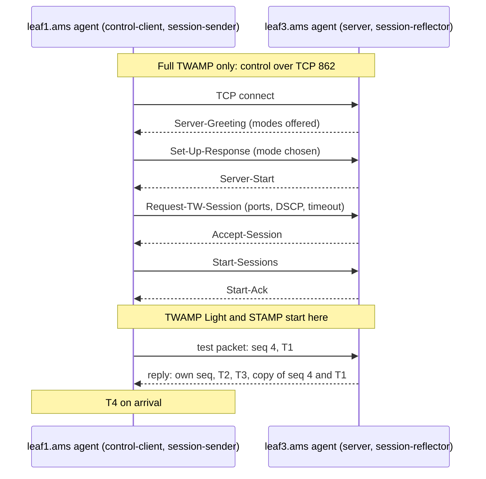

Acme reports that some requests from its web servers behind `leaf1.ams` to its databases behind `leaf3.ams` are slow, now and then. Every device in Meridian's Amsterdam fabric reports healthy: interfaces up, IS-IS adjacencies up, BGP sessions Established (IS-IS routes the fabric itself and BGP carries tenant routes, both from earlier modules; those states mean the neighbours are talking), CPU normal. A ping between the two racks shows 0% loss. All of that is true, and one link is still dropping 4% of the packets that cross it.

Device telemetry ([telemetry and observability](/learn/fabric-networking/operating-fabrics/telemetry-and-observability)) is **passive**: it reports what each device believes about itself. **Active measurement** sends test traffic and watches what happens to it, so it sees what an application sees, including failures no device notices: a link that corrupts frames while staying up, a hardware table missing an entry, a line card that drops only some hash values. Its cost: a probe measures only the path *it* took, and in a leaf-spine fabric that path has to be chosen on purpose.

## Active versus passive, in one table

| | Passive (counters, logs, streaming telemetry) | Active (probes) |
|---|---|---|
| Question it answers | What does each device say happened? | What happens to traffic between A and B? |
| Sees | Drops a device counts, queue depth, errors, protocol state | Loss, delay and jitter end to end, including drops nothing counts |
| Misses | Silent drops, wrong forwarding with correct state, the user's view | Paths no probe took, the cause (only the symptom and where) |
| Cost | Collection pipeline, no extra traffic | Agents, a little traffic, a scheduler that covers paths |

**What it solves:** seeing "it's the network" from outside, with the customer's eyes. **How it breaks:** probes that take a different path, class or treatment from real traffic report green while users suffer. **Signal:** a gap between probe health and application symptoms is a finding about the probes.

## What ping can and cannot tell you

ping sends an ICMP (Internet Control Message Protocol, IP's diagnostic channel, IP protocol 1) **echo request**, and the target's IP stack answers with an **echo reply**. On Linux the default packet is 84 bytes:

| Field | Size | Value in this example | What reads it |
|---|---|---|---|
| IP header | 20 bytes | 10.250.11.10 → 10.250.13.10, protocol 1, TTL 64 | Every router: the lookup and the ECMP hash |
| Type, code | 1 + 1 byte | 8, 0 (request); the reply is 0, 0 | The target's IP stack |
| Checksum | 2 bytes | over the ICMP message | The target |
| Identifier | 2 bytes | the ping process's ID | The sender, to match replies to its process |
| Sequence number | 2 bytes | 1, 2, 3… | The sender, to spot loss and reordering |
| Data | 56 bytes | a send timestamp, then filler | The sender computes RTT from it |

A reply proves IP works both ways between two addresses, and its round-trip time (RTT) is real for that path. With the don't-fragment bit and a size (`ping -M do -s 1472`), it also tests the path MTU ([transport as the network sees it](/learn/fabric-networking/from-zero/transport-as-the-network-sees-it)). What it cannot do:

- **It tests one path out of many.** ICMP has no ports. ECMP (equal-cost multipath: a leaf spreading flows over its uplinks by hashing header fields, from [ECMP and hashing](/learn/fabric-networking/fabric-architecture/ecmp-and-hashing)) hashes most ICMP on addresses and protocol alone (some platforms also mix in the identifier), so every echo between two hosts takes the same spine. With four spines, a clean ping has checked one of the four paths between those two leaves.
- **It cannot say which direction failed.** A missing reply was lost going out or coming back, and the two directions may cross different spines.
- **Pinging a switch measures the switch's CPU.** The ASIC (the switching chip) forwards transit packets at line rate; an echo *to* the switch's own address goes to its CPU, answered by software under a rate limit (control-plane policing, in [planes, ASICs and network operating systems](/learn/fabric-networking/from-zero/planes-asics-and-network-operating-systems)) and delayed whenever the CPU is busy. Ping *through* switches, between hosts.
- **It may not be treated like real traffic.** Networks may police or deprioritise ICMP, so ping can lose packets TCP does not, or pass where a firewall blocks the application's port.
- **It is too sparse to see small loss.** At the default one packet a second, a 0.1% loss rate costs one reply every 17 minutes on average. The *rule of three* says zero losses in *n* packets bounds the loss rate only below about 3/*n* with 95% confidence: 100 clean pings prove the loss is under 3%.

| ping result | It does mean | It does not mean |
|---|---|---|
| 100 of 100, 0% loss | IP works both ways on the one path this address pair hashes to | No loss: only below ~3%, and only on that path |
| 100% loss | No ICMP gets there and back | The host is down: it may filter ICMP |
| High RTT to a switch address | That switch's CPU answers slowly | Traffic through that switch is slow |
| Small pings pass, 1,472-byte DF pings fail | Something on the path has an MTU below 1,500 | Which hop: traceroute with large DF probes finds it |

## What traceroute can and cannot tell you

traceroute sends probes with TTL (time to live, the hop counter each router decrements) 1, 2, 3 and so on; each router that takes it to zero returns ICMP "time exceeded" and so reveals itself. [The packet walk](/learn/fabric-networking/from-zero/the-packet-walk) traces the mechanism and its traps (reply addresses are interfaces, hop times come from the control plane, the reverse path is invisible, changing ports per probe lets ECMP scatter them); [debugging the network](/learn/networking/networking-in-practice/debugging-the-network) reads `mtr`. Two facts matter in a fabric.

**The overlay hides the spines.** Tenant traffic crosses Meridian's spines inside VXLAN (a tunnel header added by the ingress leaf, in [VXLAN encapsulation](/learn/fabric-networking/overlays-vxlan-evpn/vxlan-encapsulation)), and the spines decrement only the outer TTL. A traceroute between tenant hosts in different subnets shows at most the leaves that route it, nothing between them; within one subnet, where the leaves only bridge, it shows no hop at all. To see the spines, probe in the underlay, between leaf loopbacks or from agents on plain routed subnets.

**A TTL-limited probe with an exact 5-tuple names a flow's spine.** The 5-tuple is source and destination address, protocol, and source and destination port. The hash ignores the TTL, so a probe that copies a stream's 5-tuple with TTL 2 follows that stream's path and expires at its spine, whose ICMP reply names it. This is Paris traceroute's idea (hold the 5-tuple constant). **Breaks:** the spine rate-limits ICMP, so mapping probes need pacing, and the map goes stale when a link joins or leaves the ECMP group and flows rehash. **Signal:** a stream whose mapping changed marks a membership change, worth an event of its own.

## TWAMP: delay, jitter and loss done properly

A measurement protocol needs timestamps at both ends, sequence numbers for loss, and probes that can look like real traffic (any port, size or DSCP class, the 6-bit IP header field that selects a switch queue). The IETF's answer is a family:

- **OWAMP** (One-Way Active Measurement Protocol, RFC 4656, 2006): timestamped packets one way; the receiver records arrival times.
- **TWAMP** (Two-Way Active Measurement Protocol, RFC 5357, 2008): a **session-sender** sends test packets to a **session-reflector**, which timestamps each on arrival and departure and sends it back. A separate TCP control connection to port 862 negotiates each test session.
- **TWAMP Light** (RFC 5357, Appendix I): no control protocol. The reflector answers test packets on a configured UDP port; the sender's tooling decides the rest. Most fabric probing runs this way.
- **STAMP** (Simple Two-way Active Measurement Protocol, RFC 8762, 2020) standardises the TWAMP Light idea with a compatible packet format and adds optional extensions (RFC 8972). RFC 8545 assigned UDP port 862 to the reflector.



Control matters when the two ends belong to different operators. Inside one fabric the operator configures both ends, so the light variants win; many network operating systems can be a TWAMP Light or STAMP reflector. **What it solves:** delay, jitter and loss per direction on a path you choose. **How it breaks:** a stateless, rate-limited or CPU-bound reflector distorts what it returns. **Signal:** results that change with the reflector or the probe rate, not the path.

### The packets, field by field

The sender's unauthenticated test packet, inside UDP to port 862:

| Field | Size | Value in this example | What reads it |
|---|---|---|---|
| Sequence number | 4 bytes | 4 | The reflector copies it into its reply |
| Timestamp (T1) | 8 bytes | send time, NTP format | The reflector copies it; the sender uses it |
| Error estimate | 2 bytes | "synchronised" flag set, error a few µs | Whoever trusts one-way numbers |
| Padding | variable | to the probe size under test | Nobody: it makes the probe as big as real traffic |

The reflector's reply carries more:

| Field | Size | Value in this example | What reads it |
|---|---|---|---|
| Sequence number | 4 bytes | the reflector's own counter | The sender: gaps here are reply (reverse) loss |
| Timestamp (T3) | 8 bytes | reflector send time | The sender, to subtract the reflector's dwell |
| Error estimate | 2 bytes | the reflector's clock quality | The sender |
| Must be zero | 2 bytes | 0 | Nobody |
| Receive timestamp (T2) | 8 bytes | reflector arrival time | The sender: forward one-way delay |
| Sender sequence number | 4 bytes | 4 | The sender: matches the reply to its probe |
| Sender timestamp (T1) | 8 bytes | copied | The sender: no local state needed per probe |
| Sender error estimate | 2 bytes | copied | The sender |
| Must be zero | 2 bytes | 0 | Nobody |
| Sender TTL | 1 byte | 252 | The sender: hops crossed on the way out |
| Padding | variable | to match the request size | Nobody |

Timestamps are 64 bits, 32 of seconds since 1900 and 32 of fraction (a resolution of about 233 picoseconds). The reply's fixed part is 41 bytes, 27 more than the request's 14, so senders pad by at least 27 bytes and the reflector reuses the padding, keeping both directions the same size. **Sender TTL** detects path changes for free: sent with TTL 255 through `leaf1.ams`, a spine and `leaf3.ams`, a probe arrives with 252; a sudden 250 means a longer path, such as a detour through another site.

### Four timestamps, worked

T1 is the sender's send time and T4 its receive time, on the sender's clock; T2 and T3 are the reflector's receive and send times, on the reflector's clock. Then:

- **Round-trip delay** = (T4 − T1) − (T3 − T2). Each bracket is a difference on *one* clock, so no synchronisation is needed, and the reflector's processing time drops out.
- **One-way forward delay** = T2 − T1, and reverse = T4 − T3. Each mixes two clocks, so it is only as good as their synchronisation.
- **Jitter**, defined in RFC 3393 as IP packet delay variation (IPDV): the difference in one-way delay between consecutive packets. A constant clock offset appears in both delays and cancels, so per-direction jitter is usable even between unsynchronised clocks (only drift between them leaks in). The code below applies the same difference to round trips.
- **Loss by direction.** The reflector numbers its own replies, so gaps in *its* numbering are replies lost on the way back; probes missing from the replies, less those, were lost on the way out.

A worked run: ten probes, 30 µs agent to agent each way, 5 µs inside the reflector, the reflector's clock 1,500 µs ahead. Probe 6 queues for an extra 62 µs; probe 4 is lost on the way out; the reply to probe 8 is lost on the way back.

```python
from dataclasses import dataclass


@dataclass
class Reply:
    sender_seq: int      # copied from the test packet
    reflector_seq: int   # the reflector's own counter, one per reply it sends
    t1: float            # sender transmit, sender's clock (microseconds)
    t2: float            # reflector receive, reflector's clock
    t3: float            # reflector transmit, reflector's clock
    t4: float            # sender receive, sender's clock


def analyse(sent, replies):
    rtt = [(r.t4 - r.t1) - (r.t3 - r.t2) for r in replies]   # reflector's dwell removed
    fwd = [r.t2 - r.t1 for r in replies]                       # needs synchronised clocks
    ipdv = [b - a for a, b in zip(rtt, rtt[1:])]               # delay variation, RFC 3393 style
    lost = sent - len(replies)
    reflected = max(r.reflector_seq for r in replies) + 1      # replies the reflector sent
    reverse = reflected - len(replies)                         # gaps in its numbering
    missing = sorted(set(range(1, sent + 1)) - {r.sender_seq for r in replies})
    return {"rtt_us": rtt, "one_way_fwd_us": fwd, "ipdv_us": ipdv, "missing": missing,
            "lost": lost, "lost_forward": lost - reverse, "lost_reverse": reverse}


# Ten probes at 10 a second from leaf1.ams's agent to leaf3.ams's reflector.
# Agent to agent 30 us each way, 5 us inside the reflector, the reflector's
# clock 1,500 us ahead. Probe 6 queues for an extra 62 us. Probe 4 dies on
# the way out; the reply to probe 8 dies on the way back.
OFFSET, ONE_WAY, DWELL = 1500.0, 30.0, 5.0
replies, rseq = [], 0
for seq in range(1, 11):
    t1 = (seq - 1) * 100_000.0
    if seq == 4:
        continue                                   # forward loss: no reply at all
    t2 = t1 + ONE_WAY + (62.0 if seq == 6 else 0.0) + OFFSET
    t3 = t2 + DWELL
    t4 = t3 - OFFSET + ONE_WAY
    if seq != 8:                                   # reverse loss: reply sent, never arrives
        replies.append(Reply(seq, rseq, t1, t2, t3, t4))
    rseq += 1

for key, value in analyse(10, replies).items():
    print(f"{key:15} {value}")
```

```text
rtt_us          [60.0, 60.0, 60.0, 60.0, 122.0, 60.0, 60.0, 60.0]
one_way_fwd_us  [1530.0, 1530.0, 1530.0, 1530.0, 1592.0, 1530.0, 1530.0, 1530.0]
ipdv_us         [0.0, 0.0, 0.0, 62.0, -62.0, 0.0, 0.0]
missing         [4, 8]
lost            2
lost_forward    1
lost_reverse    1
```

Trace it by hand. Nine probes reached the reflector, which numbered its replies 0 to 8; probe 8's reply carried 6. The sender received reflector numbers 0–5, 7 and 8: nine sent, eight arrived, one reverse loss. Probes 4 and 8 are missing, two losses in all, so one was forward. The round trip is right (60 µs, 122 µs for the queued probe) despite the offset, because each bracket stays on one clock; the one-way 1,530 µs is 30 µs of delay plus 1,500 µs of clock error.

Two limits show in the code. A reply lost after the last one received looks like a forward loss until a later reply arrives, which a continuous stream makes negligible. And a **stateless** reflector, which copies the sender's sequence number into its own field, gives up the direction split; ask for a stateful one, with one counter per session.

### Clocks and where timestamps are taken

One-way delay means something only when clock error is well below it. Agent to agent across one Meridian fabric is tens of microseconds, mostly agent software (a switch adds about a microsecond, 100 m of fibre 0.5 µs). NTP (the Network Time Protocol) keeps servers within tens of microseconds to milliseconds of each other, depending on load and implementation; PTP (the Precision Time Protocol, IEEE 1588) with hardware timestamping reaches sub-microsecond. Inside a fabric, trust one-way numbers only between PTP-synchronised agents; from `ams` to `sin`, about 52 ms one way, a millisecond of clock error still leaves a useful figure.

Where the timestamp is taken decides how much host you measure: a user-space timestamp includes scheduler delay, tens of microseconds on a busy server; a kernel software timestamp removes some; a NIC hardware timestamp is within nanoseconds of the wire. Linux's `SO_TIMESTAMPING` socket option requests either kind; record which one you got. A reflector on a switch CPU inherits ping's control-plane caveats; one built into the forwarding hardware answers at line rate. **Breaks:** an agent on an overloaded host reports the host's latency. **Signal:** the agent's CPU and run-queue metrics, and the same spike on every pair involving it.

## Covering every ECMP path: probes with varied 5-tuples

A leaf with four uplinks takes a hash of each packet's 5-tuple, modulo four, to choose a spine ([ECMP and hashing](/learn/fabric-networking/fabric-architecture/ecmp-and-hashing) has the hash and its failure modes). One probe stream is one 5-tuple and so one spine. To cover all four, the agent runs streams that differ only in **source port**: the destination stays the reflector's UDP 862, but each stream is a different flow to the hash.

**How many streams?** Hash values are effectively random, so it is the coupon collector's problem: with *N* equally likely paths, the expected number of random streams before every path has one is *N* × (1 + 1/2 + … + 1/*N*). For four spines that is 4 × 2.08 ≈ 8.3; for 16 paths (a three-tier fabric's spine and super-spine combinations) about 54. The expectation is not enough: with 16 random source ports over four spines, each spine still has a (3/4)¹⁶ ≈ 1.0% chance of no stream. Real systems **map then fill**: learn each candidate port's spine with the TTL-2 trick (or a platform command that reports which member a given packet would take), then keep ports until every member has at least two streams, so one unlucky stream cannot pass for a path.

**At what rate?** The smallest loss you must see sets the detection time. At 10 packets a second, 4% loss drops a packet every 2.5 s, obvious within a minute; 0.1% drops one every 100 s, and the rule of three needs about 3,000 clean packets (five minutes) to say "below 0.1%". The cost is small. A full mesh of Meridian's 16 Amsterdam leaves is 16 × 15 = 240 ordered pairs; at 16 streams per pair and 10 packets a second, 38,400 probes a second. With 128-byte packets and their replies that is about 80 Mb/s against 25.6 Tb/s of leaf uplink (16 leaves × 4 × 400 Gb/s), around 0.0003%.

**Probe like the traffic you care about.** Use the same protocol (TCP SYN-based probes where a firewall or load balancer treats TCP differently), the same sizes (padding to 1,500 or 9,000 bytes catches MTU problems small probes miss) and every traffic class: only a probe marked with the DSCP value of RoCE (RDMA over Ethernet, the AI cluster's transport) exercises the lossless queues. Two fabric details:

- **Underlay versus overlay.** Probes between agents on routed subnets test the underlay paths and can be mapped with TTL-limited probes. Probes between tenant hosts test what the tenant sees (encapsulation, the EVPN routes that tell each leaf where tenant addresses live, the gateway), but the leaf derives the outer UDP source port from a hash of the inner headers, so the agent steers the outer path only by varying inner ports. Run both: underlay probes localise, overlay probes confirm the tenant's view.
- **The return path is hashed separately.** The reply's 5-tuple is reversed and hashed by `leaf3.ams` with its own function and seed, so a stream's reply may cross a different spine from its request. A round-trip loss therefore belongs to two paths, so you need both TWAMP's direction split and a map of each stream's return spine, made from the reflector side.

**What it solves:** a result for every spine, so one bad path cannot hide behind the others. **How it breaks:** a hash change (a link joining or leaving the group, a new seed) moves streams and coverage silently drops. **Signal:** members exercised per pair against the group width in the source of truth.

## Pingmesh: the reachability matrix

Covering every path between two leaves is half the job; the other half is every *pair*. Microsoft's **Pingmesh** (SIGCOMM 2015) set the pattern. Every server runs an agent that a controller gives a *ping list*; agents measure with TCP connection set-up and HTTP requests, not ICMP, so probes are treated like application traffic; a pipeline computes loss and latency percentiles per pair and aggregate. The lists are hierarchical, because a full mesh of servers is quadratic: servers within a rack probe each other, racks probe each other through a few chosen servers, and data centers probe each other. Its intra-data-center latencies were a few hundred microseconds at the median with a millisecond-scale tail, much of it host software: it measured what applications get. Facebook's NetNORAD (2016) did the same with UDP pingers and responders, plus a multipath traceroute to localise. **What it solves:** every pair measured, so a problem's scope shows at a glance. **How it breaks:** busy agents add their own latency, and a full mesh grows as the square of the endpoints. **Signal:** a red row and column sharing one agent is the agent.

Results are drawn as a **matrix**: sources down, destinations across, each cell a pair of leaves (or racks, pods, sites) coloured by loss or latency. The shape of the red names the scope before anyone reads a counter:

| Pattern | Meaning | First suspect |
|---|---|---|
| One cell | One pair of leaves, a subset of their paths | A link or spine on the paths between them; map the bad streams |
| One row | Everything *from* one leaf | That leaf's uplinks, its hardware, or the probe agent behind it |
| One column | Everything *to* one leaf | That leaf's downlinks from the spines, or its receive side |
| A block | A group of leaves to another group | A pod, a super-spine, an inter-site circuit |
| Everything, one site | All pairs at once | A shared element (a spine plane, a site's clock), or the probe system itself |

In Meridian's AI cluster in `sjc` the matrix follows the rails: GPU *k* of every server attaches, through its own 400 Gb/s NIC, to rail *k*'s leaves ([AI fabric topologies](/learn/fabric-networking/ai-fabrics/ai-fabric-topologies)). Probe rail by rail: 128 NICs per rail give 128 × 127 = 16,256 ordered pairs, 130,048 across eight rails, 127 peers per NIC, easily probed once a second each. Use RDMA probes, not ICMP, because the question is whether RDMA in the lossless class works ([tuning and benchmarking RDMA](/learn/fabric-networking/ai-fabrics/tuning-and-benchmarking-rdma) covers the perftest tools).

## Host-side signals: measurement already running

Every TCP host already probes the network with production traffic: a lost segment shows up at the sender as a retransmission, either fast (after duplicate acknowledgements) or after a timeout of at least 200 ms by default on Linux ([transport as the network sees it](/learn/fabric-networking/from-zero/transport-as-the-network-sees-it)).

- **Counters.** `nstat` reports `TcpRetransSegs` and `TcpExtTCPTimeouts` per host; `ss -ti` shows each connection's smoothed RTT and `retrans:`. The `tcp:tcp_retransmit_skb` kernel tracepoint, read with eBPF (small verified programs attached to kernel hooks), gives the 5-tuple of every retransmitted segment at low cost.
- **Grouping.** Map each remote address to its leaf through the source of truth, and retransmissions per (source leaf, destination leaf) become a matrix built from real traffic. Retransmissions into `leaf3.ams` well above its baseline are the column pattern above.
- **Solves, breaks, signal.** *Solves:* coverage of every path real flows use, at no traffic cost. *Breaks:* retransmissions also come from the host (ring overflows and socket-buffer drops, in [how Linux sends and receives packets](/learn/fabric-networking/from-zero/how-linux-sends-and-receives-packets)) and from spurious timeouts, and a connection's spine is unknown unless you map its 5-tuple. *Signal:* host drop counters beside the retransmissions separate host from fabric.

Microsoft's **007** system (NSDI 2018) closed that last gap: when a connection retransmits, the host traceroutes with that connection's own 5-tuple to learn its path, and each affected flow votes for the links on it. A link with far more votes than its share is the culprit, found from production traffic alone.

RDMA (remote direct memory access) hosts report a different set, because the NIC, not the kernel, runs the transport ([RDMA from zero](/learn/fabric-networking/ai-fabrics/rdma-from-zero)). ConnectX-class NICs count `out_of_sequence` (the receiver saw a sequence gap: loss upstream), `packet_seq_err` (the sender got a negative acknowledgement, a NAK, and resends), `local_ack_timeout_err` (the sender's ACK timer fired), `np_cnp_sent` and `rp_cnp_handled` (congestion notification packets, CNPs, sent by receivers and acted on by senders) and per-priority pause frames; [when lossless goes wrong](/learn/fabric-networking/ai-fabrics/when-lossless-goes-wrong) tables them. In RoCE host and network are coupled: a receiver NIC that cannot drain its buffers pauses the switch, so switch counters show pauses and no drops while the job slows. The coarsest RDMA probe is the job: a training step waits for its slowest all-reduce ([collectives and NCCL](/learn/fabric-networking/ai-fabrics/collectives-and-nccl)), so step time growing on a subset of servers is a probe result to localise like any other.

## Turning probes into localisation

The method, as the visualisation runs it on Meridian's four-spine Amsterdam fabric with probe agents (on the monitoring subnet 10.250.0.0/16) behind `leaf1.ams` (`10.250.11.10`), `leaf2.ams` (`10.250.12.10`) and `leaf3.ams` (`10.250.13.10`):

1. **Detect on paths, not averages.** Ping shows 0% because its one 5-tuple hashes to `spine1.ams`; sixteen TWAMP Light streams on source ports 50001–50016 spread over the spines.
2. **Label every result with its path.** TTL-2 probes with each stream's 5-tuple map them: 4, 5, 3 and 4 streams on `spine1` to `spine4`.
3. **Group by element.** After five minutes (3,000 packets per stream) the three streams through `spine3.ams` lose 3.9%, 4.1% and 3.8% forward; the rest are clean apart from one lost packet of noise, and round-trip p99 is 61 µs on all of them. The average over all 16 streams, 0.7%, hides a badly broken path.
4. **Triangulate.** Is it the spine or one of its links? `leaf2.ams` to `leaf3.ams` through `spine3.ams` also loses about 4%; `leaf1.ams` to `leaf2.ams` through `spine3.ams` loses nothing. The only element on every bad path and on no good one is the link from `spine3.ams` down to `leaf3.ams`.
5. **Confirm with counters at both ends.** `spine3.ams` sent 3.000 billion frames on that link in five minutes; `leaf3.ams` received 2.883 billion intact and discarded 117 million (3.9%) with FCS errors (the frame check that fails on corrupted frames), and its uncorrectable FEC codewords climb: a 400 Gb/s link's forward error correction repairs most bit errors, and the frames that fail the check are those it could not. One receive lane of its optic reads −8.6 dBm against about −2 dBm on the others ([optics, cabling and the physical layer](/learn/fabric-networking/fabric-architecture/optics-cabling-and-the-physical-layer)); the link stays up.
6. **Act and verify.** Cost the link out (raise its IS-IS metric at both ends so no shortest path uses it; a metric governs only traffic leaving its own end, and the damaged direction is `spine3.ams` to `leaf3.ams`; the procedure is in [safe change and maintenance](/learn/fabric-networking/operating-fabrics/safe-change-and-maintenance)). The same 16 streams rehash over three spines with zero loss, confirming the diagnosis while the optic is replaced.

```viz
{"type": "fabric", "scenario": "probe-localisation", "title": "Hash-spread probes localise a bad link: ping says 0%, the three TWAMP streams through spine3.ams lose 4%", "caption": "Ping between the agents behind leaf1.ams and leaf3.ams hashes to spine1.ams and sees no loss. Sixteen TWAMP Light streams that differ only in source port spread over all four spines, and TTL-2 probes map each to its spine. After five minutes the three streams through spine3.ams lose about 4% forward while the average over all 16 is 0.7%. Two more leaf pairs narrow it to the spine3.ams to leaf3.ams link, whose counters show 3.9% FCS errors and one weak optic lane; costing that link out rehashes the streams over three spines with no loss."}
```

[The troubleshooting method](/learn/fabric-networking/operating-fabrics/the-troubleshooting-method) runs the same case from the complaint onwards, and [incidents and what they teach](/learn/fabric-networking/operating-fabrics/incidents-and-what-they-teach) tells a gray-failing optic end to end. Step 4 is **boolean network tomography**: inferring the bad element from which end-to-end paths are bad, by set arithmetic (links on every bad path, minus links on any good path). It needs good paths as much as bad: with one pair, `leaf1.ams`'s uplink to `spine3.ams`, the spine and its downlink to `leaf3.ams` are indistinguishable.

The same method over a full mesh of four leaves, two streams per spine per pair. FNV-1a stands in for the ASIC's hash (real ones are vendor-specific and seeded per device), on the visualisation's agent addresses, so `leaf1.ams` to `leaf3.ams` gets the same first eight ports and spines:

```python
import random

SPINES = ["spine1", "spine2", "spine3", "spine4"]
AGENTS = {"leaf1": "10.250.11.10", "leaf2": "10.250.12.10",
          "leaf3": "10.250.13.10", "leaf4": "10.250.14.10"}
FAULTS = {("spine3", "leaf3"): 0.039}   # the truth the probes must find: one direction of one link
PACKETS, BAD = 3000, 0.01               # five minutes at 10 packets a second; "bad" above 1%


def fnv1a(text):
    """Stand-in for the ASIC's hash. Real hashes are vendor-specific and seeded per device."""
    h = 0x811C9DC5
    for ch in text:
        h = ((h ^ ord(ch)) * 0x01000193) & 0xFFFFFFFF
    return h


def spine_for(src, dst, sport, spines=SPINES):
    """Which uplink the source leaf picks for this UDP 5-tuple (to TWAMP port 862)."""
    return spines[fnv1a(f"{AGENTS[src]}|{AGENTS[dst]}|17|{sport}|862") % len(spines)]


def pick_ports(src, dst, per_spine=2):
    """Walk source ports upwards until every spine has per_spine streams.
    A real agent learns each port's spine from a TTL-2 probe with the same 5-tuple."""
    chosen, count, port = [], {s: 0 for s in SPINES}, 50001
    while min(count.values()) < per_spine:
        spine = spine_for(src, dst, port)
        if count[spine] < per_spine:
            chosen.append((port, spine))
            count[spine] += 1
        port += 1
    return chosen


rng = random.Random(4)
streams = []
for src in AGENTS:
    for dst in AGENTS:
        if src == dst:
            continue
        for port, spine in pick_ports(src, dst):
            links = [(src, spine), (spine, dst)]           # directed: towards the reflector
            p_ok = 1.0
            for link in links:
                p_ok *= 1 - FAULTS.get(link, 0.0)
            lost = sum(rng.random() > p_ok for _ in range(PACKETS))
            streams.append({"src": src, "dst": dst, "port": port, "links": links,
                            "loss": lost / PACKETS})

bad = [s for s in streams if s["loss"] > BAD]
good = [s for s in streams if s["loss"] <= BAD]
print(f"{len(streams)} streams, {len(bad)} bad")

# Boolean tomography: a link on every bad path and on no good path.
suspects = set.intersection(*(set(s["links"]) for s in bad))
suspects -= set().union(*(set(s["links"]) for s in good))
print("suspect links:", sorted(suspects))

# The leaf-by-leaf matrix: bad streams out of total for each ordered pair.
names = list(AGENTS)
print("src\\dst " + "".join(f"{d:>8}" for d in names))
for src in names:
    row = []
    for dst in names:
        pair = [s for s in streams if s["src"] == src and s["dst"] == dst]
        row.append("-" if not pair else f"{sum(s in bad for s in pair)}/{len(pair)}")
    print(f"{src:8}" + "".join(f"{cell:>8}" for cell in row))
worst = max(bad, key=lambda s: s["loss"])
print(f"worst stream: {worst['src']}->{worst['dst']} port {worst['port']} "
      f"via {worst['links'][0][1]}, loss {worst['loss']:.2%}")
```

```text
96 streams, 6 bad
suspect links: [('spine3', 'leaf3')]
src\dst    leaf1   leaf2   leaf3   leaf4
leaf1          -     0/8     2/8     0/8
leaf2        0/8       -     2/8     0/8
leaf3        0/8     0/8       -     0/8
leaf4        0/8     0/8     2/8       -
worst stream: leaf2->leaf3 port 50005 via spine3, loss 4.20%
```

`pick_ports` stops only when every spine has two streams: map then fill, not hope. Links are **directed** tuples because the fault is one-directional: `leaf3`'s own streams out through `spine3` are clean, so its row is all zeros. The two tomography lines leave one directed link, and the matrix shows the column pattern: in every cell into `leaf3`, the two of eight streams that cross `spine3` are bad.

### Edge case: the loss is on the way back

Move the fault to `spine2.ams` → `leaf1.ams`, so it hits replies to `leaf1.ams`'s probes, and suppose `leaf3.ams` hashes the reversed 5-tuples like this:

| Stream (source port) | Forward spine | Return spine | Round-trip loss | TWAMP forward / reverse |
|---|---|---|---|---|
| 50001 | spine2 | spine4 | 0.0% | 0.0% / 0.0% |
| 50002 | spine1 | spine2 | 3.9% | 0.0% / 3.9% |
| 50004 | spine3 | spine2 | 4.0% | 0.0% / 4.0% |
| 50005 | spine2 | spine1 | 0.0% | 0.0% / 0.0% |

Grouped by *forward* spine, the bad streams sit on `spine1` and `spine3` while a `spine2` stream is clean: no element explains it. TWAMP's split says the loss is all reverse, so group by *return* spine: both bad streams return through `spine2`, neither clean one does. The reflector side must therefore map its return paths too (TTL-2 probes with the reversed 5-tuple), and round-trip-only tools such as ping cannot localise a one-directional fault.

## Failure modes in production

The measurement system fails too, and its failures look like the network's.

| Failure | Symptom | Diagnosis | Fix |
|---|---|---|---|
| Probes take a different path or class from the traffic | Probes green, customers report loss | Compare probe headers (protocol, ports, DSCP, size) with the application's; host retransmits rising while probes are clean | Probe in every traffic class and size that matters; add overlay probes from tenant-like hosts |
| Coverage gap after an ECMP change | A spine or new link has no probe stream; a fault on it goes unseen | Per pair, the set of members exercised against the group width in intent | Remap after every membership change; alert on coverage below 100% |
| Overloaded agent | Loss and latency on every pair involving one agent, a row and column at once | Agent CPU, run queue, socket drops; a second agent behind the same leaf disagrees | Pin agents to reserved cores; hardware timestamps; two agents per leaf |
| Software reflector rate-limited | Loss that rises with probe rate, only to switch-hosted reflectors | Reflector's control-plane policing drops; loss vanishes at lower rate | Hardware reflection, host-based reflectors, or pace the probes under the limit |
| Clock trouble | Negative or drifting one-way delay; round trip unaffected | The error-estimate field and the time daemon's offset on both agents | Use one-way numbers only with PTP and a good error estimate |
| Alert storm | One spine fault fires 240 pair alerts | Every alerting pair shares one element | Correlate by path: alert on the localised element, list the pairs as evidence |

## Trade-offs: the measurement toolbox

| Tool | Measures | Covers ECMP paths | Clock sync needed | Cost to run | Misses |
|---|---|---|---|---|---|
| ping | Reachability, RTT on one path | No: one path per address pair | No | None | Per-path loss, direction, small loss rates |
| traceroute / Paris traceroute | The routers on a path | Paris: one chosen path; varied ports: several | No | None | Overlay hops, reverse path, data-plane latency |
| TWAMP Light / STAMP | Delay, jitter, loss by direction | Yes, with varied source ports and mapping | Only for one-way delay | Agents or reflectors everywhere, a scheduler | The real application's treatment, unless probes mimic it |
| Full TWAMP | The same, with negotiated sessions | Yes | Only for one-way delay | Control protocol on both ends | The same; worth it across administrative boundaries |
| Pingmesh-style TCP/HTTP mesh | What applications see, pair by pair | Statistically, through many connections | No | An agent on every server, a big pipeline | Precise path labels without extra mapping |
| Host passive signals (TCP retransmits, RDMA counters) | Loss as production traffic sees it | Every path real flows use | No | Collection only | The path, unless mapped (007-style), and host-caused loss looks the same |
| BFD | Liveness of one link, within tens to hundreds of milliseconds | One 5-tuple per link | No | Built into routers | Partial loss: at 2% loss, three misses in a row has odds of 8 in a million per window, so the session stays up or flaps briefly |

[Convergence and BFD](/learn/fabric-networking/underlay/convergence-and-bfd) covers BFD as a failure detector; the last row is why it cannot replace probes.

## What the platform should show

- **Per-path, per-direction SLIs** (service-level indicators). Loss forward and reverse, round-trip p50 and p99, and jitter, for every leaf pair and traffic class, with one-way delay only where clocks are good enough.
- **Coverage and path labels.** Each stream's spine and links in each direction, remapped after membership changes; per pair, the members exercised against the group width in the source of truth, with an alert below 100%.
- **The matrix, with its pattern named.** Per leaf, rack, rail and site, with the tool saying "column: everything into `leaf3.ams`" rather than leaving a heatmap to read.
- **The suspect, with evidence.** The element from tomography, joined to that element's counters at both ends (transmitted versus received, FCS, FEC, optical power) in one view.
- **Host-side signals on the same axes.** TCP retransmits and RDMA sequence errors by destination leaf, beside the probe matrix, so disagreement is visible.
- **Health of the probes themselves.** Agent heartbeats, CPU and clock state, so a dead agent shows as "blind here", not as 100% loss.
- **Before and after every change.** The same probes validate every drain and restore, and feed an SLO (service-level objective) burn rate that decides whether the next maintenance proceeds. Engineers want the suspect link, managers the pairs affected and whether to step in: two views of the same data.

## Interviewer follow-ups

**"What is TWAMP?"** Model answer: the Two-Way Active Measurement Protocol, RFC 5357. A sender sends sequence-numbered, timestamped UDP test packets to a reflector, which adds its receive and send times and returns them; the four timestamps give round-trip delay without the reflector's dwell, jitter, loss by direction if the reflector numbers its replies, and one-way delay when clocks are synchronised. Fabrics usually run TWAMP Light or STAMP, without the TCP control session. Common wrong answer: "a newer SNMP" or "a telemetry protocol"; it polls no device, it creates test traffic.

**"Ping between two leaves is clean, but a customer sees intermittent loss between them. How can both be true?"** Model answer: ping is one 5-tuple, so it tests one ECMP path out of N; if a link behind one of four spines drops a few percent, a quarter of the customer's connections suffer and ping, hashed elsewhere, sees nothing. I would run probes with varied source ports, map each to its spine and group the results. Common wrong answer: "then it isn't the network".

**"Probes from leaf1 to leaf3 lose 4% through spine3. Is spine3 broken?"** Model answer: not proven; the leaf1 uplink, the spine and its downlink to leaf3 are all on that path. Add pairs that share some of them (leaf2 to leaf3 and leaf1 to leaf2, both through spine3), take the links common to bad paths minus those on good ones, then confirm with transmit-versus-receive and FCS counters at both ends of the suspect. I'd defer to the network team on optic thresholds and remediation; the localisation and evidence are what the tool hands them. Common wrong answer: "reboot spine3".

**"On a RoCE cluster, what would you measure that switch counters don't show?"** Model answer: the host side (receiver sequence gaps, sender NAKs and ACK timeouts, CNPs sent and handled, pauses the NIC sent), because a slow receiver can pause the fabric with no drop anywhere; plus RDMA probes per rail in the lossless class, and step time per server subset. Common wrong answer: "check the switch for drops", which in a lossless fabric are often zero during the incident.

## What mid-level engineers get wrong

- **Treating a clean ping as a clean network.** It covered one path, at one rate, in one traffic class.
- **Averaging probe loss across paths.** Three bad streams in 16 average to 0.7%, which looks like noise and is a broken link.
- **Localising with round-trip loss.** The reply may cross a different spine; split by direction first.
- **Trusting one-way delay without checking the clocks.** A millisecond of NTP offset dwarfs a fabric's tens of microseconds.
- **Letting the probe system fail silently.** A dead agent must show as blindness, not as a healthy path.

## Senior signals

- You explain TWAMP by its four timestamps: the round trip needs no clock sync, one-way does, and the reflector's numbering splits loss by direction.
- You make probes cover every ECMP member deliberately, by mapping ports to paths and filling gaps, and size the rate from the loss rate you must detect.
- You localise by set arithmetic over labelled paths, good paths included, then confirm with counters at both ends of one link.
- You treat host-side signals (TCP retransmits per destination leaf, RDMA sequence errors and CNPs) as a free probe mesh that sees what switch counters miss in RoCE.
- You monitor the measurement system itself: coverage, agent health and clock quality, so "no data" never reads as "no loss".

## Check yourself

```quiz
- q: >-
    A ping between agents behind leaf1.ams and leaf3.ams shows 100 of 100 replies, while about a quarter of Acme's connections between those racks retransmit heavily. The fabric has four spines. What is the most likely explanation?
  options: ["ICMP is prioritised over TCP, so ping hides the congestion that TCP feels", "Ping uses a smaller MTU, so it passes a link that drops only large frames", "The ping hashes onto one spine; a link on another path drops packets", "The retransmissions are caused by the hosts, since the network reached 0% loss"]
  answer: 2
  explanation: >-
    ICMP has no ports, so every echo between the two addresses hashes to the same spine and tests one path in four. A gray link on another spine damages the quarter of connections hashed onto it. Prioritisation or an MTU problem could also make ping disagree with TCP, but neither explains a clean quarter split, and 100 clean pings only bound the loss below about 3% on one path, so they cannot clear the network.
- q: >-
    A TWAMP sender's clock is 1.5 ms behind the reflector's. What does that do to the measurements?
  options: ["The round trip is correct, but the one-way delays are off by 1.5 ms", "Both the round trip and the one-way delays are off by 1.5 ms", "The round trip is off by 3 ms, twice the offset, and one-way delays are correct", "Nothing, because the reflector subtracts the offset before replying"]
  answer: 0
  explanation: >-
    The round trip is (T4 − T1) − (T3 − T2): each bracket is a difference on one clock, so any offset cancels. One-way delay T2 − T1 mixes the two clocks and absorbs the whole offset. The reflector reports raw timestamps and an error estimate; it cannot know the sender's offset.
- q: >-
    Probes from leaf1 to leaf3 through spine3 lose 4%. Probes from leaf2 to leaf3 through spine3 also lose 4%. Probes from leaf1 to leaf2 through spine3 lose nothing. Which element is the prime suspect?
  options: ["spine3.ams itself, since every bad path crosses it", "leaf3.ams's uplinks towards all four spines", "The link from leaf1.ams up to spine3.ams", "The link from spine3.ams down to leaf3.ams"]
  answer: 3
  explanation: >-
    The links common to the two bad paths are spine3 and its downlink to leaf3. The good leaf1-to-leaf2 path crosses spine3 and leaf1's uplink to it, which clears both. Only the spine3-to-leaf3 link is on every bad path and on no good one. A fault in leaf3's uplinks generally would show on every spine, not on one alone.
- q: >-
    A probe system runs 16 streams with random source ports between each pair of leaves over four spines. Why is that not enough on its own?
  options: ["Random source ports are rejected by TWAMP reflectors on UDP 862", "Sixteen streams always land four on each spine, leaving no margin", "The hash ignores source ports, so all 16 take the same spine", "Each spine has about a 1% chance of receiving no stream at all"]
  answer: 3
  explanation: >-
    Hash outputs behave randomly, so the chance a given spine gets none of 16 streams is (3/4) to the 16th, about 1%; across hundreds of pairs some paths will go unprobed. Real systems map each port to its path with TTL-limited probes and fill gaps deliberately. The hash does read source ports, which is the whole technique, and the reflector accepts any source port.
- q: >-
    TWAMP shows all of a stream's loss in the reverse direction. Why does that change how you localise?
  options: ["Reverse loss is always caused by clock offset and can be ignored", "Reverse loss means the reflector host is dropping, so the fabric is cleared", "Reverse loss means the sender's uplink is faulty, whatever the spine", "The reply is hashed separately, so group the streams by their return paths"]
  answer: 3
  explanation: >-
    The reply's 5-tuple is reversed and hashed by the far leaf with its own function and seed, so it can cross a different spine from the request. Grouping reverse loss by forward spine produces a pattern no element explains; grouping by return path, mapped from the reflector side, names the bad link. Clock offset affects delay, not loss, and nothing about direction alone clears the fabric or names the sender's uplink.
- q: >-
    A RoCE training job slows down on a subset of servers. Switch counters show PFC (priority flow control) pauses but zero drops. Which measurement is most likely to explain it?
  options: ["Polling switch interface utilisation more often to catch the bursts", "Pinging each GPU server's management address once a second", "Running classic traceroute between the servers' front-end addresses", "Host NIC counters such as sequence errors, CNPs and NIC-sent pauses"]
  answer: 3
  explanation: >-
    In RoCE the host and the fabric are coupled: a receiving NIC that cannot drain its buffers sends pauses into the switch, so the switch drops nothing while the job waits. NIC counters (pauses the NIC sent, out-of-sequence packets, CNPs sent and handled) show the half of the story switch counters miss. Pinging the management network or tracerouting the front-end network tests different networks, and faster utilisation polling still shows no drops.
```
