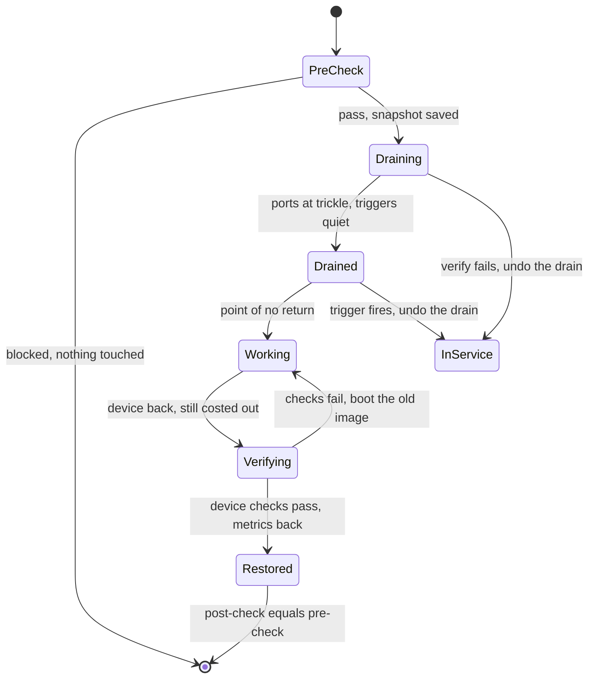

Most network outages begin with someone changing something. [Network automation and the source of truth](/learn/fabric-networking/operating-fabrics/network-automation-and-source-of-truth) gave the numbers: Google's SRE book attributes roughly 70% of outages to changes in a live system, and Google's study of its own network ("Evolve or Die", SIGCOMM 2016) found most failure events began while a management operation was in progress. Automation removes typing errors but lets one wrong change reach every device at once. Meridian still upgrades software, replaces optics, adds tenants and recables racks every week, so the answer is not fewer changes but a procedure in which every step is checked by a measurement, every batch is small enough for redundancy to absorb, and the monitoring knows a change is running.

A change has one property a hardware failure does not: it is planned. You know in advance which device you will touch, what should happen to the traffic and how to undo it, and safe change writes that down as code before it starts. It builds on the IS-IS mechanics of costing out in [underlay failures in production](/learn/fabric-networking/underlay/underlay-failures-in-production) and the headroom arithmetic in [redundancy and failure domains](/learn/fabric-networking/fabric-architecture/redundancy-and-failure-domains); for devices that speak BGP to the outside world, [operating BGP safely](/learn/fabric-networking/bgp-in-the-real-world/operating-bgp-safely) adds the order of the drain.

## The procedure shape

Every maintenance on every device follows the same six steps. Network engineers recite them as "pre-check, drain, validate, work, restore, validate", and each step answers one question:

| Step | The question it answers | Measured on Meridian by | If the answer is no |
|---|---|---|---|
| 1. Pre-check | Can the rest of the network carry this device's traffic, and is the network healthy right now? | Busiest uplink after the drain ≤ 80%; all spines in service; no open alarms; probes clean | Do not start. Nothing has been touched |
| 2. Drain | Move traffic off while the device still forwards | Raise the device's IS-IS link metrics to 16,777,214 | (an action, not a check) |
| 3. Validate drained | Did the traffic actually leave, and did nothing else break? | Every port at the control-plane trickle; ECMP width as predicted; zero discards; probes clean | Undo the drain |
| 4. Work | The upgrade, reboot, optic swap or recabling | The work's own success criteria | Roll back the work while still drained |
| 5. Restore | Put the device back, but only after checking it while it carries nothing | Release, adjacencies, route count, optics, errors; then metrics back to normal | Leave it drained and page its owner |
| 6. Validate restored | Is the network back to where the pre-check found it? | Pre-check snapshot against post-check snapshot | Re-drain and investigate |

Two rules make the shape safe. **Every gate is a measurement against a threshold, not a timer.** "Wait five minutes and continue" assumes the drain worked; "every port below 1 Mb/s" proves it. **Every step has an undo, and the undo gets more expensive as the procedure advances.** Before the work, undoing a drain is one metric change. Once the software or hardware has changed, the undo is a second piece of work. That boundary is the **point of no return**, and a good plan names it.

**What the shape solves:** each step is proven before the next begins, with the cheapest undo in reach. **How it breaks:** a gate that is a timer or a tick-box, a skipped step, an undo nobody has tried. **Signal:** each gate's measured value against its threshold, per change.



## Costing out a spine, step by step

**Costing out** a device means making every other router's routing calculation avoid it while it is still up and forwarding. On an IS-IS underlay (the link-state routing protocol Meridian runs between the switches of each site) the usual way is to raise the metric on all its links to 16,777,214, the largest metric that IS-IS's shortest-path calculation still uses ([IS-IS from zero](/learn/fabric-networking/underlay/is-is-from-zero) explains the metric field). A path through the device then costs millions instead of 20, every leaf removes it from its ECMP group (ECMP, equal-cost multipath, spreads flows over all equally short paths), and traffic moves while the spine still forwards whatever reaches it: make before break.

Tonight's change upgrades `spine2.ams`'s network operating system, which needs a reboot, and the goal is a **hitless** change: not one packet lost. The example uses the small Amsterdam fabric, 4 spines and 4 leaves on 400 Gb/s links. `spine1.ams` and `spine2.ams` also carry the two 100 Gb/s long-haul circuits to Singapore (`spine1.sin`, `spine2.sin`): the "square" of [connecting sites and backbones](/learn/fabric-networking/fabric-architecture/connecting-sites-and-backbones).

```viz
{"type": "fabric", "scenario": "spine-drain", "title": "Upgrading spine2.ams hitlessly: blocked at 14:00, then drained, verified, rebooted, verified and restored at 02:00", "caption": "Ten frames on the small Amsterdam fabric. The pre-check refuses at 14:00 (leaf3.ams would reach 360 Gb/s per uplink and one Singapore circuit 90 Gb/s, both above 80%) and passes at 02:00. spine2.ams raises its five link metrics to 16,777,214, leaves drop it from ECMP and leaf3.ams's uplinks go from 4 × 165 to 3 × 220 Gb/s. The spine is verified empty, rebooted with zero loss, checked while still costed out, restored to its normal metrics and compared against the pre-check snapshot."}
```

What each step establishes:

1. **Pre-check.** With one of four spines out, each leaf's three remaining uplinks carry 4/3 of today's load. At 14:00 `leaf3.ams`'s 270 Gb/s per uplink would become 360 (90%) and both circuits' 2 × 45 Gb/s would land on one (90%), over Meridian's 80% ceiling: do not start. At 02:00 the same arithmetic gives 220 Gb/s (55%) and 70 Gb/s (70%), and the state checks pass: 4 of 4 spines in service, 18 IS-IS adjacencies (16 leaf–spine links, 2 circuits), no open alarms, clean probes. The tool saves this as the **pre-check snapshot**, the definition of "back to normal".
2. **Drain.** `spine2.ams` raises all five link metrics (10 on the leaf links, 52,500 on the circuit) to 16,777,214 and floods a new link-state packet. Every leaf reruns SPF (shortest path first, IS-IS's Dijkstra run): through `spine2.ams` another leaf now costs 16,777,224 against 20, so the spine leaves every ECMP group. A flow that changes spine may see a few packets reordered, once; none needs to be lost.
3. **Validate drained.** The five ports carry 10 to 20 kb/s each: IS-IS hellos, BFD (bidirectional forwarding detection, fast liveness checks) and LLDP (neighbour announcements). No uplink is above 55%, no port counts discards.
4. **Work.** The spine reboots. Five adjacencies drop, which the monitoring expects for this change, and no traffic notices.
5. **Verify the device, still costed out.** The high metric is in the saved configuration, so the spine boots costed out and attracts nothing while it is checked: new release, 5 of 5 adjacencies, 52 routes (as on `spine1.ams`), optics in range, zero errors.
6. **Restore and validate.** Metrics back to normal, the leaves put it back in ECMP, and the post-check matches the snapshot: 4 × 165 Gb/s on `leaf3.ams`, 18 adjacencies, zero discards, zero packets lost.

Step 5 is a design choice worth copying. A drain held only in the running configuration vanishes at reboot, and the spine attracts traffic as soon as its adjacencies form, before anyone has checked it. Written into the intended configuration before the work starts, the drain survives a crash or an accidental reboot. IS-IS's overload-on-startup timer (RFC 3277) gives the same protection to devices that reboot without a plan.

### "Drained" is a per-port fact

The validate step reads every port, not the device's total, because a drain can leak, most often through a link it did not cover. Suppose the role template that raises metrics lists the four leaf-facing ports and forgets the circuit to `spine2.sin`. IS-IS metrics are directional: each router advertises the cost of *leaving* it over each link. A path from an Amsterdam leaf to Singapore through `spine2.ams` leaves the spine over the circuit, whose metric is still the circuit's normal 52,500 (its one-way latency in microseconds). The path costs 10 + 52,500 + 10 = 52,520, exactly what it costs through `spine1.ams`, so every leaf keeps `spine2.ams` in its ECMP group for Singapore-bound traffic. Leaf-to-leaf traffic moves; Singapore traffic stays. A device total shows "mostly drained"; the per-port view shows 35 Gb/s still leaving on the circuit, which the reboot would cut.

Other leaks have the same shape: a static route naming the spine's interface address, a device attached only to this spine (a single-homed route reflector or probe server), a bundle member the template addressed by an old name. The pre-check should list everything attached and what happens to each.

**What costing out solves:** traffic leaves a device while it still forwards, so the work costs no packets. **How it breaks:** a missed link, a device reachable only through the drained one, a drain a reboot forgets. **Signal:** per-port traffic on the drained device against the trickle, and each leaf's ECMP width against the plan.

### The procedure as code

The runner below is the procedure as a state machine over telemetry snapshots, each gate reading counters the devices already expose. The snapshots are illustrative but use the visualisation's numbers; four runs cover the blocked pre-check, the leaking drain, an unrelated failure during the drain, and the clean night.

```python
LINK, CIRCUIT, LIMIT = 400, 100, 0.80   # Gb/s, Gb/s, utilisation ceiling after the drain
TRICKLE_MBPS = 1.0                      # hellos, BFD and LLDP: what a drained port still carries
SPINES = ["spine1.ams", "spine2.ams", "spine3.ams", "spine4.ams"]


def precheck(t, target):
    """Gate 1: would the fabric fit if `target` carried nothing? Reads live counters only."""
    n = len(SPINES)
    worst = max(t["uplink_gbps"].values()) * n / (n - 1)   # each leaf's load over n-1 uplinks
    circuit = sum(t["circuit_gbps"].values())              # both circuits' traffic on one
    problems = []
    if worst > LIMIT * LINK:
        problems.append(f"busiest uplink would reach {worst:.0f} Gb/s ({worst / LINK:.0%})")
    if target in t["circuit_gbps"] and circuit > LIMIT * CIRCUIT:
        problems.append(f"one circuit would carry {circuit} Gb/s ({circuit / CIRCUIT:.0%})")
    if t["spines_in_service"] != n:
        problems.append(f"only {t['spines_in_service']} of {n} spines in service")
    if t["open_alarms"]:
        problems.append(f"open alarms: {t['open_alarms']}")
    return problems


def verify_drained(t, target):
    """Gate 2: every port of the target is down to the control-plane trickle, nothing broke."""
    busy = [f"{port} {mbps / 1000:.1f}" for port, mbps in t["port_mbps"][target].items()
            if mbps > TRICKLE_MBPS]
    problems = [f"still carrying traffic (Gb/s): {', '.join(busy)}"] if busy else []
    if any(w != len(SPINES) - 1 for w in t["ecmp_width"].values()):
        problems.append(f"ECMP width per leaf {t['ecmp_width']}, expected {len(SPINES) - 1}")
    return problems + rollback_triggers(t)


def rollback_triggers(t):
    """Checked after every step: any one of these undoes the change, whoever is watching."""
    problems = []
    if t["fabric_discards"]:
        problems.append(f"discards on fabric ports: {t['fabric_discards']}")
    if t["probe_loss_pct"] > 0.1:
        problems.append(f"probe loss {t['probe_loss_pct']}% (trigger is 0.1%)")
    return problems


def run(name, target, readings):
    log, steps = [], iter(readings)          # readings: one telemetry snapshot per gate

    def step(what):
        log.append(f"  {len(log):02d} {what}")

    problems = precheck(next(steps), target)
    if problems:
        step(f"pre-check BLOCKED, nothing touched: {'; '.join(problems)}")
        return name, log
    step("pre-check pass; snapshot saved")
    step(f"drain: {target} metric -> 16,777,214 on all its links")
    problems = verify_drained(next(steps), target)
    if problems:
        step(f"verify FAILED: {'; '.join(problems)}")
        step(f"rollback: {target} metrics back to normal (before the point of no return)")
        return name, log
    step("verify drained: pass")
    step("work: reboot into the new release  <- point of no return")
    t = next(steps)
    if t["release"] != "new" or t["adjacencies_up"] != t["adjacencies_expected"] or rollback_triggers(t):
        step("verify device FAILED: stays costed out, page the owner; roll back = reboot old image")
        return name, log
    step("verify device while costed out: pass")
    step(f"restore: {target} metrics back to normal")
    t = next(steps)
    problems = rollback_triggers(t) + ([] if all(w == len(SPINES) for w in t["ecmp_width"].values())
                                       else [f"ECMP width {t['ecmp_width']}"])
    if problems:
        step(f"post-check FAILED: {'; '.join(problems)}; re-drain {target}")
        return name, log
    step("post-check against snapshot: pass; change closed")
    return name, log


def snap(uplinks, circuits=(35, 35), ports=None, width=4, discards=0, loss=0.0, **extra):
    leaves = ["leaf1.ams", "leaf2.ams", "leaf3.ams", "leaf4.ams"]
    return {"uplink_gbps": dict(zip(leaves, uplinks)),
            "circuit_gbps": dict(zip(["spine1.ams", "spine2.ams"], circuits)),
            "spines_in_service": 4, "open_alarms": [], "fabric_discards": discards,
            "probe_loss_pct": loss, "ecmp_width": dict.fromkeys(leaves, width),
            "port_mbps": {"spine2.ams": ports or {}}, **extra}


QUIET = {f"swp{i}": 0.02 for i in range(1, 5)} | {"to spine2.sin": 0.01}
# The circuit kept its normal metric (52,500): Singapore-bound traffic still enters from every leaf.
LEAKY = {"swp1": 10_000.0, "swp2": 7_500.0, "swp3": 12_500.0, "swp4": 5_000.0, "to spine2.sin": 35_000.0}
DEVICE_OK = {"release": "new", "adjacencies_up": 5, "adjacencies_expected": 5}
AT_02 = (120, 90, 165, 105)
runs = [
    run("14:00", "spine2.ams", [snap((225, 150, 270, 195), circuits=(45, 45))]),
    run("02:00, circuit left at its normal metric", "spine2.ams",
        [snap(AT_02), snap(AT_02, ports=LEAKY, width=3)]),
    run("02:00, optic on spine3 starts dropping", "spine2.ams",
        [snap(AT_02), snap(AT_02, ports=QUIET, width=3, discards=1840, loss=0.6)]),
    run("02:00, clean", "spine2.ams",
        [snap(AT_02), snap(AT_02, ports=QUIET, width=3), snap(AT_02, width=3, **DEVICE_OK),
         snap(AT_02)]),
]
for name, log in runs:
    print(f"{name}:")
    print("\n".join(log))
```

```text
14:00:
  00 pre-check BLOCKED, nothing touched: busiest uplink would reach 360 Gb/s (90%); one circuit would carry 90 Gb/s (90%)
02:00, circuit left at its normal metric:
  00 pre-check pass; snapshot saved
  01 drain: spine2.ams metric -> 16,777,214 on all its links
  02 verify FAILED: still carrying traffic (Gb/s): swp1 10.0, swp2 7.5, swp3 12.5, swp4 5.0, to spine2.sin 35.0
  03 rollback: spine2.ams metrics back to normal (before the point of no return)
02:00, optic on spine3 starts dropping:
  00 pre-check pass; snapshot saved
  01 drain: spine2.ams metric -> 16,777,214 on all its links
  02 verify FAILED: discards on fabric ports: 1840; probe loss 0.6% (trigger is 0.1%)
  03 rollback: spine2.ams metrics back to normal (before the point of no return)
02:00, clean:
  00 pre-check pass; snapshot saved
  01 drain: spine2.ams metric -> 16,777,214 on all its links
  02 verify drained: pass
  03 work: reboot into the new release  <- point of no return
  04 verify device while costed out: pass
  05 restore: spine2.ams metrics back to normal
  06 post-check against snapshot: pass; change closed
```

The lines that carry the design:

- `precheck` applies the formula from [redundancy and failure domains](/learn/fabric-networking/fabric-architecture/redundancy-and-failure-domains), load × n / (n − 1), to live counters. Stopping at 14:00 is the cheapest rollback there is.
- `verify_drained` lists *ports* above the trickle, which is how the leaking run fails on the circuit's 35 Gb/s.
- `rollback_triggers` runs after every step. In the third run an optic on `spine3.ams` starts dropping right after the drain. Whether the drain caused it (more load can expose a marginal optic) does not matter: putting `spine2.ams` back restores a quarter of the capacity in seconds.
- After `work`, a failed device check does **not** restore the metric, which would put a broken device into service. It stays costed out, and its rollback (booting the previous image) is done while it carries nothing.

## Canaries and blast-radius batching

A new release for the whole fleet is a **rollout**: the same procedure applied to every device, in batches. Two quantities decide how to batch. The **blast radius** of a batch is what is lost if the change is bad on every device in it at once, the right planning assumption because a software bug or template error is identical on every copy. The **exposure** is how long a bad change runs before something notices. Big batches finish sooner and risk more; one device at a time risks little and takes a week. ([Blast radius](/practice/blast-radius) practises computing what one failure takes with it.)

Five rules reconcile the two:

1. **A canary goes first, alone, with the longest soak.** The canary is the first production device on the new release. A virtual lab runs the real software without the real ASIC (the switching chip), and even a hardware lab lacks production's table sizes, traffic mix and uptime. Choose one cheap to lose: a spine in the quietest site, one of four and drained during the work. Let it **soak** (run under watch before anything else changes) for a day, because some bugs need time: a memory leak, a timer that misbehaves after hours of uptime, a counter that wraps, a peak hour.
2. **Never two members of one redundancy group in one wave.** At most one spine per site, one leaf of each dual-homed pair, one route reflector (the BGP servers that redistribute overlay routes to the leaves) of each pair, one gateway of each pair. A bad wave must cost each group one member, not all of them.
3. **Every role gets its own canary.** A bug in the border gateway's BGP code will not show on a spine. A role's share of a wave doubles (1, 2, 4, 8) only after a clean wave containing that role.
4. **Soak time depends on what could go wrong.** Minutes for a configuration change whose effect is immediate, hours to a day for software, and a soak without a peak hour has not tested load.
5. **Any trigger stops the rollout, not only the device**, freezing every later wave until someone understands why.

The planner below applies rules 1 to 3 to the fleet, assuming every site has full Amsterdam's shape (4 spines, 16 leaves in 8 dual-homed pairs, 2 reflectors, 2 gateways): 72 devices, Singapore the quietest site.

```python
SITES = ["sin", "sjc", "ams"]            # assumed least tenant traffic first


def fleet():
    """Every site shaped like full-size Amsterdam: 4 spines, 16 leaves in 8 pairs, 2 RRs, 2 gateways.
    `group` is the redundancy group: members of one group must never be down together."""
    devices = []
    for site in SITES:
        devices += [(f"spine{n}.{site}", "spine", f"spines.{site}") for n in range(1, 5)]
        devices += [(f"leaf{n}.{site}", "leaf", f"leaves{(n + 1) // 2}.{site}") for n in range(1, 17)]
        devices += [(f"rr{n}.{site}", "rr", f"rrs.{site}") for n in (1, 2)]
        devices += [(f"gw{n}.{site}", "gw", f"gws.{site}") for n in (1, 2)]
    return devices


ROLE_ORDER = {"spine": 0, "leaf": 1, "rr": 2, "gw": 3}   # cleanest drain first, internet edge last
PLURAL = {"spine": "spines", "leaf": "leaves", "rr": "rrs", "gw": "gws"}


def plan(devices, growth=2, max_wave=16):
    """Waves never take two members of one redundancy group at once, and every role gets its
    own canary: a role's share of a wave doubles only after a wave containing it went cleanly."""
    todo = sorted(devices, key=lambda d: (ROLE_ORDER[d[1]], SITES.index(d[0].split(".")[1])))
    waves, done_waves = [], {}            # role -> earlier waves that contained it
    while todo:
        wave, groups, per_role = [], set(), {}
        for dev in todo:
            name, role, group = dev
            cap = growth ** done_waves.get(role, 0)          # 1, 2, 4, 8 ...
            limit = 1 if not waves else max_wave            # wave 1: a single canary
            if len(wave) < limit and group not in groups and per_role.get(role, 0) < cap:
                wave.append(dev)
                groups.add(group)
                per_role[role] = per_role.get(role, 0) + 1
        for role in per_role:
            done_waves[role] = done_waves.get(role, 0) + 1
        waves.append(wave)
        todo = [d for d in todo if d not in wave]
    return waves


def describe(waves, soak_h, work_h=1.0):
    total = 0.0
    for i, wave in enumerate(waves, 1):
        roles = {}
        for name, role, _ in wave:
            roles.setdefault(role, []).append(name)
        what = "; ".join(f"{len(v)} {PLURAL[r] if len(v) > 1 else r} ({', '.join(v[:2])}{', ...' if len(v) > 2 else ''})"
                         for r, v in roles.items())
        soak = soak_h(i)
        total += work_h + soak
        print(f"wave {i:>2}: {len(wave):>2} device{'s' if len(wave) > 1 else ''}, soak {soak:>4.0f} h  {what}")
    print(f"{len(waves)} waves, {sum(map(len, waves))} devices, about {total / 24:.1f} days")


waves = plan(fleet())
describe(waves, soak_h=lambda i: 24 if i == 1 else 4)
print()
print("one device at a time, 1 h each plus 1 h soak:", f"{len(fleet()) * 2 / 24:.1f} days")
```

```text
wave  1:  1 device, soak   24 h  1 spine (spine1.sin)
wave  2:  5 devices, soak    4 h  2 spines (spine2.sin, spine1.sjc); 1 leaf (leaf1.sin); 1 rr (rr1.sin); 1 gw (gw1.sin)
wave  3:  9 devices, soak    4 h  3 spines (spine3.sin, spine2.sjc, ...); 2 leaves (leaf2.sin, leaf3.sin); 2 rrs (rr2.sin, rr1.sjc); 2 gws (gw2.sin, gw1.sjc)
wave  4: 11 devices, soak    4 h  3 spines (spine4.sin, spine3.sjc, ...); 4 leaves (leaf4.sin, leaf5.sin, ...); 2 rrs (rr2.sjc, rr1.ams); 2 gws (gw2.sjc, gw1.ams)
wave  5: 12 devices, soak    4 h  2 spines (spine4.sjc, spine3.ams); 8 leaves (leaf6.sin, leaf8.sin, ...); 1 rr (rr2.ams); 1 gw (gw2.ams)
wave  6: 16 devices, soak    4 h  1 spine (spine4.ams); 15 leaves (leaf12.sin, leaf14.sin, ...)
wave  7: 14 devices, soak    4 h  14 leaves (leaf6.sjc, leaf8.sjc, ...)
wave  8:  4 devices, soak    4 h  4 leaves (leaf10.ams, leaf12.ams, ...)
8 waves, 72 devices, about 2.5 days

one device at a time, 1 h each plus 1 h soak: 6.0 days
```

Reading the output:

- **Wave 1 is one spine in Singapore**, soaking 24 hours; if the release crashes it, Singapore runs on three spines, as during any maintenance. **Wave 2** gives every other role its first canary, and Amsterdam, the busiest, sees its first device only in wave 3.
- **Redundancy groups bound the speed.** Twelve spines at one per site per wave need at least four waves; the leaf-pair rule makes leaves alternate (`leaf12.sin`, `leaf14.sin`).
- **Safety costs about 2.5 days**, against 6 for one device at a time and about an hour for all 72 at once, which would run a bug on every spine of every site together.

### When a canary does not protect you

A canary protects only against the change it actually ran. In Rogers Communications' nationwide outage in Canada on 8 July 2022, by Rogers' account to the Canadian regulator, a core upgrade was being done in phases and earlier phases had gone cleanly. The failing phase removed a routing filter on distribution routers, which then sent the core routers far more routes than they could handle. Mobile, internet and emergency calling were affected for most of a day. The earlier phases had not run that change on that kind of device, so they were not canaries for it: a wave that changes something new is a new canary.

**What canaries and batching solve:** a bad release shows on one cheap device, and no wave takes a whole redundancy group. **How they break:** canaries unlike the fleet (model, role, features, traffic), soaks that miss the peak hour, waves sized by percentage. **Signal:** per wave, devices on each release and triggers fired; the canary's counters against its own baseline.

## Rollback triggers

A **rollback trigger** is a condition, decided before the change starts, that undoes the change automatically or obliges the engineer to. Deciding in advance matters because judgement degrades during a change: at 02:40 with one step left, "probe loss 0.3%, probably noise" is tempting. Each trigger names a signal, a threshold, how long it must persist, and the action.

| Signal | Threshold for the `spine2.ams` change | Why that number | Action |
|---|---|---|---|
| Discards on any fabric port | Any increase over the pre-check baseline (zero) | A healthy fabric at 55% does not drop | Undo the drain |
| Probe loss across any spine | > 0.1% for 2 minutes | One random lost probe in 1,200 is 0.08%; two minutes at 10 probes per second per path is 1,200 probes | Undo the drain |
| Busiest uplink | > 80% for 1 minute | Meridian's ceiling, which the pre-check predicted would not be reached | Undo the drain |
| ECMP width per leaf (to other Amsterdam leaves) | Different from the plan (3 after the drain, 4 after restore) | A leaf with 2 paths has lost a second spine | Undo the drain; page |
| IS-IS adjacencies | Different from the expected count for this step | 18 normally, 13 while the spine reboots | Hold; page |
| EVPN routes on each leaf | Off baseline by more than 1% | Tenants losing routes through a fabric change means something unrelated broke | Undo; page |
| Clock | Window end minus the rollback's duration (about 30 minutes for an OS rollback) | The rollback must finish inside the window | Stop and roll back the work |

Three kinds of rollback differ by cost:

- **Undo the drain** before the work: one metric change, seconds, no risk. Until the reboot starts, the drained spine is the fabric's spare and restoring it is the fastest repair available.
- **Roll back configuration**: the device's commit history, or a confirmed commit that reverts itself unless confirmed within a timeout ([configuration APIs](/learn/fabric-networking/operating-fabrics/configuration-apis) traces one). Seconds, and it works even when the automation cannot reach the device.
- **Roll back software**: boot the previous image, which many network operating systems keep installed beside the new one (a second partition or image slot). Minutes, and safe only while drained. A hardware swap has no rollback, only a spare part and a roll forward.

A rollback that depends on the thing the change broke will not run: if the change cuts the automation's path to the device, a pushed undo cannot arrive. That is why Meridian manages devices over a separate out-of-band network (`172.16.0.0/16`, as in [network automation and the source of truth](/learn/fabric-networking/operating-fabrics/network-automation-and-source-of-truth)), and why device-side timers matter. During Facebook's October 2021 outage, Facebook's own write-up describes engineers unable to reach the affected data centres through their normal remote tools, because those tools needed the backbone that had just gone down. Recovery waited for people on site.

**What triggers solve:** the decision to undo is made calmly, in advance, and can run without a human. **How they break:** thresholds inside normal noise (people loosen them until they mean nothing), the wrong signal, an undo that needs the path the change broke. **Signal:** per trigger, how often it fired, and incidents after changes that fired nothing.

## Pre-change validation and network modelling

The cheapest outage is the one rejected before any device is touched. Pre-change validation is a ladder of checks, from cheap and narrow to expensive and broad:

1. **Schema validation.** The rendered configuration parses and fits the device's YANG model (the schema the device's configuration API enforces). Catches errors of form: a misspelt field, a value out of range.
2. **Policy checks on intent.** Rules run on the source of truth: both ends of every link have the same MTU (maximum transmission unit, the largest packet the link carries), every loopback and every route distinguisher (the tag that keeps one tenant's EVPN routes distinct from another's) is unique, no change touches two members of one redundancy group. These are fast, but they catch only the mistakes someone has already written a rule for.
3. **A model of the network.** Compute, from the configurations alone, the routes and forwarding tables the network will converge to, then query the result, catching consequences nobody wrote a rule for.
4. **Differential analysis.** Ask the same questions before and after the change and report only what differs, so "every leaf reaches every other leaf" becomes a test every change must pass.

**Batfish** is the best-known open-source tool for steps 3 and 4 (its design was published at NSDI in 2015). It parses configurations from many vendors into one vendor-neutral model, simulates the routing protocols (BGP, OSPF, IS-IS and static routes) until they converge, and answers questions about the result: can A reach B and along which paths, what an access list permits, whether both ends of each BGP session agree on addresses and AS numbers, which references name something undefined. Its differential questions list the flows whose fate changes between two snapshots.

The model below is the same idea at small scale: link metrics as a modelling tool would derive them from configurations (Amsterdam with 4 spines and 4 leaves, Singapore with 2 and 2, joined by the square), SPF from every leaf, and every leaf pair compared before and after a change.

```python
import heapq
from itertools import permutations

COST_OUT = 16_777_214          # largest usable IS-IS wide metric: "use me only as a last resort"
CIRCUIT = 52_500               # ams-sin circuit metric: one-way latency in microseconds


def snapshot():
    """Intended state, as a modelling tool would derive it from every device's configuration:
    per device, its links (neighbour -> metric of leaving over that link) and admin state.
    Small example: ams with 4 spines and 4 leaves, sin with 2 and 2."""
    cfg = {}
    for site, spines, leaves in (("ams", 4, 4), ("sin", 2, 2)):
        for s in range(1, spines + 1):
            for l in range(1, leaves + 1):
                cfg.setdefault(f"spine{s}.{site}", {})[f"leaf{l}.{site}"] = 10
                cfg.setdefault(f"leaf{l}.{site}", {})[f"spine{s}.{site}"] = 10
    for n in (1, 2):                                   # the square
        cfg[f"spine{n}.ams"][f"spine{n}.sin"] = CIRCUIT
        cfg[f"spine{n}.sin"][f"spine{n}.ams"] = CIRCUIT
    return cfg


def spf(cfg, src):
    """Dijkstra with ECMP: destination -> (cost, set of first hops). Links shut on either
    end are gone, as IS-IS's two-way check requires."""
    dist, heap = {src: (0, set())}, [(0, src)]
    while heap:
        cost, u = heapq.heappop(heap)
        if cost > dist[u][0]:
            continue
        for v, metric in cfg[u].items():
            if metric is None or cfg[v].get(u) is None:
                continue
            new, hops = cost + metric, ({v} if u == src else dist[u][1])
            if v not in dist or new < dist[v][0]:
                dist[v] = (new, set(hops))
                heapq.heappush(heap, (new, v))
            elif new == dist[v][0]:
                dist[v][1].update(hops)
    return dist


def leaf_paths(cfg):
    leaves = [d for d in cfg if d.startswith("leaf")]
    out = {}
    for a, b in permutations(leaves, 2):
        cost, hops = spf(cfg, a).get(b, (None, set()))
        out[(a, b)] = (cost, len(hops))
    return out


def differential(name, change):
    before = snapshot()
    after = snapshot()
    change(after)
    old, new = leaf_paths(before), leaf_paths(after)
    verdicts = {"lost": [], "last resort": [], "narrower": []}
    for pair, (cost, width) in new.items():
        if cost is None:
            verdicts["lost"].append(pair)
        elif cost >= COST_OUT:
            verdicts["last resort"].append(pair)
        elif width < old[pair][1]:
            verdicts["narrower"].append((pair, old[pair][1], width))
    blocked = verdicts["lost"] or verdicts["last resort"]
    print(f"{name}: {'BLOCK' if blocked else 'allow'}")
    for kind in ("lost", "last resort"):
        if verdicts[kind]:
            pairs = verdicts[kind]
            print(f"  {kind}: {len(pairs)} leaf pairs, e.g. {pairs[0][0]} -> {pairs[0][1]}")
    shrink = {}
    for (a, b), w0, w1 in verdicts["narrower"]:
        kind = "intra-site" if a.split(".")[1] == b.split(".")[1] else "inter-site"
        shrink[(kind, w0, w1)] = shrink.get((kind, w0, w1), 0) + 1
    for (kind, w0, w1), n in sorted(shrink.items()):
        print(f"  narrower: {n} {kind} pairs from {w0} to {w1} equal-cost first hops")


def cost_out(*devices):
    def apply(cfg):
        for d in devices:
            for peer in cfg[d]:
                cfg[d][peer] = COST_OUT
    return apply


def shut_circuits(cfg):
    for n in (1, 2):
        cfg[f"spine{n}.ams"][f"spine{n}.sin"] = None


differential("drain spine2.ams", cost_out("spine2.ams"))
differential("drain spine1.ams and spine2.ams in one batch", cost_out("spine1.ams", "spine2.ams"))
differential("shut both ams-sin circuits to test capacity", shut_circuits)
```

```text
drain spine2.ams: allow
  narrower: 16 inter-site pairs from 2 to 1 equal-cost first hops
  narrower: 12 intra-site pairs from 4 to 3 equal-cost first hops
drain spine1.ams and spine2.ams in one batch: BLOCK
  last resort: 16 leaf pairs, e.g. leaf1.ams -> leaf1.sin
  narrower: 12 intra-site pairs from 4 to 2 equal-cost first hops
shut both ams-sin circuits to test capacity: BLOCK
  lost: 16 leaf pairs, e.g. leaf1.ams -> leaf1.sin
```

The three verdicts:

- **Draining `spine2.ams` is allowed**, at a stated cost: 12 Amsterdam leaf pairs go from 4 to 3 equal-cost first hops, and all 16 inter-site pairs (4 × 2 leaves, both directions) from 2 to 1, because one circuit is left. That line sends the pre-check to the circuit's headroom.
- **Draining both circuit spines in one batch is blocked.** Every Amsterdam–Singapore path would be a last resort; with the IS-IS overload bit instead of metrics (the bit tells other routers never to route through the device) Singapore would be cut off.
- **Shutting both circuits "to test capacity" is blocked**: 16 leaf pairs lose reachability. That is the shape of Facebook's October 2021 outage, where a command meant to assess backbone capacity disconnected every backbone link.

What a model cannot see matters as much. It knows which paths exist, not **how much traffic** they carry: only the counters say whether all Singapore traffic fits on one circuit. It computes the converged state, not the **transient**, so the BGP-before-IGP order of [operating BGP safely](/learn/fabric-networking/bgp-in-the-real-world/operating-bgp-safely) is a plan check. It assumes devices behave as configured, so a **software bug** or a full forwarding table is outside it, and routes learned from ISPs must be snapshotted and supplied. A model shows the change does what the configurations say; a canary shows the devices do what the configurations say.

**What modelling solves:** consequences nobody wrote a rule for, found before any device is touched. **How it breaks:** a vendor feature the parser gets wrong, external routes missing from the snapshot, false confidence about load. **Signal:** the before/after diff on every change, and a list of incidents the model approved.

## Change-aware monitoring

Monitoring that does not know about a change fails in one of two ways. It pages for the expected (five adjacencies on `spine2.ams` dropping at 02:10) and people learn to ignore pages, or someone mutes the site for the window and the real outage at 02:20 pages nobody. The router costed out in the wrong order in [operating BGP safely](/learn/fabric-networking/bgp-in-the-real-world/operating-bgp-safely) black-holed customers' traffic for hours while no protocol alarm fired; only a check that the drained router had stopped receiving traffic would have caught it.

**Change-aware** monitoring takes its context from the change record: which devices, which window, and which events the change is expected to cause. Every event is then classified rather than suppressed:

- **Expected**: an event the plan predicted, on a touched device, inside the window. Annotate the graphs; do not page.
- **Suspect**: a symptom (loss, discards, a falling prefix count) anywhere during the window, or an unpredicted event on a touched device. Page with the change attached and its triggers evaluated: during a change, the change is the likeliest cause.
- **Amplified**: a failure in the change's failure domain. With one spine drained, a second loss in that fabric is the "drain plus failure" case, more urgent than on a normal night.
- **Unrelated**: everything else, alerted as normal.

After the window closes, every drain the change applied must be gone. The classifier below runs these rules on the `spine2.ams` change's events and on the next morning's state, after an engineer abandoned the change at the device check.

```python
from datetime import datetime, timedelta

T = lambda hm: datetime(2026, 10, 31, *map(int, hm.split(":")))

CHANGE = {
    "id": "CHG-2291", "window": (T("02:00"), T("03:30")),
    "devices": {"spine2.ams"},
    # What this change is expected to cause, and nothing else: the five adjacencies of
    # spine2.ams going down and up during the reboot, and the spine leaving ECMP groups.
    "expected": {("isis-adjacency-down", "spine2.ams"), ("isis-adjacency-up", "spine2.ams"),
                 ("ecmp-width-change", "spine2.ams"), ("device-reboot", "spine2.ams")},
    "leftover_checks": [("spine2.ams", "leaf-link-metric", 10)],
}


def site_fabric(name):
    return name.split(".")[-1] if name and name.startswith(("spine", "leaf")) else None


def classify(event, change):
    start, end = change["window"]
    if not start <= event["at"] <= end + timedelta(minutes=30):   # effects outlive the window
        return "unrelated: normal alerting"
    ends = {event["device"], event.get("peer")}
    if (event["kind"], event.get("peer") or event["device"]) in change["expected"]:
        return "expected: annotate the graphs, no page"
    if event["kind"] in {"discards", "probe-loss", "prefix-count-drop"}:
        return f"suspect: page with {change['id']} attached; evaluate its rollback triggers"
    if ends & change["devices"]:
        return f"suspect: unexpected event on a device {change['id']} touches"
    if {site_fabric(d) for d in ends} & {site_fabric(d) for d in change["devices"]}:
        return f"amplified: second loss in a fabric that {change['id']} already narrowed"
    return "unrelated: normal alerting"


def leftovers(change, state, now):
    if now <= change["window"][1]:
        return []
    return [f"{dev} {key} is {state[(dev, key)]:,}, intent {want:,} ({change['id']} closed at "
            f"{change['window'][1]:%H:%M})" for dev, key, want in change["leftover_checks"]
            if state[(dev, key)] != want]


events = [
    {"at": T("02:10"), "kind": "device-reboot", "device": "spine2.ams"},
    {"at": T("02:11"), "kind": "isis-adjacency-down", "device": "leaf3.ams", "peer": "spine2.ams"},
    {"at": T("02:14"), "kind": "isis-adjacency-down", "device": "leaf4.ams", "peer": "spine1.ams"},
    {"at": T("02:20"), "kind": "probe-loss", "device": "leaf2.ams"},
    {"at": T("02:21"), "kind": "bgp-session-down", "device": "gw1.sin", "peer": "ISP1"},
]
for e in events:
    who = f"{e['device']}" + (f" - {e['peer']}" if "peer" in e else "")
    print(f"{e['at']:%H:%M} {e['kind']:<20} {who:<24} {classify(e, CHANGE)}")
for line in leftovers(CHANGE, {("spine2.ams", "leaf-link-metric"): 16_777_214}, T("09:00")):
    print("09:00 leftover:", line)
```

```text
02:10 device-reboot        spine2.ams               expected: annotate the graphs, no page
02:11 isis-adjacency-down  leaf3.ams - spine2.ams   expected: annotate the graphs, no page
02:14 isis-adjacency-down  leaf4.ams - spine1.ams   amplified: second loss in a fabric that CHG-2291 already narrowed
02:20 probe-loss           leaf2.ams                suspect: page with CHG-2291 attached; evaluate its rollback triggers
02:21 bgp-session-down     gw1.sin - ISP1           unrelated: normal alerting
09:00 leftover: spine2.ams leaf-link-metric is 16,777,214, intent 10 (CHG-2291 closed at 03:30)
```

The 02:14 line is the one muting would have hidden. `leaf4.ams` losing `spine1.ams` while `spine2.ams` is drained leaves it two uplinks of four: 105 × 4 / 2 = 210 Gb/s each, 52.5%; on `leaf3.ams`, the busiest leaf, the same loss would mean 82.5%, over target ([redundancy and failure domains](/learn/fabric-networking/fabric-architecture/redundancy-and-failure-domains)). If the reboot has not started, restore `spine2.ams`. The 09:00 leftover is the slow failure: a spine left at 16,777,214 keeps Amsterdam on three spines of four, with no alarm, until the next failure finds a quarter less capacity than planned.

**What change awareness solves:** expected noise stays quiet while real symptoms page with the change attached. **How it breaks:** a record that lists too little (expected events page) or too much (real ones pass as expected), or a window that closes with a drain still applied. **Signal:** each change's events by class, and leftovers with their age.

## Audit trails

The first question in almost every incident is "what changed?", and answering it in seconds needs one searchable record of every change, by automation or by a person:

| Field | Example | Who uses it |
|---|---|---|
| Who and who approved | `netops-runner` service account, run by the on-call engineer; approver named | Incident review, compliance |
| Why | The ticket and the release notes being deployed | Whoever finds the change during an incident |
| What, per device | The rendered diff against the running configuration | Rollback, review |
| The plan and each gate's measured value | "verify drained: max port 0.02 Mb/s, threshold 1 Mb/s" | Proving the change was safe, improving thresholds |
| Timestamps per step | From NTP-synchronised clocks, in UTC | Correlating with telemetry and with other changes |
| Device-side evidence | Commit or revision IDs, configuration-change syslog, command accounting | Catching changes made outside the tool |
| Snapshots | Pre-check and post-check | Defining "back to normal" |
| Outcome | Hitless, rolled back at step 3, abandoned at step 7 | Change failure rate, the next planner |

An illustrative record for tonight's change:

```json
{
  "id": "CHG-2291",
  "summary": "spine2.ams: network OS upgrade (wave 3 of the fleet rollout)",
  "requested_by": "on-call engineer", "approved_by": "fabric team lead",
  "devices": ["spine2.ams"],
  "window_utc": ["2026-10-31T02:00:00Z", "2026-10-31T03:30:00Z"],
  "steps": [
    {"step": "pre-check", "at": "02:01:12", "result": "pass",
     "measured": {"busiest_uplink_after_drain_pct": 55, "circuit_after_drain_pct": 70}},
    {"step": "drain", "at": "02:03:40", "device_commit": "r118"},
    {"step": "verify-drained", "at": "02:05:02", "result": "pass",
     "measured": {"max_port_mbps": 0.02, "discards": 0, "probe_loss_pct": 0.0}},
    {"step": "work", "at": "02:10:00", "detail": "reboot into the new release"},
    {"step": "verify-device", "at": "02:21:30", "result": "pass",
     "measured": {"adjacencies": 5, "routes": 52, "interface_errors": 0}},
    {"step": "restore", "at": "02:24:10", "device_commit": "r119"},
    {"step": "post-check", "at": "02:27:45", "result": "pass", "packets_lost": 0}
  ],
  "outcome": "hitless"
}
```

The dangerous change is the one missing from the record, because nobody thinks to roll it back. Three device-side sources catch changes made outside the tool. **Command accounting** (TACACS+, the authentication and accounting protocol most network devices support for logins) logs every CLI command with user and time. **Configuration-change notifications**, as syslog messages or gNMI updates, report a change as it is committed. **Drift detection** compares running configuration with intent on a schedule ([network automation and the source of truth](/learn/fabric-networking/operating-fabrics/network-automation-and-source-of-truth)). Store the trail append-only, link it to incidents, and make "everything that touched the Amsterdam fabric in the last six hours" one query, the first step of [the troubleshooting method](/learn/fabric-networking/operating-fabrics/the-troubleshooting-method).

**What the trail solves:** "what changed?" answered in seconds, for tools and people alike. **How it breaks:** changes outside the tool, unsynchronised clocks that misorder events, no search by device and time. **Signal:** configuration-change events with no matching change record, which should be zero.

## Failure modes in production

| Failure | Symptom | Diagnosis | Fix |
|---|---|---|---|
| Drain misses a link | Traffic lost at the reboot although "drained" was ticked | One port above the trickle during validate; a leaf still lists the spine in ECMP for some prefixes | Validate per port; generate the drain from the device's full link list in the source of truth |
| Maintenance in the busy hour | Congestion and loss from the drain alone | Pre-check was skipped or used a daily average | Pre-check on live p95 load; block outside agreed windows |
| Two changes in one failure domain | Two spines out at once, site at half capacity | Two open changes on the same group | Change scheduler holds a lock per redundancy group |
| Drain never removed | One spine idle for weeks; the fabric fails over badly later | Metric or overload bit different from intent with no open change | Post-check; leftover report with age |
| Canary not representative | Wave 5 fails on a hardware model or feature no earlier wave had | The failing devices share a model or role the canaries lacked | Canary per hardware model, role and feature set |
| Rollback needs the broken path | Automation cannot reach the device to undo | Pushes time out on in-band management | Out-of-band management; device-side confirmed-commit timers |
| Model gap | The model approved a change that failed | The failure depended on traffic volume, timing or a software bug | Combine the model with live headroom checks and canaries |
| Muting instead of change-aware alerting | A real outage during a window pages nobody | Alerts silenced for the whole site | Classify events by device, kind and domain; never mute symptoms |

## Trade-offs: ways to make a change safe

| Method | Catches | Misses | Cost | Speed |
|---|---|---|---|---|
| Peer review of the diff | Intent errors a human spots | Consequences nobody imagined | Reviewer time | Hours |
| Policy checks on the source of truth | Known mistake classes (duplicates, mismatches) | Anything without a rule | Cheap once written | Seconds |
| Network model (Batfish-style) | Reachability and policy consequences across the whole network | Load, transients, software bugs | Snapshots of configs and external routes; modelling effort | Minutes |
| Lab or virtual twin | Software behaviour, upgrade procedures | Real ASICs, scale, traffic mix | Lab hardware or images, upkeep | Hours to days |
| Canary waves | Real-world bugs on real devices | Changes the canary did not run | Days of rollout | Slowest |
| Gates and rollback triggers | Effects as they happen, with an undo | Faults that appear after the soak | Telemetry and probes per change | Minutes per step |
| Change freeze | Everything, by doing nothing | Fixes that were needed, then a backlog of risky changes | Business pressure | None |

## Under the hood: what the network does during a drain

When `spine2.ams` raises its metrics, it regenerates its own link-state packet with a higher sequence number and floods it; in a fabric this size every router has it within milliseconds to tens of milliseconds. Each router then waits out its SPF throttle (an initial delay of tens to hundreds of milliseconds, depending on vendor defaults and tuning; [convergence and BFD](/learn/fabric-networking/underlay/convergence-and-bfd)), recomputes, and reprograms its forwarding table. Leaves finish at slightly different moments, so for a short time some still send through `spine2.ams`. That is harmless: its own cheapest path to each leaf is still the direct link, so a packet that reaches it is delivered.

On boot the order inside the device matters: forwarding hardware programmed, adjacencies up, routes complete, and only then attract traffic. Several network operating systems, Arista EOS and Cumulus Linux among them, package the drain as one **maintenance mode** command: raised metrics or the overload bit, plus BGP graceful shutdown where BGP runs (RFC 8326's GRACEFUL_SHUTDOWN community, which asks peers to stop preferring the routes before the session goes down). Validate from outside anyway: a maintenance mode reports what the device believes, not what the leaves send it.

## What the platform should show

The engineer running the change wants the next step and whether it is safe; the manager wants to know what is at risk. The same data serves both:

- **Every open change on the topology**: devices draining, drained, in work or restoring, with their redundancy groups, so two changes in one group collide on screen first.
- **Gates as pass or fail with the measured value**, unlocking the next step only on a pass, with the trigger thresholds on screen.
- **Predicted against actual** post-drain load, per port and per circuit. A mismatch means the tool's model of the fabric is wrong.
- **Rollout progress**: waves done, devices on each release, soak time remaining, and any trigger that froze the rollout.
- **The model's diff for every proposed change**, in plain words: pairs that lose reachability, pairs left only with last-resort paths, ECMP widths that shrink.
- **Leftovers with age**: metrics, overload bits and graceful-shutdown communities that differ from intent, and the change that set them.
- **"What changed?" for any device and time range**, including CLI changes from command accounting, on every incident page.

## Interviewer follow-ups

**"Walk me through taking a spine out for an upgrade."** Model answer: pre-check with numbers (each uplink at 165 Gb/s goes to 220 on three of four spines, 55%; circuits to 70%) and state (every spine in service, no alarms, probes clean). Raise its IS-IS metrics so leaves drop it from ECMP while it still forwards. Validate per port that only control traffic remains. Upgrade, check it while still costed out, restore the metrics, compare with the pre-check snapshot. Common wrong answer: "shut it down, ECMP handles it", which loses every packet in flight during detection and reconvergence and never checks whether the remaining spines can carry the load.

**"How would you roll a new OS release out to a thousand switches?"** Model answer: lab and model first; a canary in the least critical place with a long soak, then one per role and hardware model; waves that grow geometrically but never hold two members of a redundancy group; triggers that freeze the rollout. Common wrong answer: fixed percentages per wave (10%, 50%, 100%), which can put both spines of a small site in one wave.

**"What does a tool like Batfish give you that testing in a lab doesn't?"** Model answer: every production configuration at once, the converged routing state it implies, and a before/after reachability diff, in minutes. A lab runs real software on a few devices; the model covers every device but trusts its parser and simulation. Common wrong answer: "it catches everything"; it does not see load, transients or software bugs. Honest addition: "I'd defer to the network team on which protocol features the model handles faithfully for our vendors, but I'd run its differential reachability on every change and track the cases it missed."

**"During a maintenance an unrelated link fails. What do you do?"** Model answer: treat it as amplified and check what the drain plus the failure leaves (ECMP width, headroom). If the work has not started, restore the drained device, the fastest capacity available; if it has, finish or roll back against the window's rollback deadline. Common wrong answer: carrying on because "it's unrelated", or muting it because a maintenance is running.

## What mid-level engineers get wrong

- **Gating on timers.** "Wait five minutes, then reboot" reboots a spine that is still carrying a circuit's traffic.
- **Checking "drained" on device totals.** A 35 Gb/s leak on one port of five looks like a mostly drained device.
- **Batching by percentage** instead of by redundancy group, so one bad wave takes both members of a pair.
- **Treating a successful earlier wave as proof** for a later wave that changes something different.
- **Muting monitoring for the window**, which hides exactly the second failure that matters most.
- **Trusting the model for capacity.** A model shows that a path exists, not that it can carry the load.

## Senior signals

- You give the pre-check as arithmetic on today's numbers and treat "do not start" as a success.
- You gate every step on a measurement and name the point of no return in advance.
- You batch by redundancy group and role, with a canary per role and soak times chosen by what could fail.
- You set rollback triggers in advance, with thresholds you can justify, and know which rollbacks need the network the change might break.
- You use a model for reachability and policy and live telemetry for load, and you say what each cannot see.
- You want monitoring that classifies events against the change record and reports leftovers.
- You treat the audit trail as the first troubleshooting tool, including changes made outside the automation.

## Check yourself

```quiz
- q: >-
    Meridian's Amsterdam fabric has four spines. leaf3.ams carries 270 Gb/s on each of its four 400 Gb/s uplinks at 14:00. The ceiling after a drain is 80%. What should the pre-check for draining spine2.ams decide?
  options: ["Pass, because the drained spine's share spreads evenly over three spines", "Block, because a drain always needs half the uplinks to be idle", "Pass, because 270 Gb/s is only 67.5% of a 400 Gb/s uplink", "Block, because each remaining uplink would carry 360 Gb/s, 90%"]
  answer: 3
  explanation: >-
    With one of four spines drained, each leaf's traffic spreads over three uplinks, so each carries 4/3 of its current load: 270 × 4 / 3 = 360 Gb/s, 90% of 400 and over the 80% ceiling. Checking today's 67.5% misses that the drain itself raises the load. The traffic does spread evenly, but that is why the survivors become too full. No rule needs idle uplinks; the requirement comes from the n/(n−1) arithmetic.
- q: >-
    spine2.ams raises the metric to 16,777,214 on its four leaf-facing links but not on its circuit to spine2.sin. What does the validate-drained step find?
  options: ["Singapore-bound traffic still on spine2.ams, because circuit paths cost the same as before", "All leaf-to-leaf traffic still on spine2.ams, because metrics only apply to inbound traffic", "Nothing, because the leaves already route around a spine with any high metric", "Only control traffic, because IS-IS ignores links whose metric was not changed"]
  answer: 0
  explanation: >-
    IS-IS metrics are the cost of leaving a router over a link. A path from an Amsterdam leaf to Singapore through spine2.ams leaves the spine over the circuit, whose metric is unchanged, so it still costs 10 + 52,500 + 10, the same as through spine1.ams, and the leaves keep spine2.ams in ECMP for that traffic. Leaf-to-leaf paths leave over the raised links, so that traffic does move. Checking each port finds the circuit still carrying 35 Gb/s.
- q: >-
    A rollout planner puts spine1.sin and spine2.sin, the two spines of a two-spine site, in the same wave because the wave is only 5% of the fleet. What is wrong?
  options: ["The wave is too small to give the canary statistically useful results", "Spines must always go last, after every leaf has been upgraded", "The wave breaks the redundancy group, so one bad release takes the whole site", "Nothing, because a small percentage keeps the blast radius small"]
  answer: 2
  explanation: >-
    A bad release is the same on every device in a wave, so a wave's blast radius is every device in it failing at once. Both spines of a two-spine site failing together cuts every leaf in that site off from every other. A fleet percentage says nothing about failure domains; the rule is at most one member of each redundancy group per wave. Spines are often good early canaries because they can be fully drained.
- q: >-
    A Batfish-style differential check approves draining spine2.ams: every leaf pair stays reachable, inter-site pairs go from 2 to 1 equal-cost path. What does it not tell you?
  options: ["Which leaf pairs lose an equal-cost path after the drain", "Whether the remaining circuit has the capacity for all Singapore traffic", "Whether any leaf pair loses reachability after the drain", "Whether a configuration names a prefix list that does not exist"]
  answer: 1
  explanation: >-
    A model computes routes and paths from configurations; it knows nothing about traffic volume. It can say that all Singapore traffic will use spine1.ams's circuit, but only live telemetry says whether 70 Gb/s fits on 100. Reachability, path counts and undefined references are exactly what a model reports. That is why the pre-check combines the model's path changes with measured load.
- q: >-
    During the spine2.ams change window, with spine2.ams drained but not yet rebooted, leaf4.ams loses its link to spine1.ams. How should change-aware monitoring treat it?
  options: ["Suppress it, because it falls within the declared maintenance window", "Amplify it, because leaf4.ams now has two of four uplinks", "Ignore it until the change closes, then raise it as a new incident", "Log it as expected, because adjacency changes are part of a spine drain"]
  answer: 1
  explanation: >-
    The change declared only spine2.ams's own adjacencies as expected. A second loss in the same fabric while one spine is drained is the drain-plus-failure case: leaf4.ams is on half its uplink capacity. That is more urgent than on a normal night, and since the reboot has not started, restoring spine2.ams's metrics is the fastest fix. Suppressing everything in the window is how real outages go unnoticed during maintenance.
- q: >-
    spine2.ams comes back from its reboot and fails the device check: two of its five adjacencies stay down. What should the procedure do?
  options: ["Reboot it again immediately, then restore the metrics if it comes up", "Restore its metrics so the three good links carry traffic again", "Close the change, because the fabric is running on three spines anyway", "Keep it costed out and roll back the work by booting the old image"]
  answer: 3
  explanation: >-
    After the point of no return, restoring the metric would put a device that failed its check into service. The device stays costed out, which costs nothing because the fabric was already sized for three spines, and the rollback is a second piece of work done while it carries no traffic: boot the previous image and check again. Closing the change leaves a drained spine with no owner, which turns into a leftover that removes a quarter of the capacity for weeks.
```
