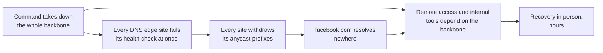

Most network outages share a sentence in the postmortem: "monitoring was green throughout; the first report came from a customer." Every protocol did what it was designed to do, every session was up, every dashboard showed a part working, and the service was down because the parts had been combined into something nobody measured. Those incidents explain why network organisations hire software engineers. A platform that looks only at protocol state cannot see them. One that checks end-to-end behaviour, compares state against intent and knows what changed can see them in seconds.

This lesson tells six incidents end to end. Five happen on Meridian, the reference fabric of this track (the fifth in its San Jose AI cluster): generic forms of failures operators really hit, with identifying details removed. The sixth is public, Facebook's outage of 4 October 2021. Each case links to the lesson that teaches its mechanism; here the questions are how the incident unfolded, why it took so long to find, and which signal a platform should have raised first.

## How to read an incident

A postmortem (the written review after an incident) separates things that a hallway retelling merges. Every case below uses the same parts:

| Part | Meaning | Why it matters to tooling |
|---|---|---|
| **Impact** | Who could not do what, for how long | Sets severity; tooling must measure it from the user's side |
| **Trigger** | The event that started it: a reboot, a command, a cable pull | Usually innocent on its own |
| **Latent condition** | What was already wrong and waiting: a bug, a copied line, an unsafe default | Exists for days or weeks; config checks and lab tests find it |
| **Detection** | Who or what noticed, and when | **Time to detect** (TTD) is the number tooling owns |
| **Mitigation** | What stopped the bleeding | **Time to mitigate** (TTM); often a drain or a rollback, not the fix |
| **Fix and prevention** | What removed the latent condition, and what stops its class from recurring | The action items |
| **Blast radius** | How far the failure reached compared with the unit of change | When it is larger than the change, the design has a hidden coupling |

Two habits run through every case. First, separate the **trigger** from the **latent condition**: "the engineer swapped two steps" is a trigger, and "nothing in the tooling knew the order" is the latent condition you can fix. Blameless postmortems (the [incidents and postmortems](/learn/senior-craft/technical-leadership/incidents-and-postmortems) lesson covers running one) exist because blaming the trigger leaves the latent condition in place. Second, ask *who saw it first*. In most cases below it was someone outside the network team; the platform's job is to move that moment earlier.

## Case 1: the clock-jump purge storm

**Impact:** tenant traffic stopped across all three of Meridian's sites three times in half an hour, from seconds to tens of seconds each time, during a planned upgrade of Amsterdam's leaves one at a time. No link and no IS-IS adjacency went down.

**Background.** Meridian's underlay is IS-IS: every router keeps a copy of every router's LSP (link-state packet, a description of its links) and runs SPF (shortest path first) over them to compute its routes. Each LSP carries a remaining lifetime, 1,200 s by default, counted down in every copy and reset by the originator's periodic refresh. A copy that reaches zero is **purged**: flooded with its contents removed and lifetime 0, and deleted everywhere. Any router may purge any LSP, because a dead router cannot withdraw its own. [Underlay failures in production](/learn/fabric-networking/underlay/underlay-failures-in-production) traces the mechanism byte by byte.

**Latent conditions, two of them.** Two weeks earlier, a change moved the switches' NTP (Network Time Protocol) from the out-of-band management network, `172.16.0.0/16`, to a server reached through the fabric itself, behind `leaf1.ams`. It was reviewed as a management tidy-up and closed as successful, since running devices kept the right time. Separately, this leaf model's network operating system stored each LSP's expiry as an absolute wall-clock time (receipt time plus remaining lifetime) instead of counting the lifetime down. It also booted with its clock at 2000-01-01, because nothing restored the hardware clock before routing started. Neither condition caused trouble alone, and no device had rebooted since the NTP change.

**Trigger:** the upgrade wave, which rebooted leaves one at a time, fifteen minutes apart.

| Time (UTC) | Event | Who saw what |
|---|---|---|
| 08:30 | Upgrade wave starts with `leaf2.ams` | Change record open, alerts for `leaf2.ams` suppressed |
| 08:31 | `leaf2.ams` boots in 2000, NTP steps it 26 years forward, it purges every LSP it did not originate; fabric-wide loss for some seconds | Tenant monitoring blips; the on-call engineer reads it as a side effect of the upgrade |
| 08:45 | Same on `leaf3.ams` | Second blip; an Acme engineer opens a ticket about failed database connections |
| 09:00:00 | `leaf4.ams` reboots; clock reads 2000-01-01 00:00:00 | |
| 09:00:41 | Adjacencies up, the spines send it the other LSPs | Expiries stored in the year 2000 |
| 09:00:52 | Underlay up, NTP answers, clock stepped forward 846,752,400 s | One syslog line: clock stepped |
| 09:00:53 | Purges of about 69 LSPs, all those it did not originate (five in the six-router example below), each stamped with `leaf4.ams`'s system ID; SPF everywhere finds almost nothing; EVPN next hops (remote leaf loopbacks) unresolvable; loss in all three sites | Third blip, the largest |
| within seconds | Each originator re-issues its LSP with a higher sequence number; topology returns; leaves reprogram tunnels and MAC entries | |
| 09:10 | Wave paused: three fabric-wide events, each starting a minute after a leaf reboot | Incident declared |
| 10:40 | Purge-originator TLVs and the clock-step logs line up | Root cause found |

```viz
{"type": "fabric", "scenario": "isis-purge-storm", "title": "One leaf's clock jumps 26 years and the topology vanishes from every router", "caption": "Small example: two spines and four leaves in area 49.0001, with NTP reached through the fabric behind leaf1.ams. leaf4.ams boots in the year 2000, stores LSP expiries as wall-clock times and is stepped to 2026 by NTP. It purges the five LSPs it did not originate, the purges flood, SPF finds almost nothing and the overlay falls, with no link or adjacency down. The originators re-issue with higher sequence numbers, the topology returns, and the last frames give the fixes and the signals: a clock-step log, purges carrying leaf4's system ID, and LSP counts collapsing on every router at once."}
```

**Why the root cause took until 10:40.** The upgrade went one leaf at a time so a failure would cost one leaf, so the first two events looked like noise from the upgraded leaf. Only the third made the pattern undeniable: a fabric-wide outage a minute after *every* reboot. The remaining hour went to the classic trap of the link-state protocols. A purge looks identical on every router, so you cannot tell from any one router who started it. RFC 6232's purge-originator TLV (a TLV, type-length-value, is a self-describing field in an LSP; type 13 carries the system ID of the router that purged) named `leaf4.ams` at once, on platforms that send it, but only after someone thought to decode the purges.

**What made the blast radius three sites:** the flooding domain. Meridian runs one level-2 domain across all three sites, about 70 routers, so the purges crossed the long-haul circuits and one Amsterdam leaf's mistake reached every router in Singapore and San Jose too. Each event lasted seconds, not milliseconds: flooding is paced (a gap of about 33 ms between LSPs per interface is a common default, so 70 LSPs take over 2 s to cross one link), the burst triggered back-to-back SPF runs under exponential throttling, and every leaf reprogrammed thousands of forwarding entries twice. That approaches Meridian's 9 s BGP hold timers (a fabric choice; RFC 4271 suggests 90 s). In a domain of hundreds of routers the gap passes them, the iBGP sessions reset, and tenants see minutes.

**Fix and prevention:** take time over the out-of-band network, so the clock is right before routing starts; ask the vendor for countdown aging; lab-test every platform with a forced clock step; review management-plane changes as data-plane changes, since this one made time depend on the network and the network on time. The rule from [planes, ASICs and network operating systems](/learn/fabric-networking/from-zero/planes-asics-and-network-operating-systems) is that the management plane must not depend on the data plane it manages; the software rule from [time and ordering](/learn/system-design/distributed-systems/time-and-ordering) is to measure durations with a monotonic clock.

**What the platform should have detected:** a clock step larger than a minute on any device, correlated within seconds with the LSP count collapsing on most routers in the same flooding domain. That pair names the culprit before anyone decodes a TLV. A second rule: an outage larger than the unit of change during a staged rollout halts the rollout automatically.

## Case 2: maintenance in the wrong order

**Impact:** about 45 minutes, 02:00 to 02:45, during which nearly all inbound internet traffic to Meridian's public servers was discarded: about 6 Gb/s, roughly 2 TB.

**Background.** A border gateway's BGP announcements tell the world which destinations sit behind it; the IGP (interior gateway protocol, IS-IS here) is how it reaches them. The rule from [operating BGP safely](/learn/fabric-networking/bgp-in-the-real-world/operating-bgp-safely) is to withdraw BGP first, prove nothing arrives, and only then remove the IGP, because a router left announcing destinations it cannot reach becomes a [BGP black hole](/learn/fabric-networking/bgp-fundamentals/the-bgp-black-hole).

**Latent conditions.** `gw1.ams` announced `203.0.113.0/24` to ISP1 from a static discard route (a route that drops anything no more specific route claims). This is a common way to keep an announcement stable, and it means the announcement does not depend on IS-IS at all. The public servers' `203.0.113.0/26` sits behind `leaf1.ams`, and `gw1.ams` reaches it through a BGP route whose next hop, `leaf1.ams`'s loopback, only IS-IS resolves. `gw2.ams` announces the same `/24` to ISP2 with the AS path prepended (repeated to look longer), so ISP1 carries nearly all inbound traffic. The change record listed the correct order, but the engineer worked from the spine runbook, where costing out IS-IS (raising its metrics or shutting adjacencies so traffic avoids the device) really is the first step, because spines run no BGP. The procedure existed only as prose, and nothing in the tooling knew a gateway's steps from a spine's. Finally, the monitoring system suppressed every alert from a device in an open maintenance window.

**Trigger:** `gw1.ams`'s IS-IS adjacencies were shut first.

| Time | Event | What the platform showed |
|---|---|---|
| 02:00:00 | IS-IS on `gw1.ams` shut; its BGP untouched | Change in progress; alerts for `gw1.ams` suppressed |
| 02:00:00.1 | `gw1.ams` can no longer resolve the next hop for `203.0.113.0/26`; the static `/24` discard route becomes the longest match | Nothing |
| 02:00:01 to 02:00:10 | Outbound recovers through `gw2.ams`, since every route via `gw1.ams`'s loopback became unusable | A few seconds of outbound loss, below alert thresholds |
| 02:00 onward | The eBGP session to ISP1 runs over the direct link and stays Established (BGP's fully up state); ISP1 still prefers the `/24` from `gw1.ams` and delivers about 6 Gb/s into the discard route | Session Established, prefixes advertised 1 as usual, ISP1 circuit inbound normal, discard counter climbing (suppressed) |
| 02:45 | A customer reports Meridian's website unreachable; the engineer restores IS-IS | Recovery |

```viz
{"type": "fabric", "scenario": "maintenance-order", "variant": "igp-first", "title": "The wrong order: gw1.ams leaves IS-IS while its BGP still attracts the internet", "caption": "gw1.ams's IS-IS adjacencies are shut first. Its route to 203.0.113.0/26 becomes unresolvable and outbound traffic moves to gw2.ams within seconds, but the eBGP session to ISP1 stays Established and the /24 stays announced from its static discard route, so inbound traffic keeps arriving and is dropped. Every protocol signal is normal or expected; only the discard counter and a probe from outside show the outage."}
```

**Why it took 45 minutes.** Every watched signal was healthy or explained by the maintenance. The ISP1 circuit showed normal inbound utilisation, because utilisation measures arrivals, not delivery. The one device signal of the outage, the discard counter, sat behind the suppression, which is meant to stop noise from expected symptoms and here hid the unexpected one.

**Fix and prevention:** encode procedures per device role in tooling that executes them, with gates that are measurements (traffic on the gateway below 1% of its usual peak before IS-IS may be touched), not timers ([safe change and maintenance](/learn/fabric-networking/operating-fabrics/safe-change-and-maintenance)). Announce the aggregate conditionally, only while routes inside it exist. Probe Meridian's own addresses from outside, through each ISP.

**What the platform should have detected:** change-aware monitoring that *asserts* the expected state rather than muting alerts. A drained device should carry almost nothing, so "device in maintenance, IGP removed, still receiving 6 Gb/s and discarding 6 Gb/s" is a critical alert precisely because a maintenance is open. A second check needs no traffic data at all: the executed steps compared with the role's required order.

## Case 3: duplicated route targets

**Impact:** for three days, about half of the internet-bound connections from Globex servers on two new leaves failed. Globex packets were also delivered into Acme's network, a tenant isolation breach. Every BGP session stayed Established throughout.

**Background.** Meridian's tenants share address space: Acme (VRF ACME, L3VNI 50001) and Globex (VRF GLOBEX, L3VNI 50002) both use `10.1.1.0/24`. A VRF (virtual routing and forwarding instance) is a separate routing table per tenant, and its L3VNI is the VXLAN network identifier that routed packets for that tenant carry between leaves. EVPN routes carry a **route distinguisher** (RD, `<loopback>:<vni>`, which makes each route unique) and **route targets** (RT, `65000:<vni>`, the policy saying which VRFs import it). The RD must be unique per device and segment; the RT must belong to exactly one tenant. [VRFs and multi-tenancy](/learn/fabric-networking/overlays-vxlan-evpn/vrfs-and-multi-tenancy) builds both.

**Latent condition.** To add Globex capacity, an engineer built `leaf5.ams` by copying Acme's tenant block from a working leaf and editing it into GLOBEX: name, VNIs and RD changed, the import RT `65000:50001` left in. A day later `leaf6.ams` was built by copying `leaf5.ams`'s configuration and changing the hostname and addresses. The RD had been typed as a literal rather than derived from the loopback, so `leaf6.ams` also carried `leaf5.ams`'s RD, `10.255.1.15:50002`. Both pushes succeeded. No device rejects a configuration for importing another tenant's RT, because importing other RTs is how deliberate route leaking works.

**What it did.** VRF GLOBEX on both new leaves imported Acme's routes alongside its own. Its default route now had four paths, two of them labelled VNI 50001, Acme's. A route's label, not the importing VRF, decides where the far end routes the packet. On a platform that load-shares across all four (others pick one by tie-break, failing all of a leaf's flows or none), half of Globex's internet flows from those leaves went to the gateways in VNI 50001, were routed in VRF ACME and left through Acme's NAT pool (the public addresses Acme's traffic is translated to). The replies, translated back, were routed inside VRF ACME, where `10.1.1.x` is an Acme host: dropped, or delivered to the wrong machine. Acme's host routes such as `10.1.2.20/32` (`acme-db1`) also appeared in GLOBEX, so a Globex host could send packets straight into Acme's database subnet. The duplicated RD added a quieter fault: for any subnet both leaves advertised, the reflector saw one route key (RD plus prefix) from two leaves and reflected only its best, hiding the other leaf's route.

| Day | Event | Who noticed |
|---|---|---|
| 1 | `leaf5.ams` in service; Globex workloads move onto it | Nobody |
| 2 | `leaf6.ams` copied from `leaf5.ams` | Nobody |
| 2 | Globex reports intermittent timeouts to external APIs from new servers only | Globex's own engineers, ticket opened |
| 3 | Acme's security team sees inbound connections from Globex addresses in its firewall logs | Acme, second ticket |
| 4 | The two tickets are linked; the GLOBEX table shows routes labelled 50001; the RTs and RD are corrected | Network team |

**Why it took three days.** Sessions were up, route counts grew as expected for a leaf taking on workloads, and the failing flows were a small fraction of traffic. Pings from `leaf5.ams` to the Globex hosts attached to it passed, because its local entries for those addresses outrank the leaked BGP routes. Two tickets from two tenants described one fault, and nothing linked them until a human did.

**Fix and prevention:** render tenant configuration from a source of truth instead of copying device configuration ([network automation and the source of truth](/learn/fabric-networking/operating-fabrics/network-automation-and-source-of-truth)). Before any push, reject a duplicate RD anywhere in the fabric and any import RT that belongs to another tenant unless a leak is declared in intent. Audit every device built from the same template the moment one is found wrong. The layer-2 form of the same mistake, a copied RD and RT that delivers Acme frames to a Globex server, is traced packet by packet in [the overlay packet walk](/learn/fabric-networking/overlays-vxlan-evpn/the-overlay-packet-walk).

**What the platform should have detected:** an invariant check on rendered configuration before the push, which costs nothing and catches the whole class. From state, a tenant route whose label maps to a different tenant's VRF. From measurement, isolation probes that *must fail* (a GLOBEX-sourced probe to `10.1.2.20` succeeding is an alert), plus probes from every leaf that hosts a tenant, not only from established ones.

## Case 4: a gray-failing optic

**Impact:** over two days, about one connection in four between servers behind `leaf1.ams` and the rest of the site ran slowly, with request latency in the hundreds of milliseconds instead of single digits. Five weeks of warning preceded it.

**Background.** A gray failure is a component that is neither working nor down: its own health checks pass while its users see it failing. ECMP (equal-cost multipath, hashing each flow onto one of several equal uplinks) turns a gray link into a precise symptom. With four uplinks, a quarter of all flows cross it, and loss averaged over the group is a quarter of the link's ([ECMP and hashing](/learn/fabric-networking/fabric-architecture/ecmp-and-hashing), [optics, cabling and the physical layer](/learn/fabric-networking/fabric-architecture/optics-cabling-and-the-physical-layer)).

**Latent condition:** a contaminated connector on the fibre from `leaf1.ams` to `spine3.ams`, its receive power drifting down week by week. FEC (forward error correction, which repairs bit errors on each 400G link) hid every error until the error rate passed what it can repair: about 2.4e-4 before correction for the RS(544,514) code 400G Ethernet uses. Past that point FEC fails abruptly, and frames start failing their FCS check (frame check sequence, the CRC-32 at the end of every Ethernet frame) at the receiver.

```viz
{"type": "fabric", "scenario": "gray-failure", "title": "Five weeks of drift on one optic, a link that never goes down, and the alert that would have fired in week 2", "caption": "spine3.ams's port facing leaf1.ams: receive power falls from −1.8 to −6.8 dBm and pre-FEC errors from 1e-8 to 1.5e-3, while FEC hides everything until week 5, when 2% of frames fail their FCS check. The port stays up, ECMP keeps sending it a quarter of leaf1's flows, and loss averaged over the uplinks is only 0.5%. Baseline-relative alerts on receive power and pre-FEC errors would have fired from week 2; the link is costed out (three uplinks at 83%), cleaned and restored."}
```

| When | Event | Who saw what |
|---|---|---|
| Weeks 0 to 4 | Receive power −1.8 → −5.9 dBm; pre-FEC bit error rate (BER) 1e-8 → 9e-5; zero FCS errors | Nothing alerts: this module's vendor low-power warning is −8.9 dBm |
| Week 5, Monday | Error rate 1.5e-3, past FEC's limit; 2% of frames on that link fail their FCS check | Acme's application team: p99 latency of `acme-web1` to `acme-db1` up tenfold |
| Monday | Network on-call pings `acme-db1` from `leaf1.ams`: clean; `leaf1.ams` interface counters: clean | "Not the network" |
| Tuesday | More reports, all from hosts behind `leaf1.ams`; a probe sweep with 64 source ports shows loss only on 5-tuples hashed through `spine3.ams` | Localised |
| Tuesday | Headroom checked (three uplinks at 83%), link costed out, connector cleaned, link restored after a soak | Resolved |

**Why it took two days.** Every first-day tool looked from the wrong place. One ping is one 5-tuple on one uplink, healthy three times in four. `leaf1.ams`'s counters were perfect, because a sender never learns the receiver dropped its frames; the FCS errors sat on `spine3.ams`'s receive side, which nobody opened for a `leaf1.ams` problem. And the averages lied: 0.5% loss across the group, against 2% for the unlucky quarter of flows. Through the Mathis relation (TCP throughput roughly proportional to one over the square root of the loss rate), that quarter ran several times to an order of magnitude slower, depending on round-trip time and their usual loss, and a lost packet at the end of a request could wait for a retransmission timer, at least 200 ms in Linux.

**What the platform should have detected:** receive power and pre-FEC error rate against *this link's own baseline*. A 2.8 dB drop and a 300-fold error increase in week 2 were three weeks of warning, while vendor thresholds, which must suit every cable plant, never fired. Errors belong to links, not devices, so show them on the link with both ends. Run probes that cover every ECMP member and group results by the member each one crossed ([active measurement](/learn/fabric-networking/operating-fabrics/active-measurement)). Many operators automate the response: cost out a link whose errors cross a threshold, but only after checking the remaining members have headroom.

## Case 5: a PFC storm from one NIC

**Impact:** a 1,024-GPU training job in San Jose stalled completely for 10 minutes, was killed by its collective timeout (a collective is an operation such as all-reduce in which every GPU exchanges data with the others; 10 minutes is PyTorch's default for NCCL, NVIDIA's collective communication library), restarted, and stalled again. Counting the 38 minutes until recovery and about 12 minutes of work lost since the last checkpoint, the cluster lost about 50 minutes of all 1,024 GPUs, around 850 GPU-hours. One NIC out of 1,024 caused it.

**Background.** RoCE (RDMA over Converged Ethernet: remote direct memory access, in which the NIC writes straight into another server's memory, carried over Ethernet and UDP) is the GPU traffic, and it recovers from loss badly, so it rides a lossless class: PFC (priority flow control) lets a receiver tell its neighbour "stop sending priority 3" when its buffer for that priority crosses a threshold called XOFF, and "resume" when it drains below XON. A PAUSE names only a priority on a link, so pauses climb towards the senders and stop innocent flows on the way ([when lossless goes wrong](/learn/fabric-networking/ai-fabrics/when-lossless-goes-wrong)). A **PFC storm** is that tree with a root that never drains. The **PFC watchdog** breaks it: when a queue has been paused for too long (200 ms by SONiC's default) it ignores further PAUSE frames for that queue and drops its packets until the storm ends.

**Latent conditions.** The switches' watchdogs had been set to `alert` during cluster bring-up, to avoid drops in the lossless class while tuning, and never set back to `drop`. The NIC-side pause-storm guard was not enabled in that firmware configuration. Nothing compared either setting against the intended one.

**Trigger:** `srv40`'s rail-1 NIC hit a PCIe error (PCIe is the server's internal bus between NIC, CPU and memory) that left it unable to write into host memory, so its receive buffer filled and it paused `rail1-leaf1.sjc` continuously.

| Time | Event | Signal |
|---|---|---|
| 14:02:00.000 | `srv40`'s NIC stops draining and starts sending PAUSE on priority 3 | NIC's pause-transmit duration jumps from near 0 to 999 ms per second |
| within a millisecond | `rail1-leaf1.sjc`'s queue for `srv40` fills; bytes for it, charged to the ports they arrived on, cross XOFF; the leaf pauses those ports, spine uplinks included | Pause-transmit on `rail1-leaf1.sjc`'s uplinks |
| within milliseconds | The spines pause `rail1-leaf2.sjc`, which pauses its own servers; through head-of-line blocking nearly all priority-3 traffic on rail 1 stops | Throughput on rail 1 to zero, with zero drops and zero errors |
| 14:02:00.2 | Watchdogs detect the storm and, in `alert` mode, log it and do nothing | Storm events, routed to a low-priority log stream |
| 14:02 to 14:12 | Every collective in the job waits for rail 1, so all 1,024 GPUs sit idle | GPU utilisation 0% cluster-wide; step time unbounded |
| 14:12 | The job's collective timeout kills it; the scheduler restarts it from the last checkpoint on the same nodes, `srv40` included | Job restart |
| 14:25 | The restarted job stalls again within seconds of its first all-reduce | Second stall |
| 14:40 | An engineer follows the pause counters hop by hop to the port facing `srv40`; the server is cordoned and the job restarts without it | Recovery |

```viz
{"type": "fabric", "scenario": "pfc-deadlock", "title": "Pauses climb upstream to an innocent flow, then a deadlock only the watchdog ends", "caption": "Small example: two spines and three leaves of the San Jose back end, priority 3 lossless at 400 Gb/s. An incast into srv3 pauses rail1-leaf1's feeders, the pauses climb through ai-spine1 to rail1-leaf2, and srv66's flow to an idle srv5 stops with zero drops, then clears when the incast ends. After an optic failure a micro-loop builds a cyclic pause between rail1-leaf2 and ai-spine1 that outlives the loop, and the PFC watchdog (200 ms detection, action drop) breaks it."}
```

The first half is the storm's shape with an incast as its root; `srv40`'s NIC was a root that never ended. The second half, a cyclic deadlock, shows the watchdog in `drop` mode. That mode would not have saved this job, which needed `srv40`, but it would have confined the damage to `srv40`'s port: after 200 ms every other flow moves again, and transfers to `srv40` fail with RDMA retry errors that name the host within seconds instead of a 10-minute hang that names nothing.

**Why it took 38 minutes.** Every switch showed "nothing moving, nothing dropped, no errors": lossless fabrics fail by stopping, which loss counters cannot see. The storm events went to the routine logs. The job framework reported a hung collective as a job failure, and the scheduler put the job back on the broken server. A synchronous training job runs at the speed of its slowest transfer ([why AI traffic is different](/learn/fabric-networking/ai-fabrics/why-ai-traffic-is-different)), so one NIC set the speed of 1,024 GPUs.

**Fix and prevention:** watchdogs in `drop` mode and the NIC storm guard enabled, both checked continuously against intent; PFC storm events as pages, not logs; a scheduler hook that cordons a node whose NIC sends sustained PAUSE.

**What the platform should have detected:** pause-transmit *duration* rather than frame count, per port and per NIC. A port paused for more than half of every second, for several seconds running, is a storm, and a NIC that transmits PAUSE for more than a sliver of each second is suspect, because a healthy host drains at line rate and pauses rarely and briefly. Walk the pause tree automatically to its root and name the server. Join host and switch views, since the NIC's own counters tell the half of the story the switch cannot.

## Case 6: Facebook, 4 October 2021

On 4 October 2021 Facebook, Instagram and WhatsApp were unreachable for about six hours. Facebook published the chain the next day; Cloudflare published what the internet saw.

1. **Trigger.** During routine maintenance, a command meant to assess the availability of global backbone capacity took down every connection in the backbone, disconnecting Facebook's data centers from one another and from the internet.
2. **Latent condition one.** An audit tool existed to stop exactly such commands, and a bug in it let this one through.
3. **Latent condition two.** Facebook's authoritative DNS servers (which answer "what is the address of facebook.com") run at edge sites and are reached by anycast: many sites announce the same prefixes over BGP, and each user reaches the nearest. Each site withdraws its announcement when it cannot reach the data centers, the right behaviour when one site is sick. With the backbone gone, every site failed the check at once, and every site withdrew.
4. **What the world saw.** Cloudflare saw a peak of BGP changes from Facebook's AS 32934 at about 15:40 UTC, and noticed the DNS prefixes withdrawn by 15:58. Resolvers everywhere failed to resolve Facebook's names and clients retried; Cloudflare's resolvers handled about 30 times their usual query volume.
5. **Why recovery was slow.** Remote access depended on the network, and the diagnosis tools on Facebook's own DNS. Engineers went to the data centers in person, slowed further by the facilities' physical and system security.
6. **Why restoration was careful.** Turning everything back on at once risked a traffic and power surge and a new round of failures, so Facebook staged it, drawing on "storm" drills that take services, data centers or regions offline on purpose (it had never drilled a global backbone outage). Cloudflare saw announcements return from about 21:00 UTC and DNS working again by about 21:20.



[Leaks, hijacks and RPKI](/learn/fabric-networking/bgp-in-the-real-world/leaks-hijacks-and-rpki) explains why none of the internet's routing defences apply: the legitimate origin withdrew its own routes. The lessons are about correlated safety mechanisms and dependencies:

- **A health check that withdraws a route is a distributed kill switch.** Independent failures make it safe; a shared cause makes every copy fire together. Guard the last instance: a site may withdraw only while some other site still announces, or a quorum must agree.
- **The tools you recover with must not depend on what failed.** Out-of-band access, credentials, runbooks and management DNS need their own path, tested by using it in drills.
- **Your own prefixes must be measured from outside.** BGP collectors and external vantage points saw the withdrawal within minutes; a platform inside the backbone lost its view with the service.
- **Command safety is code.** An audit tool that gates dangerous commands is production software, and it needs tests for the commands it exists to stop.

### Other public outages with the same shape

| Outage | What happened, per the published reviews | The pattern |
|---|---|---|
| Google Cloud, 2 June 2019 | A configuration change meant for a few servers in one region was applied across several regions and descheduled network control-plane jobs, halving available capacity for about four hours; the congestion also slowed the engineers' own debugging tools | Blast radius larger than the change; tools sharing the failed network |
| Rogers, 8 July 2022 | During a staged core upgrade, the change removed a routing filter from the distribution routers, which flooded the core routers with routes they had no protection against; national mobile and internet service was down for about a day, and the management network, carried on the same core, was unreachable | A "low risk" change with no guard rail; management plane dependent on the data plane |

## Patterns across the six

| Case | Trigger | Latent condition | Blast radius vs change | First detected by | What would have caught it first |
|---|---|---|---|---|---|
| Purge storm | Reboot in an upgrade | In-band NTP; wall-clock aging | One leaf → three sites | On-call, by pattern, third event | Clock step + LSP collapse correlation |
| Wrong order | Steps swapped | Procedure as prose; alerts muted | One gateway → all inbound | Customer, 45 min | Assertion: drained device carries ~0 |
| Duplicated RT | Config copied | No intent check before push | Two leaves → two tenants | Two tenants, 2 days | Pre-push invariant check |
| Gray optic | None (slow drift) | Vendor thresholds only | One link → a quarter of a leaf's flows | Application team | Baseline-relative receive power and pre-FEC BER |
| PFC storm | NIC PCIe error | Watchdog in `alert`; no storm guard | One NIC → 1,024 GPUs | Job timeout, 10 min | Pause duration per port, tree walk to root |
| Facebook 2021 | Capacity command | Audit tool bug; correlated health checks | One command → global | The whole internet | Outside vantage; last-site guard |

Five themes repeat:

1. **Protocol state is not service health.** Sessions stayed up in five of the six; measure delivery end to end.
2. **The latent condition is usually an earlier change,** two weeks earlier in Case 1, so change correlation must search weeks back, not the last hour.
3. **The blast radius exceeded the unit of change** in every case that had a change, so a staged rollout must halt when impact outgrows the stage.
4. **Averages hide partial failures.** ECMP spreads a gray link's loss over the group, and a lossless fabric fails without drops; per-member, per-path and per-priority views are the minimum.
5. **The management plane must survive the data plane:** time sync in Case 1, the recovery tools of Facebook and Rogers, and collectors that can report "I am blind here" ([telemetry and observability](/learn/fabric-networking/operating-fabrics/telemetry-and-observability)).

## What the platform should show

Each case reduces to a detector that joins two signals no single dashboard joins. Here are five, run on the incidents' own data; each takes state the devices already export, or rendered configuration, and returns an alert line an on-call engineer can act on.

```python
from collections import Counter


def purge_storm(events, lsp_counts, window=60):
    """A clock step on one device, then the LSP count collapsing on most routers."""
    alerts = []
    for t, device, kind, value in events:
        if kind != "clock_step" or abs(value) < 60:
            continue
        before = {r: c[0] for r, c in lsp_counts.items()}
        after = {r: min(n for at, n in c[1] if t <= at <= t + window) for r, c in lsp_counts.items()}
        collapsed = [r for r in before if after[r] < 0.5 * before[r]]
        if len(collapsed) > 0.5 * len(before):
            alerts.append(f"CRITICAL purge storm: {device} stepped its clock {value:+,} s, then "
                          f"{len(collapsed)} of {len(before)} routers lost over half their LSPs")
    return alerts


def maintenance_order(change, counters, idle_bps=0.01e9):
    """A device whose IGP is out while it still attracts traffic it cannot deliver."""
    done, plan = change["executed"], change["plan"]
    alerts = []
    if "igp-out" in done and "bgp-drain" not in done[:done.index("igp-out")]:
        alerts.append(f"WARN {change['device']}: igp-out ran before bgp-drain ({plan} planned)")
    c = counters[change["device"]]
    if "igp-out" in done and (c["in_bps"] > idle_bps or c["discard_bps"] > idle_bps):
        alerts.append(f"CRITICAL {change['device']} isolated from the IGP but receiving "
                      f"{c['in_bps'] / 1e9:.1f} Gb/s, discarding {c['discard_bps'] / 1e9:.1f} Gb/s")
    return alerts


def tenant_invariants(vrfs, tenant_rts):
    """RDs unique per device and VRF; imports only from the VRF's own tenant."""
    alerts = []
    for rd, n in Counter(v["rd"] for v in vrfs).items():
        if n > 1:
            where = [f"{v['device']}/{v['vrf']}" for v in vrfs if v["rd"] == rd]
            alerts.append(f"WARN duplicate RD {rd} on {', '.join(where)}")
    for v in vrfs:
        foreign = sorted(set(v["import"]) - tenant_rts[v["vrf"]])
        if foreign:
            owner = [t for t, rts in tenant_rts.items() if set(foreign) & rts]
            alerts.append(f"CRITICAL {v['device']}/{v['vrf']} imports {', '.join(foreign)} "
                          f"belonging to {', '.join(owner)}: tenant leak")
    return alerts


def optic_drift(link, samples, rx_drop_db=2.0, ber_ratio=100):
    """Receive power and pre-FEC BER against this link's own baseline, not vendor thresholds."""
    base = samples[0]
    for s in samples[1:]:
        reasons = []
        if base["rx_dbm"] - s["rx_dbm"] >= rx_drop_db:
            reasons.append(f"Rx {s['rx_dbm']} dBm, {base['rx_dbm'] - s['rx_dbm']:.1f} dB below baseline")
        if s["ber"] >= ber_ratio * base["ber"]:
            reasons.append(f"pre-FEC BER {s['ber']:.0e}, {s['ber'] / base['ber']:,.0f}x baseline")
        if reasons:
            return [f"WARN {link} week {s['week']}: {'; '.join(reasons)}; FCS errors still {s['fcs']}"]
    return []


def pause_storm(port, peer_kind, paused_us_per_s, ratio=0.5, seconds=3):
    """A neighbour that keeps us paused for most of every second, several seconds running."""
    run = 0
    for us in paused_us_per_s:
        run = run + 1 if us > ratio * 1e6 else 0
        if run >= seconds:
            who = "the host behind it (NIC receive path stalled?)" if peer_kind == "nic" else "the next switch"
            return [f"CRITICAL PFC storm on {port}: paused {us / 1e4:.1f}% of each second for "
                    f"{run} s; suspect {who}"]
    return []


alerts = []
# The six-router example: each router holds 6 LSPs; after the purges the others keep
# their own and leaf4's (2), and leaf4.ams, which purged the rest, keeps only its own (1).
alerts += purge_storm(
    events=[(52, "leaf4.ams", "clock_step", 846_752_400)],
    lsp_counts={r: (6, [(53, 2 if r != "leaf4.ams" else 1), (54, 6)])
                for r in ["spine1.ams", "spine2.ams", "leaf1.ams", "leaf2.ams", "leaf3.ams", "leaf4.ams"]})
alerts += maintenance_order(
    {"device": "gw1.ams", "plan": ["bgp-drain", "igp-out", "work", "igp-in", "bgp-restore"],
     "executed": ["igp-out"]},
    {"gw1.ams": {"in_bps": 6.0e9, "discard_bps": 6.0e9}})
alerts += tenant_invariants(
    [{"device": "leaf1.ams", "vrf": "ACME", "rd": "10.255.1.11:50001", "import": ["65000:50001"]},
     {"device": "leaf2.ams", "vrf": "GLOBEX", "rd": "10.255.1.12:50002", "import": ["65000:50002"]},
     {"device": "leaf5.ams", "vrf": "GLOBEX", "rd": "10.255.1.15:50002",
      "import": ["65000:50002", "65000:50001"]},
     {"device": "leaf6.ams", "vrf": "GLOBEX", "rd": "10.255.1.15:50002",
      "import": ["65000:50002", "65000:50001"]}],
    {"ACME": {"65000:50001", "65000:10100", "65000:10101"}, "GLOBEX": {"65000:50002", "65000:10200"}})
alerts += optic_drift("spine3.ams port facing leaf1.ams", [
    {"week": 0, "rx_dbm": -1.8, "ber": 1e-8, "fcs": 0},
    {"week": 2, "rx_dbm": -4.6, "ber": 3e-6, "fcs": 0},
    {"week": 4, "rx_dbm": -5.9, "ber": 9e-5, "fcs": 0},
    {"week": 5, "rx_dbm": -6.8, "ber": 1.5e-3, "fcs": 625_000}])
alerts += pause_storm("rail1-leaf1.sjc port to srv40", "nic",
                      [12_000, 40_000, 991_000, 998_000, 999_000, 999_000])
print("\n".join(alerts))
```

```text
CRITICAL purge storm: leaf4.ams stepped its clock +846,752,400 s, then 6 of 6 routers lost over half their LSPs
WARN gw1.ams: igp-out ran before bgp-drain (['bgp-drain', 'igp-out', 'work', 'igp-in', 'bgp-restore'] planned)
CRITICAL gw1.ams isolated from the IGP but receiving 6.0 Gb/s, discarding 6.0 Gb/s
WARN duplicate RD 10.255.1.15:50002 on leaf5.ams/GLOBEX, leaf6.ams/GLOBEX
CRITICAL leaf5.ams/GLOBEX imports 65000:50001 belonging to ACME: tenant leak
CRITICAL leaf6.ams/GLOBEX imports 65000:50001 belonging to ACME: tenant leak
WARN spine3.ams port facing leaf1.ams week 2: Rx -4.6 dBm, 2.8 dB below baseline; pre-FEC BER 3e-06, 300x baseline; FCS errors still 0
CRITICAL PFC storm on rail1-leaf1.sjc port to srv40: paused 99.9% of each second for 3 s; suspect the host behind it (NIC receive path stalled?)
```

The non-obvious lines: `purge_storm` fires only on the *pair*, because a clock step alone is common (NTP corrects drift) and an LSP collapse alone does not name a device. `maintenance_order` fires *because* a change is open, the inversion of alert suppression. `tenant_invariants` runs on rendered configuration, before the push, so it needs no traffic at all. `optic_drift` compares each link with its own week-0 sample, which is why it fires in week 2 while the vendor's −8.9 dBm warning never does. `pause_storm` uses pause duration, which separates a storm (99.9% of each second) from ordinary congestion (pauses that come and go within microseconds to milliseconds). The thresholds are illustrative working values to tune per fleet, not standards.

Beyond the detectors, the platform should show:

- **A change timeline beside every graph,** going back weeks, management-only changes included.
- **Impact measured from the user's side:** probes between every pair of leaves with varied 5-tuples, inside each tenant VRF, from outside through each ISP, and between GPU NICs per rail.
- **Blast radius as a computed answer,** a graph search from the failed component over what depends on it, compared with the planned unit of change, so a rollout halts when one exceeds the other ([blast radius](/practice/blast-radius) is the practice problem).
- **Intent compared with operational settings,** not only with routing configuration: watchdog mode, storm guards, NTP source and suppression rules are configuration too ([config drift](/practice/config-drift)).
- **Its own blindness as a state:** collector health and out-of-band heartbeats, so "no data" never reads as "no problem".
- **Two views of one incident.** The engineer needs the culprit and the raw counters; the manager needs impact, duration and whether to step in. Both come from the same correlated data.

## Trade-offs: ways to detect a network incident

| Approach | Catches | Misses | Time to detect | Cost and noise |
|---|---|---|---|---|
| Protocol state (sessions, adjacencies) | Hard failures: dead links, refused sessions | Cases 1 to 5: every one kept its sessions up | Seconds | Cheap; low noise; false comfort |
| Counters against fixed thresholds | Errors, discards, pauses once severe | Slow drift; anything suppressed | One polling or streaming interval | Cheap; thresholds either noisy or late |
| Counters against per-object baselines | Drift weeks early (Case 4); abnormal pause duration (Case 5) | Faults that never move a counter (Case 3) | Hours to weeks ahead of impact | Needs history per link and port; tuning |
| Active probes, many 5-tuples and vantage points | What users feel: Cases 2, 3, 4, 6 | Root cause; rarely-used paths unless probed | Seconds to a minute | Probe fleet and analysis; the most direct signal |
| Pre-change invariant checks and modelling | Cases 2 and 3 before they happen | Hardware and timing faults (Cases 1, 4, 5) | Before the change | Engineering effort to encode intent |
| Correlation of change and symptom | Case 1; latent conditions from weeks ago | Incidents with no change (Case 4) | Seconds after symptoms | Needs a complete change log |

No row catches everything; the six cases are the argument for running all of them, joined by correlation.

## Telling an incident in an interview

"Tell me about an incident that changed how you think about the network" is a common question at network organisations. A strong answer takes about 90 seconds and has the postmortem's shape: one sentence of impact, the mechanism in plain words, why detection was slow, the fix, and what you would build so it never surprises anyone again. The last part matters most for a software engineer; if you did not handle the incident yourself, say so first, then go deep on the tooling. The purge storm joins every layer: a management-plane change, a protocol behaviour (any router may purge any LSP), an implementation difference, a three-site blast radius, and a detector that would name the box in seconds.

## Interviewer follow-ups

**"Monitoring was green and a customer found the outage. What do you change?"** Model answer: green meant every component looked healthy, so measure the service itself, with probes along the users' paths from outside and inside each tenant. Tie assertions to changes, so a drained device carrying traffic alerts instead of being muted. Then fix the latent condition that made the green possible, as a class. Common wrong answer: "add more alerts on the devices", which adds noise without adding the end-to-end view.

**"One leaf rebooted and the whole site went down. Where do you look?"** Model answer: scope first. The impact was site-wide (here, fabric-wide) while the event was one device, so look for something with a wide domain: the IGP's flooding domain (purges, overload bits, a bad LSP), shared services (time, DNS, the route reflectors), or a control-plane storm. Correlate with that device's logs, its clock in particular. Common wrong answer: debugging the rebooted leaf's own interfaces and sessions, which explains nothing about the other 69 routers.

**"How would you detect a gray failure before users do?"** Model answer: baseline each link's optics and pre-FEC error rate and alert on change relative to that baseline, show FCS errors on the receiving end of the link, and run probes with many 5-tuples so every ECMP member is exercised, grouped by member. Common wrong answer: "alert when packet loss exceeds 1%" on device totals, which averages a 2% sick link down to 0.5%. An honest addition: "the exact power and error thresholds per optic type I'd defer to the network team on; what I'd build is the baseline store and the per-member view."

**"Your safety check withdraws a route when a site looks unhealthy. What could go wrong?"** Model answer: the Facebook case. If the cause is shared, every site fails the check together and the safety mechanism completes the outage. Add a last-instance guard or a quorum, alert loudly when more than a few sites withdraw at once, and measure the prefix from outside. Common wrong answer: "make the health check more sensitive".

## What mid-level engineers get wrong

- **Writing the trigger as the root cause.** "Human error" ends the analysis where it should start; the latent condition is what recurs.
- **Muting alerts during maintenance instead of asserting the expected state.** That is the reason the wrong-order case ran for 45 minutes.
- **Looking at the sender's counters for a receive-side fault.** Only the receiver counts FCS errors, and a storm's root shows as PAUSE *transmitted* on the port facing it.
- **Trusting averages across ECMP groups or a whole fabric,** which turn a 2% failure on one path into a rounding error.
- **Reviewing management-plane changes as low risk.** An in-band time-sync change took down three sites in Case 1, and management access that depended on production prolonged the Facebook and Rogers outages.

## Senior signals

- You tell an incident as impact, trigger, latent condition, detection and prevention, and spend your words on the latent condition and the detection gap.
- You treat "every session was up" as the beginning of the investigation, and measure delivery end to end.
- You compare blast radius with the unit of change, and want rollouts that halt automatically when the first exceeds the second.
- You design detectors that join two signals (clock step with LSP collapse, maintenance with traffic, NIC with pause duration), because single signals are either noisy or ambiguous.
- You baseline each object against itself, and you know lossless fabrics fail by stopping, so you watch pause duration as well as drops.
- You insist the management plane, the recovery tools and the monitoring survive the data plane they watch.

## Check yourself

```quiz
- q: >-
    During a one-leaf-at-a-time upgrade, every leaf reboot is followed a minute later by a site-wide loss of tenant traffic, while no link or IS-IS adjacency goes down. Which pair of signals best identifies the cause?
  options: ["CRC errors on the rebooted leaf's uplinks, followed by ECMP rehashing", "A clock step on the rebooted leaf, then LSP counts collapsing on every router", "A spike in CPU on both spines, followed by a drop in interface utilisation", "A BGP hold-timer expiry on the rebooted leaf followed by session resets"]
  answer: 1
  explanation: >-
    A purge storm empties every router's link-state database with no link or adjacency down; the device that purged is the one whose clock just stepped, and the collapse appears on every router in the flooding domain at once. CRC errors and CPU spikes are local and would not remove the whole topology. BGP session resets are a consequence in large areas, not the cause, and they would not name the leaf that started it.
- q: >-
    A border gateway is taken out of the IGP before its BGP is withdrawn. Its eBGP session stays Established and the ISP link shows normal inbound utilisation. Why does utilisation look normal?
  options: ["The ISP has already failed over, so the traffic seen is only control-plane keepalives", "Interface counters freeze while a device is in a maintenance window", "Packets still arrive on the link and are discarded inside the gateway", "The gateway forwards the inbound traffic to the other gateway over iBGP"]
  answer: 2
  explanation: >-
    Interface utilisation counts arrivals, not delivery. The ISP still prefers the gateway's announcement, so traffic arrives at the normal rate and is dropped on the discard route; only the discard counter and an external probe show it. Counters do not freeze in maintenance, keepalives are a few bytes every few seconds, and iBGP carries routes, not packets.
- q: >-
    A new leaf's VRF GLOBEX was built from a copy of Acme's tenant block, and the import route target 65000:50001 was left in. Which check finds it before any traffic is affected?
  options: ["A pre-push check that every import RT belongs to the VRF's own tenant", "Pinging Globex hosts on the new leaf from the new leaf itself", "Comparing the leaf's BGP session count with a baseline of other leaves", "Watching interface error counters on the new leaf's uplinks"]
  answer: 0
  explanation: >-
    The fault is in configuration, so a check on rendered configuration against intent catches it before the push. Session counts are normal because sessions are fine. Pings from the leaf itself succeed, because local entries outrank the leaked routes there. Interface errors have nothing to do with route targets.
- q: >-
    One of a leaf's four uplinks loses 2% of frames but stays up. The leaf's dashboard reports 0.5% loss on its uplinks. Why is that number misleading?
  options: ["It is measured on the sender, which overcounts loss by a factor of four", "It is sampled, so the true loss on every link is about 2%", "It averages one sick link over four, while a quarter of flows lose 2%", "It counts only TCP traffic, while the loss affects only UDP flows"]
  answer: 2
  explanation: >-
    ECMP pins each flow to one uplink, so the flows on the sick link lose 2% while the rest lose nothing; averaging over the group divides that by four. Those flows run far slower, because TCP throughput falls roughly with the square root of the loss rate. A sender cannot see receive-side FCS drops at all, so it undercounts rather than overcounts.
- q: >-
    In a RoCE cluster, all training jobs stall, switches show zero drops and zero errors, and one leaf port facing a server has been paused for 999 ms of every second. What is the most likely root cause?
  options: ["A failed spine optic, with ECMP sending a quarter of traffic into it", "A routing loop between two leaves, visible as TTL expiry", "A NIC whose receive path stalled and keeps sending PAUSE", "An ECN marking threshold set too low, throttling every sender"]
  answer: 2
  explanation: >-
    A device pausing its neighbour continuously is the root of a PFC storm: the pauses spread upstream and stop every lossless flow behind them, with no drops. A healthy NIC rarely sends PAUSE at all. A low ECN threshold slows senders but does not freeze them. A failed optic would show errors or a link down, and a loop would show TTL expiry, though in a lossless fabric it can turn into a deadlock.
- q: >-
    In the Facebook outage of October 2021, why did a mechanism designed to protect users make the outage complete?
  options: ["It rerouted traffic to a single backup site that was then overloaded", "Every DNS site withdrew at once because they all shared the failed backbone", "It throttled DNS queries, so resolvers gave up on Facebook's names", "It required RPKI validation, which failed and rejected Facebook's own routes"]
  answer: 1
  explanation: >-
    Each DNS edge site withdrew its anycast announcement when it could not reach the data centers, which is right for one sick site. The backbone failure was a shared cause, so every site withdrew together and the DNS prefixes disappeared from the internet. RPKI was not involved, since the legitimate origin withdrew its own routes; there was no throttling or single backup site.
```
