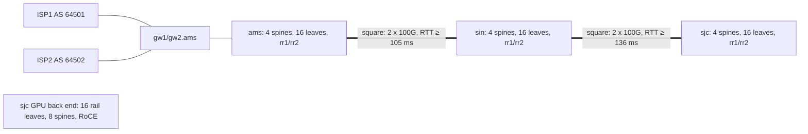

"Tell us about the network you run." Network organisations open with it because one answer tests three things at once. Do you hold the whole picture or a list of parts? Can you go one level deeper on any sentence you say? Do you know where your knowledge ends? A strong answer fits in two minutes, has seven parts in a fixed order, uses numbers, and ends with what you personally built. A weak one is a product tour ("we run EVPN-VXLAN on 400G with some SONiC"), which names a lot and explains nothing.

This lesson builds that answer on Meridian, the track's reference network, extends it into a three-minute story (fabric, protocols, a packet walk, a failure), and ends with the move that keeps you credible under deeper questions: "I don't know that detail", then what you would build or measure. The [packet-walk drills](/learn/fabric-networking/the-network-interview/packet-walk-drills), the [question bank](/learn/fabric-networking/the-network-interview/bgp-and-fabric-question-bank) and [designing network software](/learn/fabric-networking/the-network-interview/designing-network-software) take each door further.

## What the question is testing

A networking panel usually has two or three people: a principal network engineer, a hiring manager, and perhaps a software engineer from the team you would join. They listen for different things in the same two minutes.

- **The principal network engineer** listens for mechanism and for slips. "Spines only forward" is fine; "BGP runs at every hop" is a red flag they will come back to in a minute.
- **The manager** listens for scope and ownership: how big the network is, what you did, and whether you can explain it to people who are not network engineers.
- **The software engineer** listens for the system: where the source of truth lives, how configuration reaches devices, what is measured.

Each listener notes the claims worth probing, and the next twenty minutes are spent on those notes, so the answer sets the agenda. Mention route reflectors and you will be asked what happens when both fail; mention a square between sites and you will be asked about capacity after a circuit cut. Say only what you can defend one level down.

If you have never run a network, the question comes as "describe the network your systems run on". Answer about the network you know best and say where your knowledge ends. Replace Meridian's facts with yours and keep the structure.

## The seven parts

How big, how one site is built, how sites connect, what makes every device reachable, what carries tenants, where the network meets others, and what you did. Each part depends on the one before: the overlay makes no sense until the listener knows there is an underlay, and "my part" means nothing until they know what it is part of.

| # | Part | What it must contain | Meridian | Budget | The door it opens |
|---|---|---|---|---|---|
| 1 | Scale | Sites, devices, users or tenants, one number per noun | 3 sites, about 100 devices, 2 tenants, 1,024 GPUs | 10 s | "How do you push config to all of them?" |
| 2 | Intra-site fabric | Topology, why, the path length, what one failure costs | Leaf-spine Clos, 4 spines, 16 leaves, 2 hops, a quarter of capacity per spine | 20 s | ECMP, oversubscription, gray failures |
| 3 | Inter-site design | How sites connect, why not the same as inside, behaviour on failure | Squares of leased circuits, Singapore as hub, half capacity on one cut | 20 s | Latency, capacity planning, shared risk |
| 4 | Underlay | The routing protocol and its one job | IS-IS, one level-2 domain, every loopback reachable | 10 s | "Why IS-IS and not eBGP?" |
| 5 | Overlay | What carries tenants, the control plane, what spines do | BGP EVPN, route reflectors, VXLAN, overlapping tenant subnets | 25 s | Recursive next hops, RD and RT, the black hole |
| 6 | Edges | Where the network meets others, and special-purpose fabrics | Two gateways, two ISPs, AS 64500; a separate RoCE back end | 15 s | Two-ISP traffic engineering, RoCE congestion |
| 7 | Your part | What you own, in the first person, and its boundary | The config pipeline and the path probes | 20 s | Everything in the next hour |

The budgets add up to 120 seconds, a ratio rather than a stopwatch: the overlay holds the most mechanism, and the underlay's job really is one sentence.

### 1. Scale

**What it solves:** calibration. "We push a change to every device" means a serial loop at 100 devices and batches, canaries and a rollback plan at 5,000. Every later claim is read against the first number, so "a pretty big network" wastes the most valuable ten seconds. Give one rounded number per noun, plus the one unusual thing (a GPU cluster, a subsea path). Assume Meridian's three sites are built alike, 24 devices each (4 spines, 16 leaves, 2 route reflectors, 2 border gateways), plus a 24-switch GPU back end: "about a hundred switches and routers".

**How it breaks:** numbers you cannot back up. Say "a few thousand devices" and expect to be asked how many of them are spines.

### 2. The intra-site fabric

Inside a data center most bytes move between servers (east-west) rather than in and out (north-south), so every site is a **leaf-spine Clos**: servers attach to leaves, every leaf has one link to every spine, and nothing else is linked ([Clos and leaf-spine](/learn/fabric-networking/fabric-architecture/clos-and-leaf-spine)). The sentence that proves you understand it gives the path length and the failure cost: two hops between any leaves, one equal-cost path per spine, and a quarter of the capacity lost with one of four spines.

```viz
{"type": "fabric", "scenario": "clos-ecmp", "title": "Inside one site: two hops, four equal paths, six flows hashed over four spines", "caption": "Meridian's Amsterdam fabric as a small example with 4 spines and 4 leaves. leaf1.ams installs four equal-cost next hops towards leaf3.ams, and its ASIC hashes six flows onto its uplinks, ending 1, 2, 2 and 1 per spine. The last frame gives 1,600 Gb/s of uplink with a quarter of it riding each spine: the 'two hops, four paths, a quarter per spine' sentence of the answer. The run routes Acme's 10.1.2.0/24 directly to keep the hashing visible; in Meridian the leaf hashes VXLAN packets addressed to leaf3.ams's loopback and the spines never hold the tenant prefix."}
```

Equal-cost multipath (ECMP) turns four spines into four paths: the leaf hashes each flow's 5-tuple (addresses, protocol, ports) to pick an uplink, so a flow stays on one path ([ECMP and hashing](/learn/fabric-networking/fabric-architecture/ecmp-and-hashing)). `ams` leaves have 48 server ports at 100 Gb/s against 4 uplinks at 400 Gb/s, an **oversubscription** of 4,800:1,600 = 3:1; quote it only if you can say what it means (all 48 servers sending off-leaf get a third of their port each).

**How it breaks:** a link that is up but corrupting packets still gets its quarter of the flows, so one connection in four crawls while a ping looks clean. **Signal:** CRC (frame checksum) errors on one port, and varied-5-tuple probes that fail only through one spine.

### 3. The inter-site design

The real question is "do you know why the backbone looks different from the fabric?" Inside a site links are cheap cables, so you build every path. Between sites they are leased long-haul circuits, each a separate contract, route and failure point, so you build as few as failure tolerance allows ([connecting sites and backbones](/learn/fabric-networking/fabric-architecture/connecting-sites-and-backbones)). Meridian joins each pair of sites with a **square**: two spine-to-spine circuits (`spine1.ams`–`spine1.sin`, `spine2.ams`–`spine2.sin`), with intra-site links as the other two sides, where a spine full mesh would need four. Singapore is the hub: four circuits for three sites, and Amsterdam reaches San Jose through Singapore.

```viz
{"type": "fabric", "scenario": "site-square", "title": "Between sites: the square, one circuit cut, the detour, then 80% on the survivor", "caption": "Amsterdam and Singapore, small example with two spines and two leaves each, joined by two 100 Gb/s circuits. 80 Gb/s splits 40 and 40; 10,500 km of fibre costs about 105 ms round trip. Circuit 1 is cut, spine1.ams detours through a leaf to its sister spine until the leaves converge on spine2.ams, and circuit 2 carries all 80 Gb/s. The run ends with the 50% planning rule, shared-risk links and the repair."}
```

Two numbers make it credible. **Latency is distance:** at about 5 µs per km of fibre, 10,500 km is 52.5 ms one way, at least 105 ms round trip; switches add microseconds. It is a floor: real cables follow coastlines, so measured round trips run higher. **Capacity on failure is half:** 80 Gb/s over two 100 Gb/s circuits is 40% each, and 80% on the survivor after a cut. **How it breaks:** traffic grows past 50% per circuit, so one cut overloads the survivor, or two circuits share a cable, duct or landing station and fail together. **Signal:** each circuit's busy-hour utilisation against 50%, and a shared-risk record per circuit.

### 4. The underlay

One sentence that names the job, not only the protocol: IS-IS, one level-2 domain (a single flat map with no area hierarchy), making every device's loopback reachable from everywhere. A **loopback** is a router's own stable address, tied to no physical port (`leaf1.ams` is `10.255.1.11`), and doubles as the tunnel endpoint. IS-IS is link-state: every router floods a description of its links and computes shortest paths over the full map ([IS-IS from zero](/learn/fabric-networking/underlay/is-is-from-zero)).

The door it opens is the commonest follow-up: "why not eBGP, like most data centers?" ([BGP as the underlay](/learn/fabric-networking/underlay/bgp-as-the-underlay)). BGP is the protocol networks use to exchange routes; eBGP runs it between different autonomous systems (an AS is a network under one administration, identified by a number), iBGP inside one. A single data center often runs eBGP everywhere, one AS per leaf (the design RFC 7938 describes), because one protocol is simpler and the AS path, the list of ASes a route has crossed, prevents loops. A network spanning several sites as one domain gets more from link-state: every router holds the full map, so after a failure each one computes its new path in one SPF run (shortest path first, Dijkstra over the map) with no BGP-style path hunting, and a device is drained by raising its metrics or setting the overload bit (a flag telling other routers not to route through it).

**How it breaks:** an adjacency drops on one link (capacity falls, traffic reroutes) or, rarer and worse, the link-state database itself is wiped, as in a purge storm. **Signal:** adjacencies per device against intent, and whether every loopback is still reachable.

### 5. The overlay

Three ideas, in this order:

1. **What it carries.** BGP EVPN (Ethernet VPN routes carried in BGP), in iBGP AS 65000, is the directory: which tenant MAC address or IP prefix lives behind which leaf ([EVPN, the control plane](/learn/fabric-networking/overlays-vxlan-evpn/evpn-the-control-plane)). The underlay is the road map; the overlay is the address book.
2. **How it scales.** Every leaf peers with its site's two route reflectors (`rr1.ams`, `rr2.ams`), which relay routes between leaves so they need not all peer with each other ([route reflectors](/learn/fabric-networking/bgp-fundamentals/route-reflectors)). With 48 leaves across three sites, a full mesh would be 48 × 47 / 2 = 1,128 sessions; with reflectors it is 96 leaf sessions plus 15 among the six reflectors, 111.
3. **Why the spines need none of it.** Tenant traffic is wrapped in VXLAN, an outer IP and UDP header addressed from one leaf's loopback to another's, so the spines route only the outer header, using the underlay. Tenant isolation comes from VRFs (separate routing tables), which is why Acme and Globex can both use `10.1.1.0/24` ([VRFs and multi-tenancy](/learn/fabric-networking/overlays-vxlan-evpn/vrfs-and-multi-tenancy)).

The two protocols' relationship is one sentence worth memorising: **BGP says which leaf, IS-IS says how to get there.** An EVPN route's next hop is a far leaf's loopback, which the ingress leaf resolves through IS-IS ([iBGP, loops and next hops](/learn/fabric-networking/bgp-fundamentals/ibgp-loops-and-next-hops)). The tenant lookup happens at the two leaves; every device in between reads only the underlay.

**How it breaks:** sessions stay up while a route is never imported (a mistyped route target, the tag that decides which VRFs import a route) or its next hop does not resolve, or both reflectors fail together. **Signal:** EVPN routes per VNI (VXLAN segment number) against baseline, next-hop resolution, and each leaf's sessions to both reflectors.

### 6. The edges

Where the network meets someone else's, and where special-purpose networks hang off it. Meridian's border gateways `gw1.ams` and `gw2.ams` run eBGP to ISP1 (AS 64501) and ISP2 (AS 64502), announcing `203.0.113.0/24` as AS 64500; these come from the ranges reserved for documentation (RFC 5737 and RFC 5398). The second edge is the San Jose GPU cluster: 128 servers of eight GPUs, each GPU with its own 400 Gb/s RoCE NIC (RDMA over Converged Ethernet: the network card writes straight into another server's memory, [RDMA from zero](/learn/fabric-networking/ai-fabrics/rdma-from-zero)), on a rail-optimised back end of 16 leaves and 8 spines, separate from the front-end, storage and management networks ([AI fabric topologies](/learn/fabric-networking/ai-fabrics/ai-fabric-topologies)).

Each edge invites a question: two ISPs invite "prefer ISP1, fail over to ISP2" (LOCAL_PREF outbound; prepending or more-specifics to influence inbound, [traffic engineering with BGP](/learn/fabric-networking/bgp-in-the-real-world/traffic-engineering-with-bgp)), and a GPU back end invites "what do you monitor on RoCE?". Name only the edges whose question you can answer. **How it breaks:** one ISP session down with no headroom on the other, or the /24 filtered by someone upstream. **Signal:** prefixes and traffic per ISP, and the /24 as seen from outside.

### 7. Your part

The part candidates most often get wrong. It needs the first person, a concrete artefact and a boundary. "We built a lot of automation" says nothing about you. "I own the pipeline that renders every device's configuration from the source of truth and diffs it against what is running; tenant service configuration is another team's tool" sets the next hour's questions and shows you know where your system stops.

The strongest version ties your system to the network just described: the pipeline exists because a hundred devices configured by hand drift and break ([network automation and source of truth](/learn/fabric-networking/operating-fabrics/network-automation-and-source-of-truth)), and the probes exist because protocol state can be green while traffic dies, the story below ([active measurement](/learn/fabric-networking/operating-fabrics/active-measurement)).

## The two-minute answer, written out

All seven parts for Meridian, as you would say them:

> **Scale.** Meridian runs three data center sites, Amsterdam, Singapore and San Jose: about a hundred switches and routers, two tenants, and a 1,024-GPU training cluster in San Jose.
>
> **Intra-site fabric.** Inside a site most traffic is server to server, so each site is a leaf-spine Clos. Servers attach to sixteen leaves, every leaf has one link to each of four spines, so any leaf reaches any other in two hops over four equal-cost paths, and losing a spine costs a quarter of the capacity, not connectivity.
>
> **Inter-site design.** Between sites the circuits are leased and long, so we don't build a Clos. Each pair of sites is a square: two spine-to-spine circuits, with Singapore as the hub. If one circuit fails the other carries everything, so we keep each under half full. Amsterdam to Singapore is at least 105 milliseconds round trip, set by distance.
>
> **Underlay.** The underlay is IS-IS, one level-2 domain across all three sites. Its only job is to make every device's loopback reachable from everywhere.
>
> **Overlay.** The overlay is BGP EVPN in AS 65000, the directory of which tenant address lives behind which leaf. Every leaf peers with its site's two route reflectors. Tenant traffic is wrapped in VXLAN from one leaf's loopback to another's, so the spines route only the outer header and run no BGP, and two tenants can both use 10.1.1.0/24 in separate VRFs.
>
> **Edges.** At the edge, two border gateways in Amsterdam run eBGP to two ISPs and announce our /24 as AS 64500. The GPU cluster has its own rail-optimised RoCE back end, separate from the front end and storage.
>
> **Your part.** My part is the software. I own the pipeline that renders every device's configuration from the source of truth and diffs it against what is running, and the probes that tell us a path is broken while every protocol still says up.

That is 303 words. The labels are for reading; you do not say them aloud.

### Timing it, and what a checker catches

Conversational speech runs at roughly 120 to 160 words a minute, faster when nervous. At 150, 303 words is two minutes. The checker below times an answer part by part against the budgets and flags the three structural mistakes a panel notices: a scale part without a number, a "your part" without "I" or "my", and missing parts. It runs on a realistic first draft.

```python
import re

WPM = 150                       # a steady interview pace; conversation runs about 120-160
BUDGET_S = {"scale": 10, "intra-site fabric": 20, "inter-site design": 20,
            "underlay": 10, "overlay": 25, "edges": 15, "your part": 20}   # 120 s


def check(answer):
    """answer: list of (part, text). Prints a timing table and what a panel would notice."""
    seen, total, notes = set(), 0.0, []
    for part, text in answer:
        words = len(text.split())
        secs = words * 60 / WPM
        total += secs
        seen.add(part)
        over = " over budget" if secs > BUDGET_S.get(part, 0) * 1.25 else ""
        print(f"  {part:<18} {words:>4} words {secs:>5.0f} s{over}")
        if part == "scale" and not re.search(r"\d", text):
            notes.append("scale has no number: the panel cannot calibrate anything you say next")
        if part == "your part" and not re.search(r"\b(I|my|My)\b", text):
            notes.append("'your part' never says I or my: the panel cannot tell what you did")
    notes += [f"missing: {p}" for p in BUDGET_S if p not in seen]
    print(f"  {'total':<18} {'':>10} {total:>5.0f} s")
    for n in notes:
        print("  -", n)


first_draft = [
    ("scale", "So we have a pretty big network, a lot of sites and a lot of devices, "
              "it's grown a lot over the years."),
    ("intra-site fabric", "We use a mix of vendors, mostly Arista with some Cumulus and SONiC, "
              "running EVPN VXLAN with BGP and IS-IS, and we're moving everything to 400G "
              "optics this year, and there's MLAG in some older racks, and we also have a "
              "Spectrum-X cluster for AI with ConnectX-7 NICs and RoCE."),
    ("overlay", "EVPN is the overlay, BGP carries everything, route reflectors, route targets, "
              "VRFs for the tenants, type-2 and type-5 routes, ARP suppression, anycast "
              "gateways, all the standard stuff, and we use BGP at every hop so the spines "
              "know where everything is."),
    ("your part", "We built a lot of automation around it, we push configs, we have "
              "dashboards and alerting, and we're looking at streaming telemetry."),
]
print("First draft:")
check(first_draft)
```

```text
First draft:
  scale                23 words     9 s
  intra-site fabric    50 words    20 s
  overlay              41 words    16 s
  your part            22 words     9 s
  total                            54 s
  - scale has no number: the panel cannot calibrate anything you say next
  - 'your part' never says I or my: the panel cannot tell what you did
  - missing: inter-site design
  - missing: underlay
  - missing: edges
```

The first draft is worth studying because it is short: 136 words, under a minute, about twenty product and protocol names and not one mechanism. Its problem is coverage, not length. On the written-out answer the same function gives:

| Part | Words | Seconds at 150 wpm | Budget |
|---|---|---|---|
| Scale | 27 | 11 | 10 |
| Intra-site fabric | 56 | 22 | 20 |
| Inter-site design | 57 | 23 | 20 |
| Underlay | 23 | 9 | 10 |
| Overlay | 61 | 24 | 25 |
| Edges | 37 | 15 | 15 |
| Your part | 42 | 17 | 20 |
| **Total** | **303** | **121** | **120** |

No word counter catches the draft's worst line, "BGP at every hop so the spines know where everything is", the opposite of the design (the spines carry no tenant routes), or a wrong number in a well-structured answer. Only saying it aloud to someone who interrupts does: a prepared line exists once you have said it aloud.

### The numbers behind the answer

The follow-up is often "how did you get that?", so every number should come from a handful of design facts you can rederive:

```python
from math import comb

# Meridian, assuming every site is built like Amsterdam
SITES = ["ams", "sin", "sjc"]
SITE = {"spines": 4, "leaves": 16, "route reflectors": 2, "border gateways": 2}
AI_BACKEND = {"rail leaves": 16, "spines": 8}       # sjc, 1,024 GPUs
LEAF_DOWN_GBPS = 48 * 100                           # server ports
LEAF_UP_GBPS = 4 * 400                              # one uplink per spine
CIRCUIT_GBPS, PAIR_LOAD_GBPS = 100, 80              # ams-sin square
FIBRE_KM = {"ams-sin": 10_500, "sin-sjc": 13_600}
US_PER_KM = 5                                       # one way, in fibre


def facts():
    devices = len(SITES) * sum(SITE.values()) + sum(AI_BACKEND.values())
    leaves = len(SITES) * SITE["leaves"]
    rrs = len(SITES) * SITE["route reflectors"]
    yield "network devices", f"{devices} (before management switches)"
    yield "leaf-spine links per site", SITE["leaves"] * SITE["spines"]
    yield "leaf oversubscription", f"{LEAF_DOWN_GBPS / LEAF_UP_GBPS:.0f}:1"
    yield "capacity lost with one spine", f"1/{SITE['spines']}"
    for pair, km in FIBRE_KM.items():
        one_way = km * US_PER_KM / 1000
        yield f"{pair} round trip", f"at least {2 * one_way:.0f} ms"
    yield "square, normal running", f"{PAIR_LOAD_GBPS / 2 / CIRCUIT_GBPS:.0%} per circuit"
    yield "square, one circuit down", f"{PAIR_LOAD_GBPS / CIRCUIT_GBPS:.0%} on the survivor"
    yield "iBGP sessions, full mesh of leaves", comb(leaves, 2)
    yield "iBGP sessions, with reflectors", leaves * 2 + comb(rrs, 2)
    # telemetry: 64 interfaces x 10 counters every 30 s on every device
    yield "telemetry samples per second", f"{devices * 64 * 10 / 30:,.0f}"


for name, value in facts():
    print(f"{name:<36} {value}")
```

```text
network devices                      96 (before management switches)
leaf-spine links per site            64
leaf oversubscription                3:1
capacity lost with one spine         1/4
ams-sin round trip                   at least 105 ms
sin-sjc round trip                   at least 136 ms
square, normal running               40% per circuit
square, one circuit down             80% on the survivor
iBGP sessions, full mesh of leaves   1128
iBGP sessions, with reflectors       111
telemetry samples per second         2,048
```

The last line bridges to your part: about 2,000 samples a second is one ordinary time-series database, while a few thousand devices give roughly 40,000 to 100,000 a second plus per-flow data, where collectors, a stream and cardinality limits enter the design ([designing network software](/learn/fabric-networking/the-network-interview/designing-network-software)).

### What to draw if they hand you the whiteboard

If there is a whiteboard, draw while you talk; thirty seconds is enough:



Write the RTT on each circuit and leave the GPU back end unconnected, because it is a separate network. Every later answer can point at the picture.

## The one-story pattern

The two-minute answer describes the network; the **one story** proves you understand it. It runs the same network as four linked parts: the fabric, the two protocols and how they split the work, one packet walked across it, and one failure the design prevents or causes. Each part is the premise of the next: the failure only lands once the walk has shown what the spines do and do not know. It answers "walk us through your network in detail" and "how do BGP and IS-IS work together?". About 370 words, under three minutes even with pauses for the whiteboard:

> **The fabric.** Each Meridian site is a leaf-spine Clos: servers and tenants attach at the leaves, spines only forward, any leaf to any leaf in two hops. Between sites we lease circuits, so each pair of sites is a square of two spine-to-spine circuits.
>
> **The protocols.** Two protocols run it, and they know different things. IS-IS runs on every device and knows one thing: how to reach every device's loopback. It is the road map. BGP EVPN runs on the leaves and route reflectors and knows which tenant MAC or prefix lives behind which leaf. It is the directory. A BGP route's next hop is a leaf loopback, and the leaf resolves that loopback through IS-IS: BGP says which leaf, IS-IS says how to get there.
>
> **The packet.** Acme's web server `acme-web1` on `leaf1.ams` sends to `acme-web2` on `leaf2.sin`, in the same subnet. `leaf1.ams` already learned acme-web2's MAC and IP from an EVPN route, so it answers the ARP itself. It looks the MAC up: behind `leaf2.sin`'s loopback, `10.255.2.12`. It wraps the whole frame in VXLAN, segment 10100 for Acme, inside UDP, with an outer IP header from its own loopback to `leaf2.sin`'s. From there the spines and the long-haul circuit see only that outer header, which IS-IS knows how to route. Each hop rewrites the outer MACs and lowers the outer TTL; nothing inside changes. `leaf2.sin` strips the 50 bytes of outer headers and delivers acme-web1's original frame. That is why the spines need no BGP: encapsulation addresses the packet to something IS-IS already knows.
>
> **The failure.** Take the encapsulation away and it breaks. Three routers in a row, IS-IS on all three, BGP only on the two ends. The BGP session comes up, because the loopbacks are reachable through the middle router. But a tenant packet sent towards a prefix behind the far router is handed to the middle one, which has no BGP and no route for it, and drops it. BGP Established, traffic black-holed. The fixes are encapsulation, VXLAN or MPLS, so the middle router only needs the loopback route, or BGP everywhere. The lesson for monitoring: protocol state being up is not the service working, so the platform checks next-hop resolution and probes the data path, not only session state.

[The overlay packet walk](/learn/fabric-networking/overlays-vxlan-evpn/the-overlay-packet-walk) traces the packet part in full. Watch it once with every lookup visible, because you may be stopped at any hop and asked what that device reads:

```viz
{"type": "fabric", "scenario": "overlay-packet-walk", "title": "The packet in the story: nine lookups from acme-web1 in Amsterdam to acme-web2 in Singapore", "caption": "acme-web1 (leaf1.ams) to acme-web2 (leaf2.sin), both in Acme's 10.1.1.0/24, VNI 10100. leaf1.ams answers the ARP from its EVPN-learned table, finds the MAC behind VTEP (tunnel endpoint) 10.255.2.12, resolves that next hop through IS-IS and encapsulates; the spines read only the outer IP, the circuit adds about 52.5 ms, and leaf2.sin strips 50 bytes and delivers the original frame. Host and leaves read tenant state; spines read only the IS-IS FIB."}
```

The failure part is [the BGP black hole](/learn/fabric-networking/bgp-fundamentals/the-bgp-black-hole). The point to land is the moment when every check is green and the packet still dies:

```viz
{"type": "fabric", "scenario": "bgp-blackhole", "title": "The failure in the story: BGP Established, every check green, spine1.ams dropping every packet", "caption": "R1 = leaf1.ams, R2 = spine1.ams, R3 = leaf3.ams, with IS-IS on all three and BGP only on the leaves, in a design without VXLAN that Meridian does not use. The session comes up through the spine, leaf3.ams's route for 10.1.2.0/24 reaches leaf1.ams and its next hop resolves through IS-IS, every dashboard check is green, and the spine discards acme-web1's SYN with a no-route drop. The last frame names the two fixes: BGP on the spine, or encapsulation towards leaf3's loopback."}
```

### Why a failure, and which one

A failure shows you understand the mechanism well enough to predict how it breaks, a deeper test than describing it; it moves the conversation to signals and tooling, a software engineer's home ground; and it hands the interviewer a next question you have prepared. The choice decides where the next ten minutes go, so choose for the role:

| Failure | What it proves you understand | Time to tell | Follow-ups it invites | Fits a role in |
|---|---|---|---|---|
| The BGP black hole (no encapsulation) | Control plane vs data plane; why spines need no BGP | 30 s | MPLS vs VXLAN, route reflectors, next-hop resolution | Any; the safe default |
| Maintenance done in the wrong order | Drain ordering; why dashboards stay green while traffic dies | 40 s | Withdraw BGP before costing out the IGP, graceful shutdown | Change and maintenance tooling |
| A duplicated route distinguisher or route target | EVPN import and export; tenant leaks with sessions up | 30 s | RD vs RT, config-as-code, pre-deployment checks | Automation, source of truth |
| A clock jump that purges every IS-IS LSP | Link-state aging and purges; circular dependencies between planes | 60–90 s | LSP lifetime, out-of-band time sync, multi-vendor behaviour | Observability; only if you can go two levels deeper |
| A gray-failing optic in an ECMP group | Per-flow hashing; why one ping looks clean | 30 s | CRC counters, light levels, probe localisation | Telemetry and measurement |
| One slow link stalling a training job | Synchronous collectives; host and network counters together | 45 s | ECN, CNPs, PFC storms, adaptive routing | AI infrastructure |

The cases are told in full in [operating BGP safely](/learn/fabric-networking/bgp-in-the-real-world/operating-bgp-safely), [underlay failures in production](/learn/fabric-networking/underlay/underlay-failures-in-production) and [incidents and what they teach](/learn/fabric-networking/operating-fabrics/incidents-and-what-they-teach). For a real incident, say your role first: "I wasn't the engineer on the bridge, but it changed how I build the platform" is honest and still strong ([behavioural interviews](/learn/senior-craft/getting-the-job/behavioral-interviews-for-seniors) covers how such stories are scored).

### Every sentence is a door

A principal network engineer will pick a sentence and ask for the next level down. Rehearse where each door leads:

| Sentence in the story | The likely next question | The core of the answer | Where it is taught |
|---|---|---|---|
| "Any leaf to any leaf in two hops" | "How does the leaf choose a spine?" | Hash of the 5-tuple modulo the path count; per flow, so no reordering | [ECMP and hashing](/learn/fabric-networking/fabric-architecture/ecmp-and-hashing) |
| "A square of two circuits" | "One circuit fails. What happens?" | Survivor at 80%, detour through the sister spine, keep each under 50% | [Connecting sites](/learn/fabric-networking/fabric-architecture/connecting-sites-and-backbones) |
| "IS-IS knows every loopback" | "Why not eBGP?" | One domain across sites, full map, metric drains; eBGP suits a single DC | [BGP as the underlay](/learn/fabric-networking/underlay/bgp-as-the-underlay) |
| "Route reflectors" | "What if both fail?" | One down changes nothing; both down and, once the sessions drop (hold timer or BFD), every leaf deletes its overlay routes, so leaf-to-leaf tenant traffic stops with the underlay healthy | [Route reflectors](/learn/fabric-networking/bgp-fundamentals/route-reflectors) |
| "Wraps the frame in VXLAN" | "What's the overhead, and what breaks?" | 50 bytes; an underlay MTU of 1,500 drops full-size tenant packets | [VXLAN encapsulation](/learn/fabric-networking/overlays-vxlan-evpn/vxlan-encapsulation) |
| "Both tenants use 10.1.1.0/24" | "How are they kept apart?" | VRFs, an RD to make routes unique, an RT to choose who imports them | [VRFs and multi-tenancy](/learn/fabric-networking/overlays-vxlan-evpn/vrfs-and-multi-tenancy) |
| "BGP up, traffic black-holed" | "How would your platform catch it?" | Next-hop resolution checks and data-path probes, not session state | [Active measurement](/learn/fabric-networking/operating-fabrics/active-measurement) |

## Saying "I don't know that detail"

Interviewers probe until they find the edge of what you know, and measure where it is and how you behave there. A software engineer's edge is expected to sit shallower on protocol internals than a network engineer's. Guessing past it is what fails: the next question goes one level deeper, the guess collapses, and it takes the credibility of your earlier answers with it.

### The three-part move

1. **Say what you do know**, at the level of mechanism. This shows how close to the edge you got.
2. **Name precisely what you don't know**, and who would. A precise "I don't know the default refresh interval on that vendor's software" sounds expert; a vague "I'm not sure about IS-IS" does not.
3. **Pivot to what you would build or measure** to find out or to make it not matter. This moves the conversation to your strength without dodging, because it is a real answer to "what would you do?".

### A depth ladder, traced

The underlay part of the answer, followed four levels down by a principal network engineer:

| Level | Question | Answer | Where you are |
|---|---|---|---|
| 1 | "What's your underlay?" | "IS-IS, one level-2 domain; its job is every loopback reachable from everywhere." | Your own answer |
| 2 | "Why IS-IS and not eBGP?" | "One domain across three sites: every router has the full map, convergence is one SPF run with no path hunting, and raising a metric drains a device. eBGP per leaf suits a single data center." | Design reasoning: answer it |
| 3 | "How does a router know an LSP is stale?" | "Each LSP, a router's link-state packet, carries a sequence number and a remaining lifetime that counts down. The originator refreshes it before it reaches zero. A copy that does reach zero is purged, and the purge floods, so every router deletes it." | Mechanism: answer it if you can |
| 4 | "What lifetime and refresh interval do your boxes run, and do all your vendors age LSPs the same way?" | "The standard's defaults are a 1,200-second maximum lifetime and a refresh around 900 seconds; what ours are configured to I'd read from the source of truth rather than guess. Whether every vendor ages the same way I'd defer to the network team. What I'd build: an alert on LSP count collapsing across the domain, correlated with system-clock steps on any device, because a clock jump that ages out every LSP is a known way this goes wrong." | The edge: the three-part move |

The level-4 answer gives numbers with their source (ISO 10589's defaults), refuses to invent the configured value, and ends on something buildable: the purge-storm signal from [underlay failures in production](/learn/fabric-networking/underlay/underlay-failures-in-production).

### What you may defer, and what you must not

Deferring on a fundamental the role depends on is not honesty; it is a gap.

| Kind of question | Example | Answer or defer | Why |
|---|---|---|---|
| A mechanism the role builds on | "Make outbound traffic prefer ISP1." | Answer: LOCAL_PREF, set higher on ISP1's routes | Every tool in the role reads or sets it |
| Design reasoning about your own network | "Why a square between sites?" | Answer | If you describe it, you own its reasons |
| Basic correctness | "Is a /16 more specific than a /24?" | Answer: no, the /24 is | A slip here colours every later answer |
| Platform defaults and limits | "What BFD (fast link-failure detection) intervals does your ASIC support in hardware?" | Defer, then measure | Varies by platform and software version |
| Vendor commands and knobs | "What's the command for that on Junos?" | Defer | The role does not configure devices |
| Derived numbers | "PFC (pause frame) headroom for 100 m of cable at 400G?" | Give the method, defer the exact bytes | The method is the skill |
| Systems you never touched | "How does your MPLS backbone do traffic engineering?" | Say so; map it to what you know | Honest scope, then the nearest mechanism |

Three anti-patterns: **bluffing** a specific number, **the bare defer** ("I don't know.", leaving nothing to score), and **the escape** to an unrelated strength ("but I know Kubernetes well"). The pivot must answer the question you were asked.

## Describing a real network safely

If the network is your employer's, the description must not leak it. A candidate who volunteers device names, customers or tickets shows how they would treat the next employer's, and the structure needs none of it.

- **Round the numbers**: "a few thousand devices", not an exact count, and no list of locations.
- **Use roles, not hostnames**: "leaf", "spine", "border gateway", never the internal naming scheme.
- **Name no customers or internal tools**: "a large cloud tenant", "our config pipeline".
- **Tell incidents as mechanisms**: what failed, why, the blast radius and the signal, without dates, places or people.
- **Test each sentence** against "would this be fine in a public conference talk?". If not, generalise it.

## Failure modes of the answer

| Failure | Symptom in the room | Diagnosis | Fix |
|---|---|---|---|
| The product tour | "OK, but how does a packet get from A to B?" | Nouns without verbs: vendor and protocol names, no mechanism, no numbers | One mechanism sentence per part; vendor names only when asked |
| The deep dive at minute one | Interrupted at 90 seconds while still listing EVPN route types; "your part" never said | No budget; the most familiar part expanded | Time each part; the overlay gets 25 seconds, not two minutes |
| The slip a principal catches | The next question goes straight at one phrase: "BGP at every hop?" | A one-liner learned as words, not as a mechanism | Rehearse the slip-prone lines aloud: "BGP once at the ingress leaf, IS-IS at every hop" |
| Ownership blur | "And what did *you* build?" asked twice | "We" throughout, no artefact, no boundary | "My part is..." with a named system and what is not yours |
| Bluffing past the edge | A level-4 question exposes a level-3 guess; the panel discounts earlier answers | No practised defer | The three-part move: know, don't know, would build |
| A leak | Nothing in the room; a bad impression afterwards | Real hostnames, counts or customers | Round, generalise, name roles |

## What the platform should show

The seven parts are also the home page of a network platform, and a panel will ask sooner or later whether your tooling shows the same picture. Each part maps to a view:

- **Scale: live inventory.** Devices by site and role, intended (from the source of truth) against observed, so "about a hundred" is a number on a page rather than a memory.
- **Intra-site fabric: the topology graph with ECMP health.** Intended links against what LLDP (the link-layer discovery protocol, where each device announces itself to its neighbours) reports, utilisation spread across each leaf's uplinks, error counters per link.
- **Inter-site design: site pairs, not links.** For each square, can either circuit alone carry the pair's traffic at the current hour? Alert before a failure answers the question for you, and record which circuits share risk.
- **Underlay: reachability, not adjacency counts.** A loopback reachability matrix, adjacencies per device against intent, LSP count over time, and clock steps on every device.
- **Overlay: sessions with redundancy, routes with resolution.** Each leaf's sessions to both reflectors (one down is yellow, both red), EVPN routes per VNI against baseline, and every BGP next hop checked for resolution through the underlay.
- **Edges: the outside view.** Per-ISP session state, prefixes received and sent, the traffic split, and the announced /24 as seen from outside.
- **The story's failure, as an alert.** Data-path probes between every pair of leaves, with varied 5-tuples to cover every spine, alerting when probes fail while protocol state is green: the one signal the black hole and the wrong-order maintenance both produce.

The engineer wants this device and link now; the manager wants which site is degraded and whether to step in. One model with two views makes the two-minute answer a description of your product.

## Interviewer follow-ups

**"Why don't your spines run BGP?"** Model answer: they never need a tenant route. The ingress leaf looks the destination up in EVPN and wraps the packet in VXLAN addressed to the egress leaf's loopback, so a spine's only question is "how do I reach that loopback?", which IS-IS answers. Without encapsulation the spine would need every tenant route, which is the black hole. Common wrong answer: "spines are too busy forwarding to run BGP". Many fabrics *do* run BGP on spines as the underlay, so the precise claim is "no overlay BGP on spines".

**"One Amsterdam–Singapore circuit is cut. Walk me through it."** Model answer: the spine ports facing the circuit go down within milliseconds as the carrier's equipment signals the fault; `spine1.ams` reruns SPF first and briefly sends traffic through a leaf to `spine2.ams`, then the leaves converge and send Singapore traffic straight to `spine2.ams`. The survivor goes from 40% to 80%, which fits because each circuit is planned below 50%, and latency may change because the circuits take different routes. Signal: a utilisation step on the survivor and on the leaf links into `spine2.ams`. Common wrong answer: "nothing happens, it's redundant", ignoring capacity and shared risk. Honest extension: "how fast the carrier signals the fault I'd defer to the network team; I'd measure loss duration with probes across the pair."

**"What's the most interesting incident you've seen on that network?"** Model answer: one failure as mechanism, blast radius, why monitoring missed it and what you built afterwards, your role stated first. The wrong-order maintenance works well: costing out the IGP before withdrawing BGP keeps attracting traffic to a router that can no longer deliver it, every protocol shows up, and customers report it first, so change-aware monitoring checks the order of steps. Common wrong answer: a war story with no mechanism ("the network went down and we were on a call all night").

**"If you could change one thing about this design, what would it be?"** Model answer: a trade-off with its cost, not a wish. "Singapore is a hub, so an Amsterdam–San Jose flow pays 241 ms round trip and depends on two squares; a direct Amsterdam–San Jose square would cut the latency and the dependency on Singapore, and the price is two more long-haul circuits, the most expensive links we have. I'd decide with traffic and latency data per site pair." Common wrong answer: "move everything to the latest 800G gear", a purchase rather than a design argument.

**"You said you own the config pipeline. How do you know what it pushes is right?"** Model answer: in layers. Render from the source of truth, diff against the running configuration before any push, validate the rendered intent (for example, that no two tenants share a route target, and every route distinguisher is unique), push in batches with a canary, then verify behaviour with probes rather than trusting protocol state. Common wrong answer: "we have code review on the templates", which checks the template and not the network.

## What mid-level engineers get wrong

- **Skipping the inter-site part**, as if the network were one data center. The backbone is where cost, latency and capacity-on-failure live, and it is often the next question.
- **Quoting a number they cannot derive.** "3:1 oversubscription" without "each server gets a third of its port when all send off-leaf" invites the question they cannot answer.
- **Choosing a failure they cannot take two levels deeper.** The purge storm impresses only if you can explain LSP lifetimes and purges when asked; otherwise tell the black hole.
- **Deferring on fundamentals** such as LOCAL_PREF for outbound preference or which prefix is more specific, which reads as a gap rather than honesty.

## Senior signals

- You give the network in seven parts in two minutes, with a number in each, and stop.
- You state the protocol split as one sentence: BGP says which leaf, IS-IS says how to get there, and the spines see only the outer header.
- You end the longer version on a failure chosen for the role, and say which signal shows it.
- You describe the backbone by cost and failure behaviour: two circuits instead of four, half the capacity on one cut, each kept below 50%, shared risk checked.
- At the edge of your knowledge you say what you know, name exactly what you don't, and say what you would build or measure.
- You describe a real network without identifying it: rounded numbers, roles not hostnames, incidents as mechanisms.

## Check yourself

```quiz
- q: >-
    A principal network engineer asks why Meridian's spines need no BGP even though tenant routes are carried in BGP EVPN. Which answer is correct?
  options: ["IS-IS carries the tenant prefixes to the spines from each leaf", "The route reflectors forward tenant packets on behalf of the spines", "Tenant packets reach spines addressed to leaf loopbacks inside VXLAN", "Spine ASICs lack the TCAM space to hold tenant routes"]
  answer: 2
  explanation: >-
    The ingress leaf looks the destination up in EVPN and wraps the packet in VXLAN with an outer header addressed to the egress leaf's loopback, which IS-IS carries. A spine therefore only ever looks up a loopback. IS-IS carries infrastructure addresses only, never tenant prefixes. Route reflectors sit out of the forwarding path and relay routes, not packets. Table size is a real constraint in some designs, but it is not why the spines need no BGP: encapsulation is.
- q: >-
    Your first draft of the two-minute answer takes 54 seconds and names Arista, SONiC, 400G optics, EVPN, VXLAN and route reflectors. What is its main problem?
  options: ["It is too short, so it should be padded to two minutes", "It names protocols but explains no mechanism and has gaps", "It should open with the overlay, since EVPN is the core", "It names too few protocols to show breadth across the stack"]
  answer: 1
  explanation: >-
    Length was never the issue: the draft lists products and protocols but gives no numbers, no inter-site design, no underlay job and no first-person ownership, so a panel has nothing to probe. Padding it would make it longer without fixing coverage. Adding more names makes the product tour worse. Opening with the overlay breaks the order, because the overlay only makes sense once the listener knows what underlay it rides on.
- q: >-
    Amsterdam and Singapore are joined by a square of two 100 Gb/s circuits carrying 80 Gb/s between them. One circuit is cut. What is the steady state once the fabric converges?
  options: ["Both sites lose reachability until BGP reconverges between them", "Traffic shifts to the San Jose square until the circuit is repaired", "The survivor carries all 80 Gb/s at 80%, with no loss", "The survivor carries 40 Gb/s and the other 40 Gb/s is dropped"]
  answer: 2
  explanation: >-
    Each circuit ran at 40%, so the survivor can carry both shares: 80 Gb/s on 100 Gb/s. This is why the planning rule keeps each circuit below 50%. Nothing is dropped once IS-IS converges, because the path through spine2.ams and its circuit is still a valid route. Meridian has no Amsterdam to San Jose circuit to shift to, and the underlay, IS-IS, restores the path in well under a second, not BGP.
- q: >-
    Asked what LSP refresh interval your devices run, you do not know the configured value. Which response is strongest?
  options: ["Give 900 seconds as the value your devices use, to sound sure", "Say you would defer to the network team on it, and stop there", "Move on to how your team runs its Kubernetes clusters instead", "Give the mechanism and defaults, defer the value, name an alert"]
  answer: 3
  explanation: >-
    The three-part move shows how close to the edge you got (the mechanism and the standard's defaults), names exactly what you don't know (the configured value), and ends on what you would build, such as an alert on LSP count collapsing alongside clock steps. Stating a default as your configuration is a bluff the next question can expose. A bare defer leaves nothing to score, and pivoting to an unrelated strength dodges the question.
- q: >-
    Which question should a software engineer interviewing for a network-automation role answer directly rather than defer?
  options: ["How to make outbound traffic prefer ISP1 over ISP2", "The command that shows the IS-IS database on Junos", "Which BFD intervals your switch ASIC supports in hardware", "The exact PFC headroom in bytes for a 100 m cable at 400G"]
  answer: 0
  explanation: >-
    Outbound preference is a fundamental the role's tools read and set: raise LOCAL_PREF on routes learned from ISP1. Hardware BFD limits vary by platform and version, so deferring and measuring is honest. For PFC headroom the method matters more than the exact bytes, and vendor commands are outside a role that does not configure devices.
- q: >-
    You extend the answer into the one-story pattern. Why does it end with a failure such as the BGP black hole?
  options: ["Panels score candidates by how many incidents they can name", "It shows the network was badly designed before you joined the team", "Failures are shorter to tell than a packet walk across the fabric", "It shows you can predict how the design breaks and what signals it"]
  answer: 3
  explanation: >-
    Predicting how the mechanism breaks is a deeper test than describing it, and the failure moves the conversation to signals and tooling, a software engineer's ground, with a follow-up you have prepared. Panels do not count incidents. Length is not the reason; the black hole takes about as long as the walk. Using the failure to criticise a previous design misses the point: the black hole is the design that encapsulation avoids.
```
