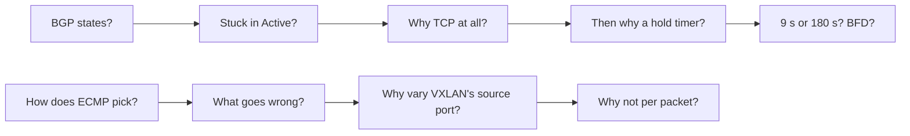

"Walk me through the BGP states." "Why IS-IS and not eBGP?" "What happens if both route reflectors die?" In the networking round at a network or AI-infrastructure company, a principal network engineer asks fifteen or twenty of these in half an hour, each followed by a dig one level down into whatever you said. The round tests whether you hold the mechanism or only the vocabulary, because a software engineer with only the vocabulary builds the dashboard that stays green during an outage.

Here are nine groups of questions, each with a crisp answer, the follow-up it invites, and the slip to avoid. Every answer uses Meridian, the track's reference fabric: three sites (`ams`, `sin`, `sjc`); an IS-IS underlay connecting every switch's loopback address; an iBGP overlay (BGP inside one autonomous system, AS 65000) carrying EVPN routes, which say where each tenant's MAC and IP addresses live, through a route-reflector pair per site; AS 64500 at the internet edge; and a RoCE (RDMA over Converged Ethernet) training cluster in San Jose. Each group links the lesson that teaches it in full; the long-form walks are in [packet-walk drills](/learn/fabric-networking/the-network-interview/packet-walk-drills).

## How a rapid-fire answer is built

A good answer has four parts, in this order:

1. **The claim.** One sentence that answers the question as asked.
2. **The mechanism.** Why it works that way, in the network's own terms: what is on the wire, which table, which timer.
3. **One number.** A timer, a size, a count. A number shows you have watched it run.
4. **How it breaks, and the signal.** The production consequence, which is your bridge to the software you would build.

That is 60 to 90 words, about 30 seconds at a conversational 140 to 160 words a minute. Then stop and let the interviewer pick the next dig.

### Worked example: "What is a route reflector?"

The vocabulary answer: "A route reflector is a BGP router that reflects routes to its clients so you don't need a full mesh. It helps scalability." It is true, and it invites "why would you need a full mesh?", which it cannot survive.

The mechanism answer: "Inside one AS the AS path never changes, so it can't catch loops, and iBGP's rule is that a route learned from one iBGP peer is never passed to another. Without help, every router needs a session to every other: 120 sessions for Amsterdam's 16 leaves. A reflector is allowed to relay routes for its clients, which brings that down to 33 with a pair. It stamps ORIGINATOR_ID and CLUSTER_LIST to close the loops relaying opens, and it sits beside the spines, out of the forwarding path." That is 87 words. It has already answered the next three follow-ups (why a mesh, how loops are stopped, where it sits), so the interviewer either goes deeper or moves on.

### The follow-up ladder

Each question has a predictable next one, usually "what breaks?" then "how would you know?". Expect three rungs and prepare the third.



### The honest defer

For platform detail (the BFD intervals one ASIC supports in hardware, one NIC's ECN thresholds), say so and pivot to what you would measure, as [explaining a network](/learn/fabric-networking/the-network-interview/explaining-a-network) shows. Defer at the third rung, never on a first answer: those are the fundamentals the round checks.

## BGP session states

**"Walk me through the BGP states."** "Six states per peer, each named by what is on the wire. Idle: not trying. Connect: a SYN, TCP's connection request, is in flight to port 179. Active: that attempt failed, so there is no TCP connection; the router listens and retries, and despite the name nothing is being exchanged. OpenSent: TCP is up and my OPEN (AS, hold time, router ID, capabilities) has gone out. OpenConfirm: I accepted your OPEN and wait for the KEEPALIVE that says you accepted mine. Established: UPDATEs flow, and every KEEPALIVE or UPDATE received restarts the hold timer, 9 s on Meridian's fabric."

**The follow-up it invites: "It has been in Active for an hour. What do you check?"** Scope first: one peer, or every peer on the box? Then TCP: a route to the peer's loopback in the IGP (the interior gateway protocol, IS-IS here); the session sourced from the address the peer expects; a capture showing SYNs and then a reset or silence; filters on port 179, including control-plane policing (the rate limiter in front of the switch CPU); TCP authentication keys (MD5 or TCP-AO); TTL, since eBGP to a loopback needs multihop. While TCP never completes, the AS number and hold time cannot matter, because they travel in the OPEN. But read the last NOTIFICATION: a wrong peer AS lets TCP succeed, fails the OPEN, and drops the session back through Idle to Active in a loop that a summary view also shows as Active.

**Next rung: "Now it's Established. Is it healthy?"** Not necessarily. Check the negotiated address families (EVPN enabled on one end only leaves a session carrying no EVPN), prefixes received against a baseline, whether the End-of-RIB marker (the empty UPDATE that ends the initial table transfer) arrived, and whether the next hops resolve.

**The slip:** calling Active "actively exchanging routes", or debugging OPEN fields before checking that TCP ever completed.

**Solves:** both ends agree on identity, timers and features before any route moves. **Breaks:** a fault pins the session in the state below the failing layer. **Signal:** the state, the time spent in it, and the last NOTIFICATION's code and direction. The full mechanism is in [BGP sessions and the FSM](/learn/fabric-networking/bgp-fundamentals/bgp-sessions-and-the-fsm).

## Path attributes

**"Which BGP attributes matter, and who sets them?"** "Four decide most paths. AS_PATH lists the ASes the route crossed; each eBGP hop prepends its own, which gives loop prevention and the length comparison. NEXT_HOP is where traffic goes; iBGP passes it unchanged, so the IGP must resolve it. LOCAL_PREF is set by our import policy and carried to every router in our AS, never to another: it is how we choose an exit. MED is a neighbour's hint about which of its entry points to use, compared only among routes from that neighbour. Communities are tags that policies match on."

| Attribute | Category | Who sets it | How far it travels | What it decides |
|---|---|---|---|---|
| ORIGIN | well-known mandatory | the originating AS | everywhere | a late tie-break: IGP < EGP < INCOMPLETE |
| AS_PATH | well-known mandatory | each eBGP speaker prepends its AS | everywhere | loops (own AS present: reject) and path length |
| NEXT_HOP | well-known mandatory | an eBGP speaker sets itself; iBGP leaves it unchanged | to the peer | where traffic is sent; it must resolve |
| LOCAL_PREF | well-known discretionary | our import policy | inside one AS only | step 3 of best path: the exit we prefer |
| MED | optional non-transitive | the neighbouring AS | one AS boundary | which of that neighbour's entry points |
| COMMUNITIES | optional transitive | any AS's policy | until a policy strips it | whatever policy says (NO_EXPORT, requests to an upstream) |
| ORIGINATOR_ID, CLUSTER_LIST | optional non-transitive | a route reflector | inside one AS | loop prevention for reflected routes |

**The follow-up it invites: "An iBGP route is in the table but not used. Why?"** Its next hop does not resolve. `gw1.ams` learns ISP1's routes with next hop `198.51.100.2`, ISP1's address on the shared link. (198.51.100.0/24 and AS numbers 64496 to 64511 are reserved for documentation by RFC 5737 and RFC 5398.) iBGP passes the route on unchanged, so a leaf that has no route to that link address marks it inaccessible. Best-path selection discards it at step 1. The fix is next-hop-self on the gateway, which rewrites the next hop to its loopback `10.255.1.201`, or carrying the link subnet in IS-IS ([iBGP, loops and next hops](/learn/fabric-networking/bgp-fundamentals/ibgp-loops-and-next-hops)).

**The slip:** "LOCAL_PREF is local to one router". That is weight, a vendor extension. Another slip is "lower MED always wins": by default MED is compared only between routes from the same neighbouring AS.

**Solves:** attributes are what policy reads and writes. **Breaks:** an unresolvable next hop, stripped communities, LOCAL_PREF on one gateway only. **Signal:** next-hop resolution, received-but-not-best counts, attribute history per prefix. More in [updates, attributes and RIBs](/learn/fabric-networking/bgp-fundamentals/updates-attributes-and-ribs) and [policy and communities](/learn/fabric-networking/bgp-in-the-real-world/policy-and-communities).

## Best path

**"Walk me through BGP best-path selection."** "Thirteen steps in four groups, stopping at the first that separates the paths. First, is the path usable: does its next hop resolve, and is it free of an AS loop? Then our decisions: weight, which is vendor-local, LOCAL_PREF, and routes we originate ourselves. Then what the path says: shortest AS_PATH, lowest ORIGIN, lowest MED among routes from the same neighbouring AS. Then our own geometry: eBGP over iBGP, then the lowest IGP cost to the next hop, which is hot-potato routing. Multipath, if enabled, installs the paths still tied there; the tie-breakers (oldest eBGP path, lowest router ID, shortest CLUSTER_LIST, lowest peer address) still name exactly one best."

Say it on a real case. `gw1.ams` holds three paths to `192.0.2.0/24` (AS 64511): A from its own eBGP session to ISP1 (AS_PATH 64501 64496 64511), B over iBGP from `gw2.ams` via ISP2 (64502 64511, IGP cost 20), and C over iBGP from `gw1.sin` via ISP2 (64502 64511, IGP cost 120 across the long-haul circuit). A is out at step 5: three ASes against two. B and C tie on ORIGIN, on MED (both 0, both from AS 64502) and on eBGP over iBGP. B wins at step 9 on IGP cost, so `gw1.ams` sends this traffic across the fabric to ISP2, and its own ISP1 link carries none of it.

```viz
{"type": "fabric", "scenario": "bgp-best-path", "title": "gw1.ams chooses one of three paths to 192.0.2.0/24, step by step", "caption": "Path A (gw1.ams's own eBGP session to ISP1), B (iBGP from gw2.ams) and C (iBGP from gw1.sin) tie through validity, weight, LOCAL_PREF and local origination. A falls at AS_PATH length; B and C tie on ORIGIN, MED and eBGP over iBGP; B wins on IGP cost, 20 against 120. Steps 10 to 13 are never reached, and gw1.ams installs B and exits through gw2.ams and ISP2."}
```

**The follow-up it invites: "You want all outbound traffic through ISP1. How?"** Set LOCAL_PREF 200 on import from ISP1, on every gateway that peers with it. Step 3 comes before AS_PATH length, so A beats B and C despite its longer path, and iBGP carries the 200 to every router in AS 64500. Inbound is a separate problem, because you can only influence other networks' choices: prepend toward ISP2, use ISP2's communities to lower its preference for you, or announce more-specifics through ISP1 ([traffic engineering with BGP](/learn/fabric-networking/bgp-in-the-real-world/traffic-engineering-with-bgp)).

**Next rung: "If A's path were as short as B's, would A's MED of 10 lose to B's 0?"** No. MED ranks one neighbour's own entry points, and A came from AS 64501 while B came from AS 64502: comparing them compares two unrelated numbering schemes, so by default BGP skips the step, and A then wins at step 8, eBGP over iBGP. An always-compare-MED option exists; it is safe only if your neighbours agree on what the numbers mean.

**The slip:** "BGP picks the shortest path" (AS_PATH counts networks, not kilometres; a two-AS path can cross an ocean), or "BGP load-balances" (only with multipath, across paths tied through the IGP-cost step).

**Solves:** one deterministic choice per prefix on every router. **Breaks:** an unexpected exit after a policy change, or a reset that flips an "oldest path" tie. **Signal:** for each prefix, the step that decided it. Full detail in [the best-path algorithm](/learn/fabric-networking/bgp-fundamentals/the-best-path-algorithm); practise it with [BGP best path](/practice/bgp-best-path).

## Route reflectors

**"Why route reflectors?"** Give the worked example's answer: split horizon forces a full mesh of $n(n-1)/2$ sessions, a reflector pair turns that into $2n + 1$, ORIGINATOR_ID and CLUSTER_LIST close the loops, and NEXT_HOP stays unchanged, which keeps the reflector out of the forwarding path.

```viz
{"type": "fabric", "scenario": "route-reflector", "title": "From a full mesh to a reflector pair, then one and both reflectors failing", "caption": "Four Amsterdam leaves: the 6-session full mesh and the split-horizon rule behind it, then the reflector pair's 9 sessions. leaf3.ams's route is reflected with ORIGINATOR_ID and CLUSTER_LIST and NEXT_HOP unchanged; rr2.ams drops rr1's copy as a loop. Losing one reflector changes nothing in forwarding; losing both withdraws every overlay route within the 9 s hold time."}
```

**The follow-up it invites: "What happens when one fails? Both?"** One: nothing changes in forwarding. Every leaf already holds an identical copy of each route from the other reflector, with the same next hop, and no packet ever passed through a reflector. Both: within the 9 s hold time, or under a second with BFD, every leaf's reflector sessions drop and the leaf deletes every overlay route learned over them, so tenant traffic between leaves stops while every spine and link is healthy. Graceful restart, if negotiated, keeps routes as stale through a software restart, not a dead pair. The common wrong answer, "forwarding continues on the last known state", holds only until the hold timer fires.

**Next rung: "Every client exits through the gateway nearest the reflector. Why?"** The reflector advertises only its own best path, chosen from its own IGP position, so clients never see the path their own hot-potato step would pick. Fixes: ADD-PATH (advertising several paths per prefix), optimal route reflection (choosing the best path from each client's position in the IGP), or reflectors per site.

**The slip:** "the reflector forwards the traffic", or "the reflector rewrites the next hop". It does neither.

**Solves:** iBGP at scale without a mesh. **Breaks:** a pair that shares a power feed or an upgrade window fails as one. **Signal:** sessions per leaf (two expected), clients per reflector, and an alarm when one reflector is lost, not only when both are. Full detail in [route reflectors](/learn/fabric-networking/bgp-fundamentals/route-reflectors).

## IS-IS or eBGP for the underlay

**"Why IS-IS and not eBGP for the underlay?"** "Both work; the network decides. An eBGP-only fabric (RFC 7938) puts one protocol on every box: an AS per leaf, the spines sharing one, AS_PATH preventing loops. That gives per-hop policy and keeps failures local, which suits one very large site run by one team. Meridian is three sites run as one domain, so IS-IS fits: every router holds the full map, a metric drains a device, no AS plan spans sites, and a BGP policy mistake cannot remove the loopbacks the overlay rides on."

**The follow-up it invites: "In an eBGP fabric, why do all spines share one AS?"** So AS-path loop prevention rejects any path that goes through two spines (leaf, spine, leaf, spine). That rules out valley paths, so there is no path hunting after a withdrawal, and every leaf sees AS paths of identical length through every spine, so multipath installs all of them. Saving AS numbers is not the reason, since the private 4-byte range holds about 95 million ([BGP as the underlay](/learn/fabric-networking/underlay/bgp-as-the-underlay)).

**Next rung: "And why IS-IS rather than OSPF?"** IS-IS runs directly on layer 2, not over IP, so adjacencies do not depend on IP addressing (whether mismatched link subnets block one varies by implementation) and a remote host cannot reach it. Its type-length-value (TLV) encoding let IPv6, wide metrics and segment routing arrive as new TLVs, where OSPF needed a new version, OSPFv3, for IPv6, and one flat level-2 domain holds hundreds of routers, more with tuned flooding. OSPF is fully capable; the choice is as much operational history as mechanism ([IS-IS from zero](/learn/fabric-networking/underlay/is-is-from-zero)).

**The slip:** "BGP is too slow for an underlay". With BFD and short timers an eBGP fabric converges in about a second, and some of the largest data centers run nothing else.

**Solves:** reachability between every loopback, which every overlay session and tunnel rides on. **Breaks:** a missing loopback, an adjacency down on one link, or (eBGP) a policy that filters a loopback. **Signal:** adjacencies or sessions and loopback routes diffed against the intended topology.

| | IS-IS underlay | eBGP underlay (RFC 7938) | OSPF underlay |
|---|---|---|---|
| Runs over | layer 2 directly | TCP port 179 per link | IP protocol 89 |
| Each router knows | the whole topology | its neighbours' best paths | the whole topology (per area) |
| Loop prevention | SPF on one shared map | AS_PATH, spines sharing an AS | SPF on one shared map |
| Draining a device | raise a metric or set the overload bit | prepend or withdraw, per session | raise a cost, or stub-router mode |
| Per-hop policy | little | full BGP policy everywhere | little |
| Best fit | multi-site backbones, one domain | one huge site, one team, one protocol | enterprises, smaller fabrics |

## MPLS or VXLAN

**"MPLS or VXLAN?"** "Same job, different wrapper. Both let the ingress router address a packet to the egress router's loopback, so transit routers forward on that alone and never need the customer's route, which is the fix for the BGP black hole. MPLS pushes 4-byte labels, distributed hop by hop by LDP (the Label Distribution Protocol) or, now, advertised by the IGP itself with segment routing. It brings traffic engineering and fast reroute, and its small overhead suits expensive long-haul circuits. VXLAN adds 50 bytes of outer Ethernet, IP, UDP and VXLAN headers that any IP fabric can carry, its UDP source port gives ECMP entropy, and a host's NIC can be the endpoint. Data centers mostly choose VXLAN with EVPN; backbones mostly choose MPLS."

**The follow-up it invites: "So why doesn't the spine need the tenant's route?"** It never reads the tenant's IP. A packet from `acme-web1` to `acme-web2` crosses the spines with outer destination `10.255.2.12`, the loopback of `leaf2.sin`, which IS-IS resolves. BGP is consulted once, at the ingress leaf; IS-IS at every hop. The one-liner: "BGP picks which leaf; the IGP gets the packet there" ([the BGP black hole](/learn/fabric-networking/bgp-fundamentals/the-bgp-black-hole)).

**Next rung: "What does EVPN add to VXLAN?"** The control plane. BGP EVPN routes tell every leaf where each MAC and IP lives: type 2 for a MAC/IP, type 3 for "send me broadcast traffic for this VNI", type 5 for an IP prefix. That replaces flood-and-learn. A route distinguisher keeps Acme's and Globex's identical `10.1.1.0/24` routes distinct, and a route target decides which VRF (a tenant's own routing table on the leaf) imports each one ([EVPN, the control plane](/learn/fabric-networking/overlays-vxlan-evpn/evpn-the-control-plane)).

**The slip:** "MPLS is faster because a label lookup beats an IP lookup". That held for 1990s routers; today's ASICs do longest-prefix match at line rate.

**Solves:** transit that needs only routes to endpoints. **Breaks:** an underlay MTU too small for the overhead (large packets dropped, small ones fine), or an endpoint unreachable in the underlay. **Signal:** endpoint-to-endpoint probes at full packet size.

| | VXLAN | MPLS (LDP or SR-MPLS) | SRv6 |
|---|---|---|---|
| Overhead | 50 bytes (outer Ethernet, IPv4, UDP, VXLAN); 70 over IPv6 | 4 bytes per label, typically 8 for a VPN | 40 bytes (an IPv6 header) for one segment; a segment routing header adds 8 plus 16 per segment |
| Transit needs | IP routes to loopbacks | a label path to every egress | IPv6 routes to locators |
| ECMP entropy | outer UDP source port | hash on the labels or the inner packet, or an entropy label | IPv6 flow label |
| Traffic engineering | none built in | RSVP-TE or segment lists, 50 ms protection | segment lists |
| Where it dominates | data-center fabrics, host endpoints | carrier and provider backbones | newer backbones |

Full detail in [MPLS and segment routing](/learn/fabric-networking/overlays-vxlan-evpn/mpls-and-segment-routing).

## ECMP

**"How does a switch choose between equal-cost paths?"** "It hashes header fields of each packet, usually the 5-tuple (source and destination IP, protocol, source and destination port), and the result picks one member of the ECMP group, the set of equal-cost next hops. Every packet of a flow carries the same five values, so a flow sticks to one path and arrives in order. `leaf1.ams` sends each flow up one of four spine uplinks; lose a spine and three remain, 75% of the capacity. ECMP balances flows, not bytes."

**The follow-up it invites: "What goes wrong?"** Three things.

- **Elephants collide.** Four large flows on four uplinks all land apart only $4!/4^4 = 9.4\%$ of the time; the busiest uplink carries about two on average, so each flow on it gets half its share.
- **Polarisation.** If two tiers use the same hash function and seed, the second tier receives only flows that already hashed alike, and it uses a subset of its links.
- **Gray failure.** One member drops a fraction of packets while staying up. ECMP keeps sending its 1/N share of flows into it, so some connections suffer and others are fine.

**Next rung: "Why does VXLAN's outer UDP source port vary?"** The spines hash the outer header. Between two leaves the outer IPs, protocol and destination port 4789 never change, so without variation every tenant flow between them would hash alike. The ingress VTEP (VXLAN tunnel endpoint) sets the outer source port from a hash of the inner headers, which restores entropy. RoCEv2 (UDP 4791) does the same per queue pair ([ECMP and hashing](/learn/fabric-networking/fabric-architecture/ecmp-and-hashing)).

**Next rung: "Why not spread per packet?"** Reordering. TCP's classic fast retransmit treats three duplicate ACKs as a loss and cuts its window, and RoCE's go-back-N discards every packet after a gap. Per-packet spraying works only when the receiver tolerates reordering, as in AI fabrics whose NICs place each packet directly in memory (NVIDIA Spectrum-X with BlueField-3 SuperNICs, and Ultra Ethernet's direction) ([AI fabric topologies](/learn/fabric-networking/ai-fabrics/ai-fabric-topologies)).

**The slip:** "ECMP sends equal traffic over every link", or "one flow uses all the paths".

**Solves:** using every spine at once without reordering a flow. **Breaks:** collisions, polarisation, gray members. **Signal:** utilisation spread and errors per member, and probes whose 5-tuples cover every path.

## BFD and fast failure detection

**"How do you detect a link failure fast?"** "If the light goes out, the port goes down within milliseconds and the protocols react at once. BFD, Bidirectional Forwarding Detection, is for failures a port cannot see, such as carrier equipment in the middle that keeps the port lit after the fibre beyond it is cut. Two neighbours exchange small UDP packets, say every 300 ms, and declare the path down after three are missed: 900 ms. IS-IS and BGP subscribe to BFD and drop the adjacency at once. Without it, IS-IS waits for its hold time, up to 30 s with the common default of 10 s hellos, and BGP for its hold timer, up to 180 s at common edge defaults."

```viz
{"type": "fabric", "scenario": "bfd-convergence", "title": "A fibre cut inside a carrier circuit: about 1 second with BFD, about 30 seconds without", "caption": "Both spines' ports stay lit, so only BFD at 300 ms × 3 notices, at 900 ms. LSP generation, flooding, SPF and the FIB write add 118 ms: about 1,018 ms from cut to recovered traffic and 5.1 GB lost at 40 Gb/s. Without BFD, IS-IS's 30 s hold time detects it: about 30.1 s and 150.6 GB."}
```

**The follow-up it invites: "Detection takes 900 ms. Where does the rest go?"** On Meridian: a 50 ms wait before generating the LSP (IS-IS's link-state packet), 2 ms of flooding, a 50 ms wait plus about 1 ms of SPF, then about 15 ms to write the FIB. The FIB write is fast because every affected prefix shares one ECMP group, and only the group is rewritten. Meanwhile, routers that have updated and routers that have not can bounce packets between them: a microloop ([convergence and BFD](/learn/fabric-networking/underlay/convergence-and-bfd)).

**Next rung: "Why not 10 ms × 3?"** False positives. A BFD process on a busy CPU (table churn, an upgrade) misses its own packets and declares a healthy link dead, and the false flap withdraws and relearns every route over that link. Very short timers need BFD in the line card or ASIC; which intervals a platform supports in hardware is a fair place for the honest defer.

**The slip:** "BFD reroutes traffic". It only detects; its client protocols act. Another is "BGP keepalives are enough".

**Solves:** sub-second detection of failures the port cannot see. **Breaks:** false positives on a busy CPU, or BFD left off one link. **Signal:** BFD flaps against CPU load, and BFD sessions against the links that should have one.

## RoCE congestion

**"How does RoCE handle congestion?"** "RoCE's transport runs in the NIC with go-back-N recovery, so one drop resends everything sent after it, and the fabric is built not to drop. A switch marks ECN (explicit congestion notification) instead of dropping: when a queue passes a threshold, it sets the packet's two ECN bits to 'congestion experienced'. The receiving NIC answers with a CNP, a congestion notification packet, at most one per queue pair (RDMA's connection) every 50 µs or so, and the sender's DCQCN (Data Center Quantized Congestion Notification) algorithm cuts that flow's rate, then climbs back when the CNPs stop. PFC, priority flow control, is the backstop: a switch about to overflow tells its upstream neighbour to pause one priority."

Back it with a run on the published DCQCN parameters: srv1 sends to srv3 at 400 Gb/s, and at 20 µs srv2 joins at line rate (DCQCN has no slow start), so the queue to srv3 grows 50 KB every microsecond and passes Kmax, the 200 KB threshold above which every packet is marked, 4 µs later.

```viz
{"type": "fabric", "scenario": "ecn-dcqcn", "title": "A 2:1 incast on rail1-leaf1.sjc, controlled by ECN marks, CNPs and DCQCN", "caption": "srv2 joins srv1 at line rate, the queue to srv3 passes Kmax (200 KB) at 24 µs and packets are marked CE, srv3's NIC sends CNPs, and both senders halve twice (400 → 200 → 100 Gb/s). The queue drains at 97 µs, fast recovery brings each sender back to 196.875 Gb/s by 354 µs, and additive increase takes over."}
```

**The follow-up it invites: "Isn't PFC enough on its own?"** No: PFC is flow control, not congestion control. It stops a link, not the source. Pauses propagate hop by hop towards the senders and stop every flow sharing that priority on those links, even flows headed nowhere near the congested port: head-of-line blocking. A cyclic buffer dependency can deadlock, and a NIC that stops draining can pause a whole fabric (a PFC storm), which the PFC watchdog breaks. ECN with DCQCN keeps queues short so that PFC rarely fires ([when lossless goes wrong](/learn/fabric-networking/ai-fabrics/when-lossless-goes-wrong)).

**Next rung: "What would you monitor?"** Both halves. On the switch: ECN marks per queue, PFC pauses sent and received per port and priority, watchdog events, buffer occupancy, and lossless-class drops, which should be zero. On the NIC, in ConnectX's counter names: CNPs sent and handled (`np_cnp_sent`, `rp_cnp_handled`), `np_ecn_marked_roce_packets`, `out_of_sequence`, `packet_seq_err` and `local_ack_timeout_err`. For the job: step time and its tail. A slow job behind clean switch ports is often one NIC throttled by CNPs or badly placed on PCIe ([lossless Ethernet](/learn/fabric-networking/ai-fabrics/lossless-ethernet-pfc-ecn-dcqcn)).

**The slip:** "ECN drops packets"; "PFC is congestion control"; "RoCE is InfiniBand". RoCEv2 carries InfiniBand's transport over UDP and IP on Ethernet. InfiniBand has its own link layer, with credit-based flow control and a subnet manager ([InfiniBand and RoCE](/learn/fabric-networking/ai-fabrics/infiniband-and-roce)).

**Solves:** RDMA at line rate on Ethernet without loss. **Breaks:** pause storms, deadlock, a DSCP mismatch that puts RoCE in a lossy queue. **Signal:** the switch and NIC counters above, joined per job.

## The lightning round

Between the deep questions come one-liners that check reflexes, each with a trap.

| Question | Answer | The trap |
|---|---|---|
| iBGP or eBGP? | iBGP inside one AS, eBGP between two | "internal means inside a data center" |
| Which is more specific, /16 or /25? | /25: a longer prefix, fewer addresses, and the longest match wins | reversing it |
| BGP's transport? | TCP, port 179 | UDP, or "its own" |
| IS-IS runs over? | layer 2 directly, no IP | "IP, like OSPF" |
| VXLAN's port and ID size? | UDP 4789, a 24-bit VNI: 16.7 million segments against 4,094 VLANs | "VLAN IDs are 16 bits" |
| RoCEv2's port? BFD's? | UDP 4791; BFD UDP 3784 single-hop, 4784 multihop | "RoCE isn't IP" |
| Hold time with proposals of 9 and 90? | 9, the minimum, keepalive every 3 | "each side keeps its own" |
| Default LOCAL_PREF, and which wins? | 100, higher wins | "lower wins" (that is MED) |
| VXLAN overhead? | 50 bytes; a 1,500-byte tenant packet needs a 1,550-byte underlay IP MTU | forgetting the 14-byte inner Ethernet header |
| Where does "Clos" come from? | Charles Clos, Bell Labs, 1953, non-blocking telephone switching | writing it CLOS, as if an acronym |
| ams to sin latency? | about 10,500 km × 5 µs/km = 52.5 ms one way, 105 ms round trip, before queueing | using light in a vacuum, 3.3 µs/km |
| eBGP or iBGP route to the same prefix, Cisco-style distance? | eBGP 20, iBGP 200; Junos uses 170 for both, and other vendors differ again | "BGP has one distance" |

## The numbers behind the answers

Every number above falls out of a few lines of arithmetic; run them once and you can derive them in the room.

```python
from itertools import product


def full_mesh(n):
    return n * (n - 1) // 2


def with_reflectors(n, reflectors=2):
    # every client peers with its site's two reflectors; the reflectors mesh among themselves
    return 2 * n + full_mesh(reflectors)


for n, rrs in ((4, 2), (16, 2), (48, 6)):   # 48 leaves = three sites, three reflector pairs
    print(f"iBGP, {n:>2} leaves: full mesh {full_mesh(n):>5}, with {rrs} reflectors {with_reflectors(n, rrs):>3}")

for spines in (2, 4, 8):
    print(f"ECMP, {spines} spines: one spine down leaves {100 * (spines - 1) / spines:.1f}% of uplink capacity")


def p_no_collision(flows, uplinks):
    """Chance that every flow hashes to a different uplink, for a uniform hash."""
    good = 1
    for i in range(flows):
        good *= uplinks - i
    return good / uplinks ** flows


def expected_busiest(flows, uplinks):
    """Average number of flows on the most loaded uplink, over every equally likely hash outcome."""
    total = 0
    for choice in product(range(uplinks), repeat=flows):
        total += max(choice.count(u) for u in range(uplinks))
    return total / uplinks ** flows


for flows in (2, 4):
    print(f"ECMP, {flows} elephants on 4 uplinks: no collision {100 * p_no_collision(flows, 4):.1f}%,"
          f" busiest uplink carries {expected_busiest(flows, 4):.2f} flows on average")


def lost_gb(rate_gbps, ms):
    return rate_gbps * ms / 1000 / 8


for name, hold, keepalive in (("BGP 180/60", 180, 60), ("BGP 90/30", 90, 30), ("BGP 9/3", 9, 3)):
    print(f"silent peer, {name:<10}: detected {hold - keepalive}-{hold} s after it dies")
rest = 50 + 2 + 50 + 1 + 15                  # LSP wait, flood, SPF wait, SPF run, FIB write (ms)
for name, detect in (("BFD 300 ms x 3", 900), ("IS-IS hellos 10 s x 3", 30_000)):
    total = detect + rest
    print(f"cut to recovered, {name:<21}: {total / 1000:6.3f} s, {lost_gb(40, total):5.1f} GB lost at 40 Gb/s")

for pair, km in (("ams-sin", 10_500), ("sin-sjc", 13_600)):
    one_way_ms = km * 5 / 1000                # about 5 microseconds per km of fibre
    print(f"{pair}: {one_way_ms:.1f} ms one way, {2 * one_way_ms:.0f} ms round trip before any queueing")

for inner in (1500, 9000):
    print(f"VXLAN: inner IP MTU {inner} needs an underlay IP MTU of at least {inner + 50}")

alpha, rc, rt = 1.0, 400.0, 400.0              # DCQCN per sender: alpha, current rate, target rate (Gb/s)
for _ in range(2):                            # two CNPs; alpha stays at 1 this early
    rt, rc = rc, rc * (1 - alpha / 2)
steps = []
for _ in range(5):                            # five fast-recovery steps, each halving the gap to the target
    rc = (rt + rc) / 2
    steps.append(rc)
print("DCQCN per sender: 400 -> 200 -> 100, then", ", ".join(f"{s:g}" for s in steps), "Gb/s")
```

```text
iBGP,  4 leaves: full mesh     6, with 2 reflectors   9
iBGP, 16 leaves: full mesh   120, with 2 reflectors  33
iBGP, 48 leaves: full mesh  1128, with 6 reflectors 111
ECMP, 2 spines: one spine down leaves 50.0% of uplink capacity
ECMP, 4 spines: one spine down leaves 75.0% of uplink capacity
ECMP, 8 spines: one spine down leaves 87.5% of uplink capacity
ECMP, 2 elephants on 4 uplinks: no collision 75.0%, busiest uplink carries 1.25 flows on average
ECMP, 4 elephants on 4 uplinks: no collision 9.4%, busiest uplink carries 2.12 flows on average
silent peer, BGP 180/60: detected 120-180 s after it dies
silent peer, BGP 90/30 : detected 60-90 s after it dies
silent peer, BGP 9/3   : detected 6-9 s after it dies
cut to recovered, BFD 300 ms x 3       :  1.018 s,   5.1 GB lost at 40 Gb/s
cut to recovered, IS-IS hellos 10 s x 3: 30.118 s, 150.6 GB lost at 40 Gb/s
ams-sin: 52.5 ms one way, 105 ms round trip before any queueing
sin-sjc: 68.0 ms one way, 136 ms round trip before any queueing
VXLAN: inner IP MTU 1500 needs an underlay IP MTU of at least 1550
VXLAN: inner IP MTU 9000 needs an underlay IP MTU of at least 9050
DCQCN per sender: 400 -> 200 -> 100, then 150, 175, 187.5, 193.75, 196.875 Gb/s
```

With four leaves a reflector pair costs more sessions than the mesh (9 against 6); reflectors pay off with growth, and because a new leaf touches two routers, not all. `expected_busiest` enumerates all $4^4 = 256$ equally likely hash outcomes, so it is exact. Trace the 48-leaf line by hand: 48 × 2 = 96 client sessions, plus three sites' six reflectors meshed, $6 \times 5 / 2 = 15$, gives 111 against 1,128.

## Failure modes in production

Behind each question sits an incident. Naming it is the strongest answer to "how does it break?".

| Failure | The question it hides behind | Symptom | Diagnosis | Fix |
|---|---|---|---|---|
| Both reflectors of a site lost (shared power feed, or upgraded in the same window) | route reflectors | tenant traffic between leaves stops; every spine and link healthy | every leaf's sessions to both reflectors down; overlay route count near zero | reflectors on different spines and feeds, upgraded one at a time; alarm on losing one |
| A loopback missing from IS-IS | attributes, MPLS or VXLAN | BGP routes present but inaccessible; traffic to one leaf dropped | next-hop resolution per route; the /32 absent from the link-state database | fix the loopback's advertisement; alarm on unresolvable next hops |
| Gray-failing ECMP member | ECMP | some flows between two leaves slow or failing, others fine; link up | per-member CRC errors and discards; probes with varied 5-tuples, where the bad ones share one spine | cost out the link, replace the optic |
| BFD flapping on a busy CPU | BFD | adjacencies on one box flap during upgrades or table churn | BFD down events that line up with CPU spikes, and links with no errors | offload BFD to hardware or relax the timers; dampen flaps |
| PFC storm from a NIC that stopped draining | RoCE congestion | jobs stall across many racks; pause frames rising toward one port | pause frames received per port, traced back hop by hop; watchdog events | PFC watchdog; isolate and replace the NIC |
| RoCE marked with a DSCP the switches do not map to the lossless queue | RoCE congestion | RoCE dropped in a lossy queue while the lossless queue sits empty; go-back-N retransmits | per-queue drop counters; `packet_seq_err` and `out_of_sequence` on the NICs | one DSCP mapping from the source of truth on NICs and switches |
| LOCAL_PREF set on one gateway only | best path | outbound traffic leaves by different ISPs from different sites | which step decided each gateway's best path; the policy diffed against intent | render policy for every gateway from one template |

## Under the hood: where each mechanism runs

"Where does that happen?" is a favourite follow-up: the answer sets the timescale and names the counter to read.

| Mechanism | Runs in | Timescale | What it means for your answer |
|---|---|---|---|
| BGP best path, IS-IS SPF | the routing daemon on the switch CPU | milliseconds to seconds | can be starved by CPU load; shows in daemon logs and churn counters |
| FIB programming | driver to ASIC tables | milliseconds per batch, longer per prefix | "converged in the protocol" is not "converged in hardware" |
| ECMP hash, longest-prefix match | the ASIC pipeline | nanoseconds per packet | no per-flow state; reordering only if a path changes |
| BFD | CPU, line card or ASIC, depending on the platform | intervals from a few ms (hardware) to 1 s | intervals below about 100 ms usually need hardware offload |
| ECN marking | the switch egress queue, at enqueue or dequeue depending on the ASIC | per packet | marks count per queue on the switch |
| CNP generation, DCQCN rate | NIC hardware or firmware | microseconds | visible only in NIC counters, not on any switch |
| PFC pause | the port's MAC, per priority | microseconds | pause counters per port and priority, both directions |

## What the platform should show

These questions test whether you would build the right signals. Each answer above ends in one, and together they make a feature list.

| The question | What the tool should show |
|---|---|
| BGP states | state, time in state, flap count, last NOTIFICATION decoded with its direction |
| Attributes | per prefix: next hop and whether it resolves, LOCAL_PREF and communities against intent |
| Best path | per prefix and router: the winning path and the step that decided it ("step 9: IGP cost 20 against 120") |
| Route reflectors | sessions per leaf against the expected two, clients per reflector, redundancy as a colour |
| IS-IS or eBGP | adjacencies and AS paths diffed against the intended topology |
| MPLS or VXLAN | endpoint-to-endpoint reachability probes and an underlay MTU test |
| ECMP | utilisation spread across members, per-member errors, hash-spread probe results per spine |
| BFD | session flaps, configured intervals against intent, detection time per failure |
| RoCE congestion | switch ECN marks, PFC and watchdog counters joined to NIC CNP and retransmit counters, per job |

Two features matter most: the reason for each decision, which ends the argument about whether policy does what was meant, and redundancy state, because one lost reflector, spine or circuit is yellow: still forwarding, one fault from an outage. Engineers need the reason, managers the colour, from the same data ([telemetry and observability](/learn/fabric-networking/operating-fabrics/telemetry-and-observability), [designing network software](/learn/fabric-networking/the-network-interview/designing-network-software)).

## Interviewer follow-ups

**"A spine dies. Walk me through what every protocol does."** Model answer: the ports facing it lose light, or BFD declares it down within 900 ms. IS-IS drops those adjacencies, floods LSPs and runs SPF, and every leaf removes the spine from its ECMP groups: 75% of the capacity remains. The overlay notices nothing, because its next hops are leaf loopbacks still reachable through the other spines; if a reflector hung off that spine alone, the pair now runs on one, a yellow alarm. Common wrong answer: "BGP reconverges and traffic stops until it does."

**"You can alert on only three things across the fabric. Which?"** Model answer: loss on probes with varied 5-tuples between leaf pairs, for gray failures and black holes the control plane cannot see; overlay route counts and next-hop resolvability against a baseline, for sessions up but carrying nothing useful; and redundancy against intent (reflector pairs, ECMP members, circuits). Common wrong answer: interface and BGP session state, which stay green in most of the incidents above ([active measurement](/learn/fabric-networking/operating-fabrics/active-measurement)).

**"The training job is 20% slower, and every switch counter is clean."** Model answer: look at the host half. Compare CNPs handled and retransmits across the 1,024 NICs for an outlier, because a collective waits for its slowest member, then check that NIC's link, PCIe and NUMA placement. Constant CNPs behind clean switch ports mean the congestion is real and the switch counters you read are the wrong ones or too coarse. Common wrong answer: "then it isn't the network" ([the troubleshooting method](/learn/fabric-networking/operating-fabrics/the-troubleshooting-method)).

**"What ECN thresholds would you set for an 800 Gb/s NIC?"** Model answer: "I'd defer to the network team and the vendor's guidance on Kmin and Kmax, and build the way to tell whether they're right: ECN marks, CNPs and pauses per queue before and after a change, with job step time as the outcome." Common wrong answer: inventing a number, or "I don't know" with no pivot.

## What mid-level engineers get wrong

- **Reciting lists.** Thirteen steps or six states without a mechanism invite the follow-up that ends the answer.
- **Answering at the wrong layer.** A session in Active debugged through its OPEN fields, or a tenant outage blamed on the spines that never read the tenant's address.
- **Treating "up" as healthy.** An Established session can carry no EVPN, and an up link can drop 1% of packets; the tool built on those two signals stays green.
- **Running long.** A three-minute answer to a thirty-second question spends the time in which you could have shown depth on the follow-up.

## Senior signals

- You answer in four beats (claim, mechanism, number, signal) and stop, leaving the hook you have prepared for.
- You name each mechanism by what is on the wire or in the table: Active means no TCP; the reflector leaves NEXT_HOP unchanged; the spine reads only the outer IP.
- You derive numbers in the room: $n(n-1)/2$ against $2n + 1$, 3/4 of capacity after a spine failure, 900 ms against 30 s.
- You give both sides of the "X or Y" questions and then the fact about this network that decides it.
- You know where each mechanism runs (daemon, ASIC, NIC), so you know which counter to read.
- You defer on platform detail at the third rung, never the first, and pivot to a measurement.

## Check yourself

```quiz
- q: >-
    Both route reflectors in Amsterdam lose power at once. The spines and fabric links are healthy. What happens to Acme's traffic between leaf1.ams and leaf3.ams?
  options: ["It is rerouted through the spines, which carry the overlay routes as a backup", "It continues indefinitely on the last routes the leaves learned", "It stops once the leaves' sessions time out and their overlay routes are deleted", "It slows down because the traffic was passing through the reflectors"]
  answer: 2
  explanation: >-
    No traffic ever passed through the reflectors, but every overlay route came from them. When the sessions drop, after the 9 s hold time or sooner with BFD, each leaf deletes the routes learned over them and leaf-to-leaf tenant traffic stops. Forwarding continues only for the seconds before the hold timer fires, and graceful restart bridges a software restart, not a dead pair. Spines carry no overlay routes.
- q: >-
    gw1.ams has its own eBGP path to 192.0.2.0/24 via ISP1 (AS_PATH 64501 64496 64511) and an iBGP path via gw2.ams and ISP2 (AS_PATH 64502 64511), both with LOCAL_PREF 100. Which does it install, and why?
  options: ["Its own ISP1 path, because eBGP is preferred over iBGP", "Its own ISP1 path, because it has no IGP cost to reach", "The path via gw2.ams, because its AS_PATH is one AS shorter", "The path via gw2.ams, because its MED of 0 beats ISP1's MED"]
  answer: 2
  explanation: >-
    AS_PATH length (step 5) comes before eBGP over iBGP (step 8) and IGP cost (step 9), so the two-AS path wins there and the later steps never see the eBGP path. MED is compared only between routes from the same neighbouring AS, so ISP1's and ISP2's MEDs are never compared by default. To prefer ISP1 anyway, set a higher LOCAL_PREF on its routes, which step 3 compares first.
- q: >-
    A RoCE fabric shows many PFC pause frames and almost no ECN marks. Why is that a problem even if no packets are dropped?
  options: ["Pauses halt a priority link by link and spread to other flows", "Pauses make the NIC switch from go-back-N to selective repeat", "PFC disables ECN marking on every port it pauses", "Pause frames corrupt the RDMA payload they hold up"]
  answer: 0
  explanation: >-
    PFC is flow control: it stops one priority on the upstream link, not the source. Pauses propagate hop by hop and block every flow sharing that priority, including flows not headed to the congested port, and they can deadlock or storm. ECN with DCQCN should slow the senders early enough that PFC rarely fires, so few marks alongside many pauses usually means the ECN thresholds or the CNP path are wrong. Pauses do not corrupt data or change the NIC's recovery scheme.
- q: >-
    A carrier circuit between spine1.ams and spine1.sin breaks inside the carrier's network, and both spine ports stay up. With IS-IS at default 10 s hellos and no BFD, roughly how long until traffic moves to the other circuit?
  options: ["About one second, because IS-IS floods the change immediately", "About 30 seconds, when the IS-IS hold time runs out", "About 180 seconds, when the BGP hold timer expires", "A few milliseconds, because the ports detect the loss of light"]
  answer: 1
  explanation: >-
    The carrier's equipment keeps the ports lit, so there is no loss of light to detect, and nothing tells IS-IS until its 30 s hold time (three 10 s hellos) runs out, 20 to 30 s after the cut depending on when the last hello arrived. Flooding, SPF and the FIB write then add about 118 ms. With BFD at 300 ms × 3 the whole sequence takes about 1 s. The BGP hold timer is irrelevant here: the underlay reroutes, and the overlay's next hops stay reachable.
- q: >-
    Why does the ingress VTEP set the outer UDP source port of a VXLAN packet from a hash of the inner headers?
  options: ["So the outer packet passes stateful firewalls", "So spines hashing the outer header spread tenant flows", "So the egress VTEP can find the tenant's VRF", "So the receiving VTEP can reorder the packets of a flow"]
  answer: 1
  explanation: >-
    Spines read only the outer header. Between two leaves the outer IPs, protocol and destination port 4789 are constant, so without a varying source port every tenant flow between that pair would hash onto the same uplink. Deriving the port from the inner flow restores entropy while keeping each flow on one path. The VNI, not the port, identifies the tenant segment.
- q: >-
    Someone argues: "MPLS must be faster than VXLAN, because a label lookup is cheaper than an IP lookup." What is the best response?
  options: ["Disagree: VXLAN skips lookups at the spines entirely", "Agree, but only for packets smaller than 1,500 bytes", "Agree, which is why data centers moved to MPLS", "Disagree: ASICs do longest-prefix match at line rate now"]
  answer: 3
  explanation: >-
    The lookup-speed argument held for 1990s routers. Modern switching ASICs do longest-prefix match at line rate, so MPLS's real advantages are traffic engineering, fast reroute and low overhead on expensive circuits, and VXLAN's are that any IP fabric carries it and its UDP source port gives ECMP entropy. Spines in a VXLAN fabric still do an IP lookup, on the outer destination.
```
