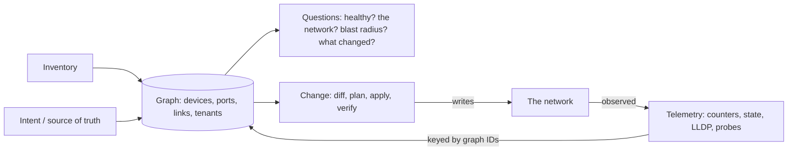
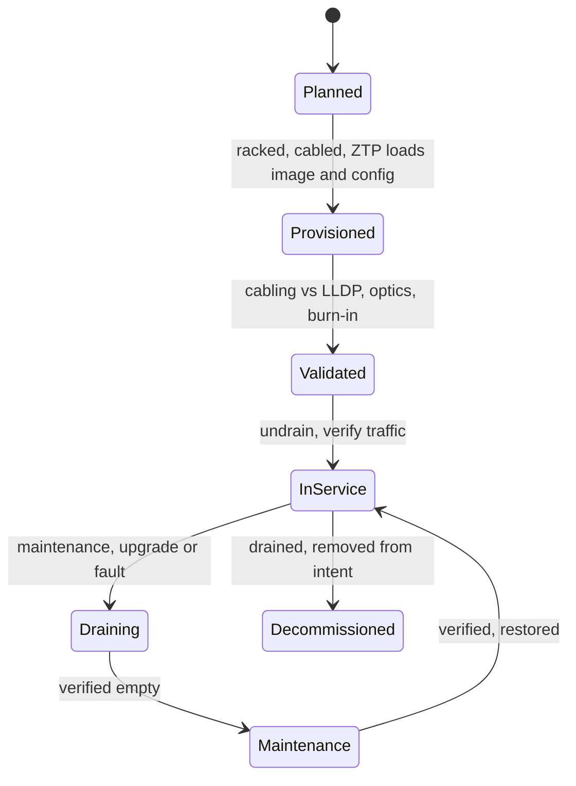

"Design a platform that tells us whether the network is healthy." Most software engineers draw the same picture in five minutes: collectors, a message queue, a time-series database, dashboards. It is not wrong, and it is where the round starts going badly, because the network engineer on the panel asks three questions it cannot answer. What happens when the site your collector sits in loses its path to the aggregator? Which of four spines is dropping 4% of one leaf's traffic while every interface reports up? Is Acme down when one route reflector dies?

Those questions test whether your boxes know they are watching a network. The thing under observation carries your observations, so it can blind you exactly when it breaks. "Protocol up" is not "traffic flows". Most outages start with a change. A design round at a network organisation, or at an AI infrastructure company with a large fabric, is graded on those three facts more than on your choice of database.

This lesson gives you a skeleton that puts them in every answer, then works the three designs these rounds usually ask for on Meridian: a visibility platform, a config-as-code pipeline, and fleet lifecycle with remediation. The general method is in [the design interview method](/learn/system-design/building-blocks/the-design-interview-method) and time-series storage internals in [the metrics and logging platform](/learn/system-design/case-studies/metrics-and-logging-platform); this lesson covers what changes when the system runs a network.

A reminder of the Meridian pieces it leans on. Servers attach to **leaves**, and every leaf connects to every **spine**, so any two leaves are two hops apart ([Clos and leaf-spine](/learn/fabric-networking/fabric-architecture/clos-and-leaf-spine)). **IS-IS** is the underlay routing protocol that gives every switch a path to every other switch's loopback address ([IS-IS from zero](/learn/fabric-networking/underlay/is-is-from-zero)). **EVPN** over iBGP carries each tenant's MAC and IP routes between leaves, relayed by the **route reflector** pair `rr1.ams` and `rr2.ams` so that leaves do not have to peer with each other ([route reflectors](/learn/fabric-networking/bgp-fundamentals/route-reflectors)).

## The network design skeleton

Every network-software design has five parts. Name them early, then go deep where the prompt points.

| Part | Question it answers | Typical store | The network fact that shapes it |
|---|---|---|---|
| Inventory | What physically exists? | Relational database (NetBox is a common open-source choice) | Devices, optics and circuits are replaced, so identity is a serial number plus a role, never a hostname alone |
| Intent | What should the network be doing? | The source of truth: data in a database or Git | The network has no "desired state" of its own; only you can say what correct means |
| Telemetry | What is it doing now? | Time series, events, flow records | Collection rides the network it measures, and device CPUs are small |
| Change | How does reality move toward intent, safely? | Change records, a workflow engine | Roughly 70% of outages follow a change (Google's SRE book), and a bad change hits every redundant copy at once |
| Failure modes | How do the network and this system break? | (A section of the answer, not a store) | Redundancy turns failures into degradation, and gray failures hide inside it |

**Inventory** is the physical layer of truth: chassis, line cards, optics with their serial numbers, cables with both ends, leased circuits with the provider's circuit ID, software versions, support contracts. **Intent** is the logical layer: `leaf1.ams` is a leaf with loopback `10.255.1.11`, peers with `rr1.ams` and `rr2.ams` in AS 65000 (Meridian's overlay BGP autonomous system), and carries Acme's VNI 10100 on port `swp1`. (A VNI, VXLAN network identifier, names one tenant segment in the overlay.) Many organisations keep both in one source of truth (SoT); keep them distinct in your head, because they change for different reasons. An optic swap is an inventory change with no intent change, and a new tenant is the reverse.

**Telemetry** is everything observed: counters, protocol state, logs, flow samples, probe results, and LLDP neighbours (with the Link Layer Discovery Protocol, each port announces its device and port name to whatever is at the other end of the cable). **Change** is every write to the network, from a template push to an engineer's emergency command. **Failure modes** is the part software engineers skip and network engineers listen for: how each component of your system fails, and how the network fails in ways your system must notice.

The idea that ties the parts together is the **join between intended and observed**. Every useful question is a comparison. Drift compares intended configuration with running configuration. Miscabling compares intended links with LLDP. A gray failure, a link that stays up while it drops a share of traffic ([ECMP and hashing](/learn/fabric-networking/fabric-architecture/ecmp-and-hashing)), is an expected loss of zero against the 4% a probe measured. A blast radius is the intended topology with an observed failure removed. A design whose stores cannot be joined on the same device, interface and link identifiers answers only "what is red", never "who is affected" or "is this wrong".



**What the skeleton solves:** an answer that covers what panels grade, in an order that leads to the join. **How it breaks:** spending twenty minutes on the queue and the database and never reaching change or failure modes. **Signal:** at minute 30 the panel is still asking "and how would you know?". A workable 45-minute budget: 5 on requirements, 5 on scale, 10 on the data model, 10 on collection or the pipeline, 10 on failure modes and push-back, and 5 to summarise and name what you would build first.

## Scale numbers to say out loud

Panels want numbers with their assumptions. The dominant volume is interface counters: devices × ports × counters per port ÷ sample interval. Twelve counters per port is a typical working set: octets, packets, errors and discards in each direction, plus queue drops, FCS errors (frame check sequence failures, corruption on the wire), and the optic's transmit and receive power. Modern switches stream them over **gNMI**, the gRPC Network Management Interface, a streaming API over HTTP/2 with two subscription modes that matter here: SAMPLE sends a value every interval, ON_CHANGE sends it only when it changes. The method is in [back-of-envelope estimation](/learn/system-design/building-blocks/back-of-envelope-estimation).

```python
def telemetry_load(devices, ports, counters, interval_s, bytes_per_sample=1.37):
    """Back-of-envelope size of the counter stream (no flows, no logs)."""
    series = devices * ports * counters
    per_second = series / interval_s
    per_day_gb = per_second * 86_400 * bytes_per_sample / 1e9
    return series, per_second, per_day_gb


fleets = {
    # name: (devices, average ports per device, counters per port, sample interval in s)
    "Meridian, 3 sites + sjc AI fabric": (120, 64, 12, 10),
    "large operator": (10_000, 96, 12, 10),
}
for name, (devices, ports, counters, interval) in fleets.items():
    series, rate, gb = telemetry_load(devices, ports, counters, interval)
    print(f"{name:<34} {series:>12,} series {rate:>11,.0f} samples/s {gb:>8,.1f} GB/day "
          f"{gb * 396 / 1000:>7,.1f} TB for 13 months raw")

# Why per-flow data never goes in the metrics store: sFlow on one busy 400G port.
link_bps, utilisation, avg_packet_bytes, sampling = 400e9, 0.5, 1_000, 10_000
pps = link_bps * utilisation / (avg_packet_bytes * 8)
print(f"one 400G port at 50%: {pps / 1e6:.0f} Mpps, {pps / sampling:,.0f} flow samples/s at 1:{sampling:,}")
```

```text
Meridian, 3 sites + sjc AI fabric        92,160 series       9,216 samples/s      1.1 GB/day     0.4 TB for 13 months raw
large operator                       11,520,000 series   1,152,000 samples/s    136.4 GB/day    54.0 TB for 13 months raw
one 400G port at 50%: 25 Mpps, 2,500 flow samples/s at 1:10,000
```

Meridian's 120 devices are 24 per site at three sites (4 spines, 16 leaves, 2 reflectors, 2 gateways) plus about 48 switches in the San Jose GPU fabric. The GPU fabric count assumes 64-port 400G switches at one-to-one: 1,024 GPU ports need 32 leaves and 16 spines. The 1.37 bytes per sample comes from Facebook's Gorilla paper (VLDB 2015), which compressed timestamps and values with delta-of-delta and XOR encoding. Prometheus-family stores land in the same range. Three conclusions follow, and you should say them:

- **Meridian fits on one machine.** Nine thousand samples a second is small for one Prometheus-compatible server. Do not design for a million on day one; design so that you can shard later.
- **A large operator does not.** About 11.5 million active series and a million samples a second means a sharded store (Mimir, VictoriaMetrics, Thanos-style designs). At a few kilobytes of memory per active series, the in-memory head alone is tens of gigabytes, and 13 months of raw data is about 54 TB. Downsampling to 5-minute resolution after 30 days keeps one point in 30 (the byte saving is smaller when each window stores min, max and mean), and capacity planning still works on it.
- **Flows go elsewhere.** sFlow has the switch copy the headers of one packet in N to a collector. A single busy 400G port produces 2,500 samples a second at 1-in-10,000 (operators choose the rate from link speed and collector capacity), and each distinct 5-tuple would be a new series if it became a metric label. Flow records belong in a columnar store (ClickHouse-style) queried by time range, never as labels.

Other numbers worth having ready:

| Quantity | Typical value | What it implies |
|---|---|---|
| Counter sample interval (gNMI SAMPLE) | 10–30 s; 1 s on some platforms | A counter-based alert cannot fire faster than 2–3 intervals |
| On-change state (oper-status, BGP state) | Pushed within about a second | State alerts are fast; counter alerts are not |
| LLDP | Sent every 30 s, entry held 120 s (IEEE 802.1AB defaults) | A new cable shows within one interval; a neighbour that goes silent without the link dropping lingers for up to 2 minutes |
| BFD (Bidirectional Forwarding Detection) failure detection | Three missed hellos: 150 ms at 50 ms intervals, 900 ms at Meridian's 300 ms | The network reroutes before your telemetry samples anything |
| Configuration per device | Several hundred to a few thousand lines | A full-fleet re-render is minutes of CPU, so parallelise and cache |
| Probe mesh | n agents give n(n−1) pairs | 16 leaf agents make 240 pairs, × 16 streams = 3,840 streams per site; a flat mesh of 1,000 agents is about a million pairs |

The last row is why probing is hierarchical. Microsoft's Pingmesh (SIGCOMM 2015) ran a full mesh among servers under each top-of-rack switch, a mesh between racks inside a data center, and a sparser one between data centers. On Meridian, the 16 Amsterdam leaf agents probe each other at 16 streams of 10 packets a second: 38,400 packets a second, trivial for the fabric. Between sites, a handful of agents per site probes the far site's agents.

## Design 1: a fabric visibility platform

### Requirements: the four questions

Ask, then state. The platform answers four questions for any device, link, tenant or path:

1. **Is it healthy?** Current state against intent and against baseline.
2. **Is it the network?** For "A cannot reach B" or "A to B is slow", the per-hop path with probe results, in seconds.
3. **What is the blast radius?** If this device or link fails or is drained, who is degraded and who is down.
4. **What changed?** Every configuration push, maintenance, provider notice and alarm on a timeline, joined to the same graph.

Non-functionally: state fresh within a minute, alerts within seconds of on-change state, 13 months of history for capacity planning, no measurable load on devices, and an API first, because network engineers automate against it and bypass a UI-only tool.

### Data model: a graph, time series and events

Three stores, joined by the same identifiers:

- **Graph.** Nodes are devices, interfaces, links, circuits, sites, tenants and services. Edges are `connected-to`, `member-of` and `carries` (a link carries a circuit, a leaf carries a tenant's segment). Every edge exists in two layers, *intended* from the SoT and *observed* from LLDP, IS-IS adjacencies and BGP sessions, with a reconciliation status on each. This is the intended-versus-running diff of [network automation](/learn/fabric-networking/operating-fabrics/network-automation-and-source-of-truth), applied to topology. Start in Postgres with versioned tables; a dedicated graph database is a later choice ([graph and time-series databases](/learn/databases/nosql-and-specialised/graph-time-series-and-vector-databases)).
- **Time series.** Every metric carries graph IDs as labels (device, interface, link, site pair) and nothing unbounded.
- **Events.** Configuration pushes, maintenance windows, provider notices, alarms and probe failures, each with a time and the graph nodes it touches.

The graph is the product. Without it, the platform can show that an interface is red but not that it is half of Amsterdam's capacity to Singapore, or that Acme's database replication crosses it.

### Pipeline, and where the collectors live

The flow is device to collector to durable stream to enrichment to stores:

1. **Collectors per site**, stateless, holding gNMI subscriptions: ON_CHANGE for state, SAMPLE for counters ([telemetry and observability](/learn/fabric-networking/operating-fabrics/telemetry-and-observability)). Add SNMP polling (the Simple Network Management Protocol, the older request-response interface) as a fallback for platforms that cannot stream. Each platform gets its own collector plugin, normalised into one schema at ingest and held to a conformance test.
2. **A durable stream** (Kafka or similar, see [Kafka internals](/learn/big-data/streaming/kafka-internals)) between collection and storage, so a slow store applies back-pressure instead of losing data, and a new consumer can replay.
3. **Enrichment** attaches graph IDs: `leaf2.ams` port `swp51` becomes the link to `spine1.ams`, in site `ams`, carrying three tenants.
4. **Fan-out** to the metrics store, the graph and the event store; a reconciler continuously diffs intended against observed and emits drift events.

Where the collectors live is the networking question inside this design. The out-of-band (OOB) management network, the separate network that reaches each device's management port ([planes, ASICs and NOSes](/learn/fabric-networking/from-zero/planes-asics-and-network-operating-systems)), is usually 1G copper sized for logins and boot images, so telemetry volume rides the data network instead, and a congested or broken fabric can silence its own telemetry. The rule: **bulk data in band, heartbeats and the alert path out of band**, and an absence-of-data alert as a first-class signal.

```viz
{"type": "fabric", "scenario": "telemetry-blind", "title": "Telemetry from leaf2.ams goes quiet: an absence alert, then the out-of-band heartbeat and the spines' counters say congested, not dead", "caption": "The collector 10.250.1.10 streams leaf2.ams's counters over the data network. A Globex batch job saturates leaf2's uplinks and the best-effort telemetry is tail-dropped. Three missed samples raise an absence-of-data alert, and the gNMI keepalive cannot tell dead from congested. The OOB ping answers in 0.6 ms, and the spines report links and IS-IS up with 399 Gb/s arriving from leaf2: the verdict is 'telemetry blind'. The four-minute gap is stored as a gap, never zeros, and telemetry moves to CS2 in its own queue."}
```

Notice what decided the verdict: two sources that do not share the failed path, the OOB heartbeat and the neighbours' own telemetry. Design every health signal so that some second source can confirm it over a different path.

### Is it the network? Paths and probes

Counters describe devices; users experience paths. The `path(src, dst)` API resolves both endpoints to leaves through the graph and returns every hop with its counters and the results of active probes between those leaves. Ping is not enough, because ECMP (equal-cost multipath: the leaf hashes each flow's 5-tuple to pick one of its spines) puts every ping between two addresses on one path. Probes must vary the 5-tuple to cover every path ([active measurement](/learn/fabric-networking/operating-fabrics/active-measurement)). The example uses TWAMP Light, the test half of the Two-Way Active Measurement Protocol (RFC 5357): a sender emits timestamped UDP packets and a reflector returns them, giving loss per direction and round-trip time.

```viz
{"type": "fabric", "scenario": "probe-localisation", "title": "Sixteen TWAMP Light streams find the link ping missed: spine3.ams to leaf3.ams losing 3.9%", "caption": "Ping from leaf1.ams to leaf3.ams shows 0% loss through one spine. Sixteen streams differing only in source port spread 4, 5, 3 and 4 over the spines, and TTL-2 probes map each stream to its spine. After five minutes the three via spine3 lose about 4% while the average over all sixteen is 0.7%. Probes from leaf2.ams's agent narrow it to the spine3 to leaf3 link; FCS counters and one weak optic lane at -8.6 dBm confirm it, and costing the link out rehashes the streams over three spines with zero loss."}
```

Two design points follow. Results must be grouped by the path each probe took, so the prober records its path mapping in the graph. And the average over all sixteen streams (0.7%) hid a path losing 4%: alert on the worst path between a pair, never on the mean.

### Blast radius and correlation

Blast radius is a traversal of the graph from the failed element along `carries` edges that stops at redundancy. A leaf with 3 of 4 spines left is degraded, not down; a tenant with a working second path is degraded, not down. Any traversal works ([breadth-first search](/learn/data-structures/graphs/breadth-first-search) is the usual one); the code walks dependencies recursively with memoisation, which makes the redundancy rule explicit. It models only `leaf1.ams`'s overlay routes and three Acme hosts, to keep the output readable.

```python
from functools import lru_cache

# What each element needs, as groups: ("all", [...]) needs every member; ("any", [...])
# survives while one member is up. Built from the graph's "carries" edges: intended
# topology from the source of truth, reconciled with what LLDP and IS-IS observe.
SPINES = [f"spine{n}.ams" for n in range(1, 5)]
DEPENDS = {
    **{f"leaf{n}.ams": [("any", SPINES)] for n in range(1, 17)},
    "leaf1.ams overlay routes": [("any", ["rr1.ams", "rr2.ams"])],
    "circuit ams-sin-1": [("all", ["spine1.ams", "spine1.sin"])],
    "circuit ams-sin-2": [("all", ["spine2.ams", "spine2.sin"])],
    "ams-sin interconnect": [("any", ["circuit ams-sin-1", "circuit ams-sin-2"])],
    "acme-web1": [("all", ["leaf1.ams", "leaf1.ams overlay routes"])],
    "acme-db1": [("all", ["leaf3.ams"])],
    "acme-web2": [("all", ["leaf2.sin"])],
    "Acme web tier": [("any", ["acme-web1", "acme-web2"])],
    "Acme ams-sin replication": [("all", ["acme-db1", "ams-sin interconnect"])],
}
RANK = {"up": 0, "degraded": 1, "down": 2}


def evaluate(failed):
    @lru_cache(maxsize=None)
    def of(node):
        if node in failed:
            return "down", "failed"
        worst, why = "up", ""
        for mode, members in DEPENDS.get(node, []):
            states = {m: of(m)[0] for m in members}
            down = [m for m, s in states.items() if s == "down"]
            weak = [m for m, s in states.items() if s == "degraded"]
            if mode == "all" and down:
                s, w = "down", f"needs {down[0]}"
            elif mode == "all" and weak:
                s, w = "degraded", f"via {weak[0]}"       # inherits reduced redundancy
            elif mode == "any" and len(down) == len(members):
                s, w = "down", f"all {len(members)} lost"
            elif mode == "any" and down:
                s, w = "degraded", f"{len(members) - len(down)} of {len(members)} left"
            else:
                continue                                  # spare capacity absorbed it
            if RANK[s] > RANK[worst]:
                worst, why = s, w
        return worst, why
    return of


def blast_radius(failed):
    of = evaluate(frozenset(failed))
    hit = {n: of(n) for n in DEPENDS if of(n)[0] != "up"}
    leaves = [n for n in hit if n.startswith("leaf") and n.endswith(".ams")]
    print(f"fail {' + '.join(failed)}:")
    if leaves:                       # 16 identical leaf lines collapse into one
        print(f"  {len(leaves):>2} leaves {'':<16} {hit[leaves[0]][0]:<8} {hit[leaves[0]][1]}")
    for node, (s, why) in hit.items():
        if node not in leaves:
            print(f"  {node:<26} {s:<8} {why}")


blast_radius(["spine1.ams"])
blast_radius(["rr1.ams"])
blast_radius(["rr1.ams", "rr2.ams"])
blast_radius(["spine1.ams", "spine2.sin"])
```

```text
fail spine1.ams:
  16 leaves                  degraded 3 of 4 left
  circuit ams-sin-1          down     needs spine1.ams
  ams-sin interconnect       degraded 1 of 2 left
  acme-web1                  degraded via leaf1.ams
  acme-db1                   degraded via leaf3.ams
  Acme ams-sin replication   degraded via acme-db1
fail rr1.ams:
  leaf1.ams overlay routes   degraded 1 of 2 left
  acme-web1                  degraded via leaf1.ams overlay routes
fail rr1.ams + rr2.ams:
  leaf1.ams overlay routes   down     all 2 lost
  acme-web1                  down     needs leaf1.ams overlay routes
  Acme web tier              degraded 1 of 2 left
fail spine1.ams + spine2.sin:
  16 leaves                  degraded 3 of 4 left
  circuit ams-sin-1          down     needs spine1.ams
  circuit ams-sin-2          down     needs spine2.sin
  ams-sin interconnect       down     all 2 lost
  acme-web1                  degraded via leaf1.ams
  acme-db1                   degraded via leaf3.ams
  Acme ams-sin replication   down     needs ams-sin interconnect
```

Trace the first case by hand. `spine1.ams` fails. Every leaf's `any` group over four spines has one member down, so each leaf is degraded at 3 of 4. Circuit 1 terminates on `spine1.ams`, an `all` dependency, so it is down. The interconnect keeps circuit 2, half its capacity: degraded, the one-circuit case of [connecting sites and backbones](/learn/fabric-networking/fabric-architecture/connecting-sites-and-backbones). Acme's web tier stays up, because both web hosts are alive and spare capacity absorbed the loss. The `continue` branch in the code encodes that. The fourth case shows why the graph needs the far site: `spine1.ams` and `spine2.sin` look unrelated on any per-site dashboard, and together they kill both circuits.

The rest of correlation follows from the same graph. A link failure produces alarms from both ends, an IS-IS adjacency change, BGP churn and probe loss. Symptoms that share a cause node collapse into one incident titled by the cause ("link spine3.ams–leaf3.ams"): one page instead of forty.

### Two views of the same data

An on-call engineer wants the ticket done fast: this link, these counters, this optic's receive power. A manager wants the estate: which tenants are red, yellow or green, and whether to step in. Build one data model with two aggregations: the cause and its evidence, and the blast radius rolled up to tenants and sites. Service owners often want no device names at all, only "Acme ams–sin: degraded, redundancy lost, no customer impact".

Error budgets put numbers on the manager's view. With probe-measured availability per site pair as the SLI (service level indicator) and 99.95% per 30 days as the SLO (objective), the budget is 0.0005 × 43,200 minutes = 21.6 minutes. Alert on burn rate, not single samples. The Google SRE Workbook's recommended policy pages when the last hour burned budget 14.4 times faster than sustainable (2% of the month's budget, confirmed over a 5-minute window) or the last 6 hours burned it 6 times faster (5%), and opens a ticket for a 1× burn over 3 days (10%). A site pair that has spent its budget gets no non-urgent maintenance.

**What the visibility platform solves:** "is it the network, and who is affected?" in seconds instead of an hour of logins. **How it breaks:** it goes blind with the fabric it rides, or its stale graph names the wrong tenants. **Signal:** absence-of-data alerts and the graph age shown on every answer.

## Design 2: a config-as-code pipeline

The prompt: "Design how configuration gets from intent to ten thousand devices." The requirement under the words is that a wrong change must reach few devices, be visible before it lands, and be undoable. The pipeline's stages:

1. **Intent as data, changed by pull request.** The SoT holds data (the VLAN 300 record), never configuration text. A change is a reviewed diff of data.
2. **Render.** Templates turn each device's data into its configuration, as a pure function, so a render can be unit-tested with golden files per role.
3. **Validate before any device sees it.** Schema checks; policy checks the network team writes once ("route distinguishers unique per device and VNI", "route targets unique per tenant", "router IDs unique", "MTU 9,216 on every fabric link", the jumbo maximum transmission unit that leaves room for VXLAN's 50 bytes of headers); and for larger changes a network model in the style of Batfish, which computes routes from the rendered configurations and answers "can Acme still reach its gateway?" offline. The duplicated-route-target incident, where a copied VRF configuration leaked one tenant's routes into another's, is stopped here or nowhere, because every session stays Established while it happens ([VRFs and multi-tenancy](/learn/fabric-networking/overlays-vxlan-evpn/vrfs-and-multi-tenancy)).
4. **Fleet diff in review.** Every device whose rendered output changes, with its diff against the running configuration. A template edit that touches 9,000 devices should look different in review from one that touches 3.
5. **Staged rollout by failure domain.** Canaries first, then waves, with a soak and automatic checks between them (below).
6. **Apply as a transaction.** Candidate datastore, commit, and where the platform supports it a confirmed commit that rolls back on its own unless the tool confirms within a timer ([configuration APIs](/learn/fabric-networking/operating-fabrics/configuration-apis)).
7. **Verify.** The post-push diff must be empty, and operational state must match intent: sessions up, the expected prefixes received, probes clean.
8. **Record.** Who, what, when and the applied diff go to the event store, which answers the visibility platform's "what changed?".

Push semantics are where pipelines fail silently. A merge push sets what the payload names and never removes what it omits, so deleted intent stays on the device:

```viz
{"type": "fabric", "scenario": "intent-drift", "title": "leaf1.ams's intent loop: drift found and reverted, a deletion that merge leaves behind and replace removes", "caption": "Source-of-truth data rendered to eight lines, and an empty diff. A manual IS-IS metric of 1000 on swp52 is found as drift and approved for revert. Acme's staging VLAN 300 / VNI 10102 is deleted from the source of truth. A merge push restores the metric but leaves VLAN 300 and swp5 configured; a replace of the same lines removes them, and the next run's diff is empty."}
```

**Waves, worked.** Batch by failure domain, not by count. On Meridian, never put two spines of one site in the same wave (two of four halves the fabric), never both reflectors of a pair, never both gateways. A large operator with 10,000 devices might run 1 canary per role, then 1%, 10% and the rest, with a 30-minute soak after each: four waves and at least two hours before the rollout is declared done, longer when waves must wait for maintenance windows. Each soak ends with automatic checks: post-push diff empty, sessions and adjacencies at their pre-change counts, probe loss and latency within baseline, no new drop counters. Any failure halts the rollout and offers rollback of the wave.

Two guard rails catch what nobody writes tests for. A **circuit breaker on diff size** refuses any push that deletes more than a threshold (for example 10% of a device's owned lines, or any BGP neighbour without a linked change) until a person approves. That is how an empty SoT read, rendered faithfully and pushed as replace, becomes a refused push instead of an outage. **One writer per device at a time**: a lock per device, so a scheduled drift fix and an engineer's change cannot interleave.

There is also a **break-glass path**. At 3 a.m. an engineer will type a command directly on a device, and the pipeline must not make that impossible. Make it visible instead: the next diff shows the change as drift with its author, and the engineer either adopts it into the SoT or lets the pipeline revert it.

**What the pipeline solves:** every change reviewed, rendered identically, rolled out by failure domain and undoable. **How it breaks:** merge leaving deletions behind, a faithful render of bad data, an emergency edit never written back. **Signal:** a non-empty post-push diff, a growing drift count, a change deleting far more than its kind usually does.

## Design 3: fleet lifecycle and remediation

Every device moves through the same states, and each transition is gated by checks the software can run.



**Bring-up.** Zero-touch provisioning (ZTP): a new switch boots, asks DHCP (the protocol that hands a booting machine its address) for an address on its management port, and receives an option pointing at a provisioning script that installs the image and rendered configuration for its serial number's planned role. Validation follows, the most automatable step in the lifecycle: compare every planned link with what LLDP reports from both ends ([optics, cabling and the physical layer](/learn/fabric-networking/fabric-architecture/optics-cabling-and-the-physical-layer)), check every optic's receive power against its thresholds, and require zero FCS errors after a burn-in under traffic. Miscabling at bring-up is common. A cable in the wrong spine port still shows link up, and with unnumbered interfaces it can form an adjacency and carry traffic on a path nobody planned, so only the comparison with the plan catches it. The exercise below implements that comparison.

**Upgrades.** Software upgrades are the recurring fleet operation, and they are drains at scale. For a spine, the procedure is pre-check headroom, cost out, verify empty, work, verify, restore, verify ([safe change and maintenance](/learn/fabric-networking/operating-fabrics/safe-change-and-maintenance)):

```viz
{"type": "fabric", "scenario": "spine-drain", "title": "Upgrading spine2.ams without dropping a packet: pre-check, drain, verify, reboot, verify, restore", "caption": "The 80% headroom check refuses at 14:00 (leaf3 uplinks would reach 360 Gb/s, all Singapore traffic 90 Gb/s on one 100G circuit) and passes at 02:00 (220 Gb/s and 70 Gb/s). spine2 raises its IS-IS metrics to 16,777,214 and the leaves drop it from ECMP. It is verified empty, rebooted while change-aware monitoring expects the adjacency drops, and returns still costed out. It is checked, restored to its normal metrics and compared with the pre-check snapshot."}
```

The fleet version adds scheduling. If a spine takes about 45 minutes end to end, Amsterdam's four take three hours in series. Sites can upgrade in parallel only where the pair check allows it: `spine1.ams` and `spine2.sin` out together cut both Amsterdam–Singapore circuits, the fourth blast-radius case above, so the scheduler runs blast radius on every set of devices it plans to have out at once. Leaves are harder. A leaf whose servers attach to it alone cannot be drained without disconnecting them, so its upgrade is an outage for those servers and needs the tenant's maintenance window; servers dual-attached with EVPN multihoming can be drained one leaf at a time ([EVPN multihoming](/learn/fabric-networking/overlays-vxlan-evpn/evpn-multihoming)). The schedule therefore comes from the graph: which leaves have single-attached servers, whose, and when they agreed to downtime. Provider maintenance belongs in the same calendar: map the carrier's circuit ID to its graph edge, mark the edge planned-down for the window, and run the blast radius in advance ("circuit ams-sin-2 down Tuesday 01:00–05:00, interconnect at half capacity, 70 Gb/s at that hour fits on 100G").

**Remediation.** Some failures have a known fix: a gray-failing optic (link up, FCS errors rising, the 3.9% of the probe example) is fixed by costing out the link and replacing the optic. Automating the first step pays, because a person takes minutes to an hour to respond while the link eats traffic. Automating it unguarded is how a monitoring bug drains half a fabric. The guard rails, in code:

```python
LIMIT = 0.80          # no link above 80% after a drain (Meridian's policy)
MAX_AUTO_DRAINED = 2  # links per site the automation may hold drained at once


def decide(event, leaf, drained_now):
    """Auto-drain a gray-failing link, or say why a person must decide."""
    # 1. Evidence: receive errors for 3 samples in a row, and the sender's counters agree.
    if event["fcs_error_samples"] < 3 or not event["peer_tx_confirms"]:
        return "watch", "evidence not yet persistent at both ends"
    # 2. Budget: automation fixes one thing at a time; a wave of failures needs a person.
    if len(drained_now) >= MAX_AUTO_DRAINED:
        return "page", f"{len(drained_now)} links in this site already auto-drained"
    # 3. Redundancy: never take a leaf below two uplinks.
    healthy = {l: gbps for l, gbps in leaf["uplinks"].items() if l not in drained_now}
    if len(healthy) - 1 < 2:
        return "page", f"draining would leave {len(healthy) - 1} uplink"
    # 4. Headroom: ECMP spreads the drained member's share evenly over the rest.
    after = sum(healthy.values()) / (len(healthy) - 1)
    if after > LIMIT * leaf["speed"]:
        return "page", (f"draining puts {len(healthy) - 1} links at {after:.0f} Gb/s "
                        f"({after / leaf['speed']:.0%}): loss on one link or congestion on three")
    return "drain", f"cost out {event['link']}: {len(healthy) - 1} links at {after:.0f} Gb/s; ticket the optic"


event = {"link": "spine3.ams-leaf3.ams", "fcs_error_samples": 5, "peer_tx_confirms": True}
links = [f"spine{n}.ams-leaf3.ams" for n in range(1, 5)]
night = {"speed": 400, "uplinks": dict.fromkeys(links, 165)}   # Gb/s per uplink at 02:00
day = {"speed": 400, "uplinks": dict.fromkeys(links, 270)}     # and at 14:00
print("02:00 ", *decide(event, night, drained_now=set()))
print("14:00 ", *decide(event, day, drained_now=set()))
print("storm ", *decide(event, night, drained_now={"spine1.ams-leaf7.ams", "spine4.ams-leaf9.ams"}))
print("early ", *decide({**event, "fcs_error_samples": 1}, night, drained_now=set()))
```

```text
02:00  drain cost out spine3.ams-leaf3.ams: 3 links at 220 Gb/s; ticket the optic
14:00  page draining puts 3 links at 360 Gb/s (90%): loss on one link or congestion on three
storm  page 2 links in this site already auto-drained
early  watch evidence not yet persistent at both ends
```

The 14:00 line is the important one. Draining moves each remaining link from 270 to 360 Gb/s, so the choice is 4% loss on a quarter of leaf3's incoming traffic or three links at 90%, a judgement about these tenants at this hour. The automation's job is to present that trade-off with numbers and stop. The budget check guards against the worst case: when several links "fail" at once, the likeliest cause is the monitoring, a bad optic batch or a shared fault, and an automated response multiplies whichever it is.

**Decommissioning** is a deletion, and deletions are the hard part of intent ([network automation](/learn/fabric-networking/operating-fabrics/network-automation-and-source-of-truth)). Drain the device first, remove it from intent, confirm the peers' configuration no longer references it, then remove it from inventory. Done in the other order, a removed device's neighbours keep sessions configured to an address someone may reuse.

**What lifecycle automation solves:** bring-up, upgrades and the first response to known faults without a person typing each step. **How it breaks:** a drain without headroom, a schedule that ignores single-attached servers, a remediation that multiplies a monitoring bug. **Signal:** refused headroom checks, an exhausted auto-drain budget, a link drained and restored over and over.

## What network engineers push back on

A network engineer has seen tools cause outages, and the push-back is the interview. The answers that hold:

| Push-back | What is behind it | The answer that holds |
|---|---|---|
| "Your collectors will melt my control plane." | Switch CPUs are modest multi-core x86 or ARM parts also running BGP and IS-IS; aggressive polling has caused incidents | On-change for state, 10–30 s samples for counters, a cap on subscriptions per device, never a poll of the full state tree, and device CPU tracked as a metric of the platform's own cost |
| "Half my fleet can't stream." | Mixed vendors and old platforms with SNMP only | One schema at ingest, per-platform plugins with conformance tests; the upgrade cycle doubles as the telemetry-consistency project |
| "Don't let a script drain my network." | Automation amplifies mistakes (the 2021 Facebook backbone outage began with a maintenance command an audit tool failed to block) | Read-only first, then suggested actions, then automatic actions for one failure class with budgets, headroom checks and a stop switch the engineer controls |
| "Your source of truth is wrong." | Brownfield networks predate the SoT, and emergency fixes never get written back | Observed and intended shown side by side, drift as an event a person classifies, a brownfield import that reads the network into the SoT before the SoT writes anything |
| "Your dashboard was green during the outage." | Protocol state up while traffic black-holes: the maintenance done in the wrong order ([operating BGP safely](/learn/fabric-networking/bgp-in-the-real-world/operating-bgp-safely)), or [the BGP black hole](/learn/fabric-networking/bgp-fundamentals/the-bgp-black-hole) | Active probes on every path as the primary health signal; protocol state explains, probes decide |
| "Which clock?" | Device clocks step; a clock jump once wiped an IS-IS domain's topology through a purge storm ([underlay failures](/learn/fabric-networking/underlay/underlay-failures-in-production)) | Collector-side receive timestamps beside device timestamps, an alert on any clock step, and time sync that does not depend on the network it syncs |
| "You can't put that on the management network." | OOB links are 1G and sized for logins | Volume in band, heartbeats and alerting out of band, as above |
| "The host is not my problem." | Switch counters look clean when a RoCE (RDMA over Converged Ethernet) job is slow | In AI fabrics host and network are coupled: join NIC counters (congestion notification packets, retransmits, out-of-sequence) to the path ([when lossless goes wrong](/learn/fabric-networking/ai-fabrics/when-lossless-goes-wrong)) |

When push-back goes past what you know, say so and pivot: "I'd defer to you on what sample interval that platform tolerates; I'd measure device CPU before and after each subscription change and cap per device." From a software engineer that reads as judgement, not weakness, the move [explaining a network](/learn/fabric-networking/the-network-interview/explaining-a-network) practises.

## Failure modes of the platform itself

| Failure | Symptom | Diagnosis | Fix |
|---|---|---|---|
| Collectors blind | A site's dashboards freeze at last values; no alerts | Absence-of-data alert; OOB health of the collector; probe the site from a neighbour | Heartbeats out of band, local buffering and replay, gaps stored as gaps |
| Alert storm | Forty pages for one link failure | Alerts not grouped by cause node | Correlate through the graph; page on the cause, attach symptoms |
| Stale graph | Blast radius names a device decommissioned last month | Reconciliation age on the answer | Every answer carries its graph age; drift events when observed and intended disagree |
| The platform depends on what it watches | During a fabric outage the platform is unreachable too (in 2021, Facebook's internal tools went down with its backbone) | The platform's own dependencies traced through the graph | Run the alert path and a minimal status view outside the fabric, reachable over OOB or another provider |
| Remediation loop | A link drained, restored, drained again every few minutes | Restoration criteria looser than drain criteria | Hysteresis: restore only after a person replaces the part, or after a long clean soak |

## Trade-offs

| Choice | Option A | Option B | A wins when | B wins when |
|---|---|---|---|---|
| Telemetry collection | Streaming (gNMI) | Polling (SNMP) | Freshness matters and the platform supports it: seconds-fresh state, less device CPU per value | The platform cannot stream; polling is slower (minutes) and costs more CPU per value |
| Collector placement | Per site | Central | A WAN failure must not blind a site; samples travel a short path | The fleet is small and operations cost dominates; one place to run and upgrade |
| Push semantics | Scoped replace | Merge plus explicit deletes | The SoT fully models the section: deletions happen by construction | Other teams own parts of the config; deletions must be listed and are easy to miss |
| Remediation | Automatic for one class, guarded | Page a person | The fix is known and safe within budgets: mitigation in seconds | The trade-off needs judgement (headroom, tenants): minutes to an hour, no amplification |
| Topology store | Postgres with versioned tables | Graph database | Queries are shallow (a few hops) and history matters; the team already runs it | Deep multi-hop path queries dominate and the team can operate another store |
| Build or buy | Buy stores, stream, dashboards | Build graph, enrichment, reconciliation, blast radius | The component is undifferentiated and mature products exist | The join between intent and observation is specific to your network and nobody sells it |

## What the platform should measure about itself

How would you know the platform works? Measure and show:

- **Coverage:** share of devices streaming, of links with probes on every ECMP path, of devices in the SoT. A 92% coverage number is a list of blind spots.
- **Freshness:** age of the newest sample per device and the graph's reconciliation age, displayed on every answer.
- **Drift:** devices out of sync with intent, and the age of each exception.
- **Change health:** share of pushes with an empty post-push diff, rollbacks per week, incidents within an hour of a change.
- **Detection:** time from fault to alert, measured by injecting faults (fail a test link and time the alert), and how many incidents customers reported first.
- **Cost to devices:** control-plane CPU and memory attributable to telemetry subscriptions.

## Interviewer follow-ups

**"LLDP and the source of truth disagree about a cable. Which wins?"** Model answer: neither, silently. The graph keeps both and opens a drift event. For a fabric link the fix is usually the cable, because the IP plan and routing intent assume the intended wiring; for an undocumented change it may be the SoT. Common wrong answer: "the source of truth, always", which shows a miscabled spine port as healthy.

**"How would you compute blast radius?"** Model answer: traverse the graph from the failed element along dependency edges and stop at redundancy, so an element with surviving alternatives is degraded, not down. Include the far ends of inter-site circuits, and evaluate pairs of failures for maintenance planning. Common wrong answer: "everything downstream of the device", which marks every tenant down when one of four spines fails.

**"Your automation pushed to 10,000 devices and broke 300. What should have stopped it?"** Model answer: canaries per role, waves by failure domain with automatic checks between them, a diff-size circuit breaker and validation before push. If 300 broke, a wave was too large or its checks did not measure what broke, and fixing that check is the postmortem's first action. Common wrong answer: "better testing of the template", necessary but blind to platform-specific behaviour that only shows on real devices.

**"What would you build first?"** Model answer: the graph, read-only, fed from existing sources; then the path-health API with probes for one important tenant; then blast radius for maintenance planning. Something visible every month, and no write access until the read side has earned trust. Common wrong answer: the full pipeline and every store before anyone can ask a question.

## What mid-level engineers get wrong

- **Designing the pipeline and forgetting the join.** Kafka, Prometheus and Grafana without a graph answer "what is red", never "who is affected".
- **Averaging health.** A 0.7% average over sixteen streams hid a path losing 4%.
- **Treating protocol state as health.** Sessions and adjacencies explain an outage; only probes and traffic prove service.
- **Automating writes before reads.** A remediation without budgets and headroom checks is a new failure mode with access to every device.
- **Ignoring the platform's own dependencies.** A platform inside the fabric it watches goes dark when it is needed most.

## Exercise: validate cabling against LLDP

```exercise
id: validate-cabling
title: Validate a new site's cabling against LLDP
prompt: |
  Bring-up of a new Meridian pod compares the planned cabling with what LLDP reports.

  `planned` is a list of links `[device_a, port_a, device_b, port_b]`.
  `lldp` is a list of observations `[device, local_port, neighbour, neighbour_port]`.
  LLDP usually reports each cable from both ends, sometimes from only one.

  Links are undirected. Normalise names before comparing: lowercase device and
  port names, strip surrounding spaces, and remove a trailing `.meridian.example`
  domain from device names.

  Return a dict with three keys, each a sorted list of links:
  - `missing`: planned links that LLDP does not report.
  - `miswired`: reported links that are not planned and touch at least one port
    used by a planned link (a cable in the wrong place).
  - `extra`: reported links that are not planned and touch no planned port.

  Write each link as `[device_a, port_a, device_b, port_b]` with its two ends in
  ascending order of `(device, port)`, and sort each list of links the same way.
languages: [python, javascript]
entry: validate_cabling
starter:
  python: |
    def validate_cabling(planned, lldp):
        # your code here
        return {"missing": [], "miswired": [], "extra": []}
  javascript: |
    function validate_cabling(planned, lldp) {
      // your code here
      return { missing: [], miswired: [], extra: [] };
    }
tests:
  - args: [[["leaf1.ams","swp51","spine1.ams","swp1"],["leaf1.ams","swp52","spine2.ams","swp1"]], [["leaf1.ams","swp51","spine1.ams","swp1"],["spine1.ams","swp1","leaf1.ams","swp51"],["leaf1.ams","swp52","spine2.ams","swp1"],["spine2.ams","swp1","leaf1.ams","swp52"]]]
    expected: {"missing": [], "miswired": [], "extra": []}
    label: every cable seen from both ends
  - args: [[["leaf1.ams","swp51","spine1.ams","swp1"],["leaf1.ams","swp52","spine2.ams","swp1"]], [["leaf1.ams","swp51","spine1.ams","swp1"],["spine1.ams","swp1","leaf1.ams","swp51"]]]
    expected: {"missing": [["leaf1.ams","swp52","spine2.ams","swp1"]], "miswired": [], "extra": []}
    label: one cable missing
  - args: [[["leaf1.ams","swp51","spine1.ams","swp1"],["leaf1.ams","swp52","spine2.ams","swp1"]], [["leaf1.ams","swp51","spine1.ams","swp1"],["spine1.ams","swp1","leaf1.ams","swp51"],["leaf1.ams","swp52","spine2.ams","swp2"],["spine2.ams","swp2","leaf1.ams","swp52"]]]
    expected: {"missing": [["leaf1.ams","swp52","spine2.ams","swp1"]], "miswired": [["leaf1.ams","swp52","spine2.ams","swp2"]], "extra": []}
    label: cable in the wrong spine port
  - args: [[["leaf1.ams","swp51","spine1.ams","swp1"],["leaf1.ams","swp52","spine2.ams","swp1"]], [["leaf1.ams","swp51","spine1.ams","swp1"],["spine1.ams","swp1","leaf1.ams","swp51"],["leaf1.ams","swp52","spine2.ams","swp1"],["spine2.ams","swp1","leaf1.ams","swp52"],["leaf1.ams","swp60","leaf2.ams","swp60"]]]
    expected: {"missing": [], "miswired": [], "extra": [["leaf1.ams","swp60","leaf2.ams","swp60"]]}
    label: an unplanned cable between unused ports
  - args: [[["leaf1.ams","swp51","spine1.ams","swp1"],["leaf1.ams","swp52","spine2.ams","swp1"]], [["SPINE1.ams.meridian.example","Swp1","leaf1.ams.meridian.example","SWP51"],["leaf1.ams","swp52","spine2.ams","swp1"]]]
    expected: {"missing": [], "miswired": [], "extra": []}
    label: names need normalising
  - args: [[], []]
    expected: {"missing": [], "miswired": [], "extra": []}
    label: empty site
  - args: [[["leaf2.ams","swp51","spine1.ams","swp2"],["leaf2.ams","swp52","spine2.ams","swp2"]], [["leaf2.ams","swp51","spine2.ams","swp2"],["spine2.ams","swp2","leaf2.ams","swp51"],["leaf2.ams","swp52","spine1.ams","swp2"],["spine1.ams","swp2","leaf2.ams","swp52"]]]
    expected: {"missing": [["leaf2.ams","swp51","spine1.ams","swp2"],["leaf2.ams","swp52","spine2.ams","swp2"]], "miswired": [["leaf2.ams","swp51","spine2.ams","swp2"],["leaf2.ams","swp52","spine1.ams","swp2"]], "extra": []}
    hidden: true
  - args: [[["spine1.ams","swp3","leaf3.ams","swp51"],["leaf3.ams","swp1","acme-db1","eth0"]], [["leaf3.ams","swp51","spine1.ams","swp3"],["leaf3.ams","swp1","acme-db1","eth0"],["leaf3.ams","swp2","acme-db1","eth1"]]]
    expected: {"missing": [], "miswired": [], "extra": [["acme-db1","eth1","leaf3.ams","swp2"]]}
    hidden: true
hints:
  - "Turn every link, planned or observed, into the same canonical form: two normalised (device, port) ends in sorted order. Then both LLDP reports of one cable become the same link."
  - "Set differences give missing (planned minus seen) and unexpected (seen minus planned). A set of every port used by a planned link splits unexpected into miswired and extra."
```

## Senior signals

- Open with the five parts and make the join between intended and observed the centre of the design.
- Bulk telemetry in band, heartbeats and the alert path out of band, and absence of data as an alert of its own.
- Blast radius as a graph traversal that stops at redundancy, with degraded and down as different colours.
- Scale numbers with their assumptions: about a million samples a second for a large fleet, one server for Meridian, flows in a separate store.
- Rollout by failure domain with a diff-size breaker, and an empty post-push diff as success rather than "the push returned OK".
- Reads before writes, and every automated write with a budget, a headroom check and a person's stop switch.
- Push-back answered with the mechanism behind it, and "I'd defer on that detail; here is what I'd measure" instead of a bluff.

## Check yourself

```quiz
- q: >-
    Your visibility platform's collectors stream over the data network. A site's dashboards freeze at their last values and no alert fires. What design element was missing?
  options: ["An absence-of-data alert, with heartbeats and the alert path carried out of band", "Polling with SNMP instead of streaming with gNMI from every device", "A larger message queue between the collectors and the time-series store", "A faster sample interval, so that the stale values are refreshed sooner"]
  answer: 0
  explanation: >-
    When the path that carries telemetry fails, there is no bad value to alert on, only silence, so the platform must alert on missing data and confirm over a path that does not share the failure, such as the OOB network or a probe from a neighbouring site. A larger queue only helps when data reaches it. SNMP polling rides the same data network, and a faster interval changes nothing when no samples arrive.
- q: >-
    spine1.ams fails. Each Amsterdam leaf still has three of four spines, and Acme's two web servers are both reachable. How should a blast-radius computation report Acme's web tier?
  options: ["Down until the spine's replacement has passed burn-in", "Up, because spare capacity absorbed the lost spine", "Unknown, because blast radius only applies to devices", "Down, because a spine it depends on has failed"]
  answer: 1
  explanation: >-
    Blast radius stops at redundancy: the leaves are degraded at 3 of 4 paths, but the web tier still has both members up, so it is not affected. Marking everything downstream of a failed device as down produces red dashboards during routine single failures and trains people to ignore them. The engineer view still shows the degraded leaves.
- q: >-
    A config-as-code pipeline renders an empty configuration for a leaf because the source of truth returned a partial record, and pushes it in replace mode. Which guard rail stops this before it becomes an outage?
  options: ["A per-device lock so that only one writer changes the leaf at a time", "A confirmed commit that rolls back if not confirmed within a timer", "A circuit breaker that refuses pushes deleting more than a threshold", "Golden-file tests of each template against a fixed sample record"]
  answer: 2
  explanation: >-
    The push is structurally valid and the tool would confirm its own commit, so only a check on the size of the deletion catches it: refuse any push that deletes more than a set share of owned lines until a person approves. A lock prevents interleaving, not bad content. A confirmed commit protects against losing reachability to the device, and golden files test the template with good data, not a partial read at run time.
- q: >-
    Sixteen probe streams between leaf1.ams and leaf3.ams show 0.7% average loss. Three of them, all through spine3.ams, lose about 4%. What should the platform alert on?
  options: ["Nothing yet, because ping between the same two hosts shows no loss", "The worst path, grouped by the spine each stream crossed", "The 0.7% average, since it is above the fabric's loss threshold", "The total packets lost per minute across all sixteen streams"]
  answer: 1
  explanation: >-
    Users on the bad path see 4% loss and retransmissions, and the average dilutes that by the number of healthy paths. Grouping streams by the path they took localises the fault to spine3 and then, with a second leaf pair, to one link. Ping uses a single 5-tuple and so tests a single path, which is why it showed nothing.
- q: >-
    An auto-remediation rule wants to cost out a gray-failing link from spine3.ams to leaf3.ams at 14:00, when each of leaf3's four uplinks carries 270 Gb/s on 400G links. What should it do?
  options: ["Drain it, since a link losing frames should always be removed", "Do nothing until the link goes operationally down on its own", "Page a person, since three links would run at 360 Gb/s, 90%", "Drain it and restore it automatically once the errors stop"]
  answer: 2
  explanation: >-
    ECMP spreads the drained link's share over the remaining three, 1,080 / 3 = 360 Gb/s each, above an 80% limit, so the choice is between loss on one link and congestion on three, a judgement for a person with the numbers in front of them. Automatic restore when errors stop invites a drain-restore loop, and waiting for the link to go down leaves the gray failure eating traffic indefinitely.
```
